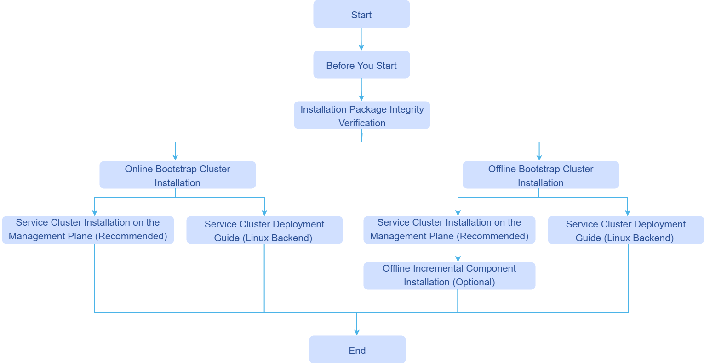

# Read Before Installation

## Basic Concepts

### BKE Tool Introduction

BKE is the installation and deployment tool for openFuyao, responsible for bootstrap node initialization, and the creation of management clusters and business clusters. Throughout the installation process, BKE initializes a machine as a bootstrap node, deploys a lightweight K3s cluster on it, and then completes the installation of Cluster-API, cluster-api-provider-bke, and the openFuyao management plane.

### openFuyao Management Plane Introduction

The openFuyao management plane is a set of services running on the management cluster (or bootstrap cluster), providing users with a visual operation interface and backend services for cluster management and operations. It mainly includes the following components:

| Component | Description |
| :--- | :--- |
| **console-website** | Frontend management interface, providing user interfaces for core functions such as application management, resource management, and alert monitoring, and supporting dynamic mounting of extension components to allow custom extended interfaces. |
| **console-service** | Backend management service, providing cluster management capabilities based on Kubernetes, and providing API support for the frontend interface. |

- The openFuyao management plane is the main entry point for users to interact with the cluster. Users can perform lifecycle management operations such as creating, scaling, and upgrading business clusters through the management plane.
- The openFuyao management plane includes 2 types: bootstrap cluster management plane (corresponding to port 30010), and management/business cluster management plane (corresponding to port 31616).
- The login URL for the bootstrap cluster's openFuyao management plane is `https://<bootstrap-node-IP-address>:30010`.
- The login URL for the management/business cluster's openFuyao management plane is `https://<cluster-node-IP-address>:31616`.
- On first login, the default username is admin and the default password is test@1234. The username and password must be changed after the first login.

### Cluster-API Introduction

Cluster-API is a Kubernetes subproject that automates Kubernetes cluster lifecycle management through declarative APIs and the controller pattern. Its core features are as follows:

- **Infrastructure as Code**: Uses Kubernetes Custom Resources (CRDs) to define cluster configurations, making cluster definitions versionable and reusable.
- **Declarative Management**: Describes the desired state of the cluster through YAML files, without needing to care about underlying operation steps.
- **Controller Pattern**: Controllers automatically monitor the difference between the desired state and the actual state, and continuously reconcile to make them consistent.

>  **Note:** openFuyao implements cluster lifecycle management based on Cluster-API. Cluster-API itself only provides the framework for cluster management. To manage clusters on specific infrastructure, a corresponding **Infrastructure Provider** is needed to implement the specific operations. The Infrastructure Provider provided by openFuyao is cluster-api-provider-bke.

### cluster-api-provider-bke Introduction

cluster-api-provider-bke is the infrastructure Provider provided by openFuyao for Cluster-API. It is a core component of BKE deployment, enabling Cluster-API to manage cluster lifecycles in the openFuyao environment. It includes the following two core components:

| Component | Description |
| :--- | :--- |
| **Infrastructure Provider** | As the infrastructure Provider for Cluster-API, it is responsible for parsing CRD resources such as cluster creation/deletion, and coordinating the execution of corresponding infrastructure operations. |
| **bkeagent** | A binary file running on each node, hosted by systemd, responsible for listening for CRD resource changes from kube-apiserver and performing specific operations on the host machine (such as node initialization, component installation, etc.). |

>  **Note:** The bkeagent binary is stored in the cluster-api-provider-bke image and supports dual architectures (amd64/arm64). Finally, operations such as installation, uninstallation, scaling, and upgrading of business clusters are performed on the openFuyao management plane.

## Deployment Topology

openFuyao uses the BKE tool for installation and deployment: first, initialize a machine as the bootstrap node and install a lightweight K3s bootstrap cluster on it, deploying Cluster-API, cluster-api-provider-bke, and the openFuyao management plane; then, complete the installation, uninstallation, scaling, and upgrading of business clusters on the openFuyao management plane. Machines are divided into three types: bootstrap nodes, management cluster nodes, and business cluster nodes.

| Node | Description | Characteristics |
| :--- | :--- | :--- |
| **Bootstrap Node** | Machine used to initialize and host the bootstrap cluster. After initialization, it deploys local image/Chart repositories and provides the openFuyao management plane login entry; the lightweight K3s (bootstrap cluster) running on it is used to create and manage target management clusters and business clusters, and runs Cluster-API control plane components. | Quickly deployed from scratch, lightweight, **does not support high availability**, not suitable for long-term use as a K8s cluster, and not suitable for deploying large-scale clusters. |
| **Management Cluster Node** | Machine used to install the management cluster by the bootstrap cluster. The management cluster is a complete highly available openFuyao cluster, including cluster management, container platform, and other functions, responsible for business cluster deployment and lifecycle management. | Highly available, suitable for medium-to-long-term operation, used to manage multiple business clusters. |
| **Business Cluster Node** | Machine used to deploy business clusters. Business clusters are created and managed by Cluster-API, carry user workloads, and their lifecycle is controlled by the bootstrap cluster or management cluster. | Highly available, for users to deploy actual business. |

For small-scale scenarios, it is recommended to prepare two machines, serving as the bootstrap node and business cluster node respectively; they can also be co-deployed on the same machine (in which case K3s and Kubernetes will run simultaneously, which may affect each other and is not recommended).

Choose the corresponding deployment path based on cluster scale, as follows:

| Deployment Scale | Applicable Scenario | Deployment Path |
| :--- | :--- |:------------------------------------------------------|
| **Small-scale** (within 10 nodes) | Quick experience, development and testing | Install bootstrap node → Deploy business cluster directly through the bootstrap cluster |
| **Medium-scale** (10~1000 nodes) | Conventional deployment for production environments | Install bootstrap node → Deploy highly available management cluster (3 nodes) through the bootstrap cluster → Use management cluster to deploy one or more business clusters |
| **Large-scale** (over 1000 nodes) | Large-scale production environments | Install bootstrap node → Deploy highly available management cluster (5~10 nodes) through the bootstrap cluster → Use management cluster to deploy one or more business clusters |

## Installation and Deployment Process

This document briefly introduces the openFuyao installation process through a flowchart.

**Figure 1** Installation Process Flowchart

The detailed descriptions of the specific installation steps corresponding to the installation process are shown in the table below.

**Table 1** Installation Process Description

| Process Step | Required | Steps |
| :--- | :--- | :--- |
| **Read Before Installation** | Required | [Read Before Installation](./installation_process.md) 
| **Environment Preparation** | Required: Installation Notes, Environment Pre-check  Optional: Installation Tool Download and Verification | <ul><li>[Installation Notes](../../cluster_installation_guide/environment_preparation/before_you_start.md)</li><li>[Environment Pre-check](../../cluster_installation_guide/environment_preparation/environment_pre_check_tool_guide.md)</li><li>[Installation Tool Download and Verification](../../cluster_installation_guide/environment_preparation/installation_package_integrity_verification.md)</li></ul> |
| **Bootstrap Cluster Custom Configuration** | Optional | <ul><li>[Custom Cluster Certificates](../../cluster_installation_guide/bootstrap_cluster_configuration/using_custom_cluster_certificates.md)</li><li>[Custom Repository Configuration](../../cluster_installation_guide/bootstrap_cluster_configuration/custom_repository_configuration_guide.md)</li></ul> |
| **Install Bootstrap Cluster** | Required | <ul><li>[Online Bootstrap Cluster Installation](../../cluster_installation_guide/bootstrap_cluster_installation/online_bootstrap_cluster_installation.md)</li><li>[Offline Bootstrap Cluster Installation](../../cluster_installation_guide/bootstrap_cluster_installation/offline_bootstrap_cluster_installation.md)</li></ul> |
| **Management/Business Cluster Custom Configuration** | Optional | <ul><li>[Binary Component Custom Configuration (Containerd and Kubelet)](../../cluster_installation_guide/service_management_cluster_configuration/binary_file_custom_configuration_guide.md)</li><li>[Addon Component Custom Configuration](../../cluster_installation_guide/service_management_cluster_configuration/using_add-ons.md)</li><li>[Node Label and Affinity Deployment Configuration](../../cluster_installation_guide/service_management_cluster_configuration/node_label_affinity_deployment_guide.md)</li><li>[Pre/Post Processing Script Custom Configuration](../../cluster_installation_guide/service_management_cluster_configuration/preprocessing_and_postprocessing_guide.md)</li><li>[KubeOS Custom Configuration](../../cluster_installation_guide/service_management_cluster_configuration/kubeos_adaptation_guide.md)</li></ul> |
| **Install Management Cluster** | Required for medium and large scale, not applicable for small scale | [Install Management Cluster](../../cluster_installation_guide/management_cluster_installation/management_cluster_deployment_guide.md) |
| **Install Business Cluster** | Required | <ul><li>[Install Business Cluster via Frontend (Web Page)](../../cluster_installation_guide/service_cluster_installation/service_cluster_installation_on_the_management_plane.md)</li><li>[Install Business Cluster via Backend (Command Line)](../../cluster_installation_guide/service_cluster_installation/service_cluster_deployment_guide_(linux_backend).md)</li></ul> |
| **Application/Component Installation** | Required | <ul><li>[Online Incremental Installation of Extension Components/Applications](../../app_installation_guide/online_incremental_component_installation.md)</li><li>[Offline Incremental Installation of Extension Components/Applications](../../app_installation_guide/offline_incremental_component_installation.md)</li></ul> |
