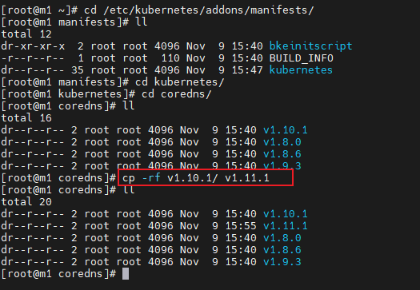
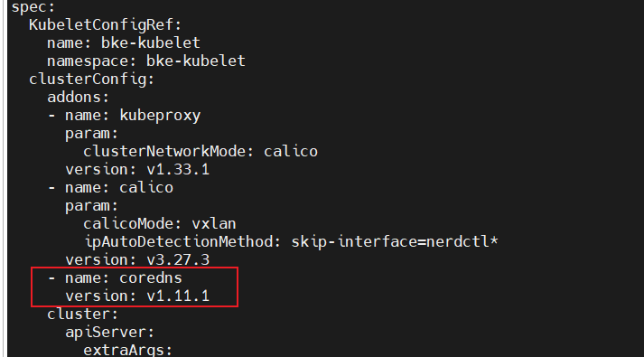

# Installing a Service Cluster via Backend (Command Line)

This document describes how to use BKE and kubectl to set up and verify a service cluster.

## Node Requirements

- Nodes can connect to the external network.
- Nodes can be logged in as the root user.
- The tar tool must be installed on the bootstrap node.
  
>  **Notice:**  
> It is recommended that your node environment be a clean operating system environment without any docker or Kubernetes components installed; otherwise, version conflicts may occur and cause installation failure. To perform a trial installation in an existing environment, you can download the [environment pre-check tool](../environment_preparation/environment_pre_check_tool_guide.md) to perform environment verification.

## Prerequisites

Before installing a service cluster, ensure the following preparations are complete:

- Bootstrap cluster initialization is complete: for online installation, see [Online Bootstrap Cluster Installation](../bootstrap_cluster_installation/online_bootstrap_cluster_installation.md); for offline installation, see [Offline Bootstrap Cluster Installation](../bootstrap_cluster_installation/offline_bootstrap_cluster_installation.md). The bootstrap cluster must be working properly.
- **Medium-to-large scale deployment**: You must first complete [Installing a Management Cluster](../management_cluster_installation/management_cluster_deployment_guide.md), and create the service cluster on the **management cluster**.
- **Small scale deployment**: You can skip deploying a separate management cluster and create the service cluster directly on the **bootstrap cluster**.
- For a description of service cluster configuration parameters, see [cluster-api-provider-bke Configuration Parameters](../appendix/cluster-api-provider-bke_configuration.md).

>  **Note:**<br />
> 1. This document only describes **service cluster** installation. For management cluster installation, see [Installing a Management Cluster](../management_cluster_installation/management_cluster_deployment_guide.md). Do not configure according to management cluster specifications in this procedure.<br />
> 2. **Do not** install the `cluster-api` addon on the service cluster (this addon is only for the management cluster); if the YAML contains a `cluster-api` section, delete or comment it out before creating the service cluster.<br />
> 3. After bootstrap cluster initialization is complete, default YAML files (such as `1master-cluster.yaml`, `1master-node.yaml`, etc.) are generated in the `/bke/cluster` directory. You can modify these files to match the service cluster specifications before use.

## Modify Configuration Files

Edit files such as `1master-cluster.yaml` and `1master-node.yaml` to fill in the correct node information, and ensure the `cluster-api` addon is **not included**.

> **Note:**<br />For custom addon installation, see the [Appendix](./service_cluster_deployment_guide_(linux_backend).md#appendix) section.

**Configure BKENode Resources (1master-node.yaml)**

```yaml
apiVersion: bke.bocloud.com/v1beta1
kind: BKENode
metadata:
  name: master-1
  namespace: bke-cluster
  labels:
    # Associated cluster name
    cluster.x-k8s.io/cluster-name: bke-cluster
spec:
  hostname: m1  # Modify to the node name
  ip: 127.0.0.1  # Modify to the actual node IP
  password: '******'  # Modify to the actual node password
  port: "22"   # Default port number is 22
  role:
  - master/node
  - etcd
  username: root   # Defaults to root privileged user
status: {}
```

**Configure BKECluster Resources (1master-cluster.yaml)**

>  **Note:**<br />`BKECluster` (kubectl short name `bc`) is the core custom resource for creating a cluster. The example below is the default template generated after **online** bootstrap cluster initialization, and its default values are the official recommended configurations of the openFuyao platform. For the meaning, value range, and recommendations of each field, see [Appendix: cluster-api-provider-bke Configuration Parameters](../appendix/cluster-api-provider-bke_configuration.md#bkecluster-crd-configuration). For the differences in repository addresses and addon parameters under **offline installation** and **custom repository** scenarios, see [Value Differences in Offline/Custom Repository Scenarios](#value-differences-in-offlinecustom-repository-scenarios). After creation or update, you can adjust it with `kubectl edit bc -n <namespace> <name>`.

```yaml
apiVersion: bke.bocloud.com/v1beta1
kind: BKECluster
metadata:
  creationTimestamp: null
  name: bke-cluster
  namespace: bke-cluster
spec:
  KubeletConfigRef:  # Custom kubelet configuration
    name: bke-kubelet
    namespace: bke-kubelet
  clusterConfig:
    addons:
    - name: kubeproxy
      param:
        clusterNetworkMode: calico
      version: v1.34.3-of.1
    - block: true
      name: calico
      param:
        calicoMode: vxlan
        ipAutoDetectionMethod: skip-interface=nerdctl*
      version: v3.31.3
    - name: coredns
      param:
        EnableAntiAffinity: "false"   # false for single-node deployment, true for multi-node deployment
      version: v1.12.2-of.1
    # Do not configure cluster-api for the service cluster; the following is a management cluster example (keep commented or do not include)
    # - block: true
    #   name: cluster-api
    #   param:
    #     containerdVersion: v2.1.1
    #     healthPort: "58080"
    #     manage: "true"
    #     manifestsVersion: latest
    #     ntpServer: 192.168.200.115:123
    #     offline: "false"   # "true" in offline scenarios
    #     openFuyaoVersion: latest
    #     providerVersion: latest
    #     replicas: "1"
    #     sandbox: hub.oepkgs.net/openfuyao/pause:3.9   # deploy.bocloud.k8s:40443/kubernetes/pause:3.9 in offline scenarios
    #   version: v1.4.3
    - name: openfuyao-system-controller   # Optional: after installation, brings up the openFuyao management plane for this service cluster
      param:
        helmRepo: https://helm.openfuyao.cn/_core   # http://<bootstrap-node-IP>:38080 in offline scenarios
        tagVersion: latest
      version: latest
    cluster:
      agentHealthPort: "58080"   # Health check port of bkeagent on nodes
      apiServer:
        extraArgs:
          max-mutating-requests-inflight: "3000"
          max-requests-inflight: "1000"
          watch-cache-sizes: node#1000,pod#5000
      certificatesDir: /etc/kubernetes/pki
      chartRepo:    # Chart repository
        domain: cr.openfuyao.cn
        ip: 119.3.216.97   # Automatically filled in by domain resolution
        port: "443"
        prefix: charts
      containerRuntime:
        cri: containerd
        param:
          data-root: /var/lib/containerd
        runtime: runc
      containerdConfigRef:    # Custom containerd configuration
        name: bke-containerd
        namespace: bke-containerd
      containerdVersion: v2.1.1
      controllerManager:
        extraArgs:
          kube-api-burst: "1000"
          kube-api-qps: "1000"
      etcd:
        dataDir: /var/lib/openFuyao/etcd
      etcdVersion: v3.6.7-of.1
      httpRepo:    # HTTP repository (binary/RPM system package source; defaults to the local service on the bootstrap node)
        domain: http.bocloud.k8s
        ip: 192.168.200.115    # Modify to the bootstrap node IP
        port: "40080"
        prefix: ""
      imageRepo:    # Image repository
        domain: default    # Online installation marker; component images use public default repositories. Do not modify
        ip: 192.168.200.115    # Modify to the bootstrap node IP
        port: "40443"
        prefix: ""    # Keep empty for online installation; kubernetes for offline installation
      kubelet:
        extraArgs:
          kube-api-burst: "2000"
          kube-api-qps: "1000"
        extraVolumes:
        - hostPath: /var/lib/kubelet
          name: kubelet-root-dir
      kubernetesVersion: v1.34.3-of.1
      networking:
        dnsDomain: cluster.local
        podSubnet: 10.250.0.0/16
        serviceSubnet: 10.96.0.0/16
      ntpServer: 192.168.200.115:123   # Modify to the actual NTP server; defaults to cn.pool.ntp.org:123
      openFuyaoVersion: latest
      scheduler:
        extraArgs:
          kube-api-qps: "1000"
    customExtra:
      agentLogLevel: INFO   # bkeagent log level; supports TRACE/DEBUG/INFO/WARNING/ERROR/CRITICAL
      chartRepoPort: "38080"   # Local chart repository port on the bootstrap node
      clusterapi: latest
      containerd: containerd-v2.1.1-linux-{.arch}.tar.gz
      domain: deploy.bocloud.k8s
      host: 192.168.200.115     # Modify to the bootstrap node IP
      imageRepoPort: "40443"   # Local image repository port on the bootstrap node
      nfsserverpath: /
      onlineImage: cr.openfuyao.cn/openfuyao/bke-online-installed:latest   # Online installation image; empty in offline/custom repository scenarios
      otherChart: ""   # Private chart repository address; fill in for custom repository scenarios
      otherChartIp: ""
      otherRepo: ""   # Private image repository address; fill in for custom repository scenarios
      otherRepoIp: ""
      otherSource: ""   # Private system package source address; fill in for custom repository scenarios
      yumRepoPort: "40080"   # Local system package source port on the bootstrap node
  controlPlaneEndpoint: {}
  pause: false
status:
  agentStatus: {}
  controlPlaneConfigHash: {}
  ready: false
```

The remaining items are defaults and do not need to be changed. Users must ensure that the edited and submitted YAML file is reliable. The reconciler will perform validation but cannot confirm business-logic correctness (e.g., incorrect IP addresses or passwords—users must verify the filled-in information is correct).

### Value Differences in Offline/Custom Repository Scenarios

The example above shows the template values generated after **online** installation (the bootstrap cluster initialized with `bke init --onlineImage ...`). The templates under `/bke/cluster` are automatically generated by `bke init` with values matching the bootstrap cluster initialization mode, so manual modification is usually **not required**. The following table is for reference when writing or verifying the YAML manually.

**Table 1** Value comparison across online/offline/custom repository scenarios

| Item | Online Installation | Offline Installation | Custom Repository |
| --- | --- | --- | --- |
| `cluster.imageRepo` | `domain: default`, `prefix: ""`: K8s/openFuyao component images fall back to public default repositories (`cr.openfuyao.cn/openfuyao`, `hub.oepkgs.net/openfuyao`) | `domain: deploy.bocloud.k8s`, `ip: <bootstrap-node-IP>`, `port: "40443"`, `prefix: kubernetes`: uses the local image repository on the bootstrap node | Points to the private image repository: `domain: <repository domain or IP>`, `ip: <repository IP>`, `port: <port>`, `prefix: <project/path>` |
| `cluster.httpRepo` | Local HTTP source on the bootstrap node: `ip: <bootstrap-node-IP>`, `port: "40080"` (binaries/RPMs are unpacked from the online installation image and served by the local service) | Same as online (local HTTP source on the bootstrap node) | Points to the private system package source: `ip: <source IP>`, `port: <source port>`, `prefix: <source path>` |
| `cluster.chartRepo` | Public chart repository: `domain: cr.openfuyao.cn`, `port: "443"`, `prefix: charts` | Local chart repository on the bootstrap node: `domain: ""`, `ip: <bootstrap-node-IP>`, `port: "38080"`, `prefix: ""`. **When domain is empty, ip must be retained**; otherwise the chart address falls back to the public repository and offline installation fails | Same as online or offline (depending on whether the bootstrap node can resolve `cr.openfuyao.cn`); the private chart repository is specified via `--otherChart` and applies to the `helmRepo` of `openfuyao-system-controller` |
| `customExtra.onlineImage` | Online installation image address | `""` | `""` (retained if the online installation image is also used, i.e., the hybrid scenario) |
| `customExtra.otherRepo` / `otherRepoIp` | `""` | `""` | Private image repository address (`<domain-or-IP>[:<port>]/<path>`) and its resolved IP |
| `customExtra.otherSource` | `""` | `""` | Private system package source address (`http://<domain-or-IP>:<port>[/<path>]`) |
| `customExtra.otherChart` / `otherChartIp` | `""` | `""` | Private chart repository address and its resolved IP |
| `offline` of the `cluster-api` addon (management cluster only) | `"false"` | `"true"` | `"false"` |
| `sandbox` of the `cluster-api` addon (management cluster only) | `hub.oepkgs.net/openfuyao/pause:3.9` | `deploy.bocloud.k8s:40443/kubernetes/pause:3.9` | `<private image repository with its last path segment removed>/pause:3.9`, e.g., `192.168.100.17:443/pause:3.9` |
| `helmRepo` of the `openfuyao-system-controller` addon | `https://helm.openfuyao.cn/_core` | `http://<bootstrap-node-IP>:38080` | When the private chart repository port is 443: `https://<host>:443`; other ports: `http://<host>:<port>`; when no private chart repository is specified: `https://helm.openfuyao.cn/_core` |

>  **Note:**<br />
> 1. Repository addresses are assembled and accessed by `domain` (with port) first; when both `domain` and `ip` are configured, the installation process writes domain→IP mappings into `/etc/hosts` on each node, and falls back to `ip` when `domain` is unreachable. `prefix` is the project/path prefix within the repository.
> 2. In the custom repository scenario, specify the repositories during bootstrap cluster initialization via `bke init --otherRepo <private image repository> --otherSource <private system package source> --otherChart <private chart repository>` (you can also provide a BKECluster YAML containing custom repository addresses via `bke init --file`, which the tool recognizes automatically). For the complete procedure (private repository media preparation, CA certificates, containerd registry authentication configuration, etc.), see [Custom Repository Configuration](../bootstrap_cluster_configuration/custom_repository_configuration_guide.md).

## Create a Service Cluster

There are two ways to create a service cluster using the edited configuration YAML file:

- Using the BKE installation tool: you need to download the BKE installation tool on the bootstrap node or management cluster node used to create the service cluster, and execute the installation command.

```bash
# Download the download.sh script
curl -LO https://openfuyao.obs.cn-north-4.myhuaweicloud.com/openFuyao/bkeadm/releases/download/latest/download.sh
# Download the checksum file for download.sh and verify; a successful verification outputs -: OK. If verification fails, contact the openFuyao sig-installation email: installation@list.openfuyao.cn or the openFuyao community email: contact@openfuyao.cn
curl -LO https://openfuyao.obs.cn-north-4.myhuaweicloud.com/openFuyao/bkeadm/releases/download/latest/download.sh.sha256
sha256sum -c <(cat download.sh.sha256) < download.sh
# Run download.sh to download the BKE installation tool; the sha256sum of the installation tool is verified during execution
chmod +x download.sh && ./download.sh
```

```bash
bke cluster create -f /bke/cluster/1master-cluster.yaml -n /bke/cluster/1master-node.yaml
```

- Using kubectl: directly calls the K8s APIServer.

```bash
# First create the namespace, corresponding to the metadata.namespace field in the configuration file
kubectl create namespace <metadata.namespace>

# Execute the installation command: first apply the BKENode resource, then apply the BKECluster resource
kubectl apply -f /bke/cluster/1master-node.yaml
kubectl apply -f /bke/cluster/1master-cluster.yaml
```

>  **Note:** <br />
> When the command output shows `Reason: ClusterReady, Message: cluster is ready`, the service cluster installation is complete; if `Reason: ClusterDeployFailed` appears, the service cluster installation has failed.<br />

## (Optional) Install the openFuyao Management Plane

If `openfuyao-system-controller` was **not** installed when creating the service cluster (or the openFuyao management plane is absent from the target cluster for other reasons), you can manually install it after the cluster is ready, by scenario, to bring up the management plane:

- Online scenario: see [Online openFuyao-system-controller Manual Deployment](../appendix/online_incremental_deployment_guide.md).
- Offline scenario: see [Offline openFuyao-system-controller Manual Deployment](../appendix/offline_incremental_deployment_guide.md).

The default login address for the management/service cluster management plane is `https://<cluster-node-IP>:31616` (for the default username/password on first login, see [Installation and Deployment Concepts and Process](../read_before_installation/installation_process.md#openfuyao-management-plane-introduction)).

## FAQ

If you encounter problems during the operation, first refer to the [Diagnosis Guide](../appendix/cluster_deployment_issue_diagnosis_guide.md) and the [FAQ](../appendix/FAQ.md) to try to resolve them.

## Appendix

The appendix section introduces knowledge related to cluster installation via the Linux backend.

### Custom Addon Installation

openFuyao provides K8s cluster installation and deployment capabilities. By adding the addon field, users can install custom extensions. bke-manifests provides YAML files for extensions used by the community, including components such as coredns and calico. In addition, through hostPath mounting, users can place custom extension YAML files to implement custom addon installation.
The hostPath mount path is `/etc/openFuyao/addons/manifests/kubernetes` (BKE reads addon manifests from this path by default). Example paths for built-in components:

```text
/etc/openFuyao/addons/manifests/kubernetes/coredns/v1.12.2-of.1/coredns.yaml
/etc/openFuyao/addons/manifests/kubernetes/calico/v3.31.3/calico.yaml
/etc/openFuyao/addons/manifests/kubernetes/openfuyao-system-controller/latest/openfuyao-system-controller.yaml
```

Follow these steps to install custom addon extensions:

1. Bring up the bootstrap cluster or management cluster to serve as the cluster management center for the service cluster.

2. Place the custom addon extension YAML files into the `/etc/openFuyao/addons/manifests/kubernetes` directory following the component-name/version-number/yaml-file structure. As shown in the figure below, a copy operation is used to simulate custom processing of YAML files.

   

3. When installing the service cluster, add the addon field to install the custom extension.

   
