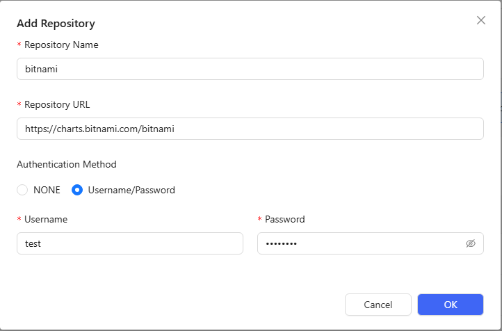
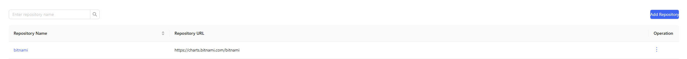
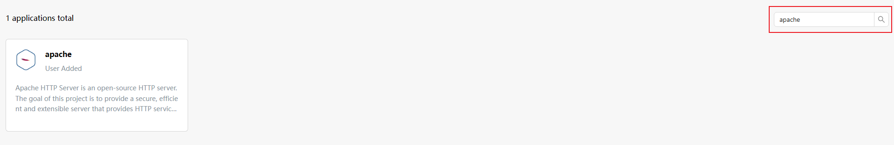
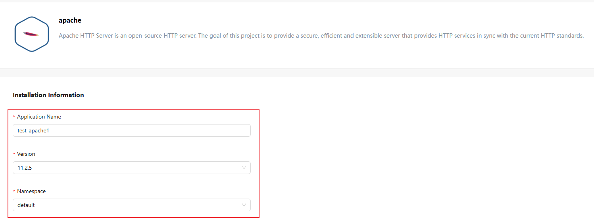
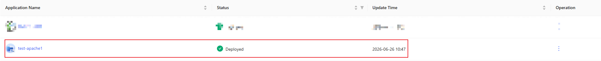

# Quick Start

The openFuyao community distribution adopts a "core platform + pluggable components" architecture. The core platform is deeply optimized based on open-source Kubernetes, providing out-of-the-box containerized cluster management capabilities, covering basic functions such as resource orchestration, elastic scaling, and multi-dimensional monitoring to meet the basic operational needs of enterprise-level production environments. Through the built-in application marketplace, it provides a rich set of industry-level high-value components, covering key capabilities such as AI/general computing hybrid scheduling, unified heterogeneous resource management, dynamic intelligent scheduling, and end-to-end observability enhancement.

This document will introduce how to quickly install an All-In-One (AIO) single-node business cluster on an openEuler 22.03 LTS operating system node, access the openFuyao cluster management interface, and successfully deploy an application from the application marketplace.

>  **Note:**<br />
> This document is intended for **simple, quick experience** of small-scale cluster installation, with steps arranged along the shortest path. For production environments, high availability, offline, and more optional configurations, see [Cluster Installation Guide](../cluster_installation_guide/read_before_installation/installation_process.md).

## Environment Preparation

The following introduces the environment preparation before quickly installing a small-scale cluster using the openFuyao installation tool.

### Prerequisites

The openFuyao platform solution supports installation and use on the following operating systems and architectures:

| Operating System     | Version    | Architecture        |
|--------------|-------|-----------|
| openEuler    | 20.03 | ARM64, x86_64 |
| openEuler    | 22.03 | ARM64, x86_64 |
| openEuler    | 24.03 | ARM64, x86_64 |
| Ubuntu       | 22.04 | ARM64, x86_64 |
| UOS          | 20 1070e | ARM64, x86_64 |

>  **Note:**<br />Other operating system versions have not been tested and may encounter unexpected issues.

Resource configuration requirements for nodes are as follows:

#### Minimum Deployment Hardware Configuration

| Node Type     | Number of Nodes | CPU | Memory | Hard Disk         |
| ------------ | -------- |---------| ---------- | ------------ |
| Bootstrap Node     | 1        | 2       | 4          | System disk >=100G |
| Business Cluster Node | 1        | 8       | 16         | System disk >=100G |

>  **Note:**<br />It is recommended to prepare two machines to serve as the bootstrap node and business cluster node respectively. They can also be deployed on the same machine (in this case, K3s and Kubernetes will run simultaneously, which may affect each other and is not recommended).

#### Recommended Hardware Configuration

| Node Type | Number of Nodes     | CPU | Memory    | Hard Disk                      |
| -------- | ------------ |---------| ------------ | ------------------------- |
| Bootstrap Node | 1            | 2       | 4            | System disk >=100G              |
| Business Cluster Node | Determined by actual situation | Determined by actual situation | Determined by actual situation | Determined by actual situation              |

### Node Requirements

- Nodes can connect to the external network.
- Nodes can be logged in using the root user.
- The tar tool needs to be installed on the bootstrap node. You can run the following commands based on the operating system:

  ```bash
  # RPM-based (openEuler/CentOS/RHEL, etc.)
  yum install -y tar

  # Debian-based (Ubuntu/Debian, etc.)
  apt-get update && apt-get install -y tar
  ```

>  **Notice:**  
> It is recommended that your node environment is sufficiently clean and has not installed any Kubernetes components, otherwise version conflicts may occur leading to installation failure.

## Quick Installation of a Small-Scale Cluster

To install a cluster with openFuyao, you need to first initialize the bootstrap node, and then use the openFuyao management interface on the bootstrap node to install the business cluster, and finally deploy a sample application.

>  **Note:**<br/> 
> Before performing small-scale cluster installation, please refer to [Installation and Deployment Concepts and Process](../../en/cluster_installation_guide/read_before_installation/installation_process.md) to understand the installation and deployment concepts and process, and perform [Environment Pre-check](../../en/cluster_installation_guide/environment_preparation/environment_pre_check_tool_guide.md) for pre-installation checks.

### 1. Install the Bootstrap Node

Download the BKE installation tool (binary), and then initialize the bootstrap node.

1. Log in to the bootstrap node using the root user.

2. Download the BKE installation tool (binary).

    2.1 Download via download.sh script

    - Install the latest version of the BKE installation tool: execute the following commands to download, verify, and install the latest version of the BKE installation tool on the bootstrap node.

    ```bash
    # Download the download.sh script
    curl -LO https://openfuyao.obs.cn-north-4.myhuaweicloud.com/openFuyao/bkeadm/releases/download/latest/download.sh
    # Download the checksum file for download.sh and perform verification; successful verification outputs -: OK; if verification fails, contact openFuyao sig-installation email installation@list.openfuyao.cn or openFuyao community email contact@openfuyao.cn
    curl -LO https://openfuyao.obs.cn-north-4.myhuaweicloud.com/openFuyao/bkeadm/releases/download/latest/download.sh.sha256
    sha256sum -c <(cat download.sh.sha256) < download.sh
    # Run download.sh to download the BKE installation tool; the sha256sum of the installation tool is verified during execution
    chmod +x download.sh && ./download.sh
    ```

    - Install a specific version of the BKE installation tool: to download a different version, use the following commands to specify the version for downloading.

    ```bash
    export VERSION=x.y.z # Replace x.y.z with the actual version you want to download.

    # Download the download.sh script
    curl -LO https://openfuyao.obs.cn-north-4.myhuaweicloud.com/openFuyao/bkeadm/releases/download/latest/download.sh
    # Download the checksum file for download.sh and perform verification; successful verification outputs -: OK; if verification fails, contact openFuyao sig-installation email installation@list.openfuyao.cn or openFuyao community email contact@openfuyao.cn
    curl -LO https://openfuyao.obs.cn-north-4.myhuaweicloud.com/openFuyao/bkeadm/releases/download/latest/download.sh.sha256
    sha256sum -c <(cat download.sh.sha256) < download.sh
    # Run download.sh to download the BKE installation tool; the sha256sum of the installation tool is verified during execution
    chmod +x download.sh && ./download.sh
    ```

    >  **Note:**<br/>
    > - For openFuyao v26.06, v26.09 and later versions: x.y.z value (BKE installation tool version number) is 26.6.0, 26.9.0 and other subsequent numeric version numbers.
    > - For openFuyao v26.03 and earlier versions: the mapping between x.y.z value (BKE installation tool version number) and openFuyao version is as follows:
    >
    >    | openFuyao Version | BKE Installation Tool Version |
    >    |--|--|
    >    | v26.03 | 1.2.2 |
    >    | v25.12 | 1.0.5 |
    >    | v25.09 | v25.09 |
    >    | v25.06 | v25.06 |
    >    | v25.03 | v25.03 |

    2.2 Download via binary package

    If you prefer not to use the download.sh script to download the target version of the BKE installation tool, you can also download the binary package directly, extract it, and move the binary file to the system path (e.g., `/usr/local/bin`). For manual downloads, please complete the integrity verification as described in [Installation Tool Download and Verification](../cluster_installation_guide/environment_preparation/installation_package_integrity_verification.md) before deployment:

    | Architecture | Download |
    | :--- | :--- |
    | x86_64 | [bkeadm_linux_amd64.tar.gz](https://openfuyao.obs.cn-north-4.myhuaweicloud.com/openFuyao/bkeadm/releases/download/latest/bkeadm_linux_amd64.tar.gz) |
    | ARM | [bkeadm_linux_arm64.tar.gz](https://openfuyao.obs.cn-north-4.myhuaweicloud.com/openFuyao/bkeadm/releases/download/latest/bkeadm_linux_arm64.tar.gz) |

3. Initialize the bootstrap node.

   ```bash
   bke init --onlineImage cr.openfuyao.cn/openfuyao/bke-online-installed:latest
   ```

   >  **Note:**<br />After the command is executed, the tool first displays the parameters that take effect for this installation (such as `--hostIP` and `--domain`), and then shows the confirmation prompt `Confirm the parameters, press Y to continue N will exit. [Y/N]?`: enter `Y` to continue the installation, or enter `N` to exit. You can also append the `--confirm` flag to the `bke init` command to skip this confirmation step.

4. Confirm the node initialization result.

   4.1 After the automated installation process in the previous step is successfully executed, you can log in to the openFuyao management interface on the bootstrap node to check whether the bootstrap node initialization is successful.
      >  **Note:**<br/> 
      > - The login URL for the openFuyao management interface on the bootstrap node is "https://_bootstrap node IP address_:30010".
      > - For the first login, the default username is admin and the default password is test@1234.
   
   4.2 Execute the following command to view the status of all Pods on the machine.
   
      ```bash
       kubectl get pod -A
      ```
   
      >  **Note:**<br />
      > - When `bke init` is executed successfully, the final log line `BKE initialization is complete` is output.
      > - Bootstrap node initialization usually takes 5 to 6 minutes, and may take longer depending on network and hardware conditions. Installation is complete when all Pod statuses are running or `Completed`. The waiting time will be longer when the network speed is slow.
       > - The components deployed by the installation and deployment tool all use default configurations and are only used to test the openFuyao platform functions. If used in a production environment, please adjust the security configurations of Kubernetes, container runtime, and network plugin components yourself.

### 2. Install the Business Cluster

1. Install the business cluster through the bootstrap node openFuyao management interface. For detailed operation steps, please refer to [Installing Business Clusters on the Management Interface](../cluster_installation_guide/service_cluster_installation/service_cluster_installation_on_the_management_plane.md#installation-steps).

2. Confirm successful installation of the business cluster.

   Execute the following command to view the Pod status. When all Pod statuses are `Running` or `Completed`, it indicates that the environment installation is complete.
   
   ```bash
   kubectl get pod -A
   ```

   >  **Note:**<br />
    > - During service cluster installation, when the "Cluster Information" window that pops up on the interface displays the log line `Reason: ClusterReady, Message: cluster is ready` and no new logs are scrolling, the service cluster installation is complete. If the log line `Reason: ClusterDeployFailed` is displayed, the installation fails.
    > - The time required for business cluster installation depends on the cluster scale and network conditions. For example, deploying a business cluster with 3 master nodes and 1 worker node takes about 15 minutes (it may take longer depending on network and hardware conditions), and the waiting time will be longer when the network speed is slow. Installation is complete when all Pod statuses are running or completed.
    > - The components deployed by the installation and deployment tool all use default configurations and are only used to test the openFuyao platform functions. If used in a production environment, please adjust the security configurations of Kubernetes, container runtime, and network plugin components yourself.

### 3. Deploy an Application

Enter "https://_management interface login IP address_:_openFuyao web service port_" in the browser, enter the username and password to log in to the openFuyao management interface.

>  **Note:**
    > - You need to change the password for the first login.
    > - The default openFuyao web service port is 31616.

For detailed introductions to the management platform functions and usage guidance, please refer to the [User Guide](https://gitcode.com/openFuyao/docs/blob/master/docs/en/management_plane_operations/registration_and_login.md).

The following uses apache as an example to explain how to deploy an application on the openFuyao management interface.

1. Select "Application Markets > Repository Config" in the left navigation bar of the openFuyao platform to enter the "Repository Config" interface.

2. Click "Add Repository", enter the repository name and repository address, and click "OK".<br />
   
   Example link `https://charts.bitnami.com/bitnami`<br />
   
   **Figure 1** Add Repository

    

3. After completion, you can see the added repository.<br />
   
   **Figure 2** Added Repository

   

   >  **Note:**<br />After a repository is added, the system needs to synchronize the Chart list in the repository. Only after the synchronization is complete will the applications in the repository be displayed in the application list. You can also select "Sync Repository" from the operation column of the repository on the "Repository Config" page to manually trigger the synchronization. If the apache application cannot be found in the application list, check the repository synchronization status first.

4. Select "Application Markets > Applications" in the left navigation bar to enter the "Applications" interface. Search for "apache" in the search box in the upper right corner to see the apache application.<br />
   
   **Figure 3** Apache Application

   

5. Click "apache" to enter the application details page.<br />

6. Click "Deploy" on the application details page to deploy the application.<br />

   >  **Note:**<br />The openFuyao platform does not perform security verification on applications deployed by users through third-party repositories. Please ensure the security of the deployed applications.

7. Fill in the installation information on the deployment page. You can customize the application name and namespace.<br />
   
   **Figure 4** Installation Information

   

8. Click "OK" in the lower right corner of the page to start deploying the application.<br />

9. After deployment is complete, you can enter the "Application Management" interface to view the deployment results.<br />
   
   **Figure 5** Deployment Results
   
   

Congratulations! You have successfully installed the apache application.<br />
- To learn more details about the openFuyao management interface, please refer to the [Management Plane Operations](https://gitcode.com/openFuyao/docs/blob/master/docs/en/management_plane_operations/registration_and_login.md).

- For more openFuyao feature usage, please refer to the [User Guide](https://gitcode.com/openFuyao/docs/blob/master/docs/en/user_guide/kae_operator.md) and [Developer Guide](https://gitcode.com/openFuyao/docs/blob/master/docs/en/developer_guide/authentication_and_authorization_development_guide.md).
