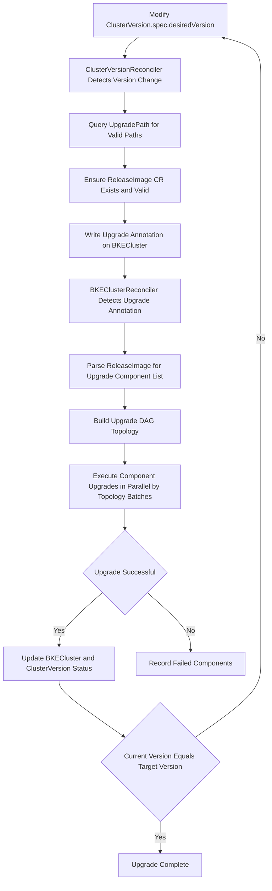

# Backend Declarative Upgrade Guide

## Backend Declarative Upgrade Introduction

### Application Scenarios

Declarative upgrade is a cluster version upgrade method provided by openFuyao based on declarative APIs. Users only need to declare the desired target version, and the system will automatically complete the entire process including upgrade path validation, upgrade resource preparation, orderly component upgrades, and status tracking. Through backend upgrades, users can view phase information during the upgrade process and understand the upgrade execution steps.

Applicable to the following scenarios:

- Upgrading the openFuyao version of a cluster from v26.06-rc.2 and subsequent versions to a higher version.
- Cluster version upgrades in both online and offline environments.

### Capability Scope

- Declarative upgrade trigger: Modify the desiredVersion field of ClusterVersion CR (Custom Resource) to trigger the upgrade, and the system automatically issues upgrade instructions.
- Automatic upgrade path validation: Based on UpgradePath rules, automatically validates whether the upgrade path from the current version to the target version is valid.
- Automatic multi-hop upgrade execution: When no direct upgrade path exists, the system automatically executes upgrades hop by hop through intermediate versions.
- DAG (Directed Acyclic Graph) driven parallel upgrade: Upgrade components build a DAG topology based on dependency relationships, supporting parallel upgrades of components in the same batch.
- Both online and offline scenarios are supported.
- Both management clusters and business clusters can be upgraded. Business cluster upgrades must be performed on the cluster managing their lifecycle (management cluster or bootstrap node).

>  **Note:**<br />Declarative upgrade is triggered by modifying `ClusterVersion.spec.desiredVersion`; after validation, ClusterVersionReconciler writes the `cvo.openfuyao.cn/upgrade-ready` annotation on BKECluster, and BKEClusterReconciler executes the DAG accordingly. For controller parameters and annotations, see [Controller Parameters and Upgrade Annotations](#controller-parameters-and-upgrade-annotations) below.

### Highlight Features

- Declarative trigger: Only need to declare the target version (modify the desiredVersion field of ClusterVersion CR), without worrying about upgrade execution details.
- DAG parallel upgrade: Compared to the legacy serial PhaseFlow upgrade, declarative upgrade supports components executing in parallel based on dependency topology, reducing overall upgrade time.
- Automatic multi-hop execution: During cross-version upgrades, the system automatically calculates intermediate hop versions and executes hop by hop, requiring no manual intervention from users.

### Basic Concepts

| Concept | Description |
| --- | --- |
| ClusterVersion | The trigger CR for declarative upgrade, declaring the desired target version by setting the spec.desiredVersion field |
| UpgradePath | Upgrade path rule CR, defining valid upgrade paths between versions, including from, to, blocked, etc. |
| ReleaseImage | Version release image CR, containing the component list, dependency relationships, and component types (inline / yaml / helm) required for upgrade |
| ComponentVersion | Component version definition CR declaring the component type via `spec.type`, along with version, dependencies, upgrade strategy, and prerequisite resources |
| Upgrade DAG | A directed acyclic graph built based on the dependency relationships of ReleaseImage and ComponentVersion, determining the execution order of upgrade components |
| Multi-hop Upgrade | When no direct upgrade path exists from the current version to the target version but multi-hop paths exist, the system automatically executes upgrades hop by hop through intermediate versions |

>  **Note:**<br />For upgrade component types (inline / yaml / helm), see [Before You Upgrade - Upgrade Component Types](./before_you_upgrade.md#upgrade-component-types).

The trigger and execution flow of declarative upgrade is as follows:



Flow step descriptions:

1. **Modify desiredVersion**: Modify the spec.desiredVersion field of ClusterVersion CR to the target version.
2. **Detect Version Change**: ClusterVersionReconciler detects that desiredVersion is inconsistent with currentVersion, triggering the upgrade flow.
3. **Query Upgrade Path**: ClusterVersionReconciler queries the UpgradePath CR, validating whether the upgrade path from the current version to the target version is valid.
4. **Ensure Resource Exists**: Ensure the ReleaseImage CR exists and its status is Valid; the system automatically pulls and parses it from the OCI image repository.
5. **Write Upgrade Annotation**: Write the upgrade-ready annotation on BKECluster, triggering BKEClusterReconciler to enter the upgrade flow.
6. **Detect Upgrade Annotation**: BKEClusterReconciler detects the upgrade-ready annotation on BKECluster and enters the declarative upgrade flow.
7. **Parse Upgrade Components**: Parse ReleaseImage to obtain the upgrade component list and dependency relationships.
8. **Build DAG Topology**: Build the DAG topology based on the upgrade component list from ReleaseImage and the dependency relationships from ComponentVersion.
9. **Execute Upgrades in Parallel**: Execute component upgrades in parallel by DAG topology batches; inline, yaml, and helm components are dispatched to their respective executors based on `spec.type`.
10. **Determine Upgrade Success**: Check whether all components have been upgraded successfully.
11. **Update Status**: After successful upgrade, update BKECluster and ClusterVersion status; update DeclarativeUpgradeStatus after each component completes.
12. **Record Failed Components**: When upgrade fails, record the failed component information.
13. **Determine Whether Target Version Reached**: Check whether the current version equals the target version; if not, continue executing the next hop upgrade.
14. **Upgrade Complete**: The current version equals the target version; all upgrades are complete, and upgrade annotations are cleared.

## Controller Parameters and Upgrade Annotations

Declarative upgrade is triggered by the ClusterVersion controller and executed by the BKECluster controller according to the DAG defined in ReleaseImage. After the user modifies `ClusterVersion.spec.desiredVersion`, ClusterVersionReconciler validates UpgradePath and ensures ReleaseImage is valid, then writes `upgrade-ready` and related annotations to BKECluster; BKEClusterReconciler executes the DAG when non-empty `upgrade-ready` is detected.

**Table 1** Declarative Upgrade Parameters and Annotations

| Configuration Item | Type | Default | Description | How to Set |
| --- | --- | --- | --- | --- |
| `--helm-component-support` | Global flag | `false` | Enables yaml/helm component executors for all clusters. | BKEControllerManager startup parameter; also see [cluster-api-provider-bke Configuration Parameters](../cluster_installation_guide/appendix/cluster-api-provider-bke_configuration.md) Table 2 |
| `cvo.openfuyao.cn/helm-component` | BKECluster annotation | None | When present, its value (case-insensitive) takes precedence; falls back to `--helm-component-support` when absent. | Manual annotation or ops script |
| `cvo.openfuyao.cn/upgrade-ready` | BKECluster annotation | None | Written by ClusterVersionReconciler after upgrade validation, value is the current hop target version; **DAG execution gate** — upgrade runs only when non-empty. | Written automatically by ClusterVersion controller |
| `cvo.openfuyao.cn/cluster-version` | BKECluster annotation | None | Associated ClusterVersion object name; written and cleaned together with `upgrade-ready`. | Written automatically by ClusterVersion controller |
| `cvo.openfuyao.cn/upgrade-path` | BKECluster annotation | None | Selected upgrade path, e.g. `v26.06-rc.2->v26.06`; written and cleaned together with `upgrade-ready`. | Written automatically by ClusterVersion controller |

**Collaboration**

- **Execution gate**: `shouldUseDeclarativeUpgrade` only checks whether `cvo.openfuyao.cn/upgrade-ready` is non-empty.
- **Helm components**: `HelmComponentEnabled` uses annotation `cvo.openfuyao.cn/helm-component` when present; otherwise falls back to the `--helm-component-support` global flag.
- **Cleanup**: After a hop completes, is cancelled, or fails, the controller removes `upgrade-ready`, `cluster-version`, and `upgrade-path` annotations together.


## Usage Restrictions

| Restriction Item | Description |
| --- | --- |
| Downgrade Not Supported | Only version upgrade functionality is provided; version downgrade functionality is not provided |
| Minimum Version Requirement | The currently supported minimum upgradable version is v26.06-rc.2 |
| Upgrade Impact | When upgrading K8s-related components in a non-high-availability cluster, there will be a brief apiserver service unavailability |
| etcd Backup Recommendation | It is recommended to back up etcd data before upgrading; manual rollback is required if upgrade fails |
| Offline Upload Restriction | Offline scenario patch upload is not supported in online mode |
| Cluster Health Requirement | The cluster status must be Healthy before upgrading; otherwise the upgrade may fail |

>  **Notice:**<br />For the upgrade system overview and guide navigation, see [Before You Upgrade](./before_you_upgrade.md). For upgrading from v26.03 to v26.06, refer to [Upgrade Guide](./upgrade_guide_from_v26.03_to_v26.06.md). The following guide applies to upgrading from v26.06-rc.2 and subsequent versions.

## Online Scenario Upgrade Operations

### Prerequisites

- The management cluster is running normally.
- The management cluster can access the remote version repository.
- The cluster to be upgraded has a status of Healthy.

>  **Note:**<br />If the target version includes a bkeagent upgrade (EnsureAgentUpgrade in the upgrade DAG), download the target-version bkeagent binaries (amd64/arm64) in advance, then copy them to the bootstrap node's `/bke/mount/source_registry/files/` directory. The following example uses `v26.09-rc.2` (component version `26.9.0-rc.2`); replace the version number with the component version of your target release:
>
> ```bash
> curl -L -o bkeagent-26.9.0-rc.2-linux-arm64 https://openfuyao.obs.cn-north-4.myhuaweicloud.com/openFuyao/cluster-api-provider-bke/releases/download/26.9.0-rc.2/bkeagent_linux_arm64
> curl -L -o bkeagent-26.9.0-rc.2-linux-amd64 https://openfuyao.obs.cn-north-4.myhuaweicloud.com/openFuyao/cluster-api-provider-bke/releases/download/26.9.0-rc.2/bkeagent_linux_amd64
> cp bkeagent-26.9.0-rc.2-linux-arm64 bkeagent-26.9.0-rc.2-linux-amd64 /bke/mount/source_registry/files/
> ```

### Step 1: Check Cluster Status

```bash
# View business cluster status
kubectl get bkecluster <cluster-name> -n <namespace> 

# Expected output: Healthy
# If the output is not Healthy, troubleshoot and fix cluster issues first
```

### Step 2: Query Upgradable Paths

```bash
# View upgrade path rules in UpgradePath CR
kubectl get upgradepath openfuyao-upgrade-paths -o yaml
```

### Step 3: Trigger Upgrade

**Operate ClusterVersion CR via kubectl**

If you want to upgrade to v26.09-rc.2, you can execute the following operations to trigger the upgrade.
```bash
# Patch update desiredVersion
kubectl patch clusterversion <cluster-name> -n <namespace> --type merge -p '{"spec":{"desiredVersion":"v26.09-rc.2"}}'
# Or edit the clusterversion resource, changing desiredVersion to v26.09-rc.2
kubectl edit clusterversion <cluster-name> -n <namespace>
```

>  **Note:**<br />Modifying the desiredVersion field of ClusterVersion CR is the only way to trigger declarative upgrade. After the system detects that desiredVersion is inconsistent with currentVersion, it automatically enters the upgrade flow.

### Step 4: Monitor Upgrade Progress

View various statuses during the upgrade process via kubectl:

```bash
# View ClusterVersion status
kubectl get clusterversion <cluster-name> -n <namespace> -w
```

ClusterVersion phase field meanings:

| Phase | Description |
| --- | --- |
| Pending | Upgrade request submitted, awaiting processing |
| PreChecking | Pre-upgrade validation in progress |
| Upgrading | Upgrade execution in progress |
| Upgraded | Single-hop upgrade completed (in multi-hop scenarios, subsequent hops remain) |
| Ready | All upgrades completed, currentVersion equals desiredVersion |
| Blocked | Upgrade path is blocked |
| PreCheckFailed | Pre-upgrade validation failed |
| Failed | Upgrade failed |

```bash
# View overall cluster health status
kubectl get bkecluster <cluster-name> -n <namespace> -w
```

Declarative upgrade phase sequence (executed by DAG topology):

| Upgrade Batch | Phase Name | CR Phase Name | Description |
| --- | --- | --- | --- |
| Batch 1 | Provider Self-upgrade | EnsureProviderSelfUpgrade | cluster-api-provider-bke own image rolling upgrade |
| Batch 2 | Agent Upgrade | EnsureAgentUpgrade | Upgrade bke-agent on each node |
| Batch 3 | Containerd Upgrade | EnsureContainerdUpgrade | Upgrade containerd on each node |
| Batch 4 | etcd Upgrade | EnsureEtcdUpgrade | Rolling upgrade of etcd cluster |
| Batch 5 | Master Upgrade | EnsureMasterUpgrade | Rolling upgrade of Master node kubernetes components |
| Batch 5 | Worker Upgrade | EnsureWorkerUpgrade | Rolling upgrade of Worker node kubernetes components |
| Batch 6 | kube-proxy Upgrade | yaml | Apply YAML manifests via Yaml executor |
| Batch 6 | coredns Upgrade | yaml | Apply YAML manifests via Yaml executor |
| Batch 6 | calico Upgrade | yaml | Apply YAML manifests via Yaml executor |

>  **Note:**<br />1. Components within the same batch execute in parallel; different batches execute serially in dependency order. Batches 1~6 are automatically determined by DAG topology sorting; dependency relationships come from the spec.dependencies field of each ComponentVersion in ReleaseImage.<br />2. In Batch 5, Master Upgrade and Worker Upgrade execute in parallel; in Batch 6, kube-proxy, coredns, and calico execute in parallel.<br />3. In multi-hop upgrade scenarios, each hop executes all the above phases before automatically proceeding to the next hop.<br />4. After provider self-upgrade completes, a new Pod will take over the subsequent upgrade process, and the old Pod will automatically exit.

### Step 5: Confirm Upgrade Completion

```bash
# Confirm ClusterVersion currentVersion equals desiredVersion
kubectl get clusterversion <cluster-name> -n <namespace> -o jsonpath='{.status.currentVersion}'

# Confirm ClusterVersion phase is Ready
kubectl get clusterversion <cluster-name> -n <namespace> -o jsonpath='{.status.phase}'

# Confirm cluster status has returned to Healthy
kubectl get bkecluster <cluster-name> -n <namespace> -o jsonpath='{.status.clusterHealthState}'
```

## Offline Scenario Upgrade Operations

### Prerequisites

- The management cluster is running normally and in an offline environment.
- The cluster is in offline mode.
- The cluster to be upgraded has a status of Healthy.
- The version configuration file has been prepared (for preparing the full offline package); offline package preparation must be done in an online environment, and the prepared offline package is then uploaded to the bootstrap node.

### Offline Package Preparation Step 1: Prepare Version Configuration File

1. Download the openFuyao version index file to obtain the correspondence between versions and file names.

   ```bash
   wget https://openfuyao.obs.cn-north-4.myhuaweicloud.com/openFuyao/version-config/index.yaml
   ```

   Index file sample content:

   ```yaml
   - openFuyaoVersion: v26.09-rc.2
     filePath: ./Core-VersionConfig-v26.09-rc.2.yaml
   - openFuyaoVersion: v26.09-rc.1
     filePath: ./Core-VersionConfig-v26.09-rc.1.yaml
   ```

2. Download the target version configuration file based on the index file.

   ```bash
   wget https://openfuyao.obs.cn-north-4.myhuaweicloud.com/openFuyao/version-config/Core-VersionConfig-v26.09-rc.2.yaml
   ```

### Offline Package Preparation Step 2: Prepare Full Offline Package

Based on the version configuration file downloaded in [Offline Package Preparation Step 1: Prepare Version Configuration File](#offline-package-preparation-step-1-prepare-version-configuration-file), prepare the full offline package required for upgrade.

Prepare the full offline package based on the version configuration file. Here, v26.09-rc.2 is used as an example; replace the file name and offline package name with the actual target version:

   ```bash
   bke build patch -f Core-VersionConfig-v26.09-rc.2.yaml -t offline-v26.09-rc.2.tar.gz --strategy=oci
   ```

>  **Note:**<br />Here, v26.09-rc.2 is used as an example; please replace the version number in the command with your actual target upgrade version number.

The full offline package contains the following:

| Content | Description |
| --- | --- |
| Container Images | All container images defined by repos in the version configuration file |
| Registry Image | The registry:2 image for the bootstrap node local image source |
| Binary Files | Binary files such as containerd, kubelet, kubectl defined by files in the version configuration file |
| RPM/deb Packages | Operating system dependency packages defined by rpms/debs in the version configuration file |
| Helm Charts | Helm chart packages defined by charts in the version configuration file |
| Version Patches | VersionConfig patch files defined by patches in the version configuration file |
| bke Installation Tool | bkeadm installation command tool |

>  **Note:**<br />1. The version configuration file defines all images, binary files, and dependency packages required for the full offline package, serving as the input configuration for offline package preparation.<br />2. The full offline package ensures that all resources required for upgrade are available in the offline environment, avoiding upgrade failures due to missing dependencies.

### Offline Upgrade Step 1: Upload Offline Package to Bootstrap Node

1. Place the full offline package file in the /etc/openFuyao directory on the bootstrap node.

2. Synchronize the offline package to the bootstrap node:

   ```bash
   # Log in to the bootstrap node

   # Extract the full offline package
   tar -xzvf /etc/openFuyao/offline-v26.09-rc.2.tar.gz

   # Synchronize images to the local image source
   bke registry patch --source ./offline-v26.09-rc.2 --target <bootstrap-node-IP>:40443

   # Copy binary files to the specified directory
   # Copy the binary files required for upgrade from ./offline-v26.09-rc.2/volumes/ to /bke/mount/source_registry/files/, example command as follows
   cp ./offline-v26.09-rc.2/volumes/containerd-*.tar.gz /bke/mount/source_registry/files/
   ```

   >  **Note:**<br />1. Here, v26.09-rc.2 is used as an example; please replace the version number in the command with your actual target upgrade version number.<br />2. If the target version includes a bkeagent upgrade, also confirm that versioned bkeagent binaries exist under `/bke/mount/source_registry/files/` (see the preparation note in [Online Scenario Prerequisites](#prerequisites)); if the offline package does not include them, download and copy them separately as described there.

### Offline Upgrade Step 2: Check Cluster Status

Same as the online scenario:

```bash
kubectl get bkecluster <cluster-name> -n <namespace> 
```

### Offline Upgrade Step 3: Trigger Upgrade

Same as the online scenario:

If you want to upgrade to v26.09-rc.2, you can execute the following operations to trigger the upgrade.
```bash
# Patch update desiredVersion
kubectl patch clusterversion <cluster-name> -n <namespace> --type merge -p '{"spec":{"desiredVersion":"v26.09-rc.2"}}'
# Or edit the clusterversion resource, changing desiredVersion to v26.09-rc.2
kubectl edit clusterversion <cluster-name> -n <namespace>
```

### Offline Upgrade Step 4: Monitor Upgrade Progress

Same as the online scenario, refer to [Online Scenario - Monitor Upgrade Progress](#step-4-monitor-upgrade-progress).

### Offline Upgrade Step 5: Confirm Upgrade Completion

Same as the online scenario, refer to [Online Scenario - Confirm Upgrade Completion](#step-5-confirm-upgrade-completion).

## Upgrade Failure Handling

### View Failure Details

```bash
# View ClusterVersion status
kubectl get clusterversion <cluster-name> -n <namespace> -o yaml

# View failure records in DeclarativeUpgradeStatus
kubectl get bkecluster <cluster-name> -n <namespace> -o jsonpath='{.status.declarativeUpgrade.lastFailure}'

# View cluster status
kubectl get bkecluster <cluster-name> -n <namespace> -o jsonpath='{.status.clusterHealthState}'
```

### Common Failure Causes

| Failure Cause | Description | Troubleshooting Command |
| --- | --- | --- |
| Cluster Not Healthy | Cluster status was not Healthy before upgrade | `kubectl get bkecluster <name> -n <name> -o jsonpath='{.status.clusterHealthState}'` |
| Upgrade Path Blocked | UpgradePath rules mark the path as blocked | `kubectl get upgradepath -o yaml` |
| Image Pull Failure | In offline scenarios, image packages were not correctly synchronized | Log in to the bootstrap node to check the image source service |
| Insufficient Resources | Node CPU/memory/disk resource shortages | `kubectl top nodes` |
| Network Issues | Abnormal network communication between nodes | `kubectl get nodes` to check node Ready status |

# FAQ

- **What is the difference between declarative upgrade and legacy PhaseFlow upgrade?**

  | Comparison Item | Legacy PhaseFlow | Declarative Upgrade |
  | --- | --- | --- |
  | Trigger Method | Modify BKECluster.spec.openFuyaoVersion | Modify ClusterVersion.spec.desiredVersion |
  | Execution Method | Serial execution of all upgrade phases | DAG topology driven parallel execution |
  | Component Order | Fixed sequence | Dynamically determined by dependency relationships |
  | Multi-hop Upgrade | Not supported | Supports automatic hop-by-hop execution |

- **Why is the upgrade version list empty?**

  ```bash
  # Check whether UpgradePath CR exists
  kubectl get upgradepath

  # Check path rules
  kubectl get upgradepath openfuyao-upgrade-paths -o jsonpath='{.spec.paths}'
  ```

  Possible causes: 1) The current version is already the latest version; 2) The UpgradePath rules have no reachable upgrade paths for the current version; 3) In online mode, the remote version repository is unreachable.

- **What is multi-hop upgrade?**

  When no direct upgrade path exists from the current version to the target version (such as v26.06-rc.2 to v26.06), the system automatically calculates the intermediate hop version path (such as v26.06-rc.2 -> v26.06-rc.3 -> v26.06) and executes upgrades hop by hop. After each hop completes, it automatically proceeds to the next hop until reaching the final target version.

- **Why is there a brief interruption after provider self-upgrade during the upgrade process?**

  Provider self-upgrade uses the Kubernetes Deployment rolling update mechanism: after the old Pod's image is patched, K8s creates a new Pod, and after the new Pod is Ready, the old Pod is terminated. The new Pod will automatically take over the subsequent upgrade process after starting. This process typically completes within 1-2 minutes.
