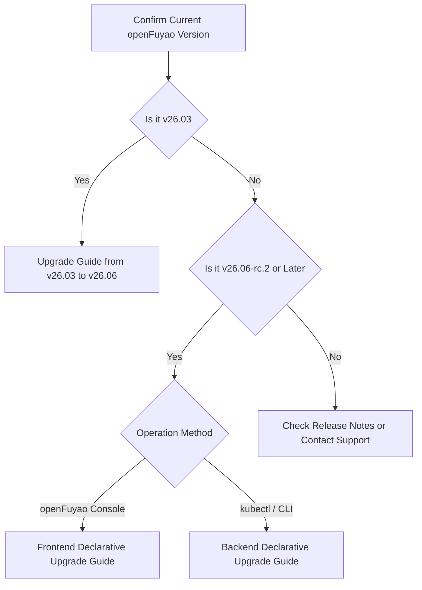
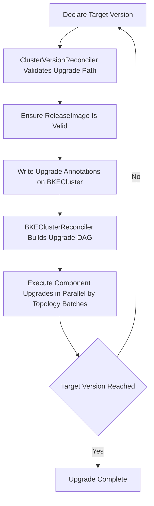

# Before You Upgrade

## Overview

openFuyao provides cluster version upgrades based on declarative APIs. After you declare a target version, the system automatically validates the upgrade path, prepares upgrade resources, upgrades components in order, and tracks status.

Choose the appropriate upgrade guide based on your cluster's **current version** and **operation method** (openFuyao management console or backend CLI). This document describes the upgrade system, core concepts, common constraints, and document navigation. It does **not** include specific upgrade commands or UI steps.

## How to Choose an Upgrade Guide

**Table 1** Upgrade Guide Navigation

| Current Cluster Version | Typical Target | Operation Method | Reference |
| --- | --- | --- | --- |
| v26.03 | v26.06 | Backend CLI (default) / Console (phase two) | [Upgrade Guide from v26.03 to v26.06](./upgrade_guide_from_v26.03_to_v26.06.md) |
| v26.06-rc.2 and later | Higher version | openFuyao management console | [Frontend Declarative Upgrade Guide](./frontend_declarative_upgrade_guide.md) |
| v26.06-rc.2 and later | Higher version | kubectl / CLI | [Backend Declarative Upgrade Guide](./backend_declarative_upgrade_guide.md) |

>  **Note:** For v26.03 clusters, upgrade the management plane (bke-controller-manager reconciler) first, then trigger declarative upgrade for business clusters. See [Upgrade Guide from v26.03 to v26.06](./upgrade_guide_from_v26.03_to_v26.06.md). For v26.06-rc.2 and later, use the declarative upgrade guides directly.

## Upgrade Method Comparison

Starting with v26.06, openFuyao introduces declarative upgrade alongside the legacy serial PhaseFlow upgrade. v26.06-rc.2 and later versions use declarative upgrade by default.

**Table 2** Legacy PhaseFlow vs. Declarative Upgrade

| Comparison Item | Legacy PhaseFlow (v26.03 and earlier) | Declarative Upgrade (v26.06-rc.2 and later) |
| --- | --- | --- |
| Trigger | Modify `BKECluster.spec.openFuyaoVersion` | Modify `ClusterVersion.spec.desiredVersion` |
| Execution | Serial execution of fixed upgrade phases | DAG built from dependencies; parallel execution within each batch |
| Upgrade Path | Fixed path | Defined by `UpgradePath` CR; supports automatic multi-hop execution |
| Applicable Versions | v26.03 and earlier | v26.06-rc.2 and later (v26.03 must migrate to v26.06 first) |

## Core Concepts

**Table 3** Declarative Upgrade Core Concepts

| Concept | Description |
| --- | --- |
| ClusterVersion | Trigger CR for declarative upgrade; declares the desired target version via `spec.desiredVersion` |
| UpgradePath | Upgrade path rule CR defining valid paths between versions (from, to, blocked, etc.) |
| ReleaseImage | Version release image CR containing the component list, dependencies, and component types (inline / yaml / helm) for upgrade |
| ComponentVersion | Component version definition CR declaring the component type via `spec.type`, along with version, dependencies, upgrade strategy, and prerequisite resources |
| Upgrade DAG | Directed acyclic graph built from ReleaseImage and ComponentVersion dependencies, determining component execution order |
| Multi-hop Upgrade | When no direct path exists, the system automatically executes upgrades hop by hop through intermediate versions |

## Upgrade Component Types

In declarative upgrade, each component in a release is represented as a `ComponentVersion` resource with its execution method declared via `spec.type`. The following three types are currently supported: **inline**, **yaml**, and **helm**.

**Table 4** Upgrade Component Types

| Type | Description | Typical Examples | Execution Method |
| --- | --- | --- | --- |
| inline | Runs built-in upgrade logic (Go Phase) on nodes or the control plane; suitable for rolling node upgrades, static Pod changes, etc. | containerd, etcd, kubernetes (master/worker), bke-agent | Inline executor (PhaseRunner) |
| yaml | Applies component manifests (YAML) to the target cluster; suitable for Deployments, DaemonSets, RBAC, and similar resources | provider, coredns, kube-proxy, calico | Yaml executor (manifest apply) |
| helm | Installs or upgrades components via Helm Chart; suitable for Addon components distributed as Charts | Components defined as Helm in release artifacts | Helm executor (Chart install/upgrade) |

All three types are included in the upgrade DAG. Execution order is determined by `ComponentVersion.spec.dependencies`: parallel within a batch, serial across batches. Specific batch layout varies by release; see the phase descriptions in [Backend Declarative Upgrade Guide](./backend_declarative_upgrade_guide.md#step-4-monitor-upgrade-progress).

>  **Note:** 1. Components previously described as "manifest" are now classified as **yaml** type. 2.**inline** components are always scheduled via the executor framework; **yaml / helm** components use the legacy path by default and the unified registry path after the new executors are enabled (see table below). 3.When a component is removed from the target release, existing cluster resources are **not automatically uninstalled**. 4. Currently, releaseImage components defined in versions v26.09 and earlier do not involve Helm types.

**Table 5** yaml / helm Component Feature Gate

| Configuration | Type | Default | Description |
| --- | --- | --- | --- |
| `--helm-component-support` | Global flag | `false` | Enables the new yaml/helm executor path for all clusters |
| `cvo.openfuyao.cn/helm-component` | BKECluster annotation | None | Enables yaml/helm new executors for a single cluster; **annotation takes precedence over** the global flag |

When the gate is off, yaml/helm components keep the legacy execution path compatible with existing deployments. When enabled, they are handled by the corresponding executors with component lifecycle status written back. For details, see [Backend Declarative Upgrade Guide - Controller Parameters and Upgrade Annotations](./backend_declarative_upgrade_guide.md#controller-parameters-and-upgrade-annotations).

## Declarative Upgrade Flow

Key steps:

1. Set `ClusterVersion.spec.desiredVersion` to the target version via the management console or `kubectl`.
2. `ClusterVersionReconciler` queries `UpgradePath`, validates the path, and ensures `ReleaseImage` exists with status Valid.
3. After validation, it writes annotations such as `cvo.openfuyao.cn/upgrade-ready` on `BKECluster`.
4. `BKEClusterReconciler` parses `ReleaseImage`, builds the DAG, and executes upgrades by batch; inline, yaml, and helm components are dispatched to their respective executors based on `spec.type`.
5. In multi-hop scenarios, each hop completes before the next begins until `currentVersion` equals `desiredVersion`.

For controller parameters and upgrade annotations, see [Backend Declarative Upgrade Guide](./backend_declarative_upgrade_guide.md#controller-parameters-and-upgrade-annotations) and [cluster-api-provider-bke Configuration Parameters](../cluster_installation_guide/appendix/cluster-api-provider-bke_configuration.md).

## General Prerequisites

Before upgrading, confirm:

- The management cluster (or bootstrap cluster) is running normally and can manage the lifecycle of the target business cluster.
- The target cluster status is **Healthy**; resolve any issues before upgrading.
- Online scenario: the management cluster can access the remote version repository; offline scenario: target version offline packages and version config files are prepared and synchronized.
- **Back up etcd data** before upgrading; manual rollback is required if the upgrade fails.
- If the target version includes a bkeagent upgrade, place the target-version bkeagent binaries (amd64/arm64) on the bootstrap node under `/bke/mount/source_registry/files/` in advance.

## Usage Restrictions

**Table 6** Common Upgrade Restrictions

| Restriction | Description |
| --- | --- |
| Downgrade not supported | Only version upgrade is provided; downgrade is not supported |
| Minimum version | The minimum version for declarative upgrade is v26.06-rc.2 |
| Upgrade impact | Non-HA clusters may experience brief apiserver unavailability when upgrading K8s-related components |
| etcd backup | Back up etcd before upgrading; manual rollback is required on failure |
| Offline upload | Offline patch upload is not supported in online mode |
| Cluster health | Cluster status must be Healthy before upgrading |

>  **Notice:** Do not mix steps across guides. v26.03 clusters must complete the two-phase migration in [Upgrade Guide from v26.03 to v26.06](./upgrade_guide_from_v26.03_to_v26.06.md) before using declarative upgrade guides for subsequent versions.

## Pre-Upgrade Checklist

| Check Item | Description | Reference |
| --- | --- | --- |
| Confirm current version | Identify the cluster openFuyao version and choose the correct guide | Cluster details or `kubectl get clusterversion` |
| Confirm upgrade path | Target version is reachable in `UpgradePath` and not blocked | `kubectl get upgradepath -o yaml` |
| Confirm cluster health | `BKECluster` status is Healthy | `kubectl get bkecluster` |
| Back up etcd | Complete data backup before upgrading | Operations backup policy |
| Prepare bkeagent (if needed) | When the target version includes EnsureAgentUpgrade, versioned bkeagent binaries are ready on the bootstrap node | [Frontend](./frontend_declarative_upgrade_guide.md#prerequisites) / [Backend](./backend_declarative_upgrade_guide.md#prerequisites) prerequisites notes |
| Offline resources ready | For offline scenarios, sync version config and offline packages | [Backend Guide - Offline Scenario](./backend_declarative_upgrade_guide.md#offline-scenario-upgrade-operations) |
| Choose operation method | Console or CLI; use the corresponding frontend/backend guide | [How to Choose an Upgrade Guide](#how-to-choose-an-upgrade-guide) |

## Related Documents

| Document | Description |
| --- | --- |
| [Upgrade Guide from v26.03 to v26.06](./upgrade_guide_from_v26.03_to_v26.06.md) | Cross-major-version migration from v26.03 (management plane + declarative upgrade) |
| [Frontend Declarative Upgrade Guide](./frontend_declarative_upgrade_guide.md) | Declarative upgrade via openFuyao management console |
| [Backend Declarative Upgrade Guide](./backend_declarative_upgrade_guide.md) | Declarative upgrade via kubectl, including monitoring and troubleshooting |
| [cluster-api-provider-bke Configuration Parameters](../cluster_installation_guide/appendix/cluster-api-provider-bke_configuration.md) | Upgrade-related controller parameters and annotations |
