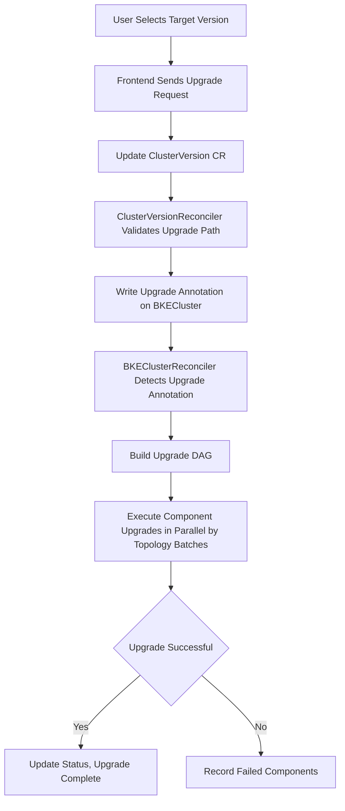

# Frontend Declarative Upgrade Guide

## Frontend Declarative Upgrade Introduction

### Application Scenarios

Declarative upgrade is a cluster version upgrade method provided by openFuyao based on declarative APIs. Through frontend upgrades, users only need to specify the target version via the Web interface, and the system will automatically complete the entire process including upgrade path validation, upgrade resource preparation, orderly component upgrades, and status tracking.

Applicable to the following scenarios:

- Upgrading the openFuyao version of a cluster from v26.06-rc.2 and subsequent versions to a higher version.
- Cluster version upgrades in both online and offline environments.

### Capability Scope

- Declarative upgrade trigger: Users select the target version via the interface, and the system automatically issues upgrade instructions.
- Automatic upgrade path validation: Based on UpgradePath rules, automatically validates whether the upgrade path from the current version to the target version is valid.
- Automatic multi-hop upgrade execution: When no direct upgrade path exists, the system automatically executes upgrades hop by hop through intermediate versions.
- DAG (Directed Acyclic Graph) driven parallel upgrade: Upgrade components build a DAG topology based on dependency relationships, supporting parallel upgrades of components in the same batch.
- Both online and offline scenarios are supported.
- Both management clusters and business clusters can be upgraded. Business cluster upgrades must be performed on the cluster managing their lifecycle (management cluster or bootstrap node).

### Highlight Features

- Declarative trigger: Only need to declare the target version (modify the desiredVersion field of ClusterVersion CR (Custom Resource)), without worrying about upgrade execution details.
- DAG parallel upgrade: Compared to the legacy serial PhaseFlow upgrade, declarative upgrade supports components executing in parallel based on dependency topology, reducing overall upgrade time.
- Automatic multi-hop execution: During cross-version upgrades, the system automatically calculates intermediate hop versions and executes hop by hop, requiring no manual intervention from users.

### Basic Concepts

| Concept | Description |
| --- | --- |
| ClusterVersion | The trigger CR for declarative upgrade, declaring the desired target version by setting the spec.desiredVersion field |
| UpgradePath | Upgrade path rule CR, defining valid upgrade paths between versions, including from, to, blocked, etc. |
| ReleaseImage | Version release image CR, containing the component list, dependency relationships, and component types (inline / yaml / helm) required for upgrade |
| ComponentVersion | Component version definition CR declaring the component type via `spec.type`, along with version, dependencies, upgrade strategy, and prerequisite resources |
| Upgrade DAG | A directed acyclic graph built based on the dependency relationships of ReleaseImage and ComponentVersion, determining the execution order of upgrade components |
| Multi-hop Upgrade | When no direct upgrade path exists from the current version to the target version but multi-hop paths exist, the system automatically executes upgrades hop by hop through intermediate versions |

>  **Note:**<br />For upgrade component types (inline / yaml / helm), see [Before You Upgrade - Upgrade Component Types](./before_you_upgrade.md#upgrade-component-types).

The trigger and execution flow of declarative upgrade is as follows:



Flow step descriptions:

1. **User Selects Target Version**: The user selects the target version to upgrade to on the interface.
2. **Frontend Sends Upgrade Request**: The frontend calls the upgrade API and sends the upgrade request.
3. **Update ClusterVersion CR**: Update the desiredVersion field of ClusterVersion CR to the target version.
4. **Validate Upgrade Path**: ClusterVersionReconciler queries the UpgradePath CR, validating whether the upgrade path from the current version to the target version is valid.
5. **Write Upgrade Annotation**: Write the upgrade-ready annotation on BKECluster.
6. **Detect Upgrade Annotation**: BKEClusterReconciler detects the upgrade-ready annotation on BKECluster and enters the declarative upgrade flow.
7. **Build Upgrade DAG**: Build the upgrade DAG topology based on the dependency relationships of ReleaseImage and ComponentVersion.
8. **Execute in Parallel by Topology Batches**: Execute component upgrades in parallel by DAG topology batches; inline, yaml, and helm components are dispatched to their respective executors based on `spec.type`.
9. **Determine Upgrade Success**: Check whether all components have been upgraded successfully.
10. **Upgrade Complete**: After successful upgrade, update status and clear upgrade annotations.
11. **Record Failed Components**: When upgrade fails, record the failed component information.


## Usage Restrictions

| Restriction Item | Description |
| --- | --- |
| Downgrade Not Supported | Only version upgrade functionality is provided; downgrade functionality is not provided |
| Minimum Version Requirement | The currently supported minimum upgradable version is v26.06-rc.2 |
| Upgrade Impact | When upgrading K8s-related components in a non-high-availability cluster, there will be a brief apiserver service unavailability |
| etcd Backup Recommendation | It is recommended to back up etcd data before upgrading; manual rollback is required if upgrade fails |
| Cluster Health Requirement | The cluster status must be Healthy before upgrading; otherwise the upgrade may fail |

>  **Notice:**<br />For the upgrade system overview and guide navigation, see [Before You Upgrade](./before_you_upgrade.md). For upgrading from v26.03 to v26.06, refer to [Upgrade Guide](./upgrade_guide_from_v26.03_to_v26.06.md). The following guide applies to upgrading from v26.06-rc.2 and subsequent versions.

## Online Scenario Upgrade Operations

### Prerequisites

- The management cluster's openFuyao has been deployed and is running normally.
- The management cluster can access the remote version repository (in online mode, the system automatically fetches version information from the remote repository).
- The cluster to be upgraded has a status of Healthy.

>  **Note:**<br />If the target version includes a bkeagent upgrade (EnsureAgentUpgrade in the upgrade DAG), download the target-version bkeagent binaries (amd64/arm64) in advance, then copy them to the bootstrap node's `/bke/mount/source_registry/files/` directory. The following example uses `v26.09-rc.2` (component version `26.9.0-rc.2`); replace the version number with the component version of your target release:
>
> ```bash
> curl -L -o bkeagent-26.9.0-rc.2-linux-arm64 https://openfuyao.obs.cn-north-4.myhuaweicloud.com/openFuyao/cluster-api-provider-bke/releases/download/26.9.0-rc.2/bkeagent_linux_arm64
> curl -L -o bkeagent-26.9.0-rc.2-linux-amd64 https://openfuyao.obs.cn-north-4.myhuaweicloud.com/openFuyao/cluster-api-provider-bke/releases/download/26.9.0-rc.2/bkeagent_linux_amd64
> cp bkeagent-26.9.0-rc.2-linux-arm64 bkeagent-26.9.0-rc.2-linux-amd64 /bke/mount/source_registry/files/
> ```

### Step 1: Check Cluster Status

1. Log in to the openFuyao management plane.
      >  **Note:**<br /> 
      > - The openFuyao management plane login URL for the bootstrap node is "https://_bootstrap node IP address_:30010".
      > - The openFuyao management plane login URL for the management cluster is "https://_management cluster node IP address_:31616".
      > - For first-time login, the default username is admin, and the default password is test@1234.
2. Select "Cluster Lifecycle Management" in the left navigation bar, find the business cluster to be upgraded, and confirm that the cluster status shows "Healthy".

If the cluster status is not "Healthy", troubleshoot and fix cluster issues before performing the upgrade.

### Step 2: Query Upgradable Versions

In online mode, the system automatically fetches version information from the remote version repository. In the openFuyao management plane:

1. Select "Cluster Lifecycle Management" and find the business cluster to be upgraded.
2. Enter the cluster's "Upgrade" sub-interface.
3. The system automatically displays the list of target versions that the current cluster can upgrade to (calculated based on UpgradePath rules).

>  **Note:**<br />The upgradable version list is determined by the upgrade path rules in the UpgradePath CR, and only displays versions that the current version can reach through valid paths. If the current version has no reachable upgrade paths, the list will be empty.

### Step 3: Select Target Version and Trigger Upgrade

1. Select the target version to upgrade to from the upgradable version list.
2. Click **OK** to issue the upgrade operation.

The system will automatically execute the following operations:
- Update ClusterVersion CR, setting desiredVersion to the target version.
- ClusterVersionReconciler validates the upgrade path validity.
- If the path is valid, write the upgrade annotation on BKECluster, triggering the declarative upgrade flow.
- BKEClusterReconciler builds the upgrade DAG and executes component upgrades by topology batches.

>  **Note:**<br />1. The actual execution order is determined by the DAG topology; components within the same batch execute in parallel.<br />2. In multi-hop upgrade scenarios, each hop executes all the above phases before proceeding to the next hop.<br />3. After provider self-upgrade completes, a new Pod will take over the subsequent upgrade process, and the old Pod will automatically exit.

### Step 4: Confirm Upgrade Completion

After upgrade completion:
- The cluster status returns to "Healthy".
- The cluster's openFuyao version is updated to the target version; you can view the current version number in the cluster details interface to confirm it matches the target version selected during upgrade.

## Offline Scenario Upgrade Operations

### Prerequisites

- The management cluster's openFuyao has been deployed and is running normally.
- The management cluster is in offline mode (cannot access the remote version repository).
- The cluster to be upgraded has a status of Healthy.
- The version configuration file and version offline package (in OCI format) have been prepared; for the preparation process, see [OCI Offline Patch Package Preparation](./backend_declarative_upgrade_guide.md#offline-package-preparation-step-2-prepare-full-offline-package).

### Step 1: Check Cluster Status

1. Log in to the openFuyao management plane.
2. Select "Cluster Lifecycle Management" in the left navigation bar, find the business cluster to be upgraded, and confirm that the cluster status shows "Healthy".

### Step 2: Upload Version Configuration File (Optional)

1. Log in to the openFuyao management plane of the bootstrap node.
      >  **Note:**<br /> 
      > - The openFuyao management plane login URL for the bootstrap node is "https://_bootstrap node IP address_:30010".
      > - For first-time login, the default username is admin, and the default password is test@1234.
2. Select "Cluster Lifecycle Management > Patch Upload" in the left navigation bar, and directly upload the version configuration file content.

>  **Note:**<br />In offline scenarios, the version configuration file must be uploaded manually. The system will store the configuration file in the cluster ConfigMap for use during upgrade.

### Step 3: Upload Offline Package to Bootstrap Node

1. Place the full offline package file in the /etc/openFuyao directory on the bootstrap node.

   >  **Note:**<br />Only offline packages prepared using the OCI strategy can be uploaded through the openFuyao management plane. The offline package file must be in .tar.gz format.

2. Log in to the openFuyao management plane, select "Cluster Lifecycle Management" in the left navigation bar, find the business cluster to be upgraded, enter the cluster's "Upgrade" sub-interface, select "Upgrade Preparation", enter the offline package file information (path and name), and click **OK**.

   The system will automatically execute the following operations:
   - Validate the offline package path and format.
   - Extract the offline package (tar.gz).
   - Use the `bke registry patch` command to synchronize images to the bootstrap node image source.
   - Copy binary files (containerd, kubelet, kubectl) to the /bke/mount/source_registry/files directory.

>  **Note:**<br />1. The "Upgrade Preparation" function on the openFuyao management plane can automatically complete image synchronization and binary file copying.<br />2. If not using the "Upgrade Preparation" function, you can log in to the bootstrap node backend to manually execute image synchronization and file copying operations.<br />3. If the target version includes a bkeagent upgrade, after offline package sync, still confirm that versioned bkeagent binaries exist under `/bke/mount/source_registry/files/` on the bootstrap node (see the preparation note in [Online Scenario Prerequisites](#prerequisites)).

### Step 4: Trigger Upgrade

The operation is the same as [Online Scenario - Step 3: Select Target Version and Trigger Upgrade](#step-3-select-target-version-and-trigger-upgrade). Log in to the openFuyao management plane, select "Cluster Lifecycle Management" in the left navigation bar, find the business cluster to be upgraded, enter the cluster's "Upgrade" sub-interface, select the target version and click **OK** to trigger the upgrade.

### Step 5: Confirm Upgrade Completion

Same as [Online Scenario - Step 4: Confirm Upgrade Completion](#step-4-confirm-upgrade-completion).

## Upgrade Failure Handling

### View Failure Information

When upgrade fails:
- Log in to the openFuyao management plane, select "Cluster Lifecycle Management" in the left navigation bar, find the corresponding business cluster, and the cluster status will show "UpgradeFailed".
- In the cluster details, you can view the failed upgrade phase and error information.

### Common Failure Causes

| Failure Cause | Description |
| --- | --- |
| Cluster Not Healthy | The cluster status was not Healthy before upgrade, preventing normal upgrade execution |
| Upgrade Path Blocked | The UpgradePath rules mark the path from the current version to the target version as blocked |
| Image Pull Failure | In offline scenarios, the image package was not correctly synchronized to the bootstrap node image source |
| Insufficient Resources | Node CPU/memory/disk resource shortages causing upgrade component startup failures |
| Network Issues | Abnormal network communication between nodes causing upgrade command execution failures |


# FAQ

- **What is the difference between declarative upgrade and legacy upgrade?**

  The legacy upgrade (v26.03 and earlier versions) uses the serial PhaseFlow method, where all upgrade phases execute in a fixed sequential order. Declarative upgrade uses the DAG-driven parallel method, where upgrade components execute in parallel by dependency topology batches, reducing overall upgrade time. Declarative upgrade also supports automatic multi-hop execution.

- **Why is the upgrade version list empty?**

  Possible causes: 1) The current version is already the latest version with no higher versions to upgrade to; 2) The UpgradePath rules have no reachable upgrade paths for the current version; 3) In online mode, the remote version repository is unreachable.

- **Why does offline patch upload fail with the prompt "online mode detected"?**

  The system detected that the management cluster is in online mode; manual patch file upload via the interface is not supported in online mode. Please check the cluster deployment mode configuration.

- **What is multi-hop upgrade?**

  When no direct upgrade path exists from the current version to the target version (such as v26.06-rc.2 to v26.06), the system automatically calculates the intermediate hop version path (such as v26.06-rc.2 -> v26.06-rc.3 -> v26.06) and executes upgrades hop by hop. After each hop completes, it automatically proceeds to the next hop until reaching the final target version.
