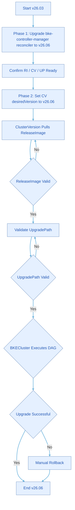

# Upgrade Guide from v26.03 to v26.06

>  **Note:**<br />For the upgrade system overview and guide navigation, see [Before You Upgrade](./before_you_upgrade.md).

## Background Information

This document describes the complete operation process for upgrading an openFuyao v26.03 cluster to v26.06. v26.06 provides declarative component management capabilities: through the coordination of three CRs (Custom Resources) — `ClusterVersion`, `ReleaseImage`, and `UpgradePath` — the reconciler automatically completes version validation, upgrade path planning, and component DAG (Directed Acyclic Graph) rolling upgrade.

v26.03 clusters do not have the above capabilities by default and must complete the upgrade in two phases:

| Phase | Objective | Operation Summary |
| ---- | ---- | -------- |
| Phase 1 | Upgrade the management plane (bke-controller-manager reconciler) | Install new CRDs (Custom Resource Definitions) / Webhook / RBAC, upgrade `bke-controller-manager` to v26.06 |
| Phase 2 | Upgrade the business cluster version | Modify `ClusterVersion.spec.desiredVersion` to v26.06, triggering declarative DAG upgrade |

Upgrade path:

```
v26.03  →  v26.06
```

The upgrade process overview is as follows:



>  **Note:**<br />In the flowchart, RI (ReleaseImage), CV (ClusterVersion), and UP (UpgradePath) are abbreviations for CRs related to declarative upgrade; DAG is the abbreviation for Directed Acyclic Graph.

## Scope of Application

>  **Note:**<br />
> The following operation steps are for the manual upgrade process executed via backend command line (`kubectl` etc.) in an online environment. Supplementary notes for offline environments and frontend (openFuyao management plane) scenarios are provided below, without specific operation steps.

The online environment described in this document refers to a management cluster that can access the public image repository (such as `cr.openfuyao.cn`); the offline environment refers to a management cluster that uses a local/private image repository and cannot directly access the public network. In both environments, you can choose to initiate upgrades via backend command line or the openFuyao management plane, with the main difference being how images and OCI artifacts are obtained.

| Scenario | Description |
| ---- | ---- |
| Online + Backend | The default scenario in this document. The cluster can access the public image repository; upgrade packages and images can be directly downloaded or pulled; phase division and command operations are written for this environment. |
| Offline + Backend | A common upgrade scenario. The operation steps for Phase 1 and Phase 2 are the same as in this document, but the upgrade packages, reconciler images, and OCI (Open Container Initiative) artifacts (`release-image`, `upgrade-path`) must be synchronized to the local image repository in advance, and `IMAGE_REPO` must be replaced with the local repository prefix in [Step 3](#step-3-update-the-reconciler-and-confirm-resources-ready) [Section 3.2](#32-replace-and-apply-the-reconciler-deployment-yaml). For general requirements on image preparation and synchronization, refer to [Upgrade Guide](./backend_declarative_upgrade_guide.md#offline-scenario-upgrade-operations); this document does not expand on offline-specific preparation processes. |
| Frontend (Management Plane) | Suitable for scenarios where Phase 1 is completed and Phase 2 is to be triggered via GUI. The `installer-service` image in the management cluster must first be changed to the higher version corresponding to v26.06, then the upgrade can be executed in the openFuyao management plane "Cluster Lifecycle Management"; Phase 1 (bke-controller-manager reconciler upgrade and RI/CV/UP readiness confirmation) must still be completed following the backend steps in this document. In offline environments, image/OCI artifact synchronization must also be completed first. |

## Upgrade Package Download and Directory Structure

The CRD, Webhook, ClusterRole, reconciler ConfigMap/Deployment manifests required for v26.03 → v26.06 management plane upgrade are packaged as a zip release. Please download and extract it to the management node:

Download URL:

[https://openfuyao.obs.cn-north-4.myhuaweicloud.com/openFuyao/ext-components/upgrade/v26.03-to-v26.06.zip](https://openfuyao.obs.cn-north-4.myhuaweicloud.com/openFuyao/ext-components/upgrade/v26.03-to-v26.06.zip)

Download and extraction example:

```bash
export UPGRADE_ZIP_URL="https://openfuyao.obs.cn-north-4.myhuaweicloud.com/openFuyao/ext-components/upgrade/v26.03-to-v26.06.zip"

# Download
curl -fL -o v26.03-to-v26.06.zip "${UPGRADE_ZIP_URL}"

# Extract (the zip should contain a single top-level directory v26.03-to-v26.06/)
unzip v26.03-to-v26.06.zip

# Verify directory structure
test -d v26.03-to-v26.06/crd \
  && test -d v26.03-to-v26.06/webhook \
  && test -d v26.03-to-v26.06/clusterRole \
  && test -d v26.03-to-v26.06/provider

export PKG_ROOT="$(pwd)/v26.03-to-v26.06"
cd "${PKG_ROOT}"
```

The directory structure after extraction is as follows:

```
v26.03-to-v26.06/
├── crd/                                        # Step 1: CRD manifests
│   ├── bke.bocloud.com_bkeclusters.yaml        # Existing CRD with new fields
│   ├── config.openfuyao.com_clusterversions.yaml   # New CRD
│   ├── config.openfuyao.com_componentversions.yaml # New CRD
│   ├── config.openfuyao.com_releaseimages.yaml     # New CRD
│   └── config.openfuyao.com_upgradepaths.yaml      # New CRD
├── webhook/                                    # Step 2: Webhook
│   └── webhook.yaml                            #   ValidatingWebhookConfiguration
├── clusterRole/                                # Step 2: RBAC
│   └── ClusterRole.yaml                        #   bke-manager-role permission extension
└── provider/                                   # Step 3: Reconciler
    ├── 001-configmap.yaml                      #   cluster-system/bke-controller-manager-ologger-config
    └── 002-deployment.yaml                     #   bke-controller-manager Deployment
```

**Table 1** Upgrade Package File Description

| Path | Resource Type | Purpose |
| ---- | -------- | ---- |
| `crd/bke.bocloud.com_bkeclusters.yaml` | CRD | Update BKECluster resource definition |
| `crd/config.openfuyao.com_clusterversions.yaml` | CRD | Declarative upgrade: ClusterVersion |
| `crd/config.openfuyao.com_componentversions.yaml` | CRD | Declarative upgrade: ComponentVersion |
| `crd/config.openfuyao.com_releaseimages.yaml` | CRD | Declarative upgrade: ReleaseImage |
| `crd/config.openfuyao.com_upgradepaths.yaml` | CRD | Declarative upgrade: UpgradePath |
| `webhook/webhook.yaml` | ValidatingWebhookConfiguration | BKECluster, UpgradePath validation |
| `clusterRole/ClusterRole.yaml` | ClusterRole | Extend reconciler permissions to access declarative CRs and other resources |
| `provider/001-configmap.yaml` | ConfigMap | Reconciler log configuration `cluster-system/bke-controller-manager-ologger-config` |
| `provider/002-deployment.yaml` | Deployment | bke-controller-manager reconciler (with image placeholders) |

## Prerequisites

- The cluster's current openFuyao version is v26.03, and the BKECluster status is healthy (`STATE=Healthy`, `CLUSTER STATUS=Ready`).
- The v26.03-to-v26.06 zip package has been obtained and extracted from the [upgrade package download URL](#upgrade-package-download-and-directory-structure).
- The upgrade-required images (see [Image List](#image-list)) have been pushed to an image repository accessible by the cluster (must be completed in advance for offline scenarios).
- The `UpgradePath` CR has defined a valid upgrade path from v26.03 → v26.06.
- etcd data has been backed up before upgrading for manual rollback in case of upgrade failure.

## Usage Restrictions

- Only version upgrade is supported; version downgrade is not supported.
- When upgrading Kubernetes-related components in a non-high-availability cluster, there will be a brief apiserver service unavailability.
- In offline scenarios, `release-image`, `upgrade-path`, and reconciler images (cluster-api-provider-bke and bke-manifests) must be synchronized to the local image repository in advance, and the reconciler Pod must be able to access the repository address.

## Image List

The following images must be prepared in advance for v26.03 → v26.06 upgrade. The reconciler container image tag is `26.6.0`; the `release-image` OCI artifact tag matches the openFuyao version number (both `v26.03` and `v26.06` tags must be prepared); `upgrade-path` always uses the `latest` tag.

**Table 2** Images Required for Upgrade

| Image Name | Image Tag | openFuyao Version | Type | Purpose |
| -------- | -------- | -------------- | ---- | ---- |
| `cluster-api-provider-bke` | `26.6.0` | v26.06 | Container Image | bke-controller-manager reconciler main container |
| `bke-manifests` | `26.6.0` | v26.06 | Container Image | Reconciler init container, distributes component manifests to the Pod |
| `release-image` | `v26.03` | v26.03 | OCI Artifact | Component information corresponding to v26.03 version |
| `release-image` | `v26.06` | v26.06 | OCI Artifact | Component information corresponding to v26.06 version |
| `upgrade-path` | `latest` | — | OCI Artifact | Pulled by UpgradePath reconciler, carries the version upgrade path graph |

Online environment (default repository) complete reference example:

```
cr.openfuyao.cn/openfuyao/cluster-api-provider-bke:26.6.0
cr.openfuyao.cn/openfuyao/bke-manifests:26.6.0
cr.openfuyao.cn/openfuyao/release-image:v26.03
cr.openfuyao.cn/openfuyao/release-image:v26.06
cr.openfuyao.cn/openfuyao/upgrade-path:latest
```

>  **Note:**<br />The `openfuyao` in the image repository path is the repository namespace (lowercase), which differs in case from the product name openFuyao.

Offline environment (local image repository) example:

Replace `{IMAGE_REPO}` with the on-site repository prefix (including trailing `/`, consistent with `IMAGE_REPO` in [Step 3](#step-3-update-the-reconciler-and-confirm-resources-ready) [Section 3.2](#32-replace-and-apply-the-reconciler-deployment-yaml), such as `192.168.201.86:5443/test/`):

```
{IMAGE_REPO}cluster-api-provider-bke:26.6.0
{IMAGE_REPO}bke-manifests:26.6.0
{IMAGE_REPO}release-image:v26.03
{IMAGE_REPO}release-image:v26.06
{IMAGE_REPO}upgrade-path:latest
```

>  **Note:**<br />
>
> - Version number and image tag: The image tags for `cluster-api-provider-bke` and `bke-manifests` are `26.6.0`; the OCI tags for `release-image` match the version numbers (`v26.03`, `v26.06`); `upgrade-path` is always `latest`.<br />
> - `release-image:v26.03` is required: After Phase 1 reconciler upgrade, the ClusterVersion/ReleaseImage reconciler will reconcile the RI for the current version v26.03, and must be able to pull `release-image:v26.03`; if only `v26.06` is pushed without `v26.03`, `openfuyao-v26.03` may not enter the `Valid` state.<br />
> - `release-image` and `upgrade-path` are OCI artifacts and must be pushed to the corresponding paths according to the image repository configuration in the cluster's `bke-config` (if both domain and IP addresses are used, they must be synchronized separately).<br />
> - After Phase 1 is completed and the reconciler is upgraded to v26.06, the management plane will automatically pull `upgrade-path:latest` and reconcile the `UpgradePath` CR; before Phase 2 is triggered, ensure that `release-image:v26.06` is accessible by the reconciler.

## Operation Steps

The following describes the manual operation process for upgrading from v26.03 to v26.06 in an online environment via backend command line. Supplementary notes for offline environments and frontend scenarios can be found in [Scope of Application](#scope-of-application).

>  **Note:**<br />For general pre-upgrade preparation (version configuration files, image package preparation, etc.), refer to [Upgrade Guide](./backend_declarative_upgrade_guide.md#offline-scenario-upgrade-operations); The following table lists the preparation items specific to upgrading from v26.03 to v26.06.

**Table 3** Pre-upgrade Preparation Checklist

| No. | Upgrade Preparation Item | Preparation Content | Recommended Start Time | Time Required |
| ---- | ---------------------- |------------------------------------------------------------------------------------------------| ------------ | ------- |
| 1 | Cluster Status Check | Confirm BKECluster status is healthy (`STATE=Healthy`, `CLUSTER STATUS=Ready`) | Before upgrade | 1 minute |
| 2 | Download Upgrade Package | Download and extract the zip, confirm `crd/`, `webhook/`, `clusterRole/`, `provider/` directories are complete | Before upgrade | 5 minutes |
| 3 | Review ologger ConfigMap | Adjust log level, rotation policy, etc. in `ologger.yaml` within `provider/001-configmap.yaml` as needed | Before upgrade | 5 minutes |
| 4 | Push Images | Push `release-image`, `upgrade-path`, `cluster-api-provider-bke`, `bke-manifests` to the image repository per [Image List](#image-list) | One day before upgrade | 10 minutes |
| 5 | Synchronize Binary Files (if needed) | If the release-image contains binary files that need separate preparation, upload them to the bootstrap node `/bke/mount/source_registry/files/` directory | One day before upgrade | 10 minutes |
| 6 | Render Reconciler YAML | Replace image placeholders in `provider/002-deployment.yaml` to generate an applicable manifest | Before upgrade | 5 minutes |
| 7 | Backup etcd | Backup etcd data before upgrading for manual rollback in case of failure | Before upgrade | 10 minutes |

For v26.06, run the following commands to download the bkeagent binary files, then copy them to the bootstrap node's `/bke/mount/source_registry/files/` directory.

```bash
curl -L -o bkeagent-26.6.0-linux-arm64 https://openfuyao.obs.cn-north-4.myhuaweicloud.com/openFuyao/cluster-api-provider-bke/releases/download/26.6.0/bkeagent_linux_arm64
curl -L -o bkeagent-26.6.0-linux-amd64 https://openfuyao.obs.cn-north-4.myhuaweicloud.com/openFuyao/cluster-api-provider-bke/releases/download/26.6.0/bkeagent_linux_amd64
cp bkeagent-26.6.0-linux-arm64 bkeagent-26.6.0-linux-amd64 /bke/mount/source_registry/files/
```

### Phase 1: Upgrade the Management Plane (bke-controller-manager Reconciler)

The following steps upgrade the bke-controller-manager reconciler in the management cluster to v26.06, enabling the cluster with declarative component management capabilities. Do not modify `ClusterVersion.spec.desiredVersion` before completing this phase.

<a id="step-1-install-new-crds"></a>

#### Step 1: Install New CRDs

Execute in the management cluster at the upgrade package root directory `${PKG_ROOT}` to install all CRDs (including BKECluster updates and declarative upgrade CRDs):

```bash
cd "${PKG_ROOT}"
kubectl apply -f crd/
```

Confirm CRDs are registered:

```bash
kubectl get crd | grep -E 'bkeclusters.bke.bocloud.com|config.openfuyao.com'
```

Expected output should include at least: `bkeclusters.bke.bocloud.com`, `clusterversions.config.openfuyao.com`, `componentversions.config.openfuyao.com`, `releaseimages.config.openfuyao.com`, `upgradepaths.config.openfuyao.com`.

<a id="step-2-install-new-webhook-and-clusterrole"></a>

#### Step 2: Install New Webhook and ClusterRole

Apply the Webhook and ClusterRole at `${PKG_ROOT}`:

```bash
kubectl apply -f webhook/webhook.yaml
kubectl apply -f clusterRole/ClusterRole.yaml
```

Confirm Webhook and RBAC resources are ready:

```bash
kubectl get validatingwebhookconfiguration bke-validating-webhook-configuration
kubectl get clusterrole bke-manager-role
```

<a id="step-3-update-the-reconciler-and-confirm-resources-ready"></a>

#### Step 3: Update the Reconciler and Confirm Resources Ready

[Step 2](#step-2-install-new-webhook-and-clusterrole) has updated the Webhook and RBAC; this step first installs the reconciler log ConfigMap, then replaces and applies the reconciler deployment YAML to upgrade bke-controller-manager to v26.06.

<a id="31-install-or-update-the-reconciler-ologger-configmap"></a>

##### 3.1 Install/Update the Reconciler ologger ConfigMap

The v26.06 reconciler loads log configuration via the `OLOGGER_CONFIG` environment variable (default path `/etc/openFuyao/ologger/ologger.yaml`). The upgrade package `provider/001-configmap.yaml` provides `cluster-system/bke-controller-manager-ologger-config`, which must be applied before updating the Deployment:

```bash
cd "${PKG_ROOT}"
kubectl apply -f provider/001-configmap.yaml
```

Confirm ConfigMap is ready:

```bash
kubectl -n cluster-system get configmap bke-controller-manager-ologger-config -o yaml
```

<a id="32-replace-and-apply-the-reconciler-deployment-yaml"></a>

##### 3.2 Replace and Apply the Reconciler Deployment YAML

1. Use `provider/002-deployment.yaml` from the upgrade package, which defines `Deployment/bke-controller-manager` (namespace `cluster-system`).

2. Replace the placeholders in the YAML template (must be completed before applying):

   | Placeholder | Meaning | Replacement Example |
   | ------ | ---- | -------------- |
   | `{{ if .repo }}{{ .repo }}{{ else }}cr.openfuyao.cn/openfuyao/{{ end }}` | Image repository prefix (including trailing `/`); defaults to `cr.openfuyao.cn/openfuyao/` when empty | `192.168.201.86:5443/test/` |
   | `{{.providerVersion}}` | Reconciler image tag (openFuyao v26.06 corresponds to `26.6.0`) | `26.6.0` |
   | `{{.manifestsVersion}}` | Manifests init container image tag (openFuyao v26.06 corresponds to `26.6.0`) | `26.6.0` |

   Typical rendered images:

   - Main container: `{IMAGE_REPO}cluster-api-provider-bke:26.6.0`
   - Init container: `{IMAGE_REPO}bke-manifests:26.6.0`

3. Generate the rendered manifest at `${PKG_ROOT}`:

   ```bash
   cd "${PKG_ROOT}"

   export IMAGE_REPO="192.168.201.86:5443/test/"
   export PROVIDER_VERSION="26.6.0"
   export MANIFESTS_VERSION="26.6.0"

   sed -e "s|{{ if .repo }}{{ .repo }}{{ else }}cr.openfuyao.cn/openfuyao/{{ end }}|${IMAGE_REPO}|g" \
       -e "s|{{.providerVersion}}|${PROVIDER_VERSION}|g" \
       -e "s|{{.manifestsVersion}}|${MANIFESTS_VERSION}|g" \
       provider/002-deployment.yaml > /tmp/bke-controller-manager.rendered.yaml
   ```

4. Apply the reconciler deployment:

   ```bash
   # Replace with the new deployment
   kubectl replace -f /tmp/bke-controller-manager.rendered.yaml
   ```
   
5. Wait for the reconciler rolling update to complete and verify the image:

   ```bash
   kubectl -n cluster-system rollout status deployment/bke-controller-manager
   kubectl -n cluster-system get pods -l control-plane=controller-manager -o wide
   kubectl -n cluster-system get deployment bke-controller-manager \
     -o jsonpath='manager={.spec.template.spec.containers[?(@.name=="manager")].image}{"\n"}'
   ```

   Expected image example: `192.168.201.86:5443/test/cluster-api-provider-bke:26.6.0`

>  **Note:**<br />
> - Do not directly apply `provider/002-deployment.yaml` without replacing placeholders, otherwise the Deployment cannot create valid Pods.<br />
> - In offline scenarios, `cluster-api-provider-bke:26.6.0`, `bke-manifests:26.6.0`, `release-image:v26.03`, and `release-image:v26.06` must be pushed to the repository indicated by `IMAGE_REPO` in advance.

##### 3.3 Confirm Declarative Upgrade Resources Ready

Observe that the following three types of resources are all ready before proceeding to Phase 2:

   (1) RI: The RI for the current version v26.03 has been created and `PHASE=Valid` (must have pushed and be able to pull `release-image:v26.03`).

   ```bash
   kubectl get releaseimage -n bke-cluster
   ```

   Output example:

   ```
   NAME               VERSION   PHASE
   openfuyao-v26.03   v26.03    Valid
   ```

   (2) CV: The CV resource has been created and `PHASE=Ready`, with `CURRENT` being v26.03.

   ```bash
   kubectl get cv -n bke-cluster
   ```

   Output example:

   ```
   NAME          DESIRED   CURRENT   PHASE
   bke-cluster   v26.03    v26.03    Ready
   ```

   (3) UP: The UP resource has been created and `PHASE=Active`, containing the v26.03 → v26.06 path.

   After the reconciler is upgraded to v26.06, UpgradePath is automatically pulled from the image repository by the built-in OCI digest monitor on a 5-minute cycle, fetching `upgrade-path:latest` and reconciling the UP CR. When checking the UP resource, if it has not yet been created or has not entered `Active`, please wait for the 5-minute timer to take effect; the reconciler will automatically complete the pull and reconcile, no manual creation is needed.

   ```bash
   kubectl get upgradepath openfuyao-upgrade-paths -o yaml
   ```

>  **Note:**<br />Do not proceed to Phase 2 until all three types of resources are ready. UpgradePath relies on a 5-minute periodic pull; please allow corresponding waiting time when checking.

---

### Phase 2: Upgrade the Cluster to v26.06

After the bke-controller-manager reconciler has been upgraded to v26.06 and resources are ready, trigger the declarative upgrade by modifying `ClusterVersion`.

#### Step 1: Edit ClusterVersion to Trigger Upgrade

Modify `spec.desiredVersion` to v26.06:

```bash
kubectl edit cv bke-cluster -n bke-cluster
```

```yaml
spec:
  desiredVersion: v26.06
```

After saving and exiting, the reconciler will automatically: pull v26.06 ReleaseImage → validate UpgradePath → execute declarative DAG upgrade on BKECluster.

Observe the upgrade progress (approximately 10~20 minutes total):

```bash
# Observe CV: PreChecking → Ready
kubectl get cv -n bke-cluster bke-cluster -w

# Observe v26.06 RI creation and transition to Valid
kubectl get releaseimage -n bke-cluster -w
```

Confirm after upgrade completion:

```bash
kubectl get cv -n bke-cluster bke-cluster
```

Output example:

```
NAME          DESIRED   CURRENT   PHASE
bke-cluster   v26.06    v26.06    Ready
```

```bash
kubectl get releaseimage -n bke-cluster
```

Output example:

```
NAME               VERSION   PHASE
openfuyao-v26.03   v26.03    Valid
openfuyao-v26.06   v26.06    Valid
```

**Table 4** Key Log Nodes for Normal Upgrade

| Time Sequence | Component | Key Log |
| ------ | --------------------- | ------------------------------------------------------------ |
| T+0 | ClusterVersion Reconciler | `pulling release image` (`.../release-image:v26.06`) |
| T+N | ClusterVersion Reconciler | `release image pulled` |
| T+N | ClusterVersion Reconciler | `upgrade precheck passed, BKECluster marked upgrade-ready` |
| T+N | BKECluster Reconciler | `running declarative upgrade DAG` |
| T+M | ClusterVersion Reconciler | `status.currentVersion` updated to v26.06, `PHASE=Ready` |
