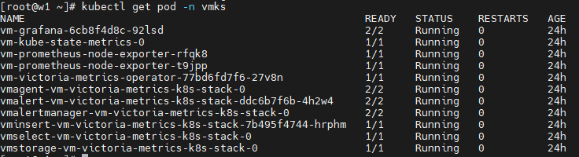
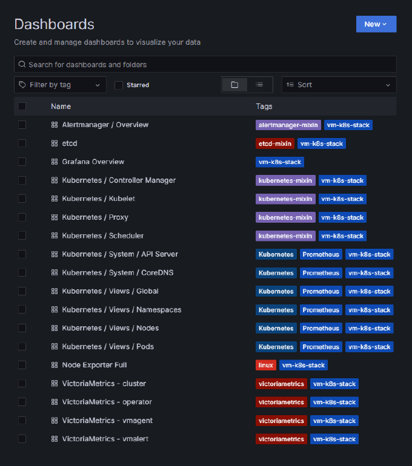
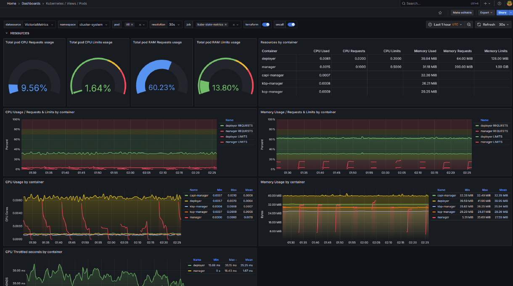

# victoriametrics_controller User Guide

## Background Information

VictoriaMetrics is a high-performance time-series database specifically designed for cloud-native monitoring. It significantly reduces storage costs through lossless compression, optimizes query engines for fast PromQL response, and supports horizontal scaling and multi-tenant isolation. Fully compatible with Prometheus, it can serve as a long-term storage alternative, providing high availability with lower resource consumption.

The openFuyao community configures victoriametrics-related parameters in the addon section of BKECluster. When processing BKECluster, the reconciler pulls the victoriametrics_controller image based on these parameters. This image runs on nodes by starting Pods, renders the values.yaml file in the VictoriaMetrics Helm Chart according to user-provided configurations, completes the installation of VictoriaMetrics components, and automatically adapts related configurations based on actual conditions.

**Terminology**

| Term | Description |
| --- | --- |
| VictoriaMetrics (VM) | An enhanced backend for Prometheus that is 100% compatible with the Prometheus API, PromQL, and data formats. Grafana dashboards, alerting rules, and clients can be integrated without any modification, focusing on solving high cardinality, high throughput, and high availability problems in large-scale scenarios. |
| VMCluster | The VM cluster-mode monitoring stack, which adopts a component-separated architecture consisting of vminsert (data writing), vmstorage (data storage), and vmselect (data query). Each component supports independent scaling. |
| VMAgent | A metric collection agent component that supports both Pull and Push collection modes, with data deletion, window aggregation, and multi-remote-write capabilities. When the remote storage is unavailable, it can automatically degrade to buffering data locally and synchronize it after recovery. |
| BKECluster CR | A custom resource that describes the desired configuration of a service cluster (nodes, network, addons, versions, etc.) and aggregates the cluster status. |
| BKENode CR | A custom resource that describes the identity, connection information, and roles of service cluster nodes. |
| Reconciler | The controller of Cluster API and the BKE provider, which continuously compares the desired cluster state with the actual state and performs reconciliation operations. |
| Addon | An extension component declared through the Addons field of BKECluster. It supports both yaml and chart forms and is installed by the reconciler when processing BKECluster. |

For the terminology, see the [VictoriaMetrics ultra-large-scale cluster monitoring best practice of sig-large-scale-cluster](https://gitcode.com/openFuyao/sig-large-scale-cluster/blob/master/docs/en/best_practice/best_practices_for_ultra_large_scale_cluster_monitoring_based_on_the_victoriametrics_software_stack.md).

## Prerequisites

- The service cluster has been installed by referring to [Service Cluster Deployment Guide (Linux Backend)](../cluster_installation_guide/service_cluster_installation/service_cluster_deployment_guide_(linux_backend).md).
- The cluster has available CPU, memory, and storage resources matching the monitoring scale. The cluster resource situation given by the [VictoriaMetrics ultra-large-scale cluster monitoring best practice of sig-large-scale-cluster](https://gitcode.com/openFuyao/sig-large-scale-cluster/blob/master/docs/en/best_practice/best_practices_for_ultra_large_scale_cluster_monitoring_based_on_the_victoriametrics_software_stack.md) is as follows (estimated with replicationFactor=2 and 7-day retention; a 1 million/s ingestion rate results in 2 million/s inside the VMCluster due to dual writes, so resources are estimated at double):

    **Cluster resource situation** (from Table 1 of the upstream best practice):

    | VMAgent ingestion rate | CPU | Memory (GiB) | Storage (GiB) |
    |---|---|---|---|
    | 1 million/s | 116 | 438 | 1100 |
    | 2 million/s | 148 | 450 | 1620 |
    | 3 million/s | 210 | 510 | 2880 |
    | 4 million/s | 234 | 576 | 3640 |
    | 5 million/s | 310 | 670 | 4260 |

    >  **Note:**<br />The preceding recommended resource configuration applies to large-scale clusters (1 million/s < data ingestion rate < 5 million/s). Clusters of other scales require separate tuning. The specific number of nodes is determined by the cluster scale and parameter planning. The source document does not provide a fixed node count baseline.
    >
    > Monitoring components occupy considerable CPU, memory, storage, and network resources on a single node. It is recommended to plan dedicated nodes for deploying monitoring components. It is recommended to use SSDs to store monitoring data, and each VMStorage instance should exclusively occupy one disk.
- If parameters are not customized, the system deploys with the default parameter group in Table 1. Ensure that node resources satisfy the default CPU, memory, and storage configuration of each component.
- If you need to control the nodes on which components are scheduled, labels for component scheduling have been added to the corresponding nodes in the BKENode CR. For details, see step 2.

## Usage Limitations

Among the currently available installable plugins, since the openFuyao management plane includes the installation of the Prometheus monitoring component by default, but VictoriaMetrics and Prometheus have the following compatibility issues, it is not recommended to install both simultaneously.

- Port Conflict: VictoriaMetrics, as an enhanced backend for Prometheus, also occupies port 9090 by default to provide API compatibility services, preventing both from running normally at the same time.

- Data Duplication: If forcibly deployed, both will scrape the same Targets simultaneously, causing monitoring data duplication.

VictoriaMetrics is primarily designed for ultra-large-scale monitoring scenarios. Its advantages in resource utilization, linear scalability, and protocol optimization are fully demonstrated when monitoring data volume is huge, metric cardinality is extremely high, or production-grade high-availability architecture needs to be built. For small to medium-scale scenarios, the Prometheus component that comes with openFuyao can already meet basic monitoring needs.

If you need to use VictoriaMetrics' efficient storage and high-availability capabilities in ultra-large-scale scenarios, it is recommended to disable or uninstall the Prometheus component that comes with openFuyao before deployment, to fully leverage VM's advantages in resource utilization and scalability.

## Procedure

Follow the steps below to install victoriametrics.

1. Edit the `cluster CR`, add the necessary parameters for the victoriametrics component in the `spec.ClusterConfig` field, and complete monitoring-related configuration based on requirements and environmental resources.

    >  **Note:**<br />For an existing cluster, you need to modify the cluster configuration file (`1master-cluster.yaml`) and the node information file (`1master-node.yaml`) in the `/bke/cluster/` directory on the bootstrap node to complete the preceding `cluster CR` and `node CR` configuration. For details, see [Service Cluster Deployment Guide (Linux Backend)](../cluster_installation_guide/service_cluster_installation/service_cluster_deployment_guide_(linux_backend).md).

    The VictoriaMetrics monitoring stack (VictoriaMetrics K8s Stack) includes vmAgent, vmSelect, vmStorage, vmInsert, vmAlert, vmAlertManager, Grafana, kubeStateMetrics, and other components. The content that users need to configure in the CR specifies the working mode of victoriametrics and specifies replicas, shard quantities, resource configurations, and metric scraping configurations for these components.

    **Default Values**: Considering the large number of parameters, there are certain difficulties for users configuring victoriametrics for the first time. Therefore, if the user does not customize parameters, the system will automatically apply preset default parameter groups. This parameter group is optimized for scenarios where the cluster data ingestion rate is 2 million/s, uses high-availability configuration methods, and ensures that monitoring business is not affected when some nodes fail. Using verified recommended configurations ensures stable monitoring under this load.

    **Table 1** victoriametrics Parameters and Default Value Description
    |Parameter|Description|Default Value|
    |---|---|---|
    |imageRepo|Image repository address, automatically switched during offline installation.|hub.oepkgs.net/openfuyao|
    |version|victoriametrics helm chart version.|0.58.2|
    |useVMSingle|Whether to use victoriametrics single-node mode. For ultra-large-scale cluster scenarios, cluster mode is recommended. After disabling this parameter, cluster mode is enabled by default.|false|
    |vmSingleStorageSize|victoriametrics single-node mode storage size, in GiB.|50Gi|
    |vmAgentAllowStatefulSet|Whether to allow VMAgent to be changed to StatefulSet mode. After changing to StatefulSet mode, when the storage node is down, VMAgent will save data locally.|true|
    |vmAgentCpuCount|Number of CPUs allocated to VMAgent component.|4|
    |vmAgentMemorySize|Memory size allocated to VMAgent component, in GiB.|8Gi|
    |vmAgentStorageSize|Storage size allocated to VMAgent component, in GiB.|60G|
    |vmAgentReplicaCount|Number of replicas for VMAgent component.|2|
    |vmAgentShareCount|Number of horizontal shards for VMAgent.|2|
    |vmAgentScrapeInterval|Metric scraping interval for VMAgent component.|20s|
    |vmSelectCpuCount|Number of CPUs allocated to VMSelect component.|12|
    |vmSelectMemorySize|Memory size allocated to VMSelect component, in GiB.|24Gi|
    |vmSelectStorageSize|Storage size allocated to VMSelect component, in GiB.|35Gi|
    |vmSelectReplicaCount|Number of replicas for VMSelect component.|2|
    |vmStorageCPUCount|Number of CPUs allocated to VMStorage component.|5|
    |vmStorageMemorySize|Memory size allocated to VMStorage component, in GiB.|32Gi|
    |vmStorageStorageSize|Storage size allocated to VMStorage component, in GiB.|720Gi|
    |vmStorageReplicaCount|Number of replicas for VMStorage component.|10|
    |vmInsertReplicaCount|Number of replicas for VMInsert.|6|
    |vmInsertCpuCount|Number of CPUs allocated to VMInsert component.|4|
    |vmInsertMemorySize|Memory size allocated to VMInsert component, in GiB.|8Gi|
    |vmAlertReplicaCount|Number of replicas for VMAlert component.|2|
    |vmAlertCpuCount|Number of CPUs allocated to VMAlert component.|4|
    |vmAlertMemorySize|Memory size allocated to VMAlert component, in GiB.|16Gi|
    |vmAlertManagerReplicaCount|Number of replicas for VMAlertManager component.|2|
    |vmAlertManagerCpuCount|Number of CPUs allocated to VMAlertManager component.|4|
    |vmAlertManagerMemorySize|Memory size allocated to VMAlertManager component, in GiB.|16Gi|
    |vmClusterRetentionPeriod|VMCluster data retention time, in h (hours), d (days), w (weeks), y (years).|15d|
    |vmClusterReplicationFactor|VMCluster data replication factor.|2|
    |grafanaNodePort|Grafana node port.|30010|
    |kubeStateMetricsAutoSharding|Whether to enable KubeStateMetrics automatic sharding.|true|
    |kubeStateMetricsReplicaCount|Number of replicas for KubeStateMetrics component.|3|
    |kubeStateMetricsCpuCount|Number of CPUs allocated to KubeStateMetrics component.|4|
    |kubeStateMetricsMemorySize|Memory size allocated to KubeStateMetrics component, in GiB.|12Gi|

    **Example**: Below is a complete configuration example of a minimal cluster mode monitoring stack, with each component count set to 1, which can meet small cluster monitoring needs.
      
    ```yaml
    spec:
      ClusterConfig:
        - name: victoriametrics-controller
          param:
            useVMSingle: false
            vmSingleStorageSize: 50Gi
            vmAgentAllowStatefulSet: true
            vmAgentCpuCount: 0.5
            vmAgentMemorySize: 2Gi
            vmAgentStorageSize: 10Gi
            vmAgentReplicaCount: 1
            vmAgentShareCount: 1
            vmAgentScrapeInterval: 20s
            vmSelectCpuCount: 0.5
            vmSelectMemorySize: 2Gi
            vmSelectStorageSize: 10Gi
            vmSelectReplicaCount: 1
            vmStorageCPUCount: 0.5
            vmStorageMemorySize: 2Gi
            vmStorageStorageSize: 20Gi
            vmStorageReplicaCount: 1
            vmInsertReplicaCount: 1
            vmInsertCpuCount: 0.5
            vmInsertMemorySize: 2Gi
            vmAlertReplicaCount: 1
            vmAlertCpuCount: 0.5
            vmAlertMemorySize: 1Gi
            vmAlertManagerReplicaCount: 1
            vmAlertManagerCpuCount: 0.5
            vmAlertManagerMemorySize: 1Gi
            vmClusterRetentionPeriod: 15d
            vmClusterReplicationFactor: 1
            grafanaNodePort: 30010
            kubeStateMetricsAutoSharding: true
            kubeStateMetricsReplicaCount: 1
            kubeStateMetricsCpuCount: 0.5
            kubeStateMetricsMemorySize: 2Gi
          version: latest
    ```

2. Edit the `node CR`, add the labels required for the victoriametrics component in the corresponding node's `spec` field.

    Various VictoriaMetrics components can implement scheduling control through node labels. The involved component labels include:

    - monitoring.victoria.com/vmstorage=vmstorage
    - monitoring.victoria.com/vminsert=vminsert
    - monitoring.victoria.com/vmselect=vmselect
    - monitoring.victoria.com/vmagent=vmagent
    - monitoring.victoria.com/vmalert=vmalert
    - monitoring.victoria.com/vmalertmanager=vmalertmanager
    - monitoring.victoria.com/vm-grafana=vm-grafana
    - monitoring.victoria.com/metrics=kube-state-metrics

    Users can mark corresponding labels on nodes that allow scheduling of corresponding monitoring components according to actual needs. During installation, each component will only be scheduled to nodes with corresponding labels.

    **Example**: In the configuration file, all components are scheduled to the same worker node.

    ```yaml
    apiVersion: bke.bocloud.com/v1beta1
    kind: BKENode
    metadata:
      labels:
        cluster.x-k8s.io/cluster-name: bke-cluster
      name: bke-cluster-master1
    ...
    ---
    apiVersion: bke.bocloud.com/v1beta1
    kind: BKENode
    metadata:
      labels:
        cluster.x-k8s.io/cluster-name: bke-cluster
      name: bke-cluster-work1
      namespace: bke-cluster
    spec:
      hostname: work1
      ip: *********
      password: *******
      port: "22"
      role:
      - node
      username: root
      labels:
        - key: monitoring.victoria.com/vmstorage
          value: vmstorage
        - key: monitoring.victoria.com/metrics
          value: kube-state-metrics
        - key: monitoring.victoria.com/vminsert
          value: vminsert
        - key: monitoring.victoria.com/vmalert
          value: vmalert
        - key: monitoring.victoria.com/vmselect
          value: vmselect
        - key: monitoring.victoria.com/vmagent
          value: vmagent
        - key: monitoring.victoria.com/vmalertmanager
          value: vmalertmanager
        - key: monitoring.victoria.com/vm-grafana
          value: vm-grafana
    ```
    >  **Note:**<br> When configuring VictoriaMetrics, ensure that there are no conflicts in the parameters. If conflicts exist, the system will report parameter validation errors. Validation rules are shown in Table 2.

      **Table 2** Parameter Validation Rules
     |Rule|Description|
     |---|---|
     |Available Node Count|Available node count for each component = Number of nodes with corresponding labels|
     |Replicas and Shards|Each component replicas &times; shards &le; Available node count for each component|
     |Storage Capacity|Each component storage &le; Actual storage of corresponding node for each component|
  
    > **Notice:**<br> Please ensure the configuration meets all the above rules, otherwise installation will fail.

3. Execute deployment.
   
    Configure VictoriaMetrics parameters in the Spec.ClusterConfig.Addons of BKECluster CR. The reconciler will detect the new addon during the EnsureAddonDeploy stage and automatically execute the deployment process.

   3.1 Users configure VictoriaMetrics plugin-related parameters in `BKECluster CR`, configure node information in `BKENode CR`, apply CR to execute worker cluster installation, and perform parameter checks.
   
   3.2 Parse parameters and obtain the corresponding YAML configuration file from `bkemanifests` based on the plugin name and version, render the YAML template. Call `kubectl apply` through `kube.InstallAddon` to apply the YAML configuration file and pull the `victoriametrics-controller` image in the Pod.
   
   3.3 The `victoriametrics-controller` image executes the task of creating pv, further creates a Job to create the pv path for the corresponding node and issues it. The Job is scheduled to the corresponding node to complete path creation.
   
   3.4 Execute the VictoriaMetrics installation command within the `victoriametrics-controller` node.

   3.5 Issue Jobs to complete certificate-related configuration, static Pod YAML modification, and dashboard configuration.

   3.6 Complete the installation of VictoriaMetrics and update Status.AddonStatus to record deployment results.

4. Verify deployment.
   
   4.1 Cluster status verification.

      After completing the installation of victoriametrics, the corresponding number of component Pods should be pulled up in the corresponding namespace of the cluster, and all should be in `Running` state. Execute the command `kubectl get pod -n <namespace>` to obtain the target node status, as shown in Figure 1.

      **Figure 1** Cluster Status Verification

      

   4.2 Dashboard verification.

      When VictoriaMetrics is running normally, it can successfully collect various performance metrics in the cluster, and Grafana can present these metrics to users in the form of visual panels.

      4.2.1 Execute the command `kubectl get secret vm-grafana -n vmks -o jsonpath="{.data.admin-password}" | base64 --decode` to obtain the login password.

      4.2.2 Enter `http://<Your control node IP>:<Your grafana port number>` in the browser. The HTTP protocol has security risks. HTTPS is recommended. If HTTPS is configured for your Grafana, access it with the `https://` protocol.
      
      4.2.3 Enter the username `admin` and the password obtained in the previous step to log in to the grafana visualization panel.
   
   After logging in, you will see a list of all monitorable dashboards as shown in Figure 2. Users can select different panels to view corresponding monitoring data as needed.

   **Figure 2** grafana All Dashboard List

   

   Taking Pods as an example, Figure 3 shows the monitoring view of their performance metrics.

   **Figure 3** grafana-Pod Metrics Performance

   
   
   
5. Addon update and uninstallation (optional).
   
   - Update: Modify the `version` or `param` of the addon in `BKECluster`, and the reconciler will automatically trigger the update process (re-render YAML and fulfill).
   - Uninstallation: Modify `BKECluster`, remove VictoriaMetrics-related content from the `Spec.ClusterConfig.Addons` field, i.e., all content under the corresponding plugin field of `victoriametrics-controller` (including `name`, `param`, and `version`). The reconciler will automatically trigger the uninstallation process.
