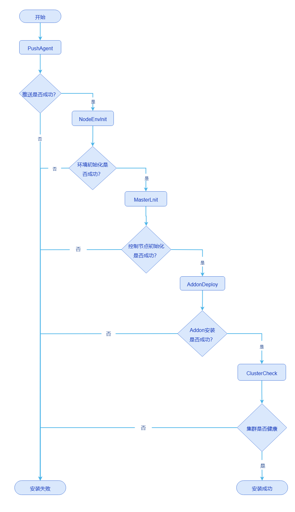

# 集群部署问题定位指导

本文档旨在提供初步的集群部署问题定位指导，用于用户使用openFuyao集群安装工具进行集群部署过程中的问题诊断及定位。

## 背景信息

openFuyao社区提供的bke集群安装工具，其提供的功能如下。

- 引导节点初始化，使用nerdctl拉起k3s、registry和nginx等容器，其中k3s容器会进一步拉起k3s集群，使用内置默认的flannel网络插件，registry和nginx容器分别作为镜像源和文件源服务。
- 引导集群拉起管理集群和业务集群，使用calico网络插件，分配Pod的IP地址，containerd运行时拉起容器。
- 管理集群拉起业务集群。

## 前提条件

使用openFuyao社区的bke集群安装工具部署的集群。

## 使用限制

无。

## 使用场景

- 离线安装包制备失败。
- 引导节点初始化失败。
- 引导集群部署K8s集群失败。

## 参考文档

安装部署相关的详细问题请参见[安装部署FAQ文档](./FAQ.md)。

## 离线安装包制备失败

使用openFuyao安装工具在离线环境进行集群部署时，需要提前制备离线安装包。

### 常见问题及信息收集

离线安装包的制备过程是无中断，一次直接完成的，当出现中断时旧表面制备失败，主要的定位输入信息如下。

- 离线包制备过程中断点附件的终端回显日志。
- `docker pull cr.openfuyao.cn/openfuyao/installer-service:latest`尝试手动拉取镜像，并给出终端回显结果。

## 引导节点初始化失败

执行下面的命令进行引导节点初始化。

```bash
# 在线环境，如果不需要安装openFuyao管理面，可以添加参数   --installConsole=false
bke init --onlineImage cr.openfuyao.cn/openfuyao/bke-online-installed:latest

# 离线环境，如果不需要安装openFuyao管理面，可以添加参数   --installConsole=false
bke init
```

引导集群正常安装成功后，可以执行下面的命令查看容器和集群Pod信息。

```bash
# 查看nerdctl拉起的容器，容器的状态都是UP的
nerdctl ps -a
# 可以使用下面的命令进入到特定的容器内
nerdctl exec -it <container-id> -- sh

# 查看k3s集群的Pod信息，kubeconfig会从/etc/rancher/k3s/k3s.yaml拷贝到/root/.kube/config
kubectl get pod -A -owide
# 注意：如果k3s集群拉起的k8s集群共部署时，查看k3s集群的pod，需要采用下面的命令查看
kubectl --kubeconfig /etc/rancher/k3s/k3s.yaml get pod -A -owide
```

### 常见问题及信息收集

本章节介绍一些常见的错误以及需要收集的定位输入信息。

#### nerdctl容器拉起失败

引导节点初始化会使用nerdctl拉起容器，介绍如下。

- bocloud_nfs_registry：提供网络文件管理功能，暂未使用，启动失败不影响。
- bocloud_chart_registry：提供chart包源服务，本地http的chart源，常用于离线安装时chart源。
- bocloud_yum_registry：提供文件源服务，本质是nginx服务器，在线安装和离线安装均需要。
- bocloud_image_registry：提供镜像源服务，离线安装时镜像源。
- kubernetes：k3s容器，用于后续拉起集群Pod，默认使用flannel网络插件。

如果出现容器启动失败，主要的定位输入信息如下。

- init初始化过程中输出到终端上的回显日志。
- `nerdctl ps a`提供容器状态信息。
- `nerdctl inspect container-id`提供异常容器的详细信息。

#### k3s集群的Pod拉起失败

如果k3s容器成功启动后，后续会部署k3s集群的Pod，下面按照命名空间进行简单介绍。

- `openfuyao-system`：openFuyao组件所在的命名空间，主要有认证、用户管理、插件管理、console和集群管理相关Pod，可选择部署。
- `ingress-nginx`：提供ingress入口服务，配合`openfuyao-system`命名空间的Pod提供openFuyao管理面功能。
- `kube-system`：这个命名空间下只有coredns，配合`openfuyao-system`命名空间的Pod提供openFuyao管理面功能。
- `cluster-system`：部署cluster-api调谐器相关的Pod，提供集群管理的能力，必须部署。

如果出现Pod启动失败，主要的定位输入信息如下。

- `kubectl get pod -A -owide`提供Pod状态信息。
- `kubectl logs -n ns pod-name`提供异常Pod的日志信息。

## 引导集群安装K8s集群

执行下面的命令进行K8s集群的安装。

```bash
# 使用后端安装K8s集群，用户自行替换-f和-n参数指定的文件
bke cluster create -f /bke/cluster/1master-cluster.yaml -n /bke/cluster/1master-node.yaml

# 使用引导节点的openFuyao管理面安装，直接登录https://<引导节点的ip>:30010，输入集群信息进行安装
```

引导集群安装K8s集群的简易流程如下。

**图1** 引导集群安装K8s集群的简易流程



K8s集群正常安装成功后，可以执行下面的命令查看容器和集群Pod信息。

```bash
# 查看containerd拉起的容器，各自节点只能查看到各自节点上的容器
crictl ps -a

# 查看k8s集群的Pod信息
kubectl get pod -A -owide
```

### 常见问题及信息收集

在引导节点上执行`kubectl get bc -A`可以查看集群的状态，确定当前所在的失败阶段。

#### PuashAgent失败

引导集群会给待安装集群的每个节点推送bkeagent节点代理，bkeagent作为系统服务，侦听引导集群的APIServer。

如果出现推送bkeagent失败，主要的定位输入信息如下。

- 引导节点上`bke-controller-manager-xxxxxx`这个Pod的日志，执行下面命令获取。

  ```bash
  # 注意：bke-controller-manager-xxxxxx需要替换为实际Pod的名称
  kubectl logs -n cluster-system bke-controller-manager-xxxxxx -c manager
  ```

- 集群各节点的bkeagent日志，新版本的日志路径为`/var/log/openFuayo/bkeagent.log`，v25.12及之前版本的日志路径为`/var/log/bkeagent.log`。

#### NodeEnvInit失败

推送bkeagent成功后，引导集群会下发commands（一个自定义CRD），节点的bkeagent监控到commands就会进行环境的初始化操作，主要如下。

- 安装containerd。
- 下载脚本和前置操作。
- 设置内核参数。

环境初始化失败时主要是安装containerd失败，主要的定位输入信息如下。

- `systemctl status containerd`查询containerd状态。
- `journalctl -xu containerd -n 200`查看containerd服务的日志。
- 集群各节点的bkeagent日志，新版本的日志路径为`/var/log/openFuayo/bkeagent.log`，v25.12及之前版本的日志路径为`/var/log/bkeagent.log`。

#### MasterInit失败

环境初始化成功后会继续管理节点的初始化操作，主要操作如下。

- `/etc/kubernetes/manifests`目录下生成静态Pod的yaml文件，包括etcd、kube-apiserver、kube-controller-manager和kube-scheduler。
- 安装kubelet。
- 预拉取k8s组件的镜像，包括etcd、kube-apiserver、kube-controller-manager和kube-scheduler。

MasterInit失败，主要的定位输入信息如下。

- 执行命令`systemctl status kubelet`查询kubelet状态。
- 执行命令`journalctl -xu kubelet -n 200`查看kubelet服务的日志。
- 执行命令`crictl images`查询预拉取的镜像，`crictl ps -a`查看容器的状态。
- 执行命令`crictl logs container-id`查询异常容器的日志。

#### AddonDeploy失败

管理节点初始化成功后会继续安装addon，使用openFuyao拉起的K8s集群是以addon粒度拉起Pod，社区常见的addon有calico、coredns、bkeagent-deployer、cluster-api和openfuyao-system-controller，也可以安装用户自定义的addon。这步操作是从引导节点的bke-controller-manager的Pod中拿到addon的yaml文件，渲染参数后通过K8s集群的k8sClient履约到APIServer，进而拉起对应的Pod。

AddonDeploy失败，主要的定位输入信息如下。

- 引导节点上`bke-controller-manager-xxxxxx`这个Pod的日志，执行下面命令获取。

  ```bash
  # 注意：bke-controller-manager-xxxxxx需要替换为实际Pod的名称
  kubectl logs -n cluster-system bke-controller-manager-xxxxxx -c manager
  ```

- K8s集群节点上执行如下命令查看信息。

  ```bash
  # 查看Pod信息
  kubectl get pod -A -owide
  
  # 查看Pod日志，ns-name替换为实际的命名空间，pod-name替换为实际的Pod名称
  kubectl logs -n ns-name pod-name
  
  # 查看Pod的详细信息，ns-name替换为实际的命名空间，pod-name替换为实际的Pod名称
  kubectl describe pod -n ns-name pod-name
  ```