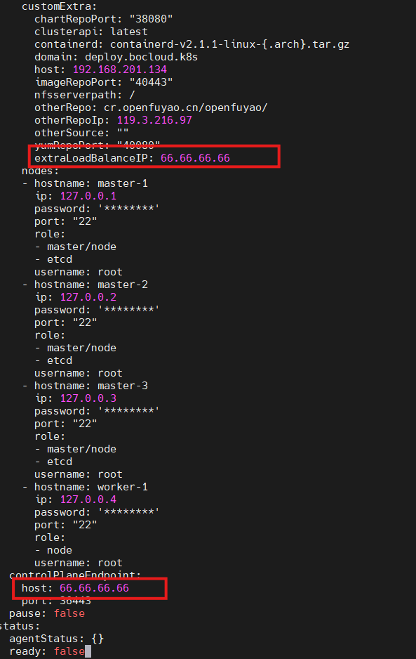

# 自定义集群证书

## 背景信息

openFuyao支持使用自定义CA证书来签发Kubernetes集群内所有组件的证书，以满足企业级安全合规要求。通过导入用户全局CA证书、私钥和证书链，以及配置证书签发策略和签发请求（CSR），可以实现对集群证书体系的完全控制。

本指南基于Kubernetes官方PKI证书配置要求，参考文档：[https://kubernetes.io/zh-cn/docs/setup/best-practices/certificates/](https://kubernetes.io/zh-cn/docs/setup/best-practices/certificates/)。

Kubernetes集群内共需要15个PKI证书，用于不同组件之间的安全通信和身份认证。详细的证书配置信息请参见[附录：PKI证书配置表](./using_custom_cluster_certificates.md#pki证书配置表)。

## 前提条件

在开始配置自定义证书之前，请确保满足以下条件：

1. **证书私钥规格要求**
   
   - 证书类型：必须具有CA签发功能的X.509公钥证书。
   - 私钥格式：必须为PKCS#1格式。

   如不满足，使用以下命令检查私钥格式并进行转换：
   
   ```bash
   # 检查私钥是否为PKCS#1格式
   openssl rsa -in <私钥文件> -text -noout
   ```
   
   ```bash
   # 将私钥转换为PKCS#1格式
   openssl rsa -in <原始私钥文件> -out <转换后的私钥文件>
   ```
2. **文件准备**
   
   - 已准备好全局CA证书文件（`global-ca.crt`）
   - 已准备好全局CA私钥文件（`global-ca.key`）
   - **（可选）** 证书链文件（`trust-chain.crt`）
     - 如果没有提供此文件，apiserver会默认挂载`ca.crt`。
   - **（可选）** 17个JSON配置文件（2个签发策略文件 + 15个CSR配置文件）
     - 如果没有提供这些配置文件，系统将使用代码内置的默认签发策略。
3. **操作时机**
   
   - 必需的证书文件（`global-ca.crt`和`global-ca.key`）必须在**引导节点初始化之前**完成导入。
   - 可选的证书链文件和配置文件（如需要）也应在**引导节点初始化之前**完成导入。
   - 目标路径及权限要求如下（需以具备 `sudo` 权限的账号操作）：
     - 全局 CA 证书与私钥目录：`/etc/openFuyao/certs/`（需可创建目录并写入 `global-ca.crt`、`global-ca.key`，可选写入 `trust-chain.crt`）
     - 证书签发策略与 CSR 配置目录：`/etc/openFuyao/certs/cert_config/`（可选；需可创建目录并写入对应 JSON 配置文件）
     - 建议将目录权限收敛为 `700`，证书与私钥文件权限收敛为 `600`，确保仅文件属主可读写。

## 使用限制

在配置和导入自定义证书签发策略与签发请求时，请务必注意以下限制：

1. **文件名不可修改**
   
   - 每个组件的CSR请求文件名和对应的签发策略文件名均为系统识别依据，**文件名必须与模板保持一致**。
   - 若文件名被更改，系统在加载ConfigMap时将无法正确匹配对应的组件配置，导致证书签发失败或组件启动异常。
2. **CN（Common Name）与O（Organization）字段必须正确配置**
   
   - 这两个字段直接影响Kubernetes的**基于证书的身份认证**和**RBAC授权**。
   - 必须严格按照集群规范填写，否则组件将无法通过API Server的认证，可以参见[附录：PKI证书配置表](./using_custom_cluster_certificates.md#pki证书配置表)。
   - 若CN/O配置错误，组件或用户将无法通过证书身份认证，表现为连接被拒绝（如"Unauthorized"或"x509: certificate signed by unknown authority"）。
3. **签发策略（profiles）名称需与组件一致**
   
   - `profiles`字段中的每个签发策略名称应与实际组件名称对应。
   - 若名称不匹配，组件将无法找到正确的签发配置，证书生成失败。
4. **证书用途（keyUsage / extKeyUsage）配置必须正确**
   
   - 用途配置错误将导致组件之间TLS握手失败，集群通信中断。
5. **必须包含默认签发策略（default profile）**
   
   - 若缺少`default`策略，部分使用默认签发规则的请求（如节点加入或自动签发）将被拒绝。
6. **CA签发策略文件不可出错**
   
   - CA是整个集群证书体系的根。若CA签发策略配置错误，所有下级组件证书将无法签发，导致控制平面服务（API Server、Scheduler、Controller Manager等）无法启动。
7. **kubelet证书CN字段限制**
   
   - `kubelet-kubeconfig-csr.json`的CN字段必须为`system:node:<nodeName>`。
   - `<nodeName>`的值必须与kubelet向apiserver注册时提供的节点名称的值完全匹配。
   - 在高可用情况下，不同节点的名称值不同，bke会自动为kubelet证书的CN字段配置对应的节点名称。
8. **负载均衡器要求提前准备**
   
   - 用户若要配置外部负载均衡器，需要提前将负载均衡器准备好，再将对应IP地址写入bc.yaml文件，否则集群节点启动会阻塞。

## 操作步骤

**1. 导入用户全局CA证书、私钥和证书链**

1.1 **准备证书文件**
   - 必须准备以下两个文件：
     - `global-ca.crt`：全局CA证书
     - `global-ca.key`：全局CA私钥（必须是PKCS#1格式）
   - **（可选）** `trust-chain.crt`：证书链文件
     - 如果没有提供此文件，系统将使用`global-ca.crt`作为证书链，apiserver会挂载`ca.crt`

1.2 **放置证书文件** 
   - 在**引导节点初始化之前**，将证书文件放置在指定路径：`/etc/openFuyao/certs/`
   - 文件名固定，不可修改：
     - `global-ca.crt`（必需）
     - `global-ca.key`（必需）
     - `trust-chain.crt`（可选）
     > **说明**：
     > 
     > - PEM、CRT和KEY格式本质上都是相同的PEM编码格式，只是文件扩展名不同，都可以正常使用，只要满足前提条件即可。
     > - 如果没有提供`trust-chain.crt`，系统会自动使用`global-ca.crt`作为证书链。

**2. 导入证书签发策略和签发请求CSR（可选）**

> **说明**：
> 
> 此步骤为可选操作。如果没有提供这些配置文件，系统将使用代码内置的默认签发策略。

2.1 **文件组成说明**

如需自定义证书签发策略和CSR配置，共需准备**17个JSON文件**，分为两类：

- **证书签发请求（CSR）**

   - 共**15个JSON文件**
   - 每个文件对应一个集群组件的证书签发请求（例如：apiserver、controller-manager、scheduler、kubelet等）。
   - 文件内容定义了该组件的证书主题信息（如CN、O、SAN、用途等），用于向CA发起签发请求。

- **证书签发策略（Signing Policy）**

  - 共**2个JSON文件**：
  - **集群CA签发策略文件**（`cluster-ca-policy.json`） ：定义集群根CA的签发规则和默认策略（`default` profile）。
  - **组件签发策略文件**（`sign-policy.json`） ：定义除集群CA以外所有14个组件的签发策略以及一个通用的默认策略（`default` profile） ，这些策略存放在文件中的`profiles`字段下，每个profile对应一个组件证书的签发参数（有效期、用途、扩展属性等）。

2.2 **导入配置文件**

在**引导节点初始化之前**，将2个签发策略和15个签发请求CSR配置JSON文件一起存放在指定路径：`/etc/openFuyao/certs/cert_config/`。

> **说明**：
> 
> 如果没有提供这些配置文件，系统将使用代码内置的默认签发策略，无需手动配置。

2.3 **配置文件模板**

以下是证书配置文件的模板示例（该模板仅供参考）。涉及组件权限时，请按规范修改证书主题中的组织（Organization，简称 **O**）字段，以匹配目标组件的 RBAC 授权要求；各组件推荐的 CN/O 取值见[附录：PKI证书配置表](./using_custom_cluster_certificates.md#pki证书配置表)。

**配置文件列表：**

| 序号 | 文件名                                                                                                                               | 类型 | 说明 |
|------|-----------------------------------------------------------------------------------------------------------------------------------|------|------|
| 1 | cluster-ca-policy.json                 | 签发策略 | 集群CA签发策略配置 |
| 2 | cluster-ca-csr.json                       | CSR配置 | 集群CA证书签发请求 |
| 3 | sign-policy.json                           | 签发策略 | 集群组件签发策略配置 |
| 4 | apiserver-csr.json                  | CSR配置 | API Server证书签发请求 |
| 5 | apiserver-etcd-client-csr.json | CSR配置 | API Server访问etcd的客户端证书签发请求 |
| 6 | front-proxy-client-csr.json | CSR配置 | Front Proxy客户端证书签发请求 |
| 7 | apiserver-kubelet-client-csr.json | CSR配置 | API Server访问kubelet的客户端证书签发请求 |
| 8 | front-proxy-ca-csr.json    | CSR配置 | Front Proxy CA证书签发请求 |
| 9 | etcd-ca-csr.json                | CSR配置 | Etcd CA证书签发请求 |
| 10 | etcd-server-csr.json               | CSR配置 | Etcd Server证书签发请求 |
| 11 | etcd-healthcheck-client-csr.json | CSR配置 | Etcd健康检查客户端证书签发请求 |
| 12 | etcd-peer-csr.json                     | CSR配置 | Etcd Peer证书签发请求 |
| 13 | admin-kubeconfig-csr.json | CSR配置 | Admin Kubeconfig证书签发请求 |
| 14 | kubelet-kubeconfig-csr.json | CSR配置 | Kubelet Kubeconfig证书签发请求 |
| 15 | controller-manager-csr.json | CSR配置 | Controller Manager证书签发请求 |
| 16 | scheduler-csr.json                            | CSR配置 | Scheduler证书签发请求 |
| 17 | kube-proxy-csr.json                           | CSR配置 | Kube-proxy证书签发请求 |


**2.3.1. 集群CA签发策略配置`cluster-ca-policy.json`**

```JSON
{
  "signing": {
    "default": {
      "usages": ["cert sign", "crl sign"],
      "expiry": "87600h",
      "ca_constraint": {
        "is_ca": true,
        "max_path_len": 0
      }
    },
    "profiles": {
      "ca": {
        "usages": ["cert sign", "crl sign"],
        "expiry": "87600h",
        "ca_constraint": {
          "is_ca": true,
          "max_path_len_zero": true
        }
      }
    }
  }
}
```


**2.3.2. 集群CA CSR配置`cluster-ca-csr.json`**

```JSON
{
     "CN": "kubernetes",
     "C": "CN",
     "ST": "Beijing",
     "L": "Beijing",
     "OU": "Kubernetes",
     "key": {
       "algo": "rsa",
       "size": 3072
     },
     "hosts": ["kubernetes", "kubernetes.default"]
}
```


**2.3.3. 集群组件签发策略配置`sign-policy.json`**

```JSON
{
  "signing": {
    "default": {
      "usages": ["digital signature", "key encipherment"],
      "expiry": "87600h"
    },
    "profiles": {
      "ca": {
        "usages": ["cert sign", "crl sign"],
        "expiry": "87600h",
        "ca_constraint": {
          "is_ca": true,
          "max_path_len": 0
        }
      },
      "apiserver": {
        "usages": ["digital signature", "key encipherment", "server auth"],
        "expiry": "87600h"
      },
      "apiserver-etcd-client": {
        "usages": ["digital signature", "key encipherment", "client auth"],
        "expiry": "87600h"
      },
      "apiserver-kubelet-client": {
        "usages": ["digital signature", "key encipherment", "client auth"],
        "expiry": "87600h"
      },
      "front-proxy-client": {
        "usages": ["digital signature", "key encipherment", "client auth"],
        "expiry": "87600h"
      },
      "front-proxy-ca": {
        "usages": ["cert sign", "crl sign"],
        "expiry": "87600h",
        "ca_constraint": {
          "is_ca": true,
          "max_path_len": 1
        }
      },
      "etcd/ca": {
        "usages": ["cert sign", "crl sign"],
        "expiry": "87600h",
        "ca_constraint": {
          "is_ca": true,
          "max_path_len": 1
        }
      },
      "etcd/server": {
        "usages": ["digital signature", "key encipherment", "server auth", "client auth"],
        "expiry": "87600h"
      },
      "etcd/peer": {
        "usages": ["digital signature", "key encipherment", "server auth", "client auth"],
        "expiry": "87600h"
      },
      "etcd/healthcheck-client": {
        "usages": ["digital signature", "key encipherment", "client auth"],
        "expiry": "87600h"
      },
      "controller-manager": {
        "usages": ["digital signature", "key encipherment", "client auth"],
        "expiry": "87600h"
      },
      "scheduler": {
        "usages": ["digital signature", "key encipherment", "client auth"],
        "expiry": "87600h"
      },
      "kubelet": {
        "usages": ["digital signature", "key encipherment", "server auth", "client auth"],
        "expiry": "87600h"
      },
      "admin": {
        "usages": ["digital signature", "key encipherment", "client auth"],
        "expiry": "87600h"
      },
      "kube-proxy": {
        "usages": ["digital signature", "key encipherment", "client auth"],
        "expiry": "87600h"
      }
    }
  }
}
```


**2.3.4. API Server CSR配置`apiserver-csr.json`**

```JSON
{
  "CN": "kube-apiserver",
  "C": "CN",
  "ST": "Beijing",
  "L": "Beijing",
  "OU": "Kubernetes",
  "key": {
    "algo": "rsa",
    "size": 3072
  },
  "hosts": [
    "kubernetes",
    "kubernetes.default",
    "kubernetes.default.svc",
    "kubernetes.default.svc.cluster.local",
    "10.0.0.1"
  ]
}
```


**2.3.5. API Server Etcd Client CSR配置`apiserver-etcd-client-csr.json`**

```JSON
{
     "CN": "kube-apiserver-etcd-client",
     "C": "CN",
     "ST": "Beijing",
     "L": "Beijing",
     "OU": "Kubernetes",
     "key": {
       "algo": "rsa",
       "size": 3072
     },
     "hosts": []
}
```


**2.3.6. Front Proxy Client CSR配置`front-proxy-client-csr.json`**

```JSON
{
  "CN": "front-proxy-client",
  "C": "CN",
  "ST": "Beijing",
  "L": "Beijing",
  "OU": "Kubernetes",
  "key": {
    "algo": "rsa",
    "size": 3072
  },
  "hosts": []
}
```


**2.3.7. API Server Kubelet Client CSR配置`apiserver-kubelet-client-csr.json`**

```JSON
{
  "CN": "kube-apiserver-kubelet-client",
  "O": "system:masters",
  "C": "CN",
  "ST": "Beijing",
  "L": "Beijing",
  "OU": "Kubernetes",
  "key": {
    "algo": "rsa",
    "size": 3072
  },
  "hosts": []
}
```


**2.3.8. Front Proxy CA CSR配置`front-proxy-ca-csr.json`**

```JSON
{
  "CN": "front-proxy-ca",
  "C": "CN",
  "ST": "Beijing",
  "L": "Beijing",
  "OU": "Kubernetes",
  "key": {
    "algo": "rsa",
    "size": 3072
  },
  "hosts": []
}
```


**2.3.9. Etcd CA CSR配置`etcd-ca-csr.json`**

```JSON
{
  "CN": "etcd-ca",
  "C": "CN",
  "ST": "Beijing",
  "L": "Beijing",
  "OU": "Kubernetes",
  "key": {
    "algo": "rsa",
    "size": 3072
  },
  "hosts": []
}
```


**2.3.10. Etcd Server CSR配置`etcd-server-csr.json`**

```JSON
{
  "CN": "etcd-server",
  "C": "CN",
  "ST": "Beijing",
  "L": "Beijing",
  "OU": "Kubernetes",
  "key": {
    "algo": "rsa",
    "size": 3072
  },
  "hosts": ["localhost", "127.0.0.1"]
}
```


**2.3.11. Etcd Healthcheck Client CSR配置`etcd-healthcheck-client-csr.json`**

```JSON
{
  "CN": "kube-etcd-healthcheck-client",
  "C": "CN",
  "ST": "Beijing",
  "L": "Beijing",
  "OU": "Kubernetes",
  "key": {
    "algo": "rsa",
    "size": 3072
  },
  "hosts": []
}
```


**2.3.12. Etcd Peer CSR配置`etcd-peer-csr.json`**

```JSON
{
  "CN": "etcd-peer",
  "C": "CN",
  "ST": "Beijing",
  "L": "Beijing",
  "OU": "Kubernetes",
  "key": {
    "algo": "rsa",
    "size": 3072
  },
  "hosts": []
}
```


**2.3.13. Admin Kubeconfig CSR配置`admin-kubeconfig-csr.json`**

```JSON
{
  "CN": "kubernetes-admin",
  "O": "system:masters",
  "C": "CN",
  "ST": "Beijing",
  "L": "Beijing",
  "OU": "Kubernetes",
  "key": {
    "algo": "rsa",
    "size": 3072
  },
  "hosts": []
}
```


**2.3.14. Kubelet Kubeconfig CSR配置`kubelet-kubeconfig-csr.json`**

> **说明**：
> 
> `kubelet-kubeconfig-csr.json`的CN字段必须为`system:node:<nodeName>`，`<nodeName>`的值必须与kubelet向apiserver注册时提供的节点名称的值完全匹配。由于高可用情况下不同节点的名称值不同，所以不同节点的`kubelet-kubeconfig-csr.json`无法通过一个配置文件指定，bke会为kubelet证书的CN字段配置对应的节点名称，用户无需担心。

```JSON
{
  "CN": "system:node:test-node",
  "O": "system:nodes",
  "C": "CN",
  "ST": "Beijing",
  "L": "Beijing",
  "OU": "Kubernetes",
  "key": {
    "algo": "rsa",
    "size": 3072
  },
  "hosts": []
}
```


**2.3.15. Controller Manager CSR配置`controller-manager-csr.json`**

```JSON
{
  "CN": "system:kube-controller-manager",
  "C": "CN",
  "ST": "Beijing",
  "L": "Beijing",
  "OU": "Kubernetes",
  "key": {
    "algo": "rsa",
    "size": 3072
  },
  "hosts": []
}
```


**2.3.16. Scheduler CSR配置`scheduler-csr.json`**

```JSON
{
  "CN": "system:kube-scheduler",
  "C": "CN",
  "ST": "Beijing",
  "L": "Beijing",
  "OU": "Kubernetes",
  "key": {
    "algo": "rsa",
    "size": 3072
  },
  "hosts": []
}
```


**2.3.17. Kube-proxy CSR配置`kube-proxy-csr.json`**

```JSON
{
  "CN": "system:kube-proxy",
  "O": "system:node-proxier",
  "C": "CN",
  "ST": "Beijing",
  "L": "Beijing",
  "OU": "Kubernetes",
  "key": {
    "algo": "rsa",
    "size": 3072
  },
  "hosts": []
}
```

**3.负载均衡器可选配（可选）**

**为证书写入外部负载均衡器IP地址：**

如果用户需要配置bke外部负载均衡器，需要在`bc.yaml`中添加对应的值，具体操作如下：

3.1 在`customExtra`下添加对应的key、value值
   
   - key值固定，不可修改。
   - value值填写负载均衡器对应的IP地址。

3.2 同步修改`controlPlaneEndpoint`
   
   - 将`host`改为负载均衡器对应的IP地址。

配置示例：



## 相关操作

### 验证证书配置

在引导节点初始化后，可以通过以下方式验证证书是否正确配置：

1. **检查证书文件**
   
   ```bash
   # 检查证书文件是否存在
   ls -la /etc/openFuyao/certs/
   ls -la /etc/openFuyao/certs/cert_config/
   ```
2. **验证证书内容**
   
   ```bash
   # 查看证书信息
   openssl x509 -in /etc/openFuyao/certs/global-ca.crt -text -noout
   ```
3. **检查集群组件状态**
   
   ```bash
   # 检查API Server是否正常启动
   kubectl get nodes
   kubectl get pods -n kube-system
   ```

## FAQ

### 1. 私钥格式转换失败怎么办？

确保原始私钥文件格式正确，可以使用以下命令检查：

```bash
# 检查私钥类型
file <私钥文件>
# 如果是PKCS#8格式，使用以下命令转换
openssl pkcs8 -topk8 -nocrypt -in <原始私钥文件> -out <临时文件>
openssl rsa -in <临时文件> -out <转换后的私钥文件>
```

### 2. 证书文件路径可以修改吗？

不可以。系统固定使用以下路径：

- 全局CA证书：`/etc/openFuyao/certs/`
- 证书配置文件：`/etc/openFuyao/certs/cert_config/`

### 3. 配置文件中的O字段如何配置？

证书主题中的组织（Organization，简称 **O**）字段用于标识证书属主所属组织，并参与 Kubernetes 基于证书的身份认证与 RBAC 授权。请按组件规范填写，推荐取值如下（完整对照见[附录：PKI证书配置表](./using_custom_cluster_certificates.md#pki证书配置表)）：

- `system:masters`：集群管理员权限
- `system:nodes`：节点权限
- `system:kube-controller-manager`：Controller Manager权限
- `system:kube-scheduler`：Scheduler权限
- `system:node-proxier`：Kube-proxy权限

### 4. 证书有效期如何设置？

在签发策略配置文件的`expiry`字段中设置，格式为时间单位（如`87600h`表示10年）。建议根据企业安全策略设置合理的有效期。

### 5. 高可用集群中kubelet证书如何配置？

在高可用情况下，不同节点的kubelet证书CN字段会自动配置为对应的节点名称，用户无需为每个节点单独配置。bke会在节点加入时自动处理。

## 附录
<a id="pki证书配置表"></a>

### PKI证书配置表


表1展示了Kubernetes集群内所需要的15个PKI证书及其通用名称（CN）、组织（O）和证书用途：

**表 1** PKI证书配置表
| 组件/证书名称                       | CN（Common Name）                | O（Organization）     | 用途 (`usages`)            | 说明                                      |
| ----------------------------------- | -------------------------------- | --------------------- | -------------------------- | ----------------------------------------- |
| **Cluster CA (根CA)**              | `kubernetes`                     | *(无)*                | `cert sign, crl sign`      | 集群根证书，用于签发所有子证书            |
| **Etcd CA**                         | `etcd-ca`                        | *(无)*                | `cert sign, crl sign`      | 签发etcd相关通信证书                    |
| **Front-Proxy CA**                  | `front-proxy-ca`                 | *(无)*                | `cert sign, crl sign`      | 用于API聚合层相关客户端证书             |
| **apiserver**                       | `kube-apiserver`                 | *(无)*                | `server auth`              | kube-apiserver服务端证书                 |
| **apiserver-kubelet-client**        | `kube-apiserver-kubelet-client`  | `system:masters`      | `client auth`              | API Server访问kubelet的客户端证书      |
| **apiserver-etcd-client**           | `kube-apiserver-etcd-client`     | *(无)*                | `client auth`              | API Server访问etcd的客户端证书         |
| **front-proxy-client**              | `front-proxy-client`             | *(无)*                | `client auth`              | 聚合层前端代理客户端证书                  |
| **etcd-server**                     | `etcd-server`                    | *(无)*                | `server auth`              | etcd服务端证书                           |
| **etcd-peer**                       | `etcd-peer`                      | *(无)*                | `server auth, client auth` | etcd节点间 (peer) 通信                   |
| **etcd-healthcheck-client**         | `kube-etcd-healthcheck-client`   | *(无)*                | `client auth`              | 健康检查客户端访问etcd                   |
| **kubelet客户端 (kubeconfig)**     | `system:node:<nodeName>`         | `system:nodes`        | `client auth`              | kubelet访问API Server的客户端证书      |
| **admin (kubeconfig)**              | `admin`                          | `system:masters`      | `client auth`              | 集群管理员客户端证书（kubectl使用）      |
| **controller-manager (kubeconfig)** | `system:kube-controller-manager` | *(无)*                | `client auth`              | controller-manager使用的kubeconfig证书 |
| **scheduler (kubeconfig)**          | `system:kube-scheduler`          | *(无)*                | `client auth`              | scheduler使用的kubeconfig证书          |
| **kube-proxy(kubeconfig)**          | `system:kube-proxy`              | `system:node-proxier` | `client auth`              | kube-proxy使用的kubeconfig证书          |
### 术语

表2展示了本文档中涉及的主要术语解释如下：

**表 2** 术语
| 中文名称 | 英文全称 | 略缩语 | 说明 |
|----------|----------|--------|------|
| 证书颁发机构 | Certificate Authority | **CA** | 负责签发和管理数字证书的权威机构 |
| 公钥基础设施 | Public Key Infrastructure | **PKI** | 用于管理数字证书和公钥-私钥对的系统 |
| 证书签发请求 | Certificate Signing Request | **CSR** | 包含证书申请者信息的文件，用于向CA申请证书 |
| X.509标准 | - | **X.509** | 国际电信联盟（ITU）制定的公钥证书标准，定义了数字证书的格式和结构 |
| PKCS#1标准 | Public-Key Cryptography Standards #1 | **PKCS#1** | RSA加密标准，定义了RSA私钥的存储格式 |
| 通用名称 | Common Name | **CN** | X.509证书中的字段，通常用于标识证书持有者的名称 |
| 组织 | Organization | **O** | X.509证书中的字段，用于标识证书持有者所属的组织 |
| 主题备用名称 | Subject Alternative Name | **SAN** | 证书中用于指定多个域名或IP地址的扩展字段 |
| 基于角色的访问控制 | Role-Based Access Control | **RBAC** | Kubernetes中的授权机制 |
| 传输层安全协议 | Transport Layer Security | **TLS** | 用于在网络上提供加密通信 |
| 隐私增强邮件格式 | Privacy-Enhanced Mail | **PEM** | 一种Base64编码的证书和密钥存储格式 |
| 证书文件扩展名 | Certificate | **CRT** | 通常用于存储X.509证书 |
| 私钥文件扩展名 | Key | **KEY** | 用于存储私钥 |
| 配置映射 | Configuration Map | **ConfigMap** | Kubernetes中的配置对象，用于存储非敏感的配置数据 |
| Kubernetes配置文件 | Kubernetes Configuration | **kubeconfig** | 包含集群访问信息、认证信息和上下文配置 |
| 配置项 | Profile | **Profile** | 签发策略配置中的配置项，定义了特定类型证书的签发参数 |
| 密钥用途 | Key Usage | **keyUsage** | 证书扩展字段，指定证书密钥的用途（如数字签名、密钥加密等） |
| 扩展密钥用途 | Extended Key Usage | **extKeyUsage** | 证书扩展字段，指定证书的特定用途（如服务器认证、客户端认证等） |
| 证书撤销列表 | Certificate Revocation List | **CRL** | 包含已被撤销证书的列表 |
| 引导节点 | Bootstrap Node | - | 用于初始化并承载引导集群的机器；在该节点上运行轻量级K3s引导集群，用于引导管理集群或业务集群的创建 |
| 负载均衡器 | Load Balancer | - | 用于在多个服务器之间分配网络流量的设备或服务 |
| API服务器 | API Server | **apiserver** | Kubernetes API服务器，提供集群的REST API接口 |
| - | etcd | **etcd** | 分布式键值存储系统，Kubernetes用于存储集群状态和配置数据 |
| - | kubelet | **kubelet** | Kubernetes节点代理，运行在每个节点上，负责管理Pod和容器 |
| 控制器管理器 | Controller Manager | **controller-manager** | Kubernetes控制器管理器，运行各种控制器来维护集群状态 |
| 调度器 | scheduler | **scheduler** | Kubernetes调度器，负责将Pod调度到合适的节点上运行 |
| - | kube-proxy | **kube-proxy** | Kubernetes网络代理，负责维护节点上的网络规则和负载均衡 |

> **说明**：
> 
> - `kubelet.conf`中`<nodeName>`的值必须与kubelet向apiserver注册时提供的节点名称的值完全匹配。
> - 更多详细信息请参考Kubernetes官方文档：[https://kubernetes.io/zh-cn/docs/setup/best-practices/certificates/](https://kubernetes.io/zh-cn/docs/setup/best-practices/certificates/)。
