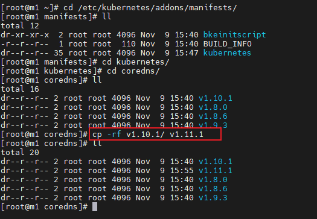
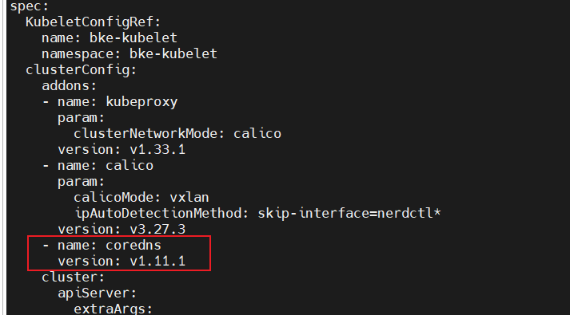

# 安装管理集群（小规模部署不涉及）

本文档介绍使用BKE和kubectl进行管理集群搭建验证。

## 节点要求

- 节点可以连通外部网络。
- 节点可以使用root用户登录。
- 引导节点上需要安装tar工具。
  
>  **须知：**  
> 建议您的节点环境为干净的操作系统环境，未安装任何docker与Kubernetes组件，否则可能会发生版本冲突导致安装失败。如需在存量环境试验性安装，可下载[环境前置检查工具](../environment_preparation/environment_pre_check_tool_guide.md)进行环境校验。

## 管理集群

引导节点初始化完成后，在`/bke/cluster`目录下会生成示例配置模板文件，分别是：

- 1master-cluster.yaml：用于创建1个master节点的管理集群。
- 1master-node.yaml：用于创建1个master节点的节点信息文件。
- 1master1node-cluster.yaml：用于创建1个master节点和1个worker节点的管理集群。
- 1master1node-nodes.yaml；用于创建1个master节点和1个worker节点的节点信息文件。
- 3master-cluster.yaml：用于创建3个master节点的管理集群，可配置负载均衡器成为高可用的管理集群。
- 3master-nodes.yaml：用于创建3个master节点的节点信息文件。

>  **说明：** <br />
> 建议不要使用引导节点作为高可用集群的Master节点。若节点数量不够需将引导节点作为Master节点，则controlPlaneEndpoint的port字段不要设置为36443。<br />

下面以1master-cluster.yaml和1master-node.yaml为例。

### 修改配置文件

对1master-cluster.yaml以及1master-node.yaml文件进行编辑，填入正确的节点信息。

>  **说明：**<br />自定义addon安装参考[附录](../service_cluster_installation/service_cluster_deployment_guide_(linux_backend).md#附录)章节。

**配置BKENode资源（1master-node.yaml）**

```yaml
apiVersion: bke.bocloud.com/v1beta1
kind: BKENode
metadata:
  name: master-1
  namespace: bke-cluster
  labels:
    # 关联集群名称
    cluster.x-k8s.io/cluster-name: bke-cluster
spec:
  hostname: m1  # 修改为节点名称
  ip: 127.0.0.1  # 修改为实际节点ip
  password: '******'  # 修改为实际节点密码
  port: "22"   # 默认端口号为22
  role:
  - master/node
  - etcd
  username: root   # 默认为root权限用户
status: {}
```

**配置BKECluster资源（1master-cluster.yaml）**

>  **说明：**<br />`BKECluster`（kubectl 短名 `bc`）是创建集群的核心自定义资源。下例为**在线安装**的引导集群初始化后生成的默认模板，缺省值均为 openFuyao 平台官方推荐配置；各字段含义、取值范围与推荐说明见[附录：cluster-api-provider-bke 配置参数](../appendix/cluster-api-provider-bke_configuration.md#bkecluster-crd配置)。**离线安装**与**自定义仓库**场景下仓库地址及 addon 参数的取值差异见[离线/自定义仓库场景取值差异](#离线自定义仓库场景取值差异)。创建或更新后可用 `kubectl edit bc -n <命名空间> <名称>` 调整。

```yaml
apiVersion: bke.bocloud.com/v1beta1
kind: BKECluster
metadata:
  creationTimestamp: null
  name: bke-cluster
  namespace: bke-cluster
spec:
  KubeletConfigRef:  # kubelet的自定义配置
    name: bke-kubelet
    namespace: bke-kubelet
  clusterConfig:
    addons:
    - name: kubeproxy
      param:
        clusterNetworkMode: calico
      version: v1.34.3-of.1
    - block: true
      name: calico
      param:
        calicoMode: vxlan
        ipAutoDetectionMethod: skip-interface=nerdctl*
      version: v3.31.3
    - name: coredns
      param:
        EnableAntiAffinity: "false"   # 单节点部署为false，多节点部署为true
      version: v1.12.2-of.1
    - block: true     # cluster-api组件，管理集群有此项addon，业务集群无此项addon
      name: cluster-api
      param:
        containerdVersion: v2.1.1
        healthPort: "58080"
        manage: "true"
        manifestsVersion: latest
        ntpServer: 192.168.200.115:123
        offline: "false"   # 离线场景为 "true"
        openFuyaoVersion: latest
        providerVersion: latest
        replicas: "1"
        sandbox: hub.oepkgs.net/openfuyao/pause:3.9   # 离线场景为 deploy.bocloud.k8s:40443/kubernetes/pause:3.9
      version: v1.4.3
    - name: openfuyao-system-controller   # openFuyao的核心组件addon
      param:
        helmRepo: https://helm.openfuyao.cn/_core   # 离线场景为 http://<引导节点IP>:38080
        tagVersion: latest
      version: latest
    cluster:
      agentHealthPort: "58080"   # 节点bkeagent健康检查端口
      apiServer:
        extraArgs:
          max-mutating-requests-inflight: "3000"
          max-requests-inflight: "1000"
          watch-cache-sizes: node#1000,pod#5000
      certificatesDir: /etc/kubernetes/pki
      chartRepo:    # chart仓库
        domain: cr.openfuyao.cn
        ip: 119.3.216.97   # 由域名解析自动填充
        port: "443"
        prefix: charts
      containerRuntime:
        cri: containerd
        param:
          data-root: /var/lib/containerd
        runtime: runc
      containerdConfigRef:    # containerd的自定义配置
        name: bke-containerd
        namespace: bke-containerd
      containerdVersion: v2.1.1
      controllerManager:
        extraArgs:
          kube-api-burst: "1000"
          kube-api-qps: "1000"
      etcd:
        dataDir: /var/lib/openFuyao/etcd
      etcdVersion: v3.6.7-of.1
      httpRepo:    # http仓库（二进制/RPM等系统包源，默认为引导节点本地服务）
        domain: http.bocloud.k8s
        ip: 192.168.200.115    # 修改为引导节点ip
        port: "40080"
        prefix: ""
      imageRepo:    # 镜像仓库
        domain: default    # 在线安装标识，组件镜像使用公网默认仓库，请勿修改
        ip: 192.168.200.115    # 修改为引导节点ip
        port: "40443"
        prefix: ""    # 在线安装保持为空；离线安装为 kubernetes
      kubelet:
        extraArgs:
          kube-api-burst: "2000"
          kube-api-qps: "1000"
        extraVolumes:
        - hostPath: /var/lib/kubelet
          name: kubelet-root-dir
      kubernetesVersion: v1.34.3-of.1
      networking:
        dnsDomain: cluster.local
        podSubnet: 10.250.0.0/16
        serviceSubnet: 10.96.0.0/16
      ntpServer: 192.168.200.115:123   # 修改为实际NTP服务器；默认为cn.pool.ntp.org:123
      openFuyaoVersion: latest
      scheduler:
        extraArgs:
          kube-api-qps: "1000"
    customExtra:
      agentLogLevel: INFO   # bkeagent日志级别，支持TRACE/DEBUG/INFO/WARNING/ERROR/CRITICAL
      chartRepoPort: "38080"   # 引导节点本地chart仓库端口
      clusterapi: latest
      containerd: containerd-v2.1.1-linux-{.arch}.tar.gz
      domain: deploy.bocloud.k8s
      host: 192.168.200.115     # 修改为引导节点ip
      imageRepoPort: "40443"   # 引导节点本地镜像仓库端口
      nfsserverpath: /
      onlineImage: cr.openfuyao.cn/openfuyao/bke-online-installed:latest   # 在线安装镜像；离线/自定义仓场景为空
      otherChart: ""   # 私有chart仓库地址，自定义仓场景填写
      otherChartIp: ""
      otherRepo: ""   # 私有镜像仓库地址，自定义仓场景填写
      otherRepoIp: ""
      otherSource: ""   # 私有系统包源地址，自定义仓场景填写
      yumRepoPort: "40080"   # 引导节点本地系统包源端口
  controlPlaneEndpoint: {}
  pause: false
status:
  agentStatus: {}
  controlPlaneConfigHash: {}
  ready: false
```

其余项为默认项，可不用更改。需要用户确保编辑提交的yaml文件是可靠的，调谐器会进行校验，但无法确认业务逻辑上的正确性（如IP地址填错，密码填错等，需要用户确认填写信息无误）。

### 离线/自定义仓库场景取值差异

上例为**在线安装**（引导集群执行 `bke init --onlineImage ...` 初始化）后生成的模板取值。`/bke/cluster` 下的模板由 `bke init` 按引导集群的初始化方式自动生成对应取值，通常**无需手工修改**；下表用于手工编写或核对 YAML 时参考。

**表1** 在线/离线/自定义仓库场景取值对照表

| 配置项 | 在线安装 | 离线安装 | 自定义仓库 |
| --- | --- | --- | --- |
| `cluster.imageRepo` | `domain: default`、`prefix: ""`：K8s/openFuyao组件镜像回退使用公网默认仓库（`cr.openfuyao.cn/openfuyao`、`hub.oepkgs.net/openfuyao`） | `domain: deploy.bocloud.k8s`、`ip: <引导节点IP>`、`port: "40443"`、`prefix: kubernetes`：使用引导节点本地镜像仓 | 指向私有镜像仓：`domain: <仓库域名或IP>`、`ip: <仓库IP>`、`port: <端口>`、`prefix: <项目/路径>` |
| `cluster.httpRepo` | 引导节点本地HTTP源：`ip: <引导节点IP>`、`port: "40080"`（二进制/RPM由在线安装镜像解包后经引导节点本地服务提供） | 同在线（引导节点本地HTTP源） | 指向私有系统包源：`ip: <源IP>`、`port: <源端口>`、`prefix: <源路径>` |
| `cluster.chartRepo` | 公网chart仓：`domain: cr.openfuyao.cn`、`port: "443"`、`prefix: charts` | 引导节点本地chart仓：`domain: ""`、`ip: <引导节点IP>`、`port: "38080"`、`prefix: ""`。**domain为空时必须保留ip**，否则chart地址会回退公网仓导致离线安装失败 | 取值同在线或离线（取决于引导节点能否解析 `cr.openfuyao.cn`）；私有chart仓通过 `--otherChart` 指定，作用于 `openfuyao-system-controller` 的 `helmRepo` |
| `customExtra.onlineImage` | 在线安装镜像地址 | `""` | `""`（若同时使用在线安装镜像则保留，即混合场景） |
| `customExtra.otherRepo` / `otherRepoIp` | `""` | `""` | 私有镜像仓地址（`<域名或IP>[:<端口>]/<路径>`）及其解析IP |
| `customExtra.otherSource` | `""` | `""` | 私有系统包源地址（`http://<域名或IP>:<端口>[/<路径>]`） |
| `customExtra.otherChart` / `otherChartIp` | `""` | `""` | 私有chart仓地址及其解析IP |
| `cluster-api` addon 的 `offline` | `"false"` | `"true"` | `"false"` |
| `cluster-api` addon 的 `sandbox` | `hub.oepkgs.net/openfuyao/pause:3.9` | `deploy.bocloud.k8s:40443/kubernetes/pause:3.9` | `<私有镜像仓去掉最后一级路径>/pause:3.9`，如 `192.168.100.17:443/pause:3.9` |
| `openfuyao-system-controller` addon 的 `helmRepo` | `https://helm.openfuyao.cn/_core` | `http://<引导节点IP>:38080` | 私有chart仓端口为443时：`https://<host>:443`；其他端口：`http://<host>:<端口>`；未指定私有chart仓时：`https://helm.openfuyao.cn/_core` |

>  **说明：**<br />
> 1. 仓库地址优先按 `domain`（含端口）拼接访问；`domain` 与 `ip` 同时配置时，安装过程会在各节点 `/etc/hosts` 中写入 domain→IP 映射，`domain` 不可达时回退使用 `ip`。`prefix` 为仓库内的项目/路径前缀。
> 2. 自定义仓库场景需在引导集群初始化时通过 `bke init --otherRepo <私有镜像仓> --otherSource <私有系统包源> --otherChart <私有chart仓>` 指定（也可通过 `bke init --file` 提供含自定义仓库地址的 BKECluster YAML，工具会自动识别），完整操作流程（私有仓介质准备、CA 证书、containerd registry 认证配置等）参见[自定义仓库配置](../bootstrap_cluster_configuration/custom_repository_configuration_guide.md)。

### 创建管理集群

执行以下命令完成集群的创建，-f后的文件替换为实际的1master-cluster.yaml的文件路径，-n后的文件替换为实际的1master-node.yaml的文件路径。

```bash
bke cluster create -f /bke/cluster/1master-cluster.yaml -n /bke/cluster/1master-node.yaml
```

>  **说明：** <br />
> 当命令回显出现`Reason: ClusterReady, Message: cluster is ready`表示管理集群安装完成；若出现`Reason: ClusterDeployFailed` 表示管理集群安装失败。<br />

## （可选）安装openFuyao管理面

若创建管理集群时 **未** 安装 `openfuyao-system-controller`（或其他原因导致管理集群上没有 openFuyao 管理面），可在集群就绪后按场景手动补装，拉起管理面：

- 在线场景：参见[在线 openFuyao-system-controller 手动部署](../appendix/online_incremental_deployment_guide.md)。
- 离线场景：参见[离线 openFuyao-system-controller 手动部署](../appendix/offline_incremental_deployment_guide.md)。

管理集群管理面默认登录地址为`https://<管理集群节点IP>:31616`（首次默认用户名/密码见[安装部署概念和流程](../read_before_installation/installation_process.md#openfuyao-管理面简介)）。

## FAQ

在操作过程中遇到问题，可先参考[定位指南](../appendix/cluster_deployment_issue_diagnosis_guide.md)和[FAQ](../appendix/FAQ.md)，尝试解决。

## 附录

附录部分介绍Linux后端安装集群的相关知识。

### 自定义addon安装

openFuyao提供了K8s集群的安装部署能力，通过添加addon字段安装用户自定义扩展件，bke-manifests提供了社区使用的扩展件的yaml文件，包括coredns、calico等组件。此外通过hostPath挂载允许用户将自定义的扩展件的yaml文件，作到自定义addon的安装。
hostPath挂载路径是/etc/openFuyao/addons/manifests/kubernetes。

按照如下步骤进行自定义addon扩展件的安装：

1. 拉起引导集群或者管理集群，作为业务集群的集群管理中心。

2. 按照组件名/版本号/yaml文件的结构将自定义addon扩展件的yaml文件放置到/etc/openFuyao/addons/manifests/kubernetes目录下，如下图所示，给出的是复制操作模拟自定义处理yaml文件。

   

3. 安装业务集群时，添加addon字段安装自定义扩展件。

   
