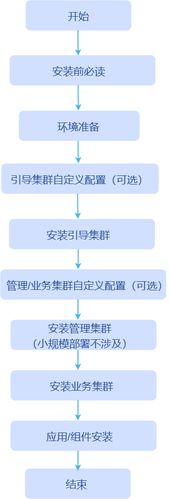

# 安装前必读

## 基础概念

### BKE 工具简介

BKE 是 openFuyao 的安装部署工具，负责引导节点的初始化、管理集群与业务集群的创建。在整个安装过程中，BKE 负责将一台机器初始化为引导节点，并在其上部署 K3s 轻量化集群，随后完成 Cluster-API、cluster-api-provider-bke 以及 openFuyao 管理面的安装。

### openFuyao 管理面简介

openFuyao 管理面是运行在管理集群（或引导集群）上的一组服务，为用户提供集群管理与运维的可视化操作界面和后端服务。主要包含以下组件：

| 组件 | 说明 |
| :--- | :--- |
| **console-website** | 前端管理界面，为应用管理、资源管理、告警监控等核心功能提供用户界面，并支持扩展组件动态挂载，允许自定义扩展界面。 |
| **console-service** | 后端管理服务，基于 Kubernetes 提供集群管理能力，为前端界面提供 API 支撑。 |

- openFuyao 管理面是用户与集群交互的主要入口，用户可通过管理面完成业务集群的创建、扩缩容、升级等生命周期管理操作。
- openFuyao 管理面包括2类：引导集群管理面(对应端口30010)，管理/业务集群管理面(对应端口31616)。
- 引导集群的 openFuyao 管理面登录网址为`https://引导节点IP地址:30010`。
- 管理/业务集群的openFuyao管理面登录网址为`https://集群节点IP地址:31616`。
- 首次登录时，默认用户名为admin，默认密码为test@1234。首次登录后需要修改用户名和密码。

### Cluster-API 简介

Cluster-API 是一个 Kubernetes 子项目，通过声明式 API 和控制器模式实现 Kubernetes 集群的生命周期管理自动化。其核心特性如下：

- **基础设施即代码**：使用 Kubernetes 自定义资源（CRD）定义集群配置，使集群定义可版本化、可复用。
- **声明式管理**：通过 YAML 文件描述集群的期望状态，无需关心底层操作步骤。
- **控制器模式**：控制器自动监测期望状态与实际状态的差异，并持续协调使其一致。

>  **说明：** openFuyao 基于 Cluster-API 实现集群生命周期管理，Cluster-API 本身只提供集群管理的框架，要管理特定基础设施上的集群，还需要对应的 **Infrastructure Provider**（基础设施提供者）来实现具体操作。openFuyao 提供的 Infrastructure Provider 即为 cluster-api-provider-bke。

### cluster-api-provider-bke 简介

cluster-api-provider-bke 是 openFuyao 为 Cluster-API 提供的基础设施 Provider，是 BKE 部署的核心组件，使 Cluster-API 能够在 openFuyao 环境中管理集群的生命周期。它包含以下两个核心组件：

| 组件 | 说明 |
| :--- | :--- |
| **基础设施 Provider** | 作为 Cluster-API 的基础设施 Provider，负责解析集群创建/删除等 CRD 资源，并协调执行相应的基础设施操作。 |
| **bkeagent** | 运行在各个节点上的二进制文件，托管于 systemd，负责侦听 kube-apiserver 的 CRD 资源变化，从而对宿主机执行具体操作（如节点初始化、组件安装等）。 |

>  **说明：** bkeagent 二进制存放于 cluster-api-provider-bke 镜像中，支持双架构（amd64/arm64）。最后在openFuyao管理面上进行业务集群的安装、卸载、扩缩容、升级等操作。

## 部署形态

openFuyao 使用 BKE 工具进行安装部署：先在一台机器上完成初始化，将其作为引导节点并在其上安装轻量级 K3s 引导集群，部署 Cluster-API、cluster-api-provider-bke 以及 openFuyao 管理面；再在 openFuyao 管理面上完成业务集群的安装、卸载、扩缩容、升级等操作。机器分为三种类型：引导节点、管理集群节点和业务集群节点。

| 节点 | 说明 | 特点 |
| :--- | :--- | :--- |
| **引导节点** | 用于初始化并承载引导集群的机器。初始化后部署本地镜像/Chart 等仓库，并提供 openFuyao 管理面登录入口；其上运行的轻量级 K3s（引导集群）用于创建和管理目标管理集群与业务集群，并运行 Cluster-API 控制平面组件。 | 从零快速部署，轻量，**不支持高可用**，不适合长期作为 K8s 集群使用，也不适合部署较大规模集群。 |
| **管理集群节点** | 用于由引导集群安装管理集群的机器。管理集群是完整的高可用 openFuyao 集群，包含集群管理、容器平台等功能，负责业务集群的部署与生命周期管理。 | 高可用，适合中长期运行，用于管理多个业务集群。 |
| **业务集群节点** | 用于部署业务集群的机器。业务集群由 Cluster-API 创建和管理，承载用户工作负载，其生命周期由引导集群或管理集群控制。 | 高可用，供用户部署实际业务。 |

小规模场景下，推荐准备两台机器，分别承担引导节点与业务集群节点角色；也可共部署于同一台机器（此时将同时运行 K3s 与 Kubernetes，可能相互影响，不推荐）。

按集群规模选择对应部署路径，统一如下：

| 部署规模 | 适用场景 | 部署路径                                                  |
| :--- | :--- |:------------------------------------------------------|
| **小规模**（10 节点以内） | 快速体验、开发测试 | 安装引导节点 → 通过引导集群直接部署业务集群                               |
| **中规模**（10~1000 节点） | 生产环境常规部署 | 安装引导节点 → 通过引导集群部署高可用管理集群（3 节点） → 使用管理集群部署一个或多个业务集群    |
| **大规模**（1000 节点以上） | 大规模生产环境 | 安装引导节点 → 通过引导集群部署高可用管理集群（5~10 节点） → 使用管理集群部署一个或多个业务集群 |

## 安装部署流程

下文通过流程图简要介绍 openFuyao 的安装流程。

**图 1** 安装流程图

安装流程对应的具体安装步骤详细说明如下表所示。

**表 1** 安装流程说明

| 流程环节 | 是否必选 | 步骤 |
| :--- | :--- | :--- |
| **安装前必读** | 必选 | [安装前必读](./installation_process.md) 
| **环境准备** | 必选：安装须知、环境前置检查  可选：安装工具下载及校验  | <ul><li>[安装须知](../../cluster_installation_guide/environment_preparation/before_you_start.md)</li><li>[环境前置检查](../../cluster_installation_guide/environment_preparation/environment_pre_check_tool_guide.md)</li><li>[安装工具下载及校验](../../cluster_installation_guide/environment_preparation/installation_package_integrity_verification.md)</li></ul> |
| **引导集群自定义配置** | 可选 | <ul><li>[自定义集群证书](../../cluster_installation_guide/bootstrap_cluster_configuration/using_custom_cluster_certificates.md)</li><li>[自定义仓库配置](../../cluster_installation_guide/bootstrap_cluster_configuration/custom_repository_configuration_guide.md)</li></ul> |
| **安装引导集群** | 必选 | <ul><li>[在线安装引导集群](../../cluster_installation_guide/bootstrap_cluster_installation/online_bootstrap_cluster_installation.md)</li><li>[离线安装引导集群](../../cluster_installation_guide/bootstrap_cluster_installation/offline_bootstrap_cluster_installation.md)</li></ul> |
| **管理/业务集群自定义配置** | 可选 | <ul><li>[二进制组件自定义配置（Containerd 和 Kubelet）](../../cluster_installation_guide/service_management_cluster_configuration/binary_file_custom_configuration_guide.md)</li><li>[Addon 组件自定义配置](../../cluster_installation_guide/service_management_cluster_configuration/using_add-ons.md)</li><li>[节点标签与亲和部署配置](../../cluster_installation_guide/service_management_cluster_configuration/node_label_affinity_deployment_guide.md)</li><li>[前置/后置处理脚本自定义配置](../../cluster_installation_guide/service_management_cluster_configuration/preprocessing_and_postprocessing_guide.md)</li><li>[KubeOS自定义配置](../../cluster_installation_guide/service_management_cluster_configuration/kubeos_adaptation_guide.md)</li></ul> |
| **安装管理集群** | 中大规模必选，小规模不涉及 | [安装管理集群](../../cluster_installation_guide/management_cluster_installation/management_cluster_deployment_guide.md) |
| **安装业务集群** | 必选 | <ul><li>[通过前台（Web 页面）安装业务集群](../../cluster_installation_guide/service_cluster_installation/service_cluster_installation_on_the_management_plane.md)</li><li>[通过后台（命令行）安装业务集群](../../cluster_installation_guide/service_cluster_installation/service_cluster_deployment_guide_(linux_backend).md)</li></ul> |
| **应用/组件安装** | 必选 | <ul><li>[在线增量安装扩展组件/应用](../../app_installation_guide/online_incremental_component_installation.md)</li><li>[离线增量安装扩展组件/应用](../../app_installation_guide/offline_incremental_component_installation.md)</li></ul> |

