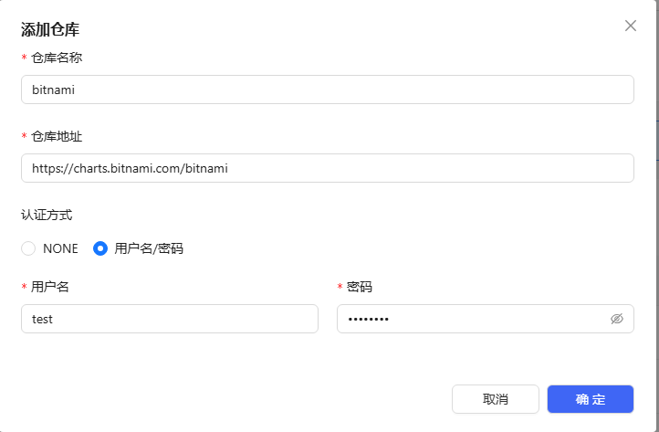
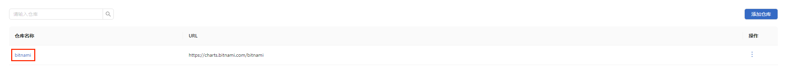
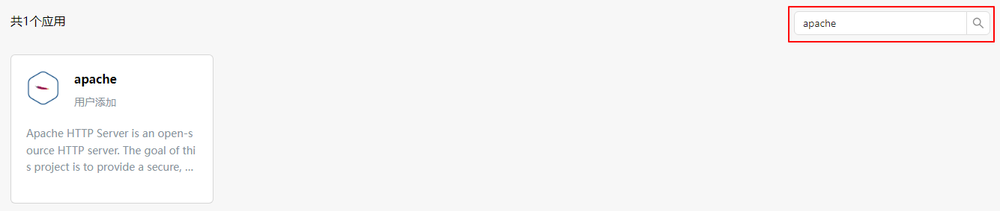
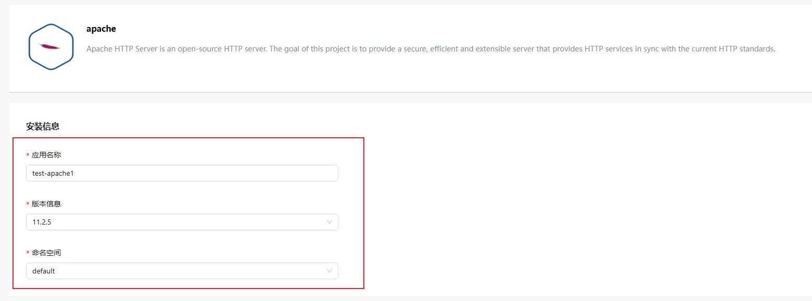
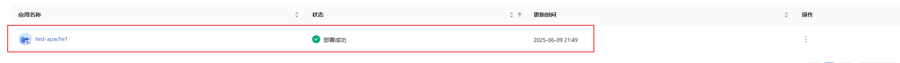

# 快速入门

openFuyao社区发行版采用“核心平台+可插拔组件”架构，核心平台基于开源Kubernetes深度优化，提供开箱即用的容器化集群管理能力，涵盖资源编排、弹性伸缩、多维度监控等基础功能，满足企业级生产环境的基础运维需求。通过内置应用市场提供丰富的产业级高价值组件，覆盖智算/通算混合调度、异构资源统一管理、动态智能调度、端到端可观测性增强等关键能力。

本文将为您介绍如何快速在openEuler 22.03 LTS操作系统节点上进行单节点业务集群All-In-One（AIO）模式的安装，访问openFuyao集群管理面，并成功从应用市场部署一个应用。

>  **说明：**<br />
> 本文面向**简单、快速体验**小规模集群安装，步骤按最短路径编排。生产环境、高可用、离线及更多可选配置，请参见[集群安装指南](../cluster_installation_guide/read_before_installation/installation_process.md)。

## 环境准备

下面介绍使用openFuyao安装工具快速安装小规模集群前的环境准备。

### 前提条件

openFuyao平台解决方案支持在如下操作系统与架构上进行安装与使用：

| 操作系统     | 版本    | 架构        |
|--------------|-------|-----------|
| openEuler    | 20.03 | ARM64、x86_64 |
| openEuler    | 22.03 | ARM64、x86_64 |
| openEuler    | 24.03 | ARM64、x86_64 |
| Ubuntu       | 22.04 | ARM64、x86_64 |
| UOS          | 20 1070e | ARM64、x86_64 |

>  **说明：**<br />其他版本操作系统暂未测试，可能会出现不在预期内的问题。

对节点的资源配置要求如下：

#### 最小化部署硬件配置

| 节点类型 | 节点数量 | CPU | 内存 | 硬盘         |
| -------- | -------- | --- | ---- | ------------ |
| 引导节点 | 1        | 2   | 4    | 系统盘>=100G |
| 业务集群 | 1        | 8   | 16   | 系统盘>=100G |

>  **说明：**<br />推荐准备两台机器，分别承担引导节点与业务集群节点角色；也可共部署于同一台机器（此时将同时运行 K3s 与 Kubernetes，可能相互影响，不推荐）。

#### 推荐硬件配置

| 节点类型 | 节点数量     | CPU          | 内存         | 硬盘         |
| -------- | ------------ | ------------ | ------------ | ------------ |
| 引导节点 | 1            | 2            | 4            | 系统盘>=100G |
| 业务集群 | 实际情况而定 | 实际情况而定 | 实际情况而定 | 实际情况而定 |

### 节点要求

- 节点可以连通外部网络。
- 节点可以使用root用户登录。
- 引导节点上需要安装tar工具。可按操作系统直接执行以下命令：

  ```bash
  # RPM系（openEuler/CentOS/RHEL等）
  yum install -y tar

  # Debian系（Ubuntu/Debian等）
  apt-get update && apt-get install -y tar
  ```

>  **须知：**  
> 建议您的节点环境足够干净，未安装任何Kubernetes组件，否则可能会发生版本冲突导致安装失败。

## 快速安装小规模集群

快速体验建议按以下顺序完成：先初始化引导节点并部署openFuyao管理面，再通过管理面安装业务集群，最后部署一个示例应用。
>  **说明：**<br/> 
> 执行小规模集群安装前，请参考[安装部署概念和流程](../../zh/cluster_installation_guide/read_before_installation/installation_process.md)了解安装部署相关概念及流程，并执行[环境前置检查](../../zh/cluster_installation_guide/environment_preparation/environment_pre_check_tool_guide.md)进行安装前置检查。

### 1. 安装引导节点

下载BKE安装工具（二进制），再初始化引导节点。

1. 使用root用户登录引导节点。

2. 下载BKE安装工具。
   
   2.1 基于download.sh 脚本
     - 安装最新版本BKE安装工具：执行如下命令，在引导节点上下载、校验并安装最新版本的 BKE 安装工具。
  
   ```bash
   # 下载 download.sh 脚本
   curl -LO https://openfuyao.obs.cn-north-4.myhuaweicloud.com/openFuyao/bkeadm/releases/download/latest/download.sh
   # 下载 download.sh 的校验文件并进行校验；校验成功会输出 -: OK，校验失败请联系 openFuyao sig-installation邮箱installation@list.openfuyao.cn或openFuyao 社区邮箱 contact@openfuyao.cn
   curl -LO https://openfuyao.obs.cn-north-4.myhuaweicloud.com/openFuyao/bkeadm/releases/download/latest/download.sh.sha256
   sha256sum -c <(cat download.sh.sha256) < download.sh
   # 运行 download.sh 下载 BKE 安装工具，执行过程中会校验安装工具的 sha256sum
   chmod +x download.sh && ./download.sh
   ```
      
      - 安装指定版本BKE安装工具：若想下载其他版本，请使用如下命令指定版本下载。
  
   ```bash
   export VERSION=x.y.z # x.y.z根据您想下载的其他实际版本替换。

   # 下载 download.sh 脚本
   curl -LO https://openfuyao.obs.cn-north-4.myhuaweicloud.com/openFuyao/bkeadm/releases/download/latest/download.sh
   # 下载 download.sh 的校验文件并进行校验；校验成功会输出 -: OK，校验失败请联系 openFuyao sig-installation邮箱installation@list.openfuyao.cn或openFuyao 社区邮箱 contact@openfuyao.cn
   curl -LO https://openfuyao.obs.cn-north-4.myhuaweicloud.com/openFuyao/bkeadm/releases/download/latest/download.sh.sha256
   sha256sum -c <(cat download.sh.sha256) < download.sh
   # 运行 download.sh 下载 BKE 安装工具，执行过程中会校验安装工具的 sha256sum
   chmod +x download.sh && ./download.sh
   ```
    >  **说明：**<br/> 
    > - 对于openFuyao v26.06、v26.09及后续版本：x.y.z取值（BKE 安装工具版本号）为26.6.0、26.9.0及其他后续数字版本号。
    > - 对于openFuyao v26.03及之前版本：x.y.z取值（BKE 安装工具版本号）与openFuyao版本对应关系如下：
    >    |openFuyao版本|BKE 安装工具版本|
    >    |--|--|
    >    |v26.03|1.2.2|
    >    |v25.12|1.0.5|
    >    |v25.09|v25.09|
    >    |v25.06|v25.06|
    >    |v25.03|v25.03|
   
   2.2 基于二进制软件包

   如不基于download.sh 脚本下载目标版本的 BKE 安装工具，也可直接下载二进制包后解压，并将二进制文件移动至系统路径（如 `/usr/local/bin`）；手动下载时请按[安装工具下载及校验](../cluster_installation_guide/environment_preparation/installation_package_integrity_verification.md)完成完整性校验后再部署：

   | 架构 | 下载 |
   | :--- | :--- |
   | x86_64 | [bkeadm_linux_amd64.tar.gz](https://openfuyao.obs.cn-north-4.myhuaweicloud.com/openFuyao/bkeadm/releases/download/latest/bkeadm_linux_amd64.tar.gz) |
   | ARM | [bkeadm_linux_arm64.tar.gz](https://openfuyao.obs.cn-north-4.myhuaweicloud.com/openFuyao/bkeadm/releases/download/latest/bkeadm_linux_arm64.tar.gz) |

3. 初始化引导节点并部署openFuyao管理面。

   ```bash
   bke init --onlineImage cr.openfuyao.cn/openfuyao/bke-online-installed:latest
   ```

   >  **说明：**<br />执行命令后，工具会先回显本次安装生效的参数（如 `--hostIP`、`--domain` 等），并出现 `Confirm the parameters, press Y to continue N will exit. [Y/N]?` 的确认提示：输入 `Y` 继续安装，输入 `N` 退出安装。也可在命令后追加 `--confirm` 参数跳过该确认步骤。

4. 确认引导节点初始化结果。

   4.1 上一步自动化安装过程执行成功后，可以登录引导节点的openFuyao管理面查看引导节点初始化是否成功。
      >  **说明：**<br/> 
      > - 引导节点的openFuyao管理面登录网址是“https://_引导节点IP地址_:30010”。
      > - 首次登录时，默认用户名为admin，默认密码为test@1234。
   
   4.2 执行如下命令，查看引导集群上部署的Pod状态。
   
      ```bash
       kubectl get pod -A
      ```
   
      >  **说明：**<br />
      > - `bke init` 执行成功时，最后会输出 `BKE initialization is complete` 日志行。
      > - 引导节点初始化通常需要 5-6 分钟，视网络与硬件情况可能延长，所有 Pod 状态都为 `Running` 或 `Completed` 则引导集群安装完毕。网速较慢时等待时间会比较长。
      > - 安装部署工具部署的组件均采用默认配置，仅用于测试openFuyao平台功能，若在生产环境使用，请自行调整Kubernetes、容器运行时、网络插件组件安全配置。

### 2. 安装业务集群

1. 通过引导节点openFuyao管理面安装业务集群。具体操作步骤请参见[通过前台（Web页面）安装业务集群](../cluster_installation_guide/service_cluster_installation/service_cluster_installation_on_the_management_plane.md#安装步骤)。

2. 确认业务集群安装成功。

   执行如下命令，查看Pod状态，当所有 Pod 状态都为 `Running` 或 `Completed` 后表示环境安装完毕。
   
   ```bash
   kubectl get pod -A
   ```

   >  **说明：**<br />
    > - 安装业务集群时，界面弹出的"集群信息"窗口中出现 `Reason: ClusterReady, Message: cluster is ready` 日志行且不再滚动新日志，表示业务集群安装完成；若出现 `Reason: ClusterDeployFailed` 日志行，表示业务集群安装失败。
    > - 业务集群安装耗时视集群规模与网络情况而定，实测部署 3 master + 1 worker 规格的业务集群约需 15 分钟（视网络与硬件情况可能延长），网速较慢时等待时间会比较长，所有 Pod 状态都为 `Running` 或 `Completed` 则业务集群安装完毕。
    > - 安装部署工具部署的组件均采用默认配置，仅用于测试openFuyao平台功能，若在生产环境使用，请自行调整Kubernetes、容器运行时、网络插件组件安全配置。

### 3. 部署一个应用

浏览器中输入“https://_管理面的登录IP地址_:_openFuyao的web服务端口_”，输入用户名和密码登录openFuyao管理面。

>  **说明：**
    > - 首次登录需要修改密码。
    > - openFuyao的web服务端口默认为31616。

详细管理平台的功能介绍与使用指导请参见[《用户指南》](https://gitcode.com/openFuyao/docs/blob/master/docs/zh/management_plane_operations/registration_and_login.md)。


下面以apache为例，为您讲解如何在openFuyao管理面部署一个应用。

1. 在openFuyao平台的左侧导航栏选择“应用市场 > 仓库配置”，进入“仓库配置”界面。

2. 单击"添加仓库"，输入仓库名称与仓库地址并单击“确定”。<br />
   
   示例链接`https://charts.bitnami.com/bitnami`<br />
   
   **图1** 添加仓库

    

3. 完成添加后可以看到已添加的仓库。<br />
   
   **图2** 已添加的仓库

   

   >  **说明：**<br />添加仓库后，系统需要同步仓库内的 Chart 列表，同步完成后该仓库的应用才会展示在应用列表中。也可以在“仓库配置”页对应仓库的操作列选择“同步仓库”手动触发同步。若在应用列表中搜索不到 apache，请先确认仓库同步状态。

4. 在左侧导航栏选择“应用市场 > 应用列表”，进入“应用列表”界面。在右上角搜索框中搜索“apache”，可以看到apache应用。<br />
   
   **图3** apache应用

   

5. 单击“apache”，进入应用详情页面。<br />

6. 在应用详情页面单击“部署”，部署应用。<br />

   >  **说明：**<br />openFuyao平台不对用户通过第三方仓库部署的应用进行安全性校验。请用户确保部署应用的安全性。

7. 在部署页面填写安装信息，可以自定义应用名称和命名空间。<br />
   
   **图4** 安装信息

   

8. 在页面右下角单击“确定”，开始部署应用。<br />

9. 完成部署后可以进入“应用管理”界面，查看部署结果。<br />
   
   **图5** 部署结果
   
   

恭喜您！已成功安装了apache应用。<br />

- 想了解openFuyao管理面的更多详细信息，请参见[《管理面操作》](https://gitcode.com/openFuyao/docs/blob/master/docs/zh/management_plane_operations/registration_and_login.md)。

- 更多openFuyao特性功能使用请参见[《特性用户指南》](https://gitcode.com/openFuyao/docs/blob/master/docs/zh/user_guide/kae_operator.md)和[《特性开发指南》](https://gitcode.com/openFuyao/docs/blob/master/docs/zh/developer_guide/authentication_and_authorization_development_guide.md)。
