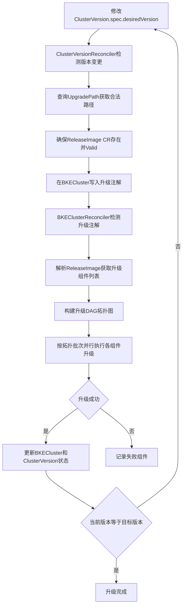

# v26.06-rc.2及后续版本升级指导（后端声明式）

## 后端声明式升级介绍

### 应用场景

声明式升级是openFuyao提供的一种基于声明式API的集群版本升级方式。用户仅需声明期望的目标版本，系统将自动完成升级路径校验、升级资源准备、组件有序升级和状态追踪等全流程操作。通过后端执行升级，用户可以查看升级过程中的阶段信息，了解升级执行步骤。

适用于以下场景：

- 将集群的openFuyao版本从v26.06-rc.2及后续版本升级到更高版本。
- 在线环境和离线环境下的集群版本升级。

### 能力范围

- 声明式触发升级：修改ClusterVersion CR（Custom Resource，自定义资源）的desiredVersion字段即可触发升级，系统自动下发升级指令。
- 升级路径自动校验：基于UpgradePath规则自动校验当前版本到目标版本的升级路径是否合法。
- 多跳升级自动执行：当不存在直接升级路径时，系统自动按中间版本逐跳执行。
- DAG（Directed Acyclic Graph，有向无环图）驱动的并行升级：升级组件按依赖关系构建DAG拓扑图，支持同批次组件并行升级。
- 在线/离线场景均支持。
- 管理集群和业务集群均可升级。业务集群的升级要在管理其生命周期的集群（管理集群或引导集群）上进行操作。

>  **说明：**<br />声明式升级由修改 `ClusterVersion.spec.desiredVersion` 触发；ClusterVersionReconciler 校验通过后向 BKECluster 写入 `cvo.openfuyao.cn/upgrade-ready` 注解，BKEClusterReconciler 据此执行 DAG。控制器参数与注解说明见下文[控制器参数与升级注解](#控制器参数与升级注解)。

### 亮点特征

- 声明式触发：仅需声明目标版本（修改ClusterVersion CR的desiredVersion字段），无需关心升级执行细节。
- DAG并行升级：相较于旧版串行PhaseFlow升级，声明式升级支持组件按依赖拓扑并行执行，缩短整体升级耗时。
- 多跳自动执行：跨版本升级时，系统自动计算中间跳版本并逐跳执行，用户无需手动干预。

### 基本概念

| 概念 | 说明 |
| --- | --- |
| ClusterVersion | 声明式升级的触发CR，通过设置spec.desiredVersion字段声明期望的目标版本 |
| UpgradePath | 升级路径规则CR，定义了版本之间的合法升级路径，包括from、to、blocked等信息 |
| ReleaseImage | 版本发布镜像CR，包含升级所需的组件列表、依赖关系及组件类型（inline / yaml / helm） |
| ComponentVersion | 组件版本定义CR，通过`spec.type`声明组件类型，并定义版本、依赖、升级策略和前置资源 |
| 升级DAG | 基于ReleaseImage和ComponentVersion的依赖关系构建的有向无环图，决定升级组件的执行顺序 |
| 多跳升级 | 当从当前版本到目标版本不存在直接升级路径而存在多跳路径时，系统自动按中间版本逐跳执行升级 |

>  **说明：**<br />升级组件类型（inline / yaml / helm）说明见[升级前必读 - 升级组件类型](./before_you_upgrade.md#升级组件类型)。

声明式升级的触发和执行流程如下：



流程步骤说明：

1. **修改desiredVersion**：修改ClusterVersion CR的spec.desiredVersion字段为目标版本。
2. **检测版本变更**：ClusterVersionReconciler检测到desiredVersion与currentVersion不一致，触发升级流程。
3. **查询升级路径**：ClusterVersionReconciler查询UpgradePath CR，校验从当前版本到目标版本的升级路径是否合法。
4. **确保资源存在**：确保ReleaseImage CR存在且状态为Valid，系统自动从OCI镜像仓库拉取并解析。
5. **写入升级注解**：在BKECluster上写入upgrade-ready注解，触发BKEClusterReconciler进入升级流程。
6. **检测升级注解**：BKEClusterReconciler检测BKECluster上的upgrade-ready注解，进入声明式升级流程。
7. **解析升级组件**：解析ReleaseImage获取升级组件列表和依赖关系。
8. **构建DAG拓扑图**：基于ReleaseImage的升级组件列表和ComponentVersion的依赖关系，构建DAG拓扑图。
9. **并行执行升级**：按DAG拓扑批次并行执行各组件升级，按`spec.type`分别调度inline、yaml、helm三类执行器。
10. **判断升级是否成功**：检查所有组件是否升级成功。
11. **更新状态**：升级成功后更新BKECluster和ClusterVersion状态，每个组件完成后更新DeclarativeUpgradeStatus。
12. **记录失败组件**：升级失败时记录失败组件信息。
13. **判断是否达到目标版本**：检查当前版本是否等于目标版本，若不等于则继续执行下一跳升级。
14. **升级完成**：当前版本等于目标版本，升级全部完成，清除升级注解。

## 控制器参数与升级注解

声明式升级由 ClusterVersion 控制器触发，由 BKECluster 控制器按 ReleaseImage 定义的 DAG 执行。用户修改 `ClusterVersion.spec.desiredVersion` 后，ClusterVersionReconciler 校验 UpgradePath 并确保 ReleaseImage 有效，再向 BKECluster 写入 `upgrade-ready` 等注解；BKEClusterReconciler 检测到非空 `upgrade-ready` 后执行 DAG。

**表1** 声明式升级参数与注解

| 配置项 | 类型 | 缺省值 | 说明 | 设置方式 |
| --- | --- | --- | --- | --- |
| `--helm-component-support` | 全局flag | `false` | 为所有集群启用 yaml/helm 类型组件执行器。 | BKEControllerManager 启动参数；亦见[cluster-api-provider-bke配置参数](../cluster_installation_guide/appendix/cluster-api-provider-bke_configuration.md)表2 |
| `cvo.openfuyao.cn/helm-component` | BKECluster注解 | 无 | 注解存在时以其值（忽略大小写）为准；缺失时回退到 `--helm-component-support`。 | 手动注解或运维脚本 |
| `cvo.openfuyao.cn/upgrade-ready` | BKECluster注解 | 无 | ClusterVersionReconciler 在升级校验通过后写入，值为当前 hop 目标版本；**DAG 执行门闩**，非空才进入升级流程。 | 由 ClusterVersion 控制器自动写入 |
| `cvo.openfuyao.cn/cluster-version` | BKECluster注解 | 无 | 关联的 ClusterVersion 对象名称；与 `upgrade-ready` 同时写入和清理。 | 由 ClusterVersion 控制器自动写入 |
| `cvo.openfuyao.cn/upgrade-path` | BKECluster注解 | 无 | 已选升级路径，例如 `v26.06-rc.2->v26.06`；与 `upgrade-ready` 同时写入和清理。 | 由 ClusterVersion 控制器自动写入 |

**协作关系**

- **执行门闩**：`shouldUseDeclarativeUpgrade` 仅检查 `cvo.openfuyao.cn/upgrade-ready` 是否非空。
- **Helm 组件**：`HelmComponentEnabled` 在注解 `cvo.openfuyao.cn/helm-component` 存在时以注解值为准，否则使用 `--helm-component-support` 全局 flag。
- **清理时机**：单跳升级完成、取消或失败后，控制器会一并移除 `upgrade-ready`、`cluster-version` 和 `upgrade-path` 注解。


## 使用限制

| 限制项 | 说明 |
| --- | --- |
| 不支持降级 | 只提供了版本升级功能，未提供版本降级功能 |
| 最低版本要求 | 目前支持可升级的最低版本是v26.06-rc.2 |
| 升级影响 | 非高可用集群升级K8s相关组件时，会出现短暂的apiserver服务不可用 |
| etcd备份建议 | 升级前建议备份etcd数据，升级失败时需手动回滚 |
| 离线上传限制 | 离线场景补丁上传不支持在在线模式下操作 |
| 集群健康要求 | 升级前集群状态必须为Healthy，否则升级可能失败 |

>  **注意：**<br />升级体系概述与文档导航见[升级前必读](./before_you_upgrade.md)。v26.03版本到v26.06版本的升级参考[升级指导](./upgrade_guide_from_v26.03_to_v26.06.md)。下面的指导为v26.06-rc.2及后续版本的升级指导。

## 在线场景升级操作

### 前提条件

- 管理集群正常运行。
- 管理集群可以访问远程版本仓库。
- 需升级的集群的状态为Healthy（健康）。

>  **说明：**<br />若目标版本涉及bkeagent升级（升级DAG中含EnsureAgentUpgrade），须提前下载目标版本的bkeagent二进制（amd64/arm64），并复制到引导节点的`/bke/mount/source_registry/files/`目录。以下以`v26.09-rc.2`（组件版本`26.9.0-rc.2`）为例，请将版本号替换为目标版本对应的组件版本号：
>
> ```bash
> curl -L -o bkeagent-26.9.0-rc.2-linux-arm64 https://openfuyao.obs.cn-north-4.myhuaweicloud.com/openFuyao/cluster-api-provider-bke/releases/download/26.9.0-rc.2/bkeagent_linux_arm64
> curl -L -o bkeagent-26.9.0-rc.2-linux-amd64 https://openfuyao.obs.cn-north-4.myhuaweicloud.com/openFuyao/cluster-api-provider-bke/releases/download/26.9.0-rc.2/bkeagent_linux_amd64
> cp bkeagent-26.9.0-rc.2-linux-arm64 bkeagent-26.9.0-rc.2-linux-amd64 /bke/mount/source_registry/files/
> ```

### 步骤一：检查集群状态

```bash
# 查看业务集群状态
kubectl get bkecluster <集群名称> -n <命名空间> 

# 期望输出: Healthy
# 若输出不是Healthy，需先排查和修复集群问题
```

### 步骤二：查询可升级路径

```bash
# 查看UpgradePath CR中的升级路径规则
kubectl get upgradepath openfuyao-upgrade-paths -o yaml
```

### 步骤三：触发升级

**通过kubectl操作ClusterVersion CR**

如果期望升级到v26.09-rc.2版本，可以执行以下操作触发升级。
```bash
# patch更新desiredVersion
kubectl patch clusterversion <集群名称> -n <命名空间> --type merge -p '{"spec":{"desiredVersion":"v26.09-rc.2"}}'
# 或者 edit clusterversion 资源，将desiredVersion修改为v26.09-rc.2
kubectl edit clusterversion <集群名称> -n <命名空间>
```

>  **说明：**<br />修改ClusterVersion CR的desiredVersion字段是声明式升级的唯一触发方式。系统检测到desiredVersion与currentVersion不一致后，自动进入升级流程。

### 步骤四：监控升级进度

通过kubectl查看升级过程中的各项状态：

```bash
# 查看ClusterVersion状态
kubectl get clusterversion <集群名称> -n <命名空间> -w
```

ClusterVersion的phase字段含义：

| Phase | 说明 |
| --- | --- |
| Pending | 升级请求已提交，等待处理 |
| PreChecking | 升级前置校验中 |
| Upgrading | 升级执行中 |
| Upgraded | 单跳升级完成（多跳场景下仍有后续跳） |
| Ready | 升级全部完成，currentVersion等于desiredVersion |
| Blocked | 升级路径被阻断 |
| PreCheckFailed | 前置校验失败 |
| Failed | 升级失败 |

```bash
# 查看集群整体健康状态
kubectl get bkecluster <集群名称> -n <命名空间> -w
```

声明式升级的阶段顺序（按DAG拓扑执行）：

| 升级批次 | 阶段名称 | CR Phase名 | 说明 |
| --- | --- | --- | --- |
| 批次1 | provider自升级 | EnsureProviderSelfUpgrade | cluster-api-provider-bke自身镜像滚动升级 |
| 批次2 | Agent升级 | EnsureAgentUpgrade | 升级各节点上的bke-agent |
| 批次3 | Containerd升级 | EnsureContainerdUpgrade | 升级各节点上的containerd |
| 批次4 | etcd升级 | EnsureEtcdUpgrade | 滚动升级etcd集群 |
| 批次5 | Master升级 | EnsureMasterUpgrade | 滚动升级Master节点kubernetes组件 |
| 批次5 | Worker升级 | EnsureWorkerUpgrade | 滚动升级Worker节点kubernetes组件 |
| 批次6 | kube-proxy升级 | yaml | 通过Yaml执行器应用YAML清单 |
| 批次6 | coredns升级 | yaml | 通过Yaml执行器应用YAML清单 |
| 批次6 | calico升级 | yaml | 通过Yaml执行器应用YAML清单 |

>  **说明：**<br />1.同批次内的组件并行执行，不同批次之间按依赖顺序串行执行。批次1~批次6由DAG拓扑排序自动决定，依赖关系来源于ReleaseImage中各ComponentVersion的spec.dependencies字段。<br />2.批次5中Master升级和Worker升级并行执行；批次6中kube-proxy、coredns和calico并行执行。<br />3.多跳升级场景下，每跳执行上述全部阶段后自动进入下一跳。<br />4.provider自升级完成后会触发新Pod接管后续升级流程，旧Pod自动退出。

### 步骤五：确认升级完成

```bash
# 确认ClusterVersion的currentVersion等于desiredVersion
kubectl get clusterversion <集群名称> -n <命名空间> -o jsonpath='{.status.currentVersion}'

# 确认ClusterVersion的phase为Ready
kubectl get clusterversion <集群名称> -n <命名空间> -o jsonpath='{.status.phase}'

# 确认集群状态恢复为Healthy
kubectl get bkecluster <集群名称> -n <命名空间> -o jsonpath='{.status.clusterHealthState}'
```

## 离线场景升级操作

### 前提条件

- 管理集群正常运行且是离线环境。
- 集群处于离线模式。
- 需升级的集群的状态为Healthy（健康）。
- 已准备好版本配置文件（用于制备全量离线包），制备离线包需要在在线环境，之后将制作好的离线包上传到引导节点。

### 制备离线包步骤一：准备版本配置文件

1. 下载openFuyao版本的索引文件，获取版本和文件名称的对应关系。

   ```bash
   wget https://openfuyao.obs.cn-north-4.myhuaweicloud.com/openFuyao/version-config/index.yaml
   ```

   索引文件样例内容：

   ```yaml
   - openFuyaoVersion: v26.09-rc.2
     filePath: ./Core-VersionConfig-v26.09-rc.2.yaml
   - openFuyaoVersion: v26.09-rc.1
     filePath: ./Core-VersionConfig-v26.09-rc.1.yaml
   ```

2. 根据索引文件下载目标版本的配置文件。

   ```bash
   wget https://openfuyao.obs.cn-north-4.myhuaweicloud.com/openFuyao/version-config/Core-VersionConfig-v26.09-rc.2.yaml
   ```

### 制备离线包步骤二：制备全量离线包

根据[制备离线包步骤一：准备版本配置文件](#制备离线包步骤一准备版本配置文件)中下载的版本配置文件，制备包含升级所需的全量离线包。

根据版本配置文件制备全量离线包。此处以v26.09-rc.2版本为例，请根据实际目标版本替换文件名和离线包名称：

   ```bash
   bke build patch -f Core-VersionConfig-v26.09-rc.2.yaml -t offline-v26.09-rc.2.tar.gz --strategy=oci
   ```

>  **说明：**<br />此处以v26.09-rc.2版本为例，请将命令中的版本号替换为您实际要升级的目标版本号。

全量离线包包含以下内容：

| 内容 | 说明 |
| --- | --- |
| 容器镜像 | 版本配置文件中repos定义的所有容器镜像 |
| registry镜像 | 用于引导节点本地镜像源的registry:2镜像 |
| 二进制文件 | 版本配置文件中files定义的containerd、kubelet、kubectl等二进制文件 |
| RPM/deb包 | 版本配置文件中rpms/debs定义的操作系统依赖包 |
| Helm charts | 版本配置文件中charts定义的Helm chart包 |
| 版本补丁 | 版本配置文件中patches定义的VersionConfig补丁文件 |
| bke安装工具 | bkeadm安装命令工具 |

>  **说明：**<br />1.版本配置文件定义了全量离线包所需的所有镜像、二进制文件和依赖包，是制备离线包的输入配置。<br />2.全量离线包确保升级所需的所有资源均可在离线环境下使用，避免因缺少依赖导致升级失败。

### 离线升级步骤一：上传离线包到引导节点

1. 将全量离线包文件放置在引导节点的/etc/openFuyao目录下。

2. 将离线包同步到引导节点：

   ```bash
   # 登录引导节点

   # 解压全量离线包
   tar -xzvf /etc/openFuyao/offline-v26.09-rc.2.tar.gz

   # 同步镜像到本地镜像源
   bke registry patch --source ./offline-v26.09-rc.2 --target <引导节点IP>:40443

   # 拷贝二进制文件到指定目录
   # 从 ./offline-v26.09-rc.2/volumes/将升级需要的二进制文件拷贝到/bke/mount/source_registry/files/下，示例命令如下
   cp ./offline-v26.09-rc.2/volumes/containerd-*.tar.gz /bke/mount/source_registry/files/
   ```

   >  **说明：**<br />1.此处以v26.09-rc.2版本为例，请将命令中的版本号替换为您实际要升级的目标版本号。<br />2.若目标版本涉及bkeagent升级，须同步确认`/bke/mount/source_registry/files/`中已具备版本化命名的bkeagent二进制（参见[在线场景前提条件](#前提条件)中的准备说明）；离线包未包含时可按该说明单独下载后拷贝。

### 离线升级步骤二：检查集群状态

与在线场景一致：

```bash
kubectl get bkecluster <集群名称> -n <命名空间> 
```

### 离线升级步骤三：触发升级

与在线场景一致：

如果期望升级到v26.09-rc.2版本，可以执行以下操作触发升级。
```bash
# patch更新desiredVersion
kubectl patch clusterversion <集群名称> -n <命名空间> --type merge -p '{"spec":{"desiredVersion":"v26.09-rc.2"}}'
# 或者 edit clusterversion 资源，将desiredVersion修改为v26.09-rc.2
kubectl edit clusterversion <集群名称> -n <命名空间>
```

### 离线升级步骤四：监控升级进度

与在线场景一致，参见[在线场景-监控升级进度](#步骤四监控升级进度)章节。

### 离线升级步骤五：确认升级完成

与在线场景一致，参见[在线场景-确认升级完成](#步骤五确认升级完成)章节。

## 升级失败处理

### 查看失败详情

```bash
# 查看ClusterVersion状态
kubectl get clusterversion <集群名称> -n <命名空间> -o yaml

# 查看DeclarativeUpgradeStatus中的失败记录
kubectl get bkecluster <集群名称> -n <命名空间> -o jsonpath='{.status.declarativeUpgrade.lastFailure}'

# 查看集群状态
kubectl get bkecluster <集群名称> -n <命名空间> -o jsonpath='{.status.clusterHealthState}'
```

### 常见失败原因

| 失败原因 | 说明 | 排查命令 |
| --- | --- | --- |
| 集群不健康 | 升级前集群状态非Healthy | `kubectl get bkecluster <名称> -n <名称> -o jsonpath='{.status.clusterHealthState}'` |
| 升级路径被阻断 | UpgradePath规则中路径被标记为blocked | `kubectl get upgradepath -o yaml` |
| 镜像拉取失败 | 离线场景下镜像包未正确同步 | 登录引导节点检查镜像源服务 |
| 资源不足 | 节点CPU/内存/磁盘资源不足 | `kubectl top nodes` |
| 网络问题 | 节点间网络通信异常 | `kubectl get nodes` 查看节点Ready状态 |

# FAQ

- **声明式升级和旧版PhaseFlow升级有什么区别？**

  | 对比项 | 旧版PhaseFlow | 声明式升级 |
  | --- | --- | --- |
  | 触发方式 | 修改BKECluster.spec.openFuyaoVersion | 修改ClusterVersion.spec.desiredVersion |
  | 执行方式 | 串行执行所有升级阶段 | DAG拓扑驱动并行执行 |
  | 组件顺序 | 固定顺序 | 按依赖关系动态决定 |
  | 多跳升级 | 不支持 | 支持自动逐跳执行 |

- **升级版本列表为空是什么原因？**

  ```bash
  # 检查UpgradePath CR是否存在
  kubectl get upgradepath

  # 检查路径规则
  kubectl get upgradepath openfuyao-upgrade-paths -o jsonpath='{.spec.paths}'
  ```

  可能原因：1）当前版本已是最新版本；2）UpgradePath规则中当前版本不存在可达的升级路径；3）在线模式下远程版本仓库不可达。

- **多跳升级是什么？**

  当从当前版本到目标版本不存在直接升级路径时（如v26.06-rc.2到v26.06），系统自动计算中间跳版本路径（如v26.06-rc.2 -> v26.06-rc.3 -> v26.06），并逐跳执行升级。每跳完成后自动进入下一跳，直到到达最终目标版本。

- **升级过程中provider自升级后为什么会有短暂中断？**

  provider自升级采用Kubernetes Deployment滚动更新机制：旧Pod patch镜像后，K8s创建新Pod，待新Pod Ready后终止旧Pod。新Pod启动后会自动接管后续升级流程。此过程通常在1-2分钟内完成。