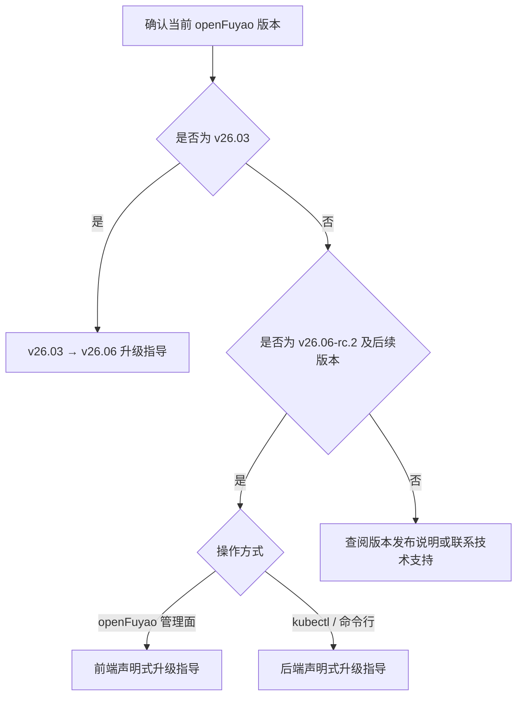
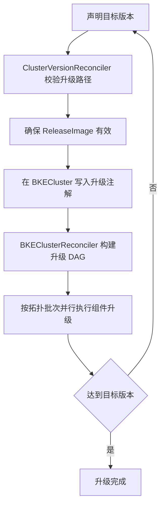

# 升级前必读

## 概述

openFuyao 提供基于声明式 API 的集群版本升级能力。用户声明目标版本后，系统自动完成升级路径校验、升级资源准备、组件有序升级与状态追踪。

根据集群**当前版本**与**操作方式**（openFuyao 管理面或后端命令行），选择对应的升级操作文档。本文档说明升级体系、核心概念、通用约束与文档导航，**不含具体升级命令与界面操作步骤**。

## 如何选择升级文档

**表1** 升级文档导航

| 当前集群版本 | 典型升级目标 | 操作方式 | 参考文档 |
| --- | --- | --- | --- |
| v26.03 | v26.06 | 后端命令行（默认）/ 管理面（阶段二） | [v26.03版本到v26.06版本升级指导](./upgrade_guide_from_v26.03_to_v26.06.md) |
| v26.06-rc.2 及后续版本 | 更高版本 | openFuyao 管理面 | [v26.06-rc.2及后续版本升级指导（前端声明式）](./frontend_declarative_upgrade_guide.md) |
| v26.06-rc.2 及后续版本 | 更高版本 | kubectl / 命令行 | [v26.06-rc.2及后续版本升级指导（后端声明式）](./backend_declarative_upgrade_guide.md) |

>  **说明：** v26.03 集群须先完成管理面（bke-controller-manager 调谐器）升级，再触发业务集群声明式升级，详见 [v26.03版本到v26.06版本升级指导](./upgrade_guide_from_v26.03_to_v26.06.md)。v26.06-rc.2 及后续版本可直接使用声明式升级文档。

## 升级方式对比

v26.06 起，openFuyao 引入声明式升级，与旧版串行 PhaseFlow 升级并存。v26.06-rc.2 及后续版本默认采用声明式升级。

**表2** 旧版 PhaseFlow 与声明式升级对比

| 对比项 | 旧版 PhaseFlow（v26.03 及之前） | 声明式升级（v26.06-rc.2 及后续） |
| --- | --- | --- |
| 触发方式 | 修改 `BKECluster.spec.openFuyaoVersion` | 修改 `ClusterVersion.spec.desiredVersion` |
| 执行方式 | 按固定顺序串行执行各升级阶段 | 按依赖关系构建 DAG，同批次组件并行执行 |
| 升级路径 | 固定路径 | 由 `UpgradePath` CR 定义，支持多跳自动执行 |
| 适用版本 | v26.03 及之前 | v26.06-rc.2 及后续（v26.03 须先迁移至 v26.06） |

## 核心概念

**表3** 声明式升级核心概念

| 概念 | 说明 |
| --- | --- |
| ClusterVersion | 声明式升级的触发 CR，通过 `spec.desiredVersion` 声明期望目标版本 |
| UpgradePath | 升级路径规则 CR，定义版本间合法升级路径（from、to、blocked 等） |
| ReleaseImage | 版本发布镜像 CR，包含升级所需组件列表、依赖关系及组件类型（inline / yaml / helm） |
| ComponentVersion | 组件版本定义 CR，通过 `spec.type` 声明组件类型，并定义版本、依赖、升级策略与前置资源 |
| 升级 DAG | 基于 ReleaseImage 与 ComponentVersion 依赖关系构建的有向无环图，决定组件执行顺序 |
| 多跳升级 | 当前版本到目标版本无直接路径时，系统按中间版本逐跳自动执行 |

## 升级组件类型

声明式升级将版本中的每个组件抽象为 `ComponentVersion` 资源，并通过 `spec.type` 声明执行方式。当前支持 **inline**、**yaml**、**helm** 三类升级组件：

**表4** 升级组件类型说明

| 类型 | 说明 | 典型组件示例 | 执行方式 |
| --- | --- | --- | --- |
| inline | 在节点或控制面执行内置升级逻辑（Go Phase），适用于需逐节点滚动、改静态 Pod 等场景 | containerd、etcd、kubernetes（master/worker）、bke-agent | Inline 执行器（PhaseRunner） |
| yaml | 将组件清单（YAML）应用到目标集群，适用于 Deployment、DaemonSet、RBAC 等资源型组件 | provider、coredns、kube-proxy、calico | Yaml 执行器（清单 Apply） |
| helm | 以 Helm Chart 方式安装或升级组件，适用于以 Chart 发布的 Addon 类组件 | 版本制品中以 Helm 方式定义的组件 | Helm 执行器（Chart 安装/升级） |

三类组件统一纳入升级 DAG，执行顺序由 `ComponentVersion.spec.dependencies` 决定：同批次内并行，不同批次间串行。具体批次划分因版本制品而异，详见[后端声明式升级指导](./backend_declarative_upgrade_guide.md#步骤四监控升级进度)中的阶段说明。

>  **说明：** 1.早期文档中的「manifest」组件现统一归类为 **yaml** 类型。 2.**inline** 组件始终经执行器框架调度；**yaml / helm** 组件默认走兼容路径，开启新执行器后走统一注册表路径（见下表）。 3.目标版本制品中移除某组件时，**不会自动卸载**该组件在集群中的已有资源。 4.目前v26.09及之前版本releaseImage定义组件暂不涉及helm类型。

**表5** yaml / helm 组件灰度开关

| 配置项 | 类型 | 缺省值 | 说明 |
| --- | --- | --- | --- |
| `--helm-component-support` | 全局 flag | `false` | 为所有集群启用 yaml/helm 类型组件的新执行器路径 |
| `cvo.openfuyao.cn/helm-component` | BKECluster 注解 | 无 | 为单个集群启用 yaml/helm 新执行器；**注解优先于**全局 flag |

开关关闭时，yaml/helm 组件保持与现网一致的 Legacy 执行路径；开关开启后，由对应执行器处理并写回组件生命周期状态。详情见[后端声明式升级指导 - 控制器参数与升级注解](./backend_declarative_upgrade_guide.md#控制器参数与升级注解)。

## 声明式升级流程

流程要点：

1. 用户通过管理面或 `kubectl` 将 `ClusterVersion.spec.desiredVersion` 设为目标版本。
2. `ClusterVersionReconciler` 查询 `UpgradePath`，校验路径合法性，并确保 `ReleaseImage` 存在且状态为 Valid。
3. 校验通过后，向 `BKECluster` 写入 `cvo.openfuyao.cn/upgrade-ready` 等注解。
4. `BKEClusterReconciler` 解析 `ReleaseImage`，构建 DAG 并按批次执行升级；按组件 `spec.type` 分别调度 inline、yaml、helm 三类执行器。
5. 多跳升级场景下，每跳完成后自动进入下一跳，直至 `currentVersion` 等于 `desiredVersion`。

控制器参数与升级注解详见[后端声明式升级指导](./backend_declarative_upgrade_guide.md#控制器参数与升级注解)及 [cluster-api-provider-bke 配置参数](../cluster_installation_guide/appendix/cluster-api-provider-bke_configuration.md)。

## 通用前提

升级前请确认：

- 管理集群（或引导集群）正常运行，且可在其上操作待升级业务集群的生命周期。
- 待升级集群状态为 **Healthy**；非 Healthy 须先排查修复。
- 在线场景：管理集群可访问远程版本仓库；离线场景：已制备并同步目标版本离线包与版本配置文件。
- **建议备份 etcd 数据**；升级失败时需按文档进行手动回滚。
- 若目标版本涉及 bkeagent 升级，须提前将目标版本的 bkeagent 二进制（amd64/arm64）放到引导节点 `/bke/mount/source_registry/files/`。

## 使用限制

**表6** 升级通用限制

| 限制项 | 说明 |
| --- | --- |
| 不支持降级 | 仅提供版本升级，不提供版本降级 |
| 最低版本要求 | 声明式升级最低可升级版本为 v26.06-rc.2 |
| 升级影响 | 非高可用集群升级 K8s 相关组件时，可能出现短暂 apiserver 不可用 |
| etcd 备份建议 | 升级前建议备份 etcd；失败时需手动回滚 |
| 离线上传限制 | 离线场景补丁上传不支持在在线模式下操作 |
| 集群健康要求 | 升级前集群状态须为 Healthy |

>  **注意：** 不支持跨文档混用操作步骤。v26.03 集群请严格按 [v26.03版本到v26.06版本升级指导](./upgrade_guide_from_v26.03_to_v26.06.md) 完成两阶段迁移后，再使用声明式升级文档进行后续版本升级。

## 升级前检查清单

| 检查项 | 说明 | 参考 |
| --- | --- | --- |
| 确认当前版本 | 明确集群 openFuyao 版本，选择正确文档 | 集群详情或 `kubectl get clusterversion` |
| 确认升级路径 | 目标版本在 `UpgradePath` 中可达且未被 blocked | `kubectl get upgradepath -o yaml` |
| 确认集群健康 | `BKECluster` 状态为 Healthy | `kubectl get bkecluster` |
| 备份 etcd | 升级前完成数据备份 | 运维备份规范 |
| 准备 bkeagent（如需） | 目标版本含 EnsureAgentUpgrade 时，引导节点已就绪版本化 bkeagent 二进制 | [前端](./frontend_declarative_upgrade_guide.md#前提条件) / [后端](./backend_declarative_upgrade_guide.md#前提条件) 前提条件说明 |
| 离线资源就绪 | 离线场景完成版本配置与离线包同步 | [后端声明式升级指导 - 离线场景](./backend_declarative_upgrade_guide.md#离线场景升级操作) |
| 选择操作方式 | 管理面或命令行，对应前端/后端文档 | 见上文[如何选择升级文档](#如何选择升级文档) |

## 相关文档

| 文档 | 说明 |
| --- | --- |
| [v26.03版本到v26.06版本升级指导](./upgrade_guide_from_v26.03_to_v26.06.md) | v26.03 跨大版本迁移（管理面升级 + 声明式升级） |
| [v26.06-rc.2及后续版本升级指导（前端声明式）](./frontend_declarative_upgrade_guide.md) | 通过 openFuyao 管理面执行声明式升级 |
| [v26.06-rc.2及后续版本升级指导（后端声明式）](./backend_declarative_upgrade_guide.md) | 通过 kubectl 执行声明式升级，含监控与排障 |
| [cluster-api-provider-bke 配置参数](../cluster_installation_guide/appendix/cluster-api-provider-bke_configuration.md) | 升级相关控制器参数与注解 |
