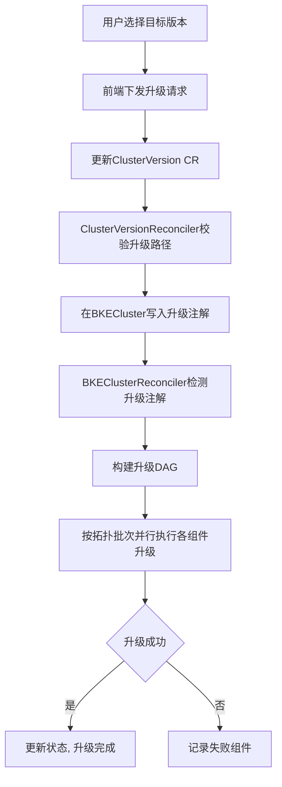

# v26.06-rc.2及后续版本升级指导（前端声明式）

## 前端声明式升级介绍

### 应用场景

声明式升级是openFuyao提供的一种基于声明式API的集群版本升级方式。通过前端进行升级，用户只需通过 Web 界面指定目标版本，系统将自动完成升级路径校验、升级资源准备、组件有序升级和状态追踪等全流程操作。

适用于以下场景：

- 将集群的openFuyao版本从v26.06-rc.2及后续版本升级到更高版本。
- 在线环境和离线环境下的集群版本升级。

### 能力范围

- 声明式触发升级：用户通过界面选择目标版本，系统自动下发升级指令。
- 升级路径自动校验：基于UpgradePath规则自动校验当前版本到目标版本的升级路径是否合法。
- 多跳升级自动执行：当不存在直接升级路径时，系统自动按中间版本逐跳执行。
- DAG（Directed Acyclic Graph，有向无环图）驱动的并行升级：升级组件按依赖关系构建DAG拓扑图，支持同批次组件并行升级。
- 在线/离线场景均支持。
- 管理集群和业务集群均可升级。业务集群的升级要在管理其生命周期的集群（管理集群或引导集群）上进行操作。

### 亮点特征

- 声明式触发：仅需声明目标版本（修改ClusterVersion CR（Custom Resource，自定义资源）的desiredVersion字段），无需关心升级执行细节。
- DAG并行升级：相较于旧版串行PhaseFlow升级，声明式升级支持组件按依赖拓扑并行执行，缩短整体升级耗时。
- 多跳自动执行：跨版本升级时，系统自动计算中间跳版本并逐跳执行，用户无需手动干预。

### 基本概念

| 概念 | 说明 |
| --- | --- |
| ClusterVersion | 声明式升级的触发CR，通过设置spec.desiredVersion字段声明期望的目标版本 |
| UpgradePath | 升级路径规则CR，定义了版本之间的合法升级路径，包括from、to、blocked等信息 |
| ReleaseImage | 版本发布镜像CR，包含升级所需的组件列表、依赖关系及组件类型（inline / yaml / helm） |
| ComponentVersion | 组件版本定义CR，通过`spec.type`声明组件类型，并定义版本、依赖、升级策略和前置资源 |
| 升级DAG | 基于ReleaseImage和ComponentVersion的依赖关系构建的有向无环图，决定升级组件的执行顺序 |
| 多跳升级 | 当从当前版本到目标版本不存在直接升级路径而存在多跳路径时，系统自动按中间版本逐跳执行升级 |

>  **说明：**<br />升级组件类型（inline / yaml / helm）说明见[升级前必读 - 升级组件类型](./before_you_upgrade.md#升级组件类型)。

声明式升级的触发和执行流程如下：



流程步骤说明：

1. **用户选择目标版本**：用户在界面上选择要升级到的目标版本。
2. **前端下发升级请求**：前端调用升级API，下发升级请求。
3. **更新ClusterVersion CR**：更新ClusterVersion CR的desiredVersion字段为目标版本。
4. **校验升级路径**：ClusterVersionReconciler查询UpgradePath CR，校验从当前版本到目标版本的升级路径是否合法。
5. **写入升级注解**：在BKECluster上写入upgrade-ready注解。
6. **检测升级注解**：BKEClusterReconciler检测BKECluster上的upgrade-ready注解，进入声明式升级流程。
7. **构建升级DAG**：基于ReleaseImage和ComponentVersion的依赖关系构建升级DAG拓扑图。
8. **按拓扑批次并行执行**：按DAG拓扑批次并行执行各组件升级，按`spec.type`分别调度inline、yaml、helm三类执行器。
9. **判断升级是否成功**：检查所有组件是否升级成功。
10. **升级完成**：升级成功后更新状态，清除升级注解。
11. **记录失败组件**：升级失败时记录失败组件信息。


## 使用限制

| 限制项 | 说明 |
| --- | --- |
| 不支持降级 | 只提供版本升级功能，未提供降级功能 |
| 最低版本要求 | 目前支持可升级的最低版本是v26.06-rc.2 |
| 升级影响 | 非高可用集群升级K8s相关组件时，会出现短暂的apiserver服务不可用 |
| etcd备份建议 | 升级前建议备份etcd数据，升级失败时需手动回滚 |
| 集群健康要求 | 升级前集群状态必须为Healthy，否则升级可能失败 |

>  **注意：**<br />升级体系概述与文档导航见[升级前必读](./before_you_upgrade.md)。v26.03版本到v26.06版本的升级参考[升级指导](./upgrade_guide_from_v26.03_to_v26.06.md)。下面的指导为v26.06-rc.2及后续版本的升级指导。

## 在线场景升级操作

### 前提条件

- 管理集群的openFuyao已部署且正常运行。
- 管理集群可以访问远程版本仓库（在线模式下系统自动从远程仓库获取版本信息）。
- 待升级的集群的状态为Healthy（健康）。

>  **说明：**<br />若目标版本涉及bkeagent升级（升级DAG中含EnsureAgentUpgrade），须提前下载目标版本的bkeagent二进制（amd64/arm64），并复制到引导节点的`/bke/mount/source_registry/files/`目录。以下以`v26.09-rc.2`（组件版本`26.9.0-rc.2`）为例，请将版本号替换为目标版本对应的组件版本号：
>
> ```bash
> curl -L -o bkeagent-26.9.0-rc.2-linux-arm64 https://openfuyao.obs.cn-north-4.myhuaweicloud.com/openFuyao/cluster-api-provider-bke/releases/download/26.9.0-rc.2/bkeagent_linux_arm64
> curl -L -o bkeagent-26.9.0-rc.2-linux-amd64 https://openfuyao.obs.cn-north-4.myhuaweicloud.com/openFuyao/cluster-api-provider-bke/releases/download/26.9.0-rc.2/bkeagent_linux_amd64
> cp bkeagent-26.9.0-rc.2-linux-arm64 bkeagent-26.9.0-rc.2-linux-amd64 /bke/mount/source_registry/files/
> ```

### 步骤一：检查集群状态

1. 登录openFuyao管理面。
      >  **说明：**<br/> 
      > - 引导节点的openFuyao管理面登录网址是“https://_引导节点IP地址_:30010”。
      > - 管理集群的openFuyao管理面登录网址是“https://_管理集群节点IP地址_:31616”。
      > - 首次登录时，默认用户名为admin，默认密码为test@1234。
2. 在左侧导航栏选择"集群生命周期管理"，找到要升级的业务集群，确认集群状态显示为"Healthy"。

若集群状态不为"Healthy"，需先排查和修复集群问题后再进行升级操作。

### 步骤二：查询可升级版本

系统在线模式下会自动从远程版本仓库获取版本信息。在openFuyao管理面中：

1. 选择"集群生命周期管理"，找到要升级的业务集群。
2. 进入集群的"升级"子界面。
3. 系统自动展示当前集群可升级的目标版本列表（基于UpgradePath规则计算得出）。

>  **说明：**<br />可升级版本列表由UpgradePath CR中的升级路径规则决定，仅展示当前版本可通过合法路径到达的版本。若当前版本没有任何可达的升级路径，则列表为空。

### 步骤三：选择目标版本并触发升级

1. 在可升级版本列表中，选择要升级到的目标版本。
2. 单击"确定"，下发升级操作。

系统会自动执行以下操作：
- 更新ClusterVersion CR，将desiredVersion设置为目标版本。
- ClusterVersionReconciler校验升级路径合法性。
- 若路径合法，在BKECluster写入升级注解，触发声明式升级流程。
- BKEClusterReconciler构建升级DAG并按拓扑批次执行各组件升级。

>  **说明：**<br />1.实际执行顺序由DAG拓扑决定，同批次内的组件并行执行。<br />2.多跳升级场景下，每跳执行上述全部阶段后才会进入下一跳。<br />3.provider自升级完成后会触发新Pod接管后续升级流程，旧Pod自动退出。

### 步骤四：确认升级完成

升级完成后：
- 集群状态恢复为"Healthy"。
- 集群的openFuyao版本更新为目标版本，可在集群详情界面查看当前版本号，确认其与升级时选择的目标版本一致。

## 离线场景升级操作

### 前提条件

- 管理集群的openFuyao已部署且正常运行。
- 管理集群处于离线模式（无法访问远程版本仓库）。
- 待升级的集群的状态为Healthy（健康）。
- 已准备好版本配置文件和版本离线包（oci格式）制备过程可参考[oci离线补丁包制备](./backend_declarative_upgrade_guide.md#制备离线包步骤二制备全量离线包)。

### 步骤一：检查集群状态

1. 登录openFuyao管理面。
2. 在左侧导航栏选择"集群生命周期管理"，找到要升级的业务集群，确认集群状态显示为"Healthy"。

### 步骤二：上传版本配置文件（可选）

1. 登录引导节点openFuyao管理面。
      >  **说明：**<br/> 
      > - 引导节点的openFuyao管理面登录网址是“https://_引导节点IP地址_:30010”。
      > - 首次登录时，默认用户名为admin，默认密码为test@1234。
2. 在左侧导航栏选择"集群生命周期管理 > 补丁上传"，直接上传版本配置文件内容。

>  **说明：**<br />离线场景下，版本配置文件需手动上传。系统会将配置文件存储在集群ConfigMap中供升级使用。

### 步骤三：上传离线包到引导节点

1. 将全量离线包文件放置在引导节点的/etc/openFuyao目录下。

   >  **说明：**<br />通过openFuyao管理面上传的只能是oci策略制备的离线包。离线包文件需要是.tar.gz格式。

2. 登录openFuyao管理面，在左侧导航栏选择"集群生命周期管理"，找到要升级的业务集群，进入集群的"升级"子界面，选择"升级准备"，输入离线包文件信息（路径和名称），单击"确定"。

   系统会自动执行以下操作：
   - 校验离线包路径和格式。
   - 解压离线包（tar.gz）。
   - 使用`bke registry patch`命令同步镜像到引导节点镜像源。
   - 拷贝二进制文件（containerd、kubelet、kubectl）到/bke/mount/source_registry/files目录。

>  **说明：**<br />1.通过openFuyao管理面的"升级准备"功能可自动完成镜像同步和二进制文件拷贝。<br />2.如不使用"升级准备"功能，可登录引导节点后端手动执行镜像同步和文件拷贝操作。<br />3.若目标版本涉及bkeagent升级，离线包同步后仍须确认引导节点`/bke/mount/source_registry/files/`目录中已具备版本化命名的bkeagent二进制（参见[在线场景前提条件](#前提条件)中的准备说明）。

### 步骤四：触发升级

操作方式与[在线场景-步骤三：选择目标版本并触发升级](#步骤三选择目标版本并触发升级)一致。登录openFuyao管理面，在左侧导航栏选择"集群生命周期管理"，找到要升级的业务集群，进入集群的"升级"子界面，选择目标版本并单击"确定"触发升级。

### 步骤五：确认升级完成

与[在线场景-步骤四：确认升级完成](#步骤四确认升级完成)一致。

## 升级失败处理

### 查看失败信息

升级失败时：
- 登录openFuyao管理面，在左侧导航栏选择"集群生命周期管理"，找到对应业务集群，集群状态显示为"UpgradeFailed"。
- 在集群详情中可查看失败的升级阶段和错误信息。

### 常见失败原因

| 失败原因 | 说明 |
| --- | --- |
| 集群不健康 | 升级前集群状态非Healthy，导致升级无法正常执行 |
| 升级路径被阻断 | UpgradePath规则中当前版本到目标版本的路径被标记为blocked |
| 镜像拉取失败 | 离线场景下镜像包未正确同步到引导节点镜像源 |
| 资源不足 | 节点CPU/内存/磁盘资源不足导致升级组件启动失败 |
| 网络问题 | 节点间网络通信异常导致升级命令执行失败 |


# FAQ

- **声明式升级和旧版升级有什么区别？**

  旧版升级(v26.03及之前版本)采用串行PhaseFlow方式，所有升级阶段按固定顺序逐一执行。声明式升级采用DAG驱动的并行方式，升级组件按依赖拓扑分批并行执行，整体升级耗时更短。同时声明式升级支持多跳自动执行。

- **升级版本列表为空是什么原因？**

  可能原因：1）当前版本已是最新版本，无更高版本可升级；2）UpgradePath规则中当前版本不存在任何可达的升级路径；3）在线模式下远程版本仓库不可达。

- **离线场景下补丁上传失败提示"online mode detected"是什么原因？**

  系统检测到管理集群处于在线模式，在线模式下不支持通过界面手动上传补丁文件。请检查集群的部署模式配置。

- **多跳升级是什么？**

  当从当前版本到目标版本不存在直接升级路径时（如v26.06-rc.2到v26.06），系统自动计算中间跳版本路径（如v26.06-rc.2 -> v26.06-rc.3 -> v26.06），并逐跳执行升级。每跳完成后自动进入下一跳，直到到达最终目标版本。