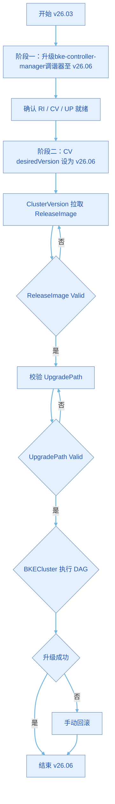

# v26.03版本到v26.06版本升级指导

>  **说明：**<br />升级体系概述与文档导航见[升级前必读](./before_you_upgrade.md)。

## 背景信息

本文档描述将openFuyao v26.03集群升级至v26.06的完整操作流程。v26.06提供声明式组件管理能力：通过`ClusterVersion`、`ReleaseImage`、`UpgradePath`三个CR（Custom Resource，自定义资源）协同，由调谐器自动完成版本校验、升级路径规划和组件DAG（Directed Acyclic Graph，有向无环图）滚动升级。

v26.03集群默认不具备上述能力，须分两个阶段完成升级：

| 阶段 | 目标 | 操作概要 |
| ---- | ---- | -------- |
| 阶段一 | 升级管理面（bke-controller-manager调谐器） | 安装新CRD（Custom Resource Definition，自定义资源定义）/ Webhook / RBAC，将`bke-controller-manager`升级至v26.06 |
| 阶段二 | 升级业务集群版本 | 修改`ClusterVersion.spec.desiredVersion`为v26.06，触发声明式DAG升级 |

升级路径：

```
v26.03  →  v26.06
```

升级流程概览如下：



>  说明：<br />流程图中RI（ReleaseImage）、CV（ClusterVersion）、UP（UpgradePath）为声明式升级相关CR的简称；DAG为Directed Acyclic Graph（有向无环图）的简称。

## 适用范围

>  说明：<br />
> 下文操作步骤面向联网环境下、通过后端命令行（`kubectl`等）执行的手动升级流程。断网环境与前端（openFuyao管理面）场景说明如下，不含具体操作步骤。

本文档所述联网环境指管理集群可访问公网镜像仓库（如`cr.openfuyao.cn`）；断网环境指管理集群使用本地/私有镜像仓库、无法直接访问公网。两种环境下均可选择后端命令行或openFuyao管理面发起升级，差异主要体现在镜像与OCI制品的获取方式。

| 场景 | 说明 |
| ---- | ---- |
| 联网 + 后端 | 本文档默认场景。集群可访问公网镜像仓库，升级包与镜像可直接下载或拉取；阶段划分与命令操作均按此环境编写。 |
| 断网 + 后端 | 常见升级场景之一。阶段一、阶段二的操作步骤与本文档一致，但须提前将升级包、调谐器镜像及OCI（Open Container Initiative，开放容器倡议）制品（`release-image`、`upgrade-path`）同步至本地镜像仓库，并在[步骤三](#步骤三更新调谐器并确认资源就绪)[3.2节](#32-替换并apply调谐器部署yaml)中将`IMAGE_REPO`替换为本地仓库前缀。镜像制备与同步的通用要求参见[升级指导](./backend_declarative_upgrade_guide.md#离线场景升级操作)；本文档不再展开断网专有的制备流程。 |
| 前端（管理面） | 适合已完成阶段一、且希望通过GUI触发阶段二的场景。须先将管理集群中`installer-service`的镜像变更为v26.06对应的高版本，再在openFuyao管理面「集群生命周期管理」中执行升级；阶段一（bke-controller-manager调谐器升级及RI/CV/UP就绪确认）仍须按本文档后端步骤完成。断网环境下同样须先完成镜像/OCI制品同步。 |

## 升级包下载与目录结构

v26.03 → v26.06管理面升级所需的CRD、Webhook、ClusterRole、调谐器ConfigMap/Deployment等清单，统一打包为zip发布。请从以下地址下载并解压至管理集群节点：

下载地址：

[https://openfuyao.obs.cn-north-4.myhuaweicloud.com/openFuyao/ext-components/upgrade/v26.03-to-v26.06.zip](https://openfuyao.obs.cn-north-4.myhuaweicloud.com/openFuyao/ext-components/upgrade/v26.03-to-v26.06.zip)

下载与解压示例：

```bash
export UPGRADE_ZIP_URL="https://openfuyao.obs.cn-north-4.myhuaweicloud.com/openFuyao/ext-components/upgrade/v26.03-to-v26.06.zip"

# 下载
curl -fL -o v26.03-to-v26.06.zip "${UPGRADE_ZIP_URL}"

# 解压（zip内应含单一顶层目录 v26.03-to-v26.06/）
unzip v26.03-to-v26.06.zip

# 校验目录结构
test -d v26.03-to-v26.06/crd \
  && test -d v26.03-to-v26.06/webhook \
  && test -d v26.03-to-v26.06/clusterRole \
  && test -d v26.03-to-v26.06/provider

export PKG_ROOT="$(pwd)/v26.03-to-v26.06"
cd "${PKG_ROOT}"
```

解压后的目录结构如下：

```
v26.03-to-v26.06/
├── crd/                                        # 步骤一：CRD 清单
│   ├── bke.bocloud.com_bkeclusters.yaml        # 已有CRD新增字段
│   ├── config.openfuyao.com_clusterversions.yaml   # 新增CRD
│   ├── config.openfuyao.com_componentversions.yaml # 新增CRD
│   ├── config.openfuyao.com_releaseimages.yaml     # 新增CRD
│   └── config.openfuyao.com_upgradepaths.yaml      # 新增CRD
├── webhook/                                    # 步骤二：Webhook
│   └── webhook.yaml                            #   ValidatingWebhookConfiguration
├── clusterRole/                                # 步骤二：RBAC
│   └── ClusterRole.yaml                        #   bke-manager-role权限扩展
└── provider/                                   # 步骤三：调谐器
    ├── 001-configmap.yaml                      #   cluster-system/bke-controller-manager-ologger-config
    └── 002-deployment.yaml                     #   bke-controller-manager Deployment
```

**表1** 升级包文件说明

| 路径 | 资源类型 | 用途 |
| ---- | -------- | ---- |
| `crd/bke.bocloud.com_bkeclusters.yaml` | CRD | 更新BKECluster资源定义 |
| `crd/config.openfuyao.com_clusterversions.yaml` | CRD | 声明式升级：ClusterVersion |
| `crd/config.openfuyao.com_componentversions.yaml` | CRD | 声明式升级：ComponentVersion |
| `crd/config.openfuyao.com_releaseimages.yaml` | CRD | 声明式升级：ReleaseImage |
| `crd/config.openfuyao.com_upgradepaths.yaml` | CRD | 声明式升级：UpgradePath |
| `webhook/webhook.yaml` | ValidatingWebhookConfiguration | BKECluster、UpgradePath校验 |
| `clusterRole/ClusterRole.yaml` | ClusterRole | 扩展调谐器访问声明式CR等资源的权限 |
| `provider/001-configmap.yaml` | ConfigMap | 调谐器日志配置`cluster-system/bke-controller-manager-ologger-config` |
| `provider/002-deployment.yaml` | Deployment | bke-controller-manager调谐器（含镜像占位符） |

## 前提条件

- 集群当前openFuyao版本为v26.03，且BKECluster状态健康（`STATE=Healthy`，`CLUSTER STATUS=Ready`）。
- 已从[升级包下载地址](#升级包下载与目录结构)获取并解压v26.03-to-v26.06 zip包。
- 升级所需镜像（见[镜像列表](#镜像列表)）已推送到集群可访问的镜像仓库（断网场景必须提前完成）。
- `UpgradePath` CR中已定义v26.03 → v26.06的合法升级路径。
- 升级前已备份etcd数据，以便升级失败时手动回滚。

## 使用限制

- 仅支持版本升级，不支持版本降级。
- 非高可用集群升级Kubernetes相关组件时，会出现短暂的apiserver服务不可用。
- 断网场景需提前将release-image、upgrade-path、调谐器镜像（cluster-api-provider-bke和bke-manifests）同步至本地镜像仓库，并确保调谐器Pod可访问该仓库地址。

## 镜像列表

v26.03 → v26.06升级须提前准备以下镜像。调谐器容器镜像tag为`26.6.0`；`release-image` OCI制品tag与openFuyao版本号一致（须同时准备`v26.03`与`v26.06`两个tag）；`upgrade-path`固定使用`latest`标签。

**表2** 升级所需镜像

| 镜像名称 | 镜像tag | openFuyao版本 | 类型 | 用途 |
| -------- | -------- | -------------- | ---- | ---- |
| `cluster-api-provider-bke` | `26.6.0` | v26.06 | 容器镜像 | bke-controller-manager调谐器主容器 |
| `bke-manifests` | `26.6.0` | v26.06 | 容器镜像 | 调谐器init容器，向Pod分发组件清单 |
| `release-image` | `v26.03` | v26.03 | OCI制品 | v26.03版本对应的组件信息 |
| `release-image` | `v26.06` | v26.06 | OCI制品 | v26.06版对应的组件信息 |
| `upgrade-path` | `latest` | — | OCI制品 | UpgradePath调谐器拉取，承载版本升级路径图 |

联网环境（默认仓库）完整引用示例：

```
cr.openfuyao.cn/openfuyao/cluster-api-provider-bke:26.6.0
cr.openfuyao.cn/openfuyao/bke-manifests:26.6.0
cr.openfuyao.cn/openfuyao/release-image:v26.03
cr.openfuyao.cn/openfuyao/release-image:v26.06
cr.openfuyao.cn/openfuyao/upgrade-path:latest
```

>  说明：<br />镜像仓库路径中的`openfuyao`为仓库命名空间（小写），与产品名称openFuyao的大小写不同。

断网环境（本地镜像仓库）示例：

将`{IMAGE_REPO}`替换为现场仓库前缀（含末尾`/`，与[步骤三](#步骤三更新调谐器并确认资源就绪)[3.2节](#32-替换并apply调谐器部署yaml)中`IMAGE_REPO`一致，如`192.168.201.86:5443/test/`）：

```
{IMAGE_REPO}cluster-api-provider-bke:26.6.0
{IMAGE_REPO}bke-manifests:26.6.0
{IMAGE_REPO}release-image:v26.03
{IMAGE_REPO}release-image:v26.06
{IMAGE_REPO}upgrade-path:latest
```

>  说明：<br />
>
> - 版本号与镜像tag：`cluster-api-provider-bke`、`bke-manifests`的镜像tag为`26.6.0`；`release-image`的OCI tag与版本号一致（`v26.03`、`v26.06`）；`upgrade-path`始终为`latest`。<br />
> - `release-image:v26.03`为必需项：阶段一调谐器升级后，ClusterVersion/ReleaseImage调谐器会reconcile当前版本v26.03的RI，须能拉取`release-image:v26.03`；若仅推送`v26.06`而缺少`v26.03`，可能导致`openfuyao-v26.03`无法进入`Valid`状态。<br />
> - `release-image`、`upgrade-path`为OCI制品，须按集群`bke-config`中镜像仓库配置推送到对应路径（域名与IP两套地址若均使用，须分别同步）。<br />
> - 阶段一完成、调谐器升级至v26.06后，管理面会自动拉取`upgrade-path:latest`并reconcile `UpgradePath` CR；阶段二触发前须确保`release-image:v26.06`可被调谐器访问。

## 操作步骤

下面介绍联网环境、后端命令行下，从v26.03升级至v26.06的手动操作流程。断网环境与前端场景的补充说明见[适用范围](#适用范围)。

>  说明：<br />通用升级前准备（版本配置文件、镜像包制备等）参见[升级指导](./backend_declarative_upgrade_guide.md#离线场景升级操作)；下表为v26.03升级至v26.06特有的准备项。

**表3** 升级前准备清单

| 序号 | 升级准备项目           | 准备内容                                                                                           | 建议起始时间 | 耗时    |
| ---- | ---------------------- |------------------------------------------------------------------------------------------------| ------------ | ------- |
| 1    | 集群状态检查           | 确认BKECluster状态健康（`STATE=Healthy`，`CLUSTER STATUS=Ready`）                                       | 升级前       | 1分钟  |
| 2    | 下载升级包             | 下载并解压zip，确认`crd/`、`webhook/`、`clusterRole/`、`provider/`目录完整                                    | 升级前       | 5分钟  |
| 3    | 核对ologger ConfigMap | 按需调整`provider/001-configmap.yaml`中`ologger.yaml`日志级别、轮转策略等                                     | 升级前       | 5分钟  |
| 4    | 推送镜像               | 按[镜像列表](#镜像列表)推送`release-image`、`upgrade-path`、`cluster-api-provider-bke`、`bke-manifests`至镜像仓库 | 升级前一天   | 10分钟 |
| 5    | 同步二进制文件（如需） | 若release-image中包含需单独准备的二进制文件，上传至引导节点`/bke/mount/source_registry/files/`目录                      | 升级前一天   | 10分钟 |
| 6    | 渲染调谐器YAML        | 替换`provider/002-deployment.yaml`中镜像占位符后生成可apply清单                                              | 升级前       | 5分钟  |
| 7    | 备份etcd              | 升级前备份etcd数据，以便失败时手动回滚                                                                          | 升级前       | 10分钟 |

v26.06版本需要执行下面的命令下载bkeagent二进制文件，然后将其复制到引导节点的`/bke/mount/source_registry/files/`目录。

```bash
curl -L -o bkeagent-26.6.0-linux-arm64 https://openfuyao.obs.cn-north-4.myhuaweicloud.com/openFuyao/cluster-api-provider-bke/releases/download/26.6.0/bkeagent_linux_arm64
curl -L -o bkeagent-26.6.0-linux-amd64 https://openfuyao.obs.cn-north-4.myhuaweicloud.com/openFuyao/cluster-api-provider-bke/releases/download/26.6.0/bkeagent_linux_amd64
cp bkeagent-26.6.0-linux-arm64 bkeagent-26.6.0-linux-amd64 /bke/mount/source_registry/files/
```

### 阶段一：升级管理面（bke-controller-manager调谐器）

以下步骤将管理集群中的bke-controller-manager调谐器升级至v26.06，使集群具备声明式组件管理能力。完成前请勿修改`ClusterVersion.spec.desiredVersion`。

<a id="步骤一安装新crd"></a>

#### 步骤一：安装新CRD

在管理集群、升级包根目录`${PKG_ROOT}`下执行，安装全部CRD（含BKECluster更新与声明式升级CRD）：

```bash
cd "${PKG_ROOT}"
kubectl apply -f crd/
```

确认CRD已注册：

```bash
kubectl get crd | grep -E 'bkeclusters.bke.bocloud.com|config.openfuyao.com'
```

预期至少包含：`bkeclusters.bke.bocloud.com`、`clusterversions.config.openfuyao.com`、`componentversions.config.openfuyao.com`、`releaseimages.config.openfuyao.com`、`upgradepaths.config.openfuyao.com`。

<a id="步骤二安装新webhook和clusterrole"></a>

#### 步骤二：安装新Webhook和ClusterRole

在`${PKG_ROOT}`下分别apply Webhook与ClusterRole：

```bash
kubectl apply -f webhook/webhook.yaml
kubectl apply -f clusterRole/ClusterRole.yaml
```

确认Webhook和RBAC资源已就绪：

```bash
kubectl get validatingwebhookconfiguration bke-validating-webhook-configuration
kubectl get clusterrole bke-manager-role
```

<a id="步骤三更新调谐器并确认资源就绪"></a>

#### 步骤三：更新调谐器并确认资源就绪

[步骤二](#步骤二安装新webhook和clusterrole)已更新Webhook与RBAC；本步骤先安装调谐器日志ConfigMap，再替换并apply调谐器部署YAML，将bke-controller-manager调谐器升级至v26.06。

<a id="31-安装更新调谐器ologger-configmap"></a>

##### 3.1 安装/更新调谐器ologger ConfigMap

v26.06调谐器通过`OLOGGER_CONFIG`环境变量加载日志配置（默认路径`/etc/openFuyao/ologger/ologger.yaml`）。升级包`provider/001-configmap.yaml`提供`cluster-system/bke-controller-manager-ologger-config`，须在更新Deployment之前apply：

```bash
cd "${PKG_ROOT}"
kubectl apply -f provider/001-configmap.yaml
```

确认ConfigMap已就绪：

```bash
kubectl -n cluster-system get configmap bke-controller-manager-ologger-config -o yaml
```

<a id="32-替换并apply调谐器部署yaml"></a>

##### 3.2 替换并apply调谐器部署YAML

1. 使用升级包中的`provider/002-deployment.yaml`，其中定义了`Deployment/bke-controller-manager`（命名空间`cluster-system`）。

2. 替换YAML模板中的占位符（apply前必须完成）：

   | 占位符 | 含义 | 替换示例 |
   | ------ | ---- | -------------- |
   | `{{ if .repo }}{{ .repo }}{{ else }}cr.openfuyao.cn/openfuyao/{{ end }}` | 镜像仓库前缀（含末尾`/`）；为空时默认`cr.openfuyao.cn/openfuyao/` | `192.168.201.86:5443/test/` |
   | `{{.providerVersion}}` | 调谐器镜像tag（openFuyao v26.06对应`26.6.0`） | `26.6.0` |
   | `{{.manifestsVersion}}` | manifests init容器镜像tag（openFuyao v26.06对应`26.6.0`） | `26.6.0` |

   渲染后典型镜像：

   - 主容器：`{IMAGE_REPO}cluster-api-provider-bke:26.6.0`
   - init容器：`{IMAGE_REPO}bke-manifests:26.6.0`

3. 在`${PKG_ROOT}`下生成渲染后的清单：

   ```bash
   cd "${PKG_ROOT}"

   export IMAGE_REPO="192.168.201.86:5443/test/"
   export PROVIDER_VERSION="26.6.0"
   export MANIFESTS_VERSION="26.6.0"

   sed -e "s|{{ if .repo }}{{ .repo }}{{ else }}cr.openfuyao.cn/openfuyao/{{ end }}|${IMAGE_REPO}|g" \
       -e "s|{{.providerVersion}}|${PROVIDER_VERSION}|g" \
       -e "s|{{.manifestsVersion}}|${MANIFESTS_VERSION}|g" \
       provider/002-deployment.yaml > /tmp/bke-controller-manager.rendered.yaml
   ```

4. 应用调谐器部署：

   ```bash
   # 替换成新的 deployment
   kubectl replace -f /tmp/bke-controller-manager.rendered.yaml
   ```
   
5. 等待调谐器滚动更新完成并核对镜像：

   ```bash
   kubectl -n cluster-system rollout status deployment/bke-controller-manager
   kubectl -n cluster-system get pods -l control-plane=controller-manager -o wide
   kubectl -n cluster-system get deployment bke-controller-manager \
     -o jsonpath='manager={.spec.template.spec.containers[?(@.name=="manager")].image}{"\n"}'
   ```

   预期镜像示例：`192.168.201.86:5443/test/cluster-api-provider-bke:26.6.0`

>  说明：<br />
> - 切勿在未替换占位符的情况下直接apply `provider/002-deployment.yaml`原始模板，否则Deployment无法创建有效Pod。<br />
> - 断网场景须提前将`cluster-api-provider-bke:26.6.0`、`bke-manifests:26.6.0`、`release-image:v26.03`、`release-image:v26.06`推送到`IMAGE_REPO`所指仓库。

##### 3.3 确认声明式升级相关资源就绪

观察以下三类资源均已就绪后，再执行阶段二：

   （1）RI：当前版本v26.03的RI已创建且`PHASE=Valid`（须已推送并可拉取`release-image:v26.03`）。

   ```bash
   kubectl get releaseimage -n bke-cluster
   ```

   输出示例：

   ```
   NAME               VERSION   PHASE
   openfuyao-v26.03   v26.03    Valid
   ```

   （2）CV：CV资源已创建且`PHASE=Ready`，`CURRENT`为v26.03。

   ```bash
   kubectl get cv -n bke-cluster
   ```

   输出示例：

   ```
   NAME          DESIRED   CURRENT   PHASE
   bke-cluster   v26.03    v26.03    Ready
   ```

   （3）UP：UP资源已创建且`PHASE=Active`，包含v26.03 → v26.06路径。

   调谐器升级至v26.06后，UpgradePath由内置OCI digest监视器按5分钟周期自动从镜像仓库拉取`upgrade-path:latest`并reconcile UP CR。检查UP资源时，若尚未创建或未进入`Active`，请等待5分钟定时器生效，调谐器会自动完成拉取与reconcile，无需手动创建。

   ```bash
   kubectl get upgradepath openfuyao-upgrade-paths -o yaml
   ```

>  说明：<br />三类资源未全部就绪时请勿进入阶段二。其中UpgradePath依赖5分钟定时拉取，检查时请预留相应等待时间。

---

### 阶段二：升级集群至v26.06

bke-controller-manager调谐器已升级至v26.06且资源就绪后，通过修改`ClusterVersion`触发声明式升级。

#### 步骤一：编辑ClusterVersion触发升级

将`spec.desiredVersion`修改为v26.06：

```bash
kubectl edit cv bke-cluster -n bke-cluster
```

```yaml
spec:
  desiredVersion: v26.06
```

保存退出后，调谐器将自动完成：拉取v26.06 ReleaseImage → 校验UpgradePath → 在BKECluster上执行声明式DAG升级。

观察升级进度（全程约10～20分钟）：

```bash
# 观察 CV：PreChecking → Ready
kubectl get cv -n bke-cluster bke-cluster -w

# 观察 v26.06 RI 创建并变为 Valid
kubectl get releaseimage -n bke-cluster -w
```

升级完成后确认：

```bash
kubectl get cv -n bke-cluster bke-cluster
```

输出示例：

```
NAME          DESIRED   CURRENT   PHASE
bke-cluster   v26.06    v26.06    Ready
```

```bash
kubectl get releaseimage -n bke-cluster
```

输出示例：

```
NAME               VERSION   PHASE
openfuyao-v26.03   v26.03    Valid
openfuyao-v26.06   v26.06    Valid
```

**表4** 正常升级关键日志节点

| 时间序 | 组件                  | 关键日志                                                     |
| ------ | --------------------- | ------------------------------------------------------------ |
| T+0    | ClusterVersion调谐器 | `pulling release image`（`.../release-image:v26.06`）       |
| T+N    | ClusterVersion调谐器 | `release image pulled`                                       |
| T+N    | ClusterVersion调谐器 | `upgrade precheck passed, BKECluster marked upgrade-ready`   |
| T+N    | BKECluster调谐器     | `running declarative upgrade DAG`                            |
| T+M    | ClusterVersion调谐器 | `status.currentVersion`更新为v26.06，`PHASE=Ready`     |
