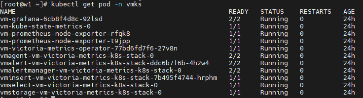
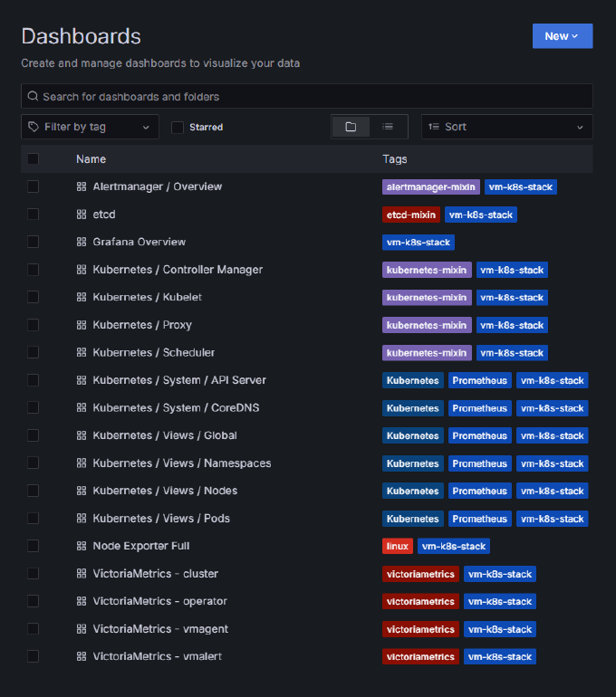
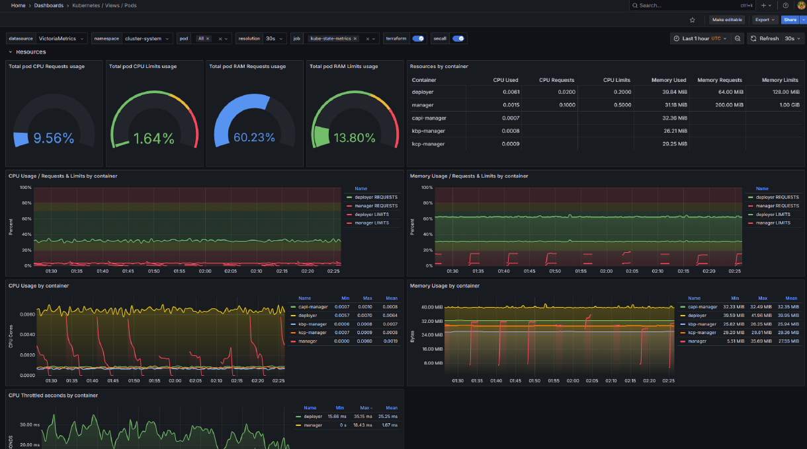

# victoriametrics_controller使用指导

## 背景信息

VictoriaMetrics是一款高性能时序数据库，专为云原生监控设计。它通过无损压缩大幅降低存储成本，优化查询引擎实现PromQL快速响应，支持水平扩展与多租户隔离。完全兼容Prometheus，可作为长期存储替代方案，以更低资源消耗提供高可用保障。

openFuyao社区通过在BKECluster中的addon部分配置victoriametrics相关参数，调谐器在处理BKECluster时依据参数拉取victoriametrics_controller的镜像。该镜像在节点上通过拉起Pod运行，根据用户提供的配置，渲染VictoriaMetrics Helm Chart中的values.yaml文件，进而完成VictoriaMetrics组件的安装，并根据实际情况自动适配相关配置。

**术语说明**

| 术语 | 说明 |
| --- | --- |
| VictoriaMetrics（VM） | Prometheus的增强后端，100%兼容Prometheus API、PromQL与数据格式，Grafana看板、告警规则、客户端可零改动接入，专注解决大规模场景下的高基数、高吞吐、高可用问题。 |
| VMCluster | VM集群模式监控栈，采用组件分离架构，由vminsert（数据写入）、vmstorage（数据存储）与vmselect（数据查询）组成，各组件支持独立扩缩容。 |
| VMAgent | 指标采集代理组件，支持Pull/Push两种采集模式，具备数据删除、窗口聚合及远端多路写入能力；远端存储不可用时可自动降级至本地暂存数据，待恢复后同步。 |
| BKECluster CR | 描述业务集群期望配置（节点、网络、Addon、版本等）并聚合集群状态的自定义资源。 |
| BKENode CR | 描述业务集群节点的身份、连接信息与角色的自定义资源。 |
| 调谐器 | Cluster API 及 BKE provider 的控制器，持续对比集群期望状态与实际状态并执行调谐操作。 |
| Addon | 通过 BKECluster 的 Addons 字段声明的扩展组件，支持 yaml 和 chart 两种形态，由调谐器在处理 BKECluster 时完成安装。 |

术语说明参考[sig-large-scale-cluster VictoriaMetrics超大规模集群监控最佳实践](https://gitcode.com/openFuyao/sig-large-scale-cluster/blob/master/docs/zh/best_practice/best_practices_for_ultra_large_scale_cluster_monitoring_based_on_the_victoriametrics_software_stack.md)。

## 前提条件

- 已参考[通过后台（命令行）安装业务集群](../cluster_installation_guide/service_cluster_installation/service_cluster_deployment_guide_(linux_backend).md)完成业务集群安装。
- 集群具备与监控规模匹配的可支配CPU、内存与存储资源。参考[sig-large-scale-cluster VictoriaMetrics超大规模集群监控最佳实践](https://gitcode.com/openFuyao/sig-large-scale-cluster/blob/master/docs/zh/best_practice/best_practices_for_ultra_large_scale_cluster_monitoring_based_on_the_victoriametrics_software_stack.md)给出的集群资源情况如下（按replicationFactor=2、保留7天测算；100w/s摄取率经VMCluster内部双写，资源按200w/s双倍估算）：

    **集群资源情况**（取自上游最佳实践表1）：

    | VMAgent摄取率 | CPU | 内存(GiB) | 存储(GiB) |
    |---|---|---|---|
    | 100w/s | 116 | 438 | 1100 |
    | 200w/s | 148 | 450 | 1620 |
    | 300w/s | 210 | 510 | 2880 |
    | 400w/s | 234 | 576 | 3640 |
    | 500w/s | 310 | 670 | 4260 |

    >  **说明：**<br />上述推荐资源配置适用于大规模集群（100w/s<数据摄取率<500w/s），其余规模集群需另行调优。具体节点数随集群规模与参数规划确定。来源文档未给出固定节点数口径。
    >
    > 监控组件会占用单节点较多的CPU、内存、存储与网络资源，建议单独规划用于部署监控组件的节点；建议使用SSD存储监控数据，且每个VMStorage实例应独占一块硬盘。
- 未自定义参数时，系统按表1默认参数组部署，请确保节点资源满足各组件默认的CPU、内存与存储配置。
- 若需控制各组件的调度节点，已在BKENode CR中为对应节点添加组件调度标签，具体见步骤2。

## 使用限制

在目前已有的可安装插件中，由于openFuyao管理面默认包含了监控组件Prometheus的安装，但VictoriaMetrics与Prometheus存在以下兼容性问题，因此不建议两者同时安装。

- 端口冲突：VictoriaMetrics作为Prometheus的增强后端，默认同样占用9090端口提供API兼容服务，导致两者无法同时正常运行。

- 数据重复：若强行部署，两者会同时抓取相同的Targets，造成监控数据重复。

VictoriaMetrics主要面向超大规模监控场景设计，当监控数据量巨大、指标基数极高或需要构建生产级高可用架构时，其资源利用率、线性扩展能力和协议优化优势才能充分体现。对于中小规模场景，openFuyao自带的Prometheus组件已能满足基本监控需求。

如需在超大规模场景下使用VictoriaMetrics的高效存储与高可用能力，建议在部署前先关闭或卸载openFuyao自带的Prometheus组件，以充分发挥VM在资源利用率和可扩展性方面的优势。

## 操作步骤

按照下列步骤进行victoriametrics的安装。

1. 编辑`cluster CR`，在`spec.ClusterConfig`字段添加victoriametrics组件所需的参数，依据需求与环境资源完成监控相关配置。

    >  **说明：**<br />对于已有集群，用户需在引导节点上修改`/bke/cluster/`目录下的集群配置文件（`1master-cluster.yaml`）与节点信息文件（`1master-node.yaml`）完成上述`cluster CR`与`node CR`的配置，具体操作参见[通过后台（命令行）安装业务集群](../cluster_installation_guide/service_cluster_installation/service_cluster_deployment_guide_(linux_backend).md)。

    VictoriaMetrics监控（VictoriaMetrics K8s Stack）包含vmAgent、vmSelect、vmStorage、vmInsert、vmAlert、vmAlertManager、Grafana以及kubeStateMetrics等组件，用户需要在CR中配置的内容，规定了victoriametrics的工作模式，并为这些组件指定了副本、分片数量以及资源配置和指标抓取配置。

    **默认值**：考虑到参数数量较多，对于首次配置victoriametrics的用户存在一定的困难。因此若用户未自定义参数，系统将自动应用预设的默认参数组。该参数组针对集群数据摄取率在200w/s的场景进行优化，使用高可用配置方式，保证在部分节点故障时，监控业务不受影响。使用经过验证的推荐配置，可确保集群在此负载下获得稳定的监控保障。

    **表 1** victoriametrics参数与默认值说明
    |参数|说明|默认值|
    |---|---|---|
    |imageRepo|镜像仓地址，离线安装时自动切换。|hub.oepkgs.net/openfuyao|
    |version|victoriametrics helm chart版本。|0.58.2|
    |useVMSingle|是否使用victoriametrics单节点模式，在超大规模集群场景建议使用集群模式，关闭该参数后默认开启集群模式。|false|
    |vmSingleStorageSize|victoriametrics单节点模式存储大小，单位GiB。|50Gi|
    |vmAgentAllowStatefulSet|是否允许VMAgent是否改为StatefulSet模式，改为StatefulSet模式后当存储节点宕机时，VMAgent会将数据保存到本地。|true|
    |vmAgentCpuCount|VMAgent组件分配cpu数量。|4|
    |vmAgentMemorySize|VMAgent组件分配内存大小，单位GiB。|8Gi|
    |vmAgentStorageSize|VMAgent组件分配存储大小，单位GiB。|60G|
    |vmAgentReplicaCount|VMAgent组件副本数。|2|
    |vmAgentShareCount|VMAgent水平分片数量。|2|
    |vmAgentScrapeInterval|VMAgent组件指标抓取间隔。|20s|
    |vmSelectCpuCount|VMSelect组件分配cpu数量。|12|
    |vmSelectMemorySize|VMSelect组件分配内存大小，单位GiB。|24Gi|
    |vmSelectStorageSize|VMSelect组件分配存储大小，单位GiB。|35Gi|
    |vmSelectReplicaCount|VMSelect组件副本数。|2|
    |vmStorageCPUCount|"VMStorage组件分配cpu数量。|5|
    |vmStorageMemorySize|VMStorage组件分配内存大小，单位GiB。|32Gi|
    |vmStorageStorageSize|VMStorage组件分配存储大小，单位GiB。|720Gi|
    |vmStorageReplicaCount|VMStorage组件副本数。|10|
    |vmInsertReplicaCount|VMInsert副本数。|6|
    |vmInsertCpuCount|VMInsert组件分配cpu数量。|4|
    |vmInsertMemorySize|VMInsert组件分配内存大小，单位GiB。|8Gi|
    |vmAlertReplicaCount|VMAlert组件副本数。|2|
    |vmAlertCpuCount|VMAlert组件分配cpu数量。|4|
    |vmAlertMemorySize|VMAlert组件分配内存大小，单位GiB。|16Gi|
    |vmAlertManagerReplicaCount|VMAlertManager组件副本数。|2|
    |vmAlertManagerCpuCount|VMAlertManager组件分配cpu数量。|4|
    |vmAlertManagerMemorySize|VMAlertManager组件分配内存大小，单位GiB。|16Gi|
    |vmClusterRetentionPeriod|VMCluster数据保留时间，单位为h（小时）、d（天）、w（星期）、 y（年）。|15d|
    |vmClusterReplicationFactor|VMCluster数据复制因子。|2|
    |grafanaNodePort|Grafana节点端口。|30010|
    |kubeStateMetricsAutoSharding|是否开启KubeStateMetrics自动分片。|true|
    |kubeStateMetricsReplicaCount|KubeStateMetrics组件副本数。|3|
    |kubeStateMetricsCpuCount|KubeStateMetrics组件分配cpu数量。|4|
    |kubeStateMetricsMemorySize|KubeStateMetrics组件分配内存大小，单位GiB。|12Gi|

    **示例**：以下是一个最小化集群模式监控栈的全量配置示例，各组件数量均为1，能够满足小集群监控需求。
      
    ```yaml
    spec:
      ClusterConfig:
        - name: victoriametrics-controller
          param:
            useVMSingle: false
            vmSingleStorageSize: 50Gi
            vmAgentAllowStatefulSet: true
            vmAgentCpuCount: 0.5
            vmAgentMemorySize: 2Gi
            vmAgentStorageSize: 10Gi
            vmAgentReplicaCount: 1
            vmAgentShareCount: 1
            vmAgentScrapeInterval: 20s
            vmSelectCpuCount: 0.5
            vmSelectMemorySize: 2Gi
            vmSelectStorageSize: 10Gi
            vmSelectReplicaCount: 1
            vmStorageCPUCount: 0.5
            vmStorageMemorySize: 2Gi
            vmStorageStorageSize: 20Gi
            vmStorageReplicaCount: 1
            vmInsertReplicaCount: 1
            vmInsertCpuCount: 0.5
            vmInsertMemorySize: 2Gi
            vmAlertReplicaCount: 1
            vmAlertCpuCount: 0.5
            vmAlertMemorySize: 1Gi
            vmAlertManagerReplicaCount: 1
            vmAlertManagerCpuCount: 0.5
            vmAlertManagerMemorySize: 1Gi
            vmClusterRetentionPeriod: 15d
            vmClusterReplicationFactor: 1
            grafanaNodePort: 30010
            kubeStateMetricsAutoSharding: true
            kubeStateMetricsReplicaCount: 1
            kubeStateMetricsCpuCount: 0.5
            kubeStateMetricsMemorySize: 2Gi
          version: latest
    ```

2. 编辑`node CR`，在对应节点`spec`字段添加victoriametrics组件所需的标签。

    VictoriaMetrics各组件可通过节点标签实现调度控制，涉及的组件标签包括：

    - monitoring.victoria.com/vmstorage=vmstorage
    - monitoring.victoria.com/vminsert=vminsert
    - monitoring.victoria.com/vmselect=vmselect
    - monitoring.victoria.com/vmagent=vmagent
    - monitoring.victoria.com/vmalert=vmalert
    - monitoring.victoria.com/vmalertmanager=vmalertmanager
    - monitoring.victoria.com/vm-grafana=vm-grafana
    - monitoring.victoria.com/metrics=kube-state-metrics

    用户可根据实际需求，在允许调度对应监控组件的节点上标记相应标签。安装时，各组件仅会调度至带有对应标签的节点上。

    **示例**：配置文件中将所有组件调度到同一个worker节点上。

    ```yaml
    apiVersion: bke.bocloud.com/v1beta1
    kind: BKENode
    metadata:
      labels:
        cluster.x-k8s.io/cluster-name: bke-cluster
      name: bke-cluster-master1
    ...
    ---
    apiVersion: bke.bocloud.com/v1beta1
    kind: BKENode
    metadata:
      labels:
        cluster.x-k8s.io/cluster-name: bke-cluster
      name: bke-cluster-work1
      namespace: bke-cluster
    spec:
      hostname: work1
      ip: *********
      password: *******
      port: "22"
      role:
      - node
      username: root
      labels:
        - key: monitoring.victoria.com/vmstorage
          value: vmstorage
        - key: monitoring.victoria.com/metrics
          value: kube-state-metrics
        - key: monitoring.victoria.com/vminsert
          value: vminsert
        - key: monitoring.victoria.com/vmalert
          value: vmalert
        - key: monitoring.victoria.com/vmselect
          value: vmselect
        - key: monitoring.victoria.com/vmagent
          value: vmagent
        - key: monitoring.victoria.com/vmalertmanager
          value: vmalertmanager
        - key: monitoring.victoria.com/vm-grafana
          value: vm-grafana
    ```
    >  **说明：**<br /> 配置VictoriaMetrics时，需确保各项参数不存在冲突。若存在冲突，系统将报参数校验错误。校验规则如表2所示。

      **表 2** 参数校验规则
     |规则|说明|
     |---|---|
     |可用节点数|各组件可用节点数 = 打有对应标签的节点数|
     |副本与分片|各组件副本 &times; 分片 &le; 各组件可用节点数|
     |存储容量|各组件存储 &le; 各组件对应节点实际存储|
  
    > **注意：**<br/> 请确保配置满足以上全部规则，否则将导致安装失败。

3. 执行部署。
   
    将VictoriaMetrics的参数配置到BKEClusterCR的Spec.ClusterConfig.Addons中，调谐器会在EnsureAddonDeploy阶段检测到新addon，自动执行部署流程。

   3.1 用户在`BKECluster CR`中配置VictoriaMetrics插件相关参数，在`BKENode CR`中配置节点信息，应用CR执行工作集群的安装并进行参数检查。
   
   3.2 解析参数并依据插件名称和版本从`bkemanifests`中获取对应YAML配置文件，渲染YAML模板。 通过`kube.InstallAddon`调用`kubectl apply`应用YAML配置文件，在Pod中拉取`victoriametrics-controller`镜像。
   
   3.3 `victoriametrics-controller`镜像执行创建pv的任务，进一步创建对应节点创建pv路径的Job并下发，Job调度到对应节点，完成路径创建。
   
   3.4 `victoriametrics-controller`节点内执行VictoriaMetrics安装命令。

   3.5 下发Job完成证书相关配置与静态Pod YAML的修改，以及dashboard的配置。

   3.6 完成VictoriaMetrics的安装，更新Status.AddonStatus记录部署结果。

4. 验证部署。
   
   4.1 集群状态验证。

      完成victoriametrics的安装后，在集群中的对应命名空间中应拉起对应配置数量的组件Pod，并且全部处于`Running`状态。通过执行命令`kubectl get pod -n <namespace>`即可获取目标节点状态，如图1所示。

      **图 1** 集群状态验证

      

   4.2 dashboard验证。

      在VictoriaMetrics运行状态正常的情况下，它能够成功采集集群中的各类性能指标，而Grafana则可将这些指标以可视化面板的形式直观地呈现给用户。

      4.2.1 执行命令`kubectl get secret vm-grafana -n vmks -o jsonpath="{.data.admin-password}" | base64 --decode`获取登录密码。

      4.2.2 浏览器输入`http://<您的控制节点ip>:<您的grafana端口号>`。http协议存在安全风险，建议您使用https安全协议；若您的 Grafana 已配置 HTTPS，请使用 `https://` 协议访问。
      
      4.2.3 输入用户名`admin`以及上一步获取的密码登录grafana可视化面板。
   
   登录后，您将看到如图2所示的所有可监控仪表盘列表。用户可根据需要选择不同的面板查看相应的监控数据。

   **图 2** grafana全部dashboard列表

   

   以Pod为例，图3展示了其性能指标的监控视图。

   **图 3** grafana-Pod指标性能

   
   
   
5. addon更新和卸载（可选）。
   
   - 更新：修改`BKECluster`中addon的`version`或`param`，调谐器会自动触发更新流程（重新渲染YAML并履约）。
   - 卸载：修改`BKECluster`，从`Spec.ClusterConfig.Addons`字段中移除VictoriaMetrics相关内容，即`victoriametrics-controller`对应插件字段下全部内容（包括`name`、`param`和`version`），调谐器会自动触发卸载流程。