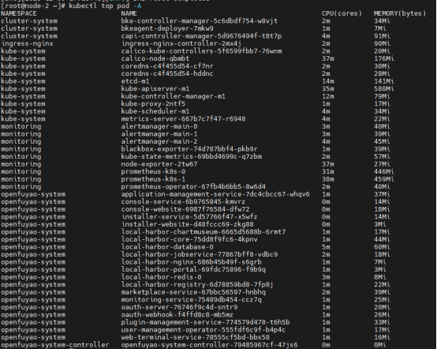
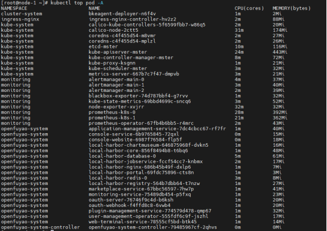

# 概述

## 测试目的

本文档旨在测试安装部署工具的性能基线。

## 测试环境

虚拟机地址：192.168.200.160-165

# 测试内容

| 序号  | 测试项 |
| --- | --- |
| 1   | 在线安装时长 |
| 2   | 离线安装时长 |
| 3   | Openfuyao-system命名空间下的pod占用资源 |
| 4   | 增量离线包制作，OCI策略与之前对比 |
| 5   | 多节点集群安装部署时长 |

# 测试用例

## 在线安装时长

### 测试目的

测试在线安装部署时长

### 前提环境

- os:openEuler 22.03 LST SP3
- CPU架构:arm64
- CPU个数：4个
- 内存：8G
- 虚拟机地址：192.168.200.30，192.168.200.31，192.168.200.32
- 下载速度约为1.5M/s

### 测试过程

- 下载bke，bke初始化引导节点
- 前端部署业务集群
- 后端bc创建管理集群

### 测试结果

- 引导节点初始化7分钟40秒
- 前端部署业务集群 6分钟 25秒
- 后端bc创建管理集群8分钟05秒
- 引导节点初始化和部署业务集群的时长较上个版本略微降低

## 离线安装时长

### 测试目的

测试离线安装包制备时长和openfuyao安装部署的时长

### 前提环境

- os:openEuler 22.03 LST SP3
- CPU架构:arm64
- CPU个数：4个
- 内存：16G
- 虚拟机地址：192.168.201.162，192.168.200.34
- 下载速度约为1.5M/s

### 测试过程

- 制备离线部署包，传到引导节点并解压
- 引导节点初始化，到管理面新建业务集群

### 测试结果

- 离线部署包8.3G，制备时长11分10秒， scp传输速率21M/s 传输时长5分钟
- 引导节点初始化5分20秒
- 新增业务集群4分55秒
- 整体时长较上版本均有所降低

## 平台底噪

### 测试目的

测试管理集群和业务集群所有命名空间下pod占用资源的情况

### 前提环境

- os:openEuler 22.03 LST SP3
- CPU架构:arm64
- CPU个数：4个
- 内存：8G
- 虚拟机地址：192.168.200.31，192.168.200.32

### 测试过程

- 下载bke，bke初始化引导节点
- 部署业务集群

### 测试结果

#### 管理集群

- 所有组件占用CPU 267m，内存 2982M
- cluster-system命名空间占用CPU 7m，内存132M
- ingress-nginx命名空间占用CPU 2m，内存 90M
- kube-system命名空间占用CPU 113m，内存 1127M
- monitoring命名空间占用CPU 121m，内存 1192M
- openfuyao-system命名空间占用CPU 24m，内存 441M
  
  

#### 业务集群

- 所有组件占用CPU 169m，内存 2132m
- cluster-system命名空间占用CPU 1m，内存2M, 新增的pod
- ingress-nginx命名空间占用CPU 2m，内存 88M，较上版本无明显变化
- kube-system命名空间占用CPU 86m，内存 952M，较上版CPU占用下降，内存占用上升
- monitoring命名空间占用CPU 96m，内存 1029M，较上版CPU占用上升，内存占用上升
- openfuyao-system命名空间占用CPU 23m，内存 427M，较上版CPU和内存占用略微上升

  

## 增量离线包制作

### 测试目的

测试组件包构建时长

### 前提环境

- os:openEuler 22.03 LST SP3
- CPU架构:arm64
- CPU个数：4个
- 内存：16G
- 虚拟机地址：192.168.201.162

### 测试过程

- 准备增量组件的配置文件，选择logging-package，monitoring-dashboard，multi-cluster组件
- 使用OCI策略构建离线包
- 使用原有方式构建离线包

### 测试结果

- OCI策略构建时长7分25秒，离线包大小3.96G
- bke build patch 方式构建9分53秒，离线包大小3.97G
- OCI策略相较原有构建方式速度更快

## 多节点集群安装部署

### 测试目的

测试新建不同节点的集群所消耗的时间

### 前提环境

- os:openEuler 22.03 LST SP3
- CPU架构:arm64
- CPU个数：4个
- 内存：8G
- 虚拟机地址：192.168.200.30-34，192.168.200.144-148

### 测试过程

- 分别新建1m1w,1m2w,1m3w,1m4w集群
- 新建3m2w集群

### 测试结果

- 1m1w集群创建时长7分11秒
- 1m2w集群创建时长7分34秒
- 1m3w集群创建时长7分59秒
- 1m4w集群创建时长8分35秒
- 3m2w集群创建时长11分46秒