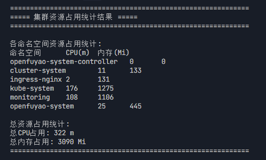
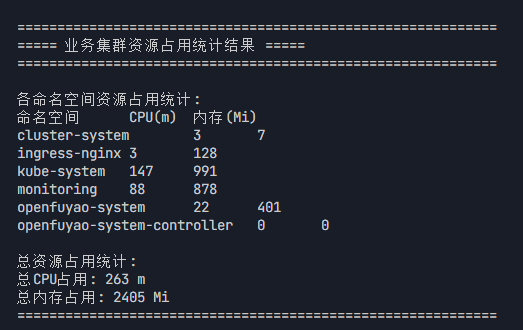

# 概述

## 测试目的

本文档旨在测试安装部署工具的性能基线。

## 测试环境

虚拟机地址：192.168.200.170-176,192.168.201.70-89,192.168.201.150-159

# 测试内容

| 序号  | 测试项 |
| --- | --- |
| 1   | 在线安装时长 |
| 2   | 扩容时长 |
| 3   | 离线安装时长 |
| 4   | Openfuyao-system命名空间下的pod占用资源 |
| 5   | 多节点集群安装部署时长 |

# 测试用例

## 在线安装时长

### 测试目的

测试在线安装部署时长

### 前提环境

- os:openEuler 22.03 LST SP3
- CPU架构:arm64
- CPU个数：4个
- 内存：8G
- 虚拟机地址：192.168.200.174，192.168.200.175，192.168.200.176，192.168.200.179

### 测试过程

- 下载bke，bke初始化引导节点
- 前端部署业务集群
- 后端bc创建管理集群
- 前端执行扩容1节点

### 测试结果

- 引导节点初始化6分钟30秒
- 前端部署业务集群 6分钟 08秒
- 后端bc创建管理集群7分钟32秒
- 扩容时长2分钟14秒
- 测试结果较上个版本差异较小

## 离线安装时长

### 测试目的

测试离线安装包制备时长和openfuyao安装部署的时长

### 前提环境

- os:openEuler 22.03 LST SP3
- CPU架构:arm64
- CPU个数：4个
- 内存：16G
- 虚拟机地址：192.168.201.162，192.168.200.177, 192.168.200.178

### 测试过程

- 制备离线部署包，传到引导节点并解压
- 引导节点初始化，到管理面新建业务集群

### 测试结果

- 离线部署包10.1G，制备时长16分32秒 ， scp传输速率约33M/s 传输时长约5分
- 引导节点初始化5分14秒
- 新增业务集群4分51秒
- 离线包大小明显增长，初始化和创建集群时长较上版本差异较小

## 平台底噪

### 测试目的

测试管理集群和业务集群所有命名空间下pod占用资源的情况

### 前提环境

- os:openEuler 22.03 LST SP3
- CPU架构:arm64P
- CPU个数：4个
- 内存：8G
- 虚拟机地址：192.168.200.175，192.168.200.176

### 测试过程

- 下载bke，bke初始化引导节点
- 部署业务集群

### 测试结果

#### 管理集群

- 所有组件占用CPU 322m，内存 3092M
- cluster-system命名空间占用CPU 11m，内存133M
- ingress-nginx命名空间占用CPU 2m，内存 131M
- kube-system命名空间占用CPU 176m，内存 1275M
- monitoring命名空间占用CPU108m，内存 1106M
- openfuyao-system命名空间占用CPU 25m，内存 445M
  
  

#### 业务集群

- 所有组件占用CPU 263m，内存 2405m
- cluster-system命名空间占用CPU 3m，内存7M
- ingress-nginx命名空间占用CPU 3m，内存 128M
- kube-system命名空间占用CPU 147m，内存 991M
- monitoring命名空间占用CPU 88m，内存 878M
- openfuyao-system命名空间占用CPU 22m，内存 401M

  

## 多节点集群安装部署

### 测试目的

测试新建不同节点的集群所消耗的时间

### 前提环境

- os:openEuler 22.03 LST SP3
- CPU架构:arm64
- CPU个数：4个
- 内存：8G
- 虚拟机地址：192.168.201.70-89

### 测试过程

- 分别新建1m1w,1m2w,1m3w,1m4w集群
- 新建3m2w集群

### 测试结果

- 1m1w集群创建时长7分25秒
- 1m2w集群创建时长7分38秒
- 1m3w集群创建时长7分49秒
- 1m4w集群创建时长8分55秒
- 3m2w集群创建时长11分12秒

## 大版本升级

### 测试目的

测试版本升级时集群所需的时间

### 前提环境

- os:openEuler 22.03 LST SP3
- CPU架构:arm64
- CPU个数：4个
- 内存：8G
- 虚拟机地址：192.168.201.155-159

### 测试过程

- 准备index.yaml，版本文件和离线镜像包
- 准备v26.03-rc.1的在线和离线环境
- 上传配置文件
- 前端升级v26.03-rc.2

### 测试结果

- 在线升级时长（包括配置文件时长）3分20秒
- 离线升级时长（包括配置文件时长）3分08秒，v26.03-rc.2离线包制备时长17分23秒