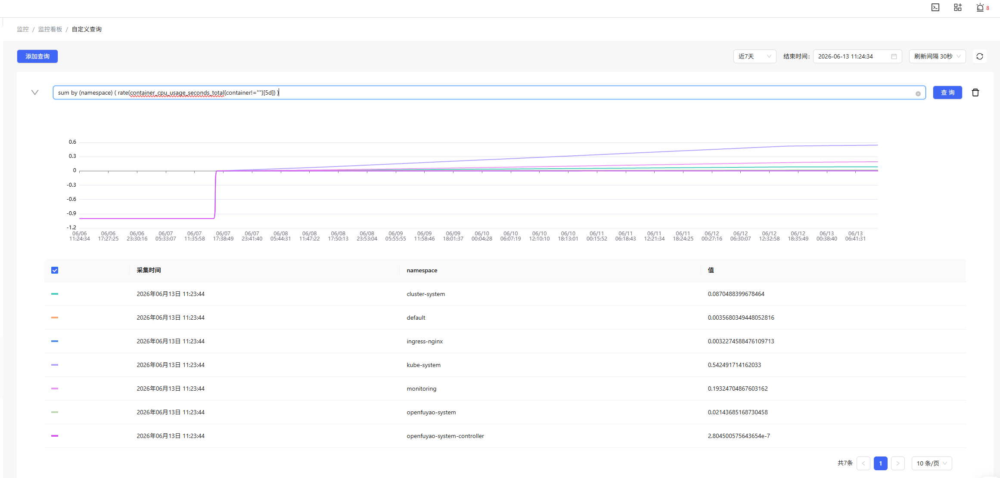
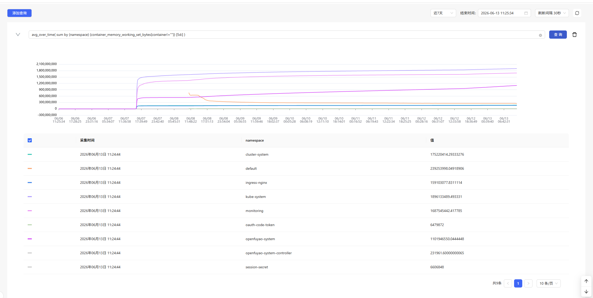

# 安装部署性能基线测试报告v26.06

## 概述

### 测试目的

本文档用于测试 openFuyao 安装部署工具的性能基线。

### 测试环境

虚拟机地址：192.168.201.32-36，192.168.200.129-134

### 测试内容

| 序号 | 测试项                     |
| ---- | -------------------------- |
| 1    | 在线安装时长               |
| 2    | 离线安装时长               |
| 3    | 离线包制备、传输、解压时长 |
| 4    | 多节点集群安装部署时长     |
| 5    | 单节点扩容与缩容时长       |
| 6    | 在线升级与离线升级时长     |
| 7    | 集群删除时长               |
| 8    | 管理集群资源底噪           |
| 9    | 安装压力测试               |

## 测试用例

## 1. 在线安装时长

### 测试目的

测试在线安装部署时长，覆盖引导节点初始化、前端部署业务集群、后端创建管理集群。

### 前提环境

- OS：openEuler 22.03 LTS SP3。
- CPU 架构：arm64。
- CPU 个数：4 个。
- 内存：8G。
- 在线仓库可访问。
- 引导节点、管理集群节点、业务集群节点均为干净环境。

### 测试过程

1. 下载 bke/bkeadm。
2. 执行 `bke init` 初始化引导节点。
3. 通过前端页面部署业务集群。
4. 通过后端 bc 创建管理集群。
5. 等待所有节点 Ready，核心 Pod Running/Ready。
6. 记录各阶段开始时间和完成时间。

### 测试结果

| 指标                             | 本轮结果   | 历史参考 v26.03 |
| -------------------------------- | ---------- | --------------- |
| 引导节点初始化耗时（带管理面）   | 5 分 14 秒 | 6 分 30 秒      |
| 引导节点初始化耗时（无管理面）   | 2 分 58 秒 |                 |
| 前端部署业务集群耗时（带管理面） | 6 分 05 秒 | 6 分 08 秒      |
| 前端部署业务集群耗时（无管理面） | 2 分 52 秒 |                 |
| 后端创建管理集群耗时（带管理面） | 8 分 18 秒 | 7 分 32 秒      |
| 后端创建管理集群耗时（无管理面） | 3 分 15 秒 |                 |

### 通过标准

- 引导节点初始化成功。
- 管理集群和业务集群均健康。
- 所有核心 Pod Running/Ready。

## 2. 离线安装时长

### 测试目的

测试离线场景下 openFuyao 安装部署时长，覆盖离线引导节点初始化和离线业务集群创建。

### 前提环境

- 离线部署包已制备完成。
- 离线包已传输至引导节点并解压。
- 引导节点无外网依赖。
- 离线镜像仓、Chart 仓、二进制仓配置正确。
- 引导节点根目录可用空间满足要求，建议不低于 50GB。

### 测试过程

1. 在离线环境中执行 `bke init`。
2. 等待引导节点轻量级集群和安装部署组件 Ready。
3. 登录安装部署页面。
4. 创建 1M业务集群。
5. 等待业务集群健康。
6. 记录离线初始化耗时和业务集群创建耗时。

### 测试结果

| 指标                               | 本轮结果   | 历史参考 v26.03 |
| ---------------------------------- | ---------- | --------------- |
| 离线引导节点初始化耗时（带管理面） | 4 分 06 秒 | 5 分 14 秒      |
| 离线引导节点初始化耗时（无管理面） | 3 分 17 秒 |                 |
| 离线新增业务集群耗时（带管理面）   | 9 分 10 秒 | 4 分 51 秒      |
| 离线新增业务集群耗时（无管理面）   | 3 分 04 秒  |                 |

### 通过标准

- 离线环境无需外网即可完成安装。
- 引导节点组件 Ready。
- 业务集群健康。

## 3. 离线包制备、传输、解压时长  

### 测试目的

测试离线部署包从制备、传输到解压完成的全流程耗时。

### 前提环境

- 环境固定，建议至少 4C16G。
- docker、buildx、bkeadm 已安装。
- `offline-artifacts.yaml` 固定。
- 传输网络带宽固定。
- 引导节点磁盘空间充足。

### 测试过程

1. 清理历史构建目录。
2. 执行离线包制备命令。
3. 记录离线包大小和制备耗时。
4. 将离线包传输到引导节点。
5. 记录传输耗时和传输速率。
6. 在引导节点解压离线包。
7. 校验 `/bke` 目录和关键文件完整性。

### 测试结果

| 指标           | 本轮结果              | 历史参考 v26.03 |
| -------------- | --------------------- | --------------- |
| 离线部署包大小 | 6.86 GB               | 10.1G           |
| 离线包制备耗时 | 10 分 56 秒（485.6MB/s） | 16 分 32 秒     |
| 解压后磁盘占用 | 6.9 GB（/dev/vda2）   |                 |

### 通过标准

- 离线包生成成功。
- 传输成功。
- 解压成功。
- 文件完整性校验通过。

## 4. 多节点集群安装部署时长

### 测试目的

测试不同节点规模下的集群安装部署时长，建立规模化部署性能基线。

### 前提环境

- 引导节点已初始化。
- 节点池准备充足。
- 节点 OS、CPU 架构、CPU、内存规格保持一致。
- 仓库和网络条件固定。

### 测试过程

1. 创建 1M1W 集群。
2. 创建 1M3W 集群。
3. 创建 3M1W 集群。
4. 创建 3M3W 集群。
5. 每种规模测试 3 次并取平均值。
6. 分别记录创建开始时间、所有节点 Ready 时间、集群健康时间。

### 测试结果

| 集群规模 | 本轮结果    | 历史参考 v26.03 |
| -------- | ----------- | --------------- |
| 1M1W     | 8 分 35 秒  | 7 分 25 秒      |
| 1M3W     | 8 分 40 秒  | 7 分 49 秒      |
| 3M1W     | 12 分 41 秒 | 11 分 12 秒     |
| 3M3W     | 14 分 53 秒 |                 |

### 通过标准

- 各规模集群均部署成功。
- 所有节点 Ready。
- 集群状态 healthy。

## 5. 单节点扩容与缩容时长  

### 测试目的

测试健康集群新增单个 worker 节点和删除单个 worker 节点的耗时。

### 前提环境

- 已存在健康业务集群。
- 准备一个干净 worker 节点用于扩容。
- 集群中存在一个可删除 worker 节点用于缩容。
- 节点 SSH 信息正确。

### 测试过程

#### 扩容

1. 后端执行kubectl apply进行扩容
6. 等待新 bn Ready、bc Healthy Ready。
7. 检查关键 DaemonSet 在新增节点上 Ready。

#### 缩容

1. 后端执行kubectl delete bn进行缩容
3. 等待bn、bc等对象删除。
4. 检查原集群healthy。

### 测试结果

| 指标                       | 本轮结果 | 历史参考 v26.03 |
| -------------------------- | -------- | --------------- |
| 单节点扩容耗时（带管理面） | 2 分 50 秒  | 2 分 14 秒      |
| 单节点扩容耗时（无管理面） | 1 分 48 秒 |                 |
| 单节点缩容耗时（带管理面） | 4 分 14 秒  |                 |
| 单节点缩容耗时（无管理面） | 1 分 10 秒  |                 |

### 通过标准

- 扩容后新节点 Ready。
- 缩容后节点和相关资源无异常残留。
- 原集群保持 healthy。

## 6. 在线升级与离线升级时长

### 测试目的

测试集群从基础版本升级到目标版本的在线升级和离线升级耗时。

### 前提环境

- 源版本集群健康。
- 目标版本可升级。
- 在线升级仓库可访问。
- 离线升级包已准备。
- 离线仓库和镜像同步配置正确。

### 测试过程

#### 在线升级

1. 准备源版本集群。
2. 上传或配置在线升级版本信息。
3. 通过前端页面触发在线升级。
4. 等待升级完成。
5. 检查集群版本、节点状态和核心组件状态。

#### 离线升级

1. 制备离线升级包。
2. 上传离线升级包到目标环境。
3. 执行镜像同步或补丁包导入。
4. 通过前端页面触发离线升级。
5. 等待升级完成。
6. 检查集群版本、节点状态和核心组件状态。

### 测试结果

| 指标                    | 本轮结果 | 历史参考 v26.03 |
| ----------------------- | -------- | --------------- |
| 在线升级耗时（4个组件） | 3~5分    | 3 分 20 秒      |

### 通过标准

- 在线升级成功。
- 离线升级成功。
- 升级后集群版本正确。
- 集群状态 healthy。

## 7. 集群删除时长

### 测试目的

测试集群删除耗时，验证环境清理能力和下一轮安装可重复性。

### 前提环境

- 已部署健康业务集群。
- 节点存在安装生成的容器、证书、manifest、日志、runtime 数据。

### 测试过程

1. 通过前端页面删除集群
2. 记录清理开始时间。
3. 等待集群删除成功。
4. 检查节点残留：
5. 记录清理完成时间。

### 测试结果

| 指标                             | 本轮结果      |
| -------------------------------- | ------------- |
| 前端删除集群耗时（3M3W） | 11 分 23 秒   |
| 前端删除集群耗时（1M1W） | 7 分 29 秒 |
| 下一轮安装是否成功               | 是            |

### 通过标准

- 集群资源删除完成。
- 节点关键残留清理完成。
- 无影响下一轮安装的残留。

## 8. 管理集群资源底噪

### 测试目的

测试管理集群在稳定态下五天内的所有命名空间 Pod 的平均资源占用，建立平台底噪基线。

### 前提环境

- 管理集群健康。
- metrics-server 或 Prometheus 可采集资源数据。

### 测试过程

1. 等待管理集群healthy。
3. 采集管理集群所有命名空间 Pod CPU/内存。
5. 按命名空间聚合资源占用。

### 测试结果

#### 管理集群

| 命名空间         | CPU    | 内存    | 历史参考 v26.03      |
| ---------------- | ------ | ------- | -------------------- |
| 所有组件         | 847.7m | 4788.3M | CPU 322m，内存 3092M |
| cluster-system   | 87.1m  | 167.1M  | CPU 11m，内存 133M   |
| ingress-nginx    | 3.2m   | 151.7M  | CPU 2m，内存 131M    |
| kube-system      | 542.6m | 1808.5M | CPU 176m，内存 1275M |
| monitoring       | 193.4m | 1609.5M | CPU 108m，内存 1106M |
| openfuyao-system | 21.4m  | 1051.5M | CPU 25m，内存 445M   |

### 通过标准

- 管理集群稳定。
- 无异常重启。

## 9. 安装压力测试

### 测试目的

验证安装部署工具在重复安装清理和并发安装场景下的稳定性、成功率。

### 前提环境

- 引导节点已初始化，且可通过 SSH 正常登录。
- `bke` 命令可用，安装配置文件已准备完成。
- 测试节点池可用，节点间网络互通正常。
- 测试环境为干净环境，避免历史残留影响结果。

### 测试过程

#### 用例 1：连续十次安装清理

1. 选择同一组master集群配置。
2. 执行安装并等待集群健康。
3. 删除当前集群并确认清理完成。
4. 重复执行 10 次。

#### 用例 2：并发安装集群

1. 准备master集群配置。
2. 设置并发度为 3、5。
3. 等待任务完成并记录成功率。

### 测试结果

#### 连续十次安装清理

| 指标                     | 本轮结果 |
| ------------------------ | -------- |
| 总轮次                   | 10       |
| 成功轮次                 | 10       |
| 失败轮次                 | 0        |
| 平均安装时长（1M）         | 8 分 50 秒 |
| 平均清理时长（1M）         | 5 分 22 秒 |
| 是否存在残留资源         | 否       |
| 后续轮次是否出现性能退化 | 否       |

#### 并发安装集群

| 指标                  | 本轮结果 |
| --------------------- | -------- |
| 并发度 3 成功数（3M） | 3        |
| 并发度 3 失败数       | 0        |
| 并发度 5 成功数（5M） | 5        |
| 并发度 5 失败数       | 0        |

### 通过标准

- 连续十次安装清理均可成功完成。
- 删除后无明显残留资源。
- 后续轮次未出现显著性能退化。
- 并发安装在目标并发度下成功率满足预期。

