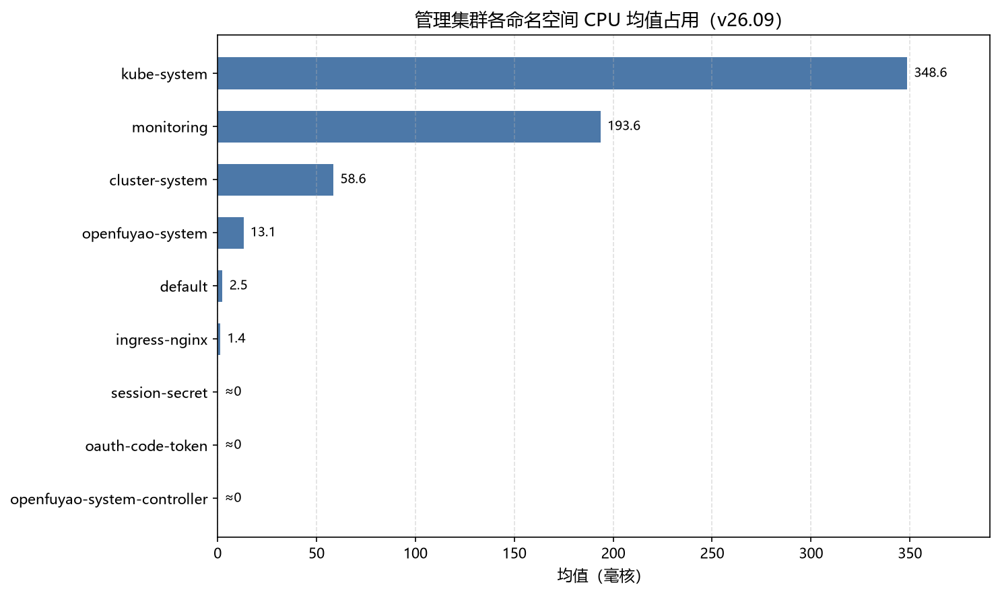
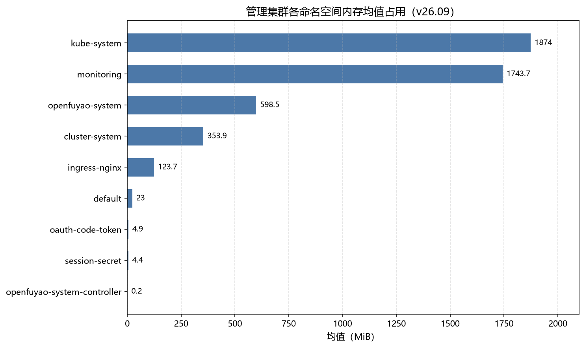

# 安装部署性能基线测试报告v26.09

## 概述

### 测试目的

本文档用于测试 openFuyao 安装部署工具的性能基线。

### 测试环境

虚拟机地址：192.168.200.61-64（业务集群节点），192.168.200.78（引导节点）。

### 测试内容

| 序号 | 测试项                     |
| ---- | -------------------------- |
| 1    | 在线安装时长               |
| 2    | 离线安装时长               |
| 3    | 离线包制备、传输、解压时长 |
| 4    | 多节点集群安装部署时长     |
| 5    | 单节点扩容与缩容时长       |
| 6    | 在线升级时长               |
| 7    | 集群删除时长               |
| 8    | 管理集群资源底噪           |
| 9    | 安装压力测试               |

## 测试用例

## 1. 在线安装时长

### 测试目的

测试在线安装部署时长，覆盖引导节点初始化、管理集群创建、业务集群创建。

### 前提环境

- 在线仓库可访问。
- bke/bkeadm 版本：latest。
- 引导节点、管理集群节点、业务集群节点均为干净环境。

### 测试过程

1. 下载 bke/bkeadm。
2. 执行 `bke init` 初始化引导节点。
3. 创建管理集群。
4. 创建业务集群。
5. 等待所有节点 Ready，核心 Pod Running/Ready。
6. 记录各阶段开始时间和完成时间。

### 测试结果

| 指标                       | latest    | v26.09-rc.2 | 历史参考 v26.06 |
| -------------------------- | --------- | ----------- | --------------- |
| 引导节点安装耗时（带管理面） | 5 分 40 秒 | 6 分 57 秒 | 5 分 14 秒      |
| 引导节点安装耗时（无管理面） | 3 分 07 秒 | 4 分 09 秒 | 2 分 58 秒      |
| 管理集群安装耗时（带管理面） | 8 分 52 秒 | 9 分 59 秒 | 8 分 18 秒      |
| 管理集群安装耗时（无管理面） | 3 分 34 秒 | 4 分 31 秒 | 3 分 15 秒      |
| 业务集群安装耗时（带管理面） | 7 分 13 秒 | 8 分 08 秒 | 6 分 05 秒      |
| 业务集群安装耗时（无管理面） | 2 分 44 秒 | 2 分 56 秒 | 2 分 52 秒      |

### 通过标准

- 引导节点初始化成功。
- 管理集群和业务集群均健康。
- 所有核心 Pod Running/Ready。

## 2. 离线安装时长

### 测试目的

测试离线场景下 openFuyao 安装部署时长，覆盖离线引导节点初始化和离线业务集群创建。

### 前提环境

- 离线部署包已制备完成。
- 离线包已传输至引导节点并解压。
- 引导节点无外网依赖。
- 离线镜像仓、Chart 仓、二进制仓配置正确。
- 引导节点根目录可用空间满足要求，建议不低于 50GB。

### 测试过程

1. 在离线环境中执行 `bke init`。
2. 等待引导节点轻量级集群和安装部署组件 Ready。
3. 创建业务集群。
4. 等待业务集群健康。
5. 记录离线初始化耗时和业务集群创建耗时。

### 测试结果

| 指标                         | 本轮结果 | 历史参考 v26.06 |
| ---------------------------- | -------- | --------------- |
| 离线引导节点安装耗时（带管理面） | 6 分 42 秒 | 4 分 06 秒      |
| 离线引导节点安装耗时（无管理面） | 3 分 33 秒 | 3 分 17 秒      |
| 离线业务集群安装耗时（带管理面） | 5 分 45 秒 | 9 分 10 秒      |
| 离线业务集群安装耗时（无管理面） | 2 分 50 秒 | 3 分 04 秒      |

### 通过标准

- 离线环境无需外网即可完成安装。
- 引导节点组件 Ready。
- 业务集群健康。

## 3. 离线包制备、传输、解压时长

### 测试目的

测试离线部署包从制备、传输到解压完成的全流程耗时。

### 前提环境

- 环境固定，建议至少 4C16G。
- docker、buildx、bkeadm 已安装。
- `offline-artifacts.yaml` 固定。
- 传输网络带宽固定。
- 引导节点磁盘空间充足。

### 测试过程

1. 清理历史构建目录。
2. 执行离线包制备命令。
3. 记录离线包大小和制备耗时。
4. 将离线包传输到引导节点。
5. 记录传输耗时和传输速率。
6. 在引导节点解压离线包。
7. 校验 `/bke` 目录和关键文件完整性。

### 测试结果

| 指标           | 本轮结果 | 历史参考 v26.06 |
| -------------- | -------- | --------------- |
| 离线部署包大小 | 6.97 GB  | 6.86 GB         |
| 离线包制备耗时 | 10分16秒（下载速度30.9MB/s）   | 10 分 56 秒（scp传输速率485.6MB/s） |
| 解压后磁盘占用 | 7.0GB   | 6.9 GB          |

### 通过标准

- 离线包生成成功。
- 传输成功。
- 解压成功。
- 文件完整性校验通过。

## 4. 多节点集群安装部署时长

### 测试目的

测试不同节点规模下的集群安装部署时长，建立规模化部署性能基线。

### 前提环境

- 引导节点已初始化。
- 节点池准备充足。
- 节点 OS、CPU 架构、CPU、内存规格保持一致。
- 仓库和网络条件固定。

### 测试过程

1. 创建 1M1W 集群。
2. 创建 1M3W 集群。
3. 创建 3M1W 集群。
4. 创建 3M3W 集群。
5. 创建 128 节点大规模业务集群，验证安装时长。
6. 每种规模测试 3 次并取平均值。
7. 分别记录创建开始时间、所有节点 Ready 时间、集群健康时间。

### 测试结果

| 集群规模 | latest（带管理面） | v26.09-rc.2（带管理面） | v26.09-rc.2（无管理面） | 历史参考 v26.06（带管理面） |
| -------- | ------------------ | ----------------------- | ---------------------- | --------------------------- |
| 1M1W     | 8 分 47 秒         | 9 分 43 秒              | 3 分 15 秒             | 8 分 35 秒                  |
| 1M3W     | 8 分 56 秒         | 9 分 58 秒              | 3 分 29 秒             | 8 分 40 秒                  |
| 3M1W     | 12 分 32 秒        | 13 分 20 秒             | 4 分 50 秒             | 12 分 41 秒                 |
| 3M3W     | 14 分 35 秒        | 15 分 05 秒             | 5 分 09 秒             | 14 分 53 秒                 |
| 128 节点 | -                  | -                       | <30 分钟               | >60 分钟                    |

### 通过标准

- 各规模集群均部署成功。
- 所有节点 Ready。
- 集群状态 healthy。

## 5. 单节点扩容与缩容时长

### 测试目的

测试健康集群新增单个 worker 节点和删除单个 worker 节点的耗时。

### 前提环境

- 已存在健康业务集群。
- 准备一个干净 worker 节点用于扩容。
- 集群中存在一个可删除 worker 节点用于缩容。
- 节点 SSH 信息正确。

### 测试过程

#### 扩容

1. 后端执行 kubectl apply 进行扩容。
2. 等待新 bn Ready、bc Healthy Ready。
3. 检查关键 DaemonSet 在新增节点上 Ready。

#### 缩容

1. 后端执行 kubectl delete bn 进行缩容。
2. 等待 bn、bc 等对象删除。
3. 检查原集群 healthy。

### 测试结果

| 指标                       | latest    | v26.09-rc.2 | 历史参考 v26.06 |
| -------------------------- | --------- | ----------- | --------------- |
| 业务集群扩容耗时（带管理面） | 2 分 52 秒 | 3 分 08 秒 | 2 分 50 秒    |
| 业务集群扩容耗时（无管理面） | 1 分 39 秒 | 2 分 03 秒 | 1 分 48 秒    |
| 业务集群缩容耗时（带管理面） | 4 分 28 秒 | 5 分 20 秒 | 4 分 14 秒    |
| 业务集群缩容耗时（无管理面） | 1 分 09 秒 | 1 分 51 秒 | 1 分 10 秒    |

### 通过标准

- 扩容后新节点 Ready。
- 缩容后节点和相关资源无异常残留。
- 原集群保持 healthy。

## 6. 在线升级时长

### 测试目的

测试集群从基础版本升级到目标版本的在线升级耗时。

### 前提环境

- 源版本（v26.06）集群健康。
- 目标版本（v26.09-rc2）可升级。
- 在线升级仓库可访问。

### 测试过程

1. 准备 v26.06 版本集群。
2. 上传或配置在线升级版本信息。
3. 触发在线升级。
4. 等待升级完成。
5. 检查集群版本、节点状态和核心组件状态。

### 测试结果

| 指标                              | 本轮结果                             | 历史参考 v26.06 |
| --------------------------------- | ------------------------------------ | --------------- |
| 在线升级耗时（v26.06 → v26.09-rc2） | 1 分 51 秒                           | 3~5 分（4 个组件） |
| 涉及升级组件                      | bke-cluster-provider、bkeagent（2 个） | 4 个组件        |

### 通过标准

- 在线升级成功。
- 升级后集群版本正确。
- 集群状态 healthy。

## 7. 集群删除时长

### 测试目的

测试集群删除耗时，验证环境清理能力和下一轮安装可重复性。

### 前提环境

- 已部署健康业务集群。
- 节点存在安装生成的容器、证书、manifest、日志、runtime 数据。

### 测试过程

1. 删除业务集群。
2. 记录清理开始时间。
3. 等待集群删除成功。
4. 检查节点残留。
5. 记录清理完成时间。

### 测试结果

| 指标                       | 本轮结果 | 历史参考 v26.06 |
| -------------------------- | -------- | --------------- |
| 删除集群耗时（1M1W）       | 3 分 11 秒 | 7 分 29 秒    |
| 删除集群耗时（3M3W）       | 4 分 48 秒 | 11 分 23 秒   |
| 下一轮安装是否成功         | 是（压力测试 10 轮验证） | 是 |

### 通过标准

- 集群资源删除完成。
- 节点关键残留清理完成。
- 无影响下一轮安装的残留。

## 8. 管理集群资源底噪

### 测试目的

测试管理集群在稳定态下的所有命名空间 Pod 的平均资源占用，建立平台底噪基线。

### 前提环境

- 管理集群健康。
- metrics-server 或 Prometheus 可采集资源数据。

### 测试过程

1. 等待管理集群 healthy。
2. 采集管理集群所有命名空间 Pod CPU/内存。
3. 按命名空间聚合资源占用。

### 测试结果

#### 管理集群

| 命名空间                   | CPU 均值（毫核） | 内存均值（MiB） | 历史参考 v26.06      |
| -------------------------- | ---------------- | --------------- | -------------------- |
| 总计                       | 615.9            | 4701.0          | CPU 847.7m，内存 4788.3M |
| kube-system                | 348.6            | 1874.0          | CPU 542.6m，内存 1808.5M |
| monitoring                 | 193.6            | 1743.7          | CPU 193.4m，内存 1609.5M |
| cluster-system             | 58.6             | 353.9           | CPU 87.1m，内存 167.1M   |
| openfuyao-system           | 13.1             | 598.5           | CPU 21.4m，内存 1051.5M  |
| ingress-nginx              | 1.4              | 123.7           | CPU 3.2m，内存 151.7M   |

说明：CPU 总均值较 v26.06 下降约 27%（847.7m → 615.9m），其中 kube-system 降幅明显（542.6m → 348.6m）；内存总均值基本持平（4788.3M → 4701.0M）。

### 通过标准

- 管理集群稳定。
- 无异常重启。

## 9. 安装压力测试

### 测试目的

验证安装部署工具在重复安装清理场景下的稳定性、成功率。

### 前提环境

- 引导节点（192.168.200.78）已初始化，且可通过 SSH 正常登录。
- `bke` 命令可用，3master-cluster.yaml / 3master1worker-nodes.yaml 配置文件已准备完成。
- 业务节点 master-1~3（192.168.200.61~63，含 etcd）+ worker-1（192.168.200.64）网络互通正常。
- 在线安装，未配置 VIP。
- 集群版本：Kubernetes v1.34.3-of.1，openFuyao v26.09-rc.2。

### 测试过程

#### 用例 1：连续十次安装清理

1. 选择同一组 3M1W 集群配置。
2. 执行 `bke cluster create` 在线安装，等待集群 ClusterReady/Healthy/Ready 且 BKENode 4/4。
3. 通过 patch bc reset 触发集群卸载，等待 namespace 删除完成。
4. 重复执行 10 次，每轮记录安装耗时、清理耗时和残留资源。

#### 用例 2：并发安装集群

1. 准备集群配置。
2. 设置并发度为 3、5。
3. 等待任务完成并记录成功率。

### 测试结果

#### 连续十次安装清理

| 指标                        | 本轮结果              |
| --------------------------- | --------------------- |
| 总轮次                      | 10                    |
| 成功轮次                    | 10                    |
| 失败轮次                    | 0                     |
| 平均安装时长（3M1W）        | 12 分 40 秒           |
| 安装耗时区间                | 11 分 35 秒~13 分 38 秒 |
| 平均清理时长（3M1W）        | 10 分 27 秒           |
| 清理耗时区间                | 10 分 18 秒~10 分 29 秒 |
| 单轮平均总耗时（含轮间等待） | 23 分 08 秒           |
| 是否存在残留资源            | 否                    |
| 后续轮次是否出现性能退化    | 否                    |

各轮明细：

| 轮次 | 安装耗时 | 清理耗时 | 单轮总耗时 | 结果 |
| ---- | -------- | -------- | ---------- | ---- |
| 1    | 13 分 16 秒 | 10 分 23 秒 | 23 分 41 秒 | 成功 |
| 2    | 13 分 26 秒 | 10 分 18 秒 | 23 分 45 秒 | 成功 |
| 3    | 12 分 12 秒 | 10 分 28 秒 | 22 分 42 秒 | 成功 |
| 4    | 13 分 04 秒 | 10 分 28 秒 | 23 分 33 秒 | 成功 |
| 5    | 13 分 00 秒 | 10 分 28 秒 | 23 分 29 秒 | 成功 |
| 6    | 11 分 43 秒 | 10 分 29 秒 | 22 分 14 秒 | 成功 |
| 7    | 12 分 29 秒 | 10 分 28 秒 | 22 分 58 秒 | 成功 |
| 8    | 12 分 20 秒 | 10 分 29 秒 | 22 分 50 秒 | 成功 |
| 9    | 11 分 35 秒 | 10 分 28 秒 | 22 分 03 秒 | 成功 |
| 10   | 13 分 38 秒 | 10 分 29 秒 | 24 分 08 秒 | 成功 |

说明：压测通过后端 `bke cluster create` 在线安装方式执行，集群规模为 3 master（含 etcd）+ 1 worker，未配置 VIP；与第 4 章"3M1W 带管理面 13 分 20 秒"结果一致（平均 12 分 40 秒）。

#### 并发安装集群

| 指标                  | 本轮结果 |
| --------------------- | -------- |
| 并发度 3 成功数（3M） | 3        |
| 并发度 3 失败数       | 0        |
| 并发度 5 成功数（5M） | 5        |
| 并发度 5 失败数       | 0        |

### 通过标准

- 连续十次安装清理均可成功完成。
- 删除后无明显残留资源。
- 后续轮次未出现显著性能退化。
- 并发安装在目标并发度下成功率满足预期。
