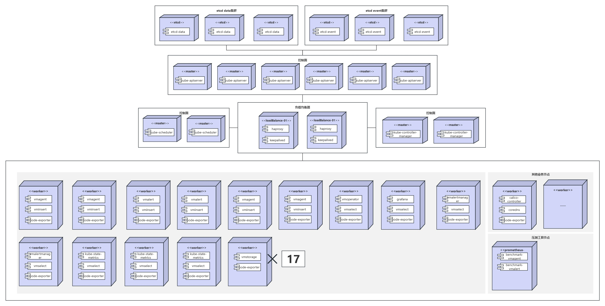

# 最佳实践

## 基于VictoriaMetrics软件栈的超大规模集群监控方案最佳实践

本文档旨在提供VictoriaMetrics监控组件在Kubernetes集群中的高可用部署、配置的的标准化方案与关键注意事项，同时给出基于prometheus-benchmark对VictoriaMetrics组件的压测流程与结果，以确保超大规模集群监控系统本身的高性能、高可靠性和可扩展性。

### 目标

1. 给出适用于超大规模集群的VictoriaMetrics监控组件部署方案
2. 给出在超大规模集群场景VictoriaMetrics监控组件参数调优方案
3. 给出在超大规模集群场景VictoriaMetrics组件压测流程与结果
4. 给出在不同摄取率情况下VictoriaMetrics组件所需资源公式

### 前提条件

- Kubernetes集群已部署，网络插件已部署，集群内未部署VictoriaMetrics、prometheus等监控告警组件。
- 搭载集群的物理机或虚拟机上拥有一定量可支配的CPU、内存以及存储资源，具体资源情况可参考下表：
    - 表中所列资源使用情况均为VMAgent在不同摄取率下VM总体需要使用的CPU、内存、存储资源，其中VMCluster参数replicationFactor值为2，意味着同一份数据在VMStorage中保存两份，数据保留期为7天。

> 因为参数replicationFactor值为2，VMAgent摄取率为100w/s时，VMCluster摄取率为200w/s，如果参数replicationFactor设置为1，那么所需资源数量将减半

| VMAgent摄取率    | CPU | 内存(GiB) | 存储(GiB) |
|--------|-----|---------|---------|
| 100w/s | 116 | 438     | 1100    |
| 200w/s | 148 | 450     | 1620    |
| 300w/s | 210 | 510     | 2880    |
| 400w/s | 234 | 576     | 3640    |
| 500w/s | 310 | 670     | 4260    |

### 使用限制

- **部署方式：** 本实践主要针对基于Helm Chart的部署方式。
- **集群规模：** 推荐的资源配置适用于大规模集群（100w/s<数据摄取率<500w/s），其余规模集群需另行调优。
- **etcd部署形态：** 本文部署配置仅支持采集使用二进制部署的etcd指标。
- **版本声明：** 本文所有步骤指导仅保证对于1.28.15版本Kubernetes，3.14.2版本helm，1.222.0版本VictoriaMetrics（helm版本0.58.2）成立，其余版本组合未作尝试，无法保证部署效果。相关内容欢迎补充和讨论！

### 背景信息

在为集群构建现代可观测性体系时，Prometheus被认为是云原生领域的监控标准，其强大的查询语言PromQL和拉模型（Pull-based）设计定义了监控的范式。然而，随着企业规模扩大，Prometheus本身在大规模场景下的可扩展性、资源效率和运维成本方面逐渐显现出挑战。

VictoriaMetrics（以下简称VM）并非旨在替代Prometheus的生态，而是作为其强大的后端增强方案。它能够完全兼容Prometheus的API、数据格式以及查询语言（PromQL），这意味着现有的Grafana看板、Prometheus的告警规则和客户端库都能无缝接入。VM的核心价值在于它解决了Prometheus在生产环境中，尤其是大规模场景下的诸多痛点。

以下是本文所采用的VM监控组件所具有的优势：

1. **资源利用效率：**
   VictoriaMetrics数据存储目录分为big目录和small目录，VictoriaMetrics在写数据时，先写入small目录下的相应partition目录下面。big目录下的数据由small目录下的数据在后台compaction时合并生成的。small目录和big目录都会周期性检查是否需要做part的合并，VictoriaMetrics默认每个10ms检查一次partition目录下的part是否需要做merge，如果检查出有满足merge条件的parts，则这些parts合并为一个part。在数据压缩方面，VictoriaMetrics在时序压缩的基础上，又采用了ZSTD压缩算法进一步压缩了数据，以提高压缩率，在small目录中的数据，采用的是低级别的ZSTD，而big目录下的数据，采用的是高级别的ZSTD。实测表明，其磁盘空间占用通常仅为Prometheus的1/5到1/7（数据来自VM官方博客，具体测试数据VM创始人已在博客给出，见文末参考资料章节），这不仅显著降低了存储成本，同时高速的压缩减少了磁盘I/O压力，提升了整体写入性能。

2. **高可用集群架构的原生支持：**
   Prometheus的高可用部署方案需要使用两个及以上的独立副本，并且通过复杂的调度机制完成重复数据的处理，但在VM提供的集群版（VMCluster）中，实现了写入（vminsert）、存储（vmstorage）和查询（vmselect）组件分离，每个组件都可以独立地、无状态地（除存储外）进行扩缩容。这一改变为监控组件提供了高可用和水平扩展能力，降低了监控组件架构的复杂性和运维负担。

3. **可扩展性：**
   当监控数据量巨大时，Prometheus通常需要通过分片（Sharding）方案来扩展，而VM只需简单地添加vmstorage节点即可扩展存储容量，添加vminsert节点即可提升写入吞吐量，添加vmselect节点即可提升查询并发能力。这种线性的、简单的扩展方式更适合超大规模环境。

4. **VMAgent数据采集：**
   VM提供了VMAgent，支持Pull和Push两种模式，可在指定窗口期内做数据删除、数据流聚合，在远端存储全部宕机或远端存储压力大时，VMAgent若配置了本地存储，可自动将监控数据写入本地存储，待远端存储恢复后再自动将数据写入远端存储，以确保不丢失监控数据。vmagent可以将抓取的数据远程写入（Remote Write）到多个不同的VM或Prometheus实例，非常适合作为超大规模集群的统一数据采集器，能够大幅降低采集端的资源消耗。

5. **远程写入协议优化：** 相比prometheus远程写入协议，VM远程写入协议做了数据压缩优化，增加10%CPU开销，但减少2~4倍的网络带宽开销。

### 操作步骤

此操作步骤明确给出使用Helm在线安装VM集群版(VictoriaMetrics K8s Stack)流程。VM监控软件栈各组件均已容器化方式部署在超大规模集群中，其中VMAlert与VMAlertmanager均采用高可用形态部署，VMAgent采用高可用加水平分片方式部署，kube-state-metrics采用水平分片方式部署。建议使用SSD硬盘存储监控数据，且每个VMStorage实例独占一块硬盘，防止硬盘最大吞吐量成为插入和查询指标瓶颈。我们最高压测了500w/s摄取率，其部署架构图如下：




#### 准备工作

- 版本选择

| 组件   | 版本       | 说明            |
|------|----------|---------------|
| Helm | v3.14.2  |               |
| k8s  | v1.28.15 |               |
| VM   | v1.222.0 | helm版本v0.58.2 |

- 检查kubectl到集群配置

```bash
kubectl config current-context  # 检查当前上下文配置
kubectl cluster-info  # 查看集群信息
kubectl get nodes  # 验证节点状态
kubectl config view  # 检查完整配置
```

- 安装Helm 3

```bash
# 下载安装脚本
curl -fsSL -o get_helm.sh https://raw.githubusercontent.com/helm/helm/main/scripts/get-helm-3
# 执行安装
chmod 700 get_helm.sh
./get_helm.sh
# 安装验证
helm version
```

#### 使用Helm下载VM包

- Helm获取可安装列表

```bash
# 使用以下命令添加图表 helm 存储库：
helm repo add vm https://victoriametrics.github.io/helm-charts/
helm repo update
# vm/victoria-metrics-k8s-stack列出可供安装的图表版本：
helm search repo vm/victoria-metrics-k8s-stack -l
```

- 获取VM指定版本的values.yaml和chart包

```bash
helm show values vm/victoria-metrics-k8s-stack --version 0.58.2 > values.yaml
helm pull vm/victoria-metrics-k8s-stack --version 0.58.2 --untar
cd victoria-metrics-k8s-stack
```

#### values.yaml文件参数调整

对于Helm部署方法来说，Chart 是软件的应用模板包，而values.yaml是注入这个模板的动态配置参数。大部分的参数修改可以在values.yaml中进行，但在有子chart时仍有一些更改需要进入chart包完成。下面是对于默认配置文件，各组件需要进行的修改。

- victoria-metrics-operator参数修改
  - **说明：** 修改镜像拉取地址

```yaml
victoria-metrics-operator:
  enabled: true
  nodeSelector:
    monitoring.victoria.com/operator: vm-operator
  crds:
    plain: true
    cleanup:
      enabled: true
      image:
        repository: hub.oepkgs.net/openfuyao/bitnami/kubectl  # 修改项
        pullPolicy: IfNotPresent
  serviceMonitor:
    enabled: true
  operator:
    # -- By default, operator converts prometheus-operator objects.
    disable_prometheus_converter: false
```

- VMSingle参数修改
    - **说明：** 禁用单节点模式

```yaml
vmsingle:
  # -- VMSingle labels
  labels: { }
  # -- VMSingle annotations
  annotations: { }
  # -- Create VMSingle CR
  enabled: false  # 修改项
  # -- Full spec for VMSingle CRD. Allowed values describe [here](https://docs.victoriametrics.com/operator/api#vmsinglespec)
  spec:
    port: "8429"
    # -- Data retention period. Possible units character: h(ours), d(ays), w(eeks), y(ears), if no unit character specified - month. The minimum retention period is 24h. See these [docs](https://docs.victoriametrics.com/single-server-victoriametrics/#retention)
    retentionPeriod: "1"
    replicaCount: 1
    extraArgs: { }
    storage:
      accessModes:
        - ReadWriteOnce
      resources:
        requests:
          storage: 20Gi
```

- VMCluster参数修改
    - **说明：** 修改内容包含VMStorage、VMSelect以及VMInsert组件的副本数、标签、镜像拉取地址，存储、CPU和内存的资源分配情况。

```yaml
vmcluster:
  # -- Create VMCluster CR
  enabled: true
  # -- VMCluster labels
  labels: { }
  # -- VMCluster annotations
  annotations: { }
  # -- Full spec for VMCluster CRD. Allowed values described [here](https://docs.victoriametrics.com/operator/api#vmclusterspec)
  spec:
    # -- Data retention period. Possible units character: h(ours), d(ays), w(eeks), y(ears), if no unit character specified - month. The minimum retention period is 24h. See these [docs](https://docs.victoriametrics.com/single-server-victoriametrics/#retention)
    retentionPeriod: "15d"  # 修改项，数据保留期
    replicationFactor: 2
    vmstorage:
      replicaCount: 17 # 修改项，vmstorage副本数
      nodeSelector:
        monitoring.victoria.com/vmstorage: vmstorage  # 修改项，vmstorage标签选择器
      storageDataPath: /vm-data
      image:
        repository: hub.oepkgs.net/openfuyao/victoriametrics/vmstorage  # 修改项
        tag: v1.122.0-cluster
        pullPolicy: IfNotPresent
      storage:
        volumeClaimTemplate:
          spec:
            resources:
              requests:
                storage: 720Gi # 修改项，每个vmstorage实例绑定pv大小
      resources:
        limits:
          cpu: "5" # 修改项，对应容器cpu核心数
          memory: 32Gi  # 修改项，对应容器内存
        requests:
          cpu: "5" # 修改项，对应容器cpu核心数
          memory: 32Gi  # 修改项，对应容器内存
      extraArgs:
        inmemoryDataFlushInterval: "10s" # 修改项
        dedup.minScrapeInterval: "20s" # 修改项

    vmselect:
      # -- Set this value to false to disable VMSelect
      enabled: true
      port: "8481"
      replicaCount: 8 # 修改项，对应副本数
      nodeSelector:
        monitoring.victoria.com/vmselect: vmselect  # 修改项，对应标签
      cacheMountPath: /select-cache
      extraArgs: { }
      image:
        repository: hub.oepkgs.net/openfuyao/victoriametrics/vmselect  # 修改项
        tag: v1.122.0-cluster
        pullPolicy: IfNotPresent
      #  maxInsertRequestSize: "32MB"  # 修改
      storage:
        volumeClaimTemplate:
          spec:
            resources:
              requests:
                storage: 35Gi  # 修改项，绑定PV大小
      resources:
        limits:
          cpu: "12" # 修改项，对应容器cpu核心数
          memory: 24Gi  # 修改项，对应容器内存
        requests:
          cpu: "12" # 修改项，对应容器cpu核心数
          memory: 24Gi  # 修改项，对应容器内存
    vminsert:
      # -- Set this value to false to disable VMInsert
      enabled: true
      port: "8480"
      replicaCount: 6 # 修改项，副本数
      image:
        repository: hub.oepkgs.net/openfuyao/victoriametrics/vminsert  # 修改项
        tag: v1.122.0-cluster
        pullPolicy: IfNotPresent
      nodeSelector:
        monitoring.victoria.com/vminsert: vminsert  # 修改项，对应标签
      extraArgs: { }
      resources:
        limits:
          cpu: "4" # 修改项，对应容器cpu核心数
          memory: 8Gi  # 修改项，对应容器最内存
        requests:
          cpu: "4" # 修改项，对应容器cpu核心数
          memory: 8Gi  # 修改项，对应容器内存
```

- VMAlert参数修改
    - **说明：** 修改的内容包括标签选择器、以及通过配置notifiers实现只把告警事件发送到vmks命名空间下、且带有 usage:
      dedicated标签的Alertmanager实例的效果。

```yaml
vmalert:
  # -- VMAlert annotations
  annotations: { }
  # -- VMAlert labels
  labels: { }
  # -- Create VMAlert CR
  enabled: true

  # -- Controls whether VMAlert should use VMAgent or VMInsert as a target for remotewrite
  remoteWriteVMAgent: false
  # -- (object) Full spec for VMAlert CRD. Allowed values described [here](https://docs.victoriametrics.com/operator/api#vmalertspec)
  spec:
    port: "8080"
    selectAllByDefault: true
    nodeSelector:
      monitoring.victoria.com/vmalert: vmalert  # 修改项，对应标签
    evaluationInterval: 20s
    replicaCount: 2
    image:
      repository: hub.oepkgs.net/openfuyao/victoriametrics/vmalert  # 修改项
      tag: v1.122.0
      pullPolicy: IfNotPresent
    extraArgs:
      http.pathPrefix: "/"
    # 通过服务发现能力找到vmalertmanager，并将告警发送到vmalertmanager
    notifiers:
      - selector:
          namespaceSelector:
            matchNames:
              - vmks  # 修改项，VM组件部署的命名空间
          labelSelector:
            matchLabels:
              usage: dedicated

    # External labels to add to all generated recording rules and alerts
    externalLabels: { }
```

- VMAlertmanager参数修改
    - **说明**：具体的修改包括副本数、节点选择器、镜像拉取地址。

```yaml
# 部分省略
...
labels:
  dedicated: dedicated   # 添加标签用于vmalert找到alertmanager
spec:
  replicaCount: 2  # 修改项，副本数
  port: "9093"
  selectAllByDefault: true
  nodeSelector:
    monitoring.victoria.com/vmalertmanager: vmalertmanager  # 修改项，对应标签
  image:
    repository: hub.oepkgs.net/openfuyao/prom/alertmanager  # 修改项
    pullPolicy: IfNotPresent
    tag: v0.28.1
  externalURL: ""
  routePrefix: /
...
```

- VMAgent参数修改
    - **说明：** 修改的内容包括Secret挂载相关配置，节点标签，副本与分片，及资源配置和pod反亲和性配置

```yaml
vmagent:
  # -- Create VMAgent CR
  enabled: true
  # -- VMAgent labels
  labels: { }
  # -- VMAgent annotations
  annotations: { }
  # -- Remote write configuration of VMAgent, allowed parameters defined in a [spec](https://docs.victoriametrics.com/operator/api#vmagentremotewritespec)
  additionalRemoteWrites:
    - url: http://vminsert-vm-victoria-metrics-k8s-stack.vmks.svc.cluster.local.:8480/insert/0/prometheus/api/v1/write
  # -- (object) Full spec for VMAgent CRD. Allowed values described [here](https://docs.victoriametrics.com/operator/api#vmagentspec)
  spec:
    additionalScrapeConfigs:
      name: etcd-scrape-config  # 修改项，Secret 名称
      key: etcd-scrape-config.yaml  # 修改项，Secret 中的 key
    port: "8429"
    selectAllByDefault: true
    image:
      repository: hub.oepkgs.net/openfuyao/victoriametrics/vmagent  # 修改项
      tag: v1.122.0
      pullPolicy: IfNotPresent
    nodeSelector: # 修改项，对应标签
      monitoring.victoria.com/vmagent: vmagent
    # modify to ha
    replicaCount: 2  # 修改项，副本数
    resources:
      limits:
        cpu: "4"  # 修改项
        memory: 8Gi  # 修改项
      requests:
        cpu: "4"  # 修改项
        memory: 8Gi  # 修改项
    # modify to StatefulSet，即使远端存储挂了，抓取的数据也不会丢失
    statefulMode: true
    statefulStorage:
      volumeClaimTemplate:
        spec:
          resources:
            requests:
              storage: 60Gi  # 修改项，本地存储大小
    # Sharding count for VMAgent
    shardCount: 2   # 修改项，分片数
    # pod反亲和性，尽量不要把满足条件的pod调到同一个节点上
    affinity:  # 修改项
      podAntiAffinity:
        preferredDuringSchedulingIgnoredDuringExecution:
          - weight: 100
            podAffinityTerm:
              labelSelector:
                matchLabels:
                  app.kubernetes.io/name: vmagent
                  shard-num: "0"
              topologyKey: kubernetes.io/hostname
          - weight: 100
            podAffinityTerm:
              labelSelector:
                matchLabels:
                  app.kubernetes.io/name: vmagent
                  shard-num: "1"
              topologyKey: kubernetes.io/hostname
    scrapeInterval: 20s
    # For multi-cluster setups it is useful to use "cluster" label to identify the metrics source.
    # For example:
    # cluster: cluster-name
    extraArgs:
      promscrape.streamParse: "true"
      # Do not store original labels in vmagent's memory by default. This reduces the amount of memory used by vmagent
      # but makes vmagent debugging UI less informative. See: https://docs.victoriametrics.com/vmagent/#relabel-debug
      promscrape.dropOriginalLabels: "true"
  # -- (object) VMAgent ingress configuration
```

- kube-proxy参数修改
    - **说明**：默认不采集kube-proxy指标，需手动开启采集kube-proxy指标开关，同时使用http协议采集指标

```yaml
kubeProxy:
  # -- Enable kube proxy metrics scraping
  enabled: true  # 修改项 

  # -- If your kube proxy is not deployed as a pod, specify IPs it can be found on
  endpoints: []
  # - 10.141.4.22
  # - 10.141.4.23
  # - 10.141.4.24

  service:
    # -- Enable service for kube proxy metrics scraping
    enabled: true
    # -- Kube proxy service port
    port: 10249
    # -- Kube proxy service target port
    targetPort: 10249
    # -- Kube proxy service pod selector
    selector:
      k8s-app: kube-proxy

  # -- Spec for VMServiceScrape CRD is [here](https://docs.victoriametrics.com/operator/api.html#vmservicescrapespec)
  vmScrape:
    spec:
      jobLabel: jobLabel
      namespaceSelector:
        matchNames: [kube-system]
      endpoints:
        - bearerTokenFile: /var/run/secrets/kubernetes.io/serviceaccount/token
          # bearerTokenSecret:
          #   key: ""
          port: http-metrics
          scheme: http  # 修改项 
          tlsConfig:
            caFile: /var/run/secrets/kubernetes.io/serviceaccount/ca.crt
```

- kube-state-metric参数修改
    - **说明**：文件路径为<rootpath>/victoria-metrics-k8s-stack/charts/kube-state-metrics/values.yaml，具体的修改包括分片配置、副本数、节点选择器、镜像拉取地址、反亲和性配置以及资源配置信息。

```yaml
# Default values for kube-state-metrics.
prometheusScrape: true
image:
  registry: hub.oepkgs.net/openfuyao  # 修改项
  repository: kube-state-metrics/kube-state-metrics
  # If unset use v + .Charts.appVersion
  tag: "v2.15.0"
  sha: ""
  pullPolicy: IfNotPresent

imagePullSecrets: [ ]
# - name: "image-pull-secret"

global:
  (部分省略......)
# If set to true, this will deploy kube-state-metrics as a StatefulSet and the data
# will be automatically sharded across <.Values.replicas> pods using the built-in
# autodiscovery feature: https://github.com/kubernetes/kube-state-metrics#automated-sharding
# This is an experimental feature and there are no stability guarantees.
# 开启自动分片
autosharding:
  enabled: true  # 修改项

replicas: 3 # 修改项，分片数

# Change the deployment strategy when autosharding is disabled.
# ref: https://kubernetes.io/docs/concepts/workloads/controllers/deployment/#strategy
# The default is "RollingUpdate" as per Kubernetes defaults.
# During a release, 'RollingUpdate' can lead to two running instances for a short period of time while 'Recreate' can create a small gap in data.
# updateStrategy: Recreate

# Number of old history to retain to allow rollback
# Default Kubernetes value is set to 10
revisionHistoryLimit: 10

# List of additional cli arguments to configure kube-state-metrics
# for example: --enable-gzip-encoding, --log-file, etc.
# all the possible args can be found here: https://github.com/kubernetes/kube-state-metrics/blob/master/docs/cli-arguments.md
# 修改项
extraArgs:  # 修改项
  - --pod=$(POD_NAME)  # 修改项
  - --pod-namespace=$(POD_NAMESPACE)  # 修改项
  - --use-apiserver-cache=true  # 修改项

# If false then the user will opt out of automounting API credentials.
automountServiceAccountToken: true

  (部分省略......)

## Node labels for pod assignment
## Ref: https://kubernetes.io/docs/user-guide/node-selection/
# 添加节点选择器
nodeSelector:
  monitoring.victoria.com/metrics: kube-state-metrics  # 修改项

## Affinity settings for pod assignment
## Can be defined as either a dict or string. String is useful for `tpl` templating.
## Ref: https://kubernetes.io/docs/concepts/configuration/assign-pod-node/
# 配置反亲和性
affinity:  # 修改项
  podAntiAffinity:
    requiredDuringSchedulingIgnoredDuringExecution:
      - labelSelector:
          matchExpressions:
            - key: app.kubernetes.io/name
              operator: In
              values:
                - kube-state-metrics
        topologyKey: "kubernetes.io/hostname"

## Tolerations for pod assignment
## Ref: https://kubernetes.io/docs/concepts/configuration/taint-and-toleration/
tolerations: [ ]

               (部分省略......)

resources:
  # We usually recommend not to specify default resources and to leave this as a conscious
  # choice for the user. This also increases chances charts run on environments with little
  # resources, such as Minikube. If you do want to specify resources, uncomment the following
  # lines, adjust them as necessary, and remove the curly braces after 'resources:'.
  # 修改存储信息
  limits:
    cpu: "4"  # 修改项
    memory: 12Gi  # 修改项
  requests:
    cpu: "4"  # 修改项
    memory: 12Gi  # 修改项
```

- Grafana 参数修改
  - 说明：文件路径为<rootpath>/victoria-metrics-k8s-stack/charts/grafana/values.yaml，具体的修改为开放NodePort端口，并替换镜像拉取地址

```yaml
# 部分省略
...
podPortName: grafana
gossipPortName: gossip
service:
  enabled: true
  type: NodePort  # 修改项
  ipFamilyPolicy: ""
  ipFamilies: []
  loadBalancerIP: ""
  loadBalancerClass: ""
  loadBalancerSourceRanges: []
  port: 80
  targetPort: 3000
  nodePort: 30010  # 修改项，新增开放端口号
...
# 部分省略
...
image:
  # -- The Docker registry
  registry: hub.oepkgs.net/openfuyao  # 修改项
  # -- Docker image repository
  repository: grafana/grafana
  # Overrides the Grafana image tag whose default is the chart appVersion
  tag: ""
  sha: ""
  pullPolicy: IfNotPresent

  ## Optionally specify an array of imagePullSecrets.
  ## Secrets must be manually created in the namespace.
  ## ref: https://kubernetes.io/docs/tasks/configure-pod-container/pull-image-private-registry/
  ## Can be templated.
  ##
  pullSecrets: []
  #   - myRegistrKeySecretName
...
# 部分省略
...
nodeSelector:  # 修改项
  monitoring.victoria.com/vm-grafana: vm-grafana
```

- VM operator参数修改
    - **说明**：文件路径为<rootpath>/victoria-metrics-k8s-stack/charts/victoria-metrics-operator/values.yaml，具体的修改包括副本数、节点选择器、镜像拉取地址。

```yaml

global:
  # -- Image pull secrets, that can be shared across multiple helm charts
  imagePullSecrets: []
  image:
    # -- Image registry, that can be shared across multiple helm charts
    registry: "hub.oepkgs.net/openfuyao"  # 修改项
  # -- Openshift security context compatibility configuration
  compatibility:
    openshift:
      adaptSecurityContext: "auto"
  cluster:
    # -- K8s cluster domain suffix, uses for building storage pods' FQDN. Details are [here](https://kubernetes.io/docs/tasks/administer-cluster/dns-custom-nameservers/)
    dnsDomain: cluster.local.
# Default values for victoria-metrics.
# This is a YAML-formatted file.
# Declare variables to be passed into your templates.
# -- operator image configuration
image:
  # -- Image registry
  registry: "hub.oepkgs.net/openfuyao"  # 修改项
  # -- Image repository
  repository: victoriametrics/operator
  # -- Image tag
  # override Chart.AppVersion
  tag: "v0.61.2"  # 修改项
  # Variant of the image to use.
  # e.g. scratch
  variant: ""
  # -- Image pull policy
  pullPolicy: IfNotPresent

crds:
  # -- manages CRD creation. Disables CRD creation only in combination with `crds.plain: false` due to helm dependency conditions limitation
  enabled: true
  # -- check if plain or templated CRDs should be created.
  # with this option set to `false`, all CRDs will be rendered from templates.
  # with this option set to `true`, all CRDs are immutable and require manual upgrade.
  plain: false
  # -- additional CRD annotations, when `.Values.crds.plain: false`
  annotations: {}
  cleanup:
    # -- Tells helm to clean up all the vm resources under this release's namespace when uninstalling
    enabled: false
    # -- Image configuration for CRD cleanup Job
    image:
      repository: hub.oepkgs.net/openfuyao/bitnami/kubectl  # 修改项
      # use image tag that matches k8s API version by default
      tag: "1.28"  # 修改项
      pullPolicy: IfNotPresent
    # -- Cleanup hook resources
    resources:
      limits:
        cpu: "500m"
        memory: "256Mi"
      requests:
        cpu: "100m"
        memory: "56Mi"


# 部分省略
...
nodeSelector:  # 修改项
  monitoring.victoria.com/vm-operator: vm-operator
...
```

- prometheus-node-exporter参数修改
    - **说明**：文件路径为<rootpath>/victoria-metrics-k8s-stack/charts/prometheus-node-exporter/values.yaml，修改镜像拉取地址。

```yaml
# 部分省略
...
global:
  # To help compatibility with other charts which use global.imagePullSecrets.
  # Allow either an array of {name: pullSecret} maps (k8s-style), or an array of strings (more common helm-style).
  # global:
  #   imagePullSecrets:
  #   - name: pullSecret1
  #   - name: pullSecret2
  # or
  # global:
  #   imagePullSecrets:
  #   - pullSecret1
  #   - pullSecret2
  imagePullSecrets: []
  #
  # Allow parent charts to override registry hostname
  imageRegistry: "hub.oepkgs.net/openfuyao"  # 修改项
# 部分省略
...
```


#### 声明pv

VM的VMStorage、VMSelect、VMagent组件部署时会生成PVC，需要通过声明PV以绑定PVC，参考pv声明文件如下：

```yaml
apiVersion: v1
kind: PersistentVolume
metadata:
  name: pv-vmselect-5  # 修改pv名字
spec:
  capacity:
    storage: 35Gi  # 修改存储大小
  volumeMode: Filesystem
  accessModes:
    - ReadWriteOnce
  persistentVolumeReclaimPolicy: Retain
  claimRef: # pv与pvc绑定，在对应pod需要跨节点调度时，不应设置这一项
    name: vmselect-cachedir-vmselect-vm-victoria-metrics-k8s-stack-5    # 替换为你期望的PVC名字
    namespace: vmks # 替换为PVC所在的命名空间
  local:
    path: /mnt/data/vmselect-5  # 替换为真实路径
  nodeAffinity:
    required:
      nodeSelectorTerms:
        - matchExpressions:
            - key: kubernetes.io/hostname
              operator: In
              values:
                - vmselect-5  # 替换为PV所在实际节点名
```

可执行如下脚本自动创建对应组件PV，执行脚本前需要修改COMPONENT、NAMESPACE、STORAGE_SIZE、BASE_PATH、NODE_LIST、PV_COUNT等变量，该脚本默认在每个节点只为一个组件创建一个PV。

> **注意：**
> - 需要为VMStorage、VMSelect、VMAgent所有pod声明pv
> - 需要在每个节点的目录下创建对应的真实路径（如：mkdir -p /mnt/data/vmselect-5）

```shell
#!/bin/bash

# === 必要参数定义 ===
COMPONENT="vmselect"               # 可选值：vmselect / vmstorage / vmagent
NAMESPACE="vmks"                   # PVC 所在命名空间
STORAGE_SIZE="35Gi"                # 每个PV的存储容量
BASE_PATH="/mnt/data"              # 每个节点上的挂载路径前缀
NODE_LIST=("node-a" "node-b")      # 实际节点名列表
PV_COUNT=5                         # 每个节点创建多少个PV

# === 创建 PV 的循环逻辑 ===
INDEX=0
for NODE in "${NODE_LIST[@]}"; do
    INDEX=$((INDEX + 1))
    PV_NAME="pv-${COMPONENT}-${NODE}-${INDEX}"
    PVC_NAME="${COMPONENT}-cachedir-${COMPONENT}-vm-victoria-metrics-k8s-stack-${INDEX}"
    LOCAL_PATH="${BASE_PATH}/${COMPONENT}-${INDEX}"
    YAML_FILE="${PV_NAME}.yaml"

    cat <<EOF > "${YAML_FILE}"
apiVersion: v1
kind: PersistentVolume
metadata:
  name: ${PV_NAME}
spec:
  capacity:
    storage: ${STORAGE_SIZE}
  volumeMode: Filesystem
  accessModes:
    - ReadWriteOnce
  persistentVolumeReclaimPolicy: Retain
  claimRef:
    name: ${PVC_NAME}
    namespace: ${NAMESPACE}
  local:
    path: ${LOCAL_PATH}
  nodeAffinity:
    required:
      nodeSelectorTerms:
        - matchExpressions:
            - key: kubernetes.io/hostname
              operator: In
              values:
                - ${NODE}
EOF

    echo "✅ Generated PV: ${YAML_FILE}"

    # 可选：自动 apply
    # kubectl apply -f "${YAML_FILE}"
done
```

#### 节点打标签

超大规模集群场景下，监控组件会占用一个节点较多的CPU、内存、存储、网络资源，所以建议单独规划监控组件节点。在修改vaules.yaml时，我们为不同组件配置了不同的标签选择器，所以在执行安装前需要为节点打对应的标签。

- 所有VMAgent pod运行节点打标签

```
# 节点列表变量，注意替换为集群内node name
NODES="node-01 node-02 node-03"

# 标签键值对
LABEL_KEY="monitoring.victoria.com/vmagent"
LABEL_VALUE="vmagent"

for NODE in $NODES; do
  echo "正在为节点 $NODE 打标签 $LABEL_KEY=$LABEL_VALUE ..."
  kubectl label node "$NODE" "$LABEL_KEY=$LABEL_VALUE" --overwrite
done
```

- 所有VMInsert pod运行节点打标签

```
# 节点列表变量，注意替换为集群内node name
NODES="node-01 node-02 node-03"

# 标签键值对
LABEL_KEY="monitoring.victoria.com/vminsert"
LABEL_VALUE="vminsert"

for NODE in $NODES; do
  echo "正在为节点 $NODE 打标签 $LABEL_KEY=$LABEL_VALUE ..."
  kubectl label node "$NODE" "$LABEL_KEY=$LABEL_VALUE" --overwrite
done
```

- 所有VMStorage pod运行节点打标签

```
# 节点列表变量，注意替换为集群内node name
NODES="node-01 node-02 node-03"

# 标签键值对
LABEL_KEY="monitoring.victoria.com/vmstorage"
LABEL_VALUE="vmstorage"

for NODE in $NODES; do
  echo "正在为节点 $NODE 打标签 $LABEL_KEY=$LABEL_VALUE ..."
  kubectl label node "$NODE" "$LABEL_KEY=$LABEL_VALUE" --overwrite
done
```

- 所有VMSelect pod运行节点打标签

```
# 节点列表变量，注意替换为集群内node name
NODES="node-01 node-02 node-03"

# 标签键值对
LABEL_KEY="monitoring.victoria.com/vmselect"
LABEL_VALUE="vmselect"

for NODE in $NODES; do
  echo "正在为节点 $NODE 打标签 $LABEL_KEY=$LABEL_VALUE ..."
  kubectl label node "$NODE" "$LABEL_KEY=$LABEL_VALUE" --overwrite
done
```

- 所有VMAlert pod运行节点打标签

```
# 节点列表变量，注意替换为集群内node name
NODES="node-01 node-02 node-03"

# 标签键值对
LABEL_KEY="monitoring.victoria.com/vmalert"
LABEL_VALUE="vmalert"

for NODE in $NODES; do
  echo "正在为节点 $NODE 打标签 $LABEL_KEY=$LABEL_VALUE ..."
  kubectl label node "$NODE" "$LABEL_KEY=$LABEL_VALUE" --overwrite
done
```

- 所有VMAlertmanager pod运行节点打标签

```
# 节点列表变量，注意替换为集群内node name
NODES="node-01 node-02 node-03"

# 标签键值对
LABEL_KEY="monitoring.victoria.com/vmalertmanager"
LABEL_VALUE="vmalertmanager"

for NODE in $NODES; do
  echo "正在为节点 $NODE 打标签 $LABEL_KEY=$LABEL_VALUE ..."
  kubectl label node "$NODE" "$LABEL_KEY=$LABEL_VALUE" --overwrite
done
```

- 所有kube-state-metrics pod运行节点打标签

```
# 节点列表变量，注意替换为集群内node name
NODES="node-01 node-02 node-03"

# 标签键值对
LABEL_KEY="monitoring.victoria.com/metrics"
LABEL_VALUE="kube-state-metrics"

for NODE in $NODES; do
  echo "正在为节点 $NODE 打标签 $LABEL_KEY=$LABEL_VALUE ..."
  kubectl label node "$NODE" "$LABEL_KEY=$LABEL_VALUE" --overwrite
done
```

- operator pod运行节点打标签

```
# 节点列表变量，注意替换为集群内node name
NODES="node-01 node-02 node-03"

# 标签键值对
LABEL_KEY="monitoring.victoria.com/vm-operator"
LABEL_VALUE="vm-operator"

for NODE in $NODES; do
  echo "正在为节点 $NODE 打标签 $LABEL_KEY=$LABEL_VALUE ..."
  kubectl label node "$NODE" "$LABEL_KEY=$LABEL_VALUE" --overwrite
done
```

- grafana pod运行节点打标签

```
# 节点列表变量，注意替换为集群内node name
NODES="node-01 node-02 node-03"

# 标签键值对
LABEL_KEY="monitoring.victoria.com/vm-grafana"
LABEL_VALUE="vm-grafana"

for NODE in $NODES; do
  echo "正在为节点 $NODE 打标签 $LABEL_KEY=$LABEL_VALUE ..."
  kubectl label node "$NODE" "$LABEL_KEY=$LABEL_VALUE" --overwrite
done
```

#### VM的安装和更新

- 首次安装指令

```
kubectl create ns vmks
helm install vm ./victoria-metrics-k8s-stack -f values.yaml -n vmks
```

- 配置文件修改后的配置更新

```
helm upgrade vm ./victoria-metrics-k8s-stack -f values.yaml -n vmks
```

#### 抓取etcd指标配置

超大规模集群etcd采用二进制方式部署，所以需要单独配置scrape以抓取etcd指标。VMAgent采集etcd指标需要使用etcd证书，我们通过secret挂载形式将etcd证书挂载到VMAgent
pod中。

- 将etcd证书与K8s根ca证书存入secret

```
# 注意替换为真实证书命和证书路径
kubectl -n vmks create secret generic vmagent-tls-secrets \
  --from-file=etcd-ca.crt=/etc/kubernetes/pki/etcd/etcd-ca.crt \
  --from-file=etcd-client.crt=/etc/kubernetes/pki/apiserver-etcd-client.crt \
  --from-file=etcd-client.key=/etc/kubernetes/pki/apiserver-etcd-client.key \
  --from-file=k8s-ca.crt=/etc/kubernetes/pki/ca.crt
```

- 编辑etcd scrape yaml文件(etcd-scrape-config.yaml)，文件内存放如下内容

```
- job_name: 'etcd-external'
  kubernetes_sd_configs: []
  static_configs:
    - targets:
      - '192.168.201.12:2379'  # etcd节点ip地址与端口号
      - '192.168.201.10:2379'  # etcd节点ip地址与端口号
  scheme: https
  tls_config:
    ca_file: /etc/vmagent/tls/etcd-ca.crt  
    cert_file: /etc/vmagent/tls/etcd-client.crt  
    key_file: /etc/vmagent/tls/etcd-client.key  
```

- 将etcd scrape yaml文件保存到secret

```shell
kubectl create secret generic etcd-scrape-config \
  --from-file=etcd-scrape-config.yaml
```

- 编辑VMAgent cr

```
# 查找cr
kubectl get vmagent -n vmks
# 编辑cr
kubectl edit vmagent vm-victoria-metrics-k8s-stack -n vmks
```

- 添加secret的挂载配置，具体修改如下：

```
spec:
    additionalScrapeConfigs:        # 添加项
      key: etcd-scrape-config.yaml  # 添加项
      name: etcd-scrape-config      # 添加项
    externalLabels: {}
    extraArgs:
      promscrape.dropOriginalLabels: "true"
      promscrape.streamParse: "true"
    image:
      tag: v1.122.0
    license: {}
    port: "8429"
    remoteWrite:
    - url: http://vminsert-vm-victoria-metrics-k8s-stack.vmks.svc.cluster.local.:8480/insert/0/prometheus/api/v1/write
    scrapeInterval: 20s
    selectAllByDefault: true
    serviceSpec:
      spec:
        ports:
        - name: http
          port: 8429
          protocol: TCP
          targetPort: 8429
        type: ClusterIP
    volumeMounts:  # 添加项
    - mountPath: /etc/vmagent/tls  # 添加项
      name: vmagent-tls-certs  # 添加项
    volumes:  # 添加项
    - name: vmagent-tls-certs  # 添加项
      secret:  # 添加项
        secretName: vmagent-tls-secrets  # 添加项
```

#### 抓取kube-controller-manager指标配置

- 编辑kube-controller-manager对应的vmservicescrapes cr vmks-victoria-metrics-k8s-stack-kube-controller-manager

```
kubectl edit vmservicescrapes vm-victoria-metrics-k8s-stack-kube-controller-manager -n vmks
```

- 修改如下

```
spec:
  endpoints:
  - bearerTokenFile: /var/run/secrets/kubernetes.io/serviceaccount/token
    port: http-metrics
    scheme: https
    tlsConfig:
      caFile: /etc/vmagent/tls/k8s-ca.crt  # 添加项
      (serverName: kubernetes  # 删除)  # 删除项
  jobLabel: jobLabel
  namespaceSelector:
    matchNames:
    - kube-system
```

- 在controller-manager所在节点生成私钥。所有运行controller-manager pod节点都要运行如下命令：

```
openssl genrsa -out /etc/kubernetes/pki/controller-manager.key 2048
```

- 在controller-manager所在节点创建CSR配置文件，例如controller-manager-csr.conf。所有运行controller-manager
  pod节点都要创建CSR配置文件。
    - 若有多个controller-manager节点，则写多个controller-manager节点ip地址

```
[req]
req_extensions = v3_req
distinguished_name = req_distinguished_name
prompt = no

[req_distinguished_name]
CN = system:kube-controller-manager

[v3_req]
keyUsage = keyEncipherment, dataEncipherment, digitalSignature
extendedKeyUsage = clientAuth, serverAuth
subjectAltName = @alt_names

[alt_names]
DNS.1 = kube-controller-manager
IP.1 = 127.0.0.1
IP.2 = <你的kube-controller-manager节点 IP1>
IP.3 = <你的kube-controller-manager节点 IP2>
```

- 在controller-manager所在节点生成CSR文件。所有运行controller-manager pod节点都要运行如下命令：

```
openssl req -new -key /etc/kubernetes/pki/controller-manager.key \
  -out /etc/kubernetes/pki/controller-manager.csr \
  -config controller-manager-csr.conf
```

- 在controller-manager所在节点使用CA签发证书。所有运行controller-manager pod节点都要运行如下命令：

```
openssl x509 -req -in /etc/kubernetes/pki/controller-manager.csr \
  -CA /etc/kubernetes/pki/ca.crt -CAkey /etc/kubernetes/pki/ca.key \
  -CAcreateserial -out /etc/kubernetes/pki/controller-manager.crt \
  -days 365 -extensions v3_req -extfile controller-manager-csr.conf
```

- 编辑`/etc/kubernetes/manifests/kube-controller-manager.yaml`，修改controller-manager启动参数，所有controller-manager静态pod
  yaml都需要修改。

```
spec:
  containers:
  - command:
    - kube-controller-manager
    - --authentication-kubeconfig=/etc/kubernetes/controller-manager.conf
    - --authorization-kubeconfig=/etc/kubernetes/controller-manager.conf
    - --bind-address=0.0.0.0  # 修改项
    - --client-ca-file=/etc/kubernetes/pki/ca.crt
    - --cluster-name=kubernetes
    - --cluster-signing-cert-file=/etc/kubernetes/pki/ca.crt
    - --cluster-signing-key-file=/etc/kubernetes/pki/ca.key
    - --controllers=*,bootstrapsigner,tokencleaner
    - --kubeconfig=/etc/kubernetes/controller-manager.conf
    - --leader-elect=true
    - --requestheader-client-ca-file=/etc/kubernetes/pki/front-proxy-ca.crt
    - --root-ca-file=/etc/kubernetes/pki/ca.crt
    - --service-account-private-key-file=/etc/kubernetes/pki/sa.key
    - --use-service-account-credentials=true
    - --tls-cert-file=/etc/kubernetes/pki/controller-manager.crt  # 添加项
    - --tls-private-key-file=/etc/kubernetes/pki/controller-manager.key  # 添加项
```

#### 抓取kube-scheduler指标配置

- 修改kube-scheduler对应的vmservicescrapes cr vmks-victoria-metrics-k8s-stack-kube-scheduler

```
kubectl edit vmservicescrapes vm-victoria-metrics-k8s-stack-kube-scheduler -n vmks
```

- 修改如下

```
spec:
  endpoints:
  - bearerTokenFile: /var/run/secrets/kubernetes.io/serviceaccount/token
    port: http-metrics
    scheme: https
    tlsConfig:
      caFile: /etc/vmagent/tls/k8s-ca.crt  # 修改项
```

- 在kube-scheduler所在节点生成私钥。所有运行kube-scheduler pod节点都要运行如下命令：

```
openssl genrsa -out /etc/kubernetes/pki/scheduler.key 2048
```

- 在kube-scheduler所在节点创建CSR配置文件：scheduler-csr.conf。所有运行kube-scheduler pod节点都要创建CSR配置文件。
    - 若有多个kube-scheduler节点，则写多个kube-scheduler节点ip地址

```
[req]
req_extensions = v3_req
distinguished_name = req_distinguished_name
prompt = no

[req_distinguished_name]
CN = system:kube-scheduler

[v3_req]
keyUsage = keyEncipherment, dataEncipherment, digitalSignature
extendedKeyUsage = clientAuth, serverAuth
subjectAltName = @alt_names

[alt_names]
DNS.1 = kube-scheduler
IP.1 = 127.0.0.1
IP.2 = <你的kube-scheduler节点 IP1>
IP.3 = <你的kube-scheduler节点 IP2>
```

- 在kube-scheduler所在节点生成CSR文件，所有运行kube-scheduler pod节点都要运行如下命令：

```
openssl req -new -key /etc/kubernetes/pki/scheduler.key \
  -out /etc/kubernetes/pki/scheduler.csr \
  -config scheduler-csr.conf
```

- 在kube-scheduler所在节点使用 CA 签发证书，所有运行kube-scheduler pod节点都要运行如下命令：

```
openssl x509 -req -in /etc/kubernetes/pki/scheduler.csr \
  -CA /etc/kubernetes/pki/ca.crt -CAkey /etc/kubernetes/pki/ca.key \
  -CAcreateserial -out /etc/kubernetes/pki/scheduler.crt \
  -days 365 -extensions v3_req -extfile scheduler-csr.conf
```

- 编辑`/etc/kubernetes/manifests/kube-scheduler.yaml`，修改kube-scheduler启动参数，所有kube-scheduler静态pod yaml都需要修改。

```yaml
spec:
  containers:
    - command:
        - kube-scheduler
        - --authentication-kubeconfig=/etc/kubernetes/scheduler.conf
        - --authorization-kubeconfig=/etc/kubernetes/scheduler.conf
        - --bind-address=0.0.0.0  # 修改项
        - --kubeconfig=/etc/kubernetes/scheduler.conf
        - --leader-elect=true
        - --tls-cert-file=/etc/kubernetes/pki/scheduler.crt  # 添加项
        - --tls-private-key-file=/etc/kubernetes/pki/scheduler.key  # 添加项
      image: harbor.openfuyao.com/openfuyao/kubernetes/kube-scheduler:v1.28.15
      imagePullPolicy: IfNotPresent
      livenessProbe:
        failureThreshold: 8
        httpGet:
          host: 127.0.0.1
          path: /healthz
          port: 10259
          scheme: HTTPS
        initialDelaySeconds: 10
        periodSeconds: 10
        timeoutSeconds: 15
      name: kube-scheduler
      resources:
        requests:
          cpu: 100m
      startupProbe:
        failureThreshold: 24
        httpGet:
          host: 127.0.0.1
          path: /healthz
          port: 10259
          scheme: HTTPS
        initialDelaySeconds: 10
        periodSeconds: 10
        timeoutSeconds: 15
      volumeMounts:
        - mountPath: /etc/kubernetes/scheduler.conf
          name: kubeconfig
          readOnly: true
        - mountPath: /etc/kubernetes/pki  # 添加项
          name: k8s-certs  # 添加项
          readOnly: true  # 添加项
  hostNetwork: true
  priority: 2000001000
  priorityClassName: system-node-critical
  securityContext:
    seccompProfile:
      type: RuntimeDefault
  volumes:
    - hostPath:
        path: /etc/kubernetes/scheduler.conf
        type: FileOrCreate
      name: kubeconfig
    - hostPath: # 添加项
        path: /etc/kubernetes/pki  # 添加项
        type: DirectoryOrCreate  # 添加项
      name: k8s-certs  # 添加项
```

#### 登录Grafana查看监控数据

- 获取登录密码

```
kubectl get secret vm-grafana -n vmks -o jsonpath="{.data.admin-password}" | base64 --decode
```

- 打开浏览器进入`http://<集群节点ip>:30010`例如：`http://192.168.201.17:30010`。输入用户名`admin`
  以及上一步获取的密码即可登录grafana可视化面板

### 后续步骤

后续步骤中主要描述如何使用prometheus-benchmark对VM进行压测，若不对VM进行压测，可跳过此步骤。

Prometheus-benchmark是一套专为评估Prometheus兼容存储系统性能而设计的开源工具集，主要用于模拟真实生产环境中的监控数据摄取（写入）和查询负载，以测试时序数据库（如VictoriaMetrics、Grafana
Mimir 等）的扩展性、稳定性和资源效率，具有如下特点：

- **真实数据源**：通过node_exporter采集物理节点或容器的真实系统指标（如 CPU、内存、磁盘等），而非合成数据，确保测试贴近生产环境
- **动态目标管理**：支持配置指标流失率（churn rate），定期更新抓取目标（如每 10 分钟更新 1% 的目标），可测试系统处理时序变化的稳定性
- **查询负载**：内置Prometheus告警规则，定期执行查询（如 queryInterval: 15s），测试存储系统的查询性能

#### 安装prometheus-benchmark

- 下载prometheus-benchmark chart包

```shell

git clone https://github.com/VictoriaMetrics/prometheus-benchmark
```

- 修改values.yaml，以配置不同摄取率、指标流失率与查询负载等。values.yaml配置详解如下：
  -
  根据[prometheus-benchmark生成十亿个活跃时间序列，每秒生成1亿个样本所需资源大小](https://victoriametrics.com/blog/benchmark-100m/)
  ，评估每秒生成500w样本数据写入pod需要的资源大小约为8U25G(Mem)

```yaml
# vmtag is a docker image tag for VictoriaMetrics components,
# which run inside the prometheus-benchmark - e.g. vmagent, vmalert, vmsingle.
# VictoriaMetrics组件镜像tag，这些组件运行在prometheus-benchmark中，例如 vmagent, vmalert, vmsingle
vmtag: "v1.102.1"

# Controls whether to deploy a built-in vmsingle for monitoring
# Useful if there is monitoring already in place and built-in vmsingle is not needed.
# 是否部署一个vmsingle，如果集群中已经部署了监控组件，则不用部署vmsingle
disableMonitoring: false

# nodeSelector is an optional node selector for placing benchmark pods.
# 选择节点运行benchmark pods.
nodeSelector: { }

# targetsCount defines the number of nodeexporter instances to scrape by every benchmark pod.
# This option allows to configure the number of active time series to push to remoteStorages.
# Every nodeexporter exposes around 1230 unique metrics, so when targetsCount
# is set to 1000, then the benchmark generates around 1230*1000=1.23M active time series.
# See also writeReplicas and writeURLReplicas options.
# 定义每个基准测试pod中的nodeexporter实例数量。此选项允许配置要推动到远程存储的活动时间序列数量
# 每个node-exporter会公开1230个独立metrics，当targetsCount设置为1000，那么1230*1000 = 1.23M的活动时间序列
targetsCount: 1000

# scrapeInterval defines how frequently to scrape nodeexporter targets.
# This option allows to configure data ingestion rate per every remoteStorages.
# For example, if the benchmark generates 1.23M active time series and scrapeInterval
# is set to 10s, then the data ingestion rate equals to 1.23M/10s = 123K samples/sec.
# See also writeReplicas and writeURLReplicas options.
# 定义了抓取指标的频率，此选项允许配置每个远程存储的数据提取率，例如设置为10s，活动时间序列为1.23M。那么数据摄取率为1.23M / 10 = 123K/s = 12.3W/s
scrapeInterval: 10s

# queryInterval is how often to send queries from files/alerts.yaml to remoteStorages.readURL
# This option can be used for tuning read load at remoteStorages.
# It is a good rule of thumb to keep it in sync with scrapeInterval.
# 此配置项配置了从files/alerts.yaml向远端存储发送查询的频率。
# 此选项可用于调整远程存储的读取负载
# 此选项与scrapeInterval保持同步是一个很好的经验
queryInterval: 10s

# scrapeConfigUpdatePercent is the percent of nodeexporter targets
# which are updated with unique label on every scrape config update
# (see scrapeConfigUpdateInterval).
# This option allows tuning time series churn rate.
# For example, if scrapeConfigUpdatePercent is set to 1 for targetsCount=1000,
# then around 10 targets gets updated labels on every scrape config update.
# This generates around 1230*10=12300 new time series every scrapeConfigUpdateInterval.
# 是node-export 中在每次scrape配置更新时用唯一标签更新的百分比
# 此选项可以调整时间序列的流失率
# 例如：当scrapeConfigUpdatePercent 配置为1 targetsCount=1000时，那么每次抓取配置更新时，大约有10个目标会获得新标签。每个scrapeConfigUpdateInterval大约会生成1230*10=12300个新的时间序列
scrapeConfigUpdatePercent: 1

# scrapeConfigUpdateInterval specifies how frequently to update labels
# across scrapeConfigUpdatePercent nodeexporter targets.
# This option allows tuning time series churn rate.
# For example, if scrapeConfigUpdateInterval is set to 10m for targetsCount=1000
# and scrapeConfigUpdatePercent=1, then around 10 targets gets updated labels every 10 minutes.
# This generates around 1230*10=12300 new time series every 10 minutes.
# 指定跨scrapeConfigUpdatePercent node-export 目标更新标签的频率
# 此选项可以调整时间序列的流失率
# 例如：如果scrapeConfigUpdateInterval设置为10m且targetsCount=1000且scrapeConfigUpdatePercent=1，那么大约每10分钟会有10个目标获得新的标签，每10分钟会产生12300个时间序列
scrapeConfigUpdateInterval: 10m

# writeConcurrency is an optional number of concurrent tcp connections
# for sending the scraped metrics to remoteStorage.writeURL.
# Increase this value if there is a high network latency between prometheus-benchmark
# components and remoteStorage.wirteURL.
# If this value isn't set, then the number of concurrent connections
# for sending the scraped metrics is determined automatically.
# 向remoteStorage.writeURL发送样本的并发TCP连接数。如果prometheus-benchmark和 remoteStorage有很高的网络延迟可以增加这个值。如果没有设置该值，那么并发连接数将自动配置
writeConcurrency: 0

# writeReplicas is an optional number of pod writers to run.
# Each replica scrapes targetsCount targets and has
# its own extra `replica` label attached to time series stored to remote storage.
# This option is useful for scaling the writers horizontally.
# See also writeURLReplicas option.
# 运行写入pod的副本数量。每个副本都会抓取targetsCount目标，并在存储到远程存储的时间序列上附加自己的额外“副本”标签。
# 此选项对于水平缩放写入器非常有用。
writeReplicas: 1

# writeReplicaMem is the memory limit per each pod writer.
# See writeReplicas option.
# 每个写入pod的内存大小限制
writeReplicaMem: "4Gi"

# writeReplicaCPU is the CPU limit per each pod writer.
# See writeReplicas option.
# 每个写入pod的CPU大小限制
writeReplicaCPU: 2

# remoteStorages contains a named list of Prometheus-compatible systems to test.
# These systems must support data ingestion via Prometheus remote_write protocol.
# These systems must also support Prometheus querying API if query performance
# needs to be measured additionally to data ingestion performance.
# remoteStorages 包含要测试的兼容prometheus系统的名称列表
# 这些系统必须支持通过Prometheus remote_write一些进行数据提取
# 如果除了数据接收性能之外还需要测量查询性能，则这些系统还必须支持Prometheus查询API。
remoteStorages:
  # the name of the remote storage to test.
  # The name is added to remote_storage_name label at collected metrics
  # 要测试的远程存储名称
  # 该名称将添加到收集指标的 remote_storage_name 标签中
  vm:
    # writeURL should contain the url, which accepts Prometheus remote_write
    # protocol at the tested remote storage.
    # For example, the following urls may be used for testing VictoriaMetrics:
    # - http://<victoriametrics-addr>:8428/api/v1/write for single-node VictoriaMetrics
    # - http://<vminsert-addr>:8480/insert/0/prometheus/api/v1/write for cluster VictoriaMetrics
    # It is possible to send data to multiple remote endpoints by specifying
    # multiple writeURL entries split by ",", e.g.:
    # writeURL: "http://<vminsert-cluster-1>:8480/insert/0/prometheus/api/v1/write,http://<vminsert-cluster-2>:8480/insert/0/prometheus/api/v1/write"
    # writeURL应包含url，该url在测试的远程存储中接受Prometheus remote_write协议。
    # 通过指定由“，”分隔的多个writeURL条目，可以将数据发送到多个远程端点
    # 可以配置为vmagent的url，主动向vmagent推送数据
    writeURL: ""
    # writeURLReplicas is an optional number of writeURL replicas to send data to.
    # A unique `url_replica` label is added to every writeURL replica via `extra_label` query arg
    # in order to generate unique time series.
    # This option can be used for increasing the number of active time series
    # to send to writeURL. Please note, `extra_label` feature is supported only by VictoriaMetrics servers.
    # See also writeReplicas option.
    # writeURLReplicas是一个可选数量的writeURL副本，用于向其发送数据。通过“extra_label”查询参数，为每个writeURL副本添加一个唯一的“url_replica”标签，以生成唯一的时间序列。
    #  此选项可用于增加发送到writeURL的活动时间序列的数量。请注意，“extra_label”功能仅受VictoriaMetrics服务器支持。另请参见writeReplicas选项。
    writeURLReplicas: 1
    # readURL is an optional url when query performance needs to be tested.
    # The query performance is tested by sending alerting queries from files/alerts.yaml
    # to readURL.
    # For example, the following urls may be used for testing query performance:
    # - http://<victoriametrics-addr>:8428/ for single-node VictoriaMetrics
    # - http://<vmselect-addr>:8481/select/0/prometheus/ for cluster VictoriaMetrics
    # 当需要测试查询性能时，readURL是一个可选的url。通过将警报查询从files/alerts.yaml发送到readURL来测试查询性能。
    readURL: ""
    # writeBearerToken is an optional bearer token to use when writing data to writeURL.
    # writeBearerToken是向writeURL写入数据时使用的可选承载令牌。
    writeBearerToken: ""
    # readBearerToken is an optional bearer token to use when querying data from readURL.
    # readBearerToken是从readURL查询数据时使用的可选承载令牌。
    readBearerToken: ""
    # writeHeaders is an optional list of headers in form `header:value`, attached to every write request.
    # multiple headers must be delimited by '^^': 'header1:value1^^header2:value2'
    # writeHeaders是一个可选的请求头列表，格式为“header:value”，附加到每个写入请求。多个标头必须用“^^”分隔：“header1:value1^^header2:value2”
    writeHeaders: ""
    # readHeaders is an optional list of headers in form `header:value`, attached to every read request.
    # multiple headers must be delimited by '^^': 'header1:value1^^header2:value2'
    # readHeaders是一个可选的请求头列表，格式为“header:value”，附加到每个读取请求中。多个标头必须用“^^”分隔：“header1:value1^^header2:value2”
    readHeaders: ""
    # vmagentExtraFlags allows to pass additional flags to vmagent.
    # vmagentExtraFlags允许向vmagent传递其他标志。
    vmagentExtraFlags: [ ]
    # - "--remoteWrite.useVMProto=true"

    vmalertExtraFlags: [ ]
    # - "--envflag.enable=true"

    # Extra env variables for vmagent container.
    # See: https://docs.victoriametrics.com/#environment-variables
    # vmagent容器的额外环境变量
    vmagentExtraEnvs: [ ]
    # - name: "VM_EXTRA_ENV"
    #   value: "value"
    # - name: "VM_LICENSE"
    #   valueFrom:
    #     secretKeyRef:
    #       name: "vm-license"
    #       key: "license-key"

    # Extra env variables for vmagent container.
    # See: https://docs.victoriametrics.com/#environment-variables
    # vmalert容器的额外环境变量
    vmalertExtraEnvs: [ ]
    # - name: "VM_EXTRA_ENV"
    #   value: "value"
    # - name: "VM_LICENSE"
    #   valueFrom:
    #     secretKeyRef:
    #       name: "vm-license"
    #       key: "license-key"
```

- 完成values.yaml修改后即可执行安装
    - 压测过程中可查看grafana中VictoriaMetrics-cluster看板指标，以评估VM的稳定性

```shell
# 可直接部署在测试监控组件集群中
cd prometheus-benchmark
make install
```

#### 卸载prometheus-benchmark

```shell
cd prometheus-benchmark
make delete
```

#### 压测不同摄取率，VM各组件资源占用情况

- 100w/s摄取率、15个查询/s、活跃时间序列3100万，CPU、内存、网络、存储资源实际使用情况中间值

| 指标                                                  | vmselect  | vmstorage  | vminsert  | vmalert   | vmagent   |
|-----------------------------------------------------|-----------|------------|-----------|-----------|-----------|
| Memory Used                                         | 39.168GiB | 159.50 GiB | 1.95 GiB  | 244.93MiB | 1.1 GiB   |
| CPU Used                                            | 22.944    | 22.6148    | 2.0322    | 0.4471    | 2.3       |
| Network usage (All).write to vmselect               |           | 522 Mb/s   |           |           |           |
| Network usage (All).read from vminsert              |           | 214 Mb/s   |           |           |           |
| Network usage (All).read from vmselect              |           | 3.31 Mb/s  |           |           |           |
| Network usage (All).write to http                   |           | 104 kb/s   |           |           |           |
| Network usage (All).write to vminsert               |           | 6.47 kb/s  |           |           |           |
| Network usage (All).write to http                   |           | 5.37 kb/s  |           |           |           |
| Network usage (All).out.mean                        |           |            |           |           | 112 Mb/s  |
| Network usage (All).in.mean                         |           |            |           |           | 56.7 Mb/s |
| Network usage: vmstorage (All).read from vmstorage  | 521 Mb/s  |            | 6.48 kb/s |           |           |
| Network usage: vmstorage (All).write from vmstorage | 3.31 Mb/s |            | 214 Mb/s  |           |           |
| Disk space usage                                    |           | 3GiB/h      |           |           |           |

- 200w/s摄取率、15个查询/s、活跃时间序列6430万，CPU、内存、网络、存储资源实际使用情况中间值

| 指标                                                  | vmselect  | vmstorage   | vminsert | vmalert  | vmagent  |
|-----------------------------------------------------|-----------|-------------|----------|----------|----------|
| Memory Used                                         | 53.76 GiB | 139.264 GiB | 1.8 GiB  | 86.09MiB | 0.48 GiB |
| CPU Used                                            | 26.784    | 28.305      | 2.568    | 0.1362   | 4        |
| Network usage (All).write to vmselect               |           | 641Mb/s     |          |          |          |
| Network usage (All).read from vminsert              |           | 456Mb/s     |          |          |          |
| Network usage (All).read from vmselect              |           | 3.60Mb/s    |          |          |          |
| Network usage (All).write to http                   |           | 108kb/s     |          |          |          |
| Network usage (All).write to vminsert               |           | 9.01kb/s    |          |          |          |
| Network usage (All).write to http                   |           | 5.37kb/s    |          |          |          |
| Network usage (All).out.mean                        |           |             |          |          | 222Mb/s  |
| Network usage (All).in.mean                         |           |             |          |          | 111Mb/s  |
| Network usage: vmstorage (All).read from vmstorage  | 640Mb/s   |             | 9.71kb/s |          |          |
| Network usage: vmstorage (All).write from vmstorage | 3.62Mb/s  |             | 455Mb/s  |          |          |
| Disk space usage                                    |           | 3.4GiB/h    |          |          |          |

- 300w/s摄取率、15个查询/s、活跃时间序列9760万，CPU、内存、网络、存储资源实际使用情况中间值

| 指标                                                  | vmselect | vmstorage  | vminsert | vmalert   | vmagent   |
|-----------------------------------------------------|----------|------------|----------|-----------|-----------|
| Memory Used                                         | 70.27GiB | 142.53 GiB | 1.97GiB  | 169.12MiB | 6.4GiB    |
| CPU Used                                            | 26.592   | 35.955     | 6.45     | 0.8206    | 6         |
| Network usage (All).write to vmselect               |          | 637Mb/s    |          |           |           |
| Network usage (All).read from vminsert              |          | 665Mb/s    |          |           |           |
| Network usage (All).read from vmselect              |          | 3.59Mb/s   |          |           |           |
| Network usage (All).write to http                   |          | 101kb/s    |          |           |           |
| Network usage (All).write to vminsert               |          | 12.6kb/s   |          |           |           |
| Network usage (All).write to http                   |          | 5.37kb/s   |          |           |           |
| Network usage (All).out.mean                        |          |            |          |           | 5.5Mb/s   |
| Network usage (All).in.mean                         |          |            |          |           | 4.21 Mb/s |
| Network usage: vmstorage (All).read from vmstorage  | 643Mb/s  |            | 12.6kb/s |           |           |
| Network usage: vmstorage (All).write from vmstorage | 3.58Mb/s |            | 665Mb/s  |           |           |
| Disk space usage                                    |          | 10.24GiB/h |          |           |           |

- 400w/s摄取率、15个查询/s、活跃时间序列1.55亿，CPU、内存、网络、存储资源实际使用情况中间值

| 指标                                                  | vmselect  | vmstorage  | vminsert  | vmalert    | vmagent    |
|-----------------------------------------------------|-----------|------------|-----------|------------|------------|
| Memory Used                                         | 72.96 GiB | 171.91 GiB | 2.976 GiB | 163.12 MiB | 905.12 MiB |
| CPU Used                                            | 26.784    | 48.025     | 8.544     | 0.0173     | 8          |
| Network usage (All).write to vmselect               |           | 648Mb/s    |           |            |            |
| Network usage (All).read from vminsert              |           | 876Mb/s    |           |            |            |
| Network usage (All).read from vmselect              |           | 3.57Mb/s   |           |            |            |
| Network usage (All).write to http                   |           | 112kb/s    |           |            |            |
| Network usage (All).write to vminsert               |           | 15.2kb/s   |           |            |            |
| Network usage (All).read from  http                 |           | 5.7kb/s    |           |            |            |
| Network usage (All).out.mean                        |           |            |           |            | Mb/s       |
| Network usage (All).in.mean                         |           |            |           |            | Mb/s       |
| Network usage: vmstorage (All).read from vmstorage  | 645Mb/s   |            | 16kb/s    |            |            |
| Network usage: vmstorage (All).write from vmstorage | 3.56Mb/s  |            | 876Mb/s   |            |            |
| Disk space usage                                    |           | 12.12GiB/h |           |            |            |

- 500w/s摄取率、15个查询/s、活跃时间序列1.6亿，CPU、内存、网络、存储资源实际使用情况中间值

| 指标                                                  | vmselect | vmstorage  | vminsert | vmalert    | vmagent    |
|-----------------------------------------------------|----------|------------|----------|------------|------------|
| Memory Used                                         | 81.6 GiB | 174.65 GiB | 5.76 GiB | 159.30 MiB | 961.82 MiB |
| CPU Used                                            | 30.916   | 59.67      | 12       | 0.0183     | 10         |
| Network usage (All).write to vmselect               |          | 638Mb/s    |          |            |            |
| Network usage (All).read from vminsert              |          | 1.1Gb/s    |          |            |            |
| Network usage (All).read from vmselect              |          | 3.56Mb/s   |          |            |            |
| Network usage (All).write to http                   |          | 115kb/s    |          |            |            |
| Network usage (All).write to vminsert               |          | 21.7kb/s   |          |            |            |
| Network usage (All).read from  http                 |          | 5.7kb/s    |          |            |            |
| Network usage (All).out.mean                        |          |            |          |            | 5.84Mb/s   |
| Network usage (All).in.mean                         |          |            |          |            | 4.52Mb/s   |
| Network usage: vmstorage (All).read from vmstorage  | 634Mb/s  |            | 21.7kb/s |            |            |
| Network usage: vmstorage (All).write from vmstorage | 3.57Mb/s |            | 1.09Gb/s |            |            |
| Disk space usage                                    |          | 14.4GiB/h  |          |            |            |

### 注意事项/常见问题(可选)

#### 参数调优建议

| 组件               | 参数                                                      | 描述                                                         | 默认值      | 建议值      | 备注                                                         |
| ------------------ | --------------------------------------------------------- | ------------------------------------------------------------ | ----------- | ----------- | ------------------------------------------------------------ |
| VMAgent            | -maxConcurrentInserts                                     | 主动向vmagent推送数据时，vmagent的最大并发插入数量，默认情况下，最多允许两倍于可用CPU核心数进行并发插入操作 | CPU核心数*2 | CPU核心数*2 | 如果网络速度较慢，增加此数量会有助于提高数据传输速度，但这也会消耗更多资源。客户端的网络速度较慢时，数据不会立即全部到达。相反，它会缓慢地进入。由于并发限制器已经存在，vmagent必须等待，从而导致一些并发槽被占用。 |
| VMAgent            | -promscrape.maxScrapeSize                                 | vmagent抓取指标时相应体的最大大小                            | 16MB        | 64MB        |                                                              |
| VMAgent            | -streamAggr.dedupInterval                                 | vmagent在指定时间范围内仅保留最新的样本，即具有最高时间戳的样本，如果两个样本具有相同的时间戳，它将保留具有较高值的样本 | 1ms         | 1ms         | 默认不丢弃数据，可根据业务方自行调整该值                     |
| VMAgent            | -remoteWrite.maxHourlySeries和-remoteWrite.maxDailySeries | 使用两个标志来控制一定时期内唯一时间序列的最大数量，超过限制的样本将被丢弃 | 0           | 0           | 设置限制可以帮助更好地管理性能                               |
| VMStorage          | -inmemoryDataFlushInterval                                | vmstorage将In-memory part数据刷新到基于磁盘的small parts的周期 | 5s          | 10s         | 调大该值，内存占用升高，磁盘写入次数降低，会批量写入大量数据，VMStorage宕机后丢失数据增加 |
| VMStorage          | -dedup.minScrapeInterva                                   | 删除指定窗口内的数据，有类似数据降采样的能力                 | 0s(不开启)  | 10s         | 仅压测使用                                                   |
| VMStorage          | -storageDataPath                                          | 监控数据的存储路径                                           | \           | \           | 建议该路径为SSD硬盘，最好是NVME接口，每个VMStorage独占一块硬盘 |
| VMSelect           | -search.maxQueryDuration                                  | 用于设置单个查询请求允许执行的最长时间                       | 30s         | 90s         | 当资源不足，一些告警规则或数据查询执行时间较长，增加该值防止查询不到数据 |
| VMInsert           | -insert.maxQueueDuration                                  | 执行-maxConferentInserts并发插入请求时队列中等待的最长持续时间 | 1m          | 2m0s        | 防止监控指标突然增加，VMInsert处理不过来而丢失监控数据       |
| kube-state-metrics | --use-apiserver-cache=true                                | 允许KSM使用kube-apiserver提供的缓存数据,减轻etcd的压力。     | false       | true        |                                                              |

#### VMStorage注意事项

VictoriaMetrics需要额外的磁盘空间来存储索引。流失率越低，索引的磁盘空间占用率就越低。通常，索引占用约20%的磁盘空间来存储数据。高基数设置可能会占用超过50%的磁盘空间来存储索引。此外建议VMStorage使用小存储空间多副本，而不是大存储空间少副本，以减少因存储宕机而丢失监控数据。

- 存储空间计算公式

```shell
Bytes Per Sample * Ingestion rate * Replication Factor * (Retention Period in Seconds +1 Retention Cycle(day or month)) * 1.2 (recommended 20% of dree space for merges )

每个样本字节数 * 摄取率 * 复制因子(备份数) * （保留期（秒） + 1保留周期（天或月）） * 1.2 （建议将20%的数据空间用于合并）
```

- 使用示例

```shell
# Kubernetes 环境每秒产生5k个时间序列，保留期为1年，ReplicationFactor=2
# 保留期+保留周期: 365天 + 30天
# byte到GB转换
(1 byte-per-sample * 5000 time series * 2 replication factor * 34128000 seconds) * 1.2 ) / 2^30 = 381 GB
```

#### kube-state-metrics注意事项

- 采用自动分片方式部署，但是最多不超过5片，大于5的分片会对集群产生较大压力。  
- 建议集群中每有1万个Pod，kube-state-metrics对应的CPU限制值为500m、内存限制值为1.5Gi，CPU和内存申请值配置为限制值的30%~40%。若集群的Pod YAML普遍较大，建议在此基础上上浮50%。例如：某大规模集群中有4万Pod，则建议kube-state-metrics的CPU限制值为2000m（申请值为1000m），内存限制值为6Gi（申请值为1Gi~2Gi）。

#### 在社区中victoriaMetrics镜像拉取地址

```shell
hub.oepkgs.net/openfuyao/bitnami/kubectl:1.28
hub.oepkgs.net/openfuyao/prom/node-exporter:v1.4.0
hub.oepkgs.net/openfuyao/victoriametrics/vmagent-config-updater:v1.1.0
hub.oepkgs.net/openfuyao/curlimages/curl:8.9.1
hub.oepkgs.net/openfuyao/grafana/grafana:12.0.2
hub.oepkgs.net/openfuyao/grafana/grafana:12.1.0
hub.oepkgs.net/openfuyao/victoriametrics/operator:v0.61.2
hub.oepkgs.net/openfuyao/victoriametrics/victoria-metrics:v1.122.0
hub.oepkgs.net/openfuyao/victoriametrics/vminsert:v1.122.0-cluster
hub.oepkgs.net/openfuyao/victoriametrics/vmselect:v1.122.0-cluster
hub.oepkgs.net/openfuyao/victoriametrics/vmstorage:v1.122.0-cluster
hub.oepkgs.net/openfuyao/jimmidyson/configmap-reload:v0.3.0
hub.oepkgs.net/openfuyao/prom/alertmanager:v0.24.0
hub.oepkgs.net/openfuyao/prom/alertmanager:v0.28.1
hub.oepkgs.net/openfuyao/victoriametrics/vmagent:v1.122.0
hub.oepkgs.net/openfuyao/victoriametrics/vmalert:v1.122.0
hub.oepkgs.net/openfuyao/prometheus/node-exporter:v1.9.1
hub.oepkgs.net/openfuyao/kiwigrid/k8s-sidecar:1.30.3
hub.oepkgs.net/openfuyao/prometheus-operator/prometheus-config-reloader:v0.82.1
hub.oepkgs.net/openfuyao/kube-state-metrics/kube-state-metrics:v2.15.0
hub.oepkgs.net/openfuyao/grafana/grafana-image-renderer:latest
hub.oepkgs.net/openfuyao/library/busybox:1.31.1
hub.oepkgs.net/openfuyao/bats/bats:v1.4.1
```

### 结论

已压测500w/s摄取率、活跃时间序列1.5亿，VM各组件均稳定运行，故而可得出结论，VM可用来监控超大规模K8s集群。当监控指标不断增长时，可水平扩容VM以提升监控系统的吞吐量。

经实测发现，监控指标突然增加时，VMStorage、VMInsert组件占用CPU、内存资源会突然增加，有一个波峰，且几分钟后资源占用量再逐渐下降，具体原因为VMStorage慢插入导致，所以建议为VMInsert、VMStorage、VMSelect预留50%空闲CPU、内存资源。为提升VMStorage磁盘吞吐量，建议在保留期内为VMStorage预留20%存储空间。

根据压测结果，可得出在不同摄取率情况下VMStorage、VMInsert、VMSelect组件CPU、内存资源实际使用公式：
- rate是指摄取率（ingestion rate），也就是 VictoriaMetrics 每秒接收到的数据点数量，单位：百万点/秒（即 1 rate = 100 万个数据点每秒）  
- 生产环境中给各组件资源大小时应为实际使用量的二倍  

| 指标                                                  | vmselect  | vmstorage  | vminsert  |
|-----------------------------------------------------|-----------|------------|-----------|
| Memory Used                                         | 10.6 × rate + 28.5 | 2.8 × rate + 145.0 | 0.9 × rate + 0.6 |
| CPU Used                                            | 1.94 × rate + 21.0    | 9.3 × rate + 13.0    | 2.5 × rate + 0.2 |

### 参考资料

- [VictoriaMetrics官方文档](https://docs.victoriametrics.com/)
- [VictoriaMetrics创始人公布VictoriaMetrics和Prometheus性能对比数据](https://valyala.medium.com/prometheus-vs-victoriametrics-benchmark-on-node-exporter-metrics-4ca29c75590f)
- [prometheus-benchmark生成十亿个活跃时间序列，每秒生成1亿个样本所需资源大小](https://victoriametrics.com/blog/benchmark-100m/)
- [How vmagent Collects and Ships Metrics Fast with Aggregation, Deduplication, and More](https://victoriametrics.com/blog/vmagent-how-it-works/index.html)
- [大规模集群中的云原生监控插件配置最佳实践](https://support.huaweicloud.com/usermanual-cce/cce_10_0978.html#cce_10_0978__section16445364611)  
