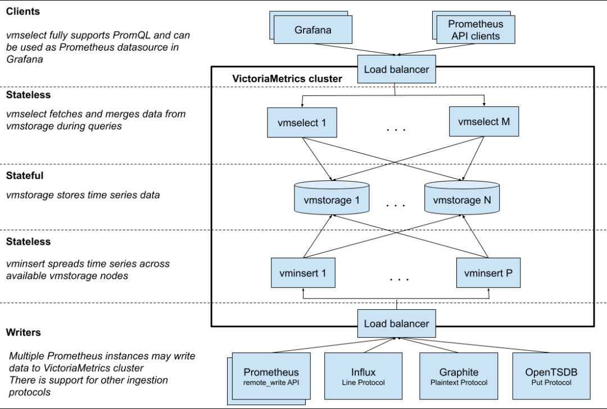
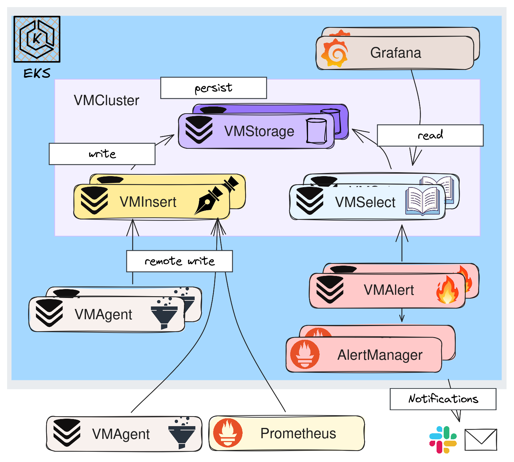
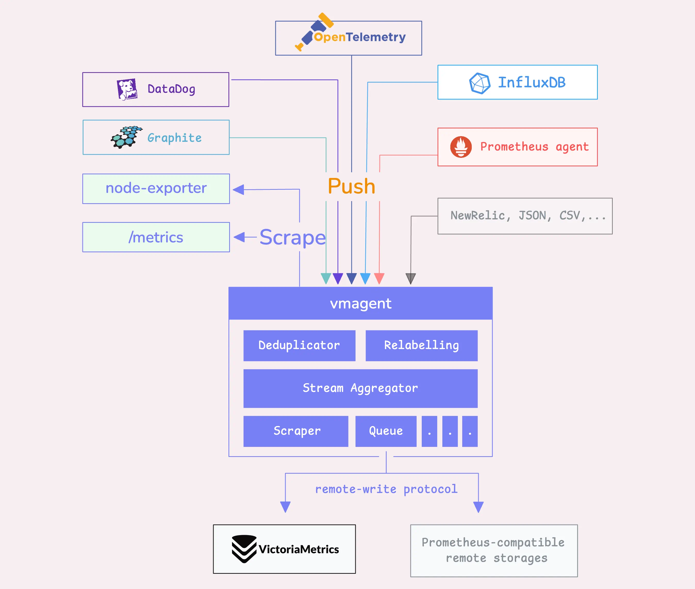
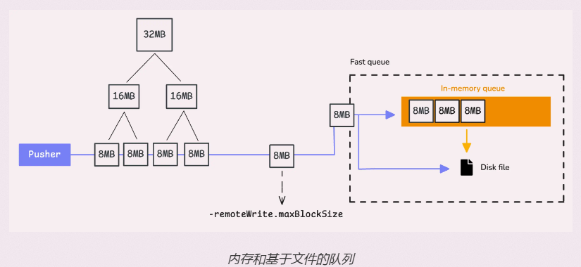
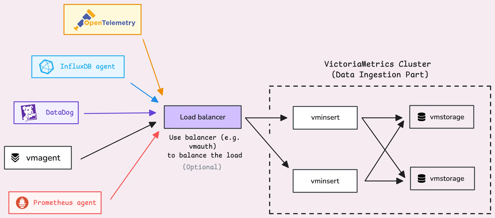
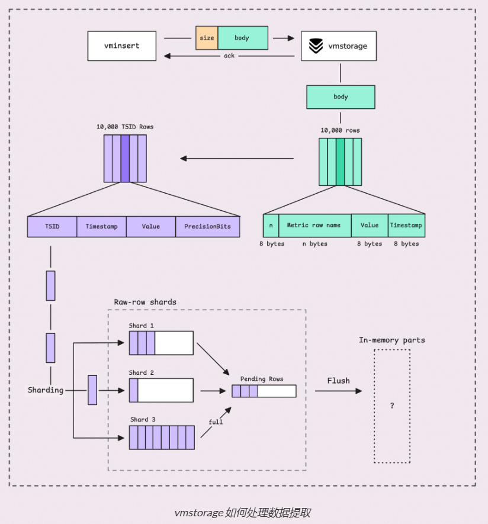
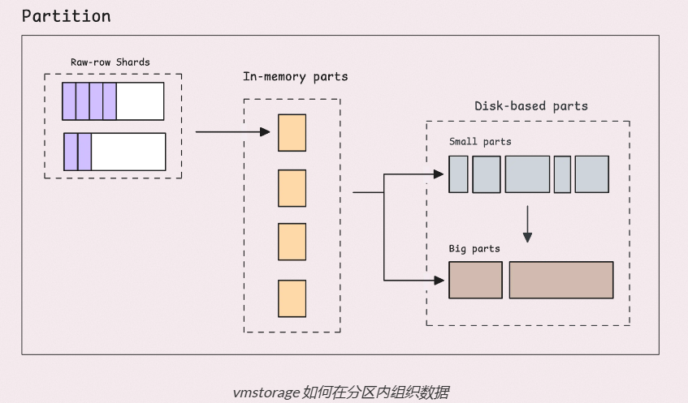
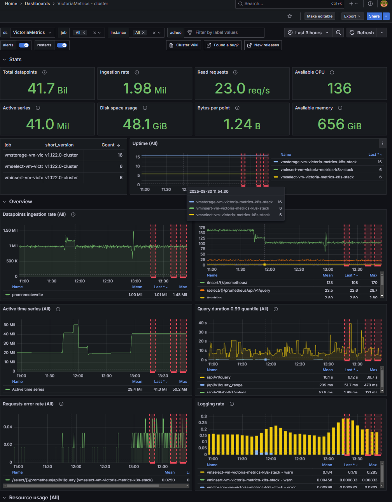
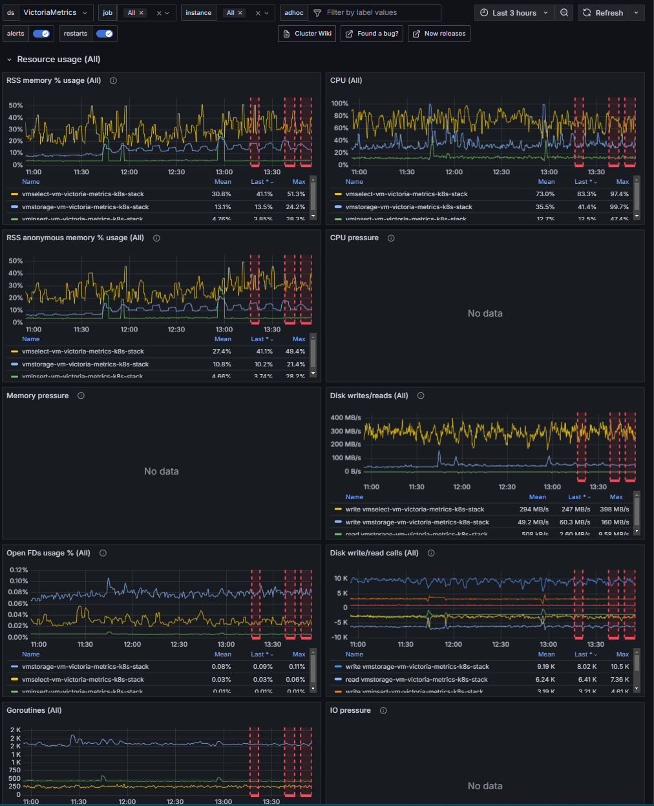

# 什么是VictoriaMetrics？
VictoriaMetrics是一个开源的、高性能、成本效益高的 **时间序列数据库（TSDB）和监控解决方案** 。它最初由一家俄罗斯公司VictoraMetrics开发，作为Prometheus的长期远程存储而设计，但现在已经发展成为一个全功能的监控栈，可以独立使用或与其他工具集成。

简单来说，它就像是 Prometheus 的一个强化版或专业版，专门为解决 Prometheus 在大规模数据场景下的痛点（如存储效率、查询性能、集群化）而诞生。

# 为什么需要VictoriaMetrics？
在为集群构建现代可观测性体系时， **Prometheus被认为是云原生领域的监控标准** ，其强大的查询语言PromQL和拉模型（Pull-based）设计定义了监控的范式。然而，当集群规模扩展到一定程度后，Prometheus本身在 **可扩展性、资源效率和长期存储成本方面的挑战被急剧放大：单个实例易于达到性能瓶颈，庞大的数据量使得内存与磁盘占用居高不下，多实例分片带来的运维复杂性也呈指数级增长** 。

在此背景下，VictoriaMetrics并非旨在替代Prometheus的生态，而是作为其 **在超大规模场景下的强大后端增强与替代方案** 。它能够完全兼容Prometheus的API、数据格式及PromQL，这意味着企业现有的Grafana看板、Prometheus告警规则和各类Exporter都能无缝、零成本地接入。VM的核心价值，正是在于它精准地解决了Prometheus在超大规模生产环境中的核心痛点：通过其高压缩比显著降低存储成本，凭借优异的水平扩展能力轻松应对亿级时间序列数据的摄入与查询，并以更低的资源开销提供稳定的高性能服务，从而极大地降低了运维复杂性。

以下是VM监控组件所具有的优势：
 1. **生态系统兼容性** ：
    - 与Prometheus无缝集成：完全支持Prometheus的远程读写协议，可以作为Prometheus的长期存储后端。
    - 支持多种数据摄取协议：除了Prometheus，它还支持 InfluxDB line protocol、Graphite、OpenTSDB、DataDog、AWS Timestream等协议，使其易于融入现有的监控体系。
    - 查询语言：原生支 PromQL，并提供了功能更强大的扩展版本MetricsQL。

1.  **资源利用效率** ：VM采用更高效的存储结构和数据压缩算法。实测表明，其磁盘空间占用通常仅为Prometheus的1/5到1/7（数据来自VM官方博客，具体测试数据VM创始人已在博客给出），这不仅显著降低了存储成本，同时高速的压缩减少了磁盘I/O压力，提升了整体写入性能。

2.  **高可用集群架构的原生支持** ：Prometheus的高可用部署方案需要使用两个及以上的独立副本，并且通过复杂的调度机制完成重复数据的处理，但在VM提供的集群版（VMCluster）中，实现了写入（vminsert）、存储（vmstorage）和查询（vmselect）组件分离，每个组件都可以独立地、无状态地（除存储外）进行扩缩容。这一改变为监控组件提供了高可用和水平扩展能力，降低了监控组件架构的复杂性和运维负担。

3.  **可扩展性** ：当监控数据量巨大时，Prometheus通常需要通过分片（Sharding）方案来扩展，而VM只需简单地添加vmstorage节点即可扩展存储容量，添加vminsert节点即可提升写入吞吐量，添加vmselect节点即可提升查询并发能力。这种线性的、简单的扩展方式更适合超大规模环境。
    - 单机版：对于大多数用户，单机版就足够强大和稳定，运维简单。
    - 集群版：当数据量巨大时，可以无缝切换到集群模式，通过增加节点来实现水平扩展，支持高可用和无限容量。

4. **简化数据采集流程** ：VM 提供了vmagent，相较Prometheus中的scrape agent，它的量级更轻，消耗的资源也更少。尤其是在集群环境下Prometheus，需要部署一个“联邦集群”的 Prometheus Server，专门用于从下层多个 Prometheus 实例中抓取聚合后的数据。这是一种级联的、被动抓取模式。而vmagent可以将抓取的数据远程写入（Remote Write）到多个不同的VM或Prometheus实例，非常适合作为超大规模集群的统一数据采集器，能够大幅降低采集端的资源消耗。

5.  **极简部署** ：单机版VM用单个二进制文件，集群版VM将核心功能拆分为三个同源且无依赖的二进制组件：vminsert（写入）、vmselect（查询）和vmstorage（存储）（在 Kubernetes 中部署二进制文件时，可以使用社区提供的 Helm Chart，通过values.yaml配置参数）。这替代了 Prometheus 生态中繁琐的组件栈。无需整合远程存储适配器、Thanos或Cortex等复杂集群，仅需一条命令启动一个无状态进程，即获得开箱即用的高性能时序数据库，其数据压缩率和查询性能通常更优，极大降低了运维复杂度与资源消耗。

# VictoriaMetrics是怎么实现的？
### 组成
- （周边）vmagent：数据指标抓取，支持多种后端存储，会占用本地磁盘缓存，默认端口 8429
- （核心）vminsert：数据录入，可实现类似分片、副本功能，默认端口 8480
- （核心）vmstorage：数据存储以及查询结果返回，默认端口为 8482
- （核心）vmselect：数据查询，汇总和数据去重，默认端口 8481
- （周边）vmalert：报警相关组件，不如果不需要告警功能可以不使用该组件，通过Alertmanager通知管理器，默认端口为 8880




   
### 写入 
1.  **服务发现和数据抓取** ：vmagent通过Kubernetes API发现集群中的所有资源，使用relabel_configs过滤和转换目标标签自动为每个目标添加K8s元数据标签（namespace、pod_name等）
2.  **数据写入** ：将抓取到的指标通过远程写入发送到vminsert负载均衡器，将数据发送到任意一个vminsert节点（http://vminsert-vm-victoria-metrics-k8s-stack.vmks.svc.cluster.local.:8480/insert/0/prometheus/api/v1/write）（支持本地缓存，在网络中断时临时存储数据）
3.  **计算数据路由** ：
    - vminsert-1接收到数据，使用 relabel_configs 过滤和转换目标标签，自动为每个目标添加 K8s 元数据标签。
    - 它根据数据点的指标名称和所有标签（cpu_usage{job="web", instance="10.0.0.1"}）计算一个哈希值
    - 哈希值通过**一致性哈希环**（确保对于同一条时间序列，所有的数据点都会被路由到同一组 vmstorage 节点）被映射到某个vmstorage节点。假设哈希结果指向vmstorage-1。
    - 复制因子-replicationFactor=2时，这个数据点需要被存储到两个不同的vmstorage节点上。系统会选择包含vmstorage-1在内的两个节点，假设是vmstorage-1和vmstorage-2（高可用）
4.  **转发数据** ：
    - vminsert-1将这个数据点并行地发送给vmstorage-1和vmstorage-2
    - 不需要等待所有节点的响应，只要收到第一个成功响应就会向客户端返回成功，以保证写入延迟最低。
5.  **存储数据** ：
    - vmstorage-1和vmstorage-2分别接收到这个数据点。
    - 在每个vmstorage节点内部，执行：将数据缓存到内存中 →→ 定期刷新到磁盘上对应的、按时间分片的数据块中 →→ 后台进程再对这些数据块进行压缩和合并

### 查询
1.  **接收查询请求** ：Grafana或者vmalert 将查询请求发送到任意一个vmselect节点的负载均衡器地址（http://vmselect-vm-victoria-metrics-k8s-stack.vmks.svc.cluster.local.:8481/select/0/prometheus/api/v1/query）
2.  **解析与分发查询** ：
    - vmselect-1解析这个PromQL查询
    - 识别出需要查找所有匹配 {job="web"} 标签的时间序列
    - 为了找到这些数据，vmselect-1将这个查询 **并行地广播** 到所有vmstorage节点（假设有三个vmstorage节点，数据是分片存储的，vmselect不知道 job="web"的数据具体在哪几个节点上）
3.  **并行执行子查询** ：
    - 每个vmstorage节点在本地执行这个查询的“子查询”
    - vmstorage-1在本地查找所有包含job="web"标签的时间序列（比如找到了cpu_usage{job="web", instance="10.0.0.1"}），然后从本地存储中读取这些序列在指定时间范围内的原始数据。
    - vmstorage-2执行同样的操作（因为它也存储了这条序列的副本）
    - vmstorage-3执行同样的操作，但发现本地没有匹配job="web"的数据，于是返回一个空的结果集
4.  **数据去重与聚合** ：
    - 三个vmstorage节点将各自的部分结果返回给vmselect-1
    - vmselect-1收到这些结果后，首先需要基于时间序列进行去重。因为同一条序列有两个副本（vmstorage-1和vmstorage-2），vmselect会智能地选择其中一个（通常是更完整的）来使用，避免数据重复计算
    - vmselect-1在内存中对所有去重后的、完整的结果集执行rate(...[5m])函数的计算
5.  **返回最终结果** ：vmselect-1将计算后的最终结果封装成Prometheus数据格式，返回给Grafana

### 告警
1.  **告警规则定义** ：在values.yaml里配置（使用Helm Chart部署方式时）
2.  **告警评估** ：vmalert 定期（如15秒）向vmselect发送查询执行告警规则，将触发的告警发送到Alertmanager
3.  **告警管理** ：Alertmanager对告警进行去重、分组、静默处理，根据路由规则将告警发送到相应的通知渠道（Email、Slack、企业微信、Webhook-自定义API端点，如钉钉）

# VictoriaMetrics的组件具体做了些什么？
### vmagent-轻量级数据采集器
1.  **核心职责** ：替代 Prometheus 进行指标抓取和初步处理。
2.  **具体工作** ：
    - 服务发现：自动发现监控目标（Kubernetes、Consul、文件服务发现等）。
    - 数据抓取（Scrape）：从被发现的目标中拉取（Scrape）监控指标。
    - 数据过滤：在源头对指标进行过滤、重命名标签、采样，减少存储压力。
    - 远程写入：将处理后的数据推送到 VictoriaMetrics 的 vminsert 组件。
    - 本地缓存：在网络中断时临时存储数据，恢复后重试。
3.  **特点** ：比 Prometheus 更轻量，资源消耗更低，功能专注。


##### 集群中的指标数据是怎样暴露的？
-  **Node Exporter：提供K8s节点本身的底层硬件和操作系统指标。**

Node Exporter 是一个独立的、运行在需要被监控的节点（通常是物理机、虚拟机或 Kubernetes 节点）上的守护进程。
它的核心工作：抓取该节点的底层硬件和操作系统指标，如：
CPU 使用率、负载、内存、交换分区使用量、磁盘 I/O、磁盘空间使用率、网络带宽、网络连接状态、系统负载、运行时间等
如何工作：它启动一个 HTTP 服务（默认端口 9100），并将上述指标以 Prometheus 标准的纯文本格式暴露在 /metrics 这个 API 端点上。它只暴露数据，并不负责发送给任何人。
-  **kube-state-metrics：提供K8s内部对象的状态指标。** 

kube-state-metrics 是一个简单的服务，通过监听 Kubernetes API Server，生成关于各种资源对象状态的指标。将K8s对象的状态（如 Deployment、Pod、Node、Service 的状态）转化为 Prometheus格式的指标。例如：kube_pod_status_phase{pod="app-123", phase="Running"} → 显示 Pod "app-123" 是否处于 Running 状态。
通过监 API Server，在内存中维护资源状态的镜像，并在一个 HTTP 端点（默认端口 8080）上暴露这些指标。它不关注节点的 CPU/内存使用量（那是 Node Exporter 的事），而是关注“我的 Deployment 有多少个 Pod 在运行？”这类问题。

##### 数据从抓取（ **Scrape** ）到写入（ **remote-write** ）是怎样进行的？

1.  **目标发现和分片复制** 
    - 发现：由于vmagent支持多种强大的服务发现机制，自动动态地找到目标，无需手动写死 IP 地址，可以自动发现Kubernetes集群内的所有 Pod、Service、Node、Endpoint 等资源对象，输出的是一个不断更新的、包含目标元数据（如地址、标签）的列表，为后续抓取奠定基础。
    - 分片：设置了多个远程存储时（-remoteWrite.url），vmagent 将把所有时间序列数据发送（或复制）到每个存储系统。
    - 复制：设置了分片标志时 ( -remoteWrite.shardByURL)，它不会将相同的数据发送到每个存储系统。相反，它会在各个存储系统之间拆分数据，从而均匀分配负载。

2.  **并发抓取（Scrape）与流式处理（ **Stream Aggregator** ）** 
    - 受控的并发抓取：抓取是最主要、最推荐的方式，与 Prometheus 的工作模式完全相同。vmagent 从发现阶段获取目标列表，并由**并发限制器**严格调控同时执行的抓取任务数。默认情况下，并发限制器最多允许两倍于可用 CPU 核心数的内核进行并发插入操作（-maxConcurrentInserts）。如果网络速度较慢，增加此数量可能会有助于提高数据传输速度，但这也会消耗更多资源。如果请求被延迟超时（-insert.maxQueueDuration），vmagent将发回503错误，过大（-maxInsertRequestSize< 32MB）的请求将会失败。vmagent会根据配置的抓取间隔默认1m（-global.scrape_interval），定期向目标列表中的每一个端点发起HTTP GET请求，访问目标的/metrics路径。抓取超时（-global.scrape_timeout）会停止抓取，超大（-promscrape.maxScrapeSize）的数据会进行丢弃。
    - 流模式解压与解析：从数据源接收数据时，vmagent会根据请求头中指定的压缩类型对其进行流式解压（如snappy和zstd压缩的Protobuf数据流），解压后“指标名称”就会转换为标签。流模式高效地利用内存池技术，复用内存缓冲区，极大地减轻了垃圾回收压力，实现了高吞吐量与低内存开销。（除此之外，对于较小的抓取响应还有单次模式，单次模式往往更高效，因为它在设置上下文方面的开销较小。相比之下，对于较大的响应，流模式可能更节省资源，因为它以块为单位处理数据，并且按顺序（而非并发）而不是一次性处理。）

    - 数据规范化与过滤：抓取到的数据会立即经过重新标记规则 的处理。此阶段可以修改、添加或删除标签（ **Relabeling** ），并基于标签对目标进行过滤，实现了数据的清洗、标准化与路由。vmagent 可根据系列限制或规则，在转发前主动丢弃某些高基数或不需要的时序数据，保护后端存储。高基数是指跟踪大量不同的时间序列（比如 user_id），为了避免这种情况，使用两个标志来控制一定时期内唯一时间序列的最大数量：-remoteWrite.maxHourlySeries和-remoteWrite.maxDailySeries。默认值为无限制（0）。任何超出限制的新时间序列都将被删除，但已经看到的时间序列将继续照常转发。
4.  **重复数据删除（Deduplicator）** 
    - 在高可用抓取场景下这个功能非常关键，为了容错，可能会部署多个vmagent分片抓取相同的目标集（即分片间有重叠）。vmagent可以处理这些重复数据，消除时间序列中任何多余的、不必要的数据点。保留特定时间范围（-streamAggr.dedupInterval）内最重要的数据点，在这窗口期内，vmagent将仅保留最新的样本，即具有最高时间戳的样本，如果两个样本具有相同的时间戳，它将保留具有较高值的​​样本。

3.  **可靠的远程写入**  
    - 快速队列（ **Queue** ）：由内存队列和使用磁盘存储的基于文件的（持久性）队列组成。当远程存储无法跟上数据采集速度时，这种设置可以帮助我们处理过快堆积的样本。在此过程的早期阶段，使用 snappy 或 zstd（或者不使用）解压缩了时间序列数据。现在，需要再次压缩它，然后再将其发送到快速队列。如果压缩后数据块大于 8 MB（-remoteWrite.maxBlockSize），vmagent 会将其分成两半，并不断递归分割，直到达到8MB的限制。在样本超出最大块大小（-remoteWrite.maxBlockSize）的极端情况下，会看到警告日志，当某些指标的最大块大小设置过低时，就会发生这种情况。如果将最大块大小设置得太高，vmagent会采取安全措施。压缩块大小（压缩后）上限为32 MB。默认每个块有 10,000 个样本（行）（-remoteWrite.maxRowsPerBlock），还要确保内存中始终至少有2个块，并且每个队列不超过100个块。三种情况下，数据会从内存刷新到磁盘：worker超时、积压磁盘队列、达到内存限制。
    - 持久化队列与容错：为保证数据可靠性，当后端不可用时，vmagent可将数据暂存于持久化磁盘队列中。待后端恢复后，它能从中断处继续发送，有效防止数据丢失，这是其生产级可靠性的关键。（部署方式为StatefulSet时需要为vmagent配置PV，Deployment则不需要）

      


### vminsert-数据摄入路由器
1.  **核心职责** ：接收外部数据，并路由到正确的vmstorage节点。
2.  **具体工作** ：
    - 接收写入请求：提供 HTTP 端点，接收来自 Prometheus、vmagent 等的远程写入数据。能够处理CPU核心数两倍的请求量。
    - 一致性哈希：根据数据点的指标名称和标签计算哈希值，确定应该存储到哪个vmstorage节点。
    - 数据复制：根据配置的复制因子（-replicationFactor），将每个数据点复制到多个 vmstorage 节点。
    - 负载均衡：将写入流量均匀分布到多个 vminsert 节点（通过前置负载均衡器）。
3.  **特点** ： **无状态** ，可以随意增删，扩展性好。



##### vminsert是如何将数据写入vmstorage的？

1.  **握手** 
    - 拨号：vminsert需要知道vmstorage节点的位置，这可以通过使用-storageNodes标志位来设置（我们在使用Helm安装的时候不需要设置这个）。一旦 vminsert 确定了存储节点所在的位置，它就会与它们建立TCP连接。
    - 压缩方法确认：在握手过程中vminsert会获取vmstorage的偏好的压缩方法。然后，它们会在数据开始移动之前确定一个共享的压缩算法（可以关闭，CPU负担↓ 网络负担↑）。
2.  **解析并重新标记** 
    - 解压缩、读取解析和重新标记：超出一定数量（-maxConcurrentInserts）的请求，在等待超时（-insert.maxQueueDuration）后将被拒绝。之后原始字节被解析成更结构化的格式（例如包含指标名称、标签、时间戳和值的行），然后进行重标记。
    - 编组：行编组成vmstorage 可以处理的格式，编组后的数据包含原始指标名称（包含指标名称和标签）以及账户/项目 ID
3.  **分片和缓冲** 
    - 分片：数据处理完成后，vminsert使用Rendezvous哈希算法，将指标名称和标签进行哈希处理，确定每个数据行应该由哪个存储节点处理（分片），并将数据拆分到多个vmstorage节点上，在集群中添加或移除节点不会导致集群节点之间所有输入键的重新排序。每个节点都会承担其份额的指标，如果设置了多个vmstorage节点 ( -storageNode)，分片功能将自动启动。
    - 缓冲：vminsert会分配12.5%的内存给缓冲区，每个存储节点都会获得相等的份额（不超过30MB）。如遇到缓冲区已满的情况，vminsert 将进行重新路由（缓冲区满了的时候进行过载重路由-disableRerouting=true、节点宕机时进行不可用重路由-disableReroutingOnUnavailable=false），将数据重定向到其他健康的存储节点。
4.  **复制并发送数据** 
    - 复制：对于每个存储节点，vminsert 都会运行一个专用的工作程序来监控其缓冲区。该工作程序会抓取缓冲区中的所有数据并将其发送到存储节点。如果设置了复制因子 ( -replicationFactor)，则同一份数据副本会发送到多个节点，每个副本都会按顺序发送到下一个节点。
    - 发送：在实际发送数据之前，vminsert 会发送一个 8 字节的小数据头，指示数据的大小。这会告诉 vmstorage 预计有多少字节，以便它决定是拒绝该数据还是分配足够的内存来处理它。之后，才会发送实际的数据缓冲区。vmstorage将通过单字节响应发送结果：1（ack成功）、2（只读）、其他


### vmstorage-有状态存储引擎
1.  **核心职责** ：存储时序数据和索引，是系统的心脏。
2.  **具体工作** ：
    - 数据持久化：将传入的时序数据（时间戳、值）写入磁盘，按时间分块存储（默认每2小时一个块）。
    - 索引管理：维护倒排索引，用于快速根据标签查找时间序列。
    - 数据压缩：在后台对数据进行重度压缩，这也是VM存储效率极高的关键。
    - 数据合并：将小的数据块合并成更大的块（小时块 → 日块 → 月块），优化查询性能。
    - 处理查询请求：响应vmselect的查询，返回本地存储的数据部分。
3.  **特点** ： **有状态** ，数据持久化在磁盘上（需要配置pv），扩展时需要迁移数据。
##### vmstorage如何处理来自vminsert的数据？
1.  **读取与解析** 
    - 并发读取限制器：仅允许两倍数量的CPU核心(-maxConcurrentInserts)同时读取数据（头+体），如果更多读取器尝试访问数据，则必须排队等待，但不会无限期等待。任何在队列中停留超时 (-insert.maxQueueDuration) 的请求都会被拒绝，以在高负载下保持系统效率。
    - 解析：块中每一行的结构，每行至少24+n个字节。指标原始名称包含指标名称和标签（例如http_requests_total{job="my_app",instance="host1",path="/foo/bar"}），但采用特定格式编码。如果数据块过大，vmstorage会将其拆分成多个较小的数据块，每个数据块最多包含10000行，然后将其插入到内部存储中。
2.  **查找TSID** 
    - TSID：（指标名称 + 标签组）哈希计算 + 时间戳 + 浮点值
    - 规范指标名称：将指标名称与指标的排序标签结合在一起（metric_name{instance="host",job="app"}），通过排序解决具有相同标签但顺序不同的问题。
    - 查询：缓存（快）？→ IndexDB（慢）？→ 新的TSID（未查询到则向前注册，以节省时间并避免将来对相同的时间序列再次访问）这也是为什么，高流失率会严重影响性能，甚至导致系统崩溃，因为它会不断生成并注册新的TSID。

3.  **将数据插入内存缓冲区（不可搜索）** 
    - 原始行分片(raw-row shards)：最多可容纳8MB数据，总计约149796行，TSID将被分片并分布到不同的原始行分片中，每当分片存满，行将被推送到“待处理系列”中，等待被分组到“LSM 部分(LSM part)”并最终写入磁盘。

        

4.  **写入磁盘** 
    - 序列刷新，“待处理系列”中内容进入LSM part：基于大小的刷新（缓冲区大小达到阈值时）、基于时间的刷新（上次刷新已经过去了2秒以上）
    - In-memory part：这是原始行分片数据在第一次刷新后存放的位置。此时，指标将变为可搜索和查询的。
    - Small part：比In-memory part稍大一些，这些parts存储在持久磁盘上。
    - Big part：最大的parts，也存储在磁盘上。
    - 刷新 ：将所有In-memory part移动到磁盘上的Small part中。
    - 合并 ：将各个parts合并起来以创建更高效​​的存储。这并不意味着所有Small part都会变成Big part；一些Small part可能只是合并成稍大一些的Small part。（规则：明显大于合并前最大）
    - 删除：配置重复数据删除窗口（-dedup.minScrapeInterval），每个窗口中保留一个样本
5.  **保留、可用磁盘空间保护和下采样** 
    - 任何从 vminsert 发送的超出保留期限（-retentionPeriod）的样本都会被立即丢弃（每个part都包含许多样本，即使某个part中只有一个样本在保留期内，整个part仍会保留）

      

##### vmstorage如何处理来自vmselect的查询请求？
1.  **从vmselect接收请求** 
    - 与 vminsert 类似，vmstorage 对来自 vmselect 的 RPC 请求应用并发限制。该限制由-search.maxConcurrentRequests控制，默认情况下，它允许最多 2 倍 CPU 核心数的并发 RPC 请求。如果请求数量超过该限制，它们将在队列中等待最多 10 秒（-search.maxQueueDuration），然后才会被拒绝。如果遇到网络速度慢或网络瓶颈，增加这些限制可能会有所帮助，因为它会将工作负载转移到 CPU 上。
2.  **查找时间序列地址Metric IDs（和 TSID）** 
    - 解析查询，确定搜索目标：找到所有与过滤标签匹配的时间序列的Metric ID
    - 查询IndexDB，获取相关Metric ID集合：先查缓存，没有的时候去索引中找
    - 合并与计算：根据查询条件对序列进行合并，加减或其他计算，得到最终的Metric ID 集合
    - 转换Metric ID为 TSID：在索引中查询全局索引（映射表），返回TSID给vmselect
3.  **查找时间序列的值和时间戳** 
    - 时间序列数据都共享一个TSID，先在缓存中查询，没有的话去索引中查询

### vmselect - 分布式查询引擎
1.  **核心职责** ：执行查询，聚合来自多个 vmstorage 节点的结果。
2.  **具体工作** ：
    - 接收查询请求：提供 HTTP 端点，接收来自 Grafana、API 客户端等的查询请求。
    - 查询解析：解析 PromQL/MetricsQL 查询语句。
    - 广播查询：将查询发送给所有 vmstorage 节点（因为不知道数据具体在哪）。
    - 结果聚合：从所有 vmstorage 节点收集部分结果，在内存中进行聚合、去重和计算。
    - 返回最终结果：将完整的查询结果返回给客户端。
3.  **特点** ： **无状态** ，但查询时比较消耗 CPU 和内存，可根据查询负载独立扩展。
##### vmselect是怎样处理查询的？
1.  **接收请求** 
    - vmselect可以同时处理来自不同 API 的多个请求（-search.maxConcurrentRequests），上限为8个，队列中的请求等待超时 (-search.maxQueueDuration)的时候，请求会被丢弃
2.  **解析查询** 
    - 结构化数据：vmselect 将查询内容视为原始字符串，例如rate(http_requests_total{method="GET"}[10m])。引起在执行任何操作之前，它必须将其分解为结构化数据以进行分析。
    - 重复查询：就为避免解析计算开销，vmselect 将结构化查询结果缓存在内存中
    - 自动调整：无效的查询会自动进行调整（avg_over_time(temperature) →→ avg_over_time(temperature[1i])），可以关闭（-search.disableImplicitConversion）
3.  **获取数据** 
    - 表达式类型区分
    - 确定时间范围后，使用标签过滤器构建搜索查询并将其发送到所有vmstorage节点， 每个vmstorage节点以块为单位流回匹配的数据。这些块首先存储在每个vmselect节点的内存缓冲区（buffer）中
    - 故障：如果某些vmstorage节点发生故障，无法响应其数据，vmselect仍将默认使用可用数据处理查询。
4.  **评估和内存使用情况** 
    - 重复删除：当数据块从多个 vmstorage 节点到达时，vmselect 会合并这些数据，同时保持数据的顺序。如果在 vminsert 上启用了复制，则某些数据可能会重复，当多个数据点具有相同的时间戳（-dedup.minScrapeInterval=1ms）时，vmselect仅保留最新的一个。
    - 内存占用：vmselect 最多会占用60%的系统内存 ( -memory.allowedPercent)，所有正在运行的查询加起来最多可以使用允许内存的50%。如果查询超出此限制，vmselect 会拒绝该查询并返回错误。
    - 缓存持久化：一些函数需要一次性获取所有数据点才能计算出准确的结果，这意味着更高的内存占用。查询执行完成后，如果缓存功能未禁用，vmselect会缓存结果。此汇总结果缓存最多占用允许内存的 12.5%。可以通过设置-cacheDataPath使其持久化。
    - 故障处理：vmselect 返回的数据有30秒的延迟（-search.latencyOffset）

### vmalert-告警规则评估器
1.  **核心职责** ：定期评估告警规则，并触发告警。
2.  **具体工作** ：
    - 加载告警规则：从配置文件或 ConfigMap 加载 PromQL/MetricsQL 告警规则。
    - 规则评估：定期（如每15秒）向 VictoriaMetrics 发送查询，判断是否满足告警条件。
    - 状态管理：管理告警状态（inactive → pending → firing → resolved）。
    - 告警发送：将触发的告警发送给 Alertmanager。
    - 状态回写：将告警状态（如 ALERTS 指标）写回 VictoriaMetrics，用于审计和展示。
3.  **特点** ：将告警评估与存储分离，可以独立配置和扩展。

# VictoriaMetrics VS Prometheus？
1.  **Prometheus遇到的瓶颈和解决方案** 
    - 单机部署 →→ 联邦部署（vm：集群版）
    - 查询性能 →→ 服务拆分（vm：vmstorage、vmselect、vminsert）
    - 高并发处理 →→ 分片
    - 存储空间 →→ 远程存储（vm：vmstorage）

2. **应对大规模集群任务时面对的挑战** 
    - 数据量和存储：单个实例难以承担
    - 性能和延迟：大数据量性能下降，资源消耗严重
    - 报警和告警：联邦部署引起告警延迟
    - 可扩展性：联邦和分片实现复杂
    - 数据一致性、可靠性：不同实例间数据不一致（抓取周期、网络、目标实例、时钟偏移、处理逻辑）

3.  **Prometheus的高可用实现** 
    - HA模式：多重普罗，部署两个完全独立、配置相同的Prometheus实例，两个实例同时抓取相同的目标（数据不一致，资源浪费）
    - HA模式+远程存储：在HA模式的基础上，引入一个远程存储，来解决数据统一和长期存储的问题（新组件维护，数据重复）
    - **Thanos**：复杂的、原生集成到Prometheus生态的HA方案，是生态内主流方案（架构复杂，查询延迟）
    - 联邦集群：通过分层结构扩展 Prometheus 或聚合特定数据，下层实例用于采集，上层实例用于聚合（不是高可用，配置复杂，单点性能瓶颈）

# VictoriaMetrics VS Thanos？
1.  **核心组件**
    - Sidecar：与每个 Prometheus 实例部署在一起，代理查询并上传数据块到对象存储。
    - Store Gateway：从对象存储中提供历史数据查询。
    - Query：核心组件，提供统一的查询入口，可以从多个 Sidecar 和 Store Gateway 聚合数据，并实现全局去重。
    - Ruler：告警规则评估。
    - Compactor：压缩对象存储中的数据。 
2.  **工作原理** 
    - 实时查询路径：每个Prometheus实例旁部署一个Sidecar组件，Querier通过Sidecar的Remote Read API直接、实时查询每个Prometheus实例的本地数据
    - 长期存储路径：每个Sidecar监控并上传Prometheus的本地数据块到对象存储（如 S3），Store Gateway将对象存储中的数据暴露给Querier查询
    - 数据聚合：Querier并行查询所有Sidecar（实时数据）和Store Gateway（历史数据），对结果进行去重、合并后返回统一的数据集
3.  **应对大规模集群任务的策略** 

| 挑战维度 | VictoriaMetrics 的应对策略 | Thanos 的应对策略 |
|---------|--------------------------|------------------|
| **1. 数据量与存储** | **原生分布式架构**：集群版专为水平扩展设计。<br>• **职责分离**：`vminsert`（写入）、`vmselect`（查询）、`vmstorage`（存储）可独立扩展。<br>• **存储分片**：数据自动在 `vmstorage` 节点间分片，不存在单点存储瓶颈。<br>• **高效压缩**：自研存储引擎，压缩比极高，直接降低单节点存储压力。 | **依赖对象存储**：<br>• **存储卸载**：将长期存储的负担完全卸载到云端的对象存储（如S3），其本身具备无限扩展能力。<br>• **挑战转移**：单个 Prometheus 实例的本地存储仍是瓶颈。Thanos 通过将数据上传到对象存储来“解决”此问题，但单个 Prometheus 实例在抓取和短期存储上仍有上限。 |
| **2. 性能与延迟** | **优化的一站式引擎**：<br>• **统一处理**：从采集、存储到查询，整个链路都在一个高度优化的引擎内完成，减少了数据转换和传输开销。<br>• **高性能查询**：对长时间范围、高基数查询进行了深度优化，性能衰减平缓。<br>• **流式聚合**：可在 `vmagent` 端进行实时聚合，减轻存储和查询压力。 | **查询联邦与合并**：<br>• **查询路由**：`Querier` 组件需要从多个 `Sidecar`/`Store Gateway` 拉取数据，然后在内存中合并。<br>• **潜在瓶颈**：跨网络的数据传输和内存中的大规模合并操作，在数据量极大时可能成为性能和延迟的瓶颈。查询延迟通常高于 VM。 |
| **3. 报警和告警** | **中心化告警**：<br>• **`vmalert`**：作为一个独立的、无状态组件，直接从 **中心化的 VictoriaMetrics** 集群查询数据并计算告警。<br>• **优势**：拥有**全局数据视图**，告警计算基于一致、完整的数据，不存在因联邦架构导致的数据不完整或延迟问题。 | **分布式告警**：<br>• **`Ruler` 组件**：可以部署为本地模式（与每个 Prometheus 实例绑定）或中心化模式。<br>• **挑战**：本地模式无法做全局告警；中心化模式的 `Ruler` 需要从多个数据源获取数据，可能遇到与查询类似的延迟和一致性问题。 |
| **4. 可扩展性** | **“开箱即用”的集群模式**：<br>• **内置分片**：分片逻辑是 VM 集群版的原生功能，配置相对简单，只需指定节点角色和集群地址。<br>• **无侵入**：对上游数据源（如 Prometheus）透明，它们只需配置远程写入到一个统一的 `vminsert` 端点。 | **“乐高式”拼接**：<br>• **显式分片**：需要在 Prometheus 层面手动进行分片（例如，按服务、按地域部署多个实例），这是一种**应用层分片**。<br>• **复杂度高**：运维人员必须理解并维护 Prometheus 分片规则、Thanos Sidecar 部署、Store Gateway 发现等一整套复杂配置。 |
| **5. 数据一致性** | **数据入口统一**：<br>• **单一事实来源**：所有数据通过 `vminsert` 写入，由 VictoriaMetrics 集群作为**唯一的事实来源**。<br>• **解决不一致**：从根本上避免了多个 Prometheus 实例因抓取周期、时钟偏移、处理逻辑不同而导致的数据不一致问题。<br>• **可靠性**：`vmagent` 的持久化队列和 VM 自身的副本机制保障了数据可靠性。 | **最终一致性模型**：<br>• **承认不一致**：Thanos 承认并接受不同 Prometheus 实例间可能存在数据不一致（如重复、时钟偏移）。<br>• **应对机制**：通过 `deduplication` 功能在查询时处理重复数据，但这是一个**事后补救**措施，而非事前预防。<br>• **可靠性依赖**：数据可靠性严重依赖于每个 Prometheus 实例的本地可靠性以及向对象存储上传的成功率。 

4.  **性能架构对比** 

| 特性 | VictoriaMetrics | Thanos |
|------|-----------------|--------|
| **核心哲学** | "All-in-One" 一体化设计，追求极简与高性能 | "Lego Bricks" 乐高式组合，作为 Prometheus 扩展套件 |
| **项目定位** | Prometheus 的高性能替代品/增强版 | Prometheus 的无侵入式扩展 |
| **架构风格** | 集成、统一 | 分散、微服务化 |
| **核心组件** | 单机版: 1个二进制文件<br>集群版: 3个二进制文件(vminsert/vmselect/vmstorage) | 5-6个核心组件(Sidecar/Query/Store Gateway/Compactor/Ruler/Receiver) |
| **部署复杂度** | 低 | 高 |
| **外部依赖** | 无，自包含 | 强依赖对象存储和服务发现 |
| **高可用实现** | 集群版原生支持，组件水平扩展 | 通过部署多个无状态组件和冗余有状态组件实现 |
| **学习曲线** | 平缓 | 陡峭 |
| **数据压缩率** | 极优(比 Prometheus/Thanos 高 1.5x-2x) | 良好(依赖 Prometheus TSDB 格式) |
| **写入吞吐量** | 非常高，优化的存储引擎 | 受限于单个 Prometheus 实例和网络上传 |
| **查询延迟** | 低，擅长长时段查询 | 中等，可能因组件跳转而增加延迟 |
| **资源消耗** | 非常低(CPU/内存) | 较高(组件众多，总消耗高) |
| **存储成本** | 低(高效压缩) | 低(对象存储廉价)，但需考虑 API 请求成本 |
| **扩展性** | 垂直扩展 + 水平分片(集群版) | 水平扩展(理论上无限) |

### 结论
监控无优劣，按需按选择即可。
|选择 VictoriaMetrics 当|选择 Thanos 当|
|---|---|
|追求极致的简单性和运维效率|已经拥有大规模、稳定的 Prometheus 实例集群|
|资源(CPU、内存、磁盘)受限|已经重度使用对象存储|
|性能是首要考虑因素，需要处理大规模数据|对监控性能无特殊要求|
|希望寻找 Prometheus 的"直接替代品"|需要与现有的Prometheus生态工具链进行无缝集成|
|团队规模较小或运维能力有限|团队具备强大的运维能力和丰富的微服务运维经验|
|**典型场景**：中小企业、云原生初创公司、资源敏感的边缘计算环境|**典型场景**：大型互联网企业、已有成百上千个Prometheus实例的公司|


# VictoriaMetrics的数据的可视化是怎样的？
1.  **开放访问端口** 

开放外部端口支持http访问
进入路径vi /root/victoria-metrics-k8s-stack/charts/grafana/values.yaml，修改chart包类型为nodeport，端口号30010开放外部端口，具体在222行以下进行修改：

```
podPortName: grafana
gossipPortName: gossip
service:
  enabled: true
  type: NodePort  # 修改项
  ipFamilyPolicy: ""
  ipFamilies: []
  loadBalancerIP: ""
  loadBalancerClass: ""
  loadBalancerSourceRanges: []
  port: 80
  targetPort: 3000
  nodePort: 30010  # 新增开放端口号
...
```
2.  **登录信息获取** 
获取登录密码执行:
```
kubectl get secret vm-grafana -n vmks -o jsonpath="{.data.admin-password}" | base64 --decode
```
页面登录 打开浏览器进入http:/<您的控制节点ip>:30010例如：http://192.168.201.17:30010

输入用户名admin以及上一步获取的密码登录grafana可视化面板

3.  **面板** 




4.  **主要指标** 

-  **压测核心关注指标 (黄金四项)** ：这四项是判断集群是否健康的最高优先级指标，任何一项出现异常都意味着遇到了瓶颈。
##### 写入延迟 (Ingestion latency)

看什么: 写入请求的延迟百分位数（P99 或 P999 最重要）。

为什么重要: 直接影响到应用端的体验。如果延迟过高（例如超过几秒），意味着VM无法及时处理写入请求。

正常现象: 延迟保持稳定且处于较低水平（如 < 1s）。

异常现象: 延迟随时间推移持续升高，或出现周期性尖峰。这通常表明系统已过载，正在排队处理请求。

##### 写入错误率 (Insert request errors)

看什么: HTTP 5xx 状态码的比率（特别是 503 Service Unavailable）。

为什么重要: 任何非零的错误率都是需要立即关注的严重问题。VM在过载时会返回503错误，这意味着它已无法处理更多请求。

正常现象: 错误率为 0。

异常现象: 错误率开始出现并持续增长。这是压测已达到集群极限的最明确信号。

##### 处理延迟队列 (Rows postponed)

看什么: 存储节点上被迫延迟处理的样本数。

为什么重要: 这是写入瓶颈的先行指标，比错误率更早出现。当存储节点(vmstorage)来不及处理写入请求时，它会要求写入节点(vminsert)稍后再试，从而导致postponed计数增加。

正常现象: postponed 计数器保持为0或非常低，且不会持续增长。

异常现象: postponed 计数器开始持续、快速地线性增长。这表明存储节点已成为瓶颈。


##### 资源饱和度 (Resource saturation)

看什么: CPU使用率、内存使用率、磁盘IO使用率（读写吞吐量和IOPS）。

为什么重要: 任何资源达到100%饱和度都会成为系统瓶颈，导致上述1、2、3项指标恶化。

CPU: 持续高于80-90%通常意味着计算瓶颈。

内存: vmstorage 内存使用率是关键，一旦耗尽会导致严重问题。

磁盘IO: 最常见的瓶颈。观察读写带宽和IOPS是否已达到所使用磁盘的极限。

-  **其他重要指标** ：在确保上述四项没问题后，这些指标可以帮助你更深入地分析性能和数据特性。

##### 数据摄入率 (Ingestion rate)

看什么: 成功写入的样本数/秒（samples/sec）。

为什么重要: 这是压测要追求的性能结果。你需要在保证延迟和错误率达标的前提下，观察这个值能达到多高。

##### 活跃时间序列 (Active time series)

看什么: 集群中唯一时间序列的总数。

为什么重要: 高基数（High cardinality）是监控系统的天敌。此指标快速增长会导致内存消耗急剧增加，是集群不稳定的重要因素。压测时需关注其增长趋势是否符合预期。

##### 查询性能（如果压测包含读操作）

看什么: 查询速率（QPS）和查询延迟（P99）。

为什么重要: 评估集群的读写混合负载能力。高写入负载可能会影响查询性能。

### 详细指标
|分类   |指标   |说明   |参考量   |备注   |
|---|---|---|---|---|
|Stats   |   |   |   |   |
|   |   |   |   |  
|overview   |Datapoints ingestion rate (All)    |集群每秒接收的样本数（samples per second）   |取决于 VM 节点的硬件（特别是 CPU 和磁盘 IOPS）   |   |
|           |Requests rate (All)                |集群所有 HTTP 接口每秒接收到的请求总数。   |   | 正常表现: 无剧烈尖峰 |
|           |Active time series (All)           |当前集群中所有唯一的时间序列数量。这是最核心的容量指标之一，直接关系到内存消耗   |没有绝对“安全”值，这取决于你的 -memory.allowedPercent（默认60%）、服务器内存大小和序列的“搅动”程度（churn rate）。   |   |
|           |Query duration 0.99 quantile (All) |99%的查询请求都快于这个值。是衡量集群查询性能的关键指标，反映了最慢的那1%请求的延迟。   |简单查询：应低于 100毫秒。复杂查询：可能在 1-2秒。   |该指标飙升是严重警告，主要原因：磁盘IO瓶颈、资源（CPU/内存）耗尽，或有人运行了扫描大量数据的低效查询   |
|           |Requests error rate (All)          |VictoriaMetrics 所有HTTP请求的失败率（通常是5xx服务器错误）   |理想值：0%，任何持续的非零错误率都是异常状态   |是 **集群健康状态的最直接、最严重的红灯信号**    |
|           |Logging rate                       |VictoriaMetrics 组件自身日志的输出速率（通常是 lines/sec 或 bytes/sec）   |正常运行时通常很低且稳定   |VM自身运行的诊断日志   |
|           |                                   |   |   |   |
|Resource usage (All)|RSS memory % usage (All)   |所有VM进程（vminsert, vmselect, vmstorage）占用的物理内存百分比。RSS是进程实际驻留在内存中的数据集大小   |正常低于默认60%，持续超过80-90%是危险信号   |内存耗尽是最严重的故障之一，需为 vmstorage 的内存使用率设置严格告警   |
|           |CPU (All)   |所有VictoriaMetrics进程（vminsert, vmselect, vmstorage）的CPU使用率总和   |关键看是否达到瓶颈：持续高于 80-90% 表明CPU已成为性能瓶颈   |单纯的CPU高（user%+sys%高）表明计算繁忙，可能正在处理复杂查询或高写入负载，需结合磁盘IO和延迟指标一起看|
|           |RSS anonymous memory % usage (All)   |所有VM进程的匿名内存占物理内存的百分比。   |使用率超过85% 需要高度警惕   |其持续快速增长是诊断高基数问题（High Cardinality）的最强信号   |
|           |Disk writes/reads (All)   |所有VM节点磁盘的实际读写吞吐量（单位通常是 MB/s）   |关键看是否接近磁盘本身的性能瓶颈   |这是最常见的性能瓶颈来源   |
|           |Open FDs usage % (All)   |所有VM进程已使用的文件描述符（File Descriptors）占操作系统限制的百分   |正常情况下应远低于100%（例如<50%）。持续超过90% 是严重警告   |100%会导致灾难性故障，VM将无法建立新的连接、打开新文件或接收数据，表现为各种无法解释的失败   |
|           |Disk write/read calls (All)   |所有VM节点上，磁盘读写操作的每秒调用次数（IOPS）   |关键看是否持续达到所使用磁盘的IOPS极限   |衡量磁盘压力的另一个关键维度，与吞吐量（MB/s）同样重要。高IOPS、低吞吐量的负载是大量小文件操作   |
|           |Goroutines (All)   |所有VictoriaMetrics进程当前的Goroutine数量。Goroutine是Go语言的轻量级线程   |关键看趋势：在负载稳定时，数量应相对稳定   |发现潜在阻塞问题的间接指标，需结合CPU利用率和延迟指标一起分析   |
|           |Threads (All)   |所有VictoriaMetrics进程当前使用的操作系统线程数   |在负载稳定时，数量应相对稳定   |诊断系统级资源竞争或I/O瓶颈的辅助指标   |
|           |TCP connections (All)   |所有VictoriaMetrics进程当前的TCP连接数总数（包括客户端入站连接和到其他组件的出站连接）。   |关键看趋势：在负载稳定时，连接数应相对稳定   |   |
|           |CPU spent on GC (All)   |所有VM进程的垃圾回收（Garbage Collection）操作所消耗的CPU时间百分比   |越低越好，通常应低于 5-10%   |该指标持续过高是内存压力的明确信号   |
|           |TCP connections rate (All)   |所有VM进程每秒建立的新TCP连接数   |稳定   |   |
|           |Memory allocations rate   |所有VM进程每秒在堆上分配的内存总量（单位通常是 MB/s 或 B/s）   |稳定   |   |
|           |Go scheduling latency   |Go运行时调度器将一个就绪的Goroutine分配到线程上执行所需的平均延迟时间   |通常极低，应在微秒(μs)级别   |   |
|           |   |   |   |   |
|Troubleshooting|Churn rate (All)   |时间序列的“搅动”或“变化”速率。指每秒新创建（新增）和变得不活跃（消失）的时间序列数量。   |理想情况下应尽可能低。非零值是正常的，但应保持稳定   |这是 **监控系统最危险的指标之一** 。高搅动率是“高基数”问题的动态表现   |
|           |Slow inserts   |检测到写入（插入）操作变慢的速率或计数。当单个写入请求的处理时间超过某个阈值时触发。   |理想值应为0或极低   |   |
|           |Slow queries % (All)   |执行时间超过某个阈值（如1秒）的查询请求占总查询数的百分比。   |越低越好，理想情况下接近 0%。持续高于 1-5% 通常意味着存在性能问题   |衡量查询性能用户体验的关键指标   |
|           |Cache usage % by type (All)   |各类缓存（如索引缓存、时间序列数据块缓存）的当前使用量占配置总大小的百分比。   |低于 100% 是正常的。使用率持续很高（如 >80%） 表明缓存配置大小可能不足   |   |
|           |Cache miss ratio (All)   |所有缓存未命中的请求数占总请求数的比率。比值越高，性能越差   |越低越好。理想情况下应低于10%，最好在1-5%左右。持续高于 20-30% 通常意味着缓存效率低下   |高缓存未命中率是性能杀手   |
|           |Deduplication rate (All)   |VictoriaMetrics 检测并丢弃的重复数据样本的速率（ samples/sec ）。当完全相同的（指标+标签+时间戳+值）数据被多次写入时发生。   |理想值应为 0。任何持续的非零值都意味着数据源配置可能有问题。    |   |
|           |Samples dropped for last 1h (All)   |过去一小时内，VictoriaMetrics 丢弃（未成功写入）的样本总数。这是一个累积计数器  |理想值应为 0。任何非零值都表明发生了数据丢失   |   |
|           |   |   |   |   |
|Interconnection (All) |Rows (All)   |VictoriaMetrics 集群内部组件之间传输的数据行速率。这主要包括 vminsert 向 vmstorage 发送写入数据，以及 vmselect 从 vmstorage 读取查询数据。   |该速率应与外部写入速率（Ingestion rate）和查询扫描速率（Rows scanned/s）相匹配   |衡量 **集群内部通信流量的关键指标**    |
|           |RPC errors (All)   |VictoriaMetrics 集群内部组件之间通过 RPC（远程过程调用）通信时发生的错误速率。这包括 vminsert -> vmstorage 和 vmselect <-> vmstorage 之间的通信错误   |理想值应为 0。任何持续的非零错误率都是严重问题   |  **集群内部健康状态的“红灯”指标** 。RPC错误意味着内部网络或节点出现了故障  |
|           |Rows (All) rerouted to   |每秒有多少行数据被 vminsert 重路由到其他 vmstorage 节点。当一个 vmstorage 节点无法及时处理写入请求时，vminsert 会尝试将数据发送到其他节点。   |理想值应为 0。任何持续的非零值都表明集群负载均衡出现了问题   |   |
|           |Rows (All) rerouted from   |每秒有多少行数据因为初始的 vmstorage 节点无法处理而被 vminsert 从其原始目标节点移走。这是 Rows rerouted to 的对应面   |理想值应为 0。任何持续的非零值都表明集群负载均衡出现了问题。   | 指向集群中表现不佳的“问题节点”  |
|           |Pending   |当前在 VictoriaMetrics 集群内部通信队列中等待被处理的数据行数或请求数。它衡量了内部组件之间的积压情况。   |理想值应为 0 或一个很低且稳定的数值。队列中始终有积压是性能瓶颈的明确信号   | 该值 **持续增长是一个严重的警告**   |
|           |RPC network usage (All)   |VictoriaMetrics 集群内部组件之间通过 RPC 通信所产生的网络带宽占用（通常单位为 MB/s 或 Gb/s）。   |   |衡量集群内部通信压力的直接指标   |
|           |   |   |   |   |
|vmstorage (All)|Ingestion rate (All)   |所有 vmstorage 节点每秒成功接收并处理的样本数 (samples/sec)。这是写入路径的最终落地指标。   |数值越高越好，但必须与 vminsert 的摄入率匹配   |衡量存储节点写入吞吐能力的核心指标   |
|           |Memory (anon) usage % (All)   |所有 vmstorage 节点的匿名内存（Anonymous memory）使用量占总内存的百分比。匿名内存主要用于存储常驻内存的索引和时间序列元数据。   |持续超过 80% 是危险信号   |监控 **高基数（High Cardinality）问题的最关键指标**    |
|           |CPU usage % (All)   |所有 vmstorage 节点的平均CPU使用率。   |持续高于 80% 表明CPU可能成为瓶颈   |   |
|           |Concurrent selects (All)   |所有 vmstorage 节点上正在并发执行的查询请求数量   |稳定   |   |
|           |Concurrent flushes on disk (All)   |所有 vmstorage 节点上正在并发执行的数据刷盘（Flush）操作的数量。这是将内存中的数据持久化到磁盘的过程。   |通常为个位数，且相对稳定   |   |
|           |Merge speed   |存储节点每秒合并的行数。合并速度取决于可用的 CPU 和磁盘 IO 带宽。   |合并速度持续为0或远低于写入速度是危险信号，会导致小文件堆积，严重降低查询性能。   |   |
|           |Active merges (All)   |跨存储节点进行的最大合并数量。合并数量的急剧变化可能表明正在进行重复数据删除/降采样活动。预计该storage/small指标的数值会很高。   |通常为个位数，且相对稳定   |   |
|           |LSM parts max by type (All)   |最后一个分区中所有存储节点上 LSM 树的最大数据分片数量。分片数量的增加（硬限制为 512）表明合并性能缓慢 - 请检查资源利用率。   |相对稳定   |   |
|           |Disk space usage % (All)   |显示已用磁盘空间的百分比。建议至少保留 20% 的可用磁盘空间以获得最佳性能。   |   |   |
|           |Pending datapoints (All)   |RAM 队列中有多少数据点正在等待写入存储。待处理数据点的数量应在 0 到 的范围内5*<ingestion_rate>，因为 VictoriaMetrics 每 5 秒将待处理数据推送到持久存储。索引数据点的值通常要低得多   |   |   |
|           |Disk space usage % by type (All)   |按类型显示已用磁盘空间百分比：数据点或索引数据库。通常情况下，索引数据库占用的空间比数据点少得多。但如果流失率较高，索引数据库的大小可能会显著增长。   |   |   |
|           |Network usage (All)   |显示 vmstorage 服务的网络使用情况   |   |   |
|           |Number of snapshots   |显示跨 vmstorages 的现有快照的最大数量。最近创建的快照不占用磁盘空间。但随着时间的推移，快照会越来越旧，占用的磁盘空间也会越来越多。   |   |不用的时候，及时删除   |
|           |   |   |   |   |
|vmselect (All)           |   |   |   |   |
|           |Requests rate (All)   |vmselect 节点接受的请求率   |   |   |
|           |Concurrent selects (All)   |显示跨实例的最大并发选择数。maxsearch.maxConcurrentRequests可以通过标志配置限制，current显示当前忙于处理请求的goroutine 数量   |   |如果持续current出现命中max，则表示一个或多个 vmselect 节点的请求数量已超载。如果您发现 vmselect 的 CPU 已饱和，请考虑添加更多 vmselect 副本或增加 CPU 资源。如果 CPU 和内存面板显示有充足的可用资源，请尝试增加-search.maxConcurrentRequests。请注意， 越高，峰值内存使用量-search.maxConcurrentRequests可能就越高。   |
|           |CPU usage % (All)   |   |   |   |
|           |Memory (anon) usage % (All)   |共享进程自身分配的内存。当内存使用率达到 100% 时，进程很可能会被 OOM 终止。安全的内存使用率百分比应低于 80%   |   |   |
|           |Series read per query (All)   |每个查询读取的时间序列数量的第 99 个百分位数   |   |   |
|           |Datapoints read per series (All)   |每个查询时间序列读取的数据样本数量的第 99 个百分位数。   |   |   |
|           |Datapoints read per query (All)   |每个查询读取的数据样本数量的第 99 个百分位数。   |   |   |
|           |Datapoints scanned per query (All)   |每个查询读取的数据样本数量的第 99 个百分位数。   |   |   |
|           |Network usage: clients (All)   |显示 vmselects 和客户端（例如 vmalert、Grafana、vmui 等）之间的网络使用情况。   |   |   |
|           |Network usage: vmstorage (All)   |显示 vmselects 和 vmstorages 之间的网络使用情况。   |   |   |
|           |   |   |   |   |
|vminsert (All)|   |   |   |   |
|           |Requests rate (All)   |*- 不支持的查询路径/write- 插入虚拟机/metrics- 查询虚拟机系统指标/query- 查询即时值/query_range- 在一段时间内进行查询/series- 匹配特定的标签集/label/{}/values- 查询标签值列表（主要是变量   |   |   |
|           |Concurrent inserts (All)   |显示正在进行的插入的最大数量。max- 默认等于 CPU 数量 * 2。可通过maxConcurrentInsertsflag 进行配置；current- 当前忙于处理请求的 goroutine 数量。   |   |   |
|           |CPU usage % (All)   |   |   |   |
|           |Memory (anon) usage % (All)   |共享进程自身分配的内存。当内存使用率达到 100% 时，进程很可能会被 OOM 终止。安全的内存使用率百分比应低于 80%   |   |   |
|           |Storage connection saturation (All)   |显示 vminsert 和 vmstorage 组件之间的连接的饱和度。   |如果达到 0.9 秒的阈值，则表示连接饱和度超过 90%，vminsert 将无法跟上。这通常意味着 vminsert 或 vmstorage 节点正在努力应对负载。请验证两个组件的 CPU/内存饱和度以及它们之间的网络饱和度。如果 vminsert 资源已饱和，请考虑添加更多资源或水平扩展 vminsert。如果 vminsert 资源和网络正常，请检查 vmstorage 指标是否存在异常。   |   |
|           |Network usage: clients (All)   |显示 vminserts 和客户端（例如 vmagent、Prometheus 或任何其他将指标推送到 vminsert 的客户端）之间的网络使用情况。   |   |   |
|           |Network usage: vmstorage (All)   |显示 vminserts 和 vmstorages 之间的网络使用情况。   |   |   |
|           |Rows per insert (All)   |   |   |   |
|           |   |   |   |   |
|Drilldown  |   |   |   |   |
|           |RSS memory usage (All)   |显示已使用的内存（常驻内存）。当内存使用率接近 100% 时，应用程序的性能将显著下降。  |   |   |
|           |RSS anonymous memory usage (All)   |RSS 是进程自身分配的内存份额。操作系统无法释放此份额，因此 OOM 终止程序必须将其考虑在内   |   |   |
|           |CPU usage (All)   || |  |
|           |Storage full ETA (All)   |根据以下参数显示达到 100% 磁盘容量所需的大约时间：可用磁盘空间（-storage.minFreeDiskSpaceBytes 之后）；行摄入率；压缩。   |   |   |
|           |Disk space usage (All)   |显示已用磁盘空间的百分比。建议至少保留 20% 的可用磁盘空间以获得最佳性能。   |   |   |
|           |Disk space usage by type (All)   |   |   |   |
|           |Logging rate   |按级别显示记录消息的速率。如果速率出现意外激增，则有必要检查日志。   |   |   |