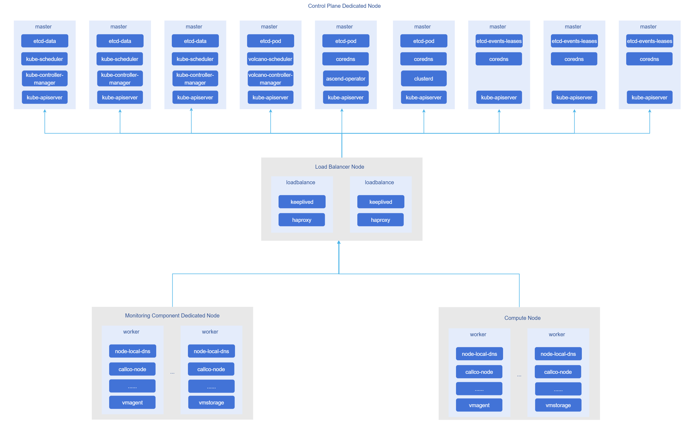
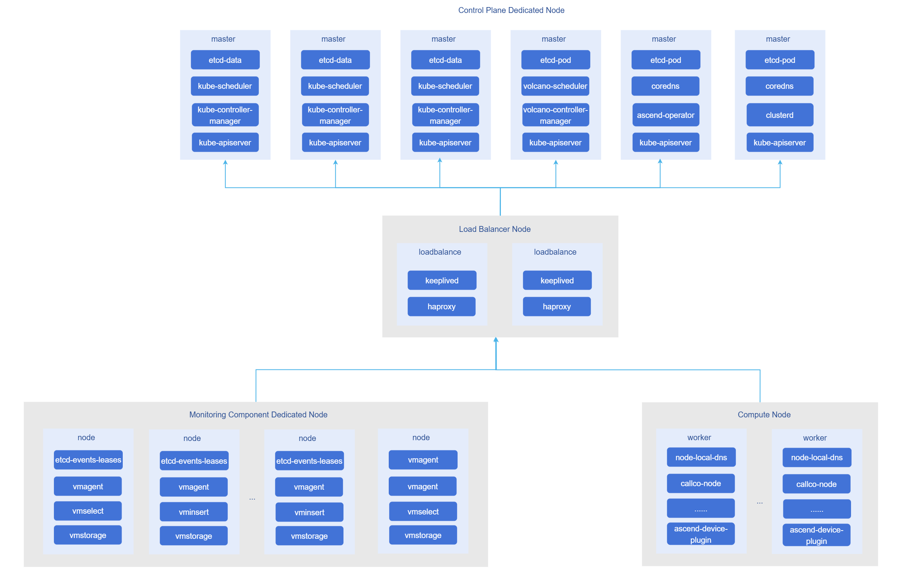

# Best Practices

## Best Practices for Kubernetes Cluster Installation and Deployment

When a cluster reaches a certain scale, the control plane deployed in normal mode has difficulty supporting stable cluster operation. The main reasons are the surge in kube-apiserver request pressure and increased etcd response latency. Therefore, it is necessary to deploy a highly available control plane and split cluster metadata into multiple etcd clusters, while also optimizing parameters for core Kubernetes components to improve control plane stability.

### Objectives

Provide deployment steps for deploying ultra-large-scale cluster control plane and worker nodes, and recommend deployment modes based on node scale.

### Prerequisites

- The operating system is installed on all machines in the cluster to be installed.
- All machines can be logged in using the root user.
- The network is connected between all machines.
- All node environments are clean, with no runc, containerd, docker, docker-ce, kubeadm, kubectl, kubelet, crictl, or other components installed.
- Nodes can install software packages using the yum tool.

### Usage Restrictions

#### Supported Operating Systems

| Operating System | Version | Architecture |
|-----------------|---------|--------------|
| openEuler | 22.03 | ARM64, x86_64 |

> **Note:**<br />Other operating system versions have not been tested and may encounter unexpected issues.

#### Supported Kubernetes Versions

- v1.28: 1.28.15
- v1.33: 1.33.1
- v1.34: 1.34.3

> **Note:**<br />Version 1.33.1 has not undergone system testing and may encounter unexpected issues.

#### Deployment Modes

1. When deploying an ultra-large-scale cluster with 16,000 nodes, it is best to deploy cluster control plane components directly on multi-CPU, large-memory physical machines to prevent control-plane component avalanches due to insufficient resources. It is recommended to deploy control plane components on physical machines with more than 80 CPU cores, more than 500GB of memory, and more than 1TB of storage, using the following architecture:

    

    > **Note:**<br />When the number of cluster nodes exceeds 5,000, the above deployment solution is recommended.

2. When deploying a large-scale cluster with 3k-5k nodes, it is also recommended to deploy cluster control plane components directly on multi-CPU, large-memory physical machines, using the following architecture:



### Procedure

This procedure provides deployment steps for a control plane and worker nodes supporting a 16,000-node cluster. Assume the control plane and some worker node machines are as shown in the following table:

**Table 1:** Control Plane and Worker Node Information

| ip              | hostname | Component                                                                    | Role          | CPU(vCPU) | Memory(GB) |
|-----------------|----------|------------------------------------------------------------------------------|---------------|-----------|------------|
| 192.168.200.240 | node1    | keepalived, haproxy                                                          | loadbalance   | 32        | 64         |
| 192.168.200.239 | node2    | keepalived, haproxy                                                          | loadbalance   | 32        | 64         |
| 192.168.200.238 | node3    | kube-apiserver, etcd(data), kube-controller-manager, kube-scheduler          | master        | 80        | 700        |
| 192.168.200.237 | node4    | kube-apiserver, etcd(data), kube-controller-manager, kube-scheduler          | master        | 80        | 700        |
| 192.168.200.236 | node5    | kube-apiserver, etcd(data), kube-controller-manager, kube-scheduler          | master        | 80        | 700        |
| 192.168.200.235 | node6    | kube-apiserver, etcd(pod), volcano-controller-manager, volcano-scheduler     | master        | 80        | 700        |
| 192.168.200.234 | node7    | kube-apiserver, etcd(pod), coredns, ascend-operator                          | master        | 80        | 700        |
| 192.168.200.233 | node8    | kube-apiserver, etcd(pod), coredns, clusterd                                 | master        | 80        | 700        |
| 192.168.200.232 | node9    | kube-apiserver, etcd(events-leases), coredns                                 | master        | 80        | 700        |
| 192.168.200.231 | node10   | kube-apiserver, etcd(events-leases), coredns                                 | master        | 80        | 700        |
| 192.168.200.230 | node11   | kube-apiserver, etcd(events-leases), coredns                                 | master        | 80        | 700        |
| 192.168.200.229 | node12   | victoriametrics software stack                                               | worker        | 80        | 700        |
| 192.168.200.228 | node13   | victoriametrics software stack                                               | worker        | 80        | 700        |
| 192.168.200.227 | node14   | victoriametrics software stack                                               | worker        | 80        | 700        |
| 192.168.200.226 | node15   | Business components                                                          | worker        | 16        | 32         |
| 192.168.200.225 | node16   | Business components                                                          | worker        | 16        | 32         |
| 192.168.200.224 | node17   | Business components                                                          | worker        | 16        | 32         |
| 192.168.200.223 | node18   | Business components                                                          | worker        | 16        | 32         |
| 192.168.200.222 | -        | -                                                                            | HA Virtual IP | -         | -          |

1. Log in to the node3 node as the root user.

2. Perform basic configuration, disable swap partition, selinux, etc., and install basic component packages. All nodes need to be configured and installed.

    ```shell
    # Disable swap partition
    swapoff -a

    # Disable selinux
    sudo setenforce 0
    sudo sed -i 's/^SELINUX=enforcing$/SELINUX=permissive/' /etc/selinux/config

    # Stop and disable firewall
    systemctl stop firewalld && systemctl disable firewalld

    yum install -y tar wget
    ```

3. Install containerd. Install on all nodes in the cluster except load balancer nodes.

    3.1 Configure bridged network traffic.

    ```shell
    cat <<EOF | sudo tee /etc/modules-load.d/k8s.conf
    overlay
    br_netfilter
    EOF
    
      sudo modprobe overlay
      sudo modprobe br_netfilter
    
    # Set required sysctl parameters, parameters persist across reboots
    cat <<EOF | sudo tee /etc/sysctl.d/k8s.conf
    net.bridge.bridge-nf-call-iptables  = 1
    net.bridge.bridge-nf-call-ip6tables = 1
    net.ipv4.ip_forward                 = 1
    EOF
    
      # Apply sysctl parameters without reboot
      sudo sysctl --system
    
      lsmod | grep br_netfilter 
      lsmod | grep overlay 
    
      sysctl net.bridge.bridge-nf-call-iptables net.bridge.bridge-nf-call-ip6tables net.ipv4.ip_forward
      
      # Configure ipv4 forwarding
      echo "1" >> /proc/sys/net/ipv4/ip_forward
    ```
 
    3.2 Install containerd and configure containerd.service.
    
    ```shell
    ARCH=$(uname -m)
    case $ARCH in
      x86_64) ARCH="amd64";;
      aarch64) ARCH="arm64";;
    esac
    VERSION="1.7.14"
    
    wget https://openfuyao.obs.cn-north-4.myhuaweicloud.com/containerd/containerd/releases/download/v${VERSION}/containerd-${VERSION}-linux-${ARCH}.tar.gz
    tar Cxzvf /usr/local/bin containerd-${VERSION}-linux-${ARCH}.tar.gz
    
    
    wget https://openfuyao.obs.cn-north-4.myhuaweicloud.com/containerd/containerd/releases/download/v{VERSION}/containerd.service
    mkdir -p /usr/local/lib/systemd/system
    # Copy the previously downloaded containerd.service to the corresponding directory
    cp containerd.service /usr/local/lib/systemd/system/
    
    # Reload configuration and enable containerd to start on boot
    sudo systemctl daemon-reload
    ```
    
    3.3 Generate containerd configuration file and modify to use systemd driver and community sandbox image.
    
    ```shell
    mkdir -p /etc/containerd/
    containerd config default > /etc/containerd/config.toml
    # Use systemd cgroup driver
    sed -i 's/SystemdCgroup = false/SystemdCgroup = true/' /etc/containerd/config.toml
    
    # Modify sandbox_image
    sed -i 's|sandbox_image = "registry.k8s.io/pause:3.8"|sandbox_image = "cr.openfuyao.cn/openfuyao/kubernetes/pause:3.9"|' /etc/containerd/config.toml
    ```
    
    3.4 Start containerd and enable it to start on boot.
    
    ```shell
    systemctl enable containerd
    systemctl start containerd
    ```

4. Install runc. Install on all nodes in the cluster.

    ```shell
    ARCH=$(uname -m)
    case $ARCH in
        x86_64) ARCH="amd64";;
        aarch64) ARCH="arm64";;
    esac
    VERSION="1.1.12"

    wget https://openfuyao.obs.cn-north-4.myhuaweicloud.com/opencontainers/runc/releases/download/v${VERSION}/runc-${ARCH}

    install -m 755 runc-${ARCH} /usr/local/sbin/runc
    ```

5. Install cni-plugins. Install on all nodes in the cluster.

    ```shell
    ARCH=$(uname -m)
    case $ARCH in
        x86_64) ARCH="amd64";;
        aarch64) ARCH="arm64";;
    esac
    VERSION="1.4.1"

    wget https://openfuyao.obs.cn-north-4.myhuaweicloud.com/containernetworking/plugins/releases/download/v${VERSION}/cni-plugins-linux-${ARCH}-v${VERSION}.tgz

    mkdir -p /opt/cni/bin
    tar Cxzvf /opt/cni/bin cni-plugins-linux-${ARCH}-v${VERSION}.tgz
    ```

6. Install etcd. Install on all nodes that deploy etcd.

    ```shell
    ARCH=$(uname -m)
    case $ARCH in
        x86_64) ARCH="amd64";;
        aarch64) ARCH="arm64";;
    esac
    VERSION="v3.5.18"

    # Download etcd installation package
    wget https://openfuyao.obs.cn-north-4.myhuaweicloud.com/etcd-io/etcd/releases/download/${VERSION}/etcd-${VERSION}-linux-${ARCH}.tar.gz

    # Install etcd
    tar -xvf etcd-"${VERSION}"-linux-${ARCH}.tar.gz
    cp -rf etcd-"${VERSION}"-linux-${ARCH}/etcd* /usr/local/bin/
    chmod +x /usr/local/bin/{etcd,etcdctl,etcdutl}
    ```

7. Start etcd cluster. Use an automated script to start the etcd cluster. Before starting the cluster, you need to configure password-free login from node3 to all etcd nodes, and install yq and step tools on the node3 node.

    7.1 Install yq tool.
      
    ```shell
    ARCH=$(uname -m)
    case $ARCH in
        x86_64) ARCH="amd64";;
        aarch64) ARCH="arm64";;
    esac
    VERSION="4.43.1"
    
    wget https://openfuyao.obs.cn-north-4.myhuaweicloud.com/mikefarah/yq/releases/download/v${VERSION}/yq_linux_${ARCH}
   
    cp -f yq_linux_${ARCH} /usr/local/bin/
    chmod +x /usr/local/bin/yq
    ```
   
    7.2 Install step tool.
   
    ```shell
    ARCH=$(uname -m)
    case $ARCH in
     x86_64) ARCH="amd64";;
     aarch64) ARCH="arm64";;
    esac
    VERSION="0.28.2"
    
    wget https://openfuyao.obs.cn-north-4.myhuaweicloud.com/smallstep/cli/releases/download/v${VERSION}/step_linux_"${VERSION}"_${ARCH}.tar.gz
    
    tar -xvf step_linux_"${VERSION}"_${ARCH}.tar.gz
    mv step_"${VERSION}"/bin/step /usr/local/bin/step
    chmod +x /usr/local/bin/step
    ```
   
    7.3 Configure password-free login from node3 to other etcd deployment nodes.
    
    ```shell
    # Generate public key, press Enter directly when prompted
    ssh-keygen
    
    # Upload login public key to other etcd nodes
    for ip in 192.168.200.238 192.168.200.237 192.168.200.236 192.168.200.235 192.168.200.234 192.168.200.233 192.168.200.232 192.168.200.231 192.168.200.230; do
     # This will prompt for password, enter password directly and press Enter
     ssh-copy-id -i ~/.ssh/id_rsa.pub root@${ip}
    done
    ```
   
    7.4 Install basic components.
    
    ```shell
    yum install -y systemd-pam
    ```
   
    7.5 Save the following startup script to etcd-bootstrap.sh on node3.
    
    ```shell
    #!/bin/bash
    
    main() {
     local workspace
     local version=3.5.18
     local hosts=()
     local prefix=etcd
     local use_tmpfs=false
     local out_certs=.
     while (($# > 0)); do
         case "$1" in
             -c|--workspace) workspace=$2; shift;;
             --workspace=*) workspace=${1#--workspace=};;
             -V|--version) version=$2; shift;;
             --version=*) version=${1#--version=};;
             -p|--prefix) prefix=$2; shift;;
             --prefix=*) prefix=${1#--prefix=};;
             -t|--use-tmpfs) use_tmpfs=true;;
             -o|--out-certs) out_certs=$2; shift;;
             --out-certs=*) out_certs=${1#--out-certs=};;
             --);;
             -*|--*) echo "Unknown option: $1"; exit 1;;
             *) hosts+=("$1");;
         esac
         shift
     done
    
     local config=$(get_embedded etcd-config)
     local script=$(get_embedded client-script)
     local defrag_script=$(get_embedded defrag-script)
    
     os=$(get_os)
     arch=$(get_arch)
     . <(get_embedded pkgman)
     prepare_ws "$workspace"
     check_prerequisites "$version" "$os" "$arch"
     gen_jwt_auth
     gen_etcd_ca
     echo "$defrag_script" > "local/bin/etcd-defrag.sh"
     chmod +x "local/bin/etcd-defrag.sh"
     local config=$(update_config "$config" "$use_tmpfs" "$(step crypto rand --format=hex)")
     local i host name args
     for i in "${!hosts[@]}"; do
         host=${hosts[$i]}
         name=$prefix-$i
         args=("$script" _ "$use_tmpfs")
         gen_etcd_certs "$name" "$host"
         ssh -o StrictHostKeyChecking=no root@"$host" bash -c "$(printf '%q ' "${args[@]}")" < <(
             create_payload "$(update_peer_config "$config" "$name" "$host")"
         )
     done
     gen_apiserver_cert
     output_certs "$out_certs"
    
     exit
    }
    
    get_os() {
     local os=$(uname | tr '[:upper:]' '[:lower:]')
     case "$os" in
         darwin) echo 'darwin';;
         linux) echo 'linux';;
         freebsd) echo 'freebsd';;
         mingw*|msys*|cygwin*) echo 'windows';;
         *) echo "Unsupported OS: ${os}" >&2; exit 1;;
     esac
    }
    
    get_arch() {
     local arch=$(uname -m)
     case "$arch" in
         amd64|x86_64) echo 'amd64';;
         i386) echo '386';;
         ppc64) echo 'ppc64';;
         ppc64le) echo 'ppc64le';;
         s390x) echo 's390x';;
         armv6*|armv7*) echo 'arm';;
         aarch64) echo 'arm64';;
         *) echo "Unsupported architecture: ${arch}" >&2; exit 1;;
     esac
    }
    
    get_embedded() {
     local embedded=$1
     sed -n "/^# >>>>> BEGIN $embedded\$/,/^# <<<<< END $embedded\$/{//!p}" "$0" | head -n-1 | tail -n+2
    }
    
    prepare_ws() {
     local workspace=$1
     local ws=${workspace:-$(mktemp -d)}
     export PATH=$PATH:$ws/bin
     [ -z "$workspace" ] &&
         trap "{
             cd /
             rm -rf '$ws'
         }" EXIT
     mkdir -p "$ws" && cd "$ws"
     mkdir -p bin local/{bin,{etc,share}/etcd}
    }
    
    check_prerequisites() {
     local version=$1
     local os=$2
     local arch=$3
     cat <<'EOF' > "step-ca.json"
    {
     "subject": {{toJson .Subject}},
     "issuer": {{toJson .Subject}},
     "keyUsage": ["digitalSignature", "keyEncipherment", "certSign"],
     "basicConstraints": {
         "isCA": true
     }
    }
    EOF
     cat <<'EOF' > "step-leaf.json"
    {
     "subject": {{toJson .Subject}},
     "sans": {{toJson .SANs}},
     "keyUsage": ["digitalSignature", "keyEncipherment"],
     "extKeyUsage": ["serverAuth", "clientAuth"]
    }
    EOF
    }
    
    gen_jwt_auth() {
     step crypto keypair local/share/etcd/jwt_ec384{.pub,} \
         --kty=EC --crv=P-384 \
         -f --insecure --no-password
    }
    
    gen_etcd_ca() {
     [ -f "etcd-ca.crt" ] && [ -f "etcd-ca.key" ] ||
         step certificate create etcd-ca etcd-ca.{crt,key} \
             --kty=OKP --crv=Ed25519 \
             --not-after=87600h \
             --template "step-ca.json" \
             -f --insecure --no-password
     cp -alf {etcd-,local/share/etcd/}ca.crt
    }
    
    gen_etcd_certs() {
     local name=$1
     local host=$2
     step certificate create "$name" local/share/etcd/server.{crt,key} \
         --kty=OKP --crv=Ed25519 \
         --ca="etcd-ca.crt" --ca-key="etcd-ca.key" \
         --not-after=87600h \
         --san="$name" --san=localhost --san=127.0.0.1 --san=0:0:0:0:0:0:0:1 --san="$host" \
         --template "step-leaf.json" \
         -f --insecure --no-password
     step certificate create "$name" local/share/etcd/peer.{crt,key} \
         --kty=OKP --crv=Ed25519 \
         --ca="etcd-ca.crt" --ca-key="etcd-ca.key" \
         --not-after=87600h \
         --san="$name" --san=localhost --san=127.0.0.1 --san=0:0:0:0:0:0:0:1 --san="$host" \
         --template "step-leaf.json" \
         -f --insecure --no-password
    }
    
    gen_apiserver_cert() {
     step certificate create apiserver-etcd-client apiserver-etcd-client.{crt,key} \
         --kty=OKP --crv=Ed25519 \
         --ca="etcd-ca.crt" --ca-key="etcd-ca.key" \
         --not-after=87600h \
         --template "step-leaf.json" \
         -f --insecure --no-password
    }
    
    create_payload() {
     local config=$1
     echo "$config" > "local/etc/etcd/config.yaml.tmpl"
     tar Cczf "local" - bin etc share
    }
    
    output_certs() {
     local out=$1
     tar czf "$out/etcd-certs.tar.gz" {etcd-ca,apiserver-etcd-client}.{crt,key}
    }
    
    update_config() {
     local config=$1
     local use_tmpfs=$2
     local token=$3
     local i cluster
     for i in "${!hosts[@]}"; do
         cluster="$cluster$prefix-$i=https://${hosts[$i]}:2380,"
     done
     cluster=${cluster::-1}
     config=$(yq "
         .initial-cluster = \"$cluster\" |
         .initial-cluster-token = \"$token\"
     " <<< "$config")
     if "$use_tmpfs"; then
         yq "
             .quota-backend-bytes = 8589934592 |
             .backend-batch-interval = 10000000 |
             .backend-batch-limit = 100 |
             .auto-compaction-mode = \"periodic\"
         " <<< "$config"
     else
         yq "
             .quota-backend-bytes = 68719476736 |
             .backend-batch-interval = 100000000 |
             .backend-batch-limit = 1000 |
             .auto-compaction-mode = \"\"
         " <<< "$config"
     fi
    }
    
    update_peer_config() {
     local config=$1
     local name=$2
     local host=$3
     yq "
         .name = \"$name\" |
         .listen-peer-urls = \"https://$host:2380\" |
         .listen-client-urls = \"https://$host:2379,https://localhost:2379\" |
         .initial-advertise-peer-urls = \"https://$host:2380\" |
         .advertise-client-urls = \"https://$host:2379\"
     " <<< "$config"
    }
    
    main "$@"
    
    # >>>>> BEGIN client-script
    
    set -e
    
    # >>>>> BEGIN pkgman
    
    has_cmd() {
     command -v "$1" &> /dev/null
    }
    
    _install_pkg_apt() {
     apt install -y --no-install-recommends "$@"
    }
    
    _install_pkg_dnf() {
     dnf install -y --setopt=install_weak_deps=False "$@"
    }
    
    _has_pkg_apt() {
     dpkg --get-selections | awk '{print $1}' | grep -qE "^$1(:|$)"
    }
    
    _has_pkg_dnf() {
     dnf list --installed | awk -F. '{print $1}' | grep -qE "^$1$"
    }
    
    _pkg_of_file_apt() {
     local file=$1
     pkg=$(dpkg -S "$file" | awk -F: '{print $1}')
     if [ -z "$pkg" ]; then
         echo "No package found for file: $file"
         exit 1
     fi
     echo "$pkg"
    }
    
    _pkg_of_file_dnf() {
     local file=$1
     if ! dnf repoquery -q --whatprovides "$file" --qf '%{name}'; then
         echo "No package found for file: $file"
         exit 1
     fi
    }
    
    shopt -s expand_aliases
    for pkgman in apt dnf; do
     if has_cmd "$pkgman"; then
         alias install_pkg="_install_pkg_$pkgman"
         alias has_pkg="_has_pkg_$pkgman"
         alias pkg_of_file="_pkg_of_file_$pkgman"
         break
     fi
    done
    if ! has_cmd install_pkg; then
     echo "Unsupported package manager"
     exit 1
    fi
    
    # <<<<< END pkgman
    
    use_tmpfs=$1
    
    if [ "$(id -u)" != 0 ]; then
     echo "client install script must be run as root"
     exit 1
    fi
    
    has_cmd systemctl ||
     install_pkg systemd
    has_cmd envsubst ||
     install_pkg gettext
    has_cmd tar ||
     install_pkg tar
    has_cmd python3 ||
     install_pkg python3
    has_cmd mkfs.xfs ||
     install_pkg xfsprogs
    systemctl daemon-reload
    
    export ETCD_DATA_DIR=/usr/local/share/etcd
    export ETCD_CONFIG_DIR=/usr/local/etc/etcd
    export ETCD_STATE_DIR=/var/lib/etcd
    export ETCD_LOG_DIR=/var/log/etcd
    
    [ -f "$ETCD_STATE_DIR/.disk-uuid" ] &&
     uuid=$(< "$ETCD_STATE_DIR/.disk-uuid")
    
    rm -rf --one-file-system "$ETCD_STATE_DIR" || true
    rm -rf "$ETCD_STATE_DIR/member"/{.,}* || true
    
    mkdir -p "$ETCD_STATE_DIR"
    echo "$uuid" > "$ETCD_STATE_DIR/.disk-uuid"
    tar Cxzf "/usr/local" -
    
    units=(etcd-defrag.timer etcd.service var-lib-etcd-member.mount)
    for unit in "${units[@]}"; do
     unit_file=/etc/systemd/system/$unit
     if [ -f "$unit_file" ]; then
         systemctl disable --now "$unit" || true
         rm -f "$unit_file"
     fi
    done
    systemctl daemon-reload
    
    if grep -q "$ETCD_STATE_DIR/member " /etc/mtab; then
     umount "$ETCD_STATE_DIR/member" || true
     sed -i "\\:$ETCD_STATE_DIR/member :d" /etc/fstab
    fi
    
    envsubst < "$ETCD_CONFIG_DIR/config.yaml.tmpl" > "$ETCD_CONFIG_DIR/config.yaml"
    
    cat <<EOF > /usr/local/sbin/etcd-tune.sh
    #!/bin/bash -x
    [ -e /sys/devices/system/cpu/cpu0/cpufreq/scaling_governor ] &&
     echo performance | tee /sys/devices/system/cpu/cpu*/cpufreq/scaling_governor > /dev/null
    EOF
    chmod +x /usr/local/sbin/etcd-tune.sh
    cat <<EOF > /etc/systemd/system/etcd-tune.service
    [Unit]
    Description=etcd tuning
    After=local-fs.target var-lib-etcd-member.mount
    Wants=local-fs.target var-lib-etcd-member.mount
    
    [Service]
    ExecStart=/usr/local/sbin/etcd-tune.sh
    Type=oneshot
    RemainAfterExit=yes
    
    [Install]
    WantedBy=default.target
    EOF
    
    chmod 700 "$ETCD_STATE_DIR"
    mkdir -p "$ETCD_STATE_DIR/member"
    if "$use_tmpfs"; then
     cat <<EOF > "/etc/systemd/system/var-lib-etcd-member.mount"
    [Unit]
    Description=etcd data disk
    Before=local-fs.target
    
    [Mount]
    What=tmpfs
    Where=$ETCD_STATE_DIR/member
    Type=tmpfs
    Options=nosuid,nodev,uid=0,gid=0,mode=700,size=16384M
    TimeoutSec=60s
    
    [Install]
    WantedBy=multi-user.target
    EOF
    else
     [ -n "$uuid" ] && [ -h "/dev/disk/by-uuid/$uuid" ] &&
         dev=$(realpath "/dev/disk/by-uuid/$uuid")
     if [ -z "$dev" ] || [ "$(blkid "$dev" | sed -E 's/.* TYPE="([^"]+)".*/\1/')" != xfs ]; then
         dev=
         for blk in $(lsblk -o NAME,MOUNTPOINT | awk '{if ($2 == "") print $1}'); do
             set +e
             [ -b "/dev/$blk" ] &&
                 blkid "/dev/$blk"
             status=$?
             set -e
             if [ "$status" == 2 ]; then
                 dev=/dev/$blk
                 echo "found unpartitioned disk: $dev"
                 uuid=$(cat /proc/sys/kernel/random/uuid)
                 mkfs.xfs -f "$dev" -m "uuid=$uuid"
                 echo "$uuid" > "$ETCD_STATE_DIR/.disk-uuid"
                 udevadm settle
                 # Mount disk
                 cat <<EOF > "/etc/systemd/system/var-lib-etcd-member.mount"
    [Unit]
    Description=etcd data disk
    Before=local-fs.target
    
    [Mount]
    What=/dev/disk/by-uuid/$uuid
    Where=$ETCD_STATE_DIR/member
    Type=xfs
    Options=nosuid,nodev,noatime,nodiratime
    TimeoutSec=60s
    
    [Install]
    WantedBy=multi-user.target
    EOF
               serial=$(udevadm info -n "$dev" | grep ID_SERIAL= | awk -F= '{print $2}')
               mkdir -p /usr/local/sbin
               # Set disk to write-through mode to avoid data loss
               cat <<EOF >> /usr/local/sbin/etcd-tune.sh
    serial=$serial
    devname=\$(find /dev/disk/by-id -regex ".*-\$serial$")
    devpath=/sys\$(udevadm info -n "\$devname" | grep devpath= | awk -F= '{print \$2}')
    echo 'write through' > "\$(find -L "\$devpath" -name cache_type -print -quit 2> /dev/null)"
    EOF
                 break
             fi
         done
         if [ -z "$dev" ]; then
             echo 'no unpartitioned disk found, use / to store etcd data'
             mkdir -p "$ETCD_STATE_DIR/member"
             dev="$ETCD_STATE_DIR/member"
         fi
     fi
    fi
    echo 'exit 0' >> /usr/local/sbin/etcd-tune.sh
    
    mkdir -p "/etc/systemd/system"
    cat <<EOF > "/etc/systemd/system/etcd.service"
    [Unit]
    Description=etcd
    After=network-online.target local-fs.target remote-fs.target time-sync.target
    Wants=network-online.target local-fs.target remote-fs.target time-sync.target
    
    [Service]
    Type=simple
    ExecStart=/usr/local/bin/etcd --config-file=$ETCD_CONFIG_DIR/config.yaml
    TimeoutSec=0
    Restart=always
    RestartSec=3
    StartLimitBurst=20
    StartLimitInterval=60s
    #LimitNOFILE=infinity
    #LimitNPROC=infinity
    #LimitCORE=infinity
    #TasksMax=infinity
    Delegate=yes
    KillMode=mixed
    # Set CPU priority
    CPUSchedulingPolicy=rr
    CPUSchedulingPriority=99
    # Set I/O priority
    IOSchedulingClass=realtime
    IOSchedulingPriority=0
    
    [Install]
    WantedBy=default.target
    EOF
    cat <<EOF > "/etc/systemd/system/etcd-defrag.service"
    [Unit]
    Description=etcd auto compact/defrag
    After=etcd.service
    Wants=etcd.service etcd-defrag.timer
    
    [Service]
    Environment=ETCD_CONFIG_DIR=$ETCD_CONFIG_DIR
    Environment=ETCDCTL_CACERT=$ETCD_DATA_DIR/ca.crt
    Environment=ETCDCTL_CERT=$ETCD_DATA_DIR/server.crt
    Environment=ETCDCTL_KEY=$ETCD_DATA_DIR/server.key
    ExecStart=/usr/local/bin/etcd-defrag.sh
    Type=oneshot
    
    [Install]
    WantedBy=default.target
    EOF
    cat <<EOF > "/etc/systemd/system/etcd-defrag.timer"
    [Unit]
    Description=etcd auto compact/defrag timer
    
    [Timer]
    Unit=etcd-defrag.service
    OnCalendar=*-*-* *:00/5:00
    
    [Install]
    WantedBy=timers.target
    EOF
    
    for file in /etc/{bash.bashrc,profile.d/etcdctl.sh}; do
     [ -f "$file" ] &&
         sed -i '/^# BEGIN external-etcd-envs$/,/^# END external-etcd-envs$/d' "$file"
     cat <<EOF >> "$file"
    
    # BEGIN external-etcd-envs
    # The following lines are managed by external etcd installer, please do not modify them manually.
    export ETCD_DATA_DIR=$ETCD_DATA_DIR
    export ETCD_CONFIG_DIR=$ETCD_CONFIG_DIR
    export ETCD_STATE_DIR=$ETCD_STATE_DIR
    export ETCD_LOG_DIR=$ETCD_LOG_DIR
    export ETCDCTL_CACERT=\$ETCD_DATA_DIR/ca.crt
    export ETCDCTL_CERT=\$ETCD_DATA_DIR/server.crt
    export ETCDCTL_KEY=\$ETCD_DATA_DIR/server.key
    # END external-etcd-envs
    EOF
    done
    
    mkdir -p "$ETCD_LOG_DIR"
    systemctl daemon-reload
    mapfile -td '' units < <(printf '%s\0' "${units[@]}" | tac -s '')
    for unit in "${units[@]}"; do
     if systemctl list-unit-files | grep -q "^$unit"; then
         systemctl enable --now "$unit"
     else
         echo "Warning: unit $unit not found, skipping"
     fi
    done
    
    # <<<<< END client-script
    
    # >>>>> BEGIN etcd-config
    
    # Human-readable name for this member.
    name: etcd
    
    # Path to the data directory.
    data-dir: ${ETCD_STATE_DIR}
    
    # Path to the dedicated wal directory.
    # wal-dir: ${ETCD_STATE_DIR}/member-wal/wal
    
    # List of URLs to listen on for peer traffic.
    listen-peer-urls: https://localhost:2380
    
    # List of URLs to listen on for client grpc traffic (and http as long as --listen-client-http-urls is not specified).
    listen-client-urls: https://localhost:2379
    
    # List of this member's peer URLs to advertise to the rest of the cluster.
    initial-advertise-peer-urls: https://localhost:2380
    
    # List of this member's client URLs to advertise to the public. The client URLs advertised should be accessible to
    # machines that talk to etcd cluster. etcd client libraries parse these URLs to connect to the cluster.
    advertise-client-urls: https://localhost:2379
    
    # Initial cluster configuration for bootstrapping.
    initial-cluster: etcd-0=https://etcd-0:2380,etcd-1=https://etcd-1:2380,etcd-2=https://etcd-2:2380
    
    # Initial cluster state ('new' when bootstrapping a new cluster or 'existing' when adding new members to an existing
    # cluster). After successful initialization (bootstrapping or adding), flag is ignored on restarts.
    initial-cluster-state: new
    
    # Initial cluster token for the etcd cluster during bootstrap. Specifying this can protect you from unintended
    # cross-cluster interaction when running multiple clusters.
    initial-cluster-token: random-token
    
    # Number of committed transactions to trigger a snapshot to disk.
    snapshot-count: 100000 # **
    
    # Time (in milliseconds) of a heartbeat interval.
    heartbeat-interval: 250 # **
    
    # Time (in milliseconds) for an election to timeout. See tuning documentation for details.
    election-timeout: 2500 # **
    
    # Whether to fast-forward initial election ticks on boot for faster election.
    initial-election-tick-advance: true
    
    # Maximum number of snapshot files to retain (0 is unlimited).
    max-snapshots: 10 # **
    
    # Maximum number of wal files to retain (0 is unlimited).
    max-wals: 10 # **
    
    # Raise alarms when backend size exceeds the given quota (0 defaults to low space quota).
    quota-backend-bytes: 34359738368 # **
    
    # Maximum time before commit the backend transaction.
    backend-batch-interval: 100000000 # **
    
    # Maximum operations before commit the backend transaction.
    backend-batch-limit: 1000 # **
    
    # Maximum number of operations permitted in a transaction.
    max-txn-ops: 16000 # **
    
    # Maximum client request size in bytes the server will accept.
    max-request-bytes: 128000000 # **
    
    # Maximum concurrent streams that each client can open at a time.
    max-concurrent-streams: 20000 # **
    
    # Enable GRPC gateway.
    enable-grpc-gateway: true
    
    # Minimum duration interval that a client should wait before pinging server.
    grpc-keepalive-min-time: 5000000000 # **
    
    # Frequency duration of server-to-client ping to check if a connection is alive (0 to disable).
    grpc-keepalive-interval: 7200000000000 # **
    
    # Additional duration of wait before closing a non-responsive connection (0 to disable).
    grpc-keepalive-timeout: 20000000000 # **
    
    # Enable to run an additional Raft election phase.
    pre-vote: true
    
    # Auto compaction retention length. 0 means disable auto compaction.
    auto-compaction-retention: '0' # **
    
    # Interpret 'auto-compaction-retention', one of: periodic|revision. 'periodic' for duration based retention, defaulting
    # to hours if no time unit is provided (e.g. '5m'). 'revision' for revision number based retention.
    auto-compaction-mode: periodic # **
    
    client-transport-security:
    # Path to the client server TLS cert file.
    cert-file: ${ETCD_DATA_DIR}/server.crt
    
    # Path to the client server TLS key file.
    key-file: ${ETCD_DATA_DIR}/server.key
    
    # Enable client cert authentication.
    client-cert-auth: true
    
    # Path to the client server TLS trusted CA cert file.
    trusted-ca-file: ${ETCD_DATA_DIR}/ca.crt
    
    peer-transport-security:
    # Path to the peer server TLS cert file.
    cert-file: ${ETCD_DATA_DIR}/peer.crt
    
    # Path to the peer server TLS key file.
    key-file: ${ETCD_DATA_DIR}/peer.key
    
    # Enable peer client cert authentication.
    client-cert-auth: true
    
    # Path to the peer server TLS trusted CA cert file.
    trusted-ca-file: ${ETCD_DATA_DIR}/ca.crt
    
    # List of supported TLS cipher suites between client/server and peers (empty will
    # be auto-populated by Go).
    cipher-suites:
    - TLS_AES_128_GCM_SHA256
    - TLS_AES_256_GCM_SHA384
    - TLS_CHACHA20_POLY1305_SHA256
    - TLS_ECDHE_RSA_WITH_AES_128_GCM_SHA256
    - TLS_ECDHE_RSA_WITH_AES_256_GCM_SHA384
    - TLS_ECDHE_RSA_WITH_CHACHA20_POLY1305_SHA256
    - TLS_ECDHE_ECDSA_WITH_AES_128_GCM_SHA256
    - TLS_ECDHE_ECDSA_WITH_AES_256_GCM_SHA384
    - TLS_ECDHE_ECDSA_WITH_CHACHA20_POLY1305_SHA256
    
    # Minimum TLS version supported by etcd. Possible values: TLS1.2, TLS1.3.
    tls-min-version: TLS1.2
    
    # Maximum TLS version supported by etcd. Possible values: TLS1.2, TLS1.3 (empty will be auto-populated by Go).
    tls-max-version: TLS1.3
    
    # Specify a v3 authentication token type and its options ('simple' or 'jwt').
    auth-token: jwt,pub-key=${ETCD_DATA_DIR}/jwt_ec384.pub,priv-key=${ETCD_DATA_DIR}/jwt_ec384,sign-method=ES384,ttl=3600s
    
    # Specify the cost / strength of the bcrypt algorithm for hashing auth passwords. Valid values are between 4 and 31.
    bcrypt-cost: 10
    
    # Currently only supports 'zap' for structured logging.
    logger: zap
    
    # Specify 'stdout' or 'stderr' to skip journald logging even when running under systemd, or list of output targets.
    log-outputs:
    - ${ETCD_LOG_DIR}/etcd.log
    
    # Configures log level. Only supports debug, info, warn, error, panic, or fatal.
    log-level: info
    
    # Enable log rotation of a single log-outputs file target.
    enable-log-rotation: true
    
    # Configures log rotation if enabled with a JSON logger config. MaxSize(MB), MaxAge(days, 0=no limit),
    # MaxBackups(0=no limit), LocalTime(use computers local time), Compress(gzip).
    log-rotation-config-json: '{"maxsize": 128, "maxage": 7, "maxbackups": 1024, "localtime": true, "compress": true}'
    
    # ExperimentalEnableLeaseCheckpoint enables primary lessor to persist lease remainingTTL to prevent indefinite
    # auto-renewal of long lived leases.
    experimental-enable-lease-checkpoint: true
    
    # Enable persisting remainingTTL to prevent indefinite auto-renewal of long lived leases. Always enabled in v3.6.
    # Should be used to ensure smooth upgrade from v3.5 clusters with this feature enabled. Requires
    # experimental-enable-lease-checkpoint to be enabled.
    experimental-enable-lease-checkpoint-persist: true
    
    # Disables fsync, unsafe, will cause data loss.
    unsafe-no-fsync: false
    
    # <<<<< END etcd-config
    
    # >>>>> BEGIN defrag-script
    
    #!/bin/bash -x
    SNAPSHOT_THRESHOLD=${SNAPSHOT_THRESHOLD:-90}
    DEFRAG_THRESHOLD=${DEFRAG_THRESHOLD:-90}
    (( SNAPSHOT_THRESHOLD >= 100 )) &&
     SNAPSHOT_THRESHOLD=90
    (( SNAPSHOT_THRESHOLD <= 0 )) &&
     SNAPSHOT_THRESHOLD=90
    (( DEFRAG_THRESHOLD >= 100 )) &&
     DEFRAG_THRESHOLD=90
    (( DEFRAG_THRESHOLD <= 0 )) &&
     DEFRAG_THRESHOLD=90
    . "$HOME/.profile"
    disk_quota=$(yq -r '.quota-backend-bytes' "$ETCD_CONFIG_DIR/config.yaml")
    read disk_size db_size revision < <(
     etcdctl endpoint status -w json | yq -r '.0.Status | .dbSize + " " + .dbSizeInUse + " " + .header.revision'
    )
    db_usage=$((100 * db_size / disk_size))
    disk_usage=$((100 * disk_size / disk_quota))
    (( db_usage >= SNAPSHOT_THRESHOLD )) &&
     etcdctl compact "$revision"
    (( disk_usage >= DEFRAG_THRESHOLD )) &&
     etcdctl defrag
    exit 0
    
    # <<<<< END defrag-script
    
    ```
   
    7.6 Start etcd data cluster.
    
    ```shell
    mkdir /root/etcd-install
    
    # Replace with actual IP addresses
    bash etcd-bootstrap.sh <etcd data node IPs, e.g.: 192.168.200.238 192.168.200.237 192.168.200.236> -c /root/etcd-install -p etcdData
    ```
    
    7.7 Start etcd Pod cluster.
    
    ```shell
    mkdir /root/etcd-install
    
    # Replace with actual IP addresses
    bash etcd-bootstrap.sh <etcd data node IPs, e.g.: 192.168.200.235 192.168.200.234 192.168.200.233> -c /root/etcd-install -p etcdPods
    ```
   
    7.8 Start etcd events-leases cluster.
    
    ```shell
    mkdir /root/etcd-install
    
    # Replace with actual IP addresses
    bash etcd-bootstrap.sh <etcd data node IPs, e.g.: 192.168.200.232 192.168.200.231 192.168.200.230> -c /root/etcd-install -p etcdPods --use-tmpfs
    ```
   
    7.9 Confirm whether etcd is started.
    - Execute `systemctl status etcd` on all etcd nodes. If the word `running` appears, etcd has started.
    
    7.10 Execute the following command on all etcd nodes to check whether the etcd cluster is healthy:
    - If all entries in the `HEALTH` column in the output table are true, the cluster is healthy.
    
    ```shell
    ETCDCTL_API=3 etcdctl --endpoints=https://127.0.0.1:2379 \
    --cacert=/usr/local/share/etcd/ca.crt \     # Replace with actual certificate path
    --cert=/usr/local/share/etcd/server.crt \   # Replace with actual certificate path
    --key=/usr/local/share/etcd/server.key \    # Replace with actual certificate path
    endpoint health --write-out=table
    ```
   
    7.11 Copy etcd certificates to the `/etc/kubernetes/pki` directory.
    
    ```shell
    tar -xf /root/etcd-install/etcd-certs.tar.gz
    
    mkdir -p /etc/kubernetes/pki/etcd
    cp /root/etcd-install/apiserver-etcd-client.{crt,key} /etc/kubernetes/pki/
    cp /root/etcd-install/etcd-ca.{crt,key} /etc/kubernetes/pki/etcd
    ```

8. Install kubeadm. Install on all nodes in the cluster.

```shell
ARCH=$(uname -m)
case $ARCH in
x86_64) ARCH="amd64";;
aarch64) ARCH="arm64";;
esac
VERSION="1.28.15-large-scale-cluster"

wget https://openfuyao.obs.cn-north-4.myhuaweicloud.com/kubernetes/kubernetes/releases/download/v${VERSION}/bin/linux/${ARCH}/kubeadm

cp kubeadm /usr/local/bin
chmod +x /usr/local/bin/kubeadm

wget https://openfuyao.obs.cn-north-4.myhuaweicloud.com/kubernetes/kubernetes/releases/download/v${VERSION}/cmd/krel/templates/latest/kubeadm/10-kubeadm.conf
sed "s:/usr/bin:/usr/local/bin:g" 10-kubeadm.conf | sudo tee /etc/systemd/system/kubelet.service.d/10-kubeadm.conf
```

9. Install kubelet and configure service file. Install on all nodes in the cluster.

```shell
ARCH=$(uname -m)
case $ARCH in
x86_64) ARCH="amd64";;
aarch64) ARCH="arm64";;
esac
VERSION="1.28.15-large-scale-cluster"

wget https://openfuyao.obs.cn-north-4.myhuaweicloud.com/kubernetes/kubernetes/releases/download/v${VERSION}/bin/linux/${ARCH}/kubelet

cp kubelet /usr/local/bin
chmod +x /usr/local/bin/kubelet

wget https://openfuyao.obs.cn-north-4.myhuaweicloud.com/kubernetes/kubernetes/releases/download/v${VERSION}/cmd/krel/templates/latest/kubelet/kubelet.service

mkdir -p /etc/systemd/system/kubelet.service.d
sed "s:/usr/bin:/usr/local/bin:g" kubelet.service | sudo tee /etc/systemd/system/kubelet.service
```

10. Install kubectl. Install on all nodes in the cluster.

```shell
ARCH=$(uname -m)
case $ARCH in
x86_64) ARCH="amd64";;
aarch64) ARCH="arm64";;
esac
VERSION="1.28.15-large-scale-cluster"

wget https://openfuyao.obs.cn-north-4.myhuaweicloud.com/kubernetes/kubernetes/releases/download/v${VERSION}/bin/linux/${ARCH}/kubectl

cp kubelet /usr/local/bin
chmod +x /usr/local/bin/kubectl
```

11. Install crictl. Install on all nodes in the cluster.

```shell
ARCH=$(uname -m)
case $ARCH in
x86_64) ARCH="amd64";;
aarch64) ARCH="arm64";;
esac
VERSION="1.28.0"

wget https://openfuyao.obs.cn-north-4.myhuaweicloud.com/kubernetes-sigs/cri-tools/releases/download/v${VERSION}/crictl-v${VERSION}-linux-${ARCH}.tar.gz

tar Cxzvf /usr/local/bin crictl-v${VERSION}-linux-${ARCH}.tar.gz
```

12. Install load balancer. Install only on load balancer nodes.

    12.1 Install haproxy and keepalived components.
    
    ```shell
    yum install haproxy keepalived -y
    ```
    
    12.2 Modify haproxy configuration file, add load balancing for kube-apiserver, etc. Edit the `vi /etc/haproxy/haproxy.cfg` file. The configuration file example after modification is as follows:
    
    ```shell
    #---------------------------------------------------------------------
    # Example configuration for a possible web application.  See the
    # full configuration options online.
    #
    #   https://www.haproxy.org/download/1.8/doc/configuration.txt
    #
    #---------------------------------------------------------------------
    
    global
      log         127.0.0.1 local2  # Log output configuration
      chroot      /var/lib/haproxy  # chroot run path
      pidfile     /var/run/haproxy.pid  # Process pid file
      user        haproxy  # User running haproxy
      group       haproxy  # User group running haproxy
      daemon  # Run as daemon process
      maxconn     400000  # Default maximum connections (maximum concurrent connections for single process)
    
    defaults
      mode                    http  # Processing level (layer 7 proxy http, layer 4 tcp)
      log                     global # Use the log format defined in global
      option                  httplog  # Log category is http log format
      option                  dontlognull  # Do not log health check information
      retries                 3  # 3 connection failures consider server unavailable
      timeout queue           1m  # Default queue timeout
      timeout connect         5s  # Default connection timeout
      timeout client          1m  # Default client timeout
      timeout server          1m  # Default server connection timeout
      timeout http-keep-alive 5s  # Default persistent connection timeout
      timeout check           5s  # Set heartbeat check timeout
    
    frontend main
      mode tcp  # Proxy mode, certificates use backend's
      bind *:6443  # Bind IP and port, proxy requests sent to this port to backend servers
      default_backend         k8s-apiserver  # Backend server, use default backend when use_backend not specified
    
    backend k8s-apiserver
      mode tcp
      balance     roundrobin  # Load balancing algorithm for backend server group
      option httpchk GET /readyz
      http-check expect status 200
      server  k8s-master01 192.168.200.238:6443 check check-ssl verify none # Only modify IP
      server  k8s-master02 192.168.200.237:6443 check check-ssl verify none # Only modify IP
      server  k8s-master03 192.168.200.236:6443 check check-ssl verify none # Only modify IP
      server  k8s-master04 192.168.200.235:6443 check check-ssl verify none # Only modify IP
      server  k8s-master05 192.168.200.234:6443 check check-ssl verify none # Only modify IP
      server  k8s-master06 192.168.200.233:6443 check check-ssl verify none # Only modify IP
      server  k8s-master07 192.168.200.232:6443 check check-ssl verify none # Only modify IP
      server  k8s-master08 192.168.200.231:6443 check check-ssl verify none # Only modify IP
      server  k8s-master09 192.168.200.230:6443 check check-ssl verify none # Only modify IP
    ```
    
    12.3 Start haproxy and enable it to start on boot.
    
    ```shell
    systemctl enable haproxy
    systemctl start haproxy
    ```
    
    12.4 Modify keepalived configuration. Edit the `vi /etc/keepalived/keepalived.conf` file. The configuration file example after modification is as follows:
    
    ```shell
    vrrp_script chk_haproxy {  # Configure detection script, check haproxy status every 3s, three consecutive failures mean haproxy unavailable on this node, two consecutive successes mean available.
    script "killall -0 haproxy"
    interval 3
    weight 100
    fall 3
    rise 2
    }
    
    vrrp_script chk_apiserver {  # Configure detection script, check cluster accessibility every 3s, three consecutive failures mean haproxy unavailable on this node, two consecutive successes mean available.
    script "/etc/keepalived/check_apiserver.sh"
    interval 3
    weight -100
    fall 3
    rise 2
    }
    
    vrrp_instance VI_1 {  # vrrp instance
      state BACKUP  # Server state
      interface eth0  # Bound network interface, fill in actual network interface on server
      virtual_router_id 32  # Set VRID here, very important, same VRID is a group, determines multicast MAC address
      priority 100  # Weight 0~255
      advert_int 1  # Set synchronization time between MASTER and BACKUP load balancers, i.e., interval for checking communication between master and backup, in seconds, default 1s
      nopreempt  # Set non-preemptive master, can only be set on nodes with state backup and this node's priority must be higher than others. For example, if master transfers scheduling power to backup server due to exception, after master is repaired, if nopreempt is not set, it will regain scheduling power, which can easily cause business interruption
      authentication {
          auth_type PASS
          auth_pass 1111
      }
      virtual_ipaddress {
          192.168.200.241/24 dev eth0  # Modify to actual floating IP and network interface name
      }
      track_script {  # Execute script
          chk_haproxy
          chk_apiserver
      }
    }
    
    vrrp_instance VI_2 {
      state BACKUP
      interface eth0  # Bound network interface, fill in actual network interface on server
      virtual_router_id 33
      priority 100
      advert_int 1
      nopreempt
      authentication {
          auth_type PASS
          auth_pass 1111
      }
      virtual_ipaddress {
          192.168.200.241/24 dev eth0  # Modify to actual floating IP and network interface name
      }
      track_script {  # Execute script
          chk_haproxy
          chk_apiserver
      }
    }
    ```
    
    12.5 Configure cluster status check script. Edit `vi /etc/keepalived/check_apiserver.sh` and fill in the following content.
    
    ```shell
    #!/bin/sh
    VIP_ADDRESS="192.168.200.241"  # Fill in the frontend virtual IP address bound by haproxy
    VIP_BIND_PORT="6443"           # Fill in the frontend port bound by haproxy
    if ip addr | grep -q ${VIP_ADDRESS}; then
      curl --silent --max-time 2 --insecure https://${VIP_ADDRESS}:${VIP_BIND_PORT}/healthz 
      exit $?
    fi
    exit 0
    ```
    
    12.6 Start keepalived and enable it to start on boot.
    
    ```shell
    systemctl enable keepalived
    systemctl start keepalived
    ```

13. Install basic component packages and load ipvs kernel modules. All nodes in the cluster need to install and configure.

```shell
# Install basic component packages
yum install -y ipvsadm ipset iptables conntrack socat openssl

# Load ipvs kernel modules
cat <<EOF | sudo tee /etc/modules-load.d/ipvs.conf
    # Load IPVS at boot
    ip_vs
    ip_vs_rr
    ip_vs_wrr
    ip_vs_sh
    ip_vs_lc
    nf_conntrack
EOF

    sudo modprobe -- ip_vs
    sudo modprobe -- ip_vs_rr
    sudo modprobe -- ip_vs_wrr
    sudo modprobe -- ip_vs_sh
    sudo modprobe -- nf_conntrack
    sudo modprobe -- ip_vs_lc
    # Confirm kernel modules loaded successfully
    sudo lsmod | grep -e ip_vs -e nf_conntrack
```

14. Initialize the first control plane node.

    14.1 Generate kubeadm configuration file.
    
    ```shell
    kubeadm config print init-defaults --component-configs KubeletConfiguration,KubeProxyConfiguration > init.yaml
    ```
    
    14.2 Modify configuration file, configure external etcd, kube-proxy mode, kubelet, etc. The configuration file after modification is as follows:
    
    ```yaml
    apiVersion: kubeadm.k8s.io/v1beta3
    bootstrapTokens:
    - groups:
    - system:bootstrappers:kubeadm:default-node-token
    token: abcdef.0123456789abcdef
    ttl: 24h0m0s
    usages:
    - signing
    - authentication
    kind: InitConfiguration
    localAPIEndpoint:
    advertiseAddress: 192.168.200.238  # Modify to current node IP
    bindPort: 6443
    nodeRegistration:
    criSocket: unix:///var/run/containerd/containerd.sock
    imagePullPolicy: IfNotPresent
    name: node3  # Modify to current node name
    taints: null
    ---
    apiServer:
    timeoutForControlPlane: 4m0s
    apiVersion: kubeadm.k8s.io/v1beta3
    controlPlaneEndpoint: 192.168.200.241:6443  # Add VIP address and port number
    certificatesDir: /etc/kubernetes/pki
    clusterName: kubernetes
    controllerManager: {}
    dns: {}
    etcd:
      external:
        endpoints:  # Configure external etcd
          - https://192.168.200.238:2379
          - https://192.168.200.237:2379
          - https://192.168.200.236:2379
          - https://192.168.200.235:2379
          - https://192.168.200.234:2379
          - https://192.168.200.233:2379
          - https://192.168.200.232:2379
          - https://192.168.200.231:2379
          - https://192.168.200.230:2379
        caFile: /etc/kubernetes/pki/etcd/etcd-ca.crt  # Configure etcd certificate
        certFile: /etc/kubernetes/pki/apiserver-etcd-client.crt  # Configure etcd certificate
        keyFile: /etc/kubernetes/pki/apiserver-etcd-client.key  # Configure etcd certificate
    imageRepository: cr.openfuyao.cn/openfuyao  # Modify image pull address
    kind: ClusterConfiguration
    kubernetesVersion: 1.28.15-large-scale-cluster  # Modify k8s version
    networking:
    podSubnet: "172.0.0.0/8"  # Add pod network segment, do not conflict with host IP
    dnsDomain: cluster.local
    serviceSubnet: 10.96.0.0/12
    scheduler: {}
    ---
    apiVersion: kubelet.config.k8s.io/v1beta1
    authentication:
    anonymous:
      enabled: false
    webhook:
      cacheTTL: 0s
      enabled: true
    x509:
      clientCAFile: /etc/kubernetes/pki/ca.crt
    authorization:
    mode: Webhook
    webhook:
      cacheAuthorizedTTL: 0s
      cacheUnauthorizedTTL: 0s
    cgroupDriver: systemd
    clusterDNS:
    - 169.254.20.10  # Modify to local-dns listening address
    clusterDomain: cluster.local
    containerRuntimeEndpoint: ""
    cpuManagerReconcilePeriod: 0s
    evictionPressureTransitionPeriod: 0s
    fileCheckFrequency: 0s
    healthzBindAddress: 127.0.0.1
    healthzPort: 10248
    httpCheckFrequency: 0s
    imageMinimumGCAge: 0s
    kind: KubeletConfiguration
    logging:
    flushFrequency: 0
    options:
      json:
        infoBufferSize: "0"
    verbosity: 0
    memorySwap: {}
    nodeStatusReportFrequency: 0s
    nodeStatusUpdateFrequency: 0s
    rotateCertificates: true
    runtimeRequestTimeout: 0s
    shutdownGracePeriod: 0s
    shutdownGracePeriodCriticalPods: 0s
    staticPodPath: /etc/kubernetes/manifests
    streamingConnectionIdleTimeout: 0s
    syncFrequency: 0s
    volumeStatsAggPeriod: 0s
    eventBurst: 100  # kubelet added parameter
    eventRecordQPS: 50  # kubelet added parameter
    kubeAPIBurst: 100  # kubelet added parameter
    kubeAPIQPS: 50  # kubelet added parameter
    serializeImagePulls: false  # kubelet added parameter
    maxParallelImagePulls: 10  # kubelet added parameter
    nodeLeaseDurationSeconds: 40  # kubelet added parameter
    ---
    apiVersion: kubeproxy.config.k8s.io/v1alpha1
    bindAddress: 0.0.0.0
    bindAddressHardFail: false
    clientConnection:
    acceptContentTypes: ""
    burst: 0
    contentType: ""
    kubeconfig: /var/lib/kube-proxy/kubeconfig.conf
    qps: 0
    clusterCIDR: ""
    configSyncPeriod: 0s
    conntrack:
    maxPerCore: null
    min: null
    tcpCloseWaitTimeout: null
    tcpEstablishedTimeout: null
    detectLocal:
    bridgeInterface: ""
    interfaceNamePrefix: ""
    detectLocalMode: ""
    enableProfiling: false
    healthzBindAddress: ""
    hostnameOverride: ""
    iptables:
    localhostNodePorts: null
    masqueradeAll: false
    masqueradeBit: null
    minSyncPeriod: 0s
    syncPeriod: 0s
    ipvs:
    excludeCIDRs: null
    minSyncPeriod: 0s
    scheduler: "lc"  # Modify scheduling algorithm to lc
    strictARP: false
    syncPeriod: 0s
    tcpFinTimeout: 0s
    tcpTimeout: 0s
    udpTimeout: 0s
    kind: KubeProxyConfiguration
    logging:
    flushFrequency: 0
    options:
      json:
        infoBufferSize: "0"
    verbosity: 0
    metricsBindAddress: ""
    mode: "ipvs"  # Modify to ipvs mode
    nodePortAddresses: null
    oomScoreAdj: null
    portRange: ""
    showHiddenMetricsForVersion: ""
    winkernel:
    enableDSR: false
    forwardHealthCheckVip: false
    networkName: ""
    rootHnsEndpointName: ""
    sourceVip: ""
    ```
    
    14.3 Generate certificates required by the cluster. Generate on one control plane node.
    
    ```shell
    for cert_name in ca apiserver apiserver-kubelet-client front-proxy-ca front-proxy-client; do
      kubeadm init phase certs "$cert_name" --config init.yaml
    done
    
    kubeadm init phase certs sa
    ```
    
    14.4 Generate kube-apiserver, kube-controller-manager, kube-scheduler static pod yaml.
    
    ```shell
    kubeadm init phase control-plane all --config=init.yaml
    ```
    
    14.5 Modify kube-apiserver static pod yaml. Need to add tuning parameters and configure external etcd, etc. The kube-apiserver static pod yaml example after modification is as follows:
    
    ```yaml
    apiVersion: v1
    kind: Pod
    metadata:
    annotations:
      kubeadm.kubernetes.io/kube-apiserver.advertise-address.endpoint: 192.168.200.238:6443
    creationTimestamp: null
    labels:
      component: kube-apiserver
      tier: control-plane
    name: kube-apiserver
    namespace: kube-system
    spec:
    containers:
    - command:
      - /kube-apiserver  # Add / at the front
      - --advertise-address=192.168.200.238
      - --allow-privileged=true
      - --authorization-mode=Node,RBAC
      - --client-ca-file=/etc/kubernetes/pki/ca.crt
      - --enable-admission-plugins=NodeRestriction
      - --enable-bootstrap-token-auth=true
      - --etcd-cafile=/etc/kubernetes/pki/etcd/etcd-ca.crt
      - --etcd-certfile=/etc/kubernetes/pki/apiserver-etcd-client.crt
      - --etcd-keyfile=/etc/kubernetes/pki/apiserver-etcd-client.key
      - --etcd-servers=https://192.168.200.238:2379,https://192.168.200.237:2379,https://192.168.200.236:2379  # Configure metadata sub-database storage
      - --etcd-servers-overrides=/pods#https://192.168.200.235:2379;https://192.168.200.234:2379;https://192.168.200.233:2379,/events#https://192.168.200.232:2379;https://192.168.200.231:2379;https://192.168.200.230:2379,/leases#https://192.168.200.232:2379;https://192.168.200.231:2379;https://192.168.200.230:2379   # Configure metadata sub-database storage
      - --kubelet-client-certificate=/etc/kubernetes/pki/apiserver-kubelet-client.crt
      - --kubelet-client-key=/etc/kubernetes/pki/apiserver-kubelet-client.key
      - --kubelet-preferred-address-types=InternalIP,ExternalIP,Hostname
      - --proxy-client-cert-file=/etc/kubernetes/pki/front-proxy-client.crt
      - --proxy-client-key-file=/etc/kubernetes/pki/front-proxy-client.key
      - --requestheader-allowed-names=front-proxy-client
      - --requestheader-client-ca-file=/etc/kubernetes/pki/front-proxy-ca.crt
      - --requestheader-extra-headers-prefix=X-Remote-Extra-
      - --requestheader-group-headers=X-Remote-Group
      - --requestheader-username-headers=X-Remote-User
      - --secure-port=6443
      - --service-account-issuer=https://kubernetes.default.svc.cluster.local
      - --service-account-key-file=/etc/kubernetes/pki/sa.pub
      - --service-account-signing-key-file=/etc/kubernetes/pki/sa.key
      - --service-cluster-ip-range=10.96.0.0/12
      - --tls-cert-file=/etc/kubernetes/pki/apiserver.crt
      - --tls-private-key-file=/etc/kubernetes/pki/apiserver.key
      # Add the following additional startup parameters
      - --goaway-chance=0.005
      - --delete-collection-workers=100
      - --max-requests-inflight=1800
      - --max-mutating-requests-inflight=5000
      - --default-not-ready-toleration-seconds=60
      - --default-unreachable-toleration-seconds=60
      - --etcd-max-call-recv-msg-size=2147483647
      - --etcd-max-call-send-msg-size=110100480
      - --hw-access-log-path=/etc/kubernetes/audit/kube-apiserver-access.log
      - --hw-access-log-check-log-deleted-period=5
      - --hw-access-log-permissions=0600
      - --audit-log-path=/etc/kubernetes/audit/kube-apiserver-audit.log
      - --audit-log-maxage=30
      - --audit-log-maxbackup=50
      - --audit-log-maxsize=10
      - --audit-log-mode=batch
      - --audit-policy-file=/etc/kubernetes/audit/audit-policy.yaml
      env:
         - name: GOGC
           value: "50"
         - name: GOMAXPROCS
           value: "32"
         - name: HTTP2_READ_IDLE_TIMEOUT_SECONDS
           value: "8"
         - name: HTTP2_PING_TIMEOUT_SECONDS
           value: "4"
      image: cr.openfuyao.cn/openfuyao/kube-apiserver:v1.28.15-large-scale-cluster   # Modified item
      imagePullPolicy: IfNotPresent
      livenessProbe:
        failureThreshold: 8
        httpGet:
          host: 192.168.200.238
          path: /livez
          port: 6443
          scheme: HTTPS
        initialDelaySeconds: 10
        periodSeconds: 10
        timeoutSeconds: 15
      name: kube-apiserver
      readinessProbe:
        failureThreshold: 3
        httpGet:
          host: 192.168.200.238
          path: /readyz
          port: 6443
          scheme: HTTPS
        periodSeconds: 1
        timeoutSeconds: 15
      resources:
        requests:
          cpu: 250m
      startupProbe:
        failureThreshold: 24
        httpGet:
          host: 192.168.200.238
          path: /livez
          port: 6443
          scheme: HTTPS
        initialDelaySeconds: 10
        periodSeconds: 10
        timeoutSeconds: 15
      volumeMounts:
      - mountPath: /etc/ssl/certs
        name: ca-certs
        readOnly: true
      - mountPath: /etc/pki
        name: etc-pki
        readOnly: true
      - mountPath: /etc/kubernetes/pki
        name: k8s-certs
        readOnly: true
      - mountPath: /etc/kubernetes/audit  # Added item
        name: k8s-audit  # Added item
    hostNetwork: true
    priority: 2000001000
    priorityClassName: system-node-critical
    securityContext:
      seccompProfile:
        type: RuntimeDefault
    volumes:
    - hostPath:
        path: /etc/ssl/certs
        type: DirectoryOrCreate
      name: ca-certs
    - hostPath:  # Added item
        path: /etc/kubernetes/audit  # Added item
        type: DirectoryOrCreate  # Added item
      name: k8s-audit  # Added item
    - hostPath:
        path: /etc/pki
        type: DirectoryOrCreate
      name: etc-pki
    - hostPath:
        path: /etc/kubernetes/pki
        type: DirectoryOrCreate
      name: k8s-certs
    status: {}
    ```
    
    14.6 Modify kube-scheduler static pod yaml, add tuning parameters, etc. The kube-scheduler static pod yaml example after modification is as follows:
    
    ```yaml
    apiVersion: v1
    kind: Pod
    metadata:
    creationTimestamp: null
    labels:
      component: kube-scheduler
      tier: control-plane
    name: kube-scheduler
    namespace: kube-system
    spec:
    containers:
    - command:
      - /kube-scheduler    # Add / at the front
      - --authentication-kubeconfig=/etc/kubernetes/scheduler.conf
      - --authorization-kubeconfig=/etc/kubernetes/scheduler.conf
      - --bind-address=127.0.0.1
      - --kubeconfig=/etc/kubernetes/scheduler.conf
      - --leader-elect=true
      - --leader-elect-lease-duration=65s
      - --leader-elect-renew-deadline=60s
      # Add startup parameters
      - --kube-api-burst=10000
      - --kube-api-qps=5000
      env:
        - name: GOGC
          value: "70"
        - name: GOMEMLIMIT
          value: "67500MiB"
        - name: HTTP2_READ_IDLE_TIMEOUT_SECONDS
          value: "15"
        - name: HTTP2_PING_TIMEOUT_SECONDS
          value: "10"
        - name: GOMAXPROCS
          value: "32"
      image: cr.openfuyao.cn/openfuyao/kube-scheduler:v1.28.15-large-scale-cluster  # Modified item 
      imagePullPolicy: IfNotPresent
      livenessProbe:
        failureThreshold: 8
        httpGet:
          host: 127.0.0.1
          path: /healthz
          port: 10259
          scheme: HTTPS
        initialDelaySeconds: 10
        periodSeconds: 10
        timeoutSeconds: 15
      name: kube-scheduler
      resources:
        requests:
          cpu: 100m
      startupProbe:
        failureThreshold: 24
        httpGet:
          host: 127.0.0.1
          path: /healthz
          port: 10259
          scheme: HTTPS
        initialDelaySeconds: 10
        periodSeconds: 10
        timeoutSeconds: 15
      volumeMounts:
      - mountPath: /etc/kubernetes/scheduler.conf
        name: kubeconfig
        readOnly: true
    hostNetwork: true
    priority: 2000001000
    priorityClassName: system-node-critical
    securityContext:
      seccompProfile:
        type: RuntimeDefault
    volumes:
    - hostPath:
        path: /etc/kubernetes/scheduler.conf
        type: FileOrCreate
      name: kubeconfig
    status: {}
    ```
    
    14.7 Modify kube-controller-manager static pod yaml, add tuning parameters, etc. The kube-controller-manager static pod yaml example after modification is as follows:
    
    ```yaml
    apiVersion: v1
    kind: Pod
    metadata:
    creationTimestamp: null
    labels:
      component: kube-controller-manager
      tier: control-plane
    name: kube-controller-manager
    namespace: kube-system
    spec:
    containers:
    - command:
      - /kube-controller-manager  # Add / at the front
      - --allocate-node-cidrs=true
      - --authentication-kubeconfig=/etc/kubernetes/controller-manager.conf
      - --authorization-kubeconfig=/etc/kubernetes/controller-manager.conf
      - --bind-address=127.0.0.1
      - --client-ca-file=/etc/kubernetes/pki/ca.crt
      - --cluster-cidr=172.0.0.0/8
      - --cluster-name=kubernetes
      - --cluster-signing-cert-file=/etc/kubernetes/pki/ca.crt
      - --cluster-signing-key-file=/etc/kubernetes/pki/ca.key
      - --controllers=*,bootstrapsigner,tokencleaner
      - --kubeconfig=/etc/kubernetes/controller-manager.conf
      - --leader-elect=true
      - --requestheader-client-ca-file=/etc/kubernetes/pki/front-proxy-ca.crt
      - --root-ca-file=/etc/kubernetes/pki/ca.crt
      - --service-account-private-key-file=/etc/kubernetes/pki/sa.key
      - --service-cluster-ip-range=10.96.0.0/12
      - --use-service-account-credentials=true
      - --leader-elect=true
      # Add startup parameters
      - --leader-elect-lease-duration=65s
      - --leader-elect-renew-deadline=60s
      - --kube-api-burst=15000
      - --kube-api-qps=10000
      - --node-monitor-period=5s
      - --node-monitor-grace-period=1m0s
      env:
        - name: GOGC
          value: "70"
        - name: GOMEMLIMIT
          value: "67500MiB"
        - name: HTTP2_READ_IDLE_TIMEOUT_SECONDS
          value: "15"
        - name: HTTP2_PING_TIMEOUT_SECONDS
          value: "10"
        - name: GOMAXPROCS
          value: "32"
      image: cr.openfuyao.cn/openfuyao/kube-controller-manager:v1.28.15-large-scale-cluster
      imagePullPolicy: IfNotPresent
      livenessProbe:
        failureThreshold: 8
        httpGet:
          host: 127.0.0.1
          path: /healthz
          port: 10257
          scheme: HTTPS
        initialDelaySeconds: 10
        periodSeconds: 10
        timeoutSeconds: 15
      name: kube-controller-manager
      resources:
        requests:
          cpu: 200m
      startupProbe:
        failureThreshold: 24
        httpGet:
          host: 127.0.0.1
          path: /healthz
          port: 10257
          scheme: HTTPS
        initialDelaySeconds: 10
        periodSeconds: 10
        timeoutSeconds: 15
      volumeMounts:
      - mountPath: /etc/ssl/certs
        name: ca-certs
        readOnly: true
      - mountPath: /etc/pki
        name: etc-pki
        readOnly: true
      - mountPath: /usr/libexec/kubernetes/kubelet-plugins/volume/exec
        name: flexvolume-dir
      - mountPath: /etc/kubernetes/pki
        name: k8s-certs
        readOnly: true
      - mountPath: /etc/kubernetes/controller-manager.conf
        name: kubeconfig
        readOnly: true
    hostNetwork: true
    priority: 2000001000
    priorityClassName: system-node-critical
    securityContext:
      seccompProfile:
        type: RuntimeDefault
    volumes:
    - hostPath:
        path: /etc/ssl/certs
        type: DirectoryOrCreate
      name: ca-certs
    - hostPath:
        path: /etc/pki
        type: DirectoryOrCreate
      name: etc-pki
    - hostPath:
        path: /usr/libexec/kubernetes/kubelet-plugins/volume/exec
        type: DirectoryOrCreate
      name: flexvolume-dir
    - hostPath:
        path: /etc/kubernetes/pki
        type: DirectoryOrCreate
      name: k8s-certs
    - hostPath:
        path: /etc/kubernetes/controller-manager.conf
        type: FileOrCreate
      name: kubeconfig
    status: {}
    ```
    
    14.8 Create audit log directory and configure audit log file.
    
    ```shell
    audit_policy_file="/etc/kubernetes/audit/audit-policy.yaml"
    mkdir -p $(dirname ${audit_policy_file})
    
    cat <<EOF | sudo tee ${audit_policy_file}
    apiVersion: audit.k8s.io/v1
    kind: Policy
    omitStages:
    - RequestReceived
    rules:
    - level: None
      verbs: ["get", "list", "watch"]
    - level: None
      resources:
        - group: ""
          resources: ["events"]
    - level: None
      verbs: ["update", "patch"]
      resources:
        - group: ""
          resources: ["*/status", "*/logs"]
        - group: "apps"
          resources: ["*/status"]
        - group: "batch"
          resources: ["*/status"]
    - level: None
      userGroups: ["system:nodes", "system:kube-controller-managers", "system:kube-schedulers"]
      verbs: ["update", "patch"]
      namespaces: ["kube-system", "kube-node-lease"]
      resources:
        - group: "coordination.k8s.io"
          resources: ["leases"]
    - level: Metadata
    EOF
    ```
    
    14.9 Execute the following command to initialize the control node.
    
    ```shell
    kubeadm init --config init.yaml --skip-phases preflight,certs,etcd,control-plane
    ```
    
    14.10 Copy kubeconfig for executing kubectl commands.
    
    ```shell
    rm -rf "$HOME/.kube"
    mkdir -p $HOME/.kube
    sudo cp -f /etc/kubernetes/admin.conf $HOME/.kube/config
    sudo chown $(id -u):$(id -g) $HOME/.kube/config
    ```
    
    14.11 Copy control plane certificates and init.yaml to other control nodes on node3.
    
    ```shell
    # Replace IP addresses after modifying node IP addresses here
    for ip in 192.168.200.238 192.168.200.237 192.168.200.236 192.168.200.235 192.168.200.234 192.168.200.233 192.168.200.232 192.168.200.231 192.168.200.230; do
       for cert_name in ca.crt ca.key front-proxy-ca.crt front-proxy-ca.key front-proxy-client.crt apiserver-etcd-client.crt apiserver-etcd-client.key front-proxy-client.key sa.key sa.pub; do
           SOURCE_FILE="/etc/kubernetes/pki/${cert_name}"
           DEST_DIR="/etc/kubernetes/pki/"
           
           ssh ${ip} "mkdir -p ${DEST_DIR}"
           scp ${SOURCE_FILE} root@${ip}:${DEST_DIR}
           
           echo "${cert_name} success"
       done
       
       for cert_name in etcd-ca.crt etcd-ca.key; do
           SOURCE_FILE="/etc/kubernetes/pki/etcd/${cert_name}"
           DEST_DIR="/etc/kubernetes/pki/etcd/"
           
           ssh ${ip} "mkdir ${DEST_DIR}"
           scp ${SOURCE_FILE} root@${ip}:${DEST_DIR}
           
           echo "${cert_name} success"
       done
       
       scp init.yaml root@${ip}:/root
    done
    ```
    
15. Add other control nodes to the cluster. This step needs to be performed on all other control nodes. Here is a command example for executing on one control node.
    
    15.1 Log in to node4 as root user.
    
    15.2 Modify init.yaml, mainly modify `advertiseAddress` and `name` fields, example as follows:
    
    ```yaml
    apiVersion: kubeadm.k8s.io/v1beta3
    bootstrapTokens:
    - groups:
    - system:bootstrappers:kubeadm:default-node-token
    token: abcdef.0123456789abcdef
    ttl: 24h0m0s
    usages:
    - signing
    - authentication
    kind: InitConfiguration
    localAPIEndpoint:
    advertiseAddress: 192.168.200.237  # Modify to current node IP
    bindPort: 6443
    nodeRegistration:
    criSocket: unix:///var/run/containerd/containerd.sock
    imagePullPolicy: IfNotPresent
    name: node4  # Modify to current node name
    taints: null
    ……
    ```
    
    15.3 Generate kube-apiserver, kube-controller-manager, kube-scheduler static pod yaml.
    
    ```shell
    kubeadm init phase control-plane all --config=init.yaml
    ```
    
    15.4 Modify kube-apiserver, kube-controller-manager, kube-scheduler static pod yaml. Refer to the yaml examples provided when initializing the first control node.
    
    15.5 Create audit log directory and configure audit log file. Directly refer to the example provided when initializing the first control node.

    15.6 Execute the following command to generate apiserver and kubelet certificates.

     ```shell
     kubeadm init certs/apiserver,certs/apiserver-kubelet-client --config init.yaml
     ```   

    15.7 Execute the following command to join the node.
    
    ```shell
    kubeadm join 192.168.200.241:6443 \   # Replace with actual IP address and port number
    --token abcdef.0123456789abcdef  \    # Replace with actual token
    --discovery-token-ca-cert-hash sha256:b67da97497548ace159d120ac148e94518753615e91e5062ebb474ea557a18f2 \  # Replace with actual certificate verification value
    --control-plane \
    --skip-phases control-plane-prepare/download-certs,control-plane-prepare/certs,control-plane-prepare/control-plane,control-plane-join/etcd,preflight \
    --node-name node4 -v=5
    ```

     > **Note:**<br />For control plane nodes with only kube-apiserver pod, you can execute `rm -f /etc/kubernetes/manifests/kube-controller-manager.yaml` and `/etc/kubernetes/manifests/kube-scheduler.yaml` commands to delete static Pods after completing the join operation.

16. Execute the following command to add worker nodes to the cluster.

> **Note:**<br />Need to execute the following command on all worker nodes.

```shell
kubeadm join 192.168.200.241:6443 \   # Replace with actual IP address and port number
    --token abcdef.0123456789abcdef  \    # Replace with actual token
    --discovery-token-ca-cert-hash sha256:b67da97497548ace159d120ac148e94518753615e91e5062ebb474ea557a18f2 \  # Replace with actual certificate verification value
    --node-name node12 -v=5  # Replace with actual node-name
```

17. Deploy local-dns component.

    17.1 Get local-dns deployment yaml.
    
    ```shell
    wget https://raw.githubusercontent.com/kubernetes/kubernetes/refs/heads/master/cluster/addons/dns/nodelocaldns/nodelocaldns.yaml
    ```
    
    17.2 Modify yaml file and execute the following command to deploy.
    
    ```shell
    kubedns=`kubectl get svc kube-dns -n kube-system -o jsonpath={.spec.clusterIP}`
    domain="cluster.local"    # Modify to actual cluster domain name
    localdns="169.254.20.10"  # Modify to actual local-dns listening address
    sed -i "s/__PILLAR__LOCAL__DNS__/$localdns/g; s/__PILLAR__DNS__DOMAIN__/$domain/g; s/,__PILLAR__DNS__SERVER__//g; s/__PILLAR__CLUSTER__DNS__/$kubedns/g" nodelocaldns.yaml
    
    kubectl apply -f nodelocaldns.yaml
    ```

18. Deploy calico component.

    18.1 Install basic components, configure NetworkManager to not manage virtual network interfaces created by Calico network plugin. All nodes in the cluster need to install and configure.
    
    ```shell
    yum install -y NetworkManager
    
    cat > /etc/NetworkManager/conf.d/calico.conf<<EOF
       [keyfile]
       unmanaged-devices=interface-name:cali*;interface-name:tunl*;interface-name:vxlan.calico;interface-name:vxlan-v6.calico;interface-name:wireguard.cali;interface-name:wg-v6.cali
    EOF
    systemctl restart NetworkManager
    ```
    
    18.2 Log in to node3, install calicoctl component. Only install on node3.
    
    ```shell
    ARCH=$(uname -m)
    case $ARCH in
       x86_64) ARCH="amd64";;
       aarch64) ARCH="arm64";;
    esac
    VERSION="3.31.3"
    
    wget https://openfuyao.obs.cn-north-4.myhuaweicloud.com/projectcalico/calicoctl/releases/download/v${VERSION}/calicoctl-linux-${ARCH}
    
    cp -f calicoctl-linux-${ARCH} /usr/local/bin/calicoctl
    chmod +x /usr/local/bin/calicoctl
    ```
    
    18.3 Get calico deployment yaml and execute the following command to install.
    
    ```shell
    kubectl create -f https://raw.githubusercontent.com/projectcalico/calico/v${VERSION}/manifests/tigera-operator.yaml
    
    curl https://raw.githubusercontent.com/projectcalico/calico/v${VERSION}/manifests/custom-resources.yaml -O
    
    yq -e 'select(di == 0).spec.calicoNetwork.ipPools[0].cidr = "172.0.0.0/8"' -i ./resources/custom-resources.yaml
    kubectl apply -f ./resources/custom-resources.yaml
    ```
    
    18.4 Execute the following command to configure calico bgp route reflector mode.
    
    ```shell
    cat > BGPConfiguration.yaml<<EOF
    apiVersion: projectcalico.org/v3
    kind: BGPConfiguration
    metadata:
     name: default
    spec:
     logSeverityScreen: Info
     nodeToNodeMeshEnabled: false
     asNumber: 64512
    EOF
    
    cat > BGPPeer.yaml<<EOF
    apiVersion: projectcalico.org/v3
    kind: BGPPeer
    metadata:
     name: peer-with-route-reflectors
    spec:
     nodeSelector: all()
     peerSelector: route-reflector == 'true'
    EOF
    
    calicoctl apply -f BGPConfiguration.yaml
    
    rr_node_names="node3 node5 node7 node9 node11"  # Replace with actual node-names in cluster
    IFS=',' read -r -a nodes <<< "$rr_node_names"
    for node_name in "${nodes[@]}"; do
       kubectl label node "${node_name}" route-reflector=true
       kubectl annotate node "${node_name}" projectcalico.org/RouteReflectorClusterID="244.0.0.1"
    done
    
    calicoctl apply -f BGPPeer.yaml
    ```

### Follow-up Steps

This section is mainly used to configure component parameter tuning to improve the stability of ultra-large-scale clusters.

1. Execute the following command to configure coreDNS parameter tuning. Only execute on one control node.

```shell
echo '
apiVersion: v1
kind: ConfigMap
metadata:
  name: coredns
  namespace: kube-system
data:
  Corefile: |-
    .:53 {
        errors
        health {
            lameduck 5s
        }
        ready
        kubernetes cluster.local in-addr.arpa ip6.arpa {
            fallthrough in-addr.arpa ip6.arpa
            ttl 600
        }
        prometheus :9153
        forward . /etc/resolv.conf {
            max_concurrent 1000
        }
        cache 600
        loop
        reload
        loadbalance
    }
' | kubectl apply -f -

# Label nodes
SchedulerNodeNames="node7,node8,node9,node10,node11"  # Modify to actual node-names in cluster
IFS=',' read -r -a nodes <<< "$SchedulerNodeNames"
for node in "${nodes[@]}"; do
    kubectl label nodes "$node" large-cluster/coredns=coredns --overwrite
done

# Modify replica count, add nodeSelector
kubectl patch deployment/coredns -n kube-system --type='merge' \
  -p '{
    "spec": {
      "replicas": 5,
      "template": {
        "spec": {
          "nodeSelector": {
            "large-cluster/coredns": "coredns"
          }
        }
      }
    }
  }'
```

### Conclusion

This deployment solution supports deploying a highly available Kubernetes cluster in ultra-large-scale scenarios. The control plane of this deployment mode has been tested through simulation and can support stable operation of a Kubernetes cluster with 16,000 nodes.

### References

- https://kubernetes.io/docs/setup/production-environment/tools/kubeadm/install-kubeadm/  
- https://etcd.io/docs/v3.6/quickstart/
