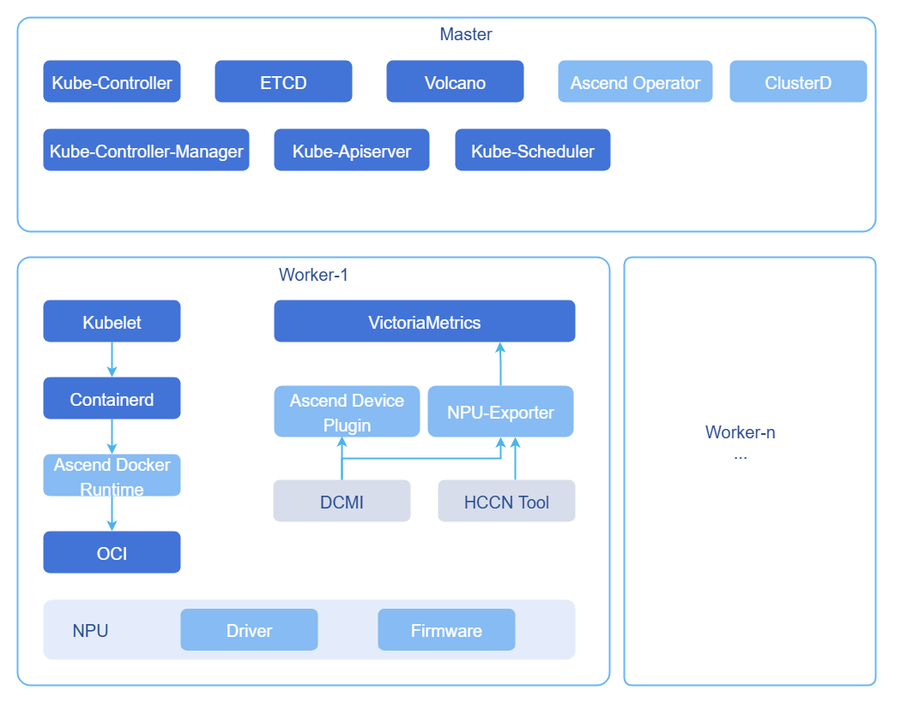
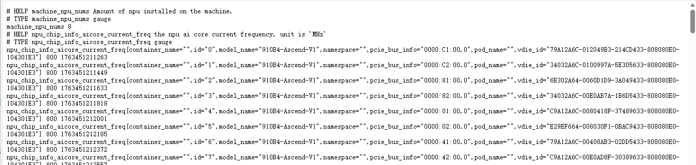
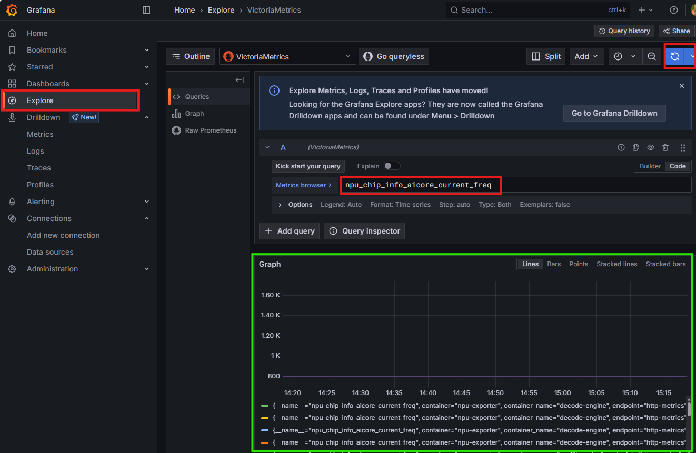
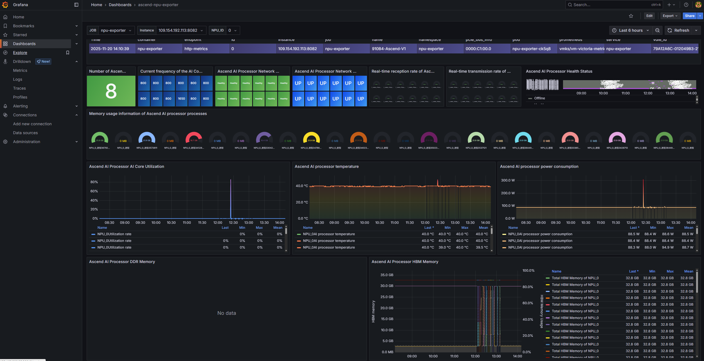

# Best Practices
## Best Practices for MindCluster Software Stack Deployment
This document aims to provide methods for deploying MindCluster components using the Ascend Deployer tool, and on this basis, use the monitoring component VictoriaMetrics to monitor the working status of NPUs, to ensure real-time status collection, reporting, and performance analysis of NPUs in ultra-large-scale clusters, ensuring that training and inference tasks are controllable, observable, and traceable throughout the entire process.
### Objectives
- Provide a MindCluster component deployment solution suitable for ultra-large-scale clusters.
- Provide a VictoriaMetrics monitoring solution adapted to NPUs in ultra-large-scale cluster scenarios.
- Provide NPU metric visualization display effects and common panel entry configurations for ultra-large-scale clusters.
- Provide an optimized Volcano replacement solution for ultra-large-scale clusters.
### Prerequisites
The environment must meet the following requirements.
- A Kubernetes cluster and corresponding network plugins have been deployed.
- The monitoring component VictoriaMetrics has been deployed.
- Python (version ≥ 3.6) and the accompanying pip3 have been installed.
- The physical machines of deployment nodes have allocatable NPU resources that meet business requirements.
### Usage Restrictions
- Deployment method: This practice mainly targets deployment using the Ascend Deployer tool.
- Operating system: The Ascend Deployer tool has strict restrictions on different versions of the openEuler operating system. For operating systems outside the supported versions, the deployment tool cannot be used to install MindCluster components ([Click to get all supported versions](https://www.hiascend.com/document/detail/zh/mindcluster/72rc1/deployer/deployerug/deployer_0002.html)). This practice uses the openEuler 22.03 (LTS-SP4) version of the operating system.
- Version statement: The steps in this document are only valid for the strictly verified component version combinations listed in the table below; other versions have not been tested, and deployment effectiveness has not been verified. We welcome contributions of more version practices to update the compatibility matrix together!

    **Table 1** Version compatibility description

    | Component/Tool  | Version                    |
    |-----------------|----------------------------|
    | Operating System| openEuler 22.03 (LTS-SP4)  |
    | Python          | 3.9.9                      |
    | pip3            | 21.3.1                     |
    | ascend-deployer | 7.1rc1                     |
    | Kubernetes      | 1.28.15, 1.33.1, 1.34.3    |
    | VictoriaMetrics | 1.222.0 (chart version 0.58.2) |

### Background Information
NPU (Neural Processing Unit) is a computing accelerator specifically designed for artificial intelligence workloads and is a type of AI accelerator. It is designed with high throughput, low latency, and high energy efficiency as goals, and is widely used in deep learning training and inference scenarios. MindCluster (AI Cluster System Software) is a deep learning system component that supports NPU (Ascend AI Processor) construction, specifically providing cluster-level solutions for training and inference tasks. Deep learning platform development manufacturers can reduce development workload related to underlying resource scheduling software and quickly enable partners to develop deep learning platforms based on MindCluster.

MindCluster uniformly encapsulates the six major capabilities of NPU registration, scheduling, fault tolerance, observation, elasticity, and auditing into the cloud-native control plane, making thousands of Ascend resources plug-and-play like CPUs. Through real-time topology bandwidth awareness, second-level sub-health isolation, idempotent checkpoint resume training, and global metric dashboards, the training interruption rate is reduced to <0.3%, resource utilization is increased by 25%, and fault recovery time is reduced from hours to minutes, truly enabling continuous, efficient, and autonomous operation loops for large model jobs on Ascend clusters.
- Automatic resource discovery: ascend-device-plugin runs as a DaemonSet, registering the DeviceID, topology location, chip type, and driver version of each NPU to Kubelet upon startup. Node scaling does not require restarting the control plane, supports dynamic hot-plugging, and the registration process is usually completed within tens of seconds.
- Resource monitoring: MindCluster uniformly exposes real-time metrics of Ascend chips and virtual NPUs through NPU Exporter, obtains container mapping through gRPC to CRI, calls hccn_tool to collect network status, reads core utilization, temperature, voltage, memory, and other hardware information through the DCMI interface, and finally converts them to Prometheus standard format. Users do not need to distinguish between training or inference scenarios, regardless of which scheduler is used, and can access in seconds by deploying only Prometheus or Telegraf, achieving full-scene observability from single boards to super nodes.
- Checkpoint resume training: MindCluster's checkpoint resume training divides fault loss into two parts: "rollback + startup". First, rollback to the state before the fault based on the most recent CKPT, then complete resource rescheduling, collective communication initialization, CKPT loading, and framework compilation in one go. The sum of the two time periods is the total loss for a single time. Taking PyTorch GPT-3 as an example (NFS read speed 4.8 GB/s, single machine 8 cards), the 3B model CKPT loading takes about 3s, overall startup takes about 70s; the 15B model CKPT loading takes about 90s, overall startup takes about 210s, both far less than full retraining, achieving minute-level recovery and continuing training forward.
- Basic scheduling: MindCluster uniformly abstracts training and inference tasks into three resource views: whole cards, static vNPUs, and elastic slices. The training side supports whole card scheduling, static vNPU slicing, and elastic scaling; the inference side additionally provides dynamic vNPUs and on-site recovery and rescheduling after card failures. The platform completes resource registration through ascend-device-plugin, implements topology affinity matching through volcano-scheduler, and ClusterD is responsible for sub-health avoidance. Users only need to submit yaml files for `acjob/vcjob/deploy`, and the system can automatically complete resource allocation, communication initialization, and fault escape without paying attention to underlying details.
- Virtualization instances: MindCluster supports slicing a single physical NPU into multiple vNPUs, which are dynamically mounted through containers to achieve multi-tenant sharing and improve resource utilization. After slicing, the original card can no longer be used, a vNPU can only be exclusively occupied by one task, and the entire server must maintain the same template and memory specifications. Training chips only support virtualization in AMP mode.

### Operation Steps
In the specific installation process, use the Ascend Deployer tool provided by MindCluster for batch deployment. After obtaining the Ascend Deployer tool, first select the corresponding software package for installation according to the usage scenario, then configure the batch installation scenario through the inventory_file file. After determining the specific MindCluster components to be installed, the final installation command can be executed. The Volcano component needs to be manually replaced because it needs to use the ultra-large-scale cluster optimized version, while other components can be used directly.

It should be noted that since the application scenario of this practice is NPU performance metric monitoring, a full installation of MindCluster components was not performed. The specific component selection and deployment form in practice are as shown in the figure below.

**Figure 1** MindCluster component selection and deployment form



- ClusterD: In order to coordinate the processing level of tasks, MindCluster provides the ClusterD service deployed on the management node. ClusterD collects and aggregates cluster task, resource, and fault information and impact scope, statistically analyzes from task, chip, and fault dimensions, and uniformly determines fault processing levels and strategies.
- Ascend Operator: Inputs the main process IP required for collective communication, the RankTable information required for static networking collective communication, the rankId of the current Pod, and other information.
- Ascend Docker Runtime: Ascend driver-related scripts and commands are distributed in different files and may change. To avoid lengthy file mounting when creating containers, MindCluster provides the Ascend Docker Runtime component deployed on compute nodes. By inputting the Ascend AI processor number to be mounted, the mounting of Ascend AI processors and related drivers can be completed.
- Ascend Device Plugin: MindCluster provides the Ascend Device Plugin service deployed on compute nodes to provide resource discovery and reporting strategies suitable for Ascend devices.
- NPU-Exporter: Obtains various data information of chips and networks from the driver, monitors dcmi/hccn tool/NPU to obtain databases. Adapts Prometheus hook functions to provide standard interfaces for Prometheus service calls.
- Volcano: K8s basic scheduling can only schedule resources by sensing the number of Ascend chips. To achieve affinity scheduling and maximize resource utilization, it is necessary to sense the network connection method between Ascend chips and select the network-optimal resources. MindCluster provides the Volcano service deployed on the management node, providing network affinity scheduling for different Ascend devices and networking methods.


1. Obtain the Ascend Deployer tool.

    The current latest version of Ascend Deployer is 7.1rc1. Execute the following commands on the control node to obtain the MindCluster Ascend Deployer tool.
    ```bash
    # Execute the following command to install the software package. Execute the following command to complete initialization. After initialization, the ascend-deployer directory is automatically generated with the path $HOME/ascend-deployer.
    # pip3 install ascend-deployer=={version}, replace {version} with the tool version
    pip3 install ascend-deployer==7.1rc1
    ascend-deployer -h # Verify installation
    ```
2. Use Ascend Deployer to install software packages.

    2.1 Check the architecture and operating system to determine the command to execute in the next step.
    ```bash
    uname -m && cat /etc/os-release
    # The following is the returned content
    # aarch64
    # NAME="openEuler"
    # VERSION="22.03 (LTS-SP4)"
    # ID="openEuler"
    # VERSION_ID="22.03"
    # PRETTY_NAME="openEuler 22.03 (LTS-SP4)"
    # ANSI_COLOR="0;31"
    ```
    2.2 According to the returned results, `<OS>=OpenEuler_22.03LTS-SP4_aarch64`. This practice is for minimal installation to achieve NPU metric monitoring, so select `<PK>=NPU,CANN,DL,FaultDiag`. Users can select more components according to their needs. Accordingly, when installing software packages, execute the following command.
    ```bash
    # ascend-download --os-list=<OS> --download=<PK1>,<PK2>==<Version>
    ascend-download --os-list=OpenEuler_22.03LTS-SP4_aarch64 --download=NPU,CANN,DL,FaultDiag
    ```
    **Table 2** Software package and component correspondence

    | Software Package | Included Components                                         |
    |------------------|-------------------------------------------------------------|
    | NPU              | npu(driver, firmware), mcu                                  |
    | CANN             | nnae, nnrt, tfplugin, toolkit, kernels, toolbox             |
    | DL               | ascend-device-plugin, ascend-docker-runtime, hccl-controller, noded, npu-exporter, volcano, ascend-operator, resilience-controller, clusterd, mindio |
    | FaultDiag        | faultDiag                                                   |
    | MindSpore        | mindspore                                                   |
    | TensorFlow       | tensorflow                                                  |
    | Torch-npu        | torch-npu, torch                                            |
    | MindIE-image     | mindie-image                                                |


     > **Note:**
        >
        > For more installation help, you can execute `ascend-download -h`.

3. Configure batch installation scenarios.

    Edit the inventory_file file under the /root/ascend-deployer/ path.

    >  **Caution:**
    >
    > Since the hostname of the host machine is different from the node name of its corresponding node in the cluster, the `<node name>` here needs to be consistent with the node name.
    ``` 
    [hccn]

    [hccn:vars]
    gateways=""
    netmask="255.255.255.0"
    roce_port=4791
    bitmap=""
    dscp_tc=""
    common_network="0.0.0.0/0"

    [master]
    # 10.10.10.1-10.10.10.9 ansible_ssh_user="root" ansible_ssh_pass="test1234" step_len=3
    192.168.200.25 ansible_ssh_user="root" ansible_ssh_pass=<ssh_pass> set_hostname="fuyao-master" 
    # `<ssh_pass>` needs to be replaced with the ssh password of the corresponding node
    # Node information fills in control node information, including `<ip>, <account>, <ssh password>, <node name>`

    [worker]
    # localhost ansible_connection='local' ansible_ssh_user='root'
    # 10.10.10.1-10.10.10.9 ansible_ssh_user="root" ansible_ssh_pass="test1234" step_len=3
    192.168.200.26 ansible_ssh_user="root" ansible_ssh_pass=<ssh_pass> set_hostname="fuyao-worker-0"
    192.168.200.27 ansible_ssh_user="root" ansible_ssh_pass=<ssh_pass> set_hostname="fuyao-worker-1"

    [npu_node]
    # 10.10.10.1-10.10.10.9 ansible_ssh_user="root" ansible_ssh_pass="test1234" step_len=3

    [other_build_image]

    [all:vars]
    SCALE="false"
    RUNNER_IP=""
    WEIGHTS_PATH=""
    ```

4. Configure image build environment.

    Since the images pulled by the installation tool ascend-deployer are made by Docker, Docker needs to be installed on the control node running the installation program. Without modifying the original code of ascend-deployer, the following two methods can be used to solve the problem.
    - Method 1: Use nerdctl instead of Docker (recommended).
      1. Install nerdctl and buildkit.

          1.1 Execute the following code to download and prepare dependencies.
          ```bash
          # Download nerdctl and buildkit installation packages, you can download the new version on github
          wget https://github.com/containerd/nerdctl/releases/download/v1.7.5/nerdctl-1.7.5-linux-amd64.tar.gz
          wget https://github.com/moby/buildkit/releases/download/v0.10.3/buildkit-v0.10.3.linux-amd64.tar.gz
          # Extract after download
          tar -xvzf nerdctl-1.7.5-linux-amd64.tar.gz -C /usr/local/bin/
          tar -xvzf buildkit-v0.10.3.linux-amd64.tar.gz -C /usr/local/bin/
          # Move binaries to the usr/local/bin/ directory
          mv /usr/local/bin/bin/buildctl /usr/local/bin/bin/buildkitd /usr/local/bin/
          ```
          1.2 Create a startup configuration file at /usr/lib/systemd/system/buildkit.service.
          ```
          # vi /usr/lib/systemd/system/buildkit.service
          [Unit]
          Description=BuildKit
          Requires=buildkit.socket
          After=buildkit.socket
          Documentation=https://github.com/moby/buildkit

          [Service]
          Type=notify
          ExecStart=/usr/local/bin/buildkitd --addr fd://

          [Install]
          WantedBy=multi-user.target
          ```
          1.3 Configure the buildkit.socket startup configuration file under /usr/lib/systemd/system.

          ```
          # vi /usr/lib/systemd/system/buildkit.socket
          [Unit]
          Description=BuildKit
          Documentation=https://github.com/moby/buildkit

          [Socket]
          ListenStream=%t/buildkit/buildkitd.sock
          SocketMode=0660

          [Install]
          WantedBy=sockets.target
          ```
        2. Execute the following code to start the buildkit service.
            ```
            systemctl enable --now buildkit.service  buildkit.socket
            ```

        3. Execute the following code to hard link the nerdctl executable file to /usr/local/bin/docker.
            ```bash
            sudo ln /usr/local/bin/nerdctl /usr/local/bin/docker
            ```
    - Method 2: Install Docker (prone to conflicts, not recommended).
      >  **Caution:**
      >
      > This method requires installing containerd first and then Docker.
      ```bash
      dnf config-manager --add-repo https://download.docker.com/linux/centos/docker-ce.repo
      sed -i 's/$releasever/8/g' /etc/yum.repos.d/docker-ce.repo
      dnf makecache
      dnf install -y docker-ce docker-ce-cli containerd.io
      systemctl enable --now docker
      docker version
      ```

5. Install driver and firmware dependencies.

    5.1 Execute the following command to check if the source is available.
    ```
    yum makecache
    ```
    5.2 Execute the following command to install required dependencies.
    ```
    yum install -y make dkms gcc kernel-headers-$(uname -r) kernel-devel-$(uname -r)  # gcc
    yum install -y net-tools pciutils  # lspci
    yum install -y net-tools net-tools  # ifconfig
    ```

6. Execute installation.

    6.1 After completing the preparation of the image build environment, installation can proceed. `ascend-deployer -h` can obtain installation help. If a check error occurs, the `--skip_check` command can be added. Run the installation execution.
    ```bash
    ascend-deployer --install=ascend-docker-runtime,volcano,ascend-device-plugin,npu-exporter,ascend-operator,clusterd,driver,firmware,npu
    ```
    6.2 The install content is the minimum installation scope for monitoring NPU using VictoriaMetrics, npu represents driver and firmware. After completing the installation, run tests to check the installation results.
    ```bash
    ascend-deployer --test all
    ```

7. Remove taints.

    mindx-exporter and volcano-system nodes appear pending because there are taints on the master node that do not allow scheduling. Remove the taints. Execute the following command to remove taints.
    ```bash
    kubectl taint node <node-name, eg: fuyao-master> node-role.kubernetes.io/control-plane:NoSchedule-
    ```

8. Manually replace Volcano.

    > **Note:**
        >
        > The Volcano version provided by ascend-deployer is the official version. The community has optimized Volcano in ultra-large-scale cluster scenarios, so it is necessary to install the community version of Volcano. Here, Volcano v1.9 is selected.

    8.1 Build environment preparation.
    - Complete the installation of the Go language environment (version>=1.21, it is recommended to use the latest bugfix version), refer to [golang official documentation](https://golang.org/).
    - Complete the installation of musl (version>=1.2.0). Refer to [musllibc official documentation](http://musl.libc.org/), as follows.

      ```bash
      wget https://musl.libc.org/releases/musl-1.2.5.tar.gz 
      tar -xzf musl-1.2.5.tar.gz
      cd musl-1.2.5
      ./configure --prefix=/usr/local/musl
      make
      sudo make install
      ```
    8.2 Pull Volcano source code.

    8.2.1 Execute the following command to pull the Volcano v1.9.0 (or v1.7.0) official open source code in the `$GOPATH/src/volcano.sh/` directory.
    ```bash
    cd $GOPATH/src/volcano.sh/
    git clone -b release-1.9 https://gitcode.com/openFuyao/volcano-ext.git
    ```
    8.2.2 Rename the code directory `ascend-for-volcano` to `ascend-volcano-plugin` and copy it to the plugin path of the Volcano official open source code `$GOPATH/src/volcano.sh/volcano/pkg/scheduler/plugins/`.

    8.3 Compile Volcano source code and build images.

    8.3.1 [Click to get the complete build.sh file for building images](#buildsh-for-building-images). Special attention needs to be paid to the version in the `DEFAULT_VER='v6.0.0'` section. It needs to be modified when using different versions of MindCluster. For details, see the official website [Integrating Ascend plugin to extend open source Volcano](https://www.hiascend.com/document/detail/zh/mindcluster/71RC1/clustersched/dlug/dlug_installation_023.html).


    8.3.2 Execute the following command to compile Volcano binary files and so files. According to the open source code version, select the corresponding parameters for the build.sh script, such as v1.9.0.
    ```bash
    cd $GOPATH/src/volcano.sh/volcano/pkg/scheduler/plugins/ascend-volcano-plugin/build
    chmod +x build.sh
    ./build.sh v1.9.0
    ```
    8.3.3 The compiled binary files and dynamic link library files are in the `ascend-volcano-plugin/output` directory.

    **Table 3** ascend-volcano-plugin/output directory structure
    | File Name                          | Description                                      |
    |------------------------------------|--------------------------------------------------|
    | volcano-npu_v6.0.0_linux-aarch64.so | Volcano Huawei NPU scheduling plugin dynamic link library. |
    | Dockerfile-scheduler               | Volcano scheduler image build text file.        |
    | Dockerfile-controller              | Volcano controller image build text file.       |
    | volcano-v1.9.0.yaml                | Volcano startup configuration file.             |
    | vc-scheduler                       | Volcano scheduler component binary file.        |
    | vc-controller-manager              | Volcano controller component binary file.       |

    8.4 Make volcano-scheduler and volcano-controller images.

    8.4.1 Enter ascend-volcano-plugin/output and execute the following command to make Volcano images. According to the open source code version, select the corresponding parameters for the image, such as v1.7.0 or v1.9.0.
    ```
    nerdctl build --no-cache -t volcanosh/vc-scheduler:v1.9.0 ./ -f ./Dockerfile-scheduler
    nerdctl build --no-cache -t volcanosh/vc-controller:v1.9.0 ./ -f ./Dockerfile-controller
    # Build completed:
    # unpacking docker.io/volcanosh/vc-scheduler:v1.9.0 (sha256:3acce97f0162d1f91866cec6ebad1b1bea9ff650d99e00160ba6712e87ae72
    # Loaded image: docker.io/volcanosh/vc-scheduler:v1.9.0
    # unpacking docker.io/volcanosh/vc-controller:v1.9.0 (sha256:0e37e772a68a1873e9f78cc96d1b5e9e69235183b22b542c68623196ed8a6417)...
    # Loaded image: docker.io/volcanosh/vc-controller:v1.9.0
    ```

    8.4.2 The already built images exist in the default namespace. K8s cannot directly call them, so the images need to be moved into the K8s namespace first. Execute the following command.

    ```
    # Save images as tar packages
    nerdctl save -o vc-controller.tar volcanosh/vc-controller:v1.9.0
    nerdctl save -o vc-scheduler.tar volcanosh/vc-scheduler:v1.9.0
    # Move images into the k8s namespace
    ctr -n k8s.io images import vc-controller.tar
    ctr -n k8s.io images import vc-scheduler.tar
    ```

    8.5 Replace images.

    Since Volcano was already selected for installation in the installation step, only the original image address needs to be replaced.

    8.5.1 Change the image address in the original configuration.
    ```
    kubectl get deploy -A
    kubectl edit deploy -n volcano-system volcano-scheduler
    kubectl edit deploy -n volcano-system volcano-controllers
    ```
    8.5.2 Taking volcano-scheduler as an example, make the following modifications.
    ```
    spec:
          containers:
          - args:
            - -c
            - umask 027; /vc-scheduler --scheduler-conf=/volcano.scheduler/volcano-scheduler.conf
              --plugins-dir=plugins --logtostderr=false --leader-elect=false --percentage-nodes-to-find=100
              --log_dir=/var/log/mindx-dl/volcano-scheduler --log_file=/var/log/mindx-dl/volcano-scheduler/volcano-scheduler.log
              -v=2 2>&1
            command:
            - /bin/ash
            image: docker.io/volcanosh/vc-scheduler:v1.9.0 # Replace with the new image address
            imagePullPolicy: IfNotPresent
            name: volcano-scheduler
    ```


9. NPU metric exposure.

    9.1 NPU exporter is a lightweight collector built into MindCluster that reads Ascend AI processor utilization, temperature, voltage, memory, network, and container mapping information in real-time through DCMI, hccn_tool, and CRI interfaces, and directly exposes them as Prometheus format metrics (default port 8082). It is automatically deployed to each NPU node as a DaemonSet with ascend-device-plugin, achieving one-stop observability of cluster-level NPU resources. After deployment is completed using Ascend Deployer, NPU exporter automatically opens ports, but due to default network policy restrictions, NPU metric data cannot be accessed directly through `http://<ip>:8082/metrics`. The original network configuration should be modified for security considerations. First, query the network configuration and remove it. Execute the following command.
    ```bash
    kubectl get networkpolicy -A # Query
    kubectl delete networkpolicy -n npu-exporter exporter-network-policy # Remove
    ```
    9.2 After the network configuration is removed, log in to `http://<ip>:8082/metrics` in a browser to obtain NPU monitoring metrics.

    **Figure 2** NPU monitoring metrics on metrics page

    

    9.3 Create a new network policy configuration file `exporter-network-policy.yaml`.
    ```yaml
    apiVersion: networking.k8s.io/v1
    kind: NetworkPolicy
    metadata:
      name: exporter-network-policy
      namespace: npu-exporter
    spec:
      egress:
      - to:
        - namespaceSelector: {}
          podSelector:
            matchLabels:
              app.kubernetes.io/name: "vmagent" # Modify
      ingress:
      - from:
        - namespaceSelector: {}
          podSelector:
            matchLabels:
              app.kubernetes.io/name: "vmagent" # Modify
      podSelector:
        matchLabels:
          app: npu-exporter
      policyTypes:
      - Ingress
      - Egress
    ```
    9.4 Make the new network policy effective.

    ```bash
    kubectl apply -f exporter-network-policy.yaml
    ```
    9.5 Query again to verify the network configuration effectiveness.
    ```bash
    kubectl get networkpolicy -A # Query
    # The following is the returned result
    # NAMESPACE          NAME                      POD-SELECTOR       AGE
    # calico-apiserver   allow-apiserver           apiserver=true     xxx
    # npu-exporter       exporter-network-policy   app=npu-exporter   xxx
    ```

10. vmagent data capture configuration.
    Currently, NPU exporter monitoring metrics can be normally exposed through ports, but vmagent still cannot obtain this data. The reason is that `npu-exporter Service` and `VMServiceScrape cr` have not been configured yet, so service and crd need to be configured so that vmagent can automatically scrape npu-exporter port data.

    10.1 Configure CRD: Create configuration file `npu-exporter-cr.yaml`.

    ```
    apiVersion: operator.victoriametrics.com/v1beta1
    kind: VMServiceScrape
    metadata:
      annotations:
        meta.helm.sh/release-name: vm
        meta.helm.sh/release-namespace: vmks
      labels:
        app.kubernetes.io/instance: vm
        app.kubernetes.io/managed-by: Helm
        app.kubernetes.io/name: victoria-metrics-k8s-stack
        app.kubernetes.io/version: v1.122.0
        helm.sh/chart: victoria-metrics-k8s-stack-0.58.2
      name: vm-victoria-metrics-k8s-stack-npu-exporter
      namespace: vmks
    spec:
      endpoints:
      - bearerTokenFile: /var/run/secrets/kubernetes.io/serviceaccount/token
        port: http-metrics
        scheme: http
        tlsConfig:
          caFile: /var/run/secrets/kubernetes.io/serviceaccount/ca.crt
      jobLabel: jobLabel
      namespaceSelector:
        matchNames:
        - npu-exporter
      selector:
        matchLabels:
          app: vm-victoria-metrics-k8s-stack-npu-exporter
          app.kubernetes.io/instance: vm
          app.kubernetes.io/name: victoria-metrics-k8s-stack
          jobLabel: npu-exporter
    ```
    10.2 Execute the following command to add the configuration file npu-exporter-cr.yaml to make VMServiceScrape cr effective.
    ```
    kubectl apply -f npu-exporter-cr.yaml
    ```

    10.3 Configure Service: Create configuration file npu-exporter-capture.yaml.

    ```yaml
    apiVersion: v1
    kind: Service
    metadata:
      labels:
        app: vm-victoria-metrics-k8s-stack-npu-exporter
        app.kubernetes.io/instance: vm
        app.kubernetes.io/name: victoria-metrics-k8s-stack
        jobLabel: npu-exporter
      name: npu-exporter
      namespace: npu-exporter
    spec:
      clusterIP: 10.105.44.182
      clusterIPs:
      - 10.105.44.182
      externalTrafficPolicy: Cluster
      internalTrafficPolicy: Cluster
      ipFamilies:
      - IPv4
      ipFamilyPolicy: SingleStack
      ports:
      - name: http-metrics
        nodePort: 30082
        port: 8082
        protocol: TCP
        targetPort: 8082
      selector:
        app: npu-exporter
      sessionAffinity: None
      type: NodePort
    status:
      loadBalancer: {}
    ```
    10.4 Execute the following command to add the configuration file npu-exporter-capture.yaml to make Service effective.

    ```
    kubectl apply -f npu-exporter-capture.yaml
    ```
11. Verify vmagent captures NPU monitoring metrics.

    To verify, you can open the vmagent target port or enter the grafana interface and query metrics exposed in `http://<ip>:8082/metrics` through Explore, such as npu_chip_info_aicore_current_freq. If data can be obtained normally, it indicates that vmagent can already capture npu monitoring metrics, as shown in the figure below.


    **Figure 3** Verification of vmagent capturing NPU monitoring metrics operation diagram
    

12. Grafana visualization panel configuration.

    When the monitoring component VictoriaMetrics is installed through helm, grafana is automatically deployed. Grafana comes with multiple default Dashboards, which enables cluster monitoring metrics to be displayed in different Dashboards of grafana without additional configuration. However, these default panels do not include NPU-related metrics, so new Dashboards need to be configured to visualize NPU monitoring metrics.

    12.1 New panels can be configured online directly by referring to the grafana official documentation, or can be implemented through code via configmap. Grafana's sidecar will automatically add dashboard panels according to the file. Here we provide an available NPU monitoring metric visualization panel. [Click to get configuration file dashboard-npu-export.yaml](#configuration-file-dashboard-npu-exportyaml).

    12.2 Execute the following command to create configmap.
    ```bash
    kubectl apply -f dashboard-npu-export.yaml
    ```
    To delete the configmap, execute `kubectl delete cm dashboard-npu-export -n vmks`

### Notes/Common Issues
The Ascend Deployer deployment tool strictly restricts operating system versions, and version checking cannot be skipped, so special attention needs to be paid to operating system version matching issues. The OpenEuler versions supported by the currently used 7.1rc1 version of ascend-deployer include:
- OpenEuler_20.03LTS_aarch64
- OpenEuler_20.03LTS_x86_64
- OpenEuler_22.03LTS-SP4_aarch64
- OpenEuler_22.03LTS_aarch64
- OpenEuler_22.03LTS_x86_64
- OpenEuler_24.03LTS-SP1_aarch64


### Conclusion
This solution deploys a MindCluster computing cluster with one click based on Ascend Deployer and integrates VictoriaMetrics to build a metric collection and visualization system. The entire system has completed deployment verification in the openEuler 22.03 and Kubernetes 1.28.15 environment. As shown in the figure, various key metrics (such as utilization, temperature, memory) of NPU during computing tasks have achieved second-level refresh and real-time presentation on the Grafana interface, which marks that the complete monitoring chain from metric acquisition, storage to display has been successfully opened and is operating effectively.

MindCluster makes the six major capabilities of Ascend NPU registration, scheduling, fault tolerance, observation, elasticity, and auditing cloud-native, making thousands of card resources plug-and-play. Through topology-aware scheduling and second-level sub-health isolation, the average recovery time for training tasks is shortened to the minute level, and resource utilization is improved, providing a unified and trusted data foundation for subsequent automatic elasticity, capacity prediction, and long-term storage, helping large model jobs transition from "firefighting operations" to "data-driven autonomy".

**Figure 4** Implementing NPU monitoring in AI inference tasks


### References

- [Ascend Official MindCluster Product Introduction](https://www.hiascend.com/software/mindcluster)
- [Ascend Official MindCluster Ascend Deployer Installation and Deployment Tool](https://www.hiascend.com/document/detail/zh/mindcluster/72rc1/deployer/deployerug/deployer_0001.html)
- [Ascend Official Cluster Scheduling Component Usage Feature Guide](https://www.hiascend.com/document/detail/zh/mindcluster/72rc1/clustersched/dlug/mxdlug_monit_001.html)
- [Grafana Official Documentation Dashboard Configuration Instructions](https://grafana.com/docs/grafana-cloud/visualizations/dashboards/build-dashboards/create-dashboard/)
- [Best Practices for Ultra-Large-Scale Cluster Monitoring Solutions Based on VictoriaMetrics Software Stack](https://gitcode.com/openFuyao/sig-large-scale-cluster/blob/master/best-practices/victoriametriacs%E6%9C%80%E4%BD%B3%E5%AE%9E%E8%B7%B5.md)

### Appendix
#### build.sh for Building Images

```bash
    #!/bin/bash
    # Perform  build volcano-huawei-npu-scheduler plugin
    # Copyright @ Huawei Technologies CO., Ltd. 2020-2022. All rights reserved
    #
    # Licensed under the Apache License, Version 2.0 (the "License");
    # you may not use this file except in compliance with the License.
    # You may obtain a copy of the License at
    #
    # http://www.apache.org/licenses/LICENSE-2.0
    #
    # Unless required by applicable law or agreed to in writing, software
    # distributed under the License is distributed on an "AS IS" BASIS,
    # WITHOUT WARRANTIES OR CONDITIONS OF ANY KIND, either express or implied.
    # See the License for the specific language governing permissions and
    # limitations under the License.
    # ============================================================================

    set -e

    # BASE_VER only support v1.7.0 or v1.9.0
    if [ ! -n "$1" ]; then
        BASE_VER=v1.7.0
    else
        BASE_VER=$1
    fi

    echo "Build Version is ${BASE_VER}"

    # Note the version changes here when using different mind-cluster versions
    DEFAULT_VER='v6.0.0'
    TOP_DIR=${GOPATH}/src/volcano.sh/volcano/
    BASE_PATH=${GOPATH}/src/volcano.sh/volcano/pkg/scheduler/plugins/ascend-volcano-plugin/
    CMD_PATH=${GOPATH}/src/volcano.sh/volcano/cmd/
    PKG_PATH=volcano.sh/volcano/pkg
    DATE=$(date "+%Y-%m-%d %H:%M:%S")

    function parse_version() {
        version_file="${TOP_DIR}"/service_config.ini
        if  [ -f "$version_file" ]; then
          line=$(sed -n '1p' "$version_file" 2>&1)
          version="v"${line#*=}
          echo "${version}"
          return
        fi
        echo ${DEFAULT_VER}
    }

    function parse_arch() {
      arch=$(arch 2>&1)
      echo "${arch}"
    }

    REL_VERSION=$(parse_version)
    REL_ARCH=$(parse_arch)
    REL_NPU_PLUGIN=volcano-npu_${REL_VERSION}_linux-${REL_ARCH}

    function clean() {
        rm -f "${BASE_PATH}"/output/vc-controller-manager
        rm -f "${BASE_PATH}"/output/vc-scheduler
        rm -f "${BASE_PATH}"/output/*.so
    }

    function copy_yaml() {
        cp "${BASE_PATH}"/build/volcano-"${BASE_VER}".yaml "${BASE_PATH}"/output/
    }

    # fix the unconditional retry. All pod errors cause the podgroup to be deleted and cannot be rescheduled
    function replace_code() {
        REPLACE_FILE="${GOPATH}/src/volcano.sh/volcano/pkg/controllers/job/state/running.go"
        SEARCH_STRING="Ignore"
        if ! grep -q "$SEARCH_STRING" "$REPLACE_FILE";then
          sed -i "s/switch action {/switch action { case \"Ignore\" : return nil/g" "$REPLACE_FILE"
        fi
    }

    function build() {
        echo "Build Architecture is" "${REL_ARCH}"

        export GO111MODULE=on
        export PATH=$GOPATH/bin:$PATH

        cd "${TOP_DIR}"
        go mod tidy

        cd "${BASE_PATH}"/output/

        export CGO_CFLAGS="-fstack-protector-all -D_FORTIFY_SOURCE=2 -O2 -fPIC -ftrapv"
        export CGO_CPPFLAGS="-fstack-protector-all -D_FORTIFY_SOURCE=2 -O2 -fPIC -ftrapv"
        export CC=/usr/local/musl/bin/musl-gcc
        export CGO_ENABLED=1 # Modify

        go build -mod=mod -buildmode=pie -ldflags "-s -linkmode=external -extldflags=-Wl,-z,now
          -X '${PKG_PATH}/version.Built=${DATE}' -X '${PKG_PATH}/version.Version=${BASE_VER}'" \
          -o vc-controller-manager "${CMD_PATH}"/controller-manager

        export CGO_ENABLED=1
        go build -mod=mod -buildmode=pie -ldflags "-s -linkmode=external -extldflags=-Wl,-z,now
          -X '${PKG_PATH}/version.Built=${DATE}' -X '${PKG_PATH}/version.Version=${BASE_VER}'" \
          -o vc-scheduler "${CMD_PATH}"/scheduler

        go build -mod=mod -buildmode=plugin -ldflags "-s -linkmode=external -extldflags=-Wl,-z,now
          -X volcano.sh/volcano/pkg/scheduler/plugins/ascend-volcano-plugin.PluginName=${REL_NPU_PLUGIN}" \
          -o "${REL_NPU_PLUGIN}".so "${GOPATH}"/src/volcano.sh/volcano/pkg/scheduler/plugins/ascend-volcano-plugin/

        if [ ! -f "${BASE_PATH}/output/${REL_NPU_PLUGIN}.so" ]
        then
          echo "fail to find volcano-npu_${REL_VERSION}.so"
          exit 1
        fi

        sed -i "s/name: volcano-npu_.*/name: ${REL_NPU_PLUGIN}/" "${BASE_PATH}"/output/volcano-*.yaml

        chmod 400 "${BASE_PATH}"/output/*.so
        chmod 500 vc-controller-manager vc-scheduler
        chmod 400 "${BASE_PATH}"/output/Dockerfile*
        chmod 400 "${BASE_PATH}"/output/volcano-*.yaml
    }

    function replace_node_predicate() {
        if [[ "$BASE_VER" == "v1.7.0" ]];then
          return
        fi
        cd $BASE_PATH
        find . -type f ! -path './.git*/*' ! -path './doc/*' -exec sed -i 's/k8s.io\/klog\"/k8s.io\/klog\/v2\"/g' {} +
        REPLACE_FILE="${GOPATH}/src/volcano.sh/volcano/pkg/scheduler/plugins/ascend-volcano-plugin/npu.go"
        sed -i "s/api.NodeInfo) error {/api.NodeInfo) (\[\]\*api.Status, error) {/g" "$REPLACE_FILE"
        sed -i "s/return predicateErr/return \[\]\*api.Status{}, predicateErr/g" "$REPLACE_FILE"
    }

    function replace_node_score() {
        REPLACE_FILE="${GOPATH}/src/volcano.sh/volcano/pkg/scheduler/actions/allocate/allocate.go"
        if [[ "$BASE_VER" == "v1.7.0" ]];then
              sed -i '
              /case len(candidateNodes) == 1:/ {
                  N
                  N
                  s/case len(candidateNodes) == 1:.*\n.*\n.*/            default:/
              }' "$REPLACE_FILE"
          return
        fi
        if [[ "$BASE_VER" == "v1.9.0" ]];then
              sed -i '
              /case len(nodes) == 1:/ {
                  N
                  N
                  s/case len(nodes) == 1:.*\n.*\n.*/            default:/
              }' "$REPLACE_FILE"
          return
        fi
        echo "volcano version is $BASE_VER, will not change allocate.go codes"
    }

    function replace_k8s_version() {
        REPLACE_FILE="${GOPATH}/src/volcano.sh/volcano/go.mod"
        if [[ "$BASE_VER" == "v1.9.0" ]];then
          sed -i "s/1.25.0/1.25.14/g" "$REPLACE_FILE"
          return
        fi
        echo "volcano version is $BASE_VER, will not change go.mod codes"
    }

    function main() {
      clean
      copy_yaml
      replace_code
      replace_node_predicate
      replace_node_score
      replace_k8s_version
      build
    }

    main "${1}"

    echo ""
    echo "Finished!"
    echo ""
  ```

#### Configuration File dashboard-npu-export.yaml

    ```yaml
    apiVersion: v1
    kind: ConfigMap
    metadata:
      name: dashboard-npu-export
      namespace: vmks          # Same namespace as Grafana
      labels:
        grafana_dashboard: "1"       # Sidecar only scans CM with this label
    data:
      your-dashboard.json: |-
        {
          "annotations": {
            "list": [
              {
                "builtIn": 1,
                "datasource": {
                  "type": "grafana",
                  "uid": "-- Grafana --"
                },
                "enable": true,
                "hide": true,
                "iconColor": "rgba(0, 211, 255, 1)",
                "name": "Annotations & Alerts",
                "target": {
                  "limit": 100,
                  "matchAny": false,
                  "tags": [],
                  "type": "dashboard"
                },
                "type": "dashboard"
              }
            ]
          },
          "description": "「Ascend Npu Monitor」\r\nA Grafana dashboard for monitoring Ascend NPU metrics via ascend-npu-exporter. Visualize AI Core utilization, temperature, power, memory, and network status in real time.\r\nBased on the ascend-npu-exporter, the Ascend NPU monitoring panel supports real-time visualization of key metrics such as AI Core, temperature, power consumption, memory, network, etc.",
          "editable": true,
          "fiscalYearStartMonth": 0,
          "graphTooltip": 0,
          "id": 20,
          "links": [],
          "panels": [
            {
              "datasource": {
                "type": "prometheus",
                "uid": "P4169E866C3094E38"
              },
              "fieldConfig": {
                "defaults": {
                  "color": {
                    "mode": "thresholds"
                  },
                  "custom": {
                    "align": "auto",
                    "cellOptions": {
                      "mode": "gradient",
                      "type": "color-background"
                    },
                    "filterable": false,
                    "inspect": false
                  },
                  "mappings": [],
                  "thresholds": {
                    "mode": "absolute",
                    "steps": [
                      {
                        "color": "#4c4c8c"
                      }
                    ]
                  }
                },
                "overrides": [
                  {
                    "matcher": {
                      "id": "byName",
                      "options": "Value"
                    },
                    "properties": [
                      {
                        "id": "custom.hidden",
                        "value": true
                      }
                    ]
                  },
                  {
                    "matcher": {
                      "id": "byName",
                      "options": "__name__"
                    },
                    "properties": [
                      {
                        "id": "custom.hidden",
                        "value": true
                      }
                    ]
                  }
                ]
              },
              "gridPos": {
                "h": 4,
                "w": 24,
                "x": 0,
                "y": 0
              },
              "id": 8,
              "options": {
                "footer": {
                  "enablePagination": false,
                  "fields": "",
                  "reducer": [
                    "sum"
                  ],
                  "show": false
                },
                "showHeader": true
              },
              "pluginVersion": "9.3.2",
              "repeat": "npu_id",
              "repeatDirection": "h",
              "targets": [
                {
                  "datasource": {
                    "type": "prometheus",
                    "uid": "P4169E866C3094E38"
                  },
                  "editorMode": "code",
                  "exemplar": false,
                  "expr": "npu_chip_info_name{instance=\"$instance\", id=\"$npu_id\"}",
                  "format": "table",
                  "instant": true,
                  "interval": "",
                  "legendFormat": "NPU{{label_name}}",
                  "range": false,
                  "refId": "A"
                }
              ],
              "title": "Ascend AI Name and ID",
              "type": "table"
            },
            {
              "datasource": {
                "type": "prometheus",
                "uid": "P4169E866C3094E38"
              },
              "fieldConfig": {
                "defaults": {
                  "mappings": [],
                  "thresholds": {
                    "mode": "absolute",
                    "steps": [
                      {
                        "color": "green"
                      },
                      {
                        "color": "red",
                        "value": 80
                      }
                    ]
                  },
                  "unit": "short"
                },
                "overrides": []
              },
              "gridPos": {
                "h": 4,
                "w": 2,
                "x": 0,
                "y": 4
              },
              "id": 2,
              "options": {
                "colorMode": "background",
                "graphMode": "none",
                "justifyMode": "auto",
                "orientation": "auto",
                "percentChangeColorMode": "standard",
                "reduceOptions": {
                  "calcs": [
                    "lastNotNull"
                  ],
                  "fields": "",
                  "values": false
                },
                "showPercentChange": false,
                "textMode": "auto",
                "wideLayout": true
              },
              "pluginVersion": "12.0.2",
              "targets": [
                {
                  "datasource": {
                    "type": "prometheus",
                    "uid": "P4169E866C3094E38"
                  },
                  "editorMode": "builder",
                  "expr": "machine_npu_nums{instance=\"$instance\"}",
                  "legendFormat": "__auto",
                  "range": true,
                  "refId": "A"
                }
              ],
              "title": "Number of Ascend AI processors",
              "type": "stat"
            },
            {
              "datasource": {
                "type": "prometheus",
                "uid": "P4169E866C3094E38"
              },
              "fieldConfig": {
                "defaults": {
                  "mappings": [],
                  "thresholds": {
                    "mode": "absolute",
                    "steps": [
                      {
                        "color": "dark-blue"
                      }
                    ]
                  },
                  "unit": "none"
                },
                "overrides": []
              },
              "gridPos": {
                "h": 4,
                "w": 3,
                "x": 2,
                "y": 4
              },
              "id": 14,
              "options": {
                "colorMode": "background",
                "graphMode": "none",
                "justifyMode": "auto",
                "orientation": "auto",
                "percentChangeColorMode": "standard",
                "reduceOptions": {
                  "calcs": [
                    "lastNotNull"
                  ],
                  "fields": "",
                  "values": false
                },
                "showPercentChange": false,
                "textMode": "auto",
                "wideLayout": true
              },
              "pluginVersion": "12.0.2",
              "targets": [
                {
                  "datasource": {
                    "type": "prometheus",
                    "uid": "P4169E866C3094E38"
                  },
                  "editorMode": "builder",
                  "expr": "npu_chip_info_aicore_current_freq{instance=\"$instance\", id=\"$npu_id\"}",
                  "legendFormat": "__auto",
                  "range": true,
                  "refId": "A"
                }
              ],
              "title": "Current frequency of the AI Core of the Ascend AI processor",
              "type": "stat"
            },
            {
              "datasource": {
                "type": "prometheus",
                "uid": "P4169E866C3094E38"
              },
              "fieldConfig": {
                "defaults": {
                  "mappings": [
                    {
                      "options": {
                        "0": {
                          "color": "orange",
                          "index": 1,
                          "text": "Unhealthy"
                        },
                        "1": {
                          "color": "green",
                          "index": 0,
                          "text": "Healthy"
                        }
                      },
                      "type": "value"
                    }
                  ],
                  "thresholds": {
                    "mode": "absolute",
                    "steps": [
                      {
                        "color": "dark-yellow"
                      }
                    ]
                  },
                  "unit": "short"
                },
                "overrides": []
              },
              "gridPos": {
                "h": 4,
                "w": 3,
                "x": 5,
                "y": 4
              },
              "id": 7,
              "options": {
                "colorMode": "background",
                "graphMode": "none",
                "justifyMode": "auto",
                "orientation": "auto",
                "percentChangeColorMode": "standard",
                "reduceOptions": {
                  "calcs": [
                    "lastNotNull"
                  ],
                  "fields": "",
                  "values": false
                },
                "showPercentChange": false,
                "textMode": "auto",
                "wideLayout": true
              },
              "pluginVersion": "12.0.2",
              "targets": [
                {
                  "datasource": {
                    "type": "prometheus",
                    "uid": "P4169E866C3094E38"
                  },
                  "editorMode": "builder",
                  "expr": "npu_chip_info_network_status{instance=\"$instance\", id=\"$npu_id\"}",
                  "legendFormat": "__auto",
                  "range": true,
                  "refId": "A"
                }
              ],
              "title": "Ascend AI Processor Network Health Status",
              "type": "stat"
            },
            {
              "datasource": {
                "type": "prometheus",
                "uid": "P4169E866C3094E38"
              },
              "fieldConfig": {
                "defaults": {
                  "mappings": [
                    {
                      "options": {
                        "0": {
                          "color": "orange",
                          "index": 1,
                          "text": "DOWN"
                        },
                        "1": {
                          "color": "blue",
                          "index": 0,
                          "text": "UP"
                        }
                      },
                      "type": "value"
                    }
                  ],
                  "thresholds": {
                    "mode": "absolute",
                    "steps": [
                      {
                        "color": "dark-yellow"
                      }
                    ]
                  },
                  "unit": "short"
                },
                "overrides": []
              },
              "gridPos": {
                "h": 4,
                "w": 3,
                "x": 8,
                "y": 4
              },
              "id": 6,
              "options": {
                "colorMode": "background",
                "graphMode": "none",
                "justifyMode": "auto",
                "orientation": "auto",
                "percentChangeColorMode": "standard",
                "reduceOptions": {
                  "calcs": [
                    "lastNotNull"
                  ],
                  "fields": "",
                  "values": false
                },
                "showPercentChange": false,
                "textMode": "auto",
                "wideLayout": true
              },
              "pluginVersion": "12.0.2",
              "targets": [
                {
                  "datasource": {
                    "type": "prometheus",
                    "uid": "P4169E866C3094E38"
                  },
                  "editorMode": "builder",
                  "expr": "npu_chip_info_link_status{instance=\"$instance\", id=\"$npu_id\"}",
                  "legendFormat": "__auto",
                  "range": true,
                  "refId": "A"
                }
              ],
              "title": "Ascend AI Processor Network Port Link Status",
              "type": "stat"
            },
            {
              "datasource": {
                "type": "prometheus",
                "uid": "P4169E866C3094E38"
              },
              "fieldConfig": {
                "defaults": {
                  "custom": {
                    "neutral": -2
                  },
                  "mappings": [],
                  "thresholds": {
                    "mode": "percentage",
                    "steps": [
                      {
                        "color": "green"
                      }
                    ]
                  },
                  "unit": "MBs"
                },
                "overrides": []
              },
              "gridPos": {
                "h": 4,
                "w": 3,
                "x": 11,
                "y": 4
              },
              "id": 4,
              "options": {
                "minVizHeight": 75,
                "minVizWidth": 75,
                "orientation": "auto",
                "reduceOptions": {
                  "calcs": [
                    "lastNotNull"
                  ],
                  "fields": "",
                  "values": false
                },
                "showThresholdLabels": false,
                "showThresholdMarkers": false,
                "sizing": "auto"
              },
              "pluginVersion": "12.0.2",
              "targets": [
                {
                  "datasource": {
                    "type": "prometheus",
                    "uid": "P4169E866C3094E38"
                  },
                  "editorMode": "builder",
                  "expr": "npu_chip_info_bandwidth_rx{instance=~\"$instance\", id=~\"$npu_id\"}",
                  "legendFormat": "__auto",
                  "range": true,
                  "refId": "A"
                }
              ],
              "title": "Real-time reception rate of Ascend AI processor network port",
              "type": "gauge"
            },
            {
              "datasource": {
                "type": "prometheus",
                "uid": "P4169E866C3094E38"
              },
              "fieldConfig": {
                "defaults": {
                  "custom": {
                    "neutral": -2
                  },
                  "mappings": [],
                  "thresholds": {
                    "mode": "percentage",
                    "steps": [
                      {
                        "color": "green"
                      }
                    ]
                  },
                  "unit": "MBs"
                },
                "overrides": []
              },
              "gridPos": {
                "h": 4,
                "w": 3,
                "x": 14,
                "y": 4
              },
              "id": 5,
              "options": {
                "minVizHeight": 75,
                "minVizWidth": 75,
                "orientation": "auto",
                "reduceOptions": {
                  "calcs": [
                    "lastNotNull"
                  ],
                  "fields": "",
                  "values": false
                },
                "showThresholdLabels": false,
                "showThresholdMarkers": false,
                "sizing": "auto"
              },
              "pluginVersion": "12.0.2",
              "targets": [
                {
                  "datasource": {
                    "type": "prometheus",
                    "uid": "P4169E866C3094E38"
                  },
                  "editorMode": "builder",
                  "expr": "npu_chip_info_bandwidth_tx{instance=~\"$instance\", id=~\"$npu_id\"}",
                  "legendFormat": "__auto",
                  "range": true,
                  "refId": "A"
                }
              ],
              "title": "Real-time transmission rate of Ascend AI processor network port",
              "type": "gauge"
            },
            {
              "datasource": {
                "type": "prometheus",
                "uid": "P4169E866C3094E38"
              },
              "fieldConfig": {
                "defaults": {
                  "color": {
                    "mode": "fixed"
                  },
                  "custom": {
                    "axisPlacement": "auto",
                    "fillOpacity": 39,
                    "hideFrom": {
                      "legend": false,
                      "tooltip": false,
                      "viz": false
                    },
                    "insertNulls": false,
                    "lineWidth": 4,
                    "spanNulls": false
                  },
                  "mappings": [
                    {
                      "options": {
                        "0": {
                          "color": "semi-dark-red",
                          "index": 1,
                          "text": "Unhealthy"
                        },
                        "1": {
                          "color": "semi-dark-purple",
                          "index": 0,
                          "text": "Healthy"
                        },
                        "3": {
                          "color": "#666c65",
                          "index": 2,
                          "text": "Offline"
                        }
                      },
                      "type": "value"
                    }
                  ],
                  "noValue": "3",
                  "thresholds": {
                    "mode": "absolute",
                    "steps": [
                      {
                        "color": "green"
                      },
                      {
                        "color": "red",
                        "value": 80
                      }
                    ]
                  }
                },
                "overrides": []
              },
              "gridPos": {
                "h": 4,
                "w": 7,
                "x": 17,
                "y": 4
              },
              "id": 9,
              "options": {
                "alignValue": "center",
                "legend": {
                  "displayMode": "table",
                  "placement": "bottom",
                  "showLegend": true
                },
                "mergeValues": true,
                "rowHeight": 0.58,
                "showValue": "always",
                "tooltip": {
                  "hideZeros": false,
                  "mode": "single",
                  "sort": "none"
                }
              },
              "pluginVersion": "12.0.2",
              "targets": [
                {
                  "datasource": {
                    "type": "prometheus",
                    "uid": "P4169E866C3094E38"
                  },
                  "editorMode": "builder",
                  "expr": "npu_chip_info_health_status{instance=\"$instance\", id=\"$npu_id\"}",
                  "legendFormat": "NPU_{{id}}Health status",
                  "range": true,
                  "refId": "A"
                }
              ],
              "title": "Ascend AI Processor Health Status",
              "transparent": true,
              "type": "state-timeline"
            },
            {
              "datasource": {
                "type": "prometheus",
                "uid": "P4169E866C3094E38"
              },
              "fieldConfig": {
                "defaults": {
                  "color": {
                    "mode": "palette-classic"
                  },
                  "mappings": [],
                  "min": 0,
                  "thresholds": {
                    "mode": "percentage",
                    "steps": [
                      {
                        "color": "green"
                      }
                    ]
                  },
                  "unit": "decmbytes"
                },
                "overrides": []
              },
              "gridPos": {
                "h": 5,
                "w": 24,
                "x": 0,
                "y": 8
              },
              "id": 15,
              "options": {
                "orientation": "auto",
                "reduceOptions": {
                  "calcs": [
                    "lastNotNull"
                  ],
                  "fields": "",
                  "values": false
                },
                "showThresholdLabels": false,
                "showThresholdMarkers": true
              },
              "pluginVersion": "9.3.2",
              "repeat": "npu_id",
              "repeatDirection": "h",
              "targets": [
                {
                  "datasource": {
                    "type": "prometheus",
                    "uid": "P4169E866C3094E38"
                  },
                  "editorMode": "builder",
                  "exemplar": false,
                  "expr": "npu_chip_info_process_info{instance=\"$instance\", id=\"$npu_id\"}",
                  "format": "time_series",
                  "instant": false,
                  "interval": "",
                  "legendFormat": "NPU_{{id}}_process{{process_id}}",
                  "range": true,
                  "refId": "A"
                }
              ],
              "title": "Memory usage information of Ascend AI processor processes",
              "type": "gauge"
            },
            {
              "datasource": {
                "type": "prometheus",
                "uid": "P4169E866C3094E38"
              },
              "fieldConfig": {
                "defaults": {
                  "color": {
                    "mode": "continuous-BlPu"
                  },
                  "custom": {
                    "axisBorderShow": false,
                    "axisCenteredZero": false,
                    "axisColorMode": "text",
                    "axisLabel": "",
                    "axisPlacement": "auto",
                    "barAlignment": 0,
                    "barWidthFactor": 0.6,
                    "drawStyle": "line",
                    "fillOpacity": 14,
                    "gradientMode": "scheme",
                    "hideFrom": {
                      "legend": false,
                      "tooltip": false,
                      "viz": false
                    },
                    "insertNulls": false,
                    "lineInterpolation": "smooth",
                    "lineWidth": 2,
                    "pointSize": 5,
                    "scaleDistribution": {
                      "type": "linear"
                    },
                    "showPoints": "auto",
                    "spanNulls": false,
                    "stacking": {
                      "group": "A",
                      "mode": "none"
                    },
                    "thresholdsStyle": {
                      "mode": "off"
                    }
                  },
                  "mappings": [],
                  "thresholds": {
                    "mode": "absolute",
                    "steps": [
                      {
                        "color": "green"
                      },
                      {
                        "color": "red",
                        "value": 80
                      }
                    ]
                  },
                  "unit": "percent"
                },
                "overrides": []
              },
              "gridPos": {
                "h": 9,
                "w": 8,
                "x": 0,
                "y": 13
              },
              "id": 13,
              "options": {
                "legend": {
                  "calcs": [
                    "last",
                    "min",
                    "max",
                    "mean"
                  ],
                  "displayMode": "table",
                  "placement": "bottom",
                  "showLegend": true
                },
                "tooltip": {
                  "hideZeros": false,
                  "mode": "single",
                  "sort": "none"
                }
              },
              "pluginVersion": "12.0.2",
              "targets": [
                {
                  "datasource": {
                    "type": "prometheus",
                    "uid": "P4169E866C3094E38"
                  },
                  "editorMode": "builder",
                  "exemplar": false,
                  "expr": "npu_chip_info_utilization{instance=\"$instance\", id=\"$npu_id\"}",
                  "instant": false,
                  "legendFormat": "NPU_{{id}}Utilization rate",
                  "range": true,
                  "refId": "A"
                }
              ],
              "title": "Ascend AI Processor AI Core Utilization",
              "type": "timeseries"
            },
            {
              "datasource": {
                "type": "prometheus",
                "uid": "P4169E866C3094E38"
              },
              "fieldConfig": {
                "defaults": {
                  "color": {
                    "mode": "continuous-GrYlRd"
                  },
                  "custom": {
                    "axisBorderShow": false,
                    "axisCenteredZero": false,
                    "axisColorMode": "text",
                    "axisLabel": "",
                    "axisPlacement": "auto",
                    "barAlignment": 0,
                    "barWidthFactor": 0.6,
                    "drawStyle": "line",
                    "fillOpacity": 13,
                    "gradientMode": "scheme",
                    "hideFrom": {
                      "legend": false,
                      "tooltip": false,
                      "viz": false
                    },
                    "insertNulls": false,
                    "lineInterpolation": "smooth",
                    "lineStyle": {
                      "fill": "solid"
                    },
                    "lineWidth": 2,
                    "pointSize": 5,
                    "scaleDistribution": {
                      "type": "linear"
                    },
                    "showPoints": "auto",
                    "spanNulls": false,
                    "stacking": {
                      "group": "A",
                      "mode": "none"
                    },
                    "thresholdsStyle": {
                      "mode": "off"
                    }
                  },
                  "decimals": 1,
                  "mappings": [],
                  "min": 0,
                  "thresholds": {
                    "mode": "absolute",
                    "steps": [
                      {
                        "color": "green"
                      }
                    ]
                  },
                  "unit": "celsius"
                },
                "overrides": []
              },
              "gridPos": {
                "h": 9,
                "w": 8,
                "x": 8,
                "y": 13
              },
              "id": 11,
              "options": {
                "legend": {
                  "calcs": [
                    "lastNotNull",
                    "min",
                    "max",
                    "mean"
                  ],
                  "displayMode": "table",
                  "placement": "bottom",
                  "showLegend": true
                },
                "tooltip": {
                  "hideZeros": false,
                  "mode": "single",
                  "sort": "none"
                }
              },
              "pluginVersion": "12.0.2",
              "targets": [
                {
                  "datasource": {
                    "type": "prometheus",
                    "uid": "P4169E866C3094E38"
                  },
                  "editorMode": "builder",
                  "expr": "npu_chip_info_temperature{instance=\"$instance\", id=\"$npu_id\"}",
                  "legendFormat": "NPU_{{id}}AI processor temperature",
                  "range": true,
                  "refId": "A"
                }
              ],
              "title": "Ascend AI processor temperature",
              "type": "timeseries"
            },
            {
              "datasource": {
                "type": "prometheus",
                "uid": "P4169E866C3094E38"
              },
              "fieldConfig": {
                "defaults": {
                  "color": {
                    "mode": "continuous-YlRd"
                  },
                  "custom": {
                    "axisBorderShow": false,
                    "axisCenteredZero": false,
                    "axisColorMode": "text",
                    "axisLabel": "",
                    "axisPlacement": "auto",
                    "barAlignment": 0,
                    "barWidthFactor": 0.6,
                    "drawStyle": "line",
                    "fillOpacity": 12,
                    "gradientMode": "scheme",
                    "hideFrom": {
                      "legend": false,
                      "tooltip": false,
                      "viz": false
                    },
                    "insertNulls": false,
                    "lineInterpolation": "smooth",
                    "lineStyle": {
                      "fill": "solid"
                    },
                    "lineWidth": 2,
                    "pointSize": 5,
                    "scaleDistribution": {
                      "type": "linear"
                    },
                    "showPoints": "auto",
                    "spanNulls": false,
                    "stacking": {
                      "group": "A",
                      "mode": "none"
                    },
                    "thresholdsStyle": {
                      "mode": "off"
                    }
                  },
                  "decimals": 1,
                  "mappings": [],
                  "min": 0,
                  "thresholds": {
                    "mode": "absolute",
                    "steps": [
                      {
                        "color": "green"
                      }
                    ]
                  },
                  "unit": "watt"
                },
                "overrides": []
              },
              "gridPos": {
                "h": 9,
                "w": 8,
                "x": 16,
                "y": 13
              },
              "id": 10,
              "options": {
                "legend": {
                  "calcs": [
                    "lastNotNull",
                    "min",
                    "max",
                    "mean"
                  ],
                  "displayMode": "table",
                  "placement": "bottom",
                  "showLegend": true
                },
                "tooltip": {
                  "hideZeros": false,
                  "mode": "single",
                  "sort": "none"
                }
              },
              "pluginVersion": "12.0.2",
              "targets": [
                {
                  "datasource": {
                    "type": "prometheus",
                    "uid": "P4169E866C3094E38"
                  },
                  "editorMode": "builder",
                  "expr": "npu_chip_info_power{instance=\"$instance\", id=\"$npu_id\"}",
                  "legendFormat": "NPU_{{id}}AI processor power consumption",
                  "range": true,
                  "refId": "A"
                }
              ],
              "title": "Ascend AI processor power consumption",
              "type": "timeseries"
            },
            {
              "datasource": {
                "type": "prometheus",
                "uid": "P4169E866C3094E38"
              },
              "fieldConfig": {
                "defaults": {
                  "color": {
                    "fixedColor": "dark-orange",
                    "mode": "palette-classic"
                  },
                  "custom": {
                    "axisBorderShow": false,
                    "axisCenteredZero": false,
                    "axisColorMode": "text",
                    "axisLabel": "DDR Memory",
                    "axisPlacement": "auto",
                    "barAlignment": 0,
                    "barWidthFactor": 0.6,
                    "drawStyle": "line",
                    "fillOpacity": 0,
                    "gradientMode": "none",
                    "hideFrom": {
                      "legend": false,
                      "tooltip": false,
                      "viz": false
                    },
                    "insertNulls": false,
                    "lineInterpolation": "smooth",
                    "lineStyle": {
                      "fill": "solid"
                    },
                    "lineWidth": 1,
                    "pointSize": 1,
                    "scaleDistribution": {
                      "type": "linear"
                    },
                    "showPoints": "always",
                    "spanNulls": false,
                    "stacking": {
                      "group": "A",
                      "mode": "none"
                    },
                    "thresholdsStyle": {
                      "mode": "off"
                    }
                  },
                  "decimals": 1,
                  "mappings": [],
                  "min": 0,
                  "thresholds": {
                    "mode": "absolute",
                    "steps": [
                      {
                        "color": "green"
                      }
                    ]
                  },
                  "unit": "decmbytes"
                },
                "overrides": [
                  {
                    "matcher": {
                      "id": "byName",
                      "options": "NPU_0DDR Memory Usage"
                    },
                    "properties": [
                      {
                        "id": "custom.axisPlacement",
                        "value": "right"
                      },
                      {
                        "id": "unit",
                        "value": "percent"
                      },
                      {
                        "id": "custom.axisLabel",
                        "value": "DDR memory usage"
                      },
                      {
                        "id": "custom.axisSoftMax",
                        "value": 100
                      },
                      {
                        "id": "custom.fillOpacity",
                        "value": 15
                      },
                      {
                        "id": "custom.drawStyle",
                        "value": "line"
                      },
                      {
                        "id": "custom.lineStyle",
                        "value": {
                          "dash": [
                            0,
                            10
                          ],
                          "fill": "dot"
                        }
                      },
                      {
                        "id": "custom.showPoints",
                        "value": "auto"
                      }
                    ]
                  }
                ]
              },
              "gridPos": {
                "h": 10,
                "w": 11,
                "x": 0,
                "y": 22
              },
              "id": 12,
              "options": {
                "legend": {
                  "calcs": [
                    "lastNotNull",
                    "min",
                    "max",
                    "mean"
                  ],
                  "displayMode": "table",
                  "placement": "right",
                  "showLegend": true
                },
                "tooltip": {
                  "hideZeros": false,
                  "mode": "multi",
                  "sort": "none"
                }
              },
              "pluginVersion": "12.0.2",
              "targets": [
                {
                  "datasource": {
                    "type": "prometheus",
                    "uid": "P4169E866C3094E38"
                  },
                  "editorMode": "builder",
                  "exemplar": false,
                  "expr": "npu_chip_info_total_memory{instance=\"$instance\", id=\"$npu_id\"}",
                  "format": "time_series",
                  "instant": false,
                  "legendFormat": "NPU_{{id}} Total DDR Memory",
                  "range": true,
                  "refId": "A"
                },
                {
                  "datasource": {
                    "type": "prometheus",
                    "uid": "P4169E866C3094E38"
                  },
                  "editorMode": "builder",
                  "exemplar": false,
                  "expr": "npu_chip_info_used_memory{instance=\"$instance\", id=\"$npu_id\"}",
                  "format": "time_series",
                  "hide": false,
                  "instant": false,
                  "legendFormat": "NPU_{{id}} has used DDR memory",
                  "range": true,
                  "refId": "B"
                },
                {
                  "datasource": {
                    "type": "prometheus",
                    "uid": "P4169E866C3094E38"
                  },
                  "editorMode": "code",
                  "expr": "npu_chip_info_total_memory{instance=\"$instance\", id=\"$npu_id\"}-npu_chip_info_used_memory{instance=\"$instance\", id=\"$npu_id\"}",
                  "hide": false,
                  "legendFormat": "NPU_{{id}} available DDR memory",
                  "range": true,
                  "refId": "C"
                },
                {
                  "datasource": {
                    "type": "prometheus",
                    "uid": "P4169E866C3094E38"
                  },
                  "editorMode": "code",
                  "expr": "npu_chip_info_used_memory{instance=\"$instance\", id=\"$npu_id\"}/npu_chip_info_total_memory{instance=\"$instance\", id=\"$npu_id\"}*100",
                  "hide": false,
                  "legendFormat": "NPU_{{id}} DDR Memory Usage",
                  "range": true,
                  "refId": "D"
                }
              ],
              "title": "Ascend AI Processor DDR Memory",
              "type": "timeseries"
            },
            {
              "datasource": {
                "type": "prometheus",
                "uid": "P4169E866C3094E38"
              },
              "fieldConfig": {
                "defaults": {
                  "color": {
                    "fixedColor": "dark-orange",
                    "mode": "palette-classic"
                  },
                  "custom": {
                    "axisBorderShow": false,
                    "axisCenteredZero": false,
                    "axisColorMode": "text",
                    "axisLabel": "HBM memory",
                    "axisPlacement": "auto",
                    "barAlignment": 0,
                    "barWidthFactor": 0.6,
                    "drawStyle": "line",
                    "fillOpacity": 0,
                    "gradientMode": "none",
                    "hideFrom": {
                      "legend": false,
                      "tooltip": false,
                      "viz": false
                    },
                    "insertNulls": false,
                    "lineInterpolation": "smooth",
                    "lineStyle": {
                      "fill": "solid"
                    },
                    "lineWidth": 1,
                    "pointSize": 1,
                    "scaleDistribution": {
                      "type": "linear"
                    },
                    "showPoints": "always",
                    "spanNulls": false,
                    "stacking": {
                      "group": "A",
                      "mode": "none"
                    },
                    "thresholdsStyle": {
                      "mode": "off"
                    }
                  },
                  "decimals": 1,
                  "mappings": [],
                  "min": 0,
                  "thresholds": {
                    "mode": "absolute",
                    "steps": [
                      {
                        "color": "green"
                      }
                    ]
                  },
                  "unit": "decmbytes"
                },
                "overrides": [
                  {
                    "matcher": {
                      "id": "byName",
                      "options": "NPU_0 HBM Memory Usage"
                    },
                    "properties": [
                      {
                        "id": "custom.axisPlacement",
                        "value": "right"
                      },
                      {
                        "id": "unit",
                        "value": "percent"
                      },
                      {
                        "id": "custom.axisLabel",
                        "value": "HBM Memory Usage"
                      },
                      {
                        "id": "custom.axisSoftMax",
                        "value": 100
                      },
                      {
                        "id": "custom.fillOpacity",
                        "value": 15
                      },
                      {
                        "id": "custom.drawStyle",
                        "value": "line"
                      },
                      {
                        "id": "custom.lineStyle",
                        "value": {
                          "dash": [
                            0,
                            10
                          ],
                          "fill": "dot"
                        }
                      },
                      {
                        "id": "custom.showPoints",
                        "value": "auto"
                      }
                    ]
                  }
                ]
              },
              "gridPos": {
                "h": 10,
                "w": 13,
                "x": 11,
                "y": 22
              },
              "id": 16,
              "options": {
                "legend": {
                  "calcs": [
                    "lastNotNull",
                    "min",
                    "max",
                    "mean"
                  ],
                  "displayMode": "table",
                  "placement": "right",
                  "showLegend": true
                },
                "tooltip": {
                  "hideZeros": false,
                  "mode": "multi",
                  "sort": "none"
                }
              },
              "pluginVersion": "12.0.2",
              "targets": [
                {
                  "datasource": {
                    "type": "prometheus",
                    "uid": "P4169E866C3094E38"
                  },
                  "editorMode": "builder",
                  "exemplar": false,
                  "expr": "npu_chip_info_hbm_total_memory{instance=\"$instance\", id=\"$npu_id\"}",
                  "format": "time_series",
                  "instant": false,
                  "legendFormat": "Total HBM Memory of NPU_{{id}}",
                  "range": true,
                  "refId": "A"
                },
                {
                  "datasource": {
                    "type": "prometheus",
                    "uid": "P4169E866C3094E38"
                  },
                  "editorMode": "builder",
                  "exemplar": false,
                  "expr": "npu_chip_info_hbm_used_memory{instance=\"$instance\", id=\"$npu_id\"}",
                  "format": "time_series",
                  "hide": false,
                  "instant": false,
                  "legendFormat": "NPU_{{id}} has used HBM memory",
                  "range": true,
                  "refId": "B"
                },
                {
                  "datasource": {
                    "type": "prometheus",
                    "uid": "P4169E866C3094E38"
                  },
                  "editorMode": "code",
                  "expr": "npu_chip_info_hbm_total_memory{instance=\"$instance\", id=\"$npu_id\"}-npu_chip_info_hbm_used_memory{instance=\"$instance\", id=\"$npu_id\"}",
                  "hide": false,
                  "legendFormat": "NPU_{{id}} available HBM memory",
                  "range": true,
                  "refId": "C"
                },
                {
                  "datasource": {
                    "type": "prometheus",
                    "uid": "P4169E866C3094E38"
                  },
                  "editorMode": "code",
                  "expr": "npu_chip_info_hbm_used_memory{instance=\"$instance\", id=\"$npu_id\"}/npu_chip_info_hbm_total_memory{instance=\"$instance\", id=\"$npu_id\"}*100",
                  "hide": false,
                  "legendFormat": "NPU_{{id}} HBM Memory Usage",
                  "range": true,
                  "refId": "D"
                }
              ],
              "title": "Ascend AI Processor HBM Memory",
              "type": "timeseries"
            }
          ],
          "preload": false,
          "refresh": "",
          "schemaVersion": 41,
          "tags": [
            "ascend",
            "昇腾"
          ],
          "templating": {
            "list": [
              {
                "current": {
                  "text": "npu-exporter",
                  "value": "npu-exporter"
                },
                "datasource": {
                  "type": "prometheus",
                  "uid": "P4169E866C3094E38"
                },
                "definition": "label_values(npu_chip_info_name{}, job)",
                "includeAll": false,
                "label": "JOB",
                "name": "job_name",
                "options": [],
                "query": {
                  "query": "label_values(npu_chip_info_name{}, job)",
                  "refId": "StandardVariableQuery"
                },
                "refresh": 1,
                "regex": "",
                "type": "query"
              },
              {
                "current": {
                  "text": "109.154.192.113:8082",
                  "value": "109.154.192.113:8082"
                },
                "datasource": {
                  "type": "prometheus",
                  "uid": "P4169E866C3094E38"
                },
                "definition": "label_values(npu_chip_info_name{job=~\"$job_name\"}, instance)",
                "includeAll": false,
                "label": "Instance",
                "name": "instance",
                "options": [],
                "query": {
                  "query": "label_values(npu_chip_info_name{job=~\"$job_name\"}, instance)",
                  "refId": "StandardVariableQuery"
                },
                "refresh": 1,
                "regex": "",
                "type": "query"
              },
              {
                "current": {
                  "text": "0",
                  "value": "0"
                },
                "datasource": {
                  "type": "prometheus",
                  "uid": "P4169E866C3094E38"
                },
                "definition": "label_values(npu_chip_info_name{job=~\"$job_name\",instance=~\"$instance\"},id)",
                "includeAll": false,
                "label": "NPU_ID",
                "name": "npu_id",
                "options": [],
                "query": {
                  "query": "label_values(npu_chip_info_name{job=~\"$job_name\",instance=~\"$instance\"},id)",
                  "refId": "StandardVariableQuery"
                },
                "refresh": 1,
                "regex": "",
                "type": "query"
              }
            ]
          },
          "time": {
            "from": "now-6h",
            "to": "now"
          },
          "timepicker": {},
          "timezone": "",
          "title": "ascend-npu-exporter",
          "uid": "Y1gwJsoIz",
          "version": 1
        }
        
    ```
