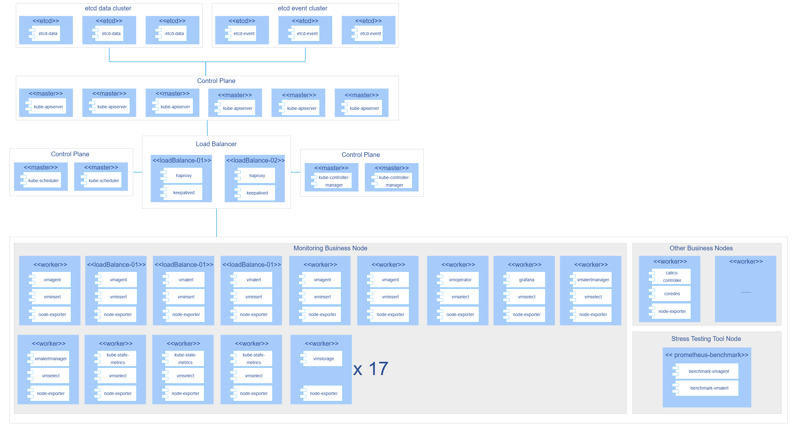

# Best Practices

## Best Practices for Ultra-Large-Scale Cluster Monitoring Based on the VictoriaMetrics Software Stack

This document aims to provide standardized solutions and key considerations for high-availability deployment and configuration of VictoriaMetrics monitoring components in Kubernetes clusters. It also provides the stress testing process and results for VictoriaMetrics components based on prometheus-benchmark to ensure high performance, high reliability, and scalability of the monitoring system itself in ultra-large-scale clusters.

### Objectives

- Provide a VictoriaMetrics monitoring component deployment solution suitable for ultra-large-scale clusters.
- Provide parameter tuning solutions for VictoriaMetrics monitoring components in ultra-large-scale cluster scenarios.
- Provide the stress testing process and results for VictoriaMetrics components in ultra-large-scale cluster scenarios.
- Provide resource formulas required for VictoriaMetrics components under different ingestion rates.

### Prerequisites

- Kubernetes cluster has been deployed, network plugin has been deployed, and VictoriaMetrics, Prometheus, and other monitoring and alerting components have not been deployed in the cluster.
- The physical machines or virtual machines hosting the cluster have a certain amount of allocatable CPU, memory, and storage resources. For specific resource requirements, refer to the table below.

**Table 1** Specific Cluster Resource Requirements

| VMAgent Ingestion Rate | CPU | Memory (GiB) | Storage (GiB) |
|------------------------|-----|--------------|---------------|
| 1M/s                   | 116 | 438          | 1100          |
| 2M/s                   | 148 | 450          | 1620          |
| 3M/s                   | 210 | 510          | 2880          |
| 4M/s                   | 234 | 576          | 3640          |
| 5M/s                   | 310 | 670          | 4260          |

> **Note:**<br>
>
> - The resource amounts in the table are calculated based on replicationFactor=2 (dual replica, 7-day retention). If set to 1, CPU, memory, and disk are all halved.
> - 1M/s ingestion rate > 2M/s internally in VMCluster (dual write), so resources are estimated at double.

### Usage Restrictions

- Deployment Method: This practice mainly targets deployment methods based on Helm Chart.
- Cluster Scale: The recommended resource configurations are suitable for large-scale clusters (1M/s < data ingestion rate < 5M/s). Clusters of other scales require separate tuning.
- etcd Deployment Form: The deployment configuration in this document only supports collecting etcd metrics deployed in binary mode.
- Version Statement: All steps in this document are based on Kubernetes v1.28.15, v1.33.1, v1.34.3, Helm v3.14.2, and VictoriaMetrics v1.222.0 (helm version 0.58.2). Other version combinations have not been attempted, and deployment effects need to be verified. Related content is welcome for additions and discussions!

### Background Information

Prometheus is the de facto standard for cloud-native monitoring, but as scale increases, its scalability, resource overhead, and operation and maintenance costs become increasingly acute. VictoriaMetrics (VM) is not an ecosystem replacement, but rather an enhanced backend for Prometheus: 100% compatible with API, PromQL, and data formats, with Grafana dashboards, alerting rules, and client zero-modification integration. VM focuses on solving the pain points of high cardinality, high throughput, and high availability in large-scale scenarios, supporting a larger monitoring surface with fewer resources.

The following are the advantages of the VM monitoring components used in this document.

- **Resource Utilization Efficiency**
 
  VictoriaMetrics stores data through a big/small dual-directory structure and uses hierarchical ZSTD compression. Data is first written to the small directory and then transferred to the big directory through background merging. This design makes disk usage only 1/5 to 1/7 of Prometheus, significantly saving storage costs and reducing I/O pressure.

- **Native Support for High-Availability Cluster Architecture**
 
   VictoriaMetrics adopts a component separation architecture, decoupling data writing (vminsert), storage (vmstorage), and querying (vmselect), supporting independent scaling of each component, significantly reducing the architectural complexity and operation and maintenance burden in traditional Prometheus high-availability solutions.

- **Scalability**
 
   When monitoring data volume is huge, Prometheus usually needs to expand through sharding solutions, while VM only needs to simply add vmstorage nodes to expand storage capacity, add vminsert nodes to improve write throughput, and add vmselect nodes to improve query concurrency. This linear and simple expansion method is more suitable for ultra-large-scale environments.

- **VMAgent Data Collection**
 
   VMAgent supports Pull/Push collection modes and has capabilities for data deletion, window aggregation, and remote multi-path writing. When remote storage is unavailable, it can automatically downgrade to local temporary data storage and synchronize after recovery, ensuring data reliability. Its unified collection entry design effectively reduces the resource overhead of large-scale monitoring systems.

- **Remote Write Protocol Optimization** 
  
   Compared to the Prometheus remote write protocol, the VM remote write protocol has data compression optimization, increasing CPU overhead by 10%, but reducing network bandwidth overhead by 2-4 times.

### Operation Steps
> **Note:** 
    > 
    > The automated deployment function of VictoriaMetrics components is currently online. When deploying clusters using the bke tool, VictoriaMetrics can be automatically installed and deployed as a plugin. For user guide, see [victoriametrics_controller User Guide](https://gitcode.com/openFuyao/sig-installation/blob/openFuyao-v26.03/docs/en/user_guide/cluster_installation_deployment/victoriametrics_controller_user_guide.md). If you choose manual deployment, please follow the steps below.

This chapter details the complete process of using Helm to install VM cluster version (VictoriaMetrics K8s Stack) online. All components of this monitoring stack are deployed in containerized form in ultra-large-scale Kubernetes clusters. Among them, VMAlert and VMAlertmanager are deployed in high-availability (HA) mode, VMAgent adopts a deployment method combining high availability and horizontal sharding, and kube-state-metrics is also scaled through horizontal sharding. To ensure performance, it is recommended to use SSD to store monitoring data, and each VMStorage instance should have exclusive access to a disk to avoid disk throughput becoming a bottleneck for metric insertion and querying. This architecture has been stress-tested and can support metric ingestion rates of up to 5 million/second. The specific deployment architecture is shown in the figure below.

**Figure 1** VM Stress Test Deployment Architecture



1. Preparation work.

    1.1 Version selection.

    **Table 2** Component Version Selection

    | Component | Version  | Description       |
    |-----------|----------|-------------------|
    | Helm      | v3.14.2  | -                 |
    | k8s       | v1.28.15 | -                 |
    | VM        | v1.222.0 | helm version v0.58.2 |

    1.2 Execute the following command to check kubectl cluster configuration.

    ```bash
    kubectl config current-context  # Check current context configuration
    kubectl cluster-info  # View cluster information
    kubectl get nodes  # Verify node status
    kubectl config view  # Check complete configuration
    ```

    1.3 Execute the following command to install Helm 3.

    ```bash
    # Download installation script
    curl -fsSL -o get_helm.sh https://raw.githubusercontent.com/helm/helm/main/scripts/get-helm-3
    # Execute installation
    chmod 700 get_helm.sh
    ./get_helm.sh
    # Installation verification
    helm version
    ```

2. Download VM package using Helm.

    2.1 Execute the following command to get the installable list with Helm.

    ```bash
    # Use the following command to add chart helm repository:
    helm repo add vm https://victoriametrics.github.io/helm-charts/
    helm repo update
    # vm/victoria-metrics-k8s-stack list chart versions available for installation:
    helm search repo vm/victoria-metrics-k8s-stack -l
    ```

    2.2 Get values.yaml and chart package for the specified version of VM.

    ```bash
    helm show values vm/victoria-metrics-k8s-stack --version 0.58.2 > values.yaml
    helm pull vm/victoria-metrics-k8s-stack --version 0.58.2 --untar
    cd victoria-metrics-k8s-stack
    ```

3. Adjust values.yaml file parameters.

    For the Helm deployment method, Chart is the application template package for the software, and values.yaml is the dynamic configuration parameters injected into this template. Most parameter modifications can be made in values.yaml, but when there are sub-charts, some changes still need to be completed by entering the chart package. Below are the modifications required for each component in the default configuration file.

    3.1 Modify the following fields to complete victoria-metrics-operator parameter modification.
    > **Note:** 
    > 
    > Modify image pull address.

    ```yaml
    victoria-metrics-operator:
      enabled: true
      nodeSelector:
        monitoring.victoria.com/operator: vm-operator
      crds:
        plain: true
        cleanup:
          enabled: true
          image:
            repository: hub.oepkgs.net/openfuyao/bitnami/kubectl  # Modified item
            pullPolicy: IfNotPresent
      serviceMonitor:
        enabled: true
      operator:
        # -- By default, operator converts prometheus-operator objects.
        disable_prometheus_converter: false
    ```

    3.2 Modify the following fields to complete VMSingle parameter modification.
    > **Note:** 
    > 
    > Disable single-node mode.

    ```yaml
    vmsingle:
      # -- VMSingle labels
      labels: { }
      # -- VMSingle annotations
      annotations: { }
      # -- Create VMSingle CR
      enabled: false  # Modified item
      # -- Full spec for VMSingle CRD. Allowed values describe [here](https://docs.victoriametrics.com/operator/api#vmsinglespec)
      spec:
        port: "8429"
        # -- Data retention period. Possible units character: h(ours), d(ays), w(eeks), y(ears), if no unit character specified - month. The minimum retention period is 24h. See these [docs](https://docs.victoriametrics.com/single-server-victoriametrics/#retention)
        retentionPeriod: "1"
        replicaCount: 1
        extraArgs: { }
        storage:
          accessModes:
            - ReadWriteOnce
          resources:
            requests:
              storage: 20Gi
    ```

    3.3 Modify the following fields to complete VMCluster parameter modification.
    > **Note:**  
    > 
    > The modifications include the number of replicas, labels, image pull addresses, storage, CPU and memory resource allocation for VMStorage, VMSelect, and VMInsert components.

    ```yaml
    vmcluster:
      # -- Create VMCluster CR
      enabled: true
      # -- VMCluster labels
      labels: { }
      # -- VMCluster annotations
      annotations: { }
      # -- Full spec for VMCluster CRD. Allowed values described [here](https://docs.victoriametrics.com/operator/api#vmclusterspec)
      spec:
        # -- Data retention period. Possible units character: h(ours), d(ays), w(eeks), y(ears), if no unit character specified - month. The minimum retention period is 24h. See these [docs](https://docs.victoriametrics.com/single-server-victoriametrics/#retention)
        retentionPeriod: "15d"  # Modified item, data retention period
        replicationFactor: 2
        vmstorage:
          replicaCount: 17 # Modified item, vmstorage replica count
          nodeSelector:
            monitoring.victoria.com/vmstorage: vmstorage  # Modified item, vmstorage label selector
          storageDataPath: /vm-data
          image:
            repository: hub.oepkgs.net/openfuyao/victoriametrics/vmstorage  # Modified item
            tag: v1.122.0-cluster
            pullPolicy: IfNotPresent
          storage:
            volumeClaimTemplate:
              spec:
                resources:
                  requests:
                    storage: 720Gi # Modified item, pv size bound to each vmstorage instance
          resources:
            limits:
              cpu: "5" # Modified item, corresponding container CPU cores
              memory: 32Gi  # Modified item, corresponding container memory
            requests:
              cpu: "5" # Modified item, corresponding container CPU cores
              memory: 32Gi  # Modified item, corresponding container memory
          extraArgs:
            inmemoryDataFlushInterval: "10s" # Modified item
            dedup.minScrapeInterval: "20s" # Modified item

        vmselect:
          # -- Set this value to false to disable VMSelect
          enabled: true
          port: "8481"
          replicaCount: 8 # Modified item, corresponding replica count
          nodeSelector:
            monitoring.victoria.com/vmselect: vmselect  # Modified item, corresponding label
          cacheMountPath: /select-cache
          extraArgs: { }
          image:
            repository: hub.oepkgs.net/openfuyao/victoriametrics/vmselect  # Modified item
            tag: v1.122.0-cluster
            pullPolicy: IfNotPresent
          #  maxInsertRequestSize: "32MB"  # Modified
          storage:
            volumeClaimTemplate:
              spec:
                resources:
                  requests:
                    storage: 35Gi  # Modified item, bound PV size
          resources:
            limits:
              cpu: "12" # Modified item, corresponding container CPU cores
              memory: 24Gi  # Modified item, corresponding container memory
            requests:
              cpu: "12" # Modified item, corresponding container CPU cores
              memory: 24Gi  # Modified item, corresponding container memory
        vminsert:
          # -- Set this value to false to disable VMInsert
          enabled: true
          port: "8480"
          replicaCount: 6 # Modified item, replica count
          image:
            repository: hub.oepkgs.net/openfuyao/victoriametrics/vminsert  # Modified item
            tag: v1.122.0-cluster
            pullPolicy: IfNotPresent
          nodeSelector:
            monitoring.victoria.com/vminsert: vminsert  # Modified item, corresponding label
          extraArgs: { }
          resources:
            limits:
              cpu: "4" # Modified item, corresponding container CPU cores
              memory: 8Gi  # Modified item, corresponding container memory
            requests:
              cpu: "4" # Modified item, corresponding container CPU cores
              memory: 8Gi  # Modified item, corresponding container memory
    ```

    3.4 Modify the following fields to complete VMAlert parameter modification.

    > **Note:**  
    > 
    > The modifications include label selectors and configuring notifiers to send alert events only to Alertmanager instances in the vmks namespace with the usage:dedicated label.

    ```yaml
    vmalert:
      # -- VMAlert annotations
      annotations: { }
      # -- VMAlert labels
      labels: { }
      # -- Create VMAlert CR
      enabled: true

      # -- Controls whether VMAlert should use VMAgent or VMInsert as a target for remotewrite
      remoteWriteVMAgent: false
      # -- (object) Full spec for VMAlert CRD. Allowed values described [here](https://docs.victoriametrics.com/operator/api#vmalertspec)
      spec:
        port: "8080"
        selectAllByDefault: true
        nodeSelector:
          monitoring.victoria.com/vmalert: vmalert  # Modified item, corresponding label
        evaluationInterval: 20s
        replicaCount: 2
        image:
          repository: hub.oepkgs.net/openfuyao/victoriametrics/vmalert  # Modified item
          tag: v1.122.0
          pullPolicy: IfNotPresent
        extraArgs:
          http.pathPrefix: "/"
        # Find vmalertmanager through service discovery capability and send alerts to vmalertmanager
        notifiers:
          - selector:
              namespaceSelector:
                matchNames:
                  - vmks  # Modified item, namespace where VM components are deployed
              labelSelector:
                matchLabels:
                  usage: dedicated

        # External labels to add to all generated recording rules and alerts
        externalLabels: { }
    ```

    3.5 Modify the following fields to complete VMAlertmanager parameter modification.

    > **Note:** 
    > 
    > Specific modifications include replica count, node selector, and image pull address.

    ```yaml
    # Partially omitted
    ...
    labels:
      dedicated: dedicated   # Add label for vmalert to find alertmanager
    spec:
      replicaCount: 2  # Modified item, replica count
      port: "9093"
      selectAllByDefault: true
      nodeSelector:
        monitoring.victoria.com/vmalertmanager: vmalertmanager  # Modified item, corresponding label
      image:
        repository: hub.oepkgs.net/openfuyao/prom/alertmanager  # Modified item
        pullPolicy: IfNotPresent
        tag: v0.28.1
      externalURL: ""
      routePrefix: /
    ...
    ```

    3.6 Modify the following fields to complete VMAgent parameter modification.

    > **Note:**  
    > 
    > The modifications include Secret mount related configuration, node labels, replicas and sharding, resource configuration, and pod anti-affinity configuration.

    ```yaml
    vmagent:
      # -- Create VMAgent CR
      enabled: true
      # -- VMAgent labels
      labels: { }
      # -- VMAgent annotations
      annotations: { }
      # -- Remote write configuration of VMAgent, allowed parameters defined in a [spec](https://docs.victoriametrics.com/operator/api#vmagentremotewritespec)
      additionalRemoteWrites:
        - url: http://vminsert-vm-victoria-metrics-k8s-stack.vmks.svc.cluster.local.:8480/insert/0/prometheus/api/v1/write
      # -- (object) Full spec for VMAgent CRD. Allowed values described [here](https://docs.victoriametrics.com/operator/api#vmagentspec)
      spec:
        additionalScrapeConfigs:
          name: etcd-scrape-config  # Modified item, Secret name
          key: etcd-scrape-config.yaml  # Modified item, key in Secret
        port: "8429"
        selectAllByDefault: true
        image:
          repository: hub.oepkgs.net/openfuyao/victoriametrics/vmagent  # Modified item
          tag: v1.122.0
          pullPolicy: IfNotPresent
        nodeSelector: # Modified item, corresponding label
          monitoring.victoria.com/vmagent: vmagent
        # modify to ha
        replicaCount: 2  # Modified item, replica count
        resources:
          limits:
            cpu: "4"  # Modified item
            memory: 8Gi  # Modified item
          requests:
            cpu: "4"  # Modified item
            memory: 8Gi  # Modified item
        # modify to StatefulSet, even if remote storage fails, scraped data will not be lost
        statefulMode: true
        statefulStorage:
          volumeClaimTemplate:
            spec:
              resources:
                requests:
                  storage: 60Gi  # Modified item, local storage size
        # Sharding count for VMAgent
        shardCount: 2   # Modified item, shard count
        # Pod anti-affinity, try not to schedule pods meeting conditions to the same node
        affinity:  # Modified item
          podAntiAffinity:
            preferredDuringSchedulingIgnoredDuringExecution:
              - weight: 100
                podAffinityTerm:
                  labelSelector:
                    matchLabels:
                      app.kubernetes.io/name: vmagent
                      shard-num: "0"
                  topologyKey: kubernetes.io/hostname
              - weight: 100
                podAffinityTerm:
                  labelSelector:
                    matchLabels:
                      app.kubernetes.io/name: vmagent
                      shard-num: "1"
                  topologyKey: kubernetes.io/hostname
        scrapeInterval: 20s
        # For multi-cluster setups it is useful to use "cluster" label to identify the metrics source.
        # For example:
        # cluster: cluster-name
        extraArgs:
          promscrape.streamParse: "true"
          # Do not store original labels in vmagent's memory by default. This reduces the amount of memory used by vmagent
          # but makes vmagent debugging UI less informative. See: https://docs.victoriametrics.com/vmagent/#relabel-debug
          promscrape.dropOriginalLabels: "true"
      # -- (object) VMAgent ingress configuration
    ```

    3.7 Modify the following fields to complete kube-proxy parameter modification.

    > **Note:** 
    > 
    > By default, kube-proxy metrics are not collected. You need to manually enable the switch to collect kube-proxy metrics and use the http protocol to collect metrics.

    ```yaml
    kubeProxy:
      # -- Enable kube proxy metrics scraping
      enabled: true  # Modified item 

      # -- If your kube proxy is not deployed as a pod, specify IPs it can be found on
      endpoints: []
      # - 10.141.4.22
      # - 10.141.4.23
      # - 10.141.4.24

      service:
        # -- Enable service for kube proxy metrics scraping
        enabled: true
        # -- Kube proxy service port
        port: 10249
        # -- Kube proxy service target port
        targetPort: 10249
        # -- Kube proxy service pod selector
        selector:
          k8s-app: kube-proxy

      # -- Spec for VMServiceScrape CRD is [here](https://docs.victoriametrics.com/operator/api.html#vmservicescrapespec)
      vmScrape:
        spec:
          jobLabel: jobLabel
          namespaceSelector:
            matchNames: [kube-system]
          endpoints:
            - bearerTokenFile: /var/run/secrets/kubernetes.io/serviceaccount/token
              # bearerTokenSecret:
              #   key: ""
              port: http-metrics
              scheme: http  # Modified item 
              tlsConfig:
                caFile: /var/run/secrets/kubernetes.io/serviceaccount/ca.crt
    ```

    3.8 Modify the following fields to complete kube-state-metric parameter modification.

    > **Note:** 
    > 
    > The file path is `<rootpath>/victoria-metrics-k8s-stack/charts/kube-state-metrics/values.yaml`. Specific modifications include sharding configuration, replica count, node selector, image pull address, anti-affinity configuration, and resource configuration information.

    ```yaml
    # Default values for kube-state-metrics.
    prometheusScrape: true
    image:
      registry: hub.oepkgs.net/openfuyao  # Modified item
      repository: kube-state-metrics/kube-state-metrics
      # If unset use v + .Charts.appVersion
      tag: "v2.15.0"
      sha: ""
      pullPolicy: IfNotPresent

    imagePullSecrets: [ ]
    # - name: "image-pull-secret"

    global:
      (Partially omitted......)
    # If set to true, this will deploy kube-state-metrics as a StatefulSet and the data
    # will be automatically sharded across <.Values.replicas> pods using the built-in
    # autodiscovery feature: https://github.com/kubernetes/kube-state-metrics#automated-sharding
    # This is an experimental feature and there are no stability guarantees.
    # Enable automatic sharding
    autosharding:
      enabled: true  # Modified item

    replicas: 3 # Modified item, shard count

    # Change the deployment strategy when autosharding is disabled.
    # ref: https://kubernetes.io/docs/concepts/workloads/controllers/deployment/#strategy
    # The default is "RollingUpdate" as per Kubernetes defaults.
    # During a release, 'RollingUpdate' can lead to two running instances for a short period of time while 'Recreate' can create a small gap in data.
    # updateStrategy: Recreate

    # Number of old history to retain to allow rollback
    # Default Kubernetes value is set to 10
    revisionHistoryLimit: 10

    # List of additional cli arguments to configure kube-state-metrics
    # for example: --enable-gzip-encoding, --log-file, etc.
    # all the possible args can be found here: https://github.com/kubernetes/kube-state-metrics/blob/master/docs/cli-arguments.md
    # Modified item
    extraArgs:  # Modified item
      - --pod=$(POD_NAME)  # Modified item
      - --pod-namespace=$(POD_NAMESPACE)  # Modified item
      - --use-apiserver-cache=true  # Modified item

    # If false then the user will opt out of automounting API credentials.
    automountServiceAccountToken: true

      (Partially omitted......)

    ## Node labels for pod assignment
    ## Ref: https://kubernetes.io/docs/user-guide/node-selection/
    # Add node selector
    nodeSelector:
      monitoring.victoria.com/metrics: kube-state-metrics  # Modified item

    ## Affinity settings for pod assignment
    ## Can be defined as either a dict or string. String is useful for `tpl` templating.
    ## Ref: https://kubernetes.io/docs/concepts/configuration/assign-pod-node/
    # Configure anti-affinity
    affinity:  # Modified item
      podAntiAffinity:
        requiredDuringSchedulingIgnoredDuringExecution:
          - labelSelector:
              matchExpressions:
                - key: app.kubernetes.io/name
                  operator: In
                  values:
                    - kube-state-metrics
            topologyKey: "kubernetes.io/hostname"

    ## Tolerations for pod assignment
    ## Ref: https://kubernetes.io/docs/concepts/configuration/taint-and-toleration/
    tolerations: [ ]

                  (Partially omitted......)

    resources:
      # We usually recommend not to specify default resources and to leave this as a conscious
      # choice for the user. This also increases chances charts run on environments with little
      # resources, such as Minikube. If you do want to specify resources, uncomment the following
      # lines, adjust them as necessary, and remove the curly braces after 'resources:'.
      # Modify storage information
      limits:
        cpu: "4"  # Modified item
        memory: 12Gi  # Modified item
      requests:
        cpu: "4"  # Modified item
        memory: 12Gi  # Modified item
    ```

    3.9 Modify the following fields to complete Grafana parameter modification.
    
    > **Note:** 
    >
    > The file path is `<rootpath>/victoria-metrics-k8s-stack/charts/grafana/values.yaml`. The specific modifications are to open the NodePort port and replace the image pull address.

    ```yaml
    # Partially omitted
    ...
    podPortName: grafana
    gossipPortName: gossip
    service:
      enabled: true
      type: NodePort  # Modified item
      ipFamilyPolicy: ""
      ipFamilies: []
      loadBalancerIP: ""
      loadBalancerClass: ""
      loadBalancerSourceRanges: []
      port: 80
      targetPort: 3000
      nodePort: 30010  # Modified item, newly added open port number
    ...
    # Partially omitted
    ...
    image:
      # -- The Docker registry
      registry: hub.oepkgs.net/openfuyao  # Modified item
      # -- Docker image repository
      repository: grafana/grafana
      # Overrides the Grafana image tag whose default is the chart appVersion
      tag: ""
      sha: ""
      pullPolicy: IfNotPresent

      ## Optionally specify an array of imagePullSecrets.
      ## Secrets must be manually created in the namespace.
      ## ref: https://kubernetes.io/docs/tasks/configure-pod-container/pull-image-private-registry/
      ## Can be templated.
      ##
      pullSecrets: []
      #   - myRegistrKeySecretName
    ...
    # Partially omitted
    ...
    nodeSelector:  # Modified item
      monitoring.victoria.com/vm-grafana: vm-grafana
    ```
    3.10 Modify the following content to complete Grafana dashboard modification.
     
    > **Note:**
    > 
    >  Due to the possible difference between the hostname of the host machine and the corresponding node name in the cluster, some display issues may occur on the Grafana dashboard, and some modifications need to be made to the Grafana default dashboard.
    >
    >  When using Grafana's default configured dashboards, during VM installation, the default dashboard configurations will be automatically pulled from the Grafana image under the path victoria-metrics-k8s-stack/files/dashboards/generated. Each dashboard corresponds to a yaml file, which contains the panel configuration, variable configuration, and other information. Note that these yaml files are not complete files but template files, which still contain many parameters that need to be rendered and do not include the standard header of json files, so they cannot be used directly to create configmaps.

    3.10.1 To modify the default dashboard, you need to first enter the victoria-metrics-k8s-stack/files/dashboards/generated path to obtain the node dashboard configuration file kubernetes-views-nodes.yaml, copy the file, and modify the following Variables configuration related fields (related variable configurations are located at the end of the file).

    ```
    - current: {}
        datasource:
          type: prometheus
          uid: ${datasource}
        definition: label_values(node_uname_info{instance="$node_ip:9100"},instance)
        hide: 2
        includeAll: false
        multi: false
        name: instance
        options: []
        query:
          query: label_values(node_uname_info{instance="$node_ip:9100"},instance)
          refId: StandardVariableQuery
        refresh: 2
        regex: ''
        skipUrlSync: false
        sort: 1
        type: query
      - current: {}
        datasource:
          type: prometheus
          uid: ${datasource}
        definition: label_values(kube_node_info{node="$node"},internal_ip)
        hide: 2
        includeAll: false
        multi: false
        name: node_ip
        options: []
        query:
          query: label_values(kube_node_info{node="$node"},internal_ip)
          refId: StandardVariableQuery
        refresh: 2
        regex: ''
        skipUrlSync: false
        sort: 1
        type: query
    ```
    3.10.2 Save the file as kubernetes-views-nodes-static.yaml and place it under the path victoria-metrics-k8s-stack/files/dashboards. To make the dashboard apply this panel configuration file, you also need to configure it in the defaultDashboards.dashboards field in VM's values.yaml file.
    ```
    defaultDashboards:
      # -- Enable custom dashboards installation
      enabled: true
      defaultTimezone: utc
      labels: {}
      annotations: {}
      grafanaOperator:
        # -- Create dashboards as CRDs (requires grafana-operator to be installed)
        enabled: false
        spec:
          instanceSelector:
            matchLabels:
              dashboards: grafana
          allowCrossNamespaceImport: false
      # -- Create dashboards as ConfigMap despite dependency it requires is not installed
      dashboards:
        # Enable new dashboard
        kubernetes-views-nodes-static:
          enabled: true
        # Disable default dashboard
        kubernetes-views-nodes:
          enabled: false
    ```


    3.11 Modify the following fields to complete VM operator parameter modification.

    > **Note:** 
    > 
    > The file path is `<rootpath>/victoria-metrics-k8s-stack/charts/victoria-metrics-operator/values.yaml`. Specific modifications include replica count, node selector, and image pull address.

    ```yaml

    global:
      # -- Image pull secrets, that can be shared across multiple helm charts
      imagePullSecrets: []
      image:
        # -- Image registry, that can be shared across multiple helm charts
        registry: "hub.oepkgs.net/openfuyao"  # Modified item
      # -- Openshift security context compatibility configuration
      compatibility:
        openshift:
          adaptSecurityContext: "auto"
      cluster:
        # -- K8s cluster domain suffix, uses for building storage pods' FQDN. Details are [here](https://kubernetes.io/docs/tasks/administer-cluster/dns-custom-nameservers/)
        dnsDomain: cluster.local.
    # Default values for victoria-metrics.
    # This is a YAML-formatted file.
    # Declare variables to be passed into your templates.
    # -- operator image configuration
    image:
      # -- Image registry
      registry: "hub.oepkgs.net/openfuyao"  # Modified item
      # -- Image repository
      repository: victoriametrics/operator
      # -- Image tag
      # override Chart.AppVersion
      tag: "v0.61.2"  # Modified item
      # Variant of the image to use.
      # e.g. scratch
      variant: ""
      # -- Image pull policy
      pullPolicy: IfNotPresent

    crds:
      # -- manages CRD creation. Disables CRD creation only in combination with `crds.plain: false` due to helm dependency conditions limitation
      enabled: true
      # -- check if plain or templated CRDs should be created.
      # with this option set to `false`, all CRDs will be rendered from templates.
      # with this option set to `true`, all CRDs are immutable and require manual upgrade.
      plain: false
      # -- additional CRD annotations, when `.Values.crds.plain: false`
      annotations: {}
      cleanup:
        # -- Tells helm to clean up all the vm resources under this release's namespace when uninstalling
        enabled: false
        # -- Image configuration for CRD cleanup Job
        image:
          repository: hub.oepkgs.net/openfuyao/bitnami/kubectl  # Modified item
          # use image tag that matches k8s API version by default
          tag: "1.28"  # Modified item
          pullPolicy: IfNotPresent
        # -- Cleanup hook resources
        resources:
          limits:
            cpu: "500m"
            memory: "256Mi"
          requests:
            cpu: "100m"
            memory: "56Mi"


    # Partially omitted
    ...
    nodeSelector:  # Modified item
      monitoring.victoria.com/vm-operator: vm-operator
    ...
    ```

    3.12 Modify the following fields to complete prometheus-node-exporter parameter modification.
    > **Note:** 
    >
    > The file path is `<rootpath>/victoria-metrics-k8s-stack/charts/prometheus-node-exporter/values.yaml`. Modify the image pull address.

    ```yaml
    # Partially omitted
    ...
    global:
      # To help compatibility with other charts which use global.imagePullSecrets.
      # Allow either an array of {name: pullSecret} maps (k8s-style), or an array of strings (more common helm-style).
      # global:
      #   imagePullSecrets:
      #   - name: pullSecret1
      #   - name: pullSecret2
      # or
      # global:
      #   imagePullSecrets:
      #   - pullSecret1
      #   - pullSecret2
      imagePullSecrets: []
      #
      # Allow parent charts to override registry hostname
      imageRegistry: "hub.oepkgs.net/openfuyao"  # Modified item
    # Partially omitted
    ...
    ```


4. Declare PV

    4.1 When deploying VM's VMStorage, VMSelect, and VMAgent components, PVCs will be generated. You need to bind PVCs by declaring PVs. Refer to the PV declaration file below.

    ```yaml
    apiVersion: v1
    kind: PersistentVolume
    metadata:
      name: pv-vmselect-5  # Modify pv name
    spec:
      capacity:
        storage: 35Gi  # Modify storage size
      volumeMode: Filesystem
      accessModes:
        - ReadWriteOnce
      persistentVolumeReclaimPolicy: Retain
      claimRef: # Bind pv to pvc. When the corresponding pod needs cross-node scheduling, this item should not be set
        name: vmselect-cachedir-vmselect-vm-victoria-metrics-k8s-stack-5    # Replace with your expected PVC name
        namespace: vmks # Replace with the namespace where the PVC is located
      local:
        path: /mnt/data/vmselect-5  # Replace with the actual path
      nodeAffinity:
        required:
          nodeSelectorTerms:
            - matchExpressions:
                - key: kubernetes.io/hostname
                  operator: In
                  values:
                    - vmselect-5  # Replace with the actual node name where the PV is located
    ```

    4.2 You can execute the following script to automatically create PVs for the corresponding components. Before executing the script, you need to modify variables such as COMPONENT, NAMESPACE, STORAGE_SIZE, BASE_PATH, NODE_LIST, and PV_COUNT. This script creates one PV for one component on each node by default.

    >  **NOTICE:**
    > 
    > - You need to declare PVs for all VMStorage, VMSelect, and VMAgent Pods.
    > - You need to create the corresponding actual path under the directory of each node (such as: mkdir -p /mnt/data/vmselect-5).

    ```shell
    #!/bin/bash

    # === Necessary parameter definitions ===
    COMPONENT="vmselect"               # Optional values: vmselect / vmstorage / vmagent
    NAMESPACE="vmks"                   # Namespace where PVC is located
    STORAGE_SIZE="35Gi"                # Storage capacity per PV
    BASE_PATH="/mnt/data"              # Mount path prefix on each node
    NODE_LIST=("node-a" "node-b")      # Actual node name list
    PV_COUNT=5                         # How many PVs to create per node

    # === Loop logic for creating PVs ===
    INDEX=0
    for NODE in "${NODE_LIST[@]}"; do
        INDEX=$((INDEX + 1))
        PV_NAME="pv-${COMPONENT}-${NODE}-${INDEX}"
        PVC_NAME="${COMPONENT}-cachedir-${COMPONENT}-vm-victoria-metrics-k8s-stack-${INDEX}"
        LOCAL_PATH="${BASE_PATH}/${COMPONENT}-${INDEX}"
        YAML_FILE="${PV_NAME}.yaml"

        cat <<EOF > "${YAML_FILE}"
    apiVersion: v1
    kind: PersistentVolume
    metadata:
      name: ${PV_NAME}
    spec:
      capacity:
        storage: ${STORAGE_SIZE}
      volumeMode: Filesystem
      accessModes:
        - ReadWriteOnce
      persistentVolumeReclaimPolicy: Retain
      claimRef:
        name: ${PVC_NAME}
        namespace: ${NAMESPACE}
      local:
        path: ${LOCAL_PATH}
      nodeAffinity:
        required:
          nodeSelectorTerms:
            - matchExpressions:
                - key: kubernetes.io/hostname
                  operator: In
                  values:
                    - ${NODE}
    EOF

        echo "✅ Generated PV: ${YAML_FILE}"

        # Optional: auto apply
        # kubectl apply -f "${YAML_FILE}"
    done
    ```

5. Label nodes.

    > **Note:**
    > 
    > In ultra-large-scale cluster scenarios, monitoring components will occupy a large amount of CPU, memory, storage, and network resources on a node, so it is recommended to plan monitoring component nodes separately. When modifying values.yaml, we configured different label selectors for different components, so we need to label nodes accordingly before executing installation.

    5.1 Execute the following command to label all nodes running VMAgent pods.

    ```
    # Node list variable, replace with node names in the cluster
    NODES="node-01 node-02 node-03"

    # Label key-value pair
    LABEL_KEY="monitoring.victoria.com/vmagent"
    LABEL_VALUE="vmagent"

    for NODE in $NODES; do
      echo "Labeling node $NODE with $LABEL_KEY=$LABEL_VALUE ..."
      kubectl label node "$NODE" "$LABEL_KEY=$LABEL_VALUE" --overwrite
    done
    ```

    5.2 Execute the following command to label all nodes running VMInsert pods.

    ```
    # Node list variable, replace with node names in the cluster
    NODES="node-01 node-02 node-03"

    # Label key-value pair
    LABEL_KEY="monitoring.victoria.com/vminsert"
    LABEL_VALUE="vminsert"

    for NODE in $NODES; do
      echo "Labeling node $NODE with $LABEL_KEY=$LABEL_VALUE ..."
      kubectl label node "$NODE" "$LABEL_KEY=$LABEL_VALUE" --overwrite
    done
    ```

    5.3 Execute the following command to label all nodes running VMStorage pods.

    ```
    # Node list variable, replace with node names in the cluster
    NODES="node-01 node-02 node-03"

    # Label key-value pair
    LABEL_KEY="monitoring.victoria.com/vmstorage"
    LABEL_VALUE="vmstorage"

    for NODE in $NODES; do
      echo "Labeling node $NODE with $LABEL_KEY=$LABEL_VALUE ..."
      kubectl label node "$NODE" "$LABEL_KEY=$LABEL_VALUE" --overwrite
    done
    ```

    5.4 Execute the following command to label all nodes running VMSelect pods.

    ```
    # Node list variable, replace with node names in the cluster
    NODES="node-01 node-02 node-03"

    # Label key-value pair
    LABEL_KEY="monitoring.victoria.com/vmselect"
    LABEL_VALUE="vmselect"

    for NODE in $NODES; do
      echo "Labeling node $NODE with $LABEL_KEY=$LABEL_VALUE ..."
      kubectl label node "$NODE" "$LABEL_KEY=$LABEL_VALUE" --overwrite
    done
    ```

    5.5 Execute the following command to label all nodes running VMAlert pods.

    ```
    # Node list variable, replace with node names in the cluster
    NODES="node-01 node-02 node-03"

    # Label key-value pair
    LABEL_KEY="monitoring.victoria.com/vmalert"
    LABEL_VALUE="vmalert"

    for NODE in $NODES; do
      echo "Labeling node $NODE with $LABEL_KEY=$LABEL_VALUE ..."
      kubectl label node "$NODE" "$LABEL_KEY=$LABEL_VALUE" --overwrite
    done
    ```

    5.6 Execute the following command to label all nodes running VMAlertmanager pods.

    ```
    # Node list variable, replace with node names in the cluster
    NODES="node-01 node-02 node-03"

    # Label key-value pair
    LABEL_KEY="monitoring.victoria.com/vmalertmanager"
    LABEL_VALUE="vmalertmanager"

    for NODE in $NODES; do
      echo "Labeling node $NODE with $LABEL_KEY=$LABEL_VALUE ..."
      kubectl label node "$NODE" "$LABEL_KEY=$LABEL_VALUE" --overwrite
    done
    ```

    5.7 Execute the following command to label all nodes running kube-state-metrics pods.

    ```
    # Node list variable, replace with node names in the cluster
    NODES="node-01 node-02 node-03"

    # Label key-value pair
    LABEL_KEY="monitoring.victoria.com/metrics"
    LABEL_VALUE="kube-state-metrics"

    for NODE in $NODES; do
      echo "Labeling node $NODE with $LABEL_KEY=$LABEL_VALUE ..."
      kubectl label node "$NODE" "$LABEL_KEY=$LABEL_VALUE" --overwrite
    done
    ```

    5.8 Execute the following command to label nodes running operator pods.

    ```
    # Node list variable, replace with node names in the cluster
    NODES="node-01 node-02 node-03"

    # Label key-value pair
    LABEL_KEY="monitoring.victoria.com/vm-operator"
    LABEL_VALUE="vm-operator"

    for NODE in $NODES; do
      echo "Labeling node $NODE with $LABEL_KEY=$LABEL_VALUE ..."
      kubectl label node "$NODE" "$LABEL_KEY=$LABEL_VALUE" --overwrite
    done
    ```

    5.9 Execute the following command to label nodes running grafana pods.

    ```
    # Node list variable, replace with node names in the cluster
    NODES="node-01 node-02 node-03"

    # Label key-value pair
    LABEL_KEY="monitoring.victoria.com/vm-grafana"
    LABEL_VALUE="vm-grafana"

    for NODE in $NODES; do
      echo "Labeling node $NODE with $LABEL_KEY=$LABEL_VALUE ..."
      kubectl label node "$NODE" "$LABEL_KEY=$LABEL_VALUE" --overwrite
    done
    ```

6. VM installation and update.

    6.1 Execute the following command to complete the first installation.

    ```
    kubectl create ns vmks
    helm install vm ./victoria-metrics-k8s-stack -f values.yaml -n vmks
    ```

    6.2 Execute the following command to update configuration after modifying the configuration file.

    ```
    helm upgrade vm ./victoria-metrics-k8s-stack -f values.yaml -n vmks
    ```

7. Scrape etcd metrics configuration.

    > **Note:**
    > 
    > Ultra-large-scale cluster etcd is deployed in binary mode, so you need to configure scrape separately to scrape etcd metrics. VMAgent needs to use etcd certificates to collect etcd metrics. We mount etcd certificates to VMAgent pods through secret mounting.

    7.1 Execute the following command to store etcd certificates and K8s root CA certificates in secret.

    ```
    # Replace with actual certificate names and certificate paths
    kubectl -n vmks create secret generic vmagent-tls-secrets \
      --from-file=etcd-ca.crt=/etc/kubernetes/pki/etcd/etcd-ca.crt \
      --from-file=etcd-client.crt=/etc/kubernetes/pki/apiserver-etcd-client.crt \
      --from-file=etcd-client.key=/etc/kubernetes/pki/apiserver-etcd-client.key \
      --from-file=k8s-ca.crt=/etc/kubernetes/pki/ca.crt
    ```

    7.2 Edit the etcd scrape yaml file `etcd-scrape-config.yaml` with the following content.

    ```
    - job_name: 'etcd-external'
      kubernetes_sd_configs: []
      static_configs:
        - targets:
          - '192.168.201.12:2379'  # etcd node ip address and port number
          - '192.168.201.10:2379'  # etcd node ip address and port number
      scheme: https
      tls_config:
        ca_file: /etc/vmagent/tls/etcd-ca.crt  
        cert_file: /etc/vmagent/tls/etcd-client.crt  
        key_file: /etc/vmagent/tls/etcd-client.key  
    ```

    7.3 Execute the following command to save the etcd scrape yaml file to secret.

    ```shell
    kubectl create secret generic etcd-scrape-config \
      --from-file=etcd-scrape-config.yaml
    ```

    7.4 Execute the following command to edit VMAgent cr.

    ```
    # Find cr
    kubectl get vmagent -n vmks
    # Edit cr
    kubectl edit vmagent vm-victoria-metrics-k8s-stack -n vmks
    ```

    7.5 Add secret mount configuration with the following specific modifications.

    ```
    spec:
        additionalScrapeConfigs:        # Added item
          key: etcd-scrape-config.yaml  # Added item
          name: etcd-scrape-config      # Added item
        externalLabels: {}
        extraArgs:
          promscrape.dropOriginalLabels: "true"
          promscrape.streamParse: "true"
        image:
          tag: v1.122.0
        license: {}
        port: "8429"
        remoteWrite:
        - url: http://vminsert-vm-victoria-metrics-k8s-stack.vmks.svc.cluster.local.:8480/insert/0/prometheus/api/v1/write
        scrapeInterval: 20s
        selectAllByDefault: true
        serviceSpec:
          spec:
            ports:
            - name: http
              port: 8429
              protocol: TCP
              targetPort: 8429
            type: ClusterIP
        volumeMounts:  # Added item
        - mountPath: /etc/vmagent/tls  # Added item
          name: vmagent-tls-certs  # Added item
        volumes:  # Added item
        - name: vmagent-tls-certs  # Added item
          secret:  # Added item
            secretName: vmagent-tls-secrets  # Added item
    ```

8. Scrape kube-controller-manager metrics configuration.

    8.1 Execute the following command to edit the vmservicescrapes cr corresponding to kube-controller-manager: vmks-victoria-metrics-k8s-stack-kube-controller-manager.

    ```
    kubectl edit vmservicescrapes vm-victoria-metrics-k8s-stack-kube-controller-manager -n vmks
    ```

    8.2 Modify the vmservicescrapes cr as follows.

    ```
    spec:
      endpoints:
      - bearerTokenFile: /var/run/secrets/kubernetes.io/serviceaccount/token
        port: http-metrics
        scheme: https
        tlsConfig:
          caFile: /etc/vmagent/tls/k8s-ca.crt  # Added item
          (serverName: kubernetes  # Delete)  # Deleted item
      jobLabel: jobLabel
      namespaceSelector:
        matchNames:
        - kube-system
    ```

    8.3 Execute the following command to generate a private key on the node where controller-manager is located. All nodes running controller-manager Pods need to run the following command.

    ```
    openssl genrsa -out /etc/kubernetes/pki/controller-manager.key 2048
    ```

    8.4 Create a CSR configuration file on the node where controller-manager is located, for example, controller-manager-csr.conf.
      
    > **Note:**
    > 
    > If there are multiple controller-manager nodes, write multiple controller-manager node IP addresses.
    
    ```
    [req]
    req_extensions = v3_req
    distinguished_name = req_distinguished_name
    prompt = no

    [req_distinguished_name]
    CN = system:kube-controller-manager

    [v3_req]
    keyUsage = keyEncipherment, dataEncipherment, digitalSignature
    extendedKeyUsage = clientAuth, serverAuth
    subjectAltName = @alt_names

    [alt_names]
    DNS.1 = kube-controller-manager
    IP.1 = 127.0.0.1
    IP.2 = <Your kube-controller-manager node IP1>
    IP.3 = <Your kube-controller-manager node IP2>
    ```

    8.5 Generate a CSR file on the node where controller-manager is located. Execute the following command on all nodes running controller-manager Pods.

    ```
    openssl req -new -key /etc/kubernetes/pki/controller-manager.key \
      -out /etc/kubernetes/pki/controller-manager.csr \
      -config controller-manager-csr.conf
    ```

    8.6 Sign the certificate using CA on the node where controller-manager is located. Execute the following command on all Pods running controller-manager.

    ```
    openssl x509 -req -in /etc/kubernetes/pki/controller-manager.csr \
      -CA /etc/kubernetes/pki/ca.crt -CAkey /etc/kubernetes/pki/ca.key \
      -CAcreateserial -out /etc/kubernetes/pki/controller-manager.crt \
      -days 365 -extensions v3_req -extfile controller-manager-csr.conf
    ```

    8.7 Edit `/etc/kubernetes/manifests/kube-controller-manager.yaml` to modify controller-manager startup parameters.
    
    > **Note:**
    >
    > All controller-manager static Pod yaml files need to be modified.

    ```
    spec:
      containers:
      - command:
        - kube-controller-manager
        - --authentication-kubeconfig=/etc/kubernetes/controller-manager.conf
        - --authorization-kubeconfig=/etc/kubernetes/controller-manager.conf
        - --bind-address=0.0.0.0  # Modified item
        - --client-ca-file=/etc/kubernetes/pki/ca.crt
        - --cluster-name=kubernetes
        - --cluster-signing-cert-file=/etc/kubernetes/pki/ca.crt
        - --cluster-signing-key-file=/etc/kubernetes/pki/ca.key
        - --controllers=*,bootstrapsigner,tokencleaner
        - --kubeconfig=/etc/kubernetes/controller-manager.conf
        - --leader-elect=true
        - --requestheader-client-ca-file=/etc/kubernetes/pki/front-proxy-ca.crt
        - --root-ca-file=/etc/kubernetes/pki/ca.crt
        - --service-account-private-key-file=/etc/kubernetes/pki/sa.key
        - --use-service-account-credentials=true
        - --tls-cert-file=/etc/kubernetes/pki/controller-manager.crt  # Added item
        - --tls-private-key-file=/etc/kubernetes/pki/controller-manager.key  # Added item
    ```

9. Scrape kube-scheduler metrics configuration.

    9.1 Execute the following command to modify the vmservicescrapes cr corresponding to kube-scheduler: vmks-victoria-metrics-k8s-stack-kube-scheduler.

    ```
    kubectl edit vmservicescrapes vm-victoria-metrics-k8s-stack-kube-scheduler -n vmks
    ```

    9.2 Modify as follows.

    ```
    spec:
      endpoints:
      - bearerTokenFile: /var/run/secrets/kubernetes.io/serviceaccount/token
        port: http-metrics
        scheme: https
        tlsConfig:
          caFile: /etc/vmagent/tls/k8s-ca.crt  # Modified item
    ```

    9.3 Generate a private key on the node where kube-scheduler is located. All nodes running kube-scheduler pods need to run the following command.

    ```
    openssl genrsa -out /etc/kubernetes/pki/scheduler.key 2048
    ```

    9.4 Create a CSR configuration file on the node where kube-scheduler is located: scheduler-csr.conf.
    > **Note:**
    > 
    > If there are multiple kube-scheduler nodes, write multiple kube-scheduler node IP addresses.

    ```
    [req]
    req_extensions = v3_req
    distinguished_name = req_distinguished_name
    prompt = no

    [req_distinguished_name]
    CN = system:kube-scheduler

    [v3_req]
    keyUsage = keyEncipherment, dataEncipherment, digitalSignature
    extendedKeyUsage = clientAuth, serverAuth
    subjectAltName = @alt_names

    [alt_names]
    DNS.1 = kube-scheduler
    IP.1 = 127.0.0.1
    IP.2 = <Your kube-scheduler node IP1>
    IP.3 = <Your kube-scheduler node IP2>
    ```

    9.5 Generate a CSR file on the node where kube-scheduler is located. All nodes running kube-scheduler Pods need to run the following command.

    ```
    openssl req -new -key /etc/kubernetes/pki/scheduler.key \
      -out /etc/kubernetes/pki/scheduler.csr \
      -config scheduler-csr.conf
    ```

    9.6 Sign the certificate using CA on the node where kube-scheduler is located. All nodes running kube-scheduler Pods need to run the following command.

    ```
    openssl x509 -req -in /etc/kubernetes/pki/scheduler.csr \
      -CA /etc/kubernetes/pki/ca.crt -CAkey /etc/kubernetes/pki/ca.key \
      -CAcreateserial -out /etc/kubernetes/pki/scheduler.crt \
      -days 365 -extensions v3_req -extfile scheduler-csr.conf
    ```

    9.7 Edit `/etc/kubernetes/manifests/kube-scheduler.yaml` to modify kube-scheduler startup parameters.
    > **Note:**
    >
    >  All kube-scheduler static Pod yaml files need to be modified.

    ```yaml
    spec:
      containers:
        - command:
            - kube-scheduler
            - --authentication-kubeconfig=/etc/kubernetes/scheduler.conf
            - --authorization-kubeconfig=/etc/kubernetes/scheduler.conf
            - --bind-address=0.0.0.0  # Modified item
            - --kubeconfig=/etc/kubernetes/scheduler.conf
            - --leader-elect=true
            - --tls-cert-file=/etc/kubernetes/pki/scheduler.crt  # Added item
            - --tls-private-key-file=/etc/kubernetes/pki/scheduler.key  # Added item
          image: harbor.openfuyao.com/openfuyao/kubernetes/kube-scheduler:v1.28.15
          imagePullPolicy: IfNotPresent
          livenessProbe:
            failureThreshold: 8
            httpGet:
              host: 127.0.0.1
              path: /healthz
              port: 10259
              scheme: HTTPS
            initialDelaySeconds: 10
            periodSeconds: 10
            timeoutSeconds: 15
          name: kube-scheduler
          resources:
            requests:
              cpu: 100m
          startupProbe:
            failureThreshold: 24
            httpGet:
              host: 127.0.0.1
              path: /healthz
              port: 10259
              scheme: HTTPS
            initialDelaySeconds: 10
            periodSeconds: 10
            timeoutSeconds: 15
          volumeMounts:
            - mountPath: /etc/kubernetes/scheduler.conf
              name: kubeconfig
              readOnly: true
            - mountPath: /etc/kubernetes/pki  # Added item
              name: k8s-certs  # Added item
              readOnly: true  # Added item
      hostNetwork: true
      priority: 2000001000
      priorityClassName: system-node-critical
      securityContext:
        seccompProfile:
          type: RuntimeDefault
      volumes:
        - hostPath:
            path: /etc/kubernetes/scheduler.conf
            type: FileOrCreate
          name: kubeconfig
        - hostPath: # Added item
            path: /etc/kubernetes/pki  # Added item
            type: DirectoryOrCreate  # Added item
          name: k8s-certs  # Added item
    ```

10. Log in to Grafana to view monitoring data.
    
    10.1 Execute the following command to get the login password.

    ```
    kubectl get secret vm-grafana -n vmks -o jsonpath="{.data.admin-password}" | base64 --decode
    ```

    10.2 Open a browser and navigate to `http://<cluster node ip>:30010`, for example: `http://192.168.201.17:30010`. Enter the username `admin` and the password obtained in the previous step to log in to the Grafana visualization panel.

### Follow-up Steps

The follow-up steps mainly describe how to use prometheus-benchmark to stress test VM. If you do not stress test VM, you can skip this step.

> **Note:**
> 
> Prometheus-benchmark is an open-source toolset designed specifically for evaluating the performance of Prometheus-compatible storage systems. It is mainly used to simulate monitoring data ingestion (write) and query loads in real production environments to test the scalability, stability, and resource efficiency of time-series databases (such as VictoriaMetrics, Grafana Mimir, etc.). It has the following characteristics:
>
>- Real data source: Collects real system metrics (such as CPU, memory, disk, etc.) from physical nodes or containers through node_exporter, rather than synthetic data, ensuring tests are close to production environments.
>- Dynamic target management: Supports configuring metric churn rate, regularly updating scrape targets (such as updating 1% of targets every 10 minutes), to test system stability in handling time-series changes.
>- Query load: Built-in Prometheus alert rules, periodically executing queries (such as queryInterval: 15s), to test storage system query performance.

1. Install prometheus-benchmark.

    1.1 Execute the following command to download the prometheus-benchmark chart package.

    ```shell
    git clone https://github.com/VictoriaMetrics/prometheus-benchmark
    ```

    1.2 Modify values.yaml to configure different ingestion rates, metric churn rates, and query loads. [Click to get values.yaml configuration details](#valuesyaml-configuration-details).
      
    > **Note:**
    > 
    > According to [prometheus-benchmark generates 1 billion active time series, generating 100 million samples per second resource requirements](https://victoriametrics.com/blog/benchmark-100m/), it is estimated that the resource size required for a 5M samples per second data write pod is approximately 8U25G (Mem).

    1.3 After completing values.yaml modifications, you can execute the installation.
    Execute the following command. During the stress test, you can view the VictoriaMetrics-cluster dashboard metrics in Grafana to evaluate VM's stability.

    ```shell
    # Can be deployed directly in the test monitoring component cluster
    cd prometheus-benchmark
    make install
    ```

    1.4 Execute the following command to uninstall prometheus-benchmark.

    ```shell
    cd prometheus-benchmark
    make delete
    ```

2. Stress test different ingestion rates, VM component resource usage.

  - 1M/s ingestion rate, 15 queries/s, 31 million active time series, median CPU, memory, network, and storage resource actual usage.
       
      **Table 3** Component Resource Usage at 1M/s Ingestion Rate

      | Metric                                              | vmselect  | vmstorage  | vminsert  | vmalert   | vmagent   |
      |-----------------------------------------------------|-----------|------------|-----------|-----------|-----------|
      | Memory Used                                         | 39.168GiB | 159.50 GiB | 1.95 GiB  | 244.93MiB | 1.1 GiB   |
      | CPU Used                                            | 22.944    | 22.6148    | 2.0322    | 0.4471    | 2.3       |
      | Network usage (All).write to vmselect               | -         | 522 Mb/s   | -         | -         | -         |
      | Network usage (All).read from vminsert              | -         | 214 Mb/s   | -         | -         | -         |
      | Network usage (All).read from vmselect              | -         | 3.31 Mb/s  | -         | -         | -         |
      | Network usage (All).write to http                   | -         | 104 kb/s   | -         | -         | -         |
      | Network usage (All).write to vminsert               | -         | 6.47 kb/s  | -         | -         | -         |
      | Network usage (All).write to http                   | -         | 5.37 kb/s  | -         | -         | -         |
      | Network usage (All).out.mean                        | -         | -          | -         | -         | 112 Mb/s  |
      | Network usage (All).in.mean                         | -         | -          | -         | -         | 56.7 Mb/s |
      | Network usage: vmstorage (All).read from vmstorage  | 521 Mb/s  | -          | 6.48 kb/s | -         | -         |
      | Network usage: vmstorage (All).write from vmstorage | 3.31 Mb/s | -          | 214 Mb/s  | -         | -         |
      | Disk space usage                                    | -         | 3GiB/h     | -         | -         | -         |

  - 2M/s ingestion rate, 15 queries/s, 64.3 million active time series, median CPU, memory, network, and storage resource actual usage.

      **Table 4** Component Resource Usage at 2M/s Ingestion Rate

      | Metric                                              | vmselect  | vmstorage   | vminsert | vmalert  | vmagent  |
      |-----------------------------------------------------|-----------|-------------|----------|----------|----------|
      | Memory Used                                         | 53.76 GiB | 139.264 GiB | 1.8 GiB  | 86.09MiB | 0.48 GiB |
      | CPU Used                                            | 26.784    | 28.305      | 2.568    | 0.1362   | 4        |
      | Network usage (All).write to vmselect               | -         | 641Mb/s     | -        | -        | -        |
      | Network usage (All).read from vminsert              | -         | 456Mb/s     | -        | -        | -        |
      | Network usage (All).read from vmselect              | -         | 3.60Mb/s    | -        | -        | -        |
      | Network usage (All).write to http                   | -         | 108kb/s     | -        | -        | -        |
      | Network usage (All).write to vminsert               | -         | 9.01kb/s    | -        | -        | -        |
      | Network usage (All).write to http                   | -         | 5.37kb/s    | -        | -        | -        |
      | Network usage (All).out.mean                        | -         | -           | -        | -        | 222Mb/s  |
      | Network usage (All).in.mean                         | -         | -           | -        | -        | 111Mb/s  |
      | Network usage: vmstorage (All).read from vmstorage  | 640Mb/s   | -           | 9.71kb/s | -        | -        |
      | Network usage: vmstorage (All).write from vmstorage | 3.62Mb/s  | -           | 455Mb/s  | -        | -        |
      | Disk space usage                                    | -         | 3.4GiB/h    | -        | -        | -        |

  - 3M/s ingestion rate, 15 queries/s, 97.6 million active time series, median CPU, memory, network, and storage resource actual usage.

      **Table 5** Component Resource Usage at 3M/s Ingestion Rate

      | Metric                                              | vmselect | vmstorage  | vminsert | vmalert   | vmagent   |
      |-----------------------------------------------------|----------|------------|----------|-----------|-----------|
      | Memory Used                                         | 70.27GiB | 142.53 GiB | 1.97GiB  | 169.12MiB | 6.4GiB    |
      | CPU Used                                            | 26.592   | 35.955     | 6.45     | 0.8206    | 6         |
      | Network usage (All).write to vmselect               | -        | 637Mb/s    | -        | -         | -         |
      | Network usage (All).read from vminsert              | -        | 665Mb/s    | -        | -         | -         |
      | Network usage (All).read from vmselect              | -        | 3.59Mb/s   | -        | -         | -         |
      | Network usage (All).write to http                   | -        | 101kb/s    | -        | -         | -         |
      | Network usage (All).write to vminsert               | -        | 12.6kb/s   | -        | -         | -         |
      | Network usage (All).write to http                   | -        | 5.37kb/s   | -        | -         | -         |
      | Network usage (All).out.mean                        | -        | -          | -        | -         | 5.5Mb/s   |
      | Network usage (All).in.mean                         | -        | -          | -        | -         | 4.21 Mb/s |
      | Network usage: vmstorage (All).read from vmstorage  | 643Mb/s  | -          | 12.6kb/s | -         | -         |
      | Network usage: vmstorage (All).write from vmstorage | 3.58Mb/s | -          | 665Mb/s  | -         | -         |
      | Disk space usage                                    | -        | 10.24GiB/h | -        | -         | -         |

  - 4M/s ingestion rate, 15 queries/s, 155 million active time series, median CPU, memory, network, and storage resource actual usage.

      **Table 6** Component Resource Usage at 4M/s Ingestion Rate

      | Metric                                              | vmselect  | vmstorage  | vminsert  | vmalert    | vmagent    |
      |-----------------------------------------------------|-----------|------------|-----------|------------|------------|
      | Memory Used                                         | 72.96 GiB | 171.91 GiB | 2.976 GiB | 163.12 MiB | 905.12 MiB |
      | CPU Used                                            | 26.784    | 48.025     | 8.544     | 0.0173     | 8          |
      | Network usage (All).write to vmselect               | -         | 648Mb/s    | -         | -          | -          |
      | Network usage (All).read from vminsert              | -         | 876Mb/s    | -         | -          | -          |
      | Network usage (All).read from vmselect              | -         | 3.57Mb/s   | -         | -          | -          |
      | Network usage (All).write to http                   | -         | 112kb/s    | -         | -          | -          |
      | Network usage (All).write to vminsert               | -         | 15.2kb/s   | -         | -          | -          |
      | Network usage (All).read from  http                 | -         | 5.7kb/s    | -         | -          | -          |
      | Network usage (All).out.mean                        | -         | -          | -         | -          | Mb/s       |
      | Network usage (All).in.mean                         | -         | -          | -         | -          | Mb/s       |
      | Network usage: vmstorage (All).read from vmstorage  | 645Mb/s   | -          | 16kb/s    | -          | -          |
      | Network usage: vmstorage (All).write from vmstorage | 3.56Mb/s  | -          | 876Mb/s   | -          | -          |
      | Disk space usage                                    | -         | 12.12GiB/h | -         | -          | -          |

  - 5M/s ingestion rate, 15 queries/s, 160 million active time series, median CPU, memory, network, and storage resource actual usage.

      **Table 7** Component Resource Usage at 5M/s Ingestion Rate

      | Metric                                              | vmselect | vmstorage  | vminsert | vmalert    | vmagent    |
      |-----------------------------------------------------|----------|------------|----------|------------|------------|
      | Memory Used                                         | 81.6 GiB | 174.65 GiB | 5.76 GiB | 159.30 MiB | 961.82 MiB |
      | CPU Used                                            | 30.916   | 59.67      | 12       | 0.0183     | 10         |
      | Network usage (All).write to vmselect               | -        | 638Mb/s    | -        | -          | -          |
      | Network usage (All).read from vminsert              | -        | 1.1Gb/s    | -        | -          | -          |
      | Network usage (All).read from vmselect              | -        | 3.56Mb/s   | -        | -          | -          |
      | Network usage (All).write to http                   | -        | 115kb/s    | -        | -          | -          |
      | Network usage (All).write to vminsert               | -        | 21.7kb/s   | -        | -          | -          |
      | Network usage (All).read from  http                 | -        | 5.7kb/s    | -        | -          | -          |
      | Network usage (All).out.mean                        | -        | -          | -        | -          | 5.84Mb/s   |
      | Network usage (All).in.mean                         | -        | -          | -        | -          | 4.52Mb/s   |
      | Network usage: vmstorage (All).read from vmstorage  | 634Mb/s  | -          | 21.7kb/s | -          | -          |
      | Network usage: vmstorage (All).write from vmstorage | 3.57Mb/s | -          | 1.09Gb/s | -          | -          |
      | Disk space usage                                    | -        | 14.4GiB/h  | -        | -          | -          |

### Notes/Common Issues

#### Parameter Tuning Recommendations

**Table 8** Component Parameter Tuning Recommendations

| Component          | Parameter                                             | Description                                                                                                                                                                                                                                                                                                                                                                                             | Default Value    | Recommended Value | Remarks                                                                                                                                                                                                                                                                                                                               |
|--------------------|-------------------------------------------------------|---------------------------------------------------------------------------------------------------------------------------------------------------------------------------------------------------------------------------------------------------------------------------------------------------------------------------------------------------------------------------------------------------------|------------------|-------------------|---------------------------------------------------------------------------------------------------------------------------------------------------------------------------------------------------------------------------------------------------------------------------------------------------------------------------------------|
| VMAgent            | -maxConcurrentInserts                                 | When actively pushing data to vmagent, the maximum number of concurrent insertions by vmagent. By default, up to twice the available CPU cores can perform concurrent insertion operations.                                                                                                                                                                                                             | CPU cores * 2    | CPU cores * 2     | If network speed is slow, increasing this number will help improve data transmission speed, but it will also consume more resources. When client network speed is slow, data won't arrive all at once. Instead, it comes in slowly. Because the concurrency limiter already exists, vmagent must wait, causing some concurrency slots to be occupied. |
| VMAgent            | -promscrape.maxScrapeSize                             | The maximum size of the response body when vmagent scrapes metrics.                                                                                                                                                                                                                                                                                                                                     | 16MB             | 64MB              | -                                                                                                                                                                                                                                                                                                                                     |
| VMAgent            | -streamAggr.dedupInterval                             | vmagent only keeps the latest sample within the specified time range, i.e., the sample with the highest timestamp. If two samples have the same timestamp, it keeps the one with the higher value.                                                                                                                                                                                                     | 1ms              | 1ms               | By default, data is not discarded. This value can be adjusted according to business needs.                                                                                                                                                                                                                                            |
| VMAgent            | -remoteWrite.maxHourlySeries and -remoteWrite.maxDailySeries | Use two flags to control the maximum number of unique time series within a certain period. Samples exceeding the limit will be discarded.                                                                                                                                                                                                                                                              | 0                | 0                 | Setting limits can help better manage performance.                                                                                                                                                                                                                                                                                    |
| VMStorage          | -inmemoryDataFlushInterval                            | The period for vmstorage to flush in-memory part data to disk-based small parts.                                                                                                                                                                                                                                                                                                                       | 5s               | 10s               | Increasing this value increases memory usage and decreases disk write frequency, causing large amounts of data to be written in batches. Data loss increases if VMStorage crashes.                                                                                                                                                    |
| VMStorage          | -dedup.minScrapeInterva                               | Deletes data within the specified window, with capabilities similar to data downsampling.                                                                                                                                                                                                                                                                                                               | 0s (not enabled) | 10s               | For stress testing only.                                                                                                                                                                                                                                                                                                              |
| VMStorage          | -storageDataPath                                      | Storage path for monitoring data.                                                                                                                                                                                                                                                                                                                                                                       | -                | -                 | It is recommended that this path be an SSD disk, preferably NVME interface, and that each VMStorage have exclusive access to a disk.                                                                                                                                                                                                 |
| VMSelect           | -search.maxQueryDuration                              | Used to set the maximum time allowed for a single query request to execute.                                                                                                                                                                                                                                                                                                                            | 30s              | 90s               | When resources are insufficient and some alert rules or data queries take longer to execute, increase this value to prevent data queries from failing.                                                                                                                                                                                |
| VMInsert           | -insert.maxQueueDuration                              | The maximum duration to wait in the queue when executing -maxConcurrentInserts concurrent insertion requests.                                                                                                                                                                                                                                                                                          | 1m               | 2m0s              | Prevent sudden increases in monitoring metrics from overwhelming VMInsert and losing monitoring data.                                                                                                                                                                                                                                 |
| kube-state-metrics | --use-apiserver-cache=true                            | Allows KSM to use the cache data provided by kube-apiserver, reducing pressure on etcd.                                                                                                                                                                                                                                                                                                                | false            | true              | -                                                                                                                                                                                                                                                                                                                                     |

#### VMStorage Notes

VictoriaMetrics requires additional disk space to store indexes. The lower the churn rate, the lower the index disk space usage. Generally, indexes occupy about 20% of disk space to store data. High cardinality settings may occupy more than 50% of disk space to store indexes. It is also recommended that VMStorage use small storage space with multiple replicas, rather than large storage space with few replicas, to reduce monitoring data loss due to storage failures.

- Storage space calculation formula

  ```shell
  Bytes Per Sample * Ingestion rate * Replication Factor * (Retention Period in Seconds +1 Retention Cycle(day or month)) * 1.2 (recommended 20% of free space for merges )

  Bytes per sample * Ingestion rate * Replication factor (number of backups) * (Retention period (seconds) + 1 retention cycle (days or months)) * 1.2 (recommended 20% of data space for merging)
  ```

- Usage example

  ```shell
  # Kubernetes environment generates 5k time series per second, retention period is 1 year, ReplicationFactor=2
  # Retention period + retention cycle: 365 days + 30 days
  # byte to GB conversion
  ((1 byte-per-sample * 5000 time series * 2 replication factor * 34128000 seconds) * 1.2 ) / 2^30 = 381 GB
  ```

#### kube-state-metrics Notes

- Deploy using automatic sharding, but no more than 5 shards. More than 5 shards will place significant pressure on the cluster.  
- It is recommended that for every 10,000 Pods in the cluster, the CPU limit value for kube-state-metrics should be 500m and the memory limit value should be 1.5Gi. CPU and memory request values should be configured at 30%~40% of the limit values. If the Pod YAML in the cluster is generally large, it is recommended to increase this by 50%. For example: If a large-scale cluster has 40,000 Pods, it is recommended that the CPU limit value for kube-state-metrics be 2000m (request value 1000m) and the memory limit value be 6Gi (request value 1Gi~2Gi).

#### VictoriaMetrics Image Pull Addresses in the Community

```shell
hub.oepkgs.net/openfuyao/bitnami/kubectl:1.28
hub.oepkgs.net/openfuyao/prom/node-exporter:v1.4.0
hub.oepkgs.net/openfuyao/victoriametrics/vmagent-config-updater:v1.1.0
hub.oepkgs.net/openfuyao/curlimages/curl:8.9.1
hub.oepkgs.net/openfuyao/grafana/grafana:12.0.2
hub.oepkgs.net/openfuyao/grafana/grafana:12.1.0
hub.oepkgs.net/openfuyao/victoriametrics/operator:v0.61.2
hub.oepkgs.net/openfuyao/victoriametrics/victoria-metrics:v1.122.0
hub.oepkgs.net/openfuyao/victoriametrics/vminsert:v1.122.0-cluster
hub.oepkgs.net/openfuyao/victoriametrics/vmselect:v1.122.0-cluster
hub.oepkgs.net/openfuyao/victoriametrics/vmstorage:v1.122.0-cluster
hub.oepkgs.net/openfuyao/jimmidyson/configmap-reload:v0.3.0
hub.oepkgs.net/openfuyao/prom/alertmanager:v0.24.0
hub.oepkgs.net/openfuyao/prom/alertmanager:v0.28.1
hub.oepkgs.net/openfuyao/victoriametrics/vmagent:v1.122.0
hub.oepkgs.net/openfuyao/victoriametrics/vmalert:v1.122.0
hub.oepkgs.net/openfuyao/prometheus/node-exporter:v1.9.1
hub.oepkgs.net/openfuyao/kiwigrid/k8s-sidecar:1.30.3
hub.oepkgs.net/openfuyao/prometheus-operator/prometheus-config-reloader:v0.82.1
hub.oepkgs.net/openfuyao/kube-state-metrics/kube-state-metrics:v2.15.0
hub.oepkgs.net/openfuyao/grafana/grafana-image-renderer:latest
hub.oepkgs.net/openfuyao/library/busybox:1.31.1
hub.oepkgs.net/openfuyao/bats/bats:v1.4.1
```

### Conclusion

Stress testing has been performed with a 5M/s ingestion rate and 150 million active time series, with all VM components running stably. Therefore, it can be concluded that VM can be used to monitor ultra-large-scale K8s clusters. When monitoring metrics continue to grow, VM can be horizontally scaled to improve the throughput of the monitoring system.

Through actual testing, it was found that when monitoring metrics suddenly increase, the CPU and memory resources occupied by VMStorage and VMInsert components will suddenly increase, with a peak, and after a few minutes, resource usage gradually decreases. The specific reason is slow insertion in VMStorage. Therefore, it is recommended to reserve 50% idle CPU and memory resources for VMInsert, VMStorage, and VMSelect. To improve VMStorage disk throughput, it is recommended to reserve 20% storage space for VMStorage within the retention period.

Based on the stress test results, formulas for actual CPU and memory resource usage of VMStorage, VMInsert, and VMSelect components at different ingestion rates can be derived.
- rate refers to the ingestion rate, which is the number of data points VictoriaMetrics receives per second, unit: million points/second (i.e., 1 rate = 1 million data points per second).  
- In production environments, the resource size given to each component should be twice the actual usage. 

**Table 9** CPU and Memory Resource Usage Calculation Formulas for Each Component

| Metric      | vmselect               | vmstorage              | vminsert             |
|-------------|------------------------|------------------------|----------------------|
| Memory Used | 10.6 × rate + 28.5     | 2.8 × rate + 145.0     | 0.9 × rate + 0.6     |
| CPU Used    | 1.94 × rate + 21.0     | 9.3 × rate + 13.0      | 2.5 × rate + 0.2     |

### References

- [VictoriaMetrics Official Documentation](https://docs.victoriametrics.com/)
- [VictoriaMetrics Founder Publishes VictoriaMetrics vs Prometheus Performance Comparison Data](https://valyala.medium.com/prometheus-vs-victoriametrics-benchmark-on-node-exporter-metrics-4ca29c75590f)
- [prometheus-benchmark generates 1 billion active time series, generating 100 million samples per second resource requirements](https://victoriametrics.com/blog/benchmark-100m/)
- [How vmagent Collects and Ships Metrics Fast with Aggregation, Deduplication, and More](https://victoriametrics.com/blog/vmagent-how-it-works/index.html)
- [Best Practices for Cloud-Native Monitoring Plugin Configuration in Large-Scale Clusters](https://support.huaweicloud.com/usermanual-cce/cce_10_0978.html#cce_10_0978__section16445364611)

### Appendix
#### values.yaml Configuration Details
```yaml
    # vmtag is a docker image tag for VictoriaMetrics components,
    # which run inside the prometheus-benchmark - e.g. vmagent, vmalert, vmsingle.
    # VictoriaMetrics component image tag, these components run in prometheus-benchmark, such as vmagent, vmalert, vmsingle
    vmtag: "v1.102.1"

    # Controls whether to deploy a built-in vmsingle for monitoring
    # Useful if there is monitoring already in place and built-in vmsingle is not needed.
    # Whether to deploy a vmsingle. If monitoring components are already deployed in the cluster, there is no need to deploy vmsingle
    disableMonitoring: false

    # nodeSelector is an optional node selector for placing benchmark pods.
    # Select nodes to run benchmark pods.
    nodeSelector: { }

    # targetsCount defines the number of nodeexporter instances to scrape by every benchmark pod.
    # This option allows to configure the number of active time series to push to remoteStorages.
    # Every nodeexporter exposes around 1230 unique metrics, so when targetsCount
    # is set to 1000, then the benchmark generates around 1230*1000=1.23M active time series.
    # See also writeReplicas and writeURLReplicas options.
    # Defines the number of nodeexporter instances in each benchmark pod. This option allows configuring the number of active time series to push to remote storage
    # Each node-exporter exposes 1230 independent metrics. When targetsCount is set to 1000, then 1230*1000 = 1.23M active time series
    targetsCount: 1000

    # scrapeInterval defines how frequently to scrape nodeexporter targets.
    # This option allows to configure data ingestion rate per every remoteStorages.
    # For example, if the benchmark generates 1.23M active time series and scrapeInterval
    # is set to 10s, then the data ingestion rate equals to 1.23M/10s = 123K samples/sec.
    # See also writeReplicas and writeURLReplicas options.
    # Defines the frequency of scraping metrics. This option allows configuring the data extraction rate for each remote storage. For example, if set to 10s and active time series is 1.23M, then the data ingestion rate is 1.23M / 10 = 123K/s = 1.23M/s
    scrapeInterval: 10s

    # queryInterval is how often to send queries from files/alerts.yaml to remoteStorages.readURL
    # This option can be used for tuning read load at remoteStorages.
    # It is a good rule of thumb to keep it in sync with scrapeInterval.
    # This configuration item configures the frequency of sending queries from files/alerts.yaml to remote storage.
    # This option can be used to adjust the read load of remote storage
    # It is good practice to keep this option in sync with scrapeInterval
    queryInterval: 10s

    # scrapeConfigUpdatePercent is the percent of nodeexporter targets
    # which are updated with unique label on every scrape config update
    # (see scrapeConfigUpdateInterval).
    # This option allows tuning time series churn rate.
    # For example, if scrapeConfigUpdatePercent is set to 1 for targetsCount=1000,
    # then around 10 targets gets updated labels on every scrape config update.
    # This generates around 1230*10=12300 new time series every scrapeConfigUpdateInterval.
    # Is the percentage of node-exporter targets that are updated with unique labels on each scrape configuration update
    # This option can adjust the time series churn rate
    # For example: when scrapeConfigUpdatePercent is configured as 1 and targetsCount=1000, then approximately 10 targets will get new labels on each scrape config update. Each scrapeConfigUpdateInterval will generate approximately 1230*10=12300 new time series
    scrapeConfigUpdatePercent: 1

    # scrapeConfigUpdateInterval specifies how frequently to update labels
    # across scrapeConfigUpdatePercent nodeexporter targets.
    # This option allows tuning time series churn rate.
    # For example, if scrapeConfigUpdateInterval is set to 10m for targetsCount=1000
    # and scrapeConfigUpdatePercent=1, then around 10 targets gets updated labels every 10 minutes.
    # This generates around 1230*10=12300 new time series every 10 minutes.
    # Specifies the frequency of updating labels across scrapeConfigUpdatePercent node-exporter targets
    # This option can adjust the time series churn rate
    # For example: if scrapeConfigUpdateInterval is set to 10m and targetsCount=1000 and scrapeConfigUpdatePercent=1, then approximately 10 targets will get new labels every 10 minutes, generating 12300 time series every 10 minutes
    scrapeConfigUpdateInterval: 10m

    # writeConcurrency is an optional number of concurrent tcp connections
    # for sending the scraped metrics to remoteStorage.writeURL.
    # Increase this value if there is a high network latency between prometheus-benchmark
    # components and remoteStorage.writeURL.
```
