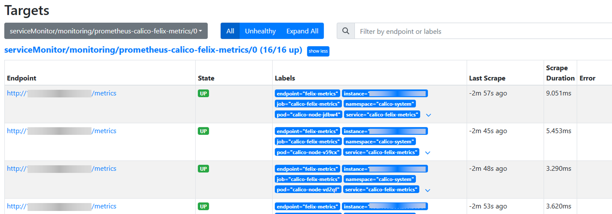
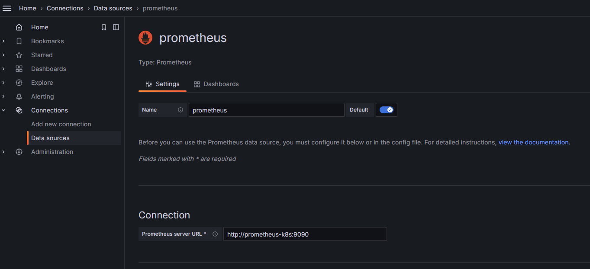
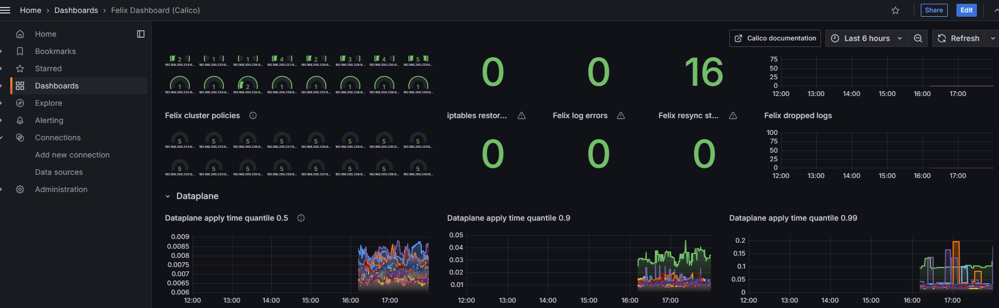
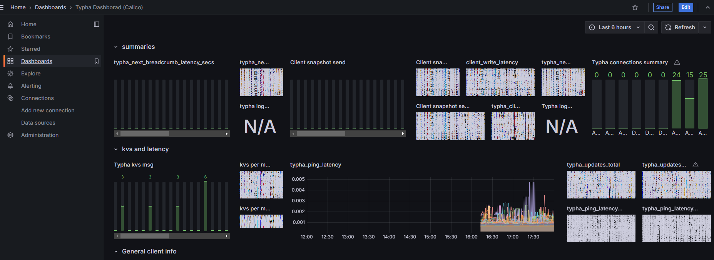

# Best Practices

## Calico Optimization

Calico is a high-performance, scalable open-source networking solution designed for cloud-native applications. It provides flexible network connectivity, network security, and network policy management capabilities. Calico supports multiple network models, including pure Layer 3 (L3) networking, IP-in-IP tunneling, VXLAN, and more, making it suitable for various different network environments.

### Objectives

Improve cluster network performance by configuring the BGP network model and deploying the Typha component.

### Prerequisites

A Kubernetes cluster has been deployed.

### Restrictions

- Supports Kubernetes v1.28, v1.33, v1.34
- Supports Calico v3.27.3, v3.31.3

### Background

#### Calico Network Models

Calico supports both Overlay and Underlay network models.
- Overlay network: A virtual network layer built on top of the underlying physical network, implementing logical isolation through tunnel encapsulation (such as IP-in-IP, VXLAN). It sacrifices some performance in exchange for flexibility, suitable for scenarios with restricted network policies.
- Underlay network: Uses the BGP routing protocol to directly announce each Pod's IP into the physical network, implementing direct routing without encapsulation. It retains the performance and low latency of the underlying network and is Calico's default and recommended core mode.

Overall, Calico's design philosophy is to prioritize the high-performance Underlay (BGP) mode, with Overlay tunnel mode as a supplementary solution for cross-subnet or restricted network environments.

**IPIP Mode**

IPIP (IP-in-IP) is a Layer 3 tunnel protocol that establishes point-to-point virtual links by encapsulating the original IP packet with an additional IP header. Its function can be viewed as an IP-based logical bridge. In IPIP mode, Calico creates a tunl0 virtual interface on each node for tunnel processing. This interface is an Overlay network component and typically remains even after a node goes offline; it can be removed using the rmmod ipip command.

**BGP Mode**

Border Gateway Protocol (BGP) is the core protocol for inter-autonomous system routing. In Calico, BGP mode achieves direct reachability of Pod IPs in the physical network through route announcement. Note that Calico's IPIP mode also relies on the BGP protocol to establish inter-node routing, with BGP session targets being the peer tunnel endpoints. Both modes support cross-node communication. The core advantages of BGP mode lie in network scalability and topology flexibility. By configuring physical network devices such as switches as BGP peers, the entire access network can directly recognize container IP routes, enabling more efficient, flatter Layer 3 interconnection.


**Comparison of Two Modes**

**Table 1** Mode Comparison

| Feature | IPIP Mode | BGP Mode |
| --- | --- | --- |
| Traffic Transmission | Encapsulates packets through the `tunl0` device and transmits via tunneling. | Forwards packets directly at Layer 3 based on routes announced by BGP. |
| Applicable Network Type | Suitable for scenarios where Pods span different network segments and need cross-subnet routing. | Suitable for scenarios where Pods are in the same network segment or the underlying network supports route propagation. |
| Transmission Efficiency | Tunnel encapsulation and decapsulation overhead exists, slightly lower forwarding efficiency. | No additional encapsulation, based on host-gw method, high forwarding efficiency. |

**Performance Test Metrics**

- Latency test: Use the `ping` command to measure network latency between host machines and between container Pods.
 
  **Table 2** Latency Performance Test Metrics

    | ping Latency | Node to Remote Node | Node to Remote Pod | Pod to Remote Pod |
    |---------|---------------------|--------------------|-------------------|
    | IPIP    | 0.1891ms            | 0.2973ms           | 0.3120ms          |
    | BGP     | 0.1888ms            | 0.2680ms           | -                 |

- Bandwidth test: Use the iperf tool to evaluate network bandwidth throughput performance between host machines and between container Pods.
  
  **Table 3** Bandwidth Performance Test Metrics

  | Bandwidth | Node to Remote Node | Node to Remote Pod | Pod to Remote Pod |
  |---------|---------------------|--------------------|-------------------|
  | IPIP    | 5.07Gbits/sec       | 4.43Gbits/sec      | 4.76Gbits/sec     |
  | BGP     | 5.08Gbits/sec       | 4.67Gbits/sec      | -                 |

  
**BGP Configuration Methods**

Calico's BGP network model has three configuration methods.

- Full-mesh: Full interconnection between nodes, suitable for clusters with less than 100 nodes. When the number of nodes exceeds 100, the number of BGP sessions explodes, affecting routing synchronization efficiency.

- Route reflectors: Designate some nodes as route reflectors, with other nodes only connecting to the reflectors, significantly reducing the number of peer connections, suitable for large-scale clusters.
- Top of Rack (ToR): Establish BGP peer connections directly between Calico and physical network devices (such as switches, routers), suitable for on-premises data center deployments. Requires disabling the default full-mesh mode and configuring physical network devices.

#### Typha Component

Typha is used to reduce the load pressure on data stores (such as Kubernetes API Server/etcd) in large-scale Calico clusters. Its functions include:
- Proxying multiple Felix instances' access to the data store, reducing the number of connections.
- Filtering updates irrelevant to nodes, reducing Felix CPU consumption.

When deploying with the operator, the typha component is automatically deployed, and the operator automatically calculates the number of typha component replicas. The calculation logic is as follows:

- When the number of nodes is less than or equal to 2, the number of typha instances is 1.
- When the number of nodes is less than or equal to 4, the number of typha instances is 2.
- When the number of nodes is greater than 4, the formula for calculating the number of typha instances is `(nodes_num / 200) + 1 + 1`.
- When the number of nodes is greater than 4, but the calculated number of typha instances is less than 3, the number of typha instances is 3.

```
	// Source code
	maxNodesPerTypha := 200

	// This gives a count of how many 200s so we need 1+ this number to get at least
	// 1 typha for every 200 nodes.
	typhas := (nodes / maxNodesPerTypha) + 1

	// We add one more to ensure there is always 1 extra for high availability purposes.
	typhas += 1

	// We have a couple special cases for small clusters. We want to ensure that we run one fewer
	// Typha instances than there are nodes, so that there is room for rescheduling. We also want
	// to ensure we have at least two, where possible, so that we have redundancy.
	if nodes <= 2 {
		// For one and two node clusters, we only need a single typha.
		typhas = 1
	} else if nodes <= 4 {
		// For three and four node clusters, we can run an additional typha.
		typhas = 2
	} else if typhas < 3 {
		// For clusters with more than 4 nodes, make sure we have a minimum of three for redundancy.
		typhas = 3
	}
```


### Procedure

1. Deploy the Typha component while configuring the BGP route reflector network model. Execute the following commands on all nodes in the cluster to update the NetworkManager configuration.

    ```shell
    cat > /etc/NetworkManager/conf.d/calico.conf<<EOF
    [keyfile]
    unmanaged-devices=interface-name:cali*;interface-name:tunl*;interface-name:vxlan.calico;interface-name:vxlan-v6.calico;interface-name:wireguard.cali;interface-name:wg-v6.cali
    EOF

    systemctl restart NetworkManager
    ```

2. Execute the following command to install the operator.

    ```shell
    kubectl create -f https://raw.githubusercontent.com/projectcalico/calico/v3.31.3/manifests/tigera-operator.yaml
    ```

3. Execute the following commands to download and modify custom resources.


    ```shell
    # Download
    curl https://raw.githubusercontent.com/projectcalico/calico/v3.31.3/manifests/custom-resources.yaml -O
    # Modify the custom podCIDR as needed
    ```

4. If the cluster was deployed using kubeadm and `podSubnet` was not set during cluster initialization, you can modify the `kubeadm-config ConfigMap` field to configure `podSubnet`. Modify the content as follows:

    ```shell
        networking:
          podSubnet: 172.20.64.0/18  # Add this item, the pod network segment, consistent with the value of the podCIDR field in calico custom-resources.yaml
          dnsDomain: cluster.local
          serviceSubnet: 10.96.0.0/12
    ```

5. Execute the following command to apply the custom resources.

    ```shell
    kubectl apply -f custom-resources.yaml
    ```

6. Execute the following commands to install Calicoctl.

    ```shell
    ARCH=$(uname -m)
    case $ARCH in
        x86_64) ARCH="amd64";;
        aarch64) ARCH="arm64";;
    esac

    wget https://github.com/projectcalico/calico/releases/download/v3.31.3/calicoctl-linux-${ARCH}
    chmod +x calicoctl-linux-${ARCH}
    mv calicoctl-linux-${ARCH} /usr/local/bin/calicoctl
    ```

7. Create the configuration file BGPConfiguration.yaml.

    ```shell
    apiVersion: projectcalico.org/v3
    kind: BGPConfiguration
    metadata:
      name: default
    spec:
      logSeverityScreen: Info
      nodeToNodeMeshEnabled: false
      asNumber: 64512
    ```
8. Execute the following command to apply the configuration file BGPConfiguration.yaml.
    ```shell
    calicoctl apply -f BGPConfiguration.yaml
    ```

9. Execute the following command to configure the specified node to act as a route reflector.

    ```shell
    kubectl label node <node-name> route-reflector=true
    ```

    > **Note:**
    > 
    > It is recommended to designate at least 2 nodes as route reflectors, with 8-12 nodes recommended. Node configuration suggestion: (8 cores, 32GB)


10. Execute the following command to configure ClusterID for all nodes configured as route reflectors.

    ```shell
    kubectl annotate node <node-name> projectcalico.org/RouteReflectorClusterID=244.0.0.1
    ```
    > **Note:**
    > 
    > Configure the node's ClusterID (typically an unused IPv4 address). All nodes configured as route reflectors must have ClusterID configured.

11. Create the configuration file BGPPeer.yaml, using label selectors to configure route reflector nodes as peers with other non-route reflector nodes.

    ```shell
    apiVersion: projectcalico.org/v3
    kind: BGPPeer
    metadata:
      name: peer-with-route-reflectors
    spec:
      nodeSelector: all()
      peerSelector: route-reflector == 'true'
    ```
12. Execute the following command to apply the created configuration file BGPPeer.yaml.
    ```shell
    calicoctl apply -f BGPPeer.yaml
    ```

### Follow-up Steps

#### Calico Monitoring Configuration

- Felix is a daemon running on each machine that implements network policies and other functions. Felix is the brain of Calico. For monitoring metrics, see [felix-prometheus](https://archive-os-3-27.netlify.app/calico/3.27/reference/felix/prometheus).

- Typha is a set of optional pods that scale Felix to extend traffic between Calico nodes and the data store. For monitoring metrics, see [typha-prometheus](https://archive-os-3-27.netlify.app/calico/3.27/reference/typha/prometheus).

- The kube-controllers pod runs a set of controllers responsible for various control plane functions, such as resource garbage collection and synchronization with the Kubernetes API. For monitoring metrics, see [kube-controllers-prometheus](https://archive-os-3-27.netlify.app/calico/3.27/reference/kube-controllers/prometheus).

**Important Metrics**

**Table 4** Calico Important Monitoring Metrics
| Metric                        | Description                               |
|-------------------------------|-------------------------------------------|
| felix_ipset_errors            | Number of ipset-restore execution failures. |
| felix_iptables_restore_calls  | Number of iptables-restore executions.    |
| felix_iptables_restore_errors | Number of iptables-restore execution failures. |
| felix_iptables_save_calls     | Number of iptables-save executions.       |
| felix_iptables_save_errors    | Number of iptables-save execution failures. |
| felix_log_errors              | Number of errors reported in logs.        |
| ipam_allocations_per_node     | Number of IP allocations per node.        |
| ipam_blocks_pre_node          | Number of Blocks allocated per node.      |

> **Note:**
> 
> In large-scale clusters, due to the large number of nodes and Pod resources, Calico's network data will also increase accordingly. ETCD and APIService need to be scaled up and other operations should be performed.

#### Configure Calico Monitoring

1. Configure Felix.

    1.1 Felix prometheus metrics are disabled by default. Execute the following command to manually change Felix's configuration (**prometheusMetricsEnabled**).

    ```sh
    # kubectl patch felixConfiguration default  --patch '{"spec":{"prometheusMetricsEnabled": true}}' --type=merge

    felixconfiguration.crd.projectcalico.org/default patched
    ```

    1.2 Execute the following command to confirm the result.

    ```sh
    # kubectl get felixConfiguration default -o yaml
    ……
    spec:
      bpfLogLevel: ""
      logSeverityScreen: Info
      prometheusMetricsEnabled: true         # prometheusMetricsEnabled is true
      reportingInterval: 0s
    ```

2. Create a service to expose Felix metrics.

    Prometheus uses Kubernetes services to dynamically discover endpoints. Create a service named `felix-metrics-svc` to let Prometheus discover all Felix metrics endpoints.

    Felix reports metrics on TCP port 9091 by default. Execute the following command to add the configuration file.

    ```sh
    # kubectl apply -f - <<EOF
    apiVersion: v1
    kind: Service
    metadata:
      labels:
        k8s-app: calico-felix-metrics
      name: calico-felix-metrics
      namespace: calico-system
    spec:
      selector:
        k8s-app: calico-node
      ports:
      - port: 9091
        targetPort: 9091
        name: felix-metrics
    EOF
    ```

3. Configure Typha. 

    3.1 Execute the following command to confirm that Typha is used in the cluster.

    ```sh
    # kubectl get pods -A | grep typha
    calico-system      calico-typha-6d8d9ffd6c-96z4z    1/1     Running   0      176m
    calico-system      calico-typha-6d8d9ffd6c-k2zpm    1/1     Running   0      176m
    calico-system      calico-typha-6d8d9ffd6c-s62nr    1/1     Running   0      176m
    ```

    Calico's Operator installation automatically deploys one or more Typha instances based on cluster scale. By default, metrics for these instances are disabled.

    3.2 Use the following command to instruct `tigera-operator` to enable Typha metrics.

    ```bash
    kubectl patch installation default --type=merge -p '{"spec": {"typhaMetricsPort":9093}}'
    ```

    3.3 If the following content is displayed, Typha metrics have been successfully enabled.

    ```bash
    installation.operator.tigera.io/default patched
    ```

4. Create a service to expose Typha metrics.

    ```sh
    # kubectl apply -f - <<EOF
    apiVersion: v1
    kind: Service
    metadata:
      labels:
        k8s-app: calico-typha-metrics
      name: calico-typha-metrics
      namespace: calico-system
    spec:
      selector:
        k8s-app: calico-typha
      ports:
      - port: 9093
        targetPort: 9093
        name: typha-metrics
    EOF
    ```

5. Configure kube-controllers.

    Kube-controllers prometheus metrics are enabled by default, using TCP port 9094. You can adjust the port by modifying the **KubeControllersConfiguration** resource.

    ```sh
    # If you don't want to modify the default port, skip this step

    # kubectl patch kubecontrollersconfiguration default  --patch '{"spec":{"prometheusMetricsPort": 9095}}'
    ```

6. Create a service to expose kube-controllers metrics.
   
      > **Note:**
      >
      > If Calico has already created a service for kube-controllers metrics during installation, the following steps can be skipped.

    6.1 Execute the following command to create a service for kube-controllers metrics.

    ```sh
    # kubectl apply -f - <<EOF
    apiVersion: v1
    kind: Service
    metadata:
      labels:
        k8s-app: calico-kube-controllers
      name: calico-kube-controllers-metrics
      namespace: calico-system
    spec:
      selector:
        k8s-app: calico-kube-controllers
      ports:
      - port: 9094
        targetPort: 9094
        name: kube-controllers-metrics
    EOF
    ```

    6.2 Execute the following command to verify the installation.

    ```sh
    kubectl get svc -n calico-system
    ```

    6.3 If the following content is displayed, the installation was successful.

    ```sh
    calico-kube-controllers-metrics   ClusterIP   10.43.77.57    <none>      9094/TCP   1d
    ```

7. Configure prometheus to collect metrics.

    7.1 Create ServiceMonitor.
    
    Kube-prometheus-stack creates five CRD resource objects during deployment: Prometheus, PodMonitor, ServiceMonitor, AlertManager, and PrometheusRule, and continuously monitors and maintains the state of these resources.
    - The Prometheus resource object is an abstract definition of Prometheus Server.
    - PodMonitor and ServiceMonitor are abstractions of Exporter, used to provide metrics data interfaces. Prometheus pulls monitoring data through these two resource objects.
    - ServiceMonitor requires the monitored service to have a corresponding Service.
    - PodMonitor does not require creating a Service for the application, but the metrics port and name must be explicitly declared in the Pod.

    Since Services have been created for the applications, ServiceMonitor is chosen here to collect metrics data. Use the following YAML to create the ServiceMonitor resource.

    ```sh
    # vim prometheus-ServiceMonitorCalico.yaml

    apiVersion: monitoring.coreos.com/v1
    kind: ServiceMonitor
    metadata:
      labels:
        release: prometheus # Must add this label, because prometheus object serviceMonitorSelector matches ServiceMonitor with release: prometheus
      name: prometheus-calico-felix-metrics  # Specify some key metadata required by ServiceMonitor
      namespace: monitoring  # Namespace
    spec:
      endpoints:  # Service endpoints, representing the addresses where Prometheus needs to collect Metrics
        - interval: 15s  # Specify the cycle for Prometheus to collect the current endpoints
          path: /metrics  # Specify the path for Prometheus to collect
          port: felix-metrics  # Specify the port through which data needs to be collected, set to the name set for the port when creating the Service
      namespaceSelector:  # The scope of Services to be discovered. namespaceSelector contains two mutually exclusive fields
        matchNames:   # matchNames: array value, specifies the scope of namespaces to monitor
        - calico-system
        # any: # any: has only one value true, when this field is set, it will monitor all Service changes that match the Selector filter conditions.
        # -true
      selector:  # Used to select Service
        matchLabels:
          k8s-app: calico-felix-metrics
    ---
    apiVersion: monitoring.coreos.com/v1
    kind: ServiceMonitor
    metadata:
      labels:
        release: prometheus
      name: prometheus-calico-typha-metrics
      namespace: monitoring
    spec:
      endpoints:
        - interval: 15s
          path: /metrics
          port: typha-metrics
      namespaceSelector:
        matchNames:
        - calico-system
      selector:
        matchLabels:
          k8s-app: calico-typha-metrics
    ---
    apiVersion: monitoring.coreos.com/v1
    kind: ServiceMonitor
    metadata:
      labels:
        release: prometheus
      name: prometheus-calico-kube-controllers-metrics
      namespace: monitoring
    spec:
      endpoints:
        - interval: 15s
          path: /metrics
          port: kube-controllers-metrics
      namespaceSelector:
        matchNames:
        - calico-system
      selector:
        matchLabels:
          k8s-app: calico-kube-controllers
    ```

    7.2 Execute the following code to apply ServiceMonitor.

    ```sh
    # kubectl apply -f prometheus-ServiceMonitorCalico.yaml
    servicemonitor.monitoring.coreos.com/felix-metrics created
    servicemonitor.monitoring.coreos.com/typha-metrics created
    servicemonitor.monitoring.coreos.com/kube-controllers-metrics create
    ```

8. Check targets.

    8.1 Log in to the Prometheus dashboard to check if the newly created target is normal. If Prometheus does not have an external port open, you can modify the service port type to NodePort.

    ```sh
    kubectl edit svc prometheus-k8s -n monitoring
    ```

    8.2 Access the dashboard according to the generated/specified nodePort.

    **Figure 1** Prometheus targets interface

    

9. Install and configure Grafana.

    9.1 Install Grafana using helm.

    ```sh
    # Add the official Grafana repository
    helm repo add grafana https://grafana.github.io/helm-charts

    # Update repository
    helm repo update grafana

    # Install Grafana
    helm install grafana grafana/grafana -n monitoring
    ```

    9.2 Add Prometheus source to Grafana.

    Enter `http://<ip>:30010` in the browser, log in to access the Grafana interface, select `Data sources > Add new data source`.

    Fill in the Prometheus server URL. For example: `http://<prometheus-k8s>:9090`.

    **Figure 2** Grafana dashboard configuration for adding Prometheus source

    

10. Import dashboard configuration files.

    10.1 In the Grafana interface, select Dashboards > New > Import. Import the `typha-dashboard.json` and `felix-dashboard.json` dashboard configuration files.
  [Click to get Grafana dashboard configuration files](https://github.com/projectcalico/calico/blob/master/manifests/grafana-dashboards.yaml).


    **Figure 3** Felix interface

    


    **Figure 4** Typha interface

    

    10.2 Configuration files.

    Please modify the `datasource` field in the file according to the actual situation.


> **Note:**
    > 
    > **Known Issue:** Grafana currently does not provide a preset dashboard for monitoring Calico-Kube-Controllers, only providing monitoring views for Felix and Typha components.


### Precautions/FAQs

Before removing all route reflector nodes from the cluster, you need to select new route reflector nodes.

### Conclusion

Based on a comprehensive assessment of performance, scalability, operation and maintenance complexity and other dimensions, for Calico's BGP networking solutions in clusters of different scales, the following best practice conclusions are formed:

- **Small to medium-scale clusters (recommended node count ≤ 100)**
  
It is recommended to adopt the Calico BGP Full-mesh solution. This solution is simple to configure, requires no additional route reflectors, provides fully symmetrical network connections when the node scale is limited, and demonstrates stable performance.

- **Medium to large-scale clusters (recommended node count > 100)**

It is recommended to adopt the Route Reflectors (RR) solution. By deploying one or more route reflectors to centrally distribute routes, the number of BGP connections can be significantly reduced, avoiding the connection storm problem in Full-mesh mode, with good horizontal scaling capabilities.

- **Scenarios Integrating with Physical Networks**

If the operation and maintenance team has the configuration and management capabilities for underlying network devices and wants to achieve seamless routing interoperability between container networks and physical networks, the Top of Rack (ToR) solution can be considered. This solution requires establishing BGP peer connections with switches/routers and is recommended for implementation in controlled network environments or cloud-network integrated architectures.

- **General Recommendations**

  - Before node scale growth, a smooth migration path from Full-mesh to RR mode should be planned in advance.
  - Regardless of which solution is adopted, it is recommended to combine Calico's network policies with BGP configuration optimization to further improve network security and routing convergence efficiency.
  - Before production environment deployment, network performance and stability verification should be completed in a non-production environment of corresponding scale.

### References

- [Calico Deployment](https://docs.tigera.io/calico/3.27/getting-started/kubernetes/self-managed-onprem/onpremises)
- [Monitor Calico Component Metrics](https://docs.tigera.io/calico/3.27/operations/monitor/monitor-component-metrics)
- [Felix Metrics](https://docs.tigera.io/calico/3.27/reference/felix/prometheus)
- [Typha Metrics](https://docs.tigera.io/calico/3.27/reference/typha/prometheus)
