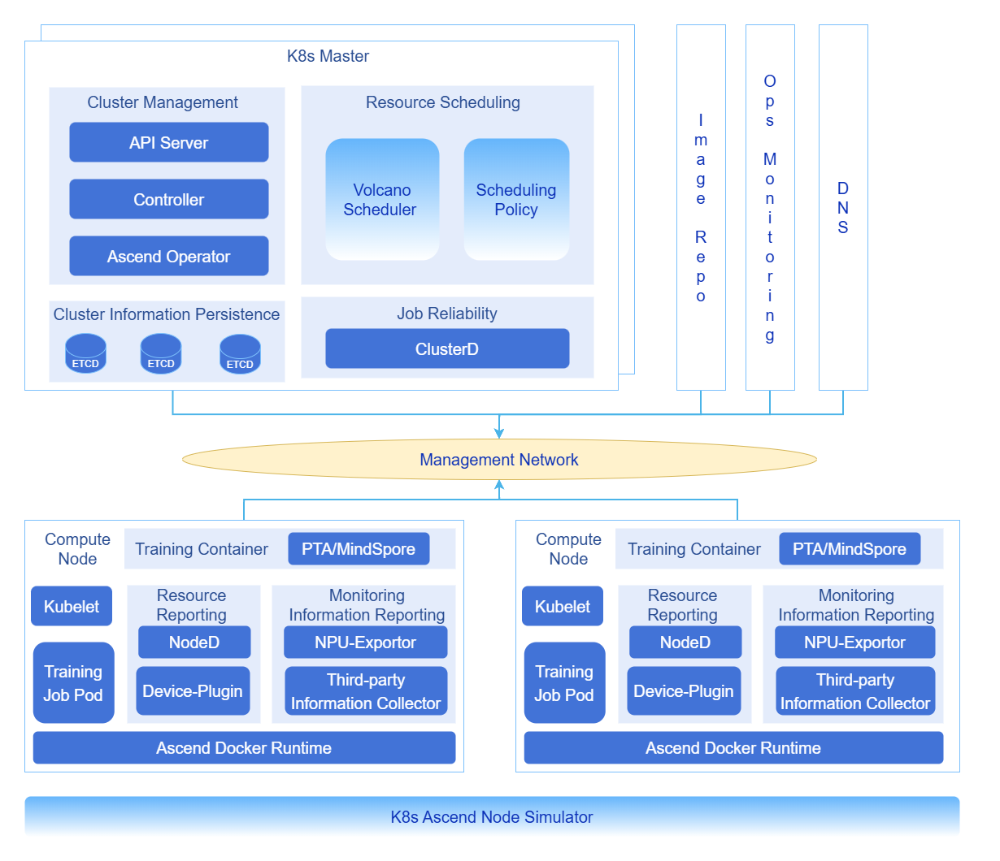
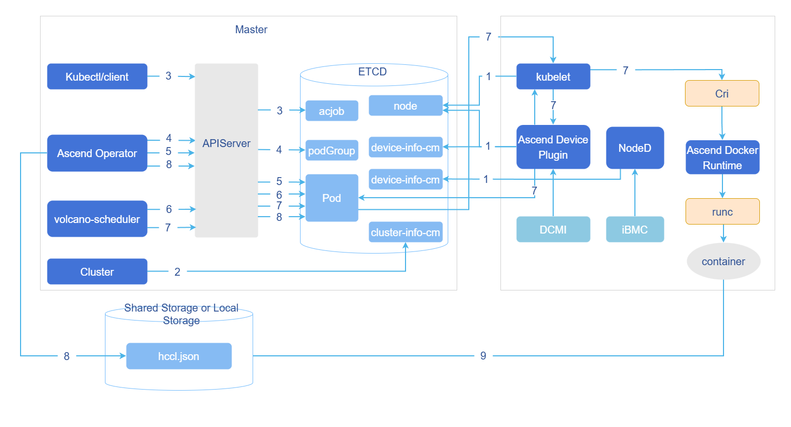
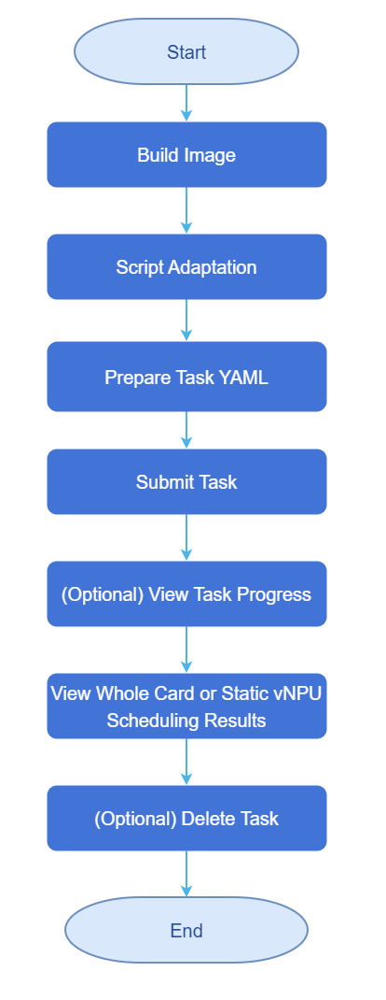

# Ultra-Large-Scale Cluster
## Feature Introduction

The Ultra-Large-Scale Cluster project is dedicated to building and optimizing ultra-large-scale Kubernetes clusters for AI training and High-Performance Data Analytics (HPDA). The core objective is to break through single-cluster management limits by achieving stable support for 16,000 nodes (128K Ascend NPU/GPU cards) in a single cluster through systematic optimization, and to design a multi-cluster collaborative architecture for future 500,000-card scale. We focus on solving bottleneck issues in Kubernetes core components, scheduling, networking, and observability in ultra-large-scale scenarios, with deep adaptation and optimization specifically for large-scale cluster management of domestic computing power such as Ascend.

### Application Scenarios
This cluster is specifically designed to break through traditional single-cluster resource limits, serving large-scale computing scenarios that require tens of thousands of node-level resources for unified scheduling and collaboration.
- Tens of Thousands of Cards AI Training: Support collaboration of thousands to tens of thousands of Ascend NPU cards, meeting ultra-large-scale distributed training needs such as trillion-parameter large models.
- Massive Parallel Computing: Suitable for scientific computing and batch processing tasks requiring tens of thousands of computing cores in parallel, such as climate simulation and gene sequencing.
- High-Concurrency Inference Services: Capable of elastically deploying hundreds of thousands of model instances, supporting high-concurrency inference requests for internet-scale AI services.

### Capability Scope

The optimization and enhancement of this project covers the following core areas.

- Kubernetes Control Plane Enhancement: Deep optimization of core components such as kube-apiserver, etcd, and kube-controller-manager to ensure control plane stability and high performance at ultra-large scale.
- AI Job Scheduling Optimization: Integration and enhancement of Volcano scheduler, providing batch creation, scheduling, and binding capabilities for acJob pods tailored to Ascend AI job characteristics.
- High-Performance and Observable Network: Optimize container networking, service discovery (DNS), and network policies to ensure efficient and stable east-west traffic; integrate VictoriaMetrics to achieve millisecond-level collection and querying of tens of millions of time series data.
- Data and Image Acceleration: Optimize training data reading pipelines and container image pull speeds to reduce job startup time and improve CPU utilization.

### Highlights
- Ultimate Scale: Single cluster supports 16,000 nodes (128K cards), breaking through the community K8s declared limit, leading the industry.
- Core Component High Availability: Through multi-instance load balancing, read-write separation, data and event separation technologies, ensure kube-apiserver, etcd and other key components have no single point of failure or performance bottlenecks.
- Intelligent AI Scheduling: Provides gang scheduling (PodGroup), perfectly adapting to distributed training topology requirements such as AllReduce, improving large job scheduling success rate and cluster utilization.
- Millisecond-Level Service Discovery: Through DNS hierarchical deployment and local caching, optimize service resolution in ultra-large-scale clusters from second-level to millisecond-level.
- Comprehensive Observability: Based on VictoriaMetrics, build a high-performance monitoring system capable of handling billions of monitoring metrics, providing three-dimensional monitoring of clusters, nodes, Pods, containers, and NPUs.
  
### Implementation Principle

**Table 1** Ultra-Large-Scale Cluster Deployment and Training Workflow
| Phase | Key Actions | Core Technologies/Tools | Goal |
|:---|:---|:---|:---|
| 1. Control Plane High Availability Deployment | • Three kube-apiserver instances + VIP load balancing<br>• etcd event and configuration data separation deployment | • Load Balancer (VIP)<br>• Three etcd clusters + auto-cleanup strategy | Establish stable, high-throughput, low-latency cluster control entry and data storage layer. |
| 2. Large-Scale Task Scheduling | • Volcano enables parallel scoring and secondary queue scheduling | • Volcano Scheduler enhanced strategy | Achieve **second-level** completion of queuing and initial scheduling decisions for tens of thousands of computing tasks. |
| 3. Image and Data Readiness | • Global image P2P preheating<br>• Node parallel pull mechanism | • Image registry + P2P acceleration component | Ensure training images required by **thousands of nodes** are fully ready within **minutes**. |
| 4. Batch Node Initialization | • Master node drives via Ansible concurrent SSH | • Ansible batch operations | **Concurrently complete** driver, component installation/upgrade for hundreds of nodes, unifying cluster state. |
| 5. Task Submission and Closed Loop | • Submit formal training tasks | • Standard K8s Job / Volcano Job | Cluster automatically completes **scheduling -> link establishment -> training -> monitoring** full closed loop. |

**Figure 1** Ultra-Large-Scale Cluster Optimization Technology Panorama



- **kube-apiserver Load Balancing and Traffic Optimization**

  In large-scale clusters, to address issues such as memory bloat caused by large LIST requests, uneven long connection load, and response latency under high load, optimization can be achieved by deploying multiple groups of kube-apiserver instances behind a load balancer (such as Nginx/HAProxy or cloud vendor load balancers). By implementing intelligent traffic distribution strategies, separating and evenly distributing read-write requests, long and short connections, large LIST requests and small Watch requests, the overall reliability and throughput of the control plane can be significantly improved.

- **Cluster Metadata Split Storage**

  For situations where large-scale Pod event writes cause etcd QPS spikes, increased write latency, and become a cluster scaling bottleneck, a physically separated storage solution can be adopted. By deploying independent "event etcd cluster", "Pods etcd cluster" and "core data etcd cluster", Kubernetes core metadata (such as ConfigMap, Node, Service), events and leases (Events/Leases), and Pod data are stored in different clusters respectively, effectively eliminating mutual interference. At the same time, combined with data governance strategies, automatic compression and defragmentation of etcd data are implemented, regularly cleaning historical and invalid data to control data growth and maintain low-latency performance.

  > **Note:**
  >
  > Through data governance, implement automatic compression and defragmentation of etcd data, regularly clean historical data and "dirty data", control data volume growth, and maintain low latency.

- **DNS Hierarchical Deployment**

  In ultra-large-scale clusters with tens of thousands of Pods, the default CoreDNS will face tremendous resolution request pressure, resulting in response times that may reach second-level. To address this, a hierarchical DNS architecture can be built by deploying Local DNS Cache (such as NodeLocal DNSCache) at the node level to cache hot records, making CoreDNS only handle cache miss requests as the central authoritative server. This architecture digests most resolution requests locally, thereby reducing DNS resolution latency from second-level to millisecond-level.

- **Batch Scheduling and Gang Scheduling for NPU**

  To meet the strict requirements of AI training jobs (such as requiring 128 Pods to be scheduled simultaneously) for gang scheduling and high-speed interconnect topology (such as NVLink, HCCS) affinity, the default scheduler needs to be enhanced. Based on Volcano Scheduler, deep adaptation for Ascend NPU computing power can be achieved through gang scheduling and topology-aware scheduling strategies, ensuring that all Pods required by the job can be scheduled simultaneously and allocated to topologically optimal nodes, thereby ensuring efficient execution of distributed training tasks.

  > **Note:**
  > - PodGroup and Gang Scheduling: Ensure all Pods of a job can start simultaneously, avoiding resource deadlock.
  > - Topology-Aware Scheduling: Combined with the NUMA architecture and high-speed interconnect topology of Ascend chips, prioritize scheduling Pods requiring high-bandwidth communication to the same node or adjacent nodes, maximizing training efficiency.

### Relationship with Related Features
None
## Installation
This chapter provides detailed guidance for building a complete, production-ready ultra-large-scale Ascend AI cluster from scratch. The deployment process is divided into two core phases: building a stable and efficient Kubernetes base cluster, and deploying an enhanced software stack for AI training.
### Single Cluster K8s Deployment
The goal of this phase is to deploy a highly available, high-performance, observable Kubernetes base cluster.

1. [**Kubernetes Cluster Installation and Deployment Best Practices**](../best_practice/best_practices_for_kubernetes_cluster_installation_and_deployment.md)
  - Document Content: This solution provides an in-depth optimization guide for tens of thousands of node K8s clusters, focusing on solving the three core bottlenecks of control plane, storage, and networking.
  - Installation Result: A stable Kubernetes cluster that has passed basic stress testing.
2. [**victoriametrics Best Practices**](../best_practice/best_practices_for_ultra_large_scale_cluster_monitoring_based_on_the_victoriametrics_software_stack.md)
  - Document Content: This document provides VictoriaMetrics high availability deployment and tuning guide, achieving deep monitoring of Kubernetes clusters with million-level metrics.
  - Installation Result: A monitoring system with high-performance read-write capabilities that can be visualized through Grafana.
### Single Cluster mind-cluster Deployment
This phase will deploy a complete Ascend AI training software stack on top of the ready Kubernetes cluster, enabling the cluster to run tens of thousands of cards AI jobs.

   [**MindCluster Software Stack Deployment Best Practices**](../best_practice/best_practices_for_mindcluster_software_stack_deployment.md)
- Document Content: The document provides a full-stack Kubernetes deployment guide for Ascend AI clusters, covering an integrated solution from NPU drivers, task scheduling to training acceleration and monitoring operations, aiming to support efficient and stable operation of tens of thousands of cards AI jobs.
- Installation Result: A fully functional, production-ready ultra-large-scale Ascend AI training cluster that can formally submit large-scale distributed training tasks.
## Batch Creation and Scheduling of acjob

### Prerequisites
**For training task type acjob, scheduler Volcano full-card scheduling supports batch Pod creation and batch scheduling functions.** 
- To use the batch Pod creation function, when installing the Ascend Operator component, you need to use openFuyao customized Kubernetes.
- To use the batch scheduling function, when installing the Volcano component, you need to use openFuyao customized Kubernetes and volcano-ext component, and enable the batch scheduling function.
- The batch scheduling function is applicable to ultra-large-scale cluster scenarios. In this scenario, please expand the CPU and memory resources allocated to MindCluster components according to actual needs to prevent MindCluster components from having insufficient performance or exceeding allocated memory usage, causing components to be evicted by Kubernetes.
### Task Scheduling Workflow
**Figure 2** acjob Task Scheduling Principle Diagram



1. Cluster scheduling components periodically report node and chip information; kubelet reports node chip quantity to the node object (Node).
    - Ascend Device Plugin periodically reports chip topology information.
Report full-card information. Report the physical ID of the chip to device-info-cm; the total number of schedulable chips (allocatable), the number of used chips (allocated), and the basic information of chips (device ip and super_device_ip) are reported to Node for full-card scheduling.
    - Report vNPU-related information to Node for static vNPU scheduling.
When there is a fault on the node, NodeD periodically reports node health status, node hardware fault information, and node DPC shared storage fault information to node-info-cm.
2. ClusterD reads information from device-info-cm and node-info-cm, then writes the information to cluster-info-cm.
3. Users submit acjob tasks via kubectl or other deep learning platforms.
4. Ascend Operator creates corresponding PodGroup for the task. For detailed description of PodGroup, please refer to the official open source Volcano documentation.
5. Ascend Operator creates corresponding Pods for the task and injects environment variables required for collective communication into the containers.
6. volcano-scheduler selects appropriate nodes for tasks based on node and chip topology information, and writes selected chip information to Pod annotations.
    - Full-card scheduling writes full-card information.
    - Static vNPU scheduling writes vNPU-related information.
7. When kubelet creates containers, it calls Ascend Device Plugin to mount chips, and Ascend Device Plugin or volcano-scheduler writes chip information to Pod annotations. Ascend Docker Runtime assists in mounting corresponding resources.
8. Ascend Operator reads Pod annotation information and writes related information to hccl.json.
9. Containers read environment variables or hccl.json information, establish communication channels, and start executing training tasks.
### Operation Steps

**Figure 3** acjob Configuration Flowchart


1. Configure NFS Storage

    1.1 Select a machine as the NFS server (here we select 192.168.200.25), execute the following code to install and configure the shared directory.
    ```
    # Install package and set to start on boot
    yum install -y nfs-utils
    systemctl enable --now nfs-server

    # Create shared directory and set permissions
    mkdir -p /data
    chmod 777 /data                # For production, can change to 755 + chown 1000:1000

    # Export configuration (allow the entire internal network segment to read and write, no root squash)
    cat >>/etc/exports <<EOF
    /data  192.168.200.0/16(rw,sync,no_root_squash,no_subtree_check)
    EOF
    exportfs -r && exportfs -v        # Reload and verify
    ```
    1.2 Execute the following code to install the client on all K8s nodes (kubelet is responsible for mounting).
    ```
    yum install -y nfs-utils
    systemctl enable --now rpcbind
    # Execute the following code to install NFS-subdir-external-provisioner with one-click Helm (dynamic provisioning)
    # Add official repository
    helm repo add nfs-subdir-external-provisioner \
      https://kubernetes-sigs.github.io/nfs-subdir-external-provisioner
    helm repo update

    # Install (replace server with corresponding IP address)
    helm install nfs-provisioner \
      nfs-subdir-external-provisioner/nfs-subdir-external-provisioner \
      --set storageClass.name=nfs-sc \
      --set storageClass.defaultClass=false \
      --set nfs.server=<master_-_ip> \
      --set nfs.path=/data \
      --create-namespace -n nfs-system
    ```
    1.3 Execute the following code to verify NFS storage.
    ```
    kubectl get sc              # Should see nfs-sc
    kubectl get pod -n nfs-system   # Provisioner should be Running
    ```
    1.4 Build complete file structure.
    ```
    /data/atlas_dls/output
    /data/atlas_dls/public/code
    /data/atlas_dls/public/dataset
    ```

2. Create Image

    Download the training base image matching the driver version from [Ascend Image Repository](https://www.hiascend.com/developer/ascendhub) according to system architecture (ARM/x86_64) and model framework (TensorFlow, PyTorch, MindSpore). Modify the base training image to change the default user in the container to root (after version 21.0.4, the default user of the training base image is non-root). The base image does not include training scripts, code and other files. During training, training scripts, code and other files are usually mapped into the container using mounting.

    2.1 Select an image based on system architecture (aarch64) and training framework (pytorch). Here we select the 24.0.0-A2-2.1.0-openeuler20.03 image, enter [Ascend Image Repository-ascend-pytorch](https://www.hiascend.com/developer/ascendhub/detail/ascend-pytorch) to download the image.

    ```bash
    docker pull --platform=arm64 swr.cn-south-1.myhuaweicloud.com/ascendhub/ascend-pytorch:24.0.0-A2-2.1.0-openeuler20.03
    ```
    2.2 Modify to a new image with the default user changed to root, steps are as follows.
        
    2.2.1 Save the following content as Dockerfile.root.
    ```
    FROM swr.cn-south-1.myhuaweicloud.com/ascendhub/ascend-pytorch:24.0.0-A2-2.1.0-openeuler20.03

    USER root

    ENV ASCEND_HOME=/usr/local/Ascend
    ENV LD_LIBRARY_PATH=$ASCEND_HOME/lib64:$ASCEND_HOME/driver/lib64:$LD_LIBRARY_PATH
    ENV PATH=$ASCEND_HOME/bin:$PATH

    RUN mkdir -p /user/mindx-dl/ranktable /workspace && \
        chmod 777 /user/mindx-dl/ranktable /workspace

    WORKDIR /workspace
    ```
    2.2.2 Execute the following code to build the image locally.
    ```
    docker build -t ascend-pytorch:24.0.0-A2-root -f Dockerfile.root .
    ```
    2.2.3 You can rename the downloaded/created training base image, execute the following code to rename the image to training:v7.1.RC1.
    ```bash
    nerctl tag swr.cn-south-1.myhuaweicloud.com/ascendhub/ascend-pytorch:24.0.0-A2-2.1.0-openeuler20.03 \
          training:v7.1.RC1
    ```
3. Adapt Scripts.

    Download the "ResNet50_ID4149_for_PyTorch" from the master branch in [PyTorch Code Repository](https://gitee.com/ascend/ModelZoo-PyTorch/tree/master/PyTorch/built-in/cv/classification/ResNet50_ID4149_for_PyTorch) as the training code. Prepare the ResNet50 dataset yourself, and please follow the corresponding regulations when using.

    3.1 Administrator uploads the dataset to the storage node.
    Enter the `/data/atlas_dls/public` directory and upload the dataset to any location, such as `/data/atlas_dls/public/dataset`.

    3.2 Extract the downloaded training code locally, and upload the extracted training code `ModelZoo-PyTorch/PyTorch/built-in/cv/classification/ResNet50_ID4149_for_PyTorch` directory to the environment, such as the `/data/atlas_dls/public/code/` path.

    3.3 In the `/data/atlas_dls/public/code/ResNet50_ID4149_for_PyTorch` path, comment or delete the annotated fields in the main.py file.
    ```
    def main():
        args = parser.parse_args()
        os.environ['MASTER_ADDR'] = args.addr
        #os.environ['MASTER_PORT'] = '29501'  # Comment or delete this line of code
        if os.getenv('ALLOW_FP32', False) and os.getenv('ALLOW_HF32', False):
            raise RuntimeError('ALLOW_FP32 and ALLOW_HF32 cannot be set at the same time!')
        elif os.getenv('ALLOW_HF32', False):
            torch.npu.conv.allow_hf32 = True
        elif os.getenv('ALLOW_FP32', False):
            torch.npu.conv.allow_hf32 = False
            torch.npu.matmul.allow_hf32 = False
    ```
    3.4 Enter [mindcluster-deploy repository](https://gitcode.com/Ascend/mindcluster-deploy), enter the corresponding branch according to [mindcluster-deploy open source repository version description](https://www.hiascend.com/document/detail/zh/mindcluster/72rc1/clustersched/dlug/mxdlug_appendices_019.html). Get train_start.sh from the `samples/train/basic-training/without-ranktable/pytorch` directory, and construct the following directory structure in the `/data/atlas_dls/public/code/ResNet50_ID4149_for_PyTorch/scripts` path.
    ```
    root@ubuntu:/data/atlas_dls/public/code/ResNet50_ID4149_for_PyTorch/scripts#
    scripts/
        ├── train_start.sh
    ```

4. Prepare Task YAML.
   
    Use the full-card scheduling feature, refer to this configuration. PyTorch and MindSpore frameworks have added the function of using switch affinity scheduling, which supports large model tasks and ordinary tasks, [Click to get pytorch_multinodes_acjob.yaml modification example](#pytorch_multinodes_acjobyaml-modification-example).
   
    
     The guide uses hardware device A800l A2, which only supports batch Pod creation. If using super nodes, batch Pod scheduling is additionally supported, in which case the following fields in the yaml need to be modified.
    - metadata.labels. podgroup-sched-enable: "true"  
       - Only configured in scenarios where the cluster uses openFuyao customized Kubernetes and volcano-ext component. When the value is the string "true", it indicates that the batch scheduling function is enabled; when the value is other strings, it indicates that the batch scheduling function does not take effect and ordinary scheduling is used. If this parameter is not configured, it indicates that the batch scheduling function does not take effect and ordinary scheduling is used.
     - spec.schedulerName: volcano
        - Takes effect when the Ascend Operator component's startup parameter enableGangScheduling is true.
      - spec.runPolicy.schedulingPolicy:    
        -  Takes effect when the Ascend Operator component's startup parameter enableGangScheduling is true, modify the fields minAvailable and queue below according to actual conditions according to the comments.


5. Submit Task.
 
    5.1 Execute the following command to create a namespace.
    ```
    kubectl create namespace vcjob
    ```
    5.2 On the management node, in the path where the example YAML is located, execute the following command to submit the training task using YAML.
    ```
    kubectl apply -f pytorch_multinodes_acjob.yaml
    ```
6. Check Task Progress.
  
    6.1 On the management node, check the status of task Pods, ensuring that the Pod status is Running. Execute the following command to check Pod operation.
    ```
    kubectl get pod --all-namespaces -o wide
    ```
    6.2 Execute the following command to check the NPU allocation of compute nodes.
    ```
    kubectl describe nodes fuyao-worker-0
    ```
    6.3 Execute the following command to check the Pod's NPU usage.
    ```
    kubectl describe pod default-test-pytorch-worker-0 -n acjob
    ```

7. Check Scheduling Results.
   
    Execute the following command to check training results.
    ```
    kubectl logs -n  <namespace> <pod-name>
    kubectl logs -n vcjob default-test-pytorch-worker-0
    ```
    Enter the model output directory to check the generated model files.

8. Delete Task.
   
    In the path where the example YAML is located, execute the following command to delete the corresponding training task.
    ```
    kubectl delete -f pytorch_multinodes_acjob.yaml
    ```
## Ultra-Large-Scale Cluster Simulation Verification
### victoriametrics Monitoring Software Stack Stress Testing
To ensure that the deployed ultra-large-scale cluster (especially its core monitoring system VictoriaMetrics) has the capability to stably carry massive monitoring data in production environments, simulation stress testing is recommended before official launch. This chapter briefly introduces the stress testing methods and purposes.
For detailed operation steps, configuration parameters, and resource planning formulas, refer to [**victoriametrics Best Practices**](../best_practice/best_practices_for_ultra_large_scale_cluster_monitoring_based_on_the_victoriametrics_software_stack.md) stress testing section.

#### Background Information
- Verify Stability: Under simulated million-level/second data ingestion rates, verify the long-term operational stability of the VictoriaMetrics cluster.
- Capacity Planning: Obtain resource consumption patterns of various components (vmselect/vmstorage/vminsert) under different pressures, providing data support for production environment resource allocation.
- Performance Tuning: Identify bottlenecks under high load, guiding core parameter tuning.

#### Tools Used
Use the prometheus-benchmark tool, which can simulate real monitoring data sources, dynamic target churn rates, and concurrent query loads, applying read-write pressure to the VictoriaMetrics cluster close to production environments.

#### Operation Steps
1. Deploy Tool: Clone the project, modify configuration according to [Best Practices Document](../best_practice/best_practices_for_ultra_large_scale_cluster_monitoring_based_on_the_victoriametrics_software_stack.md) (such as target data ingestion rate, time series count).
2. Execute Stress Test: Point to the deployed VictoriaMetrics cluster and start stress testing.
3. Observe and Verify: Observe system performance under sustained high load through monitoring dashboards.
4. Result Analysis: Based on stress test results, refer to the resource consumption empirical formulas provided in the document for final production capacity planning.

> **Note:**
> 
> For detailed configuration examples, parameter interpretation, stress test data, and capacity planning formulas, please refer directly to the above-linked document. Completing stress test verification is a key step to ensuring a solid foundation for observability in ultra-large-scale clusters.


### Appendix
#### pytorch_multinodes_acjob.yaml Modification Example
 ```
    # pytorch_multinodes_acjob.yaml
    apiVersion: mindxdl.gitee.com/v1
    kind: AscendJob
    metadata:
      labels:
        framework: pytorch  # Training framework
        tor-affinity: "null"
      name: default-test-pytorch  # Task name
      namespace: acjob  # Namespace
    spec:
      replicaSpecs:
        Master:
          replicas: 1 # Number of replicas
          restartPolicy: Never
          template:
            spec:
              containers:
              - args:  # Startup parameters
                - cd /job/code/scripts; chmod +x train_start.sh; bash train_start.sh /job/code
                  /job/output main.py --data=/job/data --amp --arch=resnet50
                  --seed=49 -j=128 --world-size=1 --lr=1.6 --dist-backend='hccl' --multiprocessing-distributed
                  --epochs=90 --batch-size=4096
                command:
                - /bin/bash
                - -c
                env:
                - name: XDL_IP
                  valueFrom:
                    fieldRef:
                      fieldPath: status.hostIP
                image: training:v7.1.RC1  # Image name
                imagePullPolicy: IfNotPresent
                name: ascend
                ports:
                - containerPort: 2222
                  name: ascendjob-port
                  protocol: TCP
                resources:
                  limits:
                    huawei.com/Ascend910: 1  # Resources
                  requests:
                    huawei.com/Ascend910: 1  # Resources
                volumeMounts:
                - mountPath: /job/code 
                  name: code
                - mountPath: /job/data
                  name: data
                - mountPath: /job/output
                  name: output
                - mountPath: /dev/shm
                  name: dshm
                - mountPath: /etc/localtime
                  name: localtime
                - mountPath: /user/serverid/devindex/config
                  name: ranktable
              nodeSelector:
                accelerator-type: module-910b-8
                host-arch: huawei-arm
              volumes:
              - nfs:
                  server: 192.168.200.25  # NFS storage service IP  
                  path: /data/atlas_dls/public/code/ResNet50_ID4149_for_PyTorch  # Training code storage path
                name: code
              - nfs:
                  server: 192.168.200.25
                  path: /data/atlas_dls/public/dataset  # Dataset storage path
                name: data
              - nfs:
                  server: 192.168.200.25
                  path: /data/atlas_dls/output  # Output result path
                name: output
              - emptyDir:
                  medium: Memory
                name: dshm
              - hostPath:
                  path: /etc/localtime
                name: localtime
              - hostPath:
                  path: /user/mindx-dl/ranktable1
                  type: DirectoryOrCreate
                name: ranktable
        Worker:  # Refer to master configuration method
          replicas: 2
          restartPolicy: Never
          template:
            spec:
              containers:
              - args:
                - cd /job/code/scripts; chmod +x train_start.sh; bash train_start.sh /job/code
                  /job/output main.py --data=/job/data --amp --arch=resnet50
                  --seed=49 -j=128 --world-size=1 --lr=1.6 --dist-backend='hccl' --multiprocessing-distributed
                  --epochs=90 --batch-size=4096
                command:
                - /bin/bash
                - -c
                env:
                - name: XDL_IP
                  valueFrom:
                    fieldRef:
                      fieldPath: status.hostIP
                image: training:v7.1.RC1
                imagePullPolicy: IfNotPresent
                name: ascend
                ports:
                - containerPort: 2222
                  name: ascendjob-port
                  protocol: TCP
                resources:
                  limits:
                    huawei.com/Ascend910: 2
                  requests:
                    huawei.com/Ascend910: 2
                volumeMounts:
                - mountPath: /job/code
                  name: code
                - mountPath: /job/data
                  name: data
                - mountPath: /job/output
                  name: output
                - mountPath: /dev/shm
                  name: dshm
                - mountPath: /etc/localtime
                  name: localtime
              nodeSelector:
                accelerator-type: module-910b-8
                host-arch: huawei-arm
              volumes:
              - nfs:
                  server: 192.168.200.25
                  path: /data/atlas_dls/public/code/ResNet50_ID4149_for_PyTorch
                name: code
              - nfs:
                  server: 192.168.200.25
                  path: /data/atlas_dls/public/dataset
                name: data
              - nfs:
                  server: 192.168.200.25
                  path: /data/atlas_dls/output
                name: output
              - emptyDir:
                  medium: Memory
                name: dshm
              - hostPath:
                  path: /etc/localtime
                name: localtime
      runPolicy:
        schedulingPolicy:
          minAvailable: 2 # Total number of task replicas
          queue: default # Queue to which the task belongs
      schedulerName: volcano
      successPolicy: AllWorkers

    ```
