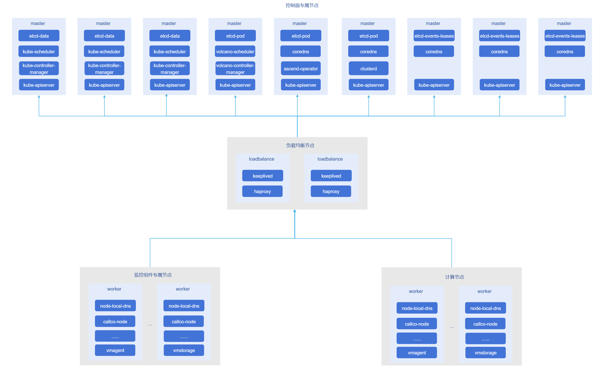
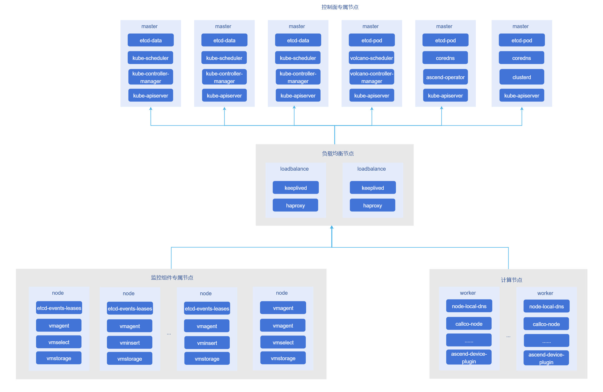

# 最佳实践

## K8s集群安装部署最佳实践

当集群达到一定规模后，普通形态部署的集群控制面难以支撑集群稳定运行，主要原因为kube-apiserver请求压力激增、etcd响应延时激增，因此需要部署高可用形态集群控制面并拆分集群元数据存到多套etcd集群，同时需要对K8s核心组件进行参数优化，以提高集群控制面的稳定性。

### 目标

给出部署超大规模集群控制面与工作节点的部署步骤，并根据节点规模给出建议部署形态。

### 前提条件

- 要求待安装集群机器已安装操作系统。
- 所有机器可使用root用户登录。
- 所有机器间网络互通。
- 所有节点环境干净，未安装runc、containerd、docker、docker-ce、kubeadm、kubectl、kubelet、crictl等组件。
- 节点可通过yum工具安装软件包。

### 使用限制

#### 支持操作系统

| 操作系统      | 版本             | 架构           |
|-----------|----------------|--------------|
| openEuler | 22.03 | ARM64、x86_64 |

> **说明：**<br />其他版本操作系统暂未测试，可能会出现不在预期内的问题。

#### 支持Kubernetes版本

- v1.28：1.28.15
- v1.33: 1.33.1
- v1.34: 1.34.3

> **说明：**<br />1.33.1暂未做系统测试，可能会出现不在预期内的问题。

#### 部署形态

1. 部署1.6万节点超大规模集群时，最好将集群控制面组件直接部署在多CPU、大内存物理机中，防止因控制面资源不足导致kube-apiserver等核心组件雪崩。建议将控制面组件部署在CPU核心数大于80、内存大于500GB、存储大于1T的物理机中，并推荐采用如下架构部署：

    

    > **说明：**<br />当集群节点数量大于5000时均推荐采用上述部署方案

2. 部署3k~5k节点大规模集群时，也建议将集群控制面组件直接部署在多CPU、大内存物理机中，并推荐采用如下架构部署：



### 操作步骤

此操作步骤给出支持1.6万节点集群控制面与工作节点的部署步骤，假设控制面与部分工作节点机器如下表：

**表1：** 控制面与工作节点信息

| ip              | hostname | 组件                                                                    | 角色          | CPU(vCPU) | 内存(BG) |
|-----------------|----------|-----------------------------------------------------------------------|-------------|-----------|--------|
| 192.168.200.240 | node1    | keepalived、haproxy                                                    | loadbalance | 32        | 64     |
| 192.168.200.239 | node2    | keepalived、haproxy                                                    | loadbalance | 32        | 64     |
| 192.168.200.238 | node3    | kube-apiserver、etcd(data)、kube-controller-manager、kube-scheduler      | master      | 80        | 700    |
| 192.168.200.237 | node4    | kube-apiserver、etcd(data)、kube-controller-manager、kube-scheduler      | master      | 80        | 700    |
| 192.168.200.236 | node5    | kube-apiserver、etcd(data)、kube-controller-manager、kube-scheduler      | master      | 80        | 700    |
| 192.168.200.235 | node6    | kube-apiserver、etcd(pod)、volcano-controller-manager、volcano-scheduler | master      | 80        | 700    |
| 192.168.200.234 | node7    | kube-apiserver、etcd(pod)、coredns、ascend-operator                      | master      | 80        | 700    |
| 192.168.200.233 | node8    | kube-apiserver、etcd(pod)、coredns、clusterd                             | master      | 80        | 700    |
| 192.168.200.232 | node9    | kube-apiserver、etcd(events-leases)、coredns                            | master      | 80        | 700    |
| 192.168.200.231 | node10   | kube-apiserver、etcd(events-leases)、coredns                            | master      | 80        | 700    |
| 192.168.200.230 | node11   | kube-apiserver、etcd(events-leases)、coredns                            | master      | 80        | 700    |
| 192.168.200.229 | node12   | victoriametrics软件栈                                                    | worker      | 80        | 700    |
| 192.168.200.228 | node13   | victoriametrics软件栈                                                    | worker   | 80        | 700    |
| 192.168.200.227 | node14   | victoriametrics软件栈                                                    | worker   | 80        | 700    |
| 192.168.200.226 | node15   | 业务组件                                                                  | worker   | 16        | 32     |
| 192.168.200.225 | node16   | 业务组件                                                                  | worker | 16        | 32     |
| 192.168.200.224 | node17   | 业务组件                                                                  | worker | 16        | 32     |
| 192.168.200.223 | node18   | 业务组件                                                                  | worker | 16        | 32     |
| 192.168.200.222 | -        | -                                                                     | 高可用部署虚拟IP    | -         | -      |

1. 以root用户登录node3节点。

2. 进行基础配置，关闭swap分区、selinux等，并安装基础组件包，所有节点都配置、安装。

    ```shell
    # 关闭swap分区
    swapoff -a

    # 关闭selinux
    sudo setenforce 0
    sudo sed -i 's/^SELINUX=enforcing$/SELINUX=permissive/' /etc/selinux/config

    # 关闭并禁用防火墙
    systemctl stop firewalld && systemctl disable firewalld

    yum install -y tar wget
    ```

3. 安装containerd，集群内除负载均衡节点其他节点都安装。

    3.1 配置桥接网络流量。

    ```shell
    cat <<EOF | sudo tee /etc/modules-load.d/k8s.conf
    overlay
    br_netfilter
    EOF
    
      sudo modprobe overlay
      sudo modprobe br_netfilter
    
    # 设置所需的 sysctl 参数，参数在重新启动后保持不变
    cat <<EOF | sudo tee /etc/sysctl.d/k8s.conf
    net.bridge.bridge-nf-call-iptables  = 1
    net.bridge.bridge-nf-call-ip6tables = 1
    net.ipv4.ip_forward                 = 1
    EOF
    
      # 应用 sysctl 参数而不重新启动
      sudo sysctl --system
    
      lsmod | grep br_netfilter 
      lsmod | grep overlay 
    
      sysctl net.bridge.bridge-nf-call-iptables net.bridge.bridge-nf-call-ip6tables net.ipv4.ip_forward
      
      # 配置ipv4转发
      echo "1" >> /proc/sys/net/ipv4/ip_forward
    ```
 
    3.2 安装containerd，并配置containerd.service。
    
    ```shell
    ARCH=$(uname -m)
    case $ARCH in
      x86_64) ARCH="amd64";;
      aarch64) ARCH="arm64";;
    esac
    VERSION="1.7.14"
    
    wget https://openfuyao.obs.cn-north-4.myhuaweicloud.com/containerd/containerd/releases/download/v${VERSION}/containerd-${VERSION}-linux-${ARCH}.tar.gz
    tar Cxzvf /usr/local/bin containerd-${VERSION}-linux-${ARCH}.tar.gz
    
    
    wget https://openfuyao.obs.cn-north-4.myhuaweicloud.com/containerd/containerd/releases/download/v{VERSION}/containerd.service
    mkdir -p /usr/local/lib/systemd/system
    # 将之前下载的containerd.service复制到对应目录
    cp containerd.service /usr/local/lib/systemd/system/
    
    # 重新加载配置，并让containerd开机自启
    sudo systemctl daemon-reload
    ```
    
    3.3 生成containerd配置文件，并修改使用systemd驱动与社区沙箱镜像。
    
    ```shell
    mkdir -p /etc/containerd/
    containerd config default > /etc/containerd/config.toml
    # 使用systemd cgroup驱动
    sed -i 's/SystemdCgroup = false/SystemdCgroup = true/' /etc/containerd/config.toml
    
    # 修改sandbox_image
    sed -i 's|sandbox_image = "registry.k8s.io/pause:3.8"|sandbox_image = "cr.openfuyao.cn/openfuyao/kubernetes/pause:3.9"|' /etc/containerd/config.toml
    ```
    
    3.4 启动containerd，并配置开机自启。
    
    ```shell
    systemctl enable containerd
    systemctl start containerd
    ```

4. 安装runc，集群内所有节点都安装。

    ```shell
    ARCH=$(uname -m)
    case $ARCH in
        x86_64) ARCH="amd64";;
        aarch64) ARCH="arm64";;
    esac
    VERSION="1.1.12"

    wget https://openfuyao.obs.cn-north-4.myhuaweicloud.com/opencontainers/runc/releases/download/v${VERSION}/runc-${ARCH}

    install -m 755 runc-${ARCH} /usr/local/sbin/runc
    ```

5. 安装cni-plugins，集群内所有节点都安装。

    ```shell
    ARCH=$(uname -m)
    case $ARCH in
        x86_64) ARCH="amd64";;
        aarch64) ARCH="arm64";;
    esac
    VERSION="1.4.1"

    wget https://openfuyao.obs.cn-north-4.myhuaweicloud.com/containernetworking/plugins/releases/download/v${VERSION}/cni-plugins-linux-${ARCH}-v${VERSION}.tgz

    mkdir -p /opt/cni/bin
    tar Cxzvf /opt/cni/bin cni-plugins-linux-${ARCH}-v${VERSION}.tgz
    ```

6. 安装etcd，部署etcd节点均需要安装。

    ```shell
    ARCH=$(uname -m)
    case $ARCH in
        x86_64) ARCH="amd64";;
        aarch64) ARCH="arm64";;
    esac
    VERSION="v3.5.18"

    # 下载etcd安装包
    wget https://openfuyao.obs.cn-north-4.myhuaweicloud.com/etcd-io/etcd/releases/download/${VERSION}/etcd-${VERSION}-linux-${ARCH}.tar.gz

    # 安装etcd
    tar -xvf etcd-"${VERSION}"-linux-${ARCH}.tar.gz
    cp -rf etcd-"${VERSION}"-linux-${ARCH}/etcd* /usr/local/bin/
    chmod +x /usr/local/bin/{etcd,etcdctl,etcdutl}
    ```

7. 启动etcd群集，使用自动化脚本启动etcd集群，启动集群前需要配置node3到所有etcd节点的免密登录，并在node3节点安装yq和step工具。

    7.1 安装yq工具。
      
    ```shell
    ARCH=$(uname -m)
    case $ARCH in
        x86_64) ARCH="amd64";;
        aarch64) ARCH="arm64";;
    esac
    VERSION="4.43.1"
    
    wget https://openfuyao.obs.cn-north-4.myhuaweicloud.com/mikefarah/yq/releases/download/v${VERSION}/yq_linux_${ARCH}
   
    cp -f yq_linux_${ARCH} /usr/local/bin/
    chmod +x /usr/local/bin/yq
    ```
   
    7.2 安装step工具。
   
    ```shell
    ARCH=$(uname -m)
    case $ARCH in
     x86_64) ARCH="amd64";;
     aarch64) ARCH="arm64";;
    esac
    VERSION="0.28.2"
    
    wget https://openfuyao.obs.cn-north-4.myhuaweicloud.com/smallstep/cli/releases/download/v${VERSION}/step_linux_"${VERSION}"_${ARCH}.tar.gz
    
    tar -xvf step_linux_"${VERSION}"_${ARCH}.tar.gz
    mv step_"${VERSION}"/bin/step /usr/local/bin/step
    chmod +x /usr/local/bin/step
    ```
   
    7.3 在node3节点配置到其他部署etcd节点的免密登录。
    
    ```shell
    # 生成公钥，有提示直接回车即可
    ssh-keygen
    
    # 上传登录公钥到其他etcd节点
    for ip in 192.168.200.238 192.168.200.237 192.168.200.236 192.168.200.235 192.168.200.234 192.168.200.233 192.168.200.232 192.168.200.231 192.168.200.230; do
     # 此处会提示输入密码，可直接输入密码并按回车
     ssh-copy-id -i ~/.ssh/id_rsa.pub root@${ip}
    done
    ```
   
    7.4 安装基础组件。
    
    ```shell
    yum install -y systemd-pam
    ```
   
    7.5 在node3上保存下面启动脚本到etcd-bootstrap.sh。
    
    ```shell
    #!/bin/bash
    
    main() {
     local workspace
     local version=3.5.18
     local hosts=()
     local prefix=etcd
     local use_tmpfs=false
     local out_certs=.
     while (($# > 0)); do
         case "$1" in
             -c|--workspace) workspace=$2; shift;;
             --workspace=*) workspace=${1#--workspace=};;
             -V|--version) version=$2; shift;;
             --version=*) version=${1#--version=};;
             -p|--prefix) prefix=$2; shift;;
             --prefix=*) prefix=${1#--prefix=};;
             -t|--use-tmpfs) use_tmpfs=true;;
             -o|--out-certs) out_certs=$2; shift;;
             --out-certs=*) out_certs=${1#--out-certs=};;
             --);;
             -*|--*) echo "Unknown option: $1"; exit 1;;
             *) hosts+=("$1");;
         esac
         shift
     done
    
     local config=$(get_embedded etcd-config)
     local script=$(get_embedded client-script)
     local defrag_script=$(get_embedded defrag-script)
    
     os=$(get_os)
     arch=$(get_arch)
     . <(get_embedded pkgman)
     prepare_ws "$workspace"
     check_prerequisites "$version" "$os" "$arch"
     gen_jwt_auth
     gen_etcd_ca
     echo "$defrag_script" > "local/bin/etcd-defrag.sh"
     chmod +x "local/bin/etcd-defrag.sh"
     local config=$(update_config "$config" "$use_tmpfs" "$(step crypto rand --format=hex)")
     local i host name args
     for i in "${!hosts[@]}"; do
         host=${hosts[$i]}
         name=$prefix-$i
         args=("$script" _ "$use_tmpfs")
         gen_etcd_certs "$name" "$host"
         ssh -o StrictHostKeyChecking=no root@"$host" bash -c "$(printf '%q ' "${args[@]}")" < <(
             create_payload "$(update_peer_config "$config" "$name" "$host")"
         )
     done
     gen_apiserver_cert
     output_certs "$out_certs"
    
     exit
    }
    
    get_os() {
     local os=$(uname | tr '[:upper:]' '[:lower:]')
     case "$os" in
         darwin) echo 'darwin';;
         linux) echo 'linux';;
         freebsd) echo 'freebsd';;
         mingw*|msys*|cygwin*) echo 'windows';;
         *) echo "Unsupported OS: ${os}" >&2; exit 1;;
     esac
    }
    
    get_arch() {
     local arch=$(uname -m)
     case "$arch" in
         amd64|x86_64) echo 'amd64';;
         i386) echo '386';;
         ppc64) echo 'ppc64';;
         ppc64le) echo 'ppc64le';;
         s390x) echo 's390x';;
         armv6*|armv7*) echo 'arm';;
         aarch64) echo 'arm64';;
         *) echo "Unsupported architecture: ${arch}" >&2; exit 1;;
     esac
    }
    
    get_embedded() {
     local embedded=$1
     sed -n "/^# >>>>> BEGIN $embedded\$/,/^# <<<<< END $embedded\$/{//!p}" "$0" | head -n-1 | tail -n+2
    }
    
    prepare_ws() {
     local workspace=$1
     local ws=${workspace:-$(mktemp -d)}
     export PATH=$PATH:$ws/bin
     [ -z "$workspace" ] &&
         trap "{
             cd /
             rm -rf '$ws'
         }" EXIT
     mkdir -p "$ws" && cd "$ws"
     mkdir -p bin local/{bin,{etc,share}/etcd}
    }
    
    check_prerequisites() {
     local version=$1
     local os=$2
     local arch=$3
     cat <<'EOF' > "step-ca.json"
    {
     "subject": {{toJson .Subject}},
     "issuer": {{toJson .Subject}},
     "keyUsage": ["digitalSignature", "keyEncipherment", "certSign"],
     "basicConstraints": {
         "isCA": true
     }
    }
    EOF
     cat <<'EOF' > "step-leaf.json"
    {
     "subject": {{toJson .Subject}},
     "sans": {{toJson .SANs}},
     "keyUsage": ["digitalSignature", "keyEncipherment"],
     "extKeyUsage": ["serverAuth", "clientAuth"]
    }
    EOF
    }
    
    gen_jwt_auth() {
     step crypto keypair local/share/etcd/jwt_ec384{.pub,} \
         --kty=EC --crv=P-384 \
         -f --insecure --no-password
    }
    
    gen_etcd_ca() {
     [ -f "etcd-ca.crt" ] && [ -f "etcd-ca.key" ] ||
         step certificate create etcd-ca etcd-ca.{crt,key} \
             --kty=OKP --crv=Ed25519 \
             --not-after=87600h \
             --template "step-ca.json" \
             -f --insecure --no-password
     cp -alf {etcd-,local/share/etcd/}ca.crt
    }
    
    gen_etcd_certs() {
     local name=$1
     local host=$2
     step certificate create "$name" local/share/etcd/server.{crt,key} \
         --kty=OKP --crv=Ed25519 \
         --ca="etcd-ca.crt" --ca-key="etcd-ca.key" \
         --not-after=87600h \
         --san="$name" --san=localhost --san=127.0.0.1 --san=0:0:0:0:0:0:0:1 --san="$host" \
         --template "step-leaf.json" \
         -f --insecure --no-password
     step certificate create "$name" local/share/etcd/peer.{crt,key} \
         --kty=OKP --crv=Ed25519 \
         --ca="etcd-ca.crt" --ca-key="etcd-ca.key" \
         --not-after=87600h \
         --san="$name" --san=localhost --san=127.0.0.1 --san=0:0:0:0:0:0:0:1 --san="$host" \
         --template "step-leaf.json" \
         -f --insecure --no-password
    }
    
    gen_apiserver_cert() {
     step certificate create apiserver-etcd-client apiserver-etcd-client.{crt,key} \
         --kty=OKP --crv=Ed25519 \
         --ca="etcd-ca.crt" --ca-key="etcd-ca.key" \
         --not-after=87600h \
         --template "step-leaf.json" \
         -f --insecure --no-password
    }
    
    create_payload() {
     local config=$1
     echo "$config" > "local/etc/etcd/config.yaml.tmpl"
     tar Cczf "local" - bin etc share
    }
    
    output_certs() {
     local out=$1
     tar czf "$out/etcd-certs.tar.gz" {etcd-ca,apiserver-etcd-client}.{crt,key}
    }
    
    update_config() {
     local config=$1
     local use_tmpfs=$2
     local token=$3
     local i cluster
     for i in "${!hosts[@]}"; do
         cluster="$cluster$prefix-$i=https://${hosts[$i]}:2380,"
     done
     cluster=${cluster::-1}
     config=$(yq "
         .initial-cluster = \"$cluster\" |
         .initial-cluster-token = \"$token\"
     " <<< "$config")
     if "$use_tmpfs"; then
         yq "
             .quota-backend-bytes = 8589934592 |
             .backend-batch-interval = 10000000 |
             .backend-batch-limit = 100 |
             .auto-compaction-mode = \"periodic\"
         " <<< "$config"
     else
         yq "
             .quota-backend-bytes = 68719476736 |
             .backend-batch-interval = 100000000 |
             .backend-batch-limit = 1000 |
             .auto-compaction-mode = \"\"
         " <<< "$config"
     fi
    }
    
    update_peer_config() {
     local config=$1
     local name=$2
     local host=$3
     yq "
         .name = \"$name\" |
         .listen-peer-urls = \"https://$host:2380\" |
         .listen-client-urls = \"https://$host:2379,https://localhost:2379\" |
         .initial-advertise-peer-urls = \"https://$host:2380\" |
         .advertise-client-urls = \"https://$host:2379\"
     " <<< "$config"
    }
    
    main "$@"
    
    # >>>>> BEGIN client-script
    
    set -e
    
    # >>>>> BEGIN pkgman
    
    has_cmd() {
     command -v "$1" &> /dev/null
    }
    
    _install_pkg_apt() {
     apt install -y --no-install-recommends "$@"
    }
    
    _install_pkg_dnf() {
     dnf install -y --setopt=install_weak_deps=False "$@"
    }
    
    _has_pkg_apt() {
     dpkg --get-selections | awk '{print $1}' | grep -qE "^$1(:|$)"
    }
    
    _has_pkg_dnf() {
     dnf list --installed | awk -F. '{print $1}' | grep -qE "^$1$"
    }
    
    _pkg_of_file_apt() {
     local file=$1
     pkg=$(dpkg -S "$file" | awk -F: '{print $1}')
     if [ -z "$pkg" ]; then
         echo "No package found for file: $file"
         exit 1
     fi
     echo "$pkg"
    }
    
    _pkg_of_file_dnf() {
     local file=$1
     if ! dnf repoquery -q --whatprovides "$file" --qf '%{name}'; then
         echo "No package found for file: $file"
         exit 1
     fi
    }
    
    shopt -s expand_aliases
    for pkgman in apt dnf; do
     if has_cmd "$pkgman"; then
         alias install_pkg="_install_pkg_$pkgman"
         alias has_pkg="_has_pkg_$pkgman"
         alias pkg_of_file="_pkg_of_file_$pkgman"
         break
     fi
    done
    if ! has_cmd install_pkg; then
     echo "Unsupported package manager"
     exit 1
    fi
    
    # <<<<< END pkgman
    
    use_tmpfs=$1
    
    if [ "$(id -u)" != 0 ]; then
     echo "client install script must be run as root"
     exit 1
    fi
    
    has_cmd systemctl ||
     install_pkg systemd
    has_cmd envsubst ||
     install_pkg gettext
    has_cmd tar ||
     install_pkg tar
    has_cmd python3 ||
     install_pkg python3
    has_cmd mkfs.xfs ||
     install_pkg xfsprogs
    systemctl daemon-reload
    
    export ETCD_DATA_DIR=/usr/local/share/etcd
    export ETCD_CONFIG_DIR=/usr/local/etc/etcd
    export ETCD_STATE_DIR=/var/lib/etcd
    export ETCD_LOG_DIR=/var/log/etcd
    
    [ -f "$ETCD_STATE_DIR/.disk-uuid" ] &&
     uuid=$(< "$ETCD_STATE_DIR/.disk-uuid")
    
    rm -rf --one-file-system "$ETCD_STATE_DIR" || true
    rm -rf "$ETCD_STATE_DIR/member"/{.,}* || true
    
    mkdir -p "$ETCD_STATE_DIR"
    echo "$uuid" > "$ETCD_STATE_DIR/.disk-uuid"
    tar Cxzf "/usr/local" -
    
    units=(etcd-defrag.timer etcd.service var-lib-etcd-member.mount)
    for unit in "${units[@]}"; do
     unit_file=/etc/systemd/system/$unit
     if [ -f "$unit_file" ]; then
         systemctl disable --now "$unit" || true
         rm -f "$unit_file"
     fi
    done
    systemctl daemon-reload
    
    if grep -q "$ETCD_STATE_DIR/member " /etc/mtab; then
     umount "$ETCD_STATE_DIR/member" || true
     sed -i "\\:$ETCD_STATE_DIR/member :d" /etc/fstab
    fi
    
    envsubst < "$ETCD_CONFIG_DIR/config.yaml.tmpl" > "$ETCD_CONFIG_DIR/config.yaml"
    
    cat <<EOF > /usr/local/sbin/etcd-tune.sh
    #!/bin/bash -x
    [ -e /sys/devices/system/cpu/cpu0/cpufreq/scaling_governor ] &&
     echo performance | tee /sys/devices/system/cpu/cpu*/cpufreq/scaling_governor > /dev/null
    EOF
    chmod +x /usr/local/sbin/etcd-tune.sh
    cat <<EOF > /etc/systemd/system/etcd-tune.service
    [Unit]
    Description=etcd tuning
    After=local-fs.target var-lib-etcd-member.mount
    Wants=local-fs.target var-lib-etcd-member.mount
    
    [Service]
    ExecStart=/usr/local/sbin/etcd-tune.sh
    Type=oneshot
    RemainAfterExit=yes
    
    [Install]
    WantedBy=default.target
    EOF
    
    chmod 700 "$ETCD_STATE_DIR"
    mkdir -p "$ETCD_STATE_DIR/member"
    if "$use_tmpfs"; then
     cat <<EOF > "/etc/systemd/system/var-lib-etcd-member.mount"
    [Unit]
    Description=etcd data disk
    Before=local-fs.target
    
    [Mount]
    What=tmpfs
    Where=$ETCD_STATE_DIR/member
    Type=tmpfs
    Options=nosuid,nodev,uid=0,gid=0,mode=700,size=16384M
    TimeoutSec=60s
    
    [Install]
    WantedBy=multi-user.target
    EOF
    else
     [ -n "$uuid" ] && [ -h "/dev/disk/by-uuid/$uuid" ] &&
         dev=$(realpath "/dev/disk/by-uuid/$uuid")
     if [ -z "$dev" ] || [ "$(blkid "$dev" | sed -E 's/.* TYPE="([^"]+)".*/\1/')" != xfs ]; then
         dev=
         for blk in $(lsblk -o NAME,MOUNTPOINT | awk '{if ($2 == "") print $1}'); do
             set +e
             [ -b "/dev/$blk" ] &&
                 blkid "/dev/$blk"
             status=$?
             set -e
             if [ "$status" == 2 ]; then
                 dev=/dev/$blk
                 echo "found unpartitioned disk: $dev"
                 uuid=$(cat /proc/sys/kernel/random/uuid)
                 mkfs.xfs -f "$dev" -m "uuid=$uuid"
                 echo "$uuid" > "$ETCD_STATE_DIR/.disk-uuid"
                 udevadm settle
                 # 挂载磁盘
                 cat <<EOF > "/etc/systemd/system/var-lib-etcd-member.mount"
    [Unit]
    Description=etcd data disk
    Before=local-fs.target
    
    [Mount]
    What=/dev/disk/by-uuid/$uuid
    Where=$ETCD_STATE_DIR/member
    Type=xfs
    Options=nosuid,nodev,noatime,nodiratime
    TimeoutSec=60s
    
    [Install]
    WantedBy=multi-user.target
    EOF
               serial=$(udevadm info -n "$dev" | grep ID_SERIAL= | awk -F= '{print $2}')
               mkdir -p /usr/local/sbin
               # 设置磁盘为写直通模式，避免数据丢失
               cat <<EOF >> /usr/local/sbin/etcd-tune.sh
    serial=$serial
    devname=\$(find /dev/disk/by-id -regex ".*-\$serial$")
    devpath=/sys\$(udevadm info -n "\$devname" | grep devpath= | awk -F= '{print \$2}')
    echo 'write through' > "\$(find -L "\$devpath" -name cache_type -print -quit 2> /dev/null)"
    EOF
                 break
             fi
         done
         if [ -z "$dev" ]; then
             echo 'no unpartitioned disk found, use / to store etcd data'
             mkdir -p "$ETCD_STATE_DIR/member"
             dev="$ETCD_STATE_DIR/member"
         fi
     fi
    fi
    echo 'exit 0' >> /usr/local/sbin/etcd-tune.sh
    
    mkdir -p "/etc/systemd/system"
    cat <<EOF > "/etc/systemd/system/etcd.service"
    [Unit]
    Description=etcd
    After=network-online.target local-fs.target remote-fs.target time-sync.target
    Wants=network-online.target local-fs.target remote-fs.target time-sync.target
    
    [Service]
    Type=simple
    ExecStart=/usr/local/bin/etcd --config-file=$ETCD_CONFIG_DIR/config.yaml
    TimeoutSec=0
    Restart=always
    RestartSec=3
    StartLimitBurst=20
    StartLimitInterval=60s
    #LimitNOFILE=infinity
    #LimitNPROC=infinity
    #LimitCORE=infinity
    #TasksMax=infinity
    Delegate=yes
    KillMode=mixed
    # 设置CPU优先级
    CPUSchedulingPolicy=rr
    CPUSchedulingPriority=99
    # 设置IO优先级
    IOSchedulingClass=realtime
    IOSchedulingPriority=0
    
    [Install]
    WantedBy=default.target
    EOF
    cat <<EOF > "/etc/systemd/system/etcd-defrag.service"
    [Unit]
    Description=etcd auto compact/defrag
    After=etcd.service
    Wants=etcd.service etcd-defrag.timer
    
    [Service]
    Environment=ETCD_CONFIG_DIR=$ETCD_CONFIG_DIR
    Environment=ETCDCTL_CACERT=$ETCD_DATA_DIR/ca.crt
    Environment=ETCDCTL_CERT=$ETCD_DATA_DIR/server.crt
    Environment=ETCDCTL_KEY=$ETCD_DATA_DIR/server.key
    ExecStart=/usr/local/bin/etcd-defrag.sh
    Type=oneshot
    
    [Install]
    WantedBy=default.target
    EOF
    cat <<EOF > "/etc/systemd/system/etcd-defrag.timer"
    [Unit]
    Description=etcd auto compact/defrag timer
    
    [Timer]
    Unit=etcd-defrag.service
    OnCalendar=*-*-* *:00/5:00
    
    [Install]
    WantedBy=timers.target
    EOF
    
    for file in /etc/{bash.bashrc,profile.d/etcdctl.sh}; do
     [ -f "$file" ] &&
         sed -i '/^# BEGIN external-etcd-envs$/,/^# END external-etcd-envs$/d' "$file"
     cat <<EOF >> "$file"
    
    # BEGIN external-etcd-envs
    # The following lines are managed by external etcd installer, please do not modify them manually.
    export ETCD_DATA_DIR=$ETCD_DATA_DIR
    export ETCD_CONFIG_DIR=$ETCD_CONFIG_DIR
    export ETCD_STATE_DIR=$ETCD_STATE_DIR
    export ETCD_LOG_DIR=$ETCD_LOG_DIR
    export ETCDCTL_CACERT=\$ETCD_DATA_DIR/ca.crt
    export ETCDCTL_CERT=\$ETCD_DATA_DIR/server.crt
    export ETCDCTL_KEY=\$ETCD_DATA_DIR/server.key
    # END external-etcd-envs
    EOF
    done
    
    mkdir -p "$ETCD_LOG_DIR"
    systemctl daemon-reload
    mapfile -td '' units < <(printf '%s\0' "${units[@]}" | tac -s '')
    for unit in "${units[@]}"; do
     if systemctl list-unit-files | grep -q "^$unit"; then
         systemctl enable --now "$unit"
     else
         echo "Warning: unit $unit not found, skipping"
     fi
    done
    
    # <<<<< END client-script
    
    # >>>>> BEGIN etcd-config
    
    # Human-readable name for this member.
    name: etcd
    
    # Path to the data directory.
    data-dir: ${ETCD_STATE_DIR}
    
    # Path to the dedicated wal directory.
    # wal-dir: ${ETCD_STATE_DIR}/member-wal/wal
    
    # List of URLs to listen on for peer traffic.
    listen-peer-urls: https://localhost:2380
    
    # List of URLs to listen on for client grpc traffic (and http as long as --listen-client-http-urls is not specified).
    listen-client-urls: https://localhost:2379
    
    # List of this member's peer URLs to advertise to the rest of the cluster.
    initial-advertise-peer-urls: https://localhost:2380
    
    # List of this member's client URLs to advertise to the public. The client URLs advertised should be accessible to
    # machines that talk to etcd cluster. etcd client libraries parse these URLs to connect to the cluster.
    advertise-client-urls: https://localhost:2379
    
    # Initial cluster configuration for bootstrapping.
    initial-cluster: etcd-0=https://etcd-0:2380,etcd-1=https://etcd-1:2380,etcd-2=https://etcd-2:2380
    
    # Initial cluster state ('new' when bootstrapping a new cluster or 'existing' when adding new members to an existing
    # cluster). After successful initialization (bootstrapping or adding), flag is ignored on restarts.
    initial-cluster-state: new
    
    # Initial cluster token for the etcd cluster during bootstrap. Specifying this can protect you from unintended
    # cross-cluster interaction when running multiple clusters.
    initial-cluster-token: random-token
    
    # Number of committed transactions to trigger a snapshot to disk.
    snapshot-count: 100000 # **
    
    # Time (in milliseconds) of a heartbeat interval.
    heartbeat-interval: 250 # **
    
    # Time (in milliseconds) for an election to timeout. See tuning documentation for details.
    election-timeout: 2500 # **
    
    # Whether to fast-forward initial election ticks on boot for faster election.
    initial-election-tick-advance: true
    
    # Maximum number of snapshot files to retain (0 is unlimited).
    max-snapshots: 10 # **
    
    # Maximum number of wal files to retain (0 is unlimited).
    max-wals: 10 # **
    
    # Raise alarms when backend size exceeds the given quota (0 defaults to low space quota).
    quota-backend-bytes: 34359738368 # **
    
    # Maximum time before commit the backend transaction.
    backend-batch-interval: 100000000 # **
    
    # Maximum operations before commit the backend transaction.
    backend-batch-limit: 1000 # **
    
    # Maximum number of operations permitted in a transaction.
    max-txn-ops: 16000 # **
    
    # Maximum client request size in bytes the server will accept.
    max-request-bytes: 128000000 # **
    
    # Maximum concurrent streams that each client can open at a time.
    max-concurrent-streams: 20000 # **
    
    # Enable GRPC gateway.
    enable-grpc-gateway: true
    
    # Minimum duration interval that a client should wait before pinging server.
    grpc-keepalive-min-time: 5000000000 # **
    
    # Frequency duration of server-to-client ping to check if a connection is alive (0 to disable).
    grpc-keepalive-interval: 7200000000000 # **
    
    # Additional duration of wait before closing a non-responsive connection (0 to disable).
    grpc-keepalive-timeout: 20000000000 # **
    
    # Enable to run an additional Raft election phase.
    pre-vote: true
    
    # Auto compaction retention length. 0 means disable auto compaction.
    auto-compaction-retention: '0' # **
    
    # Interpret 'auto-compaction-retention', one of: periodic|revision. 'periodic' for duration based retention, defaulting
    # to hours if no time unit is provided (e.g. '5m'). 'revision' for revision number based retention.
    auto-compaction-mode: periodic # **
    
    client-transport-security:
    # Path to the client server TLS cert file.
    cert-file: ${ETCD_DATA_DIR}/server.crt
    
    # Path to the client server TLS key file.
    key-file: ${ETCD_DATA_DIR}/server.key
    
    # Enable client cert authentication.
    client-cert-auth: true
    
    # Path to the client server TLS trusted CA cert file.
    trusted-ca-file: ${ETCD_DATA_DIR}/ca.crt
    
    peer-transport-security:
    # Path to the peer server TLS cert file.
    cert-file: ${ETCD_DATA_DIR}/peer.crt
    
    # Path to the peer server TLS key file.
    key-file: ${ETCD_DATA_DIR}/peer.key
    
    # Enable peer client cert authentication.
    client-cert-auth: true
    
    # Path to the peer server TLS trusted CA cert file.
    trusted-ca-file: ${ETCD_DATA_DIR}/ca.crt
    
    # List of supported TLS cipher suites between client/server and peers (empty will
    # be auto-populated by Go).
    cipher-suites:
    - TLS_AES_128_GCM_SHA256
    - TLS_AES_256_GCM_SHA384
    - TLS_CHACHA20_POLY1305_SHA256
    - TLS_ECDHE_RSA_WITH_AES_128_GCM_SHA256
    - TLS_ECDHE_RSA_WITH_AES_256_GCM_SHA384
    - TLS_ECDHE_RSA_WITH_CHACHA20_POLY1305_SHA256
    - TLS_ECDHE_ECDSA_WITH_AES_128_GCM_SHA256
    - TLS_ECDHE_ECDSA_WITH_AES_256_GCM_SHA384
    - TLS_ECDHE_ECDSA_WITH_CHACHA20_POLY1305_SHA256
    
    # Minimum TLS version supported by etcd. Possible values: TLS1.2, TLS1.3.
    tls-min-version: TLS1.2
    
    # Maximum TLS version supported by etcd. Possible values: TLS1.2, TLS1.3 (empty will be auto-populated by Go).
    tls-max-version: TLS1.3
    
    # Specify a v3 authentication token type and its options ('simple' or 'jwt').
    auth-token: jwt,pub-key=${ETCD_DATA_DIR}/jwt_ec384.pub,priv-key=${ETCD_DATA_DIR}/jwt_ec384,sign-method=ES384,ttl=3600s
    
    # Specify the cost / strength of the bcrypt algorithm for hashing auth passwords. Valid values are between 4 and 31.
    bcrypt-cost: 10
    
    # Currently only supports 'zap' for structured logging.
    logger: zap
    
    # Specify 'stdout' or 'stderr' to skip journald logging even when running under systemd, or list of output targets.
    log-outputs:
    - ${ETCD_LOG_DIR}/etcd.log
    
    # Configures log level. Only supports debug, info, warn, error, panic, or fatal.
    log-level: info
    
    # Enable log rotation of a single log-outputs file target.
    enable-log-rotation: true
    
    # Configures log rotation if enabled with a JSON logger config. MaxSize(MB), MaxAge(days, 0=no limit),
    # MaxBackups(0=no limit), LocalTime(use computers local time), Compress(gzip).
    log-rotation-config-json: '{"maxsize": 128, "maxage": 7, "maxbackups": 1024, "localtime": true, "compress": true}'
    
    # ExperimentalEnableLeaseCheckpoint enables primary lessor to persist lease remainingTTL to prevent indefinite
    # auto-renewal of long lived leases.
    experimental-enable-lease-checkpoint: true
    
    # Enable persisting remainingTTL to prevent indefinite auto-renewal of long lived leases. Always enabled in v3.6.
    # Should be used to ensure smooth upgrade from v3.5 clusters with this feature enabled. Requires
    # experimental-enable-lease-checkpoint to be enabled.
    experimental-enable-lease-checkpoint-persist: true
    
    # Disables fsync, unsafe, will cause data loss.
    unsafe-no-fsync: false
    
    # <<<<< END etcd-config
    
    # >>>>> BEGIN defrag-script
    
    #!/bin/bash -x
    SNAPSHOT_THRESHOLD=${SNAPSHOT_THRESHOLD:-90}
    DEFRAG_THRESHOLD=${DEFRAG_THRESHOLD:-90}
    (( SNAPSHOT_THRESHOLD >= 100 )) &&
     SNAPSHOT_THRESHOLD=90
    (( SNAPSHOT_THRESHOLD <= 0 )) &&
     SNAPSHOT_THRESHOLD=90
    (( DEFRAG_THRESHOLD >= 100 )) &&
     DEFRAG_THRESHOLD=90
    (( DEFRAG_THRESHOLD <= 0 )) &&
     DEFRAG_THRESHOLD=90
    . "$HOME/.profile"
    disk_quota=$(yq -r '.quota-backend-bytes' "$ETCD_CONFIG_DIR/config.yaml")
    read disk_size db_size revision < <(
     etcdctl endpoint status -w json | yq -r '.0.Status | .dbSize + " " + .dbSizeInUse + " " + .header.revision'
    )
    db_usage=$((100 * db_size / disk_size))
    disk_usage=$((100 * disk_size / disk_quota))
    (( db_usage >= SNAPSHOT_THRESHOLD )) &&
     etcdctl compact "$revision"
    (( disk_usage >= DEFRAG_THRESHOLD )) &&
     etcdctl defrag
    exit 0
    
    # <<<<< END defrag-script
    
    ```
   
    7.6 启动etcd data集群。
    
    ```shell
    mkdir /root/etcd-install
    
    # 需要替换真实ip地址
    bash etcd-bootstrap.sh <etcd data节点ip, eg: 192.168.200.238 192.168.200.237 192.168.200.236> -c /root/etcd-install -p etcdData
    ```
    
    7.7 启动etcd Pod集群。
    
    ```shell
    mkdir /root/etcd-install
    
    # 需要替换真实ip地址
    bash etcd-bootstrap.sh <etcd data节点ip, eg: 192.168.200.235 192.168.200.234 192.168.200.233> -c /root/etcd-install -p etcdPods
    ```
   
    7.8 启动etcd events-leases集群。
    
    ```shell
    mkdir /root/etcd-install
    
    # 需要替换真实ip地址
    bash etcd-bootstrap.sh <etcd data节点ip, eg: 192.168.200.232 192.168.200.231 192.168.200.230> -c /root/etcd-install -p etcdPods --use-tmpfs
    ```
   
    7.9 确定etcd是否启动。
    - 在所有etcd节点执行`systemctl status etcd`，若出现`running`字样则说明etcd已经启动。
    
    7.10 在所有etcd节点执行如下命令查看etcd集群是否健康：
    - 若输出表格中`HEALTH`列均为true，则表明集群是健康状态。
    
    ```shell
    ETCDCTL_API=3 etcdctl --endpoints=https://127.0.0.1:2379 \
    --cacert=/usr/local/share/etcd/ca.crt \     # 替换为实际证书地址
    --cert=/usr/local/share/etcd/server.crt \   # 替换为实际证书地址
    --key=/usr/local/share/etcd/server.key \    # 替换为实际证书地址
    endpoint health --write-out=table
    ```
   
    7.11 复制etcd证书到`/etc/kubernetes/pki`目录下。
    
    ```shell
    tar -xf /root/etcd-install/etcd-certs.tar.gz
    
    mkdir -p /etc/kubernetes/pki/etcd
    cp /root/etcd-install/apiserver-etcd-client.{crt,key} /etc/kubernetes/pki/
    cp /root/etcd-install/etcd-ca.{crt,key} /etc/kubernetes/pki/etcd
    ```

8. 安装kubeadm，集群内所有节点都安装。

```shell
ARCH=$(uname -m)
case $ARCH in
x86_64) ARCH="amd64";;
aarch64) ARCH="arm64";;
esac
VERSION="1.28.15-large-scale-cluster"

wget https://openfuyao.obs.cn-north-4.myhuaweicloud.com/kubernetes/kubernetes/releases/download/v${VERSION}/bin/linux/${ARCH}/kubeadm

cp kubeadm /usr/local/bin
chmod +x /usr/local/bin/kubeadm

wget https://openfuyao.obs.cn-north-4.myhuaweicloud.com/kubernetes/kubernetes/releases/download/v${VERSION}/cmd/krel/templates/latest/kubeadm/10-kubeadm.conf
sed "s:/usr/bin:/usr/local/bin:g" 10-kubeadm.conf | sudo tee /etc/systemd/system/kubelet.service.d/10-kubeadm.conf
```

9. 安装kubelet，并配置service文件，集群内所有节点都安装。

```shell
ARCH=$(uname -m)
case $ARCH in
x86_64) ARCH="amd64";;
aarch64) ARCH="arm64";;
esac
VERSION="1.28.15-large-scale-cluster"

wget https://openfuyao.obs.cn-north-4.myhuaweicloud.com/kubernetes/kubernetes/releases/download/v${VERSION}/bin/linux/${ARCH}/kubelet

cp kubelet /usr/local/bin
chmod +x /usr/local/bin/kubelet

wget https://openfuyao.obs.cn-north-4.myhuaweicloud.com/kubernetes/kubernetes/releases/download/v${VERSION}/cmd/krel/templates/latest/kubelet/kubelet.service

mkdir -p /etc/systemd/system/kubelet.service.d
sed "s:/usr/bin:/usr/local/bin:g" kubelet.service | sudo tee /etc/systemd/system/kubelet.service
```

10. 安装kubectl，集群内所有节点都安装。

```shell
ARCH=$(uname -m)
case $ARCH in
x86_64) ARCH="amd64";;
aarch64) ARCH="arm64";;
esac
VERSION="1.28.15-large-scale-cluster"

wget https://openfuyao.obs.cn-north-4.myhuaweicloud.com/kubernetes/kubernetes/releases/download/v${VERSION}/bin/linux/${ARCH}/kubectl

cp kubelet /usr/local/bin
chmod +x /usr/local/bin/kubectl
```

11. 安装crictl，集群内所有节点都安装。

```shell
ARCH=$(uname -m)
case $ARCH in
x86_64) ARCH="amd64";;
aarch64) ARCH="arm64";;
esac
VERSION="1.28.0"

wget https://openfuyao.obs.cn-north-4.myhuaweicloud.com/kubernetes-sigs/cri-tools/releases/download/v${VERSION}/crictl-v${VERSION}-linux-${ARCH}.tar.gz

tar Cxzvf /usr/local/bin crictl-v${VERSION}-linux-${ARCH}.tar.gz
```

12. 安装负载均衡器，仅在负载均衡节点安装即可。

    12.1 安装haproxy和keepalived组件。
    
    ```shell
    yum install haproxy keepalived -y
    ```
    
    12.2 修改haproxy配置文件，增加对kube-apiserver的负载均衡等，编辑`vi /etc/haproxy/haproxy.cfg`文件，修改后配置文件示例如下：
    
    ```shell
    #---------------------------------------------------------------------
    # Example configuration for a possible web application.  See the
    # full configuration options online.
    #
    #   https://www.haproxy.org/download/1.8/doc/configuration.txt
    #
    #---------------------------------------------------------------------
    
    global
      log         127.0.0.1 local2  # 日志输出配置
      chroot      /var/lib/haproxy  # chroot运行路径
      pidfile     /var/run/haproxy.pid  # 进程pid文件
      user        haproxy  # 运行haproxy的用户
      group       haproxy  # 运行haproxy的用户组
      daemon  # 以守护进程的形式运行
      maxconn     400000  # 默认最大链接数(单个进程最大并发连接数)
    
    defaults
      mode                    http  # 处理级别(7层代理http， 4层tcp)
      log                     global # 引入global定义的日志格式
      option                  httplog  # 日志类别为http日志格式
      option                  dontlognull  # 不记录健康检查日志信息
      retries                 3  # 3次链接失败认为服务器不可用
      timeout queue           1m  # 默认队列超时时间
      timeout connect         5s  # 默认连接超时时间
      timeout client          1m  # 默认客户端超时时间
      timeout server          1m  # 默认服务器连接超时时间
      timeout http-keep-alive 5s  # 默认持久性连接超时时间
      timeout check           5s  # 设置心跳检查超时时间
    
    frontend main
      mode tcp  # 制作代理，证书都用后端的
      bind *:6443  # 用于绑定ip和端口，可以将发送到该端口的请求代理到后端服务器上
      default_backend         k8s-apiserver  # 后端服务器，没有指定use_bakend时使用默认后端
    
    backend k8s-apiserver
      mode tcp
      balance     roundrobin  # 后端服务器组的负载均衡算法
      option httpchk GET /readyz
      http-check expect status 200
      server  k8s-master01 192.168.200.238:6443 check check-ssl verify none #只需要修改ip即
      server  k8s-master02 192.168.200.237:6443 check check-ssl verify none #只需要修改ip即
      server  k8s-master03 192.168.200.236:6443 check check-ssl verify none #只需要修改ip即
      server  k8s-master04 192.168.200.235:6443 check check-ssl verify none #只需要修改ip即
      server  k8s-master05 192.168.200.234:6443 check check-ssl verify none #只需要修改ip即
      server  k8s-master06 192.168.200.233:6443 check check-ssl verify none #只需要修改ip即
      server  k8s-master07 192.168.200.232:6443 check check-ssl verify none #只需要修改ip即
      server  k8s-master08 192.168.200.231:6443 check check-ssl verify none #只需要修改ip即
      server  k8s-master09 192.168.200.230:6443 check check-ssl verify none #只需要修改ip即
    ```
    
    12.3 启动haproxy并配置开机自启。
    
    ```shell
    systemctl enable haproxy
    systemctl start haproxy
    ```
    
    12.4 修改keepalived配置，编辑`vi /etc/keepalived/keepalived.conf`文件，修改后配置文件示例如下：
    
    ```shell
    vrrp_script chk_haproxy {  # 配置检测脚本，每隔3s检测haproxy状态，连续失败三次则认为此节点上haproxy不可用，连续成功2次则认为可用。
    script "killall -0 haproxy"
    interval 3
    weight 100
    fall 3
    rise 2
    }
    
    vrrp_script chk_apiserver {  # 配置检测脚本，每隔3s检测集群是否可访问状态，连续失败三次则认为此节点上haproxy不可用，连续成功2次则认为可用。
    script "/etc/keepalived/check_apiserver.sh"
    interval 3
    weight -100
    fall 3
    rise 2
    }
    
    vrrp_instance VI_1 {  # vrrp实例
      state BACKUP  # 服务器的状态
      interface eth0  # 绑定的网卡，需填写服务器上真实网卡
      virtual_router_id 32  # 这里设置VRID这里非常重要相同的VRID为一个组他将决定多播的MAC地址
      priority 100  # 权重 0~255
      advert_int 1  # 设置MASTER与BACKUP负载均衡之间同步即主备间通告时间检查的时间间隔,单位为秒，默认1s
      nopreempt  # 设置不抢占master，这里只能设置在state为backup的节点上而且这个节点的优先级必须别另外的高，比如master因为异常将调度圈交给了备份serve，master serve检修后没问题，如果不设置nopreempt就会将调度权重新夺回来，这样就容易造成业务中断问题
      authentication {
          auth_type PASS
          auth_pass 1111
      }
      virtual_ipaddress {
          192.168.200.241/24 dev eth0  # 需要修改为真实的浮动ip和网卡名字
      }
      track_script {  # 执行脚本
          chk_haproxy
          chk_apiserver
      }
    }
    
    vrrp_instance VI_2 {
      state BACKUP
      interface eth0  # 绑定的网卡，需填写服务器上真实网卡
      virtual_router_id 33
      priority 100
      advert_int 1
      nopreempt
      authentication {
          auth_type PASS
          auth_pass 1111
      }
      virtual_ipaddress {
          192.168.200.241/24 dev eth0  # 需要修改为真实的浮动ip和网卡名字
      }
      track_script {  # 执行脚本
          chk_haproxy
          chk_apiserver
      }
    }
    ```
    
    12.5 配置检查集群状态脚本，编辑`vi /etc/keepalived/check_apiserver.sh`，并填写如下内容。
    
    ```shell
    #!/bin/sh
    VIP_ADDRESS="192.168.200.241"  # 此处填写haproxy绑定的前端虚拟IP地址
    VIP_BIND_PORT="6443"           # 此处填写haproxy绑定的前端端口
    if ip addr | grep -q ${VIP_ADDRESS}; then
      curl --silent --max-time 2 --insecure https://${VIP_ADDRESS}:${VIP_BIND_PORT}/healthz 
      exit $?
    fi
    exit 0
    ```
    
    12.6 启动keepalived，并配置开机自启。
    
    ```shell
    systemctl enable keepalived
    systemctl start keepalived
    ```

13. 安装基础组件包，并加载ipvs内核模块，集群内所有节点都安装配置。

```shell
# 安装基础组件包
yum install -y ipvsadm ipset iptables conntrack socat openssl

# 加载ipvs内核模块
cat <<EOF | sudo tee /etc/modules-load.d/ipvs.conf
    # Load IPVS at boot
    ip_vs
    ip_vs_rr
    ip_vs_wrr
    ip_vs_sh
    ip_vs_lc
    nf_conntrack
EOF

    sudo modprobe -- ip_vs
    sudo modprobe -- ip_vs_rr
    sudo modprobe -- ip_vs_wrr
    sudo modprobe -- ip_vs_sh
    sudo modprobe -- nf_conntrack
    sudo modprobe -- ip_vs_lc
    # 确认内核模块加载成功
    sudo lsmod | grep -e ip_vs -e nf_conntrack
```

14. 初始化第一个控制面节点。

    14.1 生成kubeadm配置文件。
    
    ```shell
    kubeadm config print init-defaults --component-configs KubeletConfiguration,KubeProxyConfiguration > init.yaml
    ```
    
    14.2 修改配置文件，配置外置etcd、kube-proxy模式、kubelet等，修改后的配置文件如下所示：
    
    ```yaml
    apiVersion: kubeadm.k8s.io/v1beta3
    bootstrapTokens:
    - groups:
    - system:bootstrappers:kubeadm:default-node-token
    token: abcdef.0123456789abcdef
    ttl: 24h0m0s
    usages:
    - signing
    - authentication
    kind: InitConfiguration
    localAPIEndpoint:
    advertiseAddress: 192.168.200.238  # 修改为当前节点ip
    bindPort: 6443
    nodeRegistration:
    criSocket: unix:///var/run/containerd/containerd.sock
    imagePullPolicy: IfNotPresent
    name: node3  # 修改为当前节点名字
    taints: null
    ---
    apiServer:
    timeoutForControlPlane: 4m0s
    apiVersion: kubeadm.k8s.io/v1beta3
    controlPlaneEndpoint: 192.168.200.241:6443  # 添加vip地址和端口号
    certificatesDir: /etc/kubernetes/pki
    clusterName: kubernetes
    controllerManager: {}
    dns: {}
    etcd:
      external:
        endpoints:  # 配置外部etcd
          - https://192.168.200.238:2379
          - https://192.168.200.237:2379
          - https://192.168.200.236:2379
          - https://192.168.200.235:2379
          - https://192.168.200.234:2379
          - https://192.168.200.233:2379
          - https://192.168.200.232:2379
          - https://192.168.200.231:2379
          - https://192.168.200.230:2379
        caFile: /etc/kubernetes/pki/etcd/etcd-ca.crt  # 配置etcd证书
        certFile: /etc/kubernetes/pki/apiserver-etcd-client.crt  # 配置etcd证书
        keyFile: /etc/kubernetes/pki/apiserver-etcd-client.key  # 配置etcd证书
    imageRepository: cr.openfuyao.cn/openfuyao  # 修改镜像拉取地址
    kind: ClusterConfiguration
    kubernetesVersion: 1.28.15-large-scale-cluster  # 修改k8s版本
    networking:
    podSubnet: "172.0.0.0/8"  # 添加pod网络段，不要与主机IP冲突
    dnsDomain: cluster.local
    serviceSubnet: 10.96.0.0/12
    scheduler: {}
    ---
    apiVersion: kubelet.config.k8s.io/v1beta1
    authentication:
    anonymous:
      enabled: false
    webhook:
      cacheTTL: 0s
      enabled: true
    x509:
      clientCAFile: /etc/kubernetes/pki/ca.crt
    authorization:
    mode: Webhook
    webhook:
      cacheAuthorizedTTL: 0s
      cacheUnauthorizedTTL: 0s
    cgroupDriver: systemd
    clusterDNS:
    - 169.254.20.10  # 修改为local-dns侦听地址
    clusterDomain: cluster.local
    containerRuntimeEndpoint: ""
    cpuManagerReconcilePeriod: 0s
    evictionPressureTransitionPeriod: 0s
    fileCheckFrequency: 0s
    healthzBindAddress: 127.0.0.1
    healthzPort: 10248
    httpCheckFrequency: 0s
    imageMinimumGCAge: 0s
    kind: KubeletConfiguration
    logging:
    flushFrequency: 0
    options:
      json:
        infoBufferSize: "0"
    verbosity: 0
    memorySwap: {}
    nodeStatusReportFrequency: 0s
    nodeStatusUpdateFrequency: 0s
    rotateCertificates: true
    runtimeRequestTimeout: 0s
    shutdownGracePeriod: 0s
    shutdownGracePeriodCriticalPods: 0s
    staticPodPath: /etc/kubernetes/manifests
    streamingConnectionIdleTimeout: 0s
    syncFrequency: 0s
    volumeStatsAggPeriod: 0s
    eventBurst: 100  # kubelet添加参数
    eventRecordQPS: 50  # kubelet添加参数
    kubeAPIBurst: 100  # kubelet添加参数
    kubeAPIQPS: 50  # kubelet添加参数
    serializeImagePulls: false  # kubelet添加参数
    maxParallelImagePulls: 10  # kubelet添加参数
    nodeLeaseDurationSeconds: 40  # kubelet添加参数
    ---
    apiVersion: kubeproxy.config.k8s.io/v1alpha1
    bindAddress: 0.0.0.0
    bindAddressHardFail: false
    clientConnection:
    acceptContentTypes: ""
    burst: 0
    contentType: ""
    kubeconfig: /var/lib/kube-proxy/kubeconfig.conf
    qps: 0
    clusterCIDR: ""
    configSyncPeriod: 0s
    conntrack:
    maxPerCore: null
    min: null
    tcpCloseWaitTimeout: null
    tcpEstablishedTimeout: null
    detectLocal:
    bridgeInterface: ""
    interfaceNamePrefix: ""
    detectLocalMode: ""
    enableProfiling: false
    healthzBindAddress: ""
    hostnameOverride: ""
    iptables:
    localhostNodePorts: null
    masqueradeAll: false
    masqueradeBit: null
    minSyncPeriod: 0s
    syncPeriod: 0s
    ipvs:
    excludeCIDRs: null
    minSyncPeriod: 0s
    scheduler: "lc"  # 修改调度算法为lc
    strictARP: false
    syncPeriod: 0s
    tcpFinTimeout: 0s
    tcpTimeout: 0s
    udpTimeout: 0s
    kind: KubeProxyConfiguration
    logging:
    flushFrequency: 0
    options:
      json:
        infoBufferSize: "0"
    verbosity: 0
    metricsBindAddress: ""
    mode: "ipvs"  # 修改为ipvs模式
    nodePortAddresses: null
    oomScoreAdj: null
    portRange: ""
    showHiddenMetricsForVersion: ""
    winkernel:
    enableDSR: false
    forwardHealthCheckVip: false
    networkName: ""
    rootHnsEndpointName: ""
    sourceVip: ""
    ```
    
    14.3 生成集群所需证书，在一个控制面节点生成即可。
    
    ```shell
    for cert_name in ca apiserver apiserver-kubelet-client front-proxy-ca front-proxy-client; do
      kubeadm init phase certs "$cert_name" --config init.yaml
    done
    
    kubeadm init phase certs sa
    ```
    
    14.4 生成kube-apiserver、kube-controller-manager、kube-scheduler静态pod yaml。
    
    ```shell
    kubeadm init phase control-plane all --config=init.yaml
    ```
    
    14.5 修改kube-apiserver静态pod yaml，需要增加调优参数并配置外置etcd等，修改后kube-apiserver静态pod yaml示例如下：
    
    ```yaml
    apiVersion: v1
    kind: Pod
    metadata:
    annotations:
      kubeadm.kubernetes.io/kube-apiserver.advertise-address.endpoint: 192.168.200.238:6443
    creationTimestamp: null
    labels:
      component: kube-apiserver
      tier: control-plane
    name: kube-apiserver
    namespace: kube-system
    spec:
    containers:
    - command:
      - /kube-apiserver  # 前方添加/
      - --advertise-address=192.168.200.238
      - --allow-privileged=true
      - --authorization-mode=Node,RBAC
      - --client-ca-file=/etc/kubernetes/pki/ca.crt
      - --enable-admission-plugins=NodeRestriction
      - --enable-bootstrap-token-auth=true
      - --etcd-cafile=/etc/kubernetes/pki/etcd/etcd-ca.crt
      - --etcd-certfile=/etc/kubernetes/pki/apiserver-etcd-client.crt
      - --etcd-keyfile=/etc/kubernetes/pki/apiserver-etcd-client.key
      - --etcd-servers=https://192.168.200.238:2379,https://192.168.200.237:2379,https://192.168.200.236:2379  # 配置元数据分库存储
      - --etcd-servers-overrides=/pods#https://192.168.200.235:2379;https://192.168.200.234:2379;https://192.168.200.233:2379,/events#https://192.168.200.232:2379;https://192.168.200.231:2379;https://192.168.200.230:2379,/leases#https://192.168.200.232:2379;https://192.168.200.231:2379;https://192.168.200.230:2379   # 配置元数据分库存储
      - --kubelet-client-certificate=/etc/kubernetes/pki/apiserver-kubelet-client.crt
      - --kubelet-client-key=/etc/kubernetes/pki/apiserver-kubelet-client.key
      - --kubelet-preferred-address-types=InternalIP,ExternalIP,Hostname
      - --proxy-client-cert-file=/etc/kubernetes/pki/front-proxy-client.crt
      - --proxy-client-key-file=/etc/kubernetes/pki/front-proxy-client.key
      - --requestheader-allowed-names=front-proxy-client
      - --requestheader-client-ca-file=/etc/kubernetes/pki/front-proxy-ca.crt
      - --requestheader-extra-headers-prefix=X-Remote-Extra-
      - --requestheader-group-headers=X-Remote-Group
      - --requestheader-username-headers=X-Remote-User
      - --secure-port=6443
      - --service-account-issuer=https://kubernetes.default.svc.cluster.local
      - --service-account-key-file=/etc/kubernetes/pki/sa.pub
      - --service-account-signing-key-file=/etc/kubernetes/pki/sa.key
      - --service-cluster-ip-range=10.96.0.0/12
      - --tls-cert-file=/etc/kubernetes/pki/apiserver.crt
      - --tls-private-key-file=/etc/kubernetes/pki/apiserver.key
      # 添加如下额外启动参数
      - --goaway-chance=0.005
      - --delete-collection-workers=100
      - --max-requests-inflight=1800
      - --max-mutating-requests-inflight=5000
      - --default-not-ready-toleration-seconds=60
      - --default-unreachable-toleration-seconds=60
      - --etcd-max-call-recv-msg-size=2147483647
      - --etcd-max-call-send-msg-size=110100480
      - --hw-access-log-path=/etc/kubernetes/audit/kube-apiserver-access.log
      - --hw-access-log-check-log-deleted-period=5
      - --hw-access-log-permissions=0600
      - --audit-log-path=/etc/kubernetes/audit/kube-apiserver-audit.log
      - --audit-log-maxage=30
      - --audit-log-maxbackup=50
      - --audit-log-maxsize=10
      - --audit-log-mode=batch
      - --audit-policy-file=/etc/kubernetes/audit/audit-policy.yaml
      env:
         - name: GOGC
           value: "50"
         - name: GOMAXPROCS
           value: "32"
         - name: HTTP2_READ_IDLE_TIMEOUT_SECONDS
           value: "8"
         - name: HTTP2_PING_TIMEOUT_SECONDS
           value: "4"
      image: cr.openfuyao.cn/openfuyao/kube-apiserver:v1.28.15-large-scale-cluster   # 修改项
      imagePullPolicy: IfNotPresent
      livenessProbe:
        failureThreshold: 8
        httpGet:
          host: 192.168.200.238
          path: /livez
          port: 6443
          scheme: HTTPS
        initialDelaySeconds: 10
        periodSeconds: 10
        timeoutSeconds: 15
      name: kube-apiserver
      readinessProbe:
        failureThreshold: 3
        httpGet:
          host: 192.168.200.238
          path: /readyz
          port: 6443
          scheme: HTTPS
        periodSeconds: 1
        timeoutSeconds: 15
      resources:
        requests:
          cpu: 250m
      startupProbe:
        failureThreshold: 24
        httpGet:
          host: 192.168.200.238
          path: /livez
          port: 6443
          scheme: HTTPS
        initialDelaySeconds: 10
        periodSeconds: 10
        timeoutSeconds: 15
      volumeMounts:
      - mountPath: /etc/ssl/certs
        name: ca-certs
        readOnly: true
      - mountPath: /etc/pki
        name: etc-pki
        readOnly: true
      - mountPath: /etc/kubernetes/pki
        name: k8s-certs
        readOnly: true
      - mountPath: /etc/kubernetes/audit  # 添加项
        name: k8s-audit  # 添加项
    hostNetwork: true
    priority: 2000001000
    priorityClassName: system-node-critical
    securityContext:
      seccompProfile:
        type: RuntimeDefault
    volumes:
    - hostPath:
        path: /etc/ssl/certs
        type: DirectoryOrCreate
      name: ca-certs
    - hostPath:  # 添加项
        path: /etc/kubernetes/audit  # 添加项
        type: DirectoryOrCreate  # 添加项
      name: k8s-audit  # 添加项
    - hostPath:
        path: /etc/pki
        type: DirectoryOrCreate
      name: etc-pki
    - hostPath:
        path: /etc/kubernetes/pki
        type: DirectoryOrCreate
      name: k8s-certs
    status: {}
    ```
    
    14.6 修改kube-schdeuler静态pod yaml，增加调优参数等，修改后kube-schdeuler静态pod yaml示例如下：
    
    ```yaml
    apiVersion: v1
    kind: Pod
    metadata:
    creationTimestamp: null
    labels:
      component: kube-scheduler
      tier: control-plane
    name: kube-scheduler
    namespace: kube-system
    spec:
    containers:
    - command:
      - /kube-scheduler    # 前方添加/
      - --authentication-kubeconfig=/etc/kubernetes/scheduler.conf
      - --authorization-kubeconfig=/etc/kubernetes/scheduler.conf
      - --bind-address=127.0.0.1
      - --kubeconfig=/etc/kubernetes/scheduler.conf
      - --leader-elect=true
      - --leader-elect-lease-duration=65s
      - --leader-elect-renew-deadline=60s
      # 添加启动参数
      - --kube-api-burst=10000
      - --kube-api-qps=5000
      env:
        - name: GOGC
          value: "70"
        - name: GOMEMLIMIT
          value: "67500MiB"
        - name: HTTP2_READ_IDLE_TIMEOUT_SECONDS
          value: "15"
        - name: HTTP2_PING_TIMEOUT_SECONDS
          value: "10"
        - name: GOMAXPROCS
          value: "32"
      image: cr.openfuyao.cn/openfuyao/kube-scheduler:v1.28.15-large-scale-cluster  #修改项 
      imagePullPolicy: IfNotPresent
      livenessProbe:
        failureThreshold: 8
        httpGet:
          host: 127.0.0.1
          path: /healthz
          port: 10259
          scheme: HTTPS
        initialDelaySeconds: 10
        periodSeconds: 10
        timeoutSeconds: 15
      name: kube-scheduler
      resources:
        requests:
          cpu: 100m
      startupProbe:
        failureThreshold: 24
        httpGet:
          host: 127.0.0.1
          path: /healthz
          port: 10259
          scheme: HTTPS
        initialDelaySeconds: 10
        periodSeconds: 10
        timeoutSeconds: 15
      volumeMounts:
      - mountPath: /etc/kubernetes/scheduler.conf
        name: kubeconfig
        readOnly: true
    hostNetwork: true
    priority: 2000001000
    priorityClassName: system-node-critical
    securityContext:
      seccompProfile:
        type: RuntimeDefault
    volumes:
    - hostPath:
        path: /etc/kubernetes/scheduler.conf
        type: FileOrCreate
      name: kubeconfig
    status: {}
    ```
    
    14.7 修改kube-controller-manager静态pod yaml，增加调优参数等，修改后kube-controller-manager静态pod yaml示例如下：
    
    ```yaml
    apiVersion: v1
    kind: Pod
    metadata:
    creationTimestamp: null
    labels:
      component: kube-controller-manager
      tier: control-plane
    name: kube-controller-manager
    namespace: kube-system
    spec:
    containers:
    - command:
      - /kube-controller-manager  # 前面增加/
      - --allocate-node-cidrs=true
      - --authentication-kubeconfig=/etc/kubernetes/controller-manager.conf
      - --authorization-kubeconfig=/etc/kubernetes/controller-manager.conf
      - --bind-address=127.0.0.1
      - --client-ca-file=/etc/kubernetes/pki/ca.crt
      - --cluster-cidr=172.0.0.0/8
      - --cluster-name=kubernetes
      - --cluster-signing-cert-file=/etc/kubernetes/pki/ca.crt
      - --cluster-signing-key-file=/etc/kubernetes/pki/ca.key
      - --controllers=*,bootstrapsigner,tokencleaner
      - --kubeconfig=/etc/kubernetes/controller-manager.conf
      - --leader-elect=true
      - --requestheader-client-ca-file=/etc/kubernetes/pki/front-proxy-ca.crt
      - --root-ca-file=/etc/kubernetes/pki/ca.crt
      - --service-account-private-key-file=/etc/kubernetes/pki/sa.key
      - --service-cluster-ip-range=10.96.0.0/12
      - --use-service-account-credentials=true
      - --leader-elect=true
      # 添加启动参数
      - --leader-elect-lease-duration=65s
      - --leader-elect-renew-deadline=60s
      - --kube-api-burst=15000
      - --kube-api-qps=10000
      - --node-monitor-period=5s
      - --node-monitor-grace-period=1m0s
      env:
        - name: GOGC
          value: "70"
        - name: GOMEMLIMIT
          value: "67500MiB"
        - name: HTTP2_READ_IDLE_TIMEOUT_SECONDS
          value: "15"
        - name: HTTP2_PING_TIMEOUT_SECONDS
          value: "10"
        - name: GOMAXPROCS
          value: "32"
      image: cr.openfuyao.cn/openfuyao/kube-controller-manager:v1.28.15-large-scale-cluster
      imagePullPolicy: IfNotPresent
      livenessProbe:
        failureThreshold: 8
        httpGet:
          host: 127.0.0.1
          path: /healthz
          port: 10257
          scheme: HTTPS
        initialDelaySeconds: 10
        periodSeconds: 10
        timeoutSeconds: 15
      name: kube-controller-manager
      resources:
        requests:
          cpu: 200m
      startupProbe:
        failureThreshold: 24
        httpGet:
          host: 127.0.0.1
          path: /healthz
          port: 10257
          scheme: HTTPS
        initialDelaySeconds: 10
        periodSeconds: 10
        timeoutSeconds: 15
      volumeMounts:
      - mountPath: /etc/ssl/certs
        name: ca-certs
        readOnly: true
      - mountPath: /etc/pki
        name: etc-pki
        readOnly: true
      - mountPath: /usr/libexec/kubernetes/kubelet-plugins/volume/exec
        name: flexvolume-dir
      - mountPath: /etc/kubernetes/pki
        name: k8s-certs
        readOnly: true
      - mountPath: /etc/kubernetes/controller-manager.conf
        name: kubeconfig
        readOnly: true
    hostNetwork: true
    priority: 2000001000
    priorityClassName: system-node-critical
    securityContext:
      seccompProfile:
        type: RuntimeDefault
    volumes:
    - hostPath:
        path: /etc/ssl/certs
        type: DirectoryOrCreate
      name: ca-certs
    - hostPath:
        path: /etc/pki
        type: DirectoryOrCreate
      name: etc-pki
    - hostPath:
        path: /usr/libexec/kubernetes/kubelet-plugins/volume/exec
        type: DirectoryOrCreate
      name: flexvolume-dir
    - hostPath:
        path: /etc/kubernetes/pki
        type: DirectoryOrCreate
      name: k8s-certs
    - hostPath:
        path: /etc/kubernetes/controller-manager.conf
        type: FileOrCreate
      name: kubeconfig
    status: {}
    ```
    
    14.8 创建审计日志目录，并配置审计日志文件。
    
    ```shell
    audit_policy_file="/etc/kubernetes/audit/audit-policy.yaml"
    mkdir -p $(dirname ${audit_policy_file})
    
    cat <<EOF | sudo tee ${audit_policy_file}
    apiVersion: audit.k8s.io/v1
    kind: Policy
    omitStages:
    - RequestReceived
    rules:
    - level: None
      verbs: ["get", "list", "watch"]
    - level: None
      resources:
        - group: ""
          resources: ["events"]
    - level: None
      verbs: ["update", "patch"]
      resources:
        - group: ""
          resources: ["*/status", "*/logs"]
        - group: "apps"
          resources: ["*/status"]
        - group: "batch"
          resources: ["*/status"]
    - level: None
      userGroups: ["system:nodes", "system:kube-controller-managers", "system:kube-schedulers"]
      verbs: ["update", "patch"]
      namespaces: ["kube-system", "kube-node-lease"]
      resources:
        - group: "coordination.k8s.io"
          resources: ["leases"]
    - level: Metadata
    EOF
    ```
    
    14.9 执行如下命令，初始化控制节点。
    
    ```shell
    kubeadm init --config init.yaml --skip-phases preflight,certs,etcd,control-plane
    ```
    
    14.10 复制kubeconfig，便于执行kubectl命令。
    
    ```shell
    rm -rf "$HOME/.kube"
    mkdir -p $HOME/.kube
    sudo cp -f /etc/kubernetes/admin.conf $HOME/.kube/config
    sudo chown $(id -u):$(id -g) $HOME/.kube/config
    ```
    
    14.11 在node3上复制控制面证书与init.yaml到其他控制节点。
    
    ```shell
    # 节点ip替换后注意修改这里的ip地址
    for ip in 192.168.200.238 192.168.200.237 192.168.200.236 192.168.200.235 192.168.200.234 192.168.200.233 192.168.200.232 192.168.200.231 192.168.200.230; do
       for cert_name in ca.crt ca.key front-proxy-ca.crt front-proxy-ca.key front-proxy-client.crt apiserver-etcd-client.crt apiserver-etcd-client.key front-proxy-client.key sa.key sa.pub; do
           SOURCE_FILE="/etc/kubernetes/pki/${cert_name}"
           DEST_DIR="/etc/kubernetes/pki/"
           
           ssh ${ip} "mkdir -p ${DEST_DIR}"
           scp ${SOURCE_FILE} root@${ip}:${DEST_DIR}
           
           echo "${cert_name} success"
       done
       
       for cert_name in etcd-ca.crt etcd-ca.key; do
           SOURCE_FILE="/etc/kubernetes/pki/etcd/${cert_name}"
           DEST_DIR="/etc/kubernetes/pki/etcd/"
           
           ssh ${ip} "mkdir ${DEST_DIR}"
           scp ${SOURCE_FILE} root@${ip}:${DEST_DIR}
           
           echo "${cert_name} success"
       done
       
       scp init.yaml root@${ip}:/root
    done
    ```
    
15. 向集群中添加其他控制节点，此步骤内操作需要在其他所有控制节点执行，此处给出在一个控制节点执行的命令示例。
    
    15.1 使用root用户登录node4节点。
    
    15.2 修改init.yaml，主要修改`advertiseAddress`和`name`两个字段，示例如下：
    
    ```yaml
    apiVersion: kubeadm.k8s.io/v1beta3
    bootstrapTokens:
    - groups:
    - system:bootstrappers:kubeadm:default-node-token
    token: abcdef.0123456789abcdef
    ttl: 24h0m0s
    usages:
    - signing
    - authentication
    kind: InitConfiguration
    localAPIEndpoint:
    advertiseAddress: 192.168.200.237  # 修改为当前节点ip
    bindPort: 6443
    nodeRegistration:
    criSocket: unix:///var/run/containerd/containerd.sock
    imagePullPolicy: IfNotPresent
    name: node4  # 修改为当前节点名字
    taints: null
    ……
    ```
    
    15.3 生成kube-apiserver、kube-controller-manager、kube-scheduler静态pod yaml。
    
    ```shell
    kubeadm init phase control-plane all --config=init.yaml
    ```
    
    15.4 修改kube-apiserver、kube-controller-manager、kube-scheduler静态pod yaml，可参考初始化第一个控制节点给出的yaml示例修改。
    
    15.5 创建审计日志目录，并配置审计日志文件，直接参考初始化第一个控制节点给出的示例修改即可。 

    15.6 执行如下命令，生成apiserver和kubelet证书。

     ```shell
     kubeadm init certs/apiserver,certs/apiserver-kubelet-client --config init.yaml
     ```   

    15.7 执行如下命令，加入节点。
    
    ```shell
    kubeadm join 192.168.200.241:6443 \   # 注意替换为真实的IP地址和端口号
    --token abcdef.0123456789abcdef  \    # 注意替换为真实的token
    --discovery-token-ca-cert-hash sha256:b67da97497548ace159d120ac148e94518753615e91e5062ebb474ea557a18f2 \  # 注意替换为真实的证书校验值
    --control-plane \
    --skip-phases control-plane-prepare/download-certs,control-plane-prepare/certs,control-plane-prepare/control-plane,control-plane-join/etcd,preflight \
    --node-name node4 -v=5
    ```

     > **说明：**<br />对于只有kube-apiserver pod的控制面节点，可在完成join操作后执行`rm -f /etc/kubernetes/manifests/kube-controller-manager.yaml`和`/etc/kubernetes/manifests/kube-scheduler.yaml`命令删除静态Pod。

16. 执行如下命令向集群中添加工作节点。

> **说明：**<br />需要在所有工作节点执行下面命令。

```shell
kubeadm join 192.168.200.241:6443 \   # 注意替换为真实的IP地址和端口号
    --token abcdef.0123456789abcdef  \    # 注意替换为真实的token
    --discovery-token-ca-cert-hash sha256:b67da97497548ace159d120ac148e94518753615e91e5062ebb474ea557a18f2 \  # 注意替换为真实的证书校验值
    --node-name node12 -v=5  # 注意替换为真实的node-name
```

17. 部署local-dns组件。

    17.1 获取local-dns部署yaml。
    
    ```shell
    wget https://raw.githubusercontent.com/kubernetes/kubernetes/refs/heads/master/cluster/addons/dns/nodelocaldns/nodelocaldns.yaml
    ```
    
    17.2 修改yaml文件，并执行如下命令进行部署。
    
    ```shell
    kubedns=`kubectl get svc kube-dns -n kube-system -o jsonpath={.spec.clusterIP}`
    domain="cluster.local"    # 注意修改为真实集群域名
    localdns="169.254.20.10"  # 注意修改为真是local-dns侦听地址
    sed -i "s/__PILLAR__LOCAL__DNS__/$localdns/g; s/__PILLAR__DNS__DOMAIN__/$domain/g; s/,__PILLAR__DNS__SERVER__//g; s/__PILLAR__CLUSTER__DNS__/$kubedns/g" nodelocaldns.yaml
    
    kubectl apply -f nodelocaldns.yaml
    ```

18. 部署calico组件。

    18.1 安装基础组件，配置NetworkManager不管理Calico网络插件创建的虚拟网卡接口，集群内所有节点都要安装并配置。
    
    ```shell
    yum install -y NetworkManager
    
    cat > /etc/NetworkManager/conf.d/calico.conf<<EOF
       [keyfile]
       unmanaged-devices=interface-name:cali*;interface-name:tunl*;interface-name:vxlan.calico;interface-name:vxlan-v6.calico;interface-name:wireguard.cali;interface-name:wg-v6.cali
    EOF
    systemctl restart NetworkManager
    ```
    
    18.2 登录node3节点，安装calicoctl组件，仅在node3节点安装即可。
    
    ```shell
    ARCH=$(uname -m)
    case $ARCH in
       x86_64) ARCH="amd64";;
       aarch64) ARCH="arm64";;
    esac
    VERSION="3.31.3"
    
    wget https://openfuyao.obs.cn-north-4.myhuaweicloud.com/projectcalico/calicoctl/releases/download/v${VERSION}/calicoctl-linux-${ARCH}
    
    cp -f calicoctl-linux-${ARCH} /usr/local/bin/calicoctl
    chmod +x /usr/local/bin/calicoctl
    ```
    
    18.3 获取calico部署yaml并执行如下命令进行安装。
    
    ```shell
    kubectl create -f https://raw.githubusercontent.com/projectcalico/calico/v${VERSION}/manifests/tigera-operator.yaml
    
    curl https://raw.githubusercontent.com/projectcalico/calico/v${VERSION}/manifests/custom-resources.yaml -O
    
    yq -e 'select(di == 0).spec.calicoNetwork.ipPools[0].cidr = "172.0.0.0/8"' -i ./resources/custom-resources.yaml
    kubectl apply -f ./resources/custom-resources.yaml
    ```
    
    18.4 执行如下命令，配置calico bgp路由反射模式。
    
    ```shell
    cat > BGPConfiguration.yaml<<EOF
    apiVersion: projectcalico.org/v3
    kind: BGPConfiguration
    metadata:
     name: default
    spec:
     logSeverityScreen: Info
     nodeToNodeMeshEnabled: false
     asNumber: 64512
    EOF
    
    cat > BGPPeer.yaml<<EOF
    apiVersion: projectcalico.org/v3
    kind: BGPPeer
    metadata:
     name: peer-with-route-reflectors
    spec:
     nodeSelector: all()
     peerSelector: route-reflector == 'true'
    EOF
    
    calicoctl apply -f BGPConfiguration.yaml
    
    rr_node_names="node3 node5 node7 node9 node11"  # 注意替换为集群内真实的node-name
    IFS=',' read -r -a nodes <<< "$rr_node_names"
    for node_name in "${nodes[@]}"; do
       kubectl label node "${node_name}" route-reflector=true
       kubectl annotate node "${node_name}" projectcalico.org/RouteReflectorClusterID="244.0.0.1"
    done
    
    calicoctl apply -f BGPPeer.yaml
    ```

### 后续步骤

此处主要用于配置组件参数调优，以提升超大规模集群的稳定性。

1. 执行如下命令，配置coreDNS参数调优，只在一个控制节点执行即可。

```shell
echo '
apiVersion: v1
kind: ConfigMap
metadata:
  name: coredns
  namespace: kube-system
data:
  Corefile: |-
    .:53 {
        errors
        health {
            lameduck 5s
        }
        ready
        kubernetes cluster.local in-addr.arpa ip6.arpa {
            fallthrough in-addr.arpa ip6.arpa
            ttl 600
        }
        prometheus :9153
        forward . /etc/resolv.conf {
            max_concurrent 1000
        }
        cache 600
        loop
        reload
        loadbalance
    }
' | kubectl apply -f -

# 节点打标签
SchedulerNodeNames="node7,node8,node9,node10,node11"  # 注意修改为集群内真实node-name
IFS=',' read -r -a nodes <<< "$SchedulerNodeNames"
for node in "${nodes[@]}"; do
    kubectl label nodes "$node" large-cluster/coredns=coredns --overwrite
done

# 修改副本数量、添加nodeSelector
kubectl patch deployment/coredns -n kube-system --type='merge' \
  -p '{
    "spec": {
      "replicas": 5,
      "template": {
        "spec": {
          "nodeSelector": {
            "large-cluster/coredns": "coredns"
          }
        }
      }
    }
  }'
```

### 结论

此部署方案支持部署一套超大规模场景下的高可用K8s集群，此部署形态的控制面已经过模拟测试，可支撑1.6w节点的K8s集群稳定运行。

### 参考资料

- https://kubernetes.io/docs/setup/production-environment/tools/kubeadm/install-kubeadm/  
- https://etcd.io/docs/v3.6/quickstart/ 
