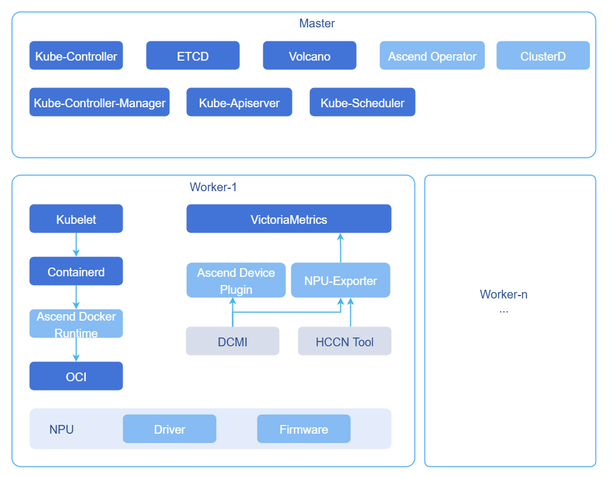
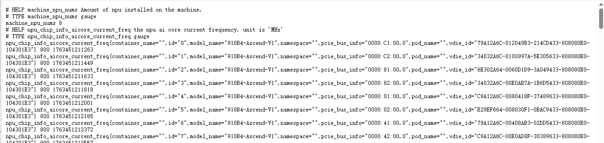
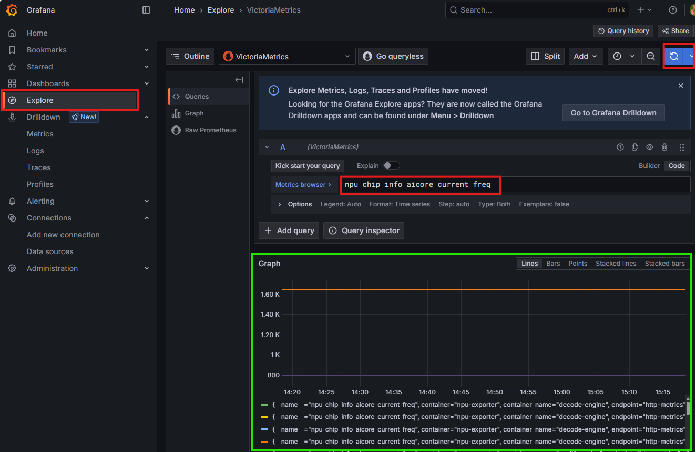
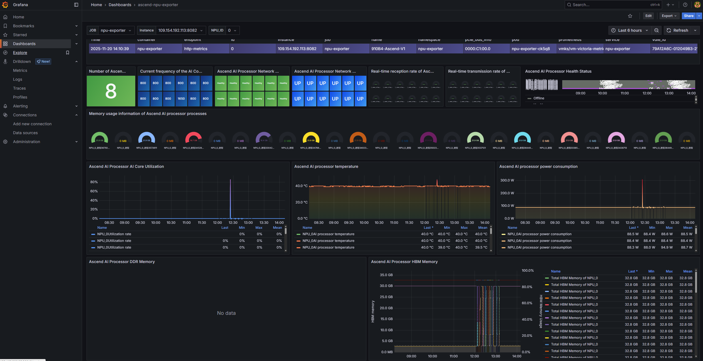

# 最佳实践
## MindCluster软件栈部署最佳实践
本文旨在提供使用Ascend Deployer工具部署MindCluster组件的方法，并在此基础上使用监控组件VictoriaMetrics实现对NPU工作状态的监控，以确保超大规模集群NPU的实时状态采集、上报与性能分析，保障训练与推理任务全程可控、可观测、可回溯。
### 目标
- 给出适用于超大规模集群的MindCluster组件部署方案。
- 给出在超大规模集群场景下与NPU适配的VictoriaMetrics监控方案。
- 给出针对超大规模集群的NPU指标可视化展示效果及常用面板入口配置。
- 给出针对超大规模集群优化的volcano的替换方案。
### 前提条件
环境需满足以下要求。
- 已部署Kubernetes集群及对应网络插件。
- 已部署监控组件VictoriaMetrics。
- 已安装Python（版本 ≥ 3.6）及配套的pip3。
- 部署节点的物理机上具备可分配、满足业务需求的NPU资源。
### 使用限制
-  部署方式：本实践主要针对使用Ascend Deployer工具的部署方式。
-  操作系统：Ascend Deployer工具针对不同版本的openEuler操作系统有严格限制，对于支持版本外的操作系统无法使用部署工具安装MindCluster组件（[单击获取所有支持版本](https://www.hiascend.com/document/detail/zh/mindcluster/72rc1/deployer/deployerug/deployer_0002.html)），本实践使用openEuler 22.03（LTS-SP4）版本的操作系统。
-  版本声明：本文步骤仅对下表所列经严格验证的组件版本组合有效；其余版本未实测，部署效果未验证。欢迎补充更多版本实践，一起更新兼容矩阵！
  
    **表1** 版本配套说明

    | 组件/工具           | 版本                       |
    |-----------------|--------------------------|
    | 操作系统            | openEuler 22.03（LTS-SP4） |
    | Python          | 3.9.9                    |
    | pip3            | 21.3.1                   |
    | ascend-deployer | 7.1rc1                   |
    | Kubernetes      | 1.28.15、1.33.1、1.34.3    |
    | VictoriaMetrics  | 1.222.0（chart版本0.58.2）   |

### 背景信息
NPU（Neural Processing Unit，神经网络处理器）是专为人工智能工作负载设计的计算加速器，属于AI加速器的一种。它以高吞吐、低延迟、高能效为设计目标，广泛应用于深度学习训练与推理场景。MindCluster（AI集群系统软件）是支持NPU（昇腾AI处理器）构建的深度学习系统组件，专为训练和推理任务提供集群级解决方案。深度学习平台开发厂商可以减少底层资源调度相关软件开发工作量，快速使能伙伴基于MindCluster开发深度学习平台。

MindCluster将NPU的注册、调度、容错、观测、弹性、审计六大能力统一封装到云原生控制面，使千卡级Ascend资源像CPU一样即插即用；通过实时拓扑带宽感知、秒级亚健康隔离、幂等式断点续训和全局指标大盘，将训练中断率压至<0.3%，资源利用率提升25%，故障恢复时间从小时级降到分钟级，真正让大模型作业在Ascend集群上实现连续、高效、自治的运行闭环。
-  资源自动发现 ：ascend-device-plugin以DaemonSet运行，开机即向Kubelet注册每颗NPU的DeviceID、拓扑位置、芯片类型、驱动版本，节点扩缩无需重启控制面，支持动态热插拔，注册过程通常在数十秒内完成。
-  资源监测 ：MindCluster通过NPU Exporter统一暴露昇腾芯片与虚拟NPU的实时指标，以gRPC对接CRI获取容器映射，调用hccn_tool采集网络状态，通过DCMI接口读取核心利用率、温度、电压、内存等硬件信息，最终转化为Prometheus标准格式；用户无需区分训练或推理场景，无论使用何种调度器，仅需部署Prometheus或Telegraf即可秒级接入，实现从单板到超节点的全景可观测。
-  断点续训 ：MindCluster的断点续训把故障损失拆成“回滚+拉起”两段。先基于最近CKPT回滚到故障前状态，再一次性完成资源重调度、集合通信初始化、CKPT加载和框架编译，两段耗时相加即为单次总损失。以PyTorch GPT-3为例（NFS读速4.8 GB/s，单机 8卡），3B模型CKPT加载约3s、整体拉起约70s；15B模型CKPT加载约90s、整体拉起约210s，均远小于全量重训，实现分钟级恢复并继续向后训练。
-  基础调度 ：MindCluster把训练与推理任务统一抽象为整卡、静态vNPU和弹性切片三种资源视图。训练侧支持整卡调度、静态vNPU切分与弹性扩缩，推理侧额外提供动态vNPU及卡故障后的现场恢复与重调度。平台通过ascend-device-plugin完成资源注册，volcano-scheduler实现拓扑亲和匹配，ClusterD负责亚健康避让，用户只需提交`acjob/vcjob/deploy`的yaml文件，系统即可自动完成资源分配、通信初始化与故障逃逸，无需关注底层细节。
-  虚拟化实例 ：MindCluster支持把单颗物理NPU切片成多个vNPU，通过容器动态挂载，实现多租户共享，提升资源利用率；切片后原卡不可再用，一个vNPU只能被一个任务独占，且整服务器须保持同一模板与内存规格，训练芯片仅AMP模式支持虚拟化。

### 操作步骤
在具体的安装过程中，使用MindCluster提供的Ascend Deployer工具进行批量化部署。在完成Ascend Deployer工具的获取后，首先需要根据使用场景，选择对应的软件包进行安装，然后通过inventory_file文件配置批量待安装场景，在确定具体所需要安装的MindCluster组件后即可执行最终的安装命令。其中的volcano组件由于需要使用超大规模集群优化版，应进行手动替换，其余组件均可直接使用。

需要说明的是，由于本实践应用场景为NPU的性能指标监控，因此未进行MindCluster组件的全量安装，实践中具体的组件选择和部署形态如下图。

**图1** MindCluster组件选择和部署形态



- ClusterD：为了协调任务的处理级别，MindCluster提供了部署在管理节点的ClusterD服务。ClusterD收集并汇总集群任务、资源和故障信息及影响范围，从任务、芯片和故障维度统计分析，统一判定故障处理级别和策略。
- Ascend Operator：输入集合通信所需的主进程IP、静态组网集合通信所需的RankTable信息、当前Pod的rankId等信息。
- Ascend Docker Runtime：昇腾驱动相关的脚本和命令分布在不同的文件中，且存在变更的可能性。为了避免容器创建时冗长的文件挂载，MindCluster提供了部署在计算节点上的Ascend Docker Runtime组件。通过输入需要挂载的昇腾AI处理器编号，即可完成昇腾AI处理器及相关驱动的文件挂载。
- Ascend Device Plugin：MindCluster提供了部署在计算节点的Ascend Device Plugin服务，用于提供适合昇腾设备的资源发现和上报策略。
- NPU-Exporter：从驱动中获取芯片、网络的各项数据信息，监测dcmi/hccn tool/NPU获取数据库。适配Prometheus钩子函数，提供标准的接口供Prometheus服务调用。
- Volcano：K8s基础调度仅能通过感知昇腾芯片的数量进行资源调度。为实现亲和性调度，最大化资源利用，需要感知昇腾芯片之间的网络连接方式，选择网络最优的资源。MindCluster提供了部署在管理节点的Volcano服务，针对不同的昇腾设备和组网方式提供网络亲和性调度。


1. 获取Ascend Deployer工具。
 
    目前Ascend Deployer已有最新版本为7.1rc1，需要在控制节点上执行以下命令，获取MindCluster Ascend Deployer工具。
    ```bash
    # 执行以下命令安装软件包。执行以下命令完成初始化。初始化后自动生成ascend-deployer目录，路径为$HOME/ascend-deployer。
    # pip3 install ascend-deployer=={version}，{version}替换为工具版本
    pip3 install ascend-deployer==7.1rc1
    ascend-deployer -h # 验证安装
    ```
2. 使用Ascend Deployer安装软件包。
 
    2.1 查看架构和操作系统，确定下一步安装需要执行的命令。
    ```bash
    uname -m && cat /etc/os-release
    # 以下为返回内容
    # aarch64
    # NAME="openEuler"
    # VERSION="22.03 (LTS-SP4)"
    # ID="openEuler"
    # VERSION_ID="22.03"
    # PRETTY_NAME="openEuler 22.03 (LTS-SP4)"
    # ANSI_COLOR="0;31"
    ```
    2.2 根据返回结果，`<OS>=OpenEuler_22.03LTS-SP4_aarch64`，本实践为实现NPU指标监控的最小安装，因此选择`<PK>=NPU,CANN,DL,FaultDiag`，用户可以根据需求选择更多组件。据此，安装软件包时，执行命令如下。
    ```bash
    # ascend-download --os-list=<OS> --download=<PK1>,<PK2>==<Version>
    ascend-download --os-list=OpenEuler_22.03LTS-SP4_aarch64 --download=NPU,CANN,DL,FaultDiag
    ```
    **表2** 软件包与组件对应关系

    | 软件包        | 包含的组件                                         |
    |------------|------------------------------------------------------|
    | NPU        | npu(driver、firmware)，mcu                         |
    | CANN       | nnae，nnrt，tfplugin，toolkit，kernels，toolbox     |
    | DL         | ascend-device-plugin，ascend-docker-runtime，hccl-controller，noded，npu-exporter，volcano，ascend-operator，resilience-controller，clusterd，mindio |
    | FaultDiag  | faultDiag                 |
    | MindSpore  | mindspore                  |
    | TensorFlow | tensorflow                 |
    | Torch-npu  | torch-npu，torch           |
    |MindIE-image|mindie-image|

    
     > **说明：**
        >
        > 如需获取更多安装帮助可以执行`ascend-download -h`。

3. 配置批量待安装场景。
   
    编辑/root/ascend-deployer/路径下inventory_file文件。

    >  **注意：**
    >
    >由于宿主机的hostname与其对应节点在集群中的node名称存在差异，因此这里的`<节点名称>`需要与node名称保持一致。
    ``` 
    [hccn]

    [hccn:vars]
    gateways=""
    netmask="255.255.255.0"
    roce_port=4791
    bitmap=""
    dscp_tc=""
    common_network="0.0.0.0/0"

    [master]
    # 10.10.10.1-10.10.10.9 ansible_ssh_user="root" ansible_ssh_pass="test1234" step_len=3
    192.168.200.25 ansible_ssh_user="root" ansible_ssh_pass=<ssh_pass> set_hostname="fuyao-master" 
    # `<ssh_pass>`需要替换为对应节点ssh密码
    # 节点信息填写控制节点信息，信息包括`<ip>，<账户>，<ssh密码>，<节点名称>`

    [worker]
    # localhost ansible_connection='local' ansible_ssh_user='root'
    # 10.10.10.1-10.10.10.9 ansible_ssh_user="root" ansible_ssh_pass="test1234" step_len=3
    192.168.200.26 ansible_ssh_user="root" ansible_ssh_pass=<ssh_pass> set_hostname="fuyao-worker-0"
    192.168.200.27 ansible_ssh_user="root" ansible_ssh_pass=<ssh_pass> set_hostname="fuyao-worker-1"

    [npu_node]
    # 10.10.10.1-10.10.10.9 ansible_ssh_user="root" ansible_ssh_pass="test1234" step_len=3

    [other_build_image]

    [all:vars]
    SCALE="false"
    RUNNER_IP=""
    WEIGHTS_PATH=""
    ```

4. 配置镜像构建环境。
   
    由于安装工具ascend-deployer所拉取的镜像是Docker制作的，因此在运行安装程序的控制节点上需要安装Docker，在不修改ascend-deployer原有代码的前提下可以使用以下两种方法解决。
    - 方法一：使用nerdctl替代Docker（推荐）。
      1. 安装nerdctl和buildkit。

          1.1 执行以下代码，下载准备依赖项。
          ```bash
          # 下载nerdctl、buildkit安装包,可以到github下载新版的
          wget https://github.com/containerd/nerdctl/releases/download/v1.7.5/nerdctl-1.7.5-linux-amd64.tar.gz
          wget https://github.com/moby/buildkit/releases/download/v0.10.3/buildkit-v0.10.3.linux-amd64.tar.gz
          # 下载后解压
          tar -xvzf nerdctl-1.7.5-linux-amd64.tar.gz -C /usr/local/bin/
          tar -xvzf buildkit-v0.10.3.linux-amd64.tar.gz -C /usr/local/bin/
          # 将二进制移动到usr/local/bin/目录下
          mv /usr/local/bin/bin/buildctl /usr/local/bin/bin/buildkitd /usr/local/bin/
          ```
          1.2 在/usr/lib/systemd/system/buildkit.service启动配置文件。
          ```
          # vi /usr/lib/systemd/system/buildkit.service
          [Unit]
          Description=BuildKit
          Requires=buildkit.socket
          After=buildkit.socket
          Documentation=https://github.com/moby/buildkit

          [Service]
          Type=notify
          ExecStart=/usr/local/bin/buildkitd --addr fd://

          [Install]
          WantedBy=multi-user.target
          ```
          1.3 在/usr/lib/systemd/system下配置buildkit.socket启动配置文件。

          ```
          # vi /usr/lib/systemd/system/buildkit.socket
          [Unit]
          Description=BuildKit
          Documentation=https://github.com/moby/buildkit

          [Socket]
          ListenStream=%t/buildkit/buildkitd.sock
          SocketMode=0660

          [Install]
          WantedBy=sockets.target
          ```
        2. 执行以下代码，启动buildkit服务。
            ```
            systemctl enable --now buildkit.service  buildkit.socket
            ```

        3. 执行以下代码，将nerdctl可执行文件硬链到/usr/local/bin/decker。
            ```bash
            sudo ln /usr/local/bin/nerdctl /usr/local/bin/docker
            ```
    - 方法二：安装Docker（易冲突，不推荐）。
      >  **注意：**
      >
      > 该方法需要先安装containerd再安装Docker。
      ```bash
      dnf config-manager --add-repo https://download.docker.com/linux/centos/docker-ce.repo
      sed -i 's/$releasever/8/g' /etc/yum.repos.d/docker-ce.repo
      dnf makecache
      dnf install -y docker-ce docker-ce-cli containerd.io
      systemctl enable --now docker
      docker version
      ```
    
5. 安装驱动和固件的依赖项。
 
    5.1 执行以下命令，检查源是否可用。
    ```
    yum makecache
    ```
    5.2 执行以下命令，安装所需依赖。
    ```
    yum install -y make dkms gcc kernel-headers-$(uname -r) kernel-devel-$(uname -r)  # gcc
    yum install -y net-tools pciutils  # lspci
    yum install -y net-tools net-tools  # ifconfig
    ```

6. 执行安装。
   
    6.1 完成镜像构建环境的准备后可以进行安装，`ascend-deployer -h`可以获取安装帮助，若发生检查错误，可以添加`--skip_check`命令。运行安装执行。
    ```bash
    ascend-deployer --install=ascend-docker-runtime,volcano,ascend-device-plugin,npu-exporter,ascend-operator,clusterd,driver,firmware,npu
    ```
    6.2 其中install内容为使用victoriesmetric监控NPU的最小安装范围，npu代表驱动和固件。完成安装后运行测试，检查安装结果。
    ```bash
    ascend-deployer --test all
    ```

7. 去除污点。
   
    mindx-exporter和volcano-system节点出现pending，原因是主节点上存在污点不允许调度，去除污点即可，执行以下命令，去除污点。
    ```bash
    kubectl taint node <node-name, eg: fuyao-master> node-role.kubernetes.io/control-plane:NoSchedule-
    ```

8. 手动替换volcano。
   
    > **说明：**
        >
        >ascend-deployer提供的volcano的版本为官方版本，社区对volcano在超大规模集群场景下做了优化，因此需要安装社区版本的volcano，这里选择volcano v1.9。

    8.1 构建环境准备。
    - 完成Go语言环境的安装（版本>=1.21，建议使用最新的bugfix版本），参见[golang官方文档·](https://golang.org/) 。
    - 完成musl的安装（版本>=1.2.0）。参见[musllibc官方文档·](http://musl.libc.org/) ，如下。

      ```bash
      wget https://musl.libc.org/releases/musl-1.2.5.tar.gz 
      tar -xzf musl-1.2.5.tar.gz
      cd musl-1.2.5
      ./configure --prefix=/usr/local/musl
      make
      sudo make install
      ```
    8.2 拉取Volcano源代码。

    8.2.1 执行以下命令，在`$GOPATH/src/volcano.sh/`目录下拉取Volcano v1.9.0（或v1.7.0）官方开源代码。
    ```bash
    cd $GOPATH/src/volcano.sh/
    git clone -b release-1.9 https://gitcode.com/openFuyao/volcano-ext.git
    ```
    8.2.2 将代码目录`ascend-for-volcano`重命名为`ascend-volcano-plugin`拷贝至Volcano官方开源代码的插件路径下`$GOPATH/src/volcano.sh/volcano/pkg/scheduler/plugins/`。

    8.3 编译Volcano源码，构建镜像。

    8.3.1 [单击获取完整用于构建镜像的build.sh文件](#用于构建镜像的buildsh)，需要特别注意`DEFAULT_VER='v6.0.0'`这一部分的版本，在使用不同版本的mind-cluster时需要进行修改，详见官网[集成昇腾插件扩展开源Volcano](https://www.hiascend.com/document/detail/zh/mindcluster/71RC1/clustersched/dlug/dlug_installation_023.html)。
    

    8.3.2 执行以下命令，编译Volcano二进制文件和so文件。根据开源代码版本，为build.sh脚本选择对应的参数，如v1.9.0。
    ```bash
    cd $GOPATH/src/volcano.sh/volcano/pkg/scheduler/plugins/ascend-volcano-plugin/build
    chmod +x build.sh
    ./build.sh v1.9.0
    ```
    8.3.3 编译出的二进制文件和动态链接库文件在`ascend-volcano-plugin/output`目录下。

    **表3** ascend-volcano-plugin/output目录结构
    | 文件名                                | 说明                         |
    |------------------------------------|----------------------------|
    | volcano-npu_v6.0.0_linux-aarch64.so | Volcano华为NPU调度插件动态链接库。      |
    | Dockerfile-scheduler               | Volcano scheduler镜像构建文本文件。  |
    | Dockerfile-controller              | Volcano controller镜像构建文本文件。 |
    | volcano-v1.9.0.yaml             | Volcano的启动配置文件。             |
    | vc-scheduler                       | Volcano scheduler组件二进制文件。   |
    | vc-controller-manager              | Volcano controller组件二进制文件。  |

    8.4 制作volcano-scheduler、volcano-controller镜像。

    8.4.1 进入ascend-volcano-plugin/output，执行以下命令，制作Volcano镜像。根据开源代码版本，为镜像选择对应的参数，如v1.7.0或v1.9.0。
    ```
    nerdctl build --no-cache -t volcanosh/vc-scheduler:v1.9.0 ./ -f ./Dockerfile-scheduler
    nerdctl build --no-cache -t volcanosh/vc-controller:v1.9.0 ./ -f ./Dockerfile-controller
    # 完成构建：
    # unpacking docker.io/volcanosh/vc-scheduler:v1.9.0 (sha256:3acce97f0162d1f91866cec6ebad1b1bea9ff650d99e00160ba6712e87ae72
    # Loaded image: docker.io/volcanosh/vc-scheduler:v1.9.0
    # unpacking docker.io/volcanosh/vc-controller:v1.9.0 (sha256:0e37e772a68a1873e9f78cc96d1b5e9e69235183b22b542c68623196ed8a6417)...
    # Loaded image: docker.io/volcanosh/vc-controller:v1.9.0
    ```

    8.4.2 已经构建完成的镜像存在于默认命名空间中，K8s无法直接调用，因此需要先将镜像移入K8s的命名空间中，执行以下命令。

    ```
    # 将镜像保存成tar包
    nerdctl save -o vc-controller.tar volcanosh/vc-controller:v1.9.0
    nerdctl save -o vc-scheduler.tar volcanosh/vc-scheduler:v1.9.0
    # 将镜像移入k8s的命名空间
    ctr -n k8s.io images import vc-controller.tar
    ctr -n k8s.io images import vc-scheduler.tar
    ```

    8.5 替换镜像。

    由于在安装环节已经选择安装volcano，因此只需对原有镜像地址进行替换即可。

    8.5.1更改原有配置中镜像地址。
    ```
    kubectl get deploy -A
    kubectl edit deploy -n volcano-system volcano-scheduler
    kubectl edit deploy -n volcano-system volcano-controllers
    ```
    8.5.2 以volcano-scheduler为例，进行如下修改。
    ```
    spec:
          containers:
          - args:
            - -c
            - umask 027; /vc-scheduler --scheduler-conf=/volcano.scheduler/volcano-scheduler.conf
              --plugins-dir=plugins --logtostderr=false --leader-elect=false --percentage-nodes-to-find=100
              --log_dir=/var/log/mindx-dl/volcano-scheduler --log_file=/var/log/mindx-dl/volcano-scheduler/volcano-scheduler.log
              -v=2 2>&1
            command:
            - /bin/ash
            image: docker.io/volcanosh/vc-scheduler:v1.9.0 # 替换成新的的镜像地址
            imagePullPolicy: IfNotPresent
            name: volcano-scheduler
    ```


9. NPU指标暴露。
    
    9.1 NPU exporter是MindCluster内置的轻量级采集器，通过DCMI、hccn_tool与CRI接口实时读取昇腾AI处理器的利用率、温度、电压、内存、网络及容器映射信息，并直接暴露成Prometheus格式指标（默认端口 8082）。它随ascend-device-plugin以DaemonSet方式自动部署到每个NPU节点，实现集群级NPU资源的一站式可观测。使用Ascend Deployer完成部署后，NPU exporter自动开放端口，但受于默认网络策略限制，无法通过`http://<ip>:8082/metrics`直接访问NPU指标数据，出于安全考虑的原有网络配置应该进行修改，首先需要查询网络配置并移除，执行以下命令。
    ```bash
    kubectl get networkpolicy -A # 查询
    kubectl delete networkpolicy -n npu-exporter exporter-network-policy #移除
    ```
    9.2 网络配置移除后浏览器登录`http://<ip>:8082/metrics`即可获取NPU监控指标。

    **图2** metrics页面NPU监控指标

    

    9.3 创建新的网络策略配置文件`exporter-network-policy.yaml`。
    ```yaml
    apiVersion: networking.k8s.io/v1
    kind: NetworkPolicy
    metadata:
      name: exporter-network-policy
      namespace: npu-exporter
    spec:
      egress:
      - to:
        - namespaceSelector: {}
          podSelector:
            matchLabels:
              app.kubernetes.io/name: "vmagent" #修改
      ingress:
      - from:
        - namespaceSelector: {}
          podSelector:
            matchLabels:
              app.kubernetes.io/name: "vmagent" #修改
      podSelector:
        matchLabels:
          app: npu-exporter
      policyTypes:
      - Ingress
      - Egress
    ```
    9.4 新网络策略生效。

    ```bash
    kubectl apply -f exporter-network-policy.yaml
    ```
    9.5 再次查询，验证网络配置生效情况。
    ```bash
    kubectl get networkpolicy -A # 查询
    # 以下为返回结果
    # NAMESPACE          NAME                      POD-SELECTOR       AGE
    # calico-apiserver   allow-apiserver           apiserver=true     xxx
    # npu-exporter       exporter-network-policy   app=npu-exporter   xxx
    ```

10. vmagent数据捕获配置。
    目前NPU exporter监控指标已经能够通过端口正常暴露，但vmagent仍然无法获取这些数据。原因在于尚未配置`npu-exporter Service`和`VMServiceScrape cr`，因此需要配置service和crd，使得vmagent能够自动抓取npu-exporter端口数据。

    10.1 配置CRD：创建配置文件`npu-exporter-cr.yaml`。

    ```
    apiVersion: operator.victoriametrics.com/v1beta1
    kind: VMServiceScrape
    metadata:
      annotations:
        meta.helm.sh/release-name: vm
        meta.helm.sh/release-namespace: vmks
      labels:
        app.kubernetes.io/instance: vm
        app.kubernetes.io/managed-by: Helm
        app.kubernetes.io/name: victoria-metrics-k8s-stack
        app.kubernetes.io/version: v1.122.0
        helm.sh/chart: victoria-metrics-k8s-stack-0.58.2
      name: vm-victoria-metrics-k8s-stack-npu-exporter
      namespace: vmks
    spec:
      endpoints:
      - bearerTokenFile: /var/run/secrets/kubernetes.io/serviceaccount/token
        port: http-metrics
        scheme: http
        tlsConfig:
          caFile: /var/run/secrets/kubernetes.io/serviceaccount/ca.crt
      jobLabel: jobLabel
      namespaceSelector:
        matchNames:
        - npu-exporter
      selector:
        matchLabels:
          app: vm-victoria-metrics-k8s-stack-npu-exporter
          app.kubernetes.io/instance: vm
          app.kubernetes.io/name: victoria-metrics-k8s-stack
          jobLabel: npu-exporter
    ```
    10.2 执行以下命令，添加配置文件npu-exporter-cr.yaml，使VMServiceScrape cr生效。
    ```
    kubectl apply -f npu-exporter-cr.yaml
    ```

    10.3 配置Service：创建配置文件npu-exporter-capture.yaml。

    ```yaml
    apiVersion: v1
    kind: Service
    metadata:
      labels:
        app: vm-victoria-metrics-k8s-stack-npu-exporter
        app.kubernetes.io/instance: vm
        app.kubernetes.io/name: victoria-metrics-k8s-stack
        jobLabel: npu-exporter
      name: npu-exporter
      namespace: npu-exporter
    spec:
      clusterIP: 10.105.44.182
      clusterIPs:
      - 10.105.44.182
      externalTrafficPolicy: Cluster
      internalTrafficPolicy: Cluster
      ipFamilies:
      - IPv4
      ipFamilyPolicy: SingleStack
      ports:
      - name: http-metrics
        nodePort: 30082
        port: 8082
        protocol: TCP
        targetPort: 8082
      selector:
        app: npu-exporter
      sessionAffinity: None
      type: NodePort
    status:
      loadBalancer: {}
    ```
    10.4 执行以下命令，添加配置文件npu-exporter-capture.yaml，使Service生效。

    ```
    kubectl apply -f npu-exporter-capture.yaml
    ```
11. 验证vmagent捕获NPU监控指标。
    
    如需验证可以开放vmagent的target端口或者进入grafana界面，通过Explore查询`http://<ip>:8082/metrics`中暴露的指标，如npu_chip_info_aicore_current_freq，若能够正常获取数据，则表示vmagent已经能捕获npu监控指标，如下图。


    **图3** 验证vmagent捕获NPU监控指标操作示意图
    

12. grafana可视化面板配置。
    
    通过helm安装的监控组件VictoriaMetrics时自动部署了grafana，grafana带有多个默认Dashboards，这使得集群的监控指标无需额外配置即可显示在grafana的不同Dashboards中。但这些默认面板中不包含NPU的相关指标，因此需要配置新的Dashboards以可视化展示NPU的监控指标。

    12.1 新增面板可以参考grafana官方文档直接在线配置，也可以通过configmap通过代码实现，grafana的sidecar会自动依据文件添加dashboard面板。这里我们提供了一个可用的NPU监控指标可视化面板，[单击获取配置文件dashboard-npu-export.yaml](#配置文件dashboard-npu-exportyaml)。

    12.2 执行以下命令，创建configmap。
    ```
    kubectl apply -f dashboard-npu-export.yaml
    ```
    如需删除configmap，执行`kubectl delete cm dashboard-npu-export -n vmks`

### 注意事项/常见问题
Ascend Deployer部署工具严格限制操作系统版本，且版本检查无法跳过，因此需要特别注意操作系统的版本匹配问题，目前使用的7.1rc1版本ascend-deployer支持的OpenEuler版本包括。
- OpenEuler_20.03LTS_aarch64
- OpenEuler_20.03LTS_x86_64
- OpenEuler_22.03LTS-SP4_aarch64
- OpenEuler_22.03LTS_aarch64
- OpenEuler_22.03LTS_x86_64
- OpenEuler_24.03LTS-SP1_aarch64


### 结论
本方案基于Ascend Deployer一键部署MindCluster算力集群，并集成VictoriaMetrics构建指标采集与可视化体系。整套系统已在openEuler 22.03与Kubernetes 1.28.15环境中完成部署验证。如图所示，NPU在计算任务期间的各项关键指标（如利用率、温度、内存）均在Grafana界面上实现了秒级刷新与实时呈现，这标志着从指标获取、存储到展示的完整监控链路已成功打通并运行有效。

MindCluster将昇腾NPU的注册、调度、容错、观测、弹性、审计六大能力云原生化，使千卡资源即插即用；通过拓扑感知调度与秒级亚健康隔离，训练任务平均恢复时间缩短至分钟级，资源利用率提升，为后续自动弹性、容量预测和长期存储提供统一、可信的数据底座，助力大模型作业从“救火式运维”转向“数据驱动自治”。

**图4** 实现AI推理任务中NPU监控


### 参考资料

- [Ascend官方MindCluster产品简介](https://www.hiascend.com/software/mindcluster)
- [Ascend官方MindCluster Ascend Deployer安装部署工具](https://www.hiascend.com/document/detail/zh/mindcluster/72rc1/deployer/deployerug/deployer_0001.html)
- [Ascend官方集群调度组件使用特性指南](https://www.hiascend.com/document/detail/zh/mindcluster/72rc1/clustersched/dlug/mxdlug_monit_001.html)
- [grafana官方文档Dashboards配置说明](https://grafana.com/docs/grafana-cloud/visualizations/dashboards/build-dashboards/create-dashboard/)
- [基于VictoriaMetrics软件栈的超大规模集群监控方案最佳实践](https://gitcode.com/openFuyao/sig-large-scale-cluster/blob/master/best-practices/victoriametriacs%E6%9C%80%E4%BD%B3%E5%AE%9E%E8%B7%B5.md)

### 附录
#### 用于构建镜像的build.sh

```bash
    #!/bin/bash
    # Perform  build volcano-huawei-npu-scheduler plugin
    # Copyright @ Huawei Technologies CO., Ltd. 2020-2022. All rights reserved
    #
    # Licensed under the Apache License, Version 2.0 (the "License");
    # you may not use this file except in compliance with the License.
    # You may obtain a copy of the License at
    #
    # http://www.apache.org/licenses/LICENSE-2.0
    #
    # Unless required by applicable law or agreed to in writing, software
    # distributed under the License is distributed on an "AS IS" BASIS,
    # WITHOUT WARRANTIES OR CONDITIONS OF ANY KIND, either express or implied.
    # See the License for the specific language governing permissions and
    # limitations under the License.
    # ============================================================================

    set -e

    # BASE_VER only support v1.7.0 or v1.9.0
    if [ ! -n "$1" ]; then
        BASE_VER=v1.7.0
    else
        BASE_VER=$1
    fi

    echo "Build Version is ${BASE_VER}"

    # 使用不同mind-cluster版本时需要注意此处版本的变动
    DEFAULT_VER='v6.0.0'
    TOP_DIR=${GOPATH}/src/volcano.sh/volcano/
    BASE_PATH=${GOPATH}/src/volcano.sh/volcano/pkg/scheduler/plugins/ascend-volcano-plugin/
    CMD_PATH=${GOPATH}/src/volcano.sh/volcano/cmd/
    PKG_PATH=volcano.sh/volcano/pkg
    DATE=$(date "+%Y-%m-%d %H:%M:%S")

    function parse_version() {
        version_file="${TOP_DIR}"/service_config.ini
        if  [ -f "$version_file" ]; then
          line=$(sed -n '1p' "$version_file" 2>&1)
          version="v"${line#*=}
          echo "${version}"
          return
        fi
        echo ${DEFAULT_VER}
    }

    function parse_arch() {
      arch=$(arch 2>&1)
      echo "${arch}"
    }

    REL_VERSION=$(parse_version)
    REL_ARCH=$(parse_arch)
    REL_NPU_PLUGIN=volcano-npu_${REL_VERSION}_linux-${REL_ARCH}

    function clean() {
        rm -f "${BASE_PATH}"/output/vc-controller-manager
        rm -f "${BASE_PATH}"/output/vc-scheduler
        rm -f "${BASE_PATH}"/output/*.so
    }

    function copy_yaml() {
        cp "${BASE_PATH}"/build/volcano-"${BASE_VER}".yaml "${BASE_PATH}"/output/
    }

    # fix the unconditional retry. All pod errors cause the podgroup to be deleted and cannot be rescheduled
    function replace_code() {
        REPLACE_FILE="${GOPATH}/src/volcano.sh/volcano/pkg/controllers/job/state/running.go"
        SEARCH_STRING="Ignore"
        if ! grep -q "$SEARCH_STRING" "$REPLACE_FILE";then
          sed -i "s/switch action {/switch action { case \"Ignore\" : return nil/g" "$REPLACE_FILE"
        fi
    }

    function build() {
        echo "Build Architecture is" "${REL_ARCH}"

        export GO111MODULE=on
        export PATH=$GOPATH/bin:$PATH

        cd "${TOP_DIR}"
        go mod tidy

        cd "${BASE_PATH}"/output/

        export CGO_CFLAGS="-fstack-protector-all -D_FORTIFY_SOURCE=2 -O2 -fPIC -ftrapv"
        export CGO_CPPFLAGS="-fstack-protector-all -D_FORTIFY_SOURCE=2 -O2 -fPIC -ftrapv"
        export CC=/usr/local/musl/bin/musl-gcc
        export CGO_ENABLED=1 #修改

        go build -mod=mod -buildmode=pie -ldflags "-s -linkmode=external -extldflags=-Wl,-z,now
          -X '${PKG_PATH}/version.Built=${DATE}' -X '${PKG_PATH}/version.Version=${BASE_VER}'" \
          -o vc-controller-manager "${CMD_PATH}"/controller-manager

        export CGO_ENABLED=1
        go build -mod=mod -buildmode=pie -ldflags "-s -linkmode=external -extldflags=-Wl,-z,now
          -X '${PKG_PATH}/version.Built=${DATE}' -X '${PKG_PATH}/version.Version=${BASE_VER}'" \
          -o vc-scheduler "${CMD_PATH}"/scheduler

        go build -mod=mod -buildmode=plugin -ldflags "-s -linkmode=external -extldflags=-Wl,-z,now
          -X volcano.sh/volcano/pkg/scheduler/plugins/ascend-volcano-plugin.PluginName=${REL_NPU_PLUGIN}" \
          -o "${REL_NPU_PLUGIN}".so "${GOPATH}"/src/volcano.sh/volcano/pkg/scheduler/plugins/ascend-volcano-plugin/

        if [ ! -f "${BASE_PATH}/output/${REL_NPU_PLUGIN}.so" ]
        then
          echo "fail to find volcano-npu_${REL_VERSION}.so"
          exit 1
        fi

        sed -i "s/name: volcano-npu_.*/name: ${REL_NPU_PLUGIN}/" "${BASE_PATH}"/output/volcano-*.yaml

        chmod 400 "${BASE_PATH}"/output/*.so
        chmod 500 vc-controller-manager vc-scheduler
        chmod 400 "${BASE_PATH}"/output/Dockerfile*
        chmod 400 "${BASE_PATH}"/output/volcano-*.yaml
    }

    function replace_node_predicate() {
        if [[ "$BASE_VER" == "v1.7.0" ]];then
          return
        fi
        cd $BASE_PATH
        find . -type f ! -path './.git*/*' ! -path './doc/*' -exec sed -i 's/k8s.io\/klog\"/k8s.io\/klog\/v2\"/g' {} +
        REPLACE_FILE="${GOPATH}/src/volcano.sh/volcano/pkg/scheduler/plugins/ascend-volcano-plugin/npu.go"
        sed -i "s/api.NodeInfo) error {/api.NodeInfo) (\[\]\*api.Status, error) {/g" "$REPLACE_FILE"
        sed -i "s/return predicateErr/return \[\]\*api.Status{}, predicateErr/g" "$REPLACE_FILE"
    }

    function replace_node_score() {
        REPLACE_FILE="${GOPATH}/src/volcano.sh/volcano/pkg/scheduler/actions/allocate/allocate.go"
        if [[ "$BASE_VER" == "v1.7.0" ]];then
              sed -i '
              /case len(candidateNodes) == 1:/ {
                  N
                  N
                  s/case len(candidateNodes) == 1:.*\n.*\n.*/            default:/
              }' "$REPLACE_FILE"
          return
        fi
        if [[ "$BASE_VER" == "v1.9.0" ]];then
              sed -i '
              /case len(nodes) == 1:/ {
                  N
                  N
                  s/case len(nodes) == 1:.*\n.*\n.*/            default:/
              }' "$REPLACE_FILE"
          return
        fi
        echo "volcano version is $BASE_VER, will not change allocate.go codes"
    }

    function replace_k8s_version() {
        REPLACE_FILE="${GOPATH}/src/volcano.sh/volcano/go.mod"
        if [[ "$BASE_VER" == "v1.9.0" ]];then
          sed -i "s/1.25.0/1.25.14/g" "$REPLACE_FILE"
          return
        fi
        echo "volcano version is $BASE_VER, will not change go.mod codes"
    }

    function main() {
      clean
      copy_yaml
      replace_code
      replace_node_predicate
      replace_node_score
      replace_k8s_version
      build
    }

    main "${1}"

    echo ""
    echo "Finished!"
    echo ""
  ```

#### 配置文件dashboard-npu-export.yaml

    ```yaml
    apiVersion: v1
    kind: ConfigMap
    metadata:
      name: dashboard-npu-export
      namespace: vmks          # 与 Grafana 同命名空间
      labels:
        grafana_dashboard: "1"       # sidecar 只扫带这个标签的 CM
    data:
      your-dashboard.json: |-
        {
          "annotations": {
            "list": [
              {
                "builtIn": 1,
                "datasource": {
                  "type": "grafana",
                  "uid": "-- Grafana --"
                },
                "enable": true,
                "hide": true,
                "iconColor": "rgba(0, 211, 255, 1)",
                "name": "Annotations & Alerts",
                "target": {
                  "limit": 100,
                  "matchAny": false,
                  "tags": [],
                  "type": "dashboard"
                },
                "type": "dashboard"
              }
            ]
          },
          "description": "「Ascend Npu Monitor」\r\nA Grafana dashboard for monitoring Ascend NPU metrics via ascend-npu-exporter. Visualize AI Core utilization, temperature, power, memory, and network status in real time.\r\n基于 ascend-npu-exporter 的昇腾NPU监控面板，支持AI Core、温度、功耗、内存、网络等关键指标的实时可视化。",
          "editable": true,
          "fiscalYearStartMonth": 0,
          "graphTooltip": 0,
          "id": 20,
          "links": [],
          "panels": [
            {
              "datasource": {
                "type": "prometheus",
                "uid": "P4169E866C3094E38"
              },
              "fieldConfig": {
                "defaults": {
                  "color": {
                    "mode": "thresholds"
                  },
                  "custom": {
                    "align": "auto",
                    "cellOptions": {
                      "mode": "gradient",
                      "type": "color-background"
                    },
                    "filterable": false,
                    "inspect": false
                  },
                  "mappings": [],
                  "thresholds": {
                    "mode": "absolute",
                    "steps": [
                      {
                        "color": "#4c4c8c"
                      }
                    ]
                  }
                },
                "overrides": [
                  {
                    "matcher": {
                      "id": "byName",
                      "options": "Value"
                    },
                    "properties": [
                      {
                        "id": "custom.hidden",
                        "value": true
                      }
                    ]
                  },
                  {
                    "matcher": {
                      "id": "byName",
                      "options": "__name__"
                    },
                    "properties": [
                      {
                        "id": "custom.hidden",
                        "value": true
                      }
                    ]
                  }
                ]
              },
              "gridPos": {
                "h": 4,
                "w": 24,
                "x": 0,
                "y": 0
              },
              "id": 8,
              "options": {
                "footer": {
                  "enablePagination": false,
                  "fields": "",
                  "reducer": [
                    "sum"
                  ],
                  "show": false
                },
                "showHeader": true
              },
              "pluginVersion": "9.3.2",
              "repeat": "npu_id",
              "repeatDirection": "h",
              "targets": [
                {
                  "datasource": {
                    "type": "prometheus",
                    "uid": "P4169E866C3094E38"
                  },
                  "editorMode": "code",
                  "exemplar": false,
                  "expr": "npu_chip_info_name{instance=\"$instance\", id=\"$npu_id\"}",
                  "format": "table",
                  "instant": true,
                  "interval": "",
                  "legendFormat": "NPU{{label_name}}",
                  "range": false,
                  "refId": "A"
                }
              ],
              "title": "Ascend AI Name and ID",
              "type": "table"
            },
            {
              "datasource": {
                "type": "prometheus",
                "uid": "P4169E866C3094E38"
              },
              "fieldConfig": {
                "defaults": {
                  "mappings": [],
                  "thresholds": {
                    "mode": "absolute",
                    "steps": [
                      {
                        "color": "green"
                      },
                      {
                        "color": "red",
                        "value": 80
                      }
                    ]
                  },
                  "unit": "short"
                },
                "overrides": []
              },
              "gridPos": {
                "h": 4,
                "w": 2,
                "x": 0,
                "y": 4
              },
              "id": 2,
              "options": {
                "colorMode": "background",
                "graphMode": "none",
                "justifyMode": "auto",
                "orientation": "auto",
                "percentChangeColorMode": "standard",
                "reduceOptions": {
                  "calcs": [
                    "lastNotNull"
                  ],
                  "fields": "",
                  "values": false
                },
                "showPercentChange": false,
                "textMode": "auto",
                "wideLayout": true
              },
              "pluginVersion": "12.0.2",
              "targets": [
                {
                  "datasource": {
                    "type": "prometheus",
                    "uid": "P4169E866C3094E38"
                  },
                  "editorMode": "builder",
                  "expr": "machine_npu_nums{instance=\"$instance\"}",
                  "legendFormat": "__auto",
                  "range": true,
                  "refId": "A"
                }
              ],
              "title": "Number of Ascend AI processors",
              "type": "stat"
            },
            {
              "datasource": {
                "type": "prometheus",
                "uid": "P4169E866C3094E38"
              },
              "fieldConfig": {
                "defaults": {
                  "mappings": [],
                  "thresholds": {
                    "mode": "absolute",
                    "steps": [
                      {
                        "color": "dark-blue"
                      }
                    ]
                  },
                  "unit": "none"
                },
                "overrides": []
              },
              "gridPos": {
                "h": 4,
                "w": 3,
                "x": 2,
                "y": 4
              },
              "id": 14,
              "options": {
                "colorMode": "background",
                "graphMode": "none",
                "justifyMode": "auto",
                "orientation": "auto",
                "percentChangeColorMode": "standard",
                "reduceOptions": {
                  "calcs": [
                    "lastNotNull"
                  ],
                  "fields": "",
                  "values": false
                },
                "showPercentChange": false,
                "textMode": "auto",
                "wideLayout": true
              },
              "pluginVersion": "12.0.2",
              "targets": [
                {
                  "datasource": {
                    "type": "prometheus",
                    "uid": "P4169E866C3094E38"
                  },
                  "editorMode": "builder",
                  "expr": "npu_chip_info_aicore_current_freq{instance=\"$instance\", id=\"$npu_id\"}",
                  "legendFormat": "__auto",
                  "range": true,
                  "refId": "A"
                }
              ],
              "title": "Current frequency of the AI Core of the Ascend AI processor",
              "type": "stat"
            },
            {
              "datasource": {
                "type": "prometheus",
                "uid": "P4169E866C3094E38"
              },
              "fieldConfig": {
                "defaults": {
                  "mappings": [
                    {
                      "options": {
                        "0": {
                          "color": "orange",
                          "index": 1,
                          "text": "Unhealthy"
                        },
                        "1": {
                          "color": "green",
                          "index": 0,
                          "text": "Healthy"
                        }
                      },
                      "type": "value"
                    }
                  ],
                  "thresholds": {
                    "mode": "absolute",
                    "steps": [
                      {
                        "color": "dark-yellow"
                      }
                    ]
                  },
                  "unit": "short"
                },
                "overrides": []
              },
              "gridPos": {
                "h": 4,
                "w": 3,
                "x": 5,
                "y": 4
              },
              "id": 7,
              "options": {
                "colorMode": "background",
                "graphMode": "none",
                "justifyMode": "auto",
                "orientation": "auto",
                "percentChangeColorMode": "standard",
                "reduceOptions": {
                  "calcs": [
                    "lastNotNull"
                  ],
                  "fields": "",
                  "values": false
                },
                "showPercentChange": false,
                "textMode": "auto",
                "wideLayout": true
              },
              "pluginVersion": "12.0.2",
              "targets": [
                {
                  "datasource": {
                    "type": "prometheus",
                    "uid": "P4169E866C3094E38"
                  },
                  "editorMode": "builder",
                  "expr": "npu_chip_info_network_status{instance=\"$instance\", id=\"$npu_id\"}",
                  "legendFormat": "__auto",
                  "range": true,
                  "refId": "A"
                }
              ],
              "title": "Ascend AI Processor Network Health Status",
              "type": "stat"
            },
            {
              "datasource": {
                "type": "prometheus",
                "uid": "P4169E866C3094E38"
              },
              "fieldConfig": {
                "defaults": {
                  "mappings": [
                    {
                      "options": {
                        "0": {
                          "color": "orange",
                          "index": 1,
                          "text": "DOWN"
                        },
                        "1": {
                          "color": "blue",
                          "index": 0,
                          "text": "UP"
                        }
                      },
                      "type": "value"
                    }
                  ],
                  "thresholds": {
                    "mode": "absolute",
                    "steps": [
                      {
                        "color": "dark-yellow"
                      }
                    ]
                  },
                  "unit": "short"
                },
                "overrides": []
              },
              "gridPos": {
                "h": 4,
                "w": 3,
                "x": 8,
                "y": 4
              },
              "id": 6,
              "options": {
                "colorMode": "background",
                "graphMode": "none",
                "justifyMode": "auto",
                "orientation": "auto",
                "percentChangeColorMode": "standard",
                "reduceOptions": {
                  "calcs": [
                    "lastNotNull"
                  ],
                  "fields": "",
                  "values": false
                },
                "showPercentChange": false,
                "textMode": "auto",
                "wideLayout": true
              },
              "pluginVersion": "12.0.2",
              "targets": [
                {
                  "datasource": {
                    "type": "prometheus",
                    "uid": "P4169E866C3094E38"
                  },
                  "editorMode": "builder",
                  "expr": "npu_chip_info_link_status{instance=\"$instance\", id=\"$npu_id\"}",
                  "legendFormat": "__auto",
                  "range": true,
                  "refId": "A"
                }
              ],
              "title": "Ascend AI Processor Network Port Link Status",
              "type": "stat"
            },
            {
              "datasource": {
                "type": "prometheus",
                "uid": "P4169E866C3094E38"
              },
              "fieldConfig": {
                "defaults": {
                  "custom": {
                    "neutral": -2
                  },
                  "mappings": [],
                  "thresholds": {
                    "mode": "percentage",
                    "steps": [
                      {
                        "color": "green"
                      }
                    ]
                  },
                  "unit": "MBs"
                },
                "overrides": []
              },
              "gridPos": {
                "h": 4,
                "w": 3,
                "x": 11,
                "y": 4
              },
              "id": 4,
              "options": {
                "minVizHeight": 75,
                "minVizWidth": 75,
                "orientation": "auto",
                "reduceOptions": {
                  "calcs": [
                    "lastNotNull"
                  ],
                  "fields": "",
                  "values": false
                },
                "showThresholdLabels": false,
                "showThresholdMarkers": false,
                "sizing": "auto"
              },
              "pluginVersion": "12.0.2",
              "targets": [
                {
                  "datasource": {
                    "type": "prometheus",
                    "uid": "P4169E866C3094E38"
                  },
                  "editorMode": "builder",
                  "expr": "npu_chip_info_bandwidth_rx{instance=~\"$instance\", id=~\"$npu_id\"}",
                  "legendFormat": "__auto",
                  "range": true,
                  "refId": "A"
                }
              ],
              "title": "Real-time reception rate of Ascend AI processor network port",
              "type": "gauge"
            },
            {
              "datasource": {
                "type": "prometheus",
                "uid": "P4169E866C3094E38"
              },
              "fieldConfig": {
                "defaults": {
                  "custom": {
                    "neutral": -2
                  },
                  "mappings": [],
                  "thresholds": {
                    "mode": "percentage",
                    "steps": [
                      {
                        "color": "green"
                      }
                    ]
                  },
                  "unit": "MBs"
                },
                "overrides": []
              },
              "gridPos": {
                "h": 4,
                "w": 3,
                "x": 14,
                "y": 4
              },
              "id": 5,
              "options": {
                "minVizHeight": 75,
                "minVizWidth": 75,
                "orientation": "auto",
                "reduceOptions": {
                  "calcs": [
                    "lastNotNull"
                  ],
                  "fields": "",
                  "values": false
                },
                "showThresholdLabels": false,
                "showThresholdMarkers": false,
                "sizing": "auto"
              },
              "pluginVersion": "12.0.2",
              "targets": [
                {
                  "datasource": {
                    "type": "prometheus",
                    "uid": "P4169E866C3094E38"
                  },
                  "editorMode": "builder",
                  "expr": "npu_chip_info_bandwidth_tx{instance=~\"$instance\", id=~\"$npu_id\"}",
                  "legendFormat": "__auto",
                  "range": true,
                  "refId": "A"
                }
              ],
              "title": "Real-time transmission rate of Ascend AI processor network port",
              "type": "gauge"
            },
            {
              "datasource": {
                "type": "prometheus",
                "uid": "P4169E866C3094E38"
              },
              "fieldConfig": {
                "defaults": {
                  "color": {
                    "mode": "fixed"
                  },
                  "custom": {
                    "axisPlacement": "auto",
                    "fillOpacity": 39,
                    "hideFrom": {
                      "legend": false,
                      "tooltip": false,
                      "viz": false
                    },
                    "insertNulls": false,
                    "lineWidth": 4,
                    "spanNulls": false
                  },
                  "mappings": [
                    {
                      "options": {
                        "0": {
                          "color": "semi-dark-red",
                          "index": 1,
                          "text": "Unhealthy"
                        },
                        "1": {
                          "color": "semi-dark-purple",
                          "index": 0,
                          "text": "Healthy"
                        },
                        "3": {
                          "color": "#666c65",
                          "index": 2,
                          "text": "Offline"
                        }
                      },
                      "type": "value"
                    }
                  ],
                  "noValue": "3",
                  "thresholds": {
                    "mode": "absolute",
                    "steps": [
                      {
                        "color": "green"
                      },
                      {
                        "color": "red",
                        "value": 80
                      }
                    ]
                  }
                },
                "overrides": []
              },
              "gridPos": {
                "h": 4,
                "w": 7,
                "x": 17,
                "y": 4
              },
              "id": 9,
              "options": {
                "alignValue": "center",
                "legend": {
                  "displayMode": "table",
                  "placement": "bottom",
                  "showLegend": true
                },
                "mergeValues": true,
                "rowHeight": 0.58,
                "showValue": "always",
                "tooltip": {
                  "hideZeros": false,
                  "mode": "single",
                  "sort": "none"
                }
              },
              "pluginVersion": "12.0.2",
              "targets": [
                {
                  "datasource": {
                    "type": "prometheus",
                    "uid": "P4169E866C3094E38"
                  },
                  "editorMode": "builder",
                  "expr": "npu_chip_info_health_status{instance=\"$instance\", id=\"$npu_id\"}",
                  "legendFormat": "NPU_{{id}}Health status",
                  "range": true,
                  "refId": "A"
                }
              ],
              "title": "Ascend AI Processor Health Status",
              "transparent": true,
              "type": "state-timeline"
            },
            {
              "datasource": {
                "type": "prometheus",
                "uid": "P4169E866C3094E38"
              },
              "fieldConfig": {
                "defaults": {
                  "color": {
                    "mode": "palette-classic"
                  },
                  "mappings": [],
                  "min": 0,
                  "thresholds": {
                    "mode": "percentage",
                    "steps": [
                      {
                        "color": "green"
                      }
                    ]
                  },
                  "unit": "decmbytes"
                },
                "overrides": []
              },
              "gridPos": {
                "h": 5,
                "w": 24,
                "x": 0,
                "y": 8
              },
              "id": 15,
              "options": {
                "orientation": "auto",
                "reduceOptions": {
                  "calcs": [
                    "lastNotNull"
                  ],
                  "fields": "",
                  "values": false
                },
                "showThresholdLabels": false,
                "showThresholdMarkers": true
              },
              "pluginVersion": "9.3.2",
              "repeat": "npu_id",
              "repeatDirection": "h",
              "targets": [
                {
                  "datasource": {
                    "type": "prometheus",
                    "uid": "P4169E866C3094E38"
                  },
                  "editorMode": "builder",
                  "exemplar": false,
                  "expr": "npu_chip_info_process_info{instance=\"$instance\", id=\"$npu_id\"}",
                  "format": "time_series",
                  "instant": false,
                  "interval": "",
                  "legendFormat": "NPU_{{id}}_process{{process_id}}",
                  "range": true,
                  "refId": "A"
                }
              ],
              "title": "Memory usage information of Ascend AI processor processes",
              "type": "gauge"
            },
            {
              "datasource": {
                "type": "prometheus",
                "uid": "P4169E866C3094E38"
              },
              "fieldConfig": {
                "defaults": {
                  "color": {
                    "mode": "continuous-BlPu"
                  },
                  "custom": {
                    "axisBorderShow": false,
                    "axisCenteredZero": false,
                    "axisColorMode": "text",
                    "axisLabel": "",
                    "axisPlacement": "auto",
                    "barAlignment": 0,
                    "barWidthFactor": 0.6,
                    "drawStyle": "line",
                    "fillOpacity": 14,
                    "gradientMode": "scheme",
                    "hideFrom": {
                      "legend": false,
                      "tooltip": false,
                      "viz": false
                    },
                    "insertNulls": false,
                    "lineInterpolation": "smooth",
                    "lineWidth": 2,
                    "pointSize": 5,
                    "scaleDistribution": {
                      "type": "linear"
                    },
                    "showPoints": "auto",
                    "spanNulls": false,
                    "stacking": {
                      "group": "A",
                      "mode": "none"
                    },
                    "thresholdsStyle": {
                      "mode": "off"
                    }
                  },
                  "mappings": [],
                  "thresholds": {
                    "mode": "absolute",
                    "steps": [
                      {
                        "color": "green"
                      },
                      {
                        "color": "red",
                        "value": 80
                      }
                    ]
                  },
                  "unit": "percent"
                },
                "overrides": []
              },
              "gridPos": {
                "h": 9,
                "w": 8,
                "x": 0,
                "y": 13
              },
              "id": 13,
              "options": {
                "legend": {
                  "calcs": [
                    "last",
                    "min",
                    "max",
                    "mean"
                  ],
                  "displayMode": "table",
                  "placement": "bottom",
                  "showLegend": true
                },
                "tooltip": {
                  "hideZeros": false,
                  "mode": "single",
                  "sort": "none"
                }
              },
              "pluginVersion": "12.0.2",
              "targets": [
                {
                  "datasource": {
                    "type": "prometheus",
                    "uid": "P4169E866C3094E38"
                  },
                  "editorMode": "builder",
                  "exemplar": false,
                  "expr": "npu_chip_info_utilization{instance=\"$instance\", id=\"$npu_id\"}",
                  "instant": false,
                  "legendFormat": "NPU_{{id}}Utilization rate",
                  "range": true,
                  "refId": "A"
                }
              ],
              "title": "Ascend AI Processor AI Core Utilization",
              "type": "timeseries"
            },
            {
              "datasource": {
                "type": "prometheus",
                "uid": "P4169E866C3094E38"
              },
              "fieldConfig": {
                "defaults": {
                  "color": {
                    "mode": "continuous-GrYlRd"
                  },
                  "custom": {
                    "axisBorderShow": false,
                    "axisCenteredZero": false,
                    "axisColorMode": "text",
                    "axisLabel": "",
                    "axisPlacement": "auto",
                    "barAlignment": 0,
                    "barWidthFactor": 0.6,
                    "drawStyle": "line",
                    "fillOpacity": 13,
                    "gradientMode": "scheme",
                    "hideFrom": {
                      "legend": false,
                      "tooltip": false,
                      "viz": false
                    },
                    "insertNulls": false,
                    "lineInterpolation": "smooth",
                    "lineStyle": {
                      "fill": "solid"
                    },
                    "lineWidth": 2,
                    "pointSize": 5,
                    "scaleDistribution": {
                      "type": "linear"
                    },
                    "showPoints": "auto",
                    "spanNulls": false,
                    "stacking": {
                      "group": "A",
                      "mode": "none"
                    },
                    "thresholdsStyle": {
                      "mode": "off"
                    }
                  },
                  "decimals": 1,
                  "mappings": [],
                  "min": 0,
                  "thresholds": {
                    "mode": "absolute",
                    "steps": [
                      {
                        "color": "green"
                      }
                    ]
                  },
                  "unit": "celsius"
                },
                "overrides": []
              },
              "gridPos": {
                "h": 9,
                "w": 8,
                "x": 8,
                "y": 13
              },
              "id": 11,
              "options": {
                "legend": {
                  "calcs": [
                    "lastNotNull",
                    "min",
                    "max",
                    "mean"
                  ],
                  "displayMode": "table",
                  "placement": "bottom",
                  "showLegend": true
                },
                "tooltip": {
                  "hideZeros": false,
                  "mode": "single",
                  "sort": "none"
                }
              },
              "pluginVersion": "12.0.2",
              "targets": [
                {
                  "datasource": {
                    "type": "prometheus",
                    "uid": "P4169E866C3094E38"
                  },
                  "editorMode": "builder",
                  "expr": "npu_chip_info_temperature{instance=\"$instance\", id=\"$npu_id\"}",
                  "legendFormat": "NPU_{{id}}AI processor temperature",
                  "range": true,
                  "refId": "A"
                }
              ],
              "title": "Ascend AI processor temperature",
              "type": "timeseries"
            },
            {
              "datasource": {
                "type": "prometheus",
                "uid": "P4169E866C3094E38"
              },
              "fieldConfig": {
                "defaults": {
                  "color": {
                    "mode": "continuous-YlRd"
                  },
                  "custom": {
                    "axisBorderShow": false,
                    "axisCenteredZero": false,
                    "axisColorMode": "text",
                    "axisLabel": "",
                    "axisPlacement": "auto",
                    "barAlignment": 0,
                    "barWidthFactor": 0.6,
                    "drawStyle": "line",
                    "fillOpacity": 12,
                    "gradientMode": "scheme",
                    "hideFrom": {
                      "legend": false,
                      "tooltip": false,
                      "viz": false
                    },
                    "insertNulls": false,
                    "lineInterpolation": "smooth",
                    "lineStyle": {
                      "fill": "solid"
                    },
                    "lineWidth": 2,
                    "pointSize": 5,
                    "scaleDistribution": {
                      "type": "linear"
                    },
                    "showPoints": "auto",
                    "spanNulls": false,
                    "stacking": {
                      "group": "A",
                      "mode": "none"
                    },
                    "thresholdsStyle": {
                      "mode": "off"
                    }
                  },
                  "decimals": 1,
                  "mappings": [],
                  "min": 0,
                  "thresholds": {
                    "mode": "absolute",
                    "steps": [
                      {
                        "color": "green"
                      }
                    ]
                  },
                  "unit": "watt"
                },
                "overrides": []
              },
              "gridPos": {
                "h": 9,
                "w": 8,
                "x": 16,
                "y": 13
              },
              "id": 10,
              "options": {
                "legend": {
                  "calcs": [
                    "lastNotNull",
                    "min",
                    "max",
                    "mean"
                  ],
                  "displayMode": "table",
                  "placement": "bottom",
                  "showLegend": true
                },
                "tooltip": {
                  "hideZeros": false,
                  "mode": "single",
                  "sort": "none"
                }
              },
              "pluginVersion": "12.0.2",
              "targets": [
                {
                  "datasource": {
                    "type": "prometheus",
                    "uid": "P4169E866C3094E38"
                  },
                  "editorMode": "builder",
                  "expr": "npu_chip_info_power{instance=\"$instance\", id=\"$npu_id\"}",
                  "legendFormat": "NPU_{{id}}AI processor power consumption",
                  "range": true,
                  "refId": "A"
                }
              ],
              "title": "Ascend AI processor power consumption",
              "type": "timeseries"
            },
            {
              "datasource": {
                "type": "prometheus",
                "uid": "P4169E866C3094E38"
              },
              "fieldConfig": {
                "defaults": {
                  "color": {
                    "fixedColor": "dark-orange",
                    "mode": "palette-classic"
                  },
                  "custom": {
                    "axisBorderShow": false,
                    "axisCenteredZero": false,
                    "axisColorMode": "text",
                    "axisLabel": "DDR Memory",
                    "axisPlacement": "auto",
                    "barAlignment": 0,
                    "barWidthFactor": 0.6,
                    "drawStyle": "line",
                    "fillOpacity": 0,
                    "gradientMode": "none",
                    "hideFrom": {
                      "legend": false,
                      "tooltip": false,
                      "viz": false
                    },
                    "insertNulls": false,
                    "lineInterpolation": "smooth",
                    "lineStyle": {
                      "fill": "solid"
                    },
                    "lineWidth": 1,
                    "pointSize": 1,
                    "scaleDistribution": {
                      "type": "linear"
                    },
                    "showPoints": "always",
                    "spanNulls": false,
                    "stacking": {
                      "group": "A",
                      "mode": "none"
                    },
                    "thresholdsStyle": {
                      "mode": "off"
                    }
                  },
                  "decimals": 1,
                  "mappings": [],
                  "min": 0,
                  "thresholds": {
                    "mode": "absolute",
                    "steps": [
                      {
                        "color": "green"
                      }
                    ]
                  },
                  "unit": "decmbytes"
                },
                "overrides": [
                  {
                    "matcher": {
                      "id": "byName",
                      "options": "NPU_0DDR Memory Usage"
                    },
                    "properties": [
                      {
                        "id": "custom.axisPlacement",
                        "value": "right"
                      },
                      {
                        "id": "unit",
                        "value": "percent"
                      },
                      {
                        "id": "custom.axisLabel",
                        "value": "DDR memory usage"
                      },
                      {
                        "id": "custom.axisSoftMax",
                        "value": 100
                      },
                      {
                        "id": "custom.fillOpacity",
                        "value": 15
                      },
                      {
                        "id": "custom.drawStyle",
                        "value": "line"
                      },
                      {
                        "id": "custom.lineStyle",
                        "value": {
                          "dash": [
                            0,
                            10
                          ],
                          "fill": "dot"
                        }
                      },
                      {
                        "id": "custom.showPoints",
                        "value": "auto"
                      }
                    ]
                  }
                ]
              },
              "gridPos": {
                "h": 10,
                "w": 11,
                "x": 0,
                "y": 22
              },
              "id": 12,
              "options": {
                "legend": {
                  "calcs": [
                    "lastNotNull",
                    "min",
                    "max",
                    "mean"
                  ],
                  "displayMode": "table",
                  "placement": "right",
                  "showLegend": true
                },
                "tooltip": {
                  "hideZeros": false,
                  "mode": "multi",
                  "sort": "none"
                }
              },
              "pluginVersion": "12.0.2",
              "targets": [
                {
                  "datasource": {
                    "type": "prometheus",
                    "uid": "P4169E866C3094E38"
                  },
                  "editorMode": "builder",
                  "exemplar": false,
                  "expr": "npu_chip_info_total_memory{instance=\"$instance\", id=\"$npu_id\"}",
                  "format": "time_series",
                  "instant": false,
                  "legendFormat": "NPU_{{id}} Total DDR Memory",
                  "range": true,
                  "refId": "A"
                },
                {
                  "datasource": {
                    "type": "prometheus",
                    "uid": "P4169E866C3094E38"
                  },
                  "editorMode": "builder",
                  "exemplar": false,
                  "expr": "npu_chip_info_used_memory{instance=\"$instance\", id=\"$npu_id\"}",
                  "format": "time_series",
                  "hide": false,
                  "instant": false,
                  "legendFormat": "NPU_{{id}} has used DDR memory",
                  "range": true,
                  "refId": "B"
                },
                {
                  "datasource": {
                    "type": "prometheus",
                    "uid": "P4169E866C3094E38"
                  },
                  "editorMode": "code",
                  "expr": "npu_chip_info_total_memory{instance=\"$instance\", id=\"$npu_id\"}-npu_chip_info_used_memory{instance=\"$instance\", id=\"$npu_id\"}",
                  "hide": false,
                  "legendFormat": "NPU_{{id}} available DDR memory",
                  "range": true,
                  "refId": "C"
                },
                {
                  "datasource": {
                    "type": "prometheus",
                    "uid": "P4169E866C3094E38"
                  },
                  "editorMode": "code",
                  "expr": "npu_chip_info_used_memory{instance=\"$instance\", id=\"$npu_id\"}/npu_chip_info_total_memory{instance=\"$instance\", id=\"$npu_id\"}*100",
                  "hide": false,
                  "legendFormat": "NPU_{{id}} DDR Memory Usage",
                  "range": true,
                  "refId": "D"
                }
              ],
              "title": "Ascend AI Processor DDR Memory",
              "type": "timeseries"
            },
            {
              "datasource": {
                "type": "prometheus",
                "uid": "P4169E866C3094E38"
              },
              "fieldConfig": {
                "defaults": {
                  "color": {
                    "fixedColor": "dark-orange",
                    "mode": "palette-classic"
                  },
                  "custom": {
                    "axisBorderShow": false,
                    "axisCenteredZero": false,
                    "axisColorMode": "text",
                    "axisLabel": "HBM memory",
                    "axisPlacement": "auto",
                    "barAlignment": 0,
                    "barWidthFactor": 0.6,
                    "drawStyle": "line",
                    "fillOpacity": 0,
                    "gradientMode": "none",
                    "hideFrom": {
                      "legend": false,
                      "tooltip": false,
                      "viz": false
                    },
                    "insertNulls": false,
                    "lineInterpolation": "smooth",
                    "lineStyle": {
                      "fill": "solid"
                    },
                    "lineWidth": 1,
                    "pointSize": 1,
                    "scaleDistribution": {
                      "type": "linear"
                    },
                    "showPoints": "always",
                    "spanNulls": false,
                    "stacking": {
                      "group": "A",
                      "mode": "none"
                    },
                    "thresholdsStyle": {
                      "mode": "off"
                    }
                  },
                  "decimals": 1,
                  "mappings": [],
                  "min": 0,
                  "thresholds": {
                    "mode": "absolute",
                    "steps": [
                      {
                        "color": "green"
                      }
                    ]
                  },
                  "unit": "decmbytes"
                },
                "overrides": [
                  {
                    "matcher": {
                      "id": "byName",
                      "options": "NPU_0 HBM Memory Usage"
                    },
                    "properties": [
                      {
                        "id": "custom.axisPlacement",
                        "value": "right"
                      },
                      {
                        "id": "unit",
                        "value": "percent"
                      },
                      {
                        "id": "custom.axisLabel",
                        "value": "HBM Memory Usage"
                      },
                      {
                        "id": "custom.axisSoftMax",
                        "value": 100
                      },
                      {
                        "id": "custom.fillOpacity",
                        "value": 15
                      },
                      {
                        "id": "custom.drawStyle",
                        "value": "line"
                      },
                      {
                        "id": "custom.lineStyle",
                        "value": {
                          "dash": [
                            0,
                            10
                          ],
                          "fill": "dot"
                        }
                      },
                      {
                        "id": "custom.showPoints",
                        "value": "auto"
                      }
                    ]
                  }
                ]
              },
              "gridPos": {
                "h": 10,
                "w": 13,
                "x": 11,
                "y": 22
              },
              "id": 16,
              "options": {
                "legend": {
                  "calcs": [
                    "lastNotNull",
                    "min",
                    "max",
                    "mean"
                  ],
                  "displayMode": "table",
                  "placement": "right",
                  "showLegend": true
                },
                "tooltip": {
                  "hideZeros": false,
                  "mode": "multi",
                  "sort": "none"
                }
              },
              "pluginVersion": "12.0.2",
              "targets": [
                {
                  "datasource": {
                    "type": "prometheus",
                    "uid": "P4169E866C3094E38"
                  },
                  "editorMode": "builder",
                  "exemplar": false,
                  "expr": "npu_chip_info_hbm_total_memory{instance=\"$instance\", id=\"$npu_id\"}",
                  "format": "time_series",
                  "instant": false,
                  "legendFormat": "Total HBM Memory of NPU_{{id}}",
                  "range": true,
                  "refId": "A"
                },
                {
                  "datasource": {
                    "type": "prometheus",
                    "uid": "P4169E866C3094E38"
                  },
                  "editorMode": "builder",
                  "exemplar": false,
                  "expr": "npu_chip_info_hbm_used_memory{instance=\"$instance\", id=\"$npu_id\"}",
                  "format": "time_series",
                  "hide": false,
                  "instant": false,
                  "legendFormat": "NPU_{{id}} has used HBM memory",
                  "range": true,
                  "refId": "B"
                },
                {
                  "datasource": {
                    "type": "prometheus",
                    "uid": "P4169E866C3094E38"
                  },
                  "editorMode": "code",
                  "expr": "npu_chip_info_hbm_total_memory{instance=\"$instance\", id=\"$npu_id\"}-npu_chip_info_hbm_used_memory{instance=\"$instance\", id=\"$npu_id\"}",
                  "hide": false,
                  "legendFormat": "NPU_{{id}} available HBM memory",
                  "range": true,
                  "refId": "C"
                },
                {
                  "datasource": {
                    "type": "prometheus",
                    "uid": "P4169E866C3094E38"
                  },
                  "editorMode": "code",
                  "expr": "npu_chip_info_hbm_used_memory{instance=\"$instance\", id=\"$npu_id\"}/npu_chip_info_hbm_total_memory{instance=\"$instance\", id=\"$npu_id\"}*100",
                  "hide": false,
                  "legendFormat": "NPU_{{id}} HBM Memory Usage",
                  "range": true,
                  "refId": "D"
                }
              ],
              "title": "Ascend AI Processor HBM Memory",
              "type": "timeseries"
            }
          ],
          "preload": false,
          "refresh": "",
          "schemaVersion": 41,
          "tags": [
            "ascend",
            "昇腾"
          ],
          "templating": {
            "list": [
              {
                "current": {
                  "text": "npu-exporter",
                  "value": "npu-exporter"
                },
                "datasource": {
                  "type": "prometheus",
                  "uid": "P4169E866C3094E38"
                },
                "definition": "label_values(npu_chip_info_name{}, job)",
                "includeAll": false,
                "label": "JOB",
                "name": "job_name",
                "options": [],
                "query": {
                  "query": "label_values(npu_chip_info_name{}, job)",
                  "refId": "StandardVariableQuery"
                },
                "refresh": 1,
                "regex": "",
                "type": "query"
              },
              {
                "current": {
                  "text": "109.154.192.113:8082",
                  "value": "109.154.192.113:8082"
                },
                "datasource": {
                  "type": "prometheus",
                  "uid": "P4169E866C3094E38"
                },
                "definition": "label_values(npu_chip_info_name{job=~\"$job_name\"}, instance)",
                "includeAll": false,
                "label": "Instance",
                "name": "instance",
                "options": [],
                "query": {
                  "query": "label_values(npu_chip_info_name{job=~\"$job_name\"}, instance)",
                  "refId": "StandardVariableQuery"
                },
                "refresh": 1,
                "regex": "",
                "type": "query"
              },
              {
                "current": {
                  "text": "0",
                  "value": "0"
                },
                "datasource": {
                  "type": "prometheus",
                  "uid": "P4169E866C3094E38"
                },
                "definition": "label_values(npu_chip_info_name{job=~\"$job_name\",instance=~\"$instance\"},id)",
                "includeAll": false,
                "label": "NPU_ID",
                "name": "npu_id",
                "options": [],
                "query": {
                  "query": "label_values(npu_chip_info_name{job=~\"$job_name\",instance=~\"$instance\"},id)",
                  "refId": "StandardVariableQuery"
                },
                "refresh": 1,
                "regex": "",
                "type": "query"
              }
            ]
          },
          "time": {
            "from": "now-6h",
            "to": "now"
          },
          "timepicker": {},
          "timezone": "",
          "title": "ascend-npu-exporter",
          "uid": "Y1gwJsoIz",
          "version": 1
        }
        
    ```