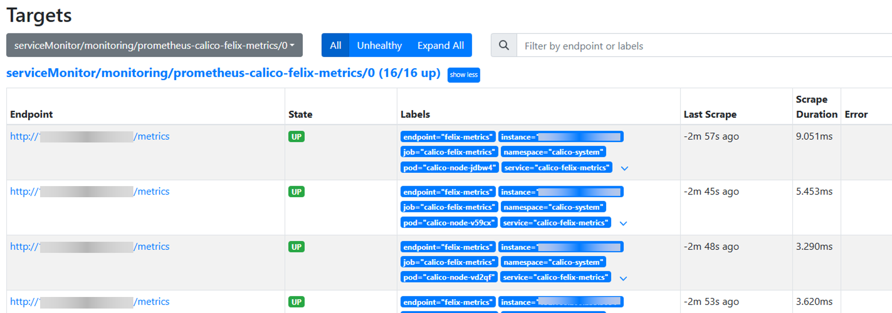
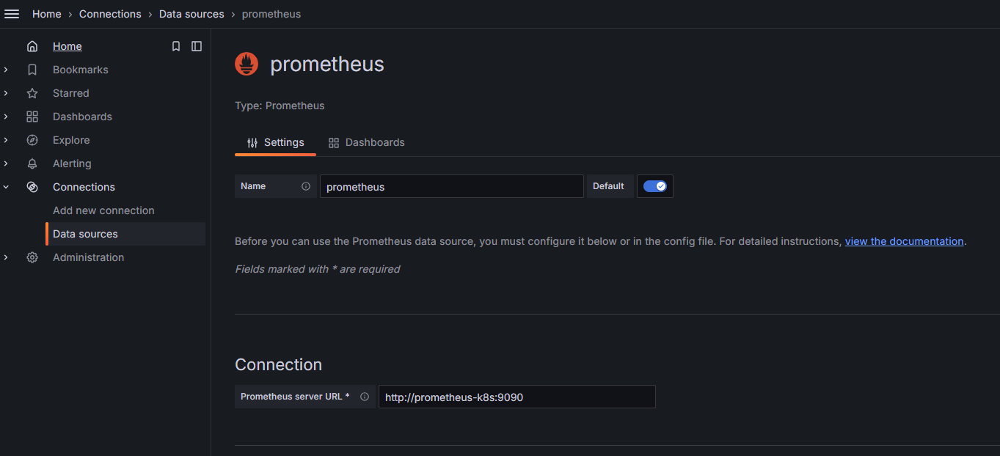
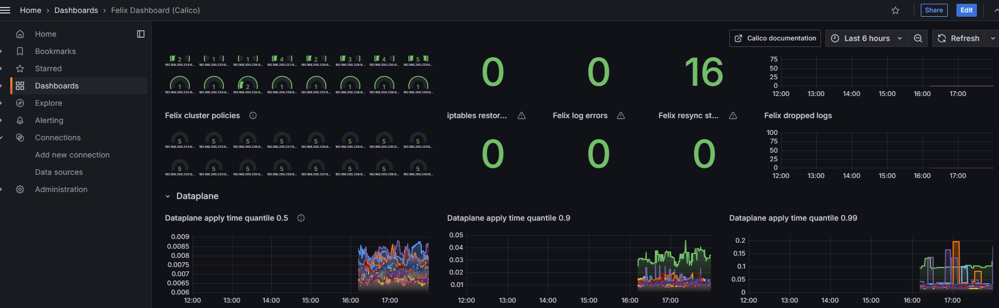
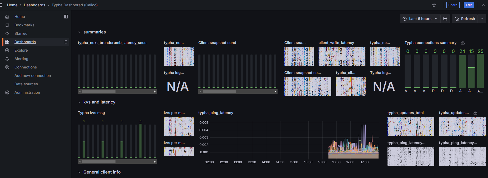

# 最佳实践

## Calico优化

Calico是一个高性能、可扩展的开源网络解决方案，专为云原生应用而设计。它提供了灵活的网络连接、网络安全和网络策略管理功能。Calico支持多种网络模型，包括纯三层网络（L3）、IP-in-IP隧道、VXLAN等，使其适用于各种不同的网络环境。

### 目标

通过配置BGP网络模型和部署Typha组件提升集群网络性能。

### 前提条件

已部署Kubernetes集群。

### 使用限制

- 支持Kubernetes v1.28、v1.33、v1.34
- 支持Calico v3.27.3、v3.31.3

### 背景信息

#### Calico网络模型

Calico支持Overlay和Underlay两种网络模型。
- Overlay网络：是在底层物理网络之上构建的虚拟网络层，通过隧道封装（如IP-in-IP、VXLAN）实现逻辑隔离。它牺牲了部分性能以换取灵活性，适用于网络策略受限的场景。
- Underlay网络：则是利用BGP路由协议，将每个Pod的IP直接宣告到物理网络中，实现无封装的直接路由。它保留了底层网络的性能和低延迟，是Calico默认且推荐的核心模式。

总的来说，Calico的设计哲学是：优先采用高性能的Underlay（BGP）模式，并以Overlay隧道模式作为跨子网或受限制网络环境下的补充方案。

**IPIP模式**

IPIP（IP-in-IP）是一种三层隧道协议，通过在原始IP数据包外再封装一层IP包头，建立点对点的虚拟链路，其功能可视为一个基于IP的逻辑网桥。在IPIP模式下，Calico会在每个节点创建tunl0虚拟接口用于隧道处理。该接口属Overlay网络组件，节点下线后通常仍存在，可通过rmmod ipip命令移除。

**BGP模式**

边界网关协议（Border Gateway Protocol，BGP）是用于自治系统间路由的核心协议。在Calico中，BGP模式通过路由宣告实现Pod IP在物理网络中的直接可达。需要注意的是，Calico的IPIP模式同样依赖BGP协议建立节点间路由，其BGP会话目标为对端隧道端点。两种模式均支持跨节点通信。BGP模式的核心优势在于网络扩展性与拓扑灵活性。通过将交换机等物理网络设备配置为BGP对等体，可使整个接入层网络直接识别容器IP路由，从而实现更高效、更扁平的三层互联。


**两种模式对比**

**表1** 模式对比

| 特性 | IPIP模式 | BGP模式 |
| --- | --- | --- |
| 流量传输 | 通过`tunl0`设备封装数据包，建立隧道进行传输。 | 依据BGP通告的路由信息，在三层直接转发数据包。 |
| 适用网络类型 | 适用于Pod跨不同网段、需解决跨子网路由的场景。 | 适用于Pod在同一网段或底层网络支持路由扩散的场景。 |
| 传输效率 | 存在隧道封装与解封装开销，转发效率略低。 | 无额外封装，基于主机网关（host-gw）方式，转发效率高。 |

**性能评测指标**

- 延迟测试：使用`ping`命令测量宿主机之间及容器Pod之间的网络延迟。
 
  **表2** 延迟性能评测指标

    | ping包延迟 | Node to Remote Node | Node to Remote Pod | Pod to Remote Pod |
    |---------|---------------------|--------------------|-------------------|
    | IPIP    | 0.1891ms            | 0.2973ms           | 0.3120ms          |
    | BGP     | 0.1888ms            | 0.2680ms           | -                 |

- 带宽测试：使用iperf工具评估宿主机之间及容器Pod之间的网络带宽吞吐性能。
  
  **表3** 带宽性能评测指标

  | 带宽      | Node to Remote Node | Node to Remote Pod | Pod to Remote Pod |
  |---------|---------------------|--------------------|-------------------|
  | IPIP    | 5.07Gbits/sec       | 4.43Gbits/sec      | 4.76Gbits/sec     |
  | BGP     | 5.08Gbits/sec       | 4.67Gbits/sec      | -                 |

  
**BGP配置方式**

Calico的BGP网络模型有三种配置方式。

- Full-mesh（全网状连接）：节点间全互联，适用于100节点以下集群。节点数超100时，BGP会话数量暴增，影响路由同步效率。

- Route reflectors（路由反射器）：指定部分节点作为路由反射器，其他节点仅与反射器建立连接，大幅减少对等连接数，适用于大规模集群。
- Top of Rack（ToR）：将Calico与物理网络设备（如交换机、路由器）直接建立BGP对等连接，适用于本地化数据中心部署。需关闭默认的全网状模式，并配置物理网络设备。

#### typha组件

Typha用于在大规模Calico集群中降低数据存储（如Kubernetes API Server/etcd）的负载压力，其作用包括。
- 代理多个Felix实例对数据存储的访问，减少连接数。
- 过滤与节点无关的更新，降低Felix的CPU消耗。

使用operator部署时会自动部署typha组件，同时operator会自动计算typha组件副本数量，其计算逻辑如下。

- 当节点数小于等于2个时，typha实例数量为1。
- 当节点数小于等于4个时，typha实例数量为2。
- 当节点数量大于4个，计算出typha实例数量公式为`(nodes_num/ 200) + 1 +1`。
- 当节点数量大于4个，计算出typha实例数量小于3个，typha实例数量为3。

```
	// 源码
	maxNodesPerTypha := 200

	// This gives a count of how many 200s so we need 1+ this number to get at least
	// 1 typha for every 200 nodes.
	typhas := (nodes / maxNodesPerTypha) + 1

	// We add one more to ensure there is always 1 extra for high availability purposes.
	typhas += 1

	// We have a couple special cases for small clusters. We want to ensure that we run one fewer
	// Typha instances than there are nodes, so that there is room for rescheduling. We also want
	// to ensure we have at least two, where possible, so that we have redundancy.
	if nodes <= 2 {
		// For one and two node clusters, we only need a single typha.
		typhas = 1
	} else if nodes <= 4 {
		// For three and four node clusters, we can run an additional typha.
		typhas = 2
	} else if typhas < 3 {
		// For clusters with more than 4 nodes, make sure we have a minimum of three for redundancy.
		typhas = 3
	}
```


### 操作步骤

1. 部署Typha组件，同时配置BGP路由反射网络模型，在集群所有节点上执行以下命令，更新NetworkManager配置。

    ```shell
    cat > /etc/NetworkManager/conf.d/calico.conf<<EOF
    [keyfile]
    unmanaged-devices=interface-name:cali*;interface-name:tunl*;interface-name:vxlan.calico;interface-name:vxlan-v6.calico;interface-name:wireguard.cali;interface-name:wg-v6.cali
    EOF

    systemctl restart NetworkManager
    ```

2. 执行以下命令，安装operator。

    ```shell
    kubectl create -f https://raw.githubusercontent.com/projectcalico/calico/v3.31.3/manifests/tigera-operator.yaml
    ```

3. 执行以下命令，下载并修改自定义资源。


    ```shell
    # 下载
    curl https://raw.githubusercontent.com/projectcalico/calico/v3.31.3/manifests/custom-resources.yaml -O
    # 修改需要自定义的 podCIDR
    ```

4. 如果使用kubeadm部署集群且在集群初始化时未设置`podSubnet`，可修改`kubeadm-config CofigMap`字段配置`podSubnet`，修改内容如下。

    ```shell
        networking:
          podSubnet: 172.20.64.0/18  # 添加项，pod的网络段，和calico custom-resources.yaml中podCIDR字段的值一致
          dnsDomain: cluster.local
          serviceSubnet: 10.96.0.0/12
    ```

5. 执行以下命令，应用自定义资源。

    ```shell
    kubectl apply -f custom-resources.yaml
    ```

6. 执行以下命令，安装Calicoctl。

    ```shell
    ARCH=$(uname -m)
    case $ARCH in
        x86_64) ARCH="amd64";;
        aarch64) ARCH="arm64";;
    esac

    wget https://github.com/projectcalico/calico/releases/download/v3.31.3/calicoctl-linux-${ARCH}
    chmod +x calicoctl-linux-${ARCH}
    mv calicoctl-linux-${ARCH} /usr/local/bin/calicoctl
    ```

7. 创建配置文件BGPConfiguration.yaml。

    ```shell
    apiVersion: projectcalico.org/v3
    kind: BGPConfiguration
    metadata:
      name: default
    spec:
      logSeverityScreen: Info
      nodeToNodeMeshEnabled: false
      asNumber: 64512
    ```
8. 执行以下命令，应用配置文件BGPConfiguration.yaml。
    ```shell
    calicoctl apply -f BGPConfiguration.yaml
    ```

9.  执行以下命令，配置指定节点充当路由反射器。

    ```shell
    kubectl label node <node-name> route-reflector=true
    ```

    > **说明：**
    > 
    > 路由反射器建议指定至少2个节点，建议8~12个。节点配置建议(8u，32G)


10. 执行以下命令，为所有配置路由反射器的节点配置ClusterID。

    ```shell
    kubectl annotate node <node-name> projectcalico.org/RouteReflectorClusterID=244.0.0.1
    ```
    > **说明：**
    > 
    > 配置节点的ClusterID（通常是一个未使用的IPv4地址），配置路由反射器的节点都要配置ClusterID。

11. 创建配置文件BGPPeer.yaml，使用标签选择器将路由反射器节点与其他非路由反射器节点配置为对等。

    ```shell
    apiVersion: projectcalico.org/v3
    kind: BGPPeer
    metadata:
      name: peer-with-route-reflectors
    spec:
      nodeSelector: all()
      peerSelector: route-reflector == 'true'
    ```
12. 执行以下命令，应用创建的配置文件BGPPeer.yaml。
    ```shell
    calicoctl apply -f BGPPeer.yaml
    ```

### 后续步骤

#### Calico监控配置说明

- Felix是一个守护进程，运行在每台机器上实现网络策略等功能，Felix是Calico的大脑，监控指标请参见[felix-prometheus](https://archive-os-3-27.netlify.app/calico/3.27/reference/felix/prometheus)。

- Typha是一组可选的pod，可扩展Felix以扩展Calico节点和数据存储之间的流量，监控指标请参见[typha-prometheus](https://archive-os-3-27.netlify.app/calico/3.27/reference/typha/prometheus)。

- kube-controllers pod运行一组控制器，这些控制器负责各种控制平面功能，例如资源垃圾收集和与Kubernetes API的同步，监控指标请参见[kube-controllers-prometheus](https://archive-os-3-27.netlify.app/calico/3.27/reference/kube-controllers/prometheus)。

**重要指标**

**表4** Calico重要监控指标
| 指标                            | 说明                     |
|-------------------------------|------------------------|
| felix_ipset_errors            | 执行ipset-restore失败次数。    |
| felix_iptables_restore_calls  | 执行iptables-restore次数。   |
| felix_iptables_restore_errors | 执行iptables-restore失败次数。 |
| felix_iptables_save_calls     | 执行iptables-save次数。      |
| felix_iptables_save_errors    | 执行iptables-save失败次数。    |
| felix_log_errors              | 日志报告error的次数。           |
| ipam_allocations_per_node     | 每个节点上IP分配的数量。           |
| ipam_blocks_pre_node          | 每个节点上分配的Block数量。        |

> **说明：**
> 
> 大规模集群时，由于节点和Pod资源较多，Calico的网络数据也会随之增加，需要ETCD和APIService做好扩容等操作。

#### 配置Calico监控

1. 配置Felix。

    1.1 Felix prometheus metrics默认是禁用的，执行以下命令，手动更改Felix的配置（**prometheusMetricsEnabled**）。

    ```sh
    # kubectl patch felixConfiguration default  --patch '{"spec":{"prometheusMetricsEnabled": true}}' --type=merge

    felixconfiguration.crd.projectcalico.org/default patched
    ```

    1.2 执行以下命令，确认结果。

    ```sh
    # kubectl get felixConfiguration default -o yaml
    ……
    spec:
      bpfLogLevel: ""
      logSeverityScreen: Info
      prometheusMetricsEnabled: true         #prometheusMetricsEnabled 是 true
      reportingInterval: 0s
    ```

2. 创建service暴露Felix metrics。

    Prometheus使用Kubernetes服务动态发现endpoint，创建一个名为`felix-metrics-svc`的服务，让Prometheus去发现所有的Felix metrics endpoints。

    Felix默认使用9091 TCP上报metrics，执行以下命令，增加配置文件。

    ```sh
    # kubectl apply -f - <<EOF
    apiVersion: v1
    kind: Service
    metadata:
      labels:
        k8s-app: calico-felix-metrics
      name: calico-felix-metrics
      namespace: calico-system
    spec:
      selector:
        k8s-app: calico-node
      ports:
      - port: 9091
        targetPort: 9091
        name: felix-metrics
    EOF
    ```

3.  配置Typha。 

    3.1 执行以下命令，确认在集群中使用了Typha。

    ```sh
    # kubectl get pods -A | grep typha
    calico-system      calico-typha-6d8d9ffd6c-96z4z    1/1     Running   0      176m
    calico-system      calico-typha-6d8d9ffd6c-k2zpm    1/1     Running   0      176m
    calico-system      calico-typha-6d8d9ffd6c-s62nr    1/1     Running   0      176m
    ```

    Calico的Operator安装会根据集群规模自动部署一个或多个Typha实例。默认情况下，这些实例的指标处于禁用状态。

    3.2 使用以下命令指示`tigera-operator`启用Typha指标。

    ```bash
    kubectl patch installation default --type=merge -p '{"spec": {"typhaMetricsPort":9093}}'
    ```

    3.3 如显示以下内容表明Typha指标启用成功。

    ```bash
    installation.operator.tigera.io/default patched
    ```

4. 创建service暴露Typha metrics。

    ```sh
    # kubectl apply -f - <<EOF
    apiVersion: v1
    kind: Service
    metadata:
      labels:
        k8s-app: calico-typha-metrics
      name: calico-typha-metrics
      namespace: calico-system
    spec:
      selector:
        k8s-app: calico-typha
      ports:
      - port: 9093
        targetPort: 9093
        name: typha-metrics
    EOF
    ```

5. 配置kube-controllers。

    kube-controllers prometheus metrics默认是启动的，使用9094 TCP端口。可以通过修改**KubeControllersConfiguration**资源调整端口。

    ```sh
    # 不修改默认端口无需执行此步骤

    # kubectl patch kubecontrollersconfiguration default  --patch '{"spec":{"prometheusMetricsPort": 9095}}'
    ```

6. 创建service暴露kube-controllers metrics。
   
      > **说明：**
      >
      > 若Calico在安装中已经创建了kube-controllers metrics的service，以下步骤可以跳过。

    6.1 执行以下命令，创建kube-controllers metrics的service。

    ```sh
    # kubectl apply -f - <<EOF
    apiVersion: v1
    kind: Service
    metadata:
      labels:
        k8s-app: calico-kube-controllers
      name: calico-kube-controllers-metrics
      namespace: calico-system
    spec:
      selector:
        k8s-app: calico-kube-controllers
      ports:
      - port: 9094
        targetPort: 9094
        name: kube-controllers-metrics
    EOF
    ```

    6.2 执行以下命令，验证安装完。

    ```sh
    kubectl get svc -n calico-system
    ```

    6.3 如显示以下内容表明安装成功。

    ```sh
    calico-kube-controllers-metrics   ClusterIP   10.43.77.57    <none>      9094/TCP   1d
    ```

7. 配置prometheus采集指标。

    7.1 创建ServiceMonitor。
    
    kube-prometheus-stack在部署时会创建Prometheus、PodMonitor、ServiceMonitor、AlertManager和PrometheusRule这五个CRD资源对象，并持续监控与维护这些资源的状态。
    - Prometheus资源对象是对Prometheus Server的抽象定义。
    - PodMonitor和ServiceMonitor是对Exporter的抽象，用于提供指标数据接口。Prometheus通过这两个资源对象拉取监控数据。
    - ServiceMonitor要求被监控的服务必须具有对应的Service。
    - PodMonitor虽然无需为应用创建Service，但必须在Pod中明确声明指标端口与名称。

    由于已为应用创建相应的Service，此处选择通过ServiceMonitor采集指标数据。使用以下YAML创建ServiceMonitor资源。

    ```sh
    # vim prometheus-ServiceMonitorCalico.yaml

    apiVersion: monitoring.coreos.com/v1
    kind: ServiceMonitor
    metadata:
      labels:
        release: prometheus # 必须添加此 label,因为 prometheus 的对象 serviceMonitorSelector 匹配 release: prometheus 的 ServiceMonitor
      name: prometheus-calico-felix-metrics  # 指定 ServiceMonitor 所需的一些关键元信息
      namespace: monitoring  # 命名空间
    spec:
      endpoints:  # 服务端点，代表 Prometheus 所需的采集 Metrics 的地址
        - interval: 15s  # 指定 Prometheus 对当前 endpoints 采集的周期
          path: /metrics  # 指定 Prometheus 的采集路径
          port: felix-metrics  # 指定采集数据需要通过的端口，设置的端口为创建 Service 时端口所设置的 name
      namespaceSelector:  # 为需要发现的 Service 的范围。namespaceSelector 包含两个互斥字段
        matchNames:   # matchNames：数组值，指定需要侦听的 namespace 的范围
        - calico-system
        # any: # any：有且仅有一个值 true，当该字段被设置时，将侦听所有符合 Selector 过滤条件的 Service 的变动。
        # -true
      selector:  # 用于选择 Service
        matchLabels:
          k8s-app: calico-felix-metrics
    ---
    apiVersion: monitoring.coreos.com/v1
    kind: ServiceMonitor
    metadata:
      labels:
        release: prometheus
      name: prometheus-calico-typha-metrics
      namespace: monitoring
    spec:
      endpoints:
        - interval: 15s
          path: /metrics
          port: typha-metrics
      namespaceSelector:
        matchNames:
        - calico-system
      selector:
        matchLabels:
          k8s-app: calico-typha-metrics
    ---
    apiVersion: monitoring.coreos.com/v1
    kind: ServiceMonitor
    metadata:
      labels:
        release: prometheus
      name: prometheus-calico-kube-controllers-metrics
      namespace: monitoring
    spec:
      endpoints:
        - interval: 15s
          path: /metrics
          port: kube-controllers-metrics
      namespaceSelector:
        matchNames:
        - calico-system
      selector:
        matchLabels:
          k8s-app: calico-kube-controllers
    ```

    7.2 执行以下代码。应用ServiceMonitor。

    ```sh
    # kubectl apply -f prometheus-ServiceMonitorCalico.yaml
    servicemonitor.monitoring.coreos.com/felix-metrics created
    servicemonitor.monitoring.coreos.com/typha-metrics created
    servicemonitor.monitoring.coreos.com/kube-controllers-metrics create
    ```

8. 检查target。

    8.1 登录Prometheus dashboard查看新建的target是否正常。如Prometheus没有开放对外端口，可以修改service的端口类型为NodePort。

    ```sh
    kubectl edit svc prometheus-k8s -n monitoring
    ```

    8.2 根据生成/指定的nodePort访问dashboard。

    **图1** 登录Prometheus的target界面

    

9.  安装配置Grafana。

    9.1 helm安装Grafana。

    ```sh
    # 添加Grafana官方仓库
    helm repo add grafana https://grafana.github.io/helm-charts

    # 更新仓库
    helm repo update grafana

    # 安装Grafana
    helm install grafana grafana/grafana -n monitoring
    ```

    9.2  Grafana添加Prometheus源。

    浏览器输入`http://<ip>:30010`，登录访问Granfana界面，选择`Data sources > Add new data source`。

    填写Prometheus server URL。如：`http://<prometheus-k8s>:9090`。

    **图2** Grafana添加Prometheus源的面板配置

    

10. 导入dashbaord配置文件。

    10.1 在Grafana界面选择Dashboards > New > Import。导入`typha-dashboard.json`和 `felix-dashboard.json`两个dashbaord配置文件。
  [单击获取Grafana面板配置文件](https://github.com/projectcalico/calico/blob/master/manifests/grafana-dashboards.yaml)。


    **图3** felix界面

    


    **图4**  typha界面

    

    10.2  配置文件。

    请根据实际情况修改文件中的`datasource`字段。


> **说明：**
    > 
    > **已知问题：** Grafana目前暂无用于监控Calico-Kube-Controllers的预设仪表盘，仅提供针对Felix与Typha组件的监控视图。


### 注意事项/常见问题

将所有路由反射器节点从集群内移除前，需选择新的路由反射器节点。

### 结论

基于性能、可扩展性及运维复杂度等维度的综合评估，针对Calico在不同规模集群中的BGP组网方案，形成以下最佳实践结论。

- **中小规模集群（建议节点数 ≤ 100）**
  
推荐采用Calico BGP Full-mesh方案。该方案配置简单，无需额外路由反射器，在节点规模有限的情况下可提供完全对称的网络连接，且性能表现稳定。

- **中大规模集群（建议节点数 > 100）**

推荐采用Route Reflectors（RR）方案。通过部署一个或多个路由反射器集中分发路由，可显著降低BGP连接数，避免Full-mesh模式下的连接风暴问题，具备良好的横向扩展能力。

- **与物理网络集成的场景**

若运维团队具备底层网络设备的配置与管理能力，且希望实现容器网络与物理网络的无缝路由互通，可考虑Top of Rack（ToR）方案。该方案需与交换机/路由器建立BGP对等连接，建议在受控网络环境或云网一体化架构中实施。

- **通用建议**

  - 在节点规模增长前，应提前规划从Full-mesh向RR模式的平滑迁移路径。
  - 无论采用何种方案，均建议配合Calico的网络策略与BGP配置优化，进一步提升网络安全性与路由收敛效率。
  - 生产环境部署前，应在对应规模的非生产环境中完成网络性能与稳定性验证。

### 参考资料

- [Calico部署](https://docs.tigera.io/calico/3.27/getting-started/kubernetes/self-managed-onprem/onpremises)
- [监控Calico组件指标](https://docs.tigera.io/calico/3.27/operations/monitor/monitor-component-metrics)
- [Felix metrics](https://docs.tigera.io/calico/3.27/reference/felix/prometheus)
- [Typha metrics](https://docs.tigera.io/calico/3.27/reference/typha/prometheus)
