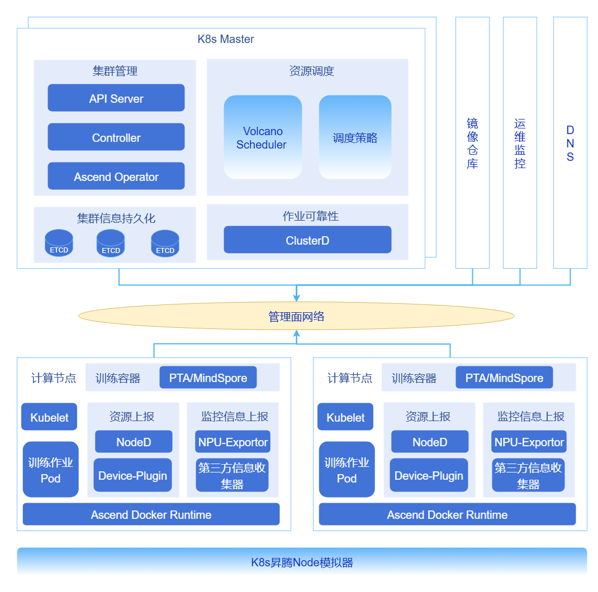
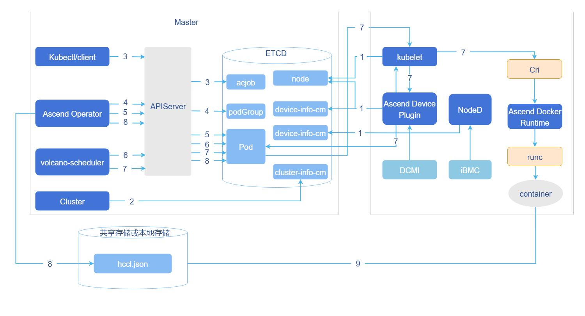
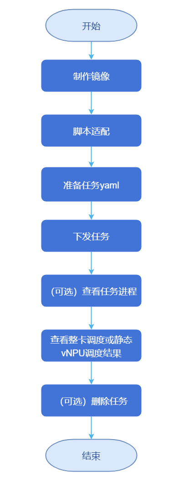

# 超大规模集群
## 特性介绍

超大规模集群项目致力于构建和优化面向AI训练与高性能计算（HPDA）的超大规模Kubernetes集群。核心目标是突破单集群纳管上限，通过系统性优化，稳定支撑1.6万节点（128K昇腾NPU/GPU卡）的单一集群，并为未来50万卡规模设计多集群协同架构。我们聚焦于解决超大规模场景下Kubernetes核心组件、调度、网络及观测性的瓶颈问题，尤其针对昇腾等国产化算力的大规模集群管理进行了深度适配与优化。

### 应用场景
本集群专为突破传统单集群资源上限设计，核心服务于需要万节点级资源统一调度与协同的大规模计算场景。
- 万卡级AI训练：支撑数千至数万张昇腾NPU卡协同，满足万亿参数大模型等超大规模分布式训练需求。
- 海量并行计算：适用于气候模拟、基因测序等需要数万计算核心并行的科学计算与批量处理任务。
- 高并发推理服务：可弹性部署数十万个模型实例，承载互联网级AI服务的高并发推理请求。
### 能力范围

本项目的优化与增强覆盖以下核心领域。

- Kubernetes控制面强化：针对kube-apiserver、etcd、kube-controller-manager等核心组件进行深度优化，保障控制面在超大规模下的稳定性与高性能。
- AI作业调度优化：集成并增强Volcano调度器，针对昇腾AI作业特点，提供批量创建、调度、绑定acJob pod能力。
- 高性能与可观测性网络：优化容器网络、服务发现（DNS）和网络策略，确保东西向流量高效、稳定；集成VictoriaMetrics，实现千万级时间序列数据的毫秒级采集与查询。
- 数据与镜像加速：优化训练数据读取流水线和容器镜像拉取速度，减少作业启动时间，提升CPU利用率。
### 亮点特征
- 极致规模：单集群支持1.6万节点（128K卡），突破社区K8s宣称上限，为业界领先。
- 核心组件高可用：通过多实例负载均衡、读写分离、数据与事件分离等技术，确保kube-apiserver、etcd等关键组件无单点故障与性能瓶颈。
- 智能AI调度：提供组调度（PodGroup），完美适配AllReduce等分布式训练拓扑需求，提升大作业调度成功率与集群利用率。
- 毫秒级服务发现：通过DNS分级部署与本地缓存，将超大规模集群内服务解析从秒级优化至毫秒级。
- 全方位可观测：基于VictoriaMetrics，构建能够处理亿级监控指标的高性能监控体系，提供集群、节点、Pod、容器及NPU的立体化监控。
  
### 实现原理

**表1** 超大规模集群部署与训练流程
| 阶段 | 关键动作 | 核心技术/工具 | 目标 |
|:---|:---|:---|:---|
| 1. 控制面高可用部署 | • kube-apiserver三实例 + VIP负载均衡<br>• etcd事件与配置数据分离部署 | • 负载均衡器 (VIP)<br>• etcd三集群 + 自动清理策略 | 建立稳定、高吞吐、低延迟的集群控制入口与数据存储层。 |
| 2. 大规模任务调度 | • Volcano启用并行打分与二级队列调度 | • Volcano Scheduler增强策略 | 实现**秒级**完成上万计算任务的排队与初始调度决策。 |
| 3. 镜像与数据就绪 | • 全局镜像P2P预热<br>• 节点并行拉取机制 | • 镜像仓库 + P2P加速组件 | 确保**千节点**所需训练镜像在**分钟级**内全部就绪。 |
| 4. 批量节点初始化 | • 主控节点通过Ansible并发SSH驱动 | • Ansible批量运维 | **并发完成**数百节点驱动、组件安装/升级，统一集群状态。 |
| 5. 任务提交与闭环 | • 提交正式训练任务 | • 标准K8s Job / Volcano Job | 集群自动完成**调度 -> 建链 -> 训练 -> 监控**的全闭环。 |

**图1** 超大规模集群优化技术全景



- **kube-apiserver负载均衡与流量优化**

  在大规模集群中，为应对由大LIST请求导致的内存膨胀、长连接负载不均以及高负载下的响应延迟问题，可通过在负载均衡器（如Nginx/HAProxy或云厂商负载均衡器）后端部署多组kube-apiserver实例来实现优化。通过实施智能分流策略，将读写请求、长连接与短连接、大LIST请求与小Watch请求进行分离与均衡分发，从而显著提升控制面的整体可靠性与吞吐量。

- **集群元数据拆分存储**

  针对因大规模Pod事件写入导致etcd QPS飙升、写入延迟增加并成为集群扩展瓶颈的情况，可采用物理分离的存储方案。通过部署独立的 “事件etcd集群”、“Pods etcd集群” 与“核心数据etcd集群”，将Kubernetes核心元数据（如ConfigMap、Node、Service）、事件与租约（Events/Leases）以及Pod数据分别存入不同集群，有效消除相互干扰。同时，结合数据治理策略，实现etcd数据的自动压缩与碎片整理，定期清理历史与无效数据，控制数据增长以保持低延迟性能。

  > **说明：**
  >
  > 通过数据治理，实现etcd数据的自动压缩与碎片整理，定期清理历史数据与“脏数据”，控制数据量增长，保持低延迟。

- **DNS分级部署**

  在拥有数万Pod的超大规模集群中，默认的CoreDNS会面临巨大的解析请求压力，导致响应时间可能达到秒级。为此，可构建分级DNS架构，通过在节点级别部署Local DNS Cache（如NodeLocal DNSCache）来缓存热点记录，使CoreDNS作为中心权威服务器仅处理缓存未命中的请求。此架构将绝大多数解析请求消化在本地，从而将DNS解析延迟从秒级降至毫秒级。

- **适配NPU的批量调度与组调度**

  为满足AI训练作业（如需要128个Pod同时调度）对成组调度及高速互联拓扑（如NVLink、HCCS）亲和性的严格要求，需对默认调度器进行增强。基于Volcano Scheduler，可以实现针对昇腾（Ascend）NPU算力的深度适配，通过组调度（Gang Scheduling）和拓扑感知调度策略，确保作业所需的全部Pod能被同时调度并分配到拓扑最优的节点上，从而保障分布式训练任务的高效执行。

  > **说明：**
  > - PodGroup与组调度：确保作业的所有Pod能同时启动，避免资源死锁。
  > - 拓扑感知调度：结合昇腾芯片的NUMA架构与高速互联拓扑，优先将需要高带宽通信的Pod调度到同一节点或邻近节点，最大化训练效率。

### 与相关特性的关系
暂无
## 安装
本章节提供从零开始搭建一套完整、生产可用的超大规模昇腾AI集群的详细指引。部署流程分为两个核心阶段：构建稳定高效的Kubernetes基础集群，部署面向AI训练的增强软件栈。
### 单集群K8s部署
此阶段的目标是部署一个高可用、高性能、可观测的Kubernetes基础集群。

1. [**kubernetes集群安装部署最佳实践**](../best_practice/best_practices_for_kubernetes_cluster_installation_and_deployment.md)
  - 文档内容：本方案提供万节点K8s集群的深度优化指南，重点解决控制面、存储与网络三大核心瓶颈。
  - 安装结果：一个稳定、已通过基础压力测试的Kubernetes集群。
2. [**victoriametriacs最佳实践**](../best_practice/best_practices_for_ultra_large_scale_cluster_monitoring_based_on_the_victoriametrics_software_stack.md)
  - 文档内容：本文档提供VictoriaMetrics高可用部署与调优指南，实现百万级指标的Kubernetes集群深度监控。
  - 安装结果：一套具备高性能读写能力的监控系统，可通过Grafana进行可视化。
### 单集群mind-cluster部署
此阶段将在已就绪的Kubernetes集群之上，部署完整的昇腾AI训练软件栈，使集群具备运行万卡级AI作业的能力。

   [**MindCluster软件栈部署最佳实践**](../best_practice/best_practices_for_mindcluster_software_stack_deployment.md)
- 文档内容：文档提供昇腾AI集群的全栈Kubernetes部署指南，涵盖从NPU驱动、任务调度到训练加速和监控运维的一体化方案，旨在支撑万卡级AI作业的高效、稳定运行。
- 安装结果：一个功能完整、生产就绪的超大规模昇腾AI训练集群，可正式提交大规模分布式训练任务。
## 批量创建、调度acjob

### 前提条件
**对于训练任务类型为acjob，调度器为Volcano的整卡调度，支持批量创建Pod和批量调度功能。** 
- 若要使用批量创建Pod功能，安装Ascend Operator组件时需使用openFuyao定制的Kubernetes。
- 若要使用批量调度功能，安装Volcano组件时需使用openFuyao定制Kubernetes和volcano-ext组件，并开启批量调度功能。
- 批量调度功能适用于超大规模集群场景，在此场景下请根据实际需要扩展MindCluster组件分配的CPU和内存资源，防止MindCluster组件出现性能不足或者超出分配内存使用，导致组件被Kubernetes驱逐。
### 任务调度流程
**图2** acjob任务调度原理图



1. 集群调度组件定期上报节点和芯片信息；kubelet上报节点芯片数量到节点对象（Node）中。
    - Ascend Device Plugin定期上报芯片拓扑信息。
上报整卡信息。将芯片的物理ID上报到device-info-cm中；可调度的芯片总数量（allocatable）、已使用的芯片数量（allocated）和芯片的基础信息（device ip和super_device_ip）上报到Node中，用于整卡调度。
    - 上报vNPU相关信息到Node中，用于静态vNPU调度。
当节点上存在故障时，NodeD定期上报节点健康状态、节点硬件故障信息、节点DPC共享存储故障信息到node-info-cm中。
2. ClusterD读取device-info-cm和node-info-cm中信息后，将信息写入cluster-info-cm。
3. 用户通过kubectl或者其他深度学习平台下发acjob任务。
4. Ascend Operator为任务创建相应的PodGroup。关于PodGroup的详细说明，可以参考开源Volcano官方文档。
5. Ascend Operator为任务创建相应的Pod，并在容器中注入集合通信所需环境变量。
6. volcano-scheduler根据节点和芯片拓扑信息为任务选择合适节点，并在Pod的annotation上写入选择的芯片信息。
    - 整卡调度写入整卡信息。
    - 静态vNPU调度写入vNPU相关信息。
7. kubelet创建容器时，调用Ascend Device Plugin挂载芯片，Ascend Device Plugin或volcano-scheduler在Pod的annotation上写入芯片信息。Ascend Docker Runtime协助挂载相应资源。
8. Ascend Operator读取Pod的annotation信息，将相关信息写入hccl.json。
9. 容器读取环境变量或者hccl.json信息，建立通信通道，开始执行训练任务。
### 操作步骤

**图3** acjob配置流程图


1. 配置NFS存储

    1.1 选一台机器做NFS服务器（此处选择192.168.200.25），执行以下代码，执行安装并配置共享目录。
    ```
    # 装包并设开机自启
    yum install -y nfs-utils
    systemctl enable --now nfs-server

    # 创建共享目录并放权限
    mkdir -p /data
    chmod 777 /data                # 生产可改 755 + chown 1000:1000

    # 导出配置（允许整个内网段读写，无root squash）
    cat >>/etc/exports <<EOF
    /data  192.168.200.0/16(rw,sync,no_root_squash,no_subtree_check)
    EOF
    exportfs -r && exportfs -v        # 重载并验证
    ```
    1.2 执行以下代码，为所有K8s节点安装客户端（kubelet负责挂载）。
    ```
    yum install -y nfs-utils
    systemctl enable --now rpcbind
    执行以下代码，一键 Helm 装 NFS-subdir-external-provisioner（动态供给）
    # 添加官方仓库
    helm repo add nfs-subdir-external-provisioner \
      https://kubernetes-sigs.github.io/nfs-subdir-external-provisioner
    helm repo update

    # 安装（把server换成对应IP地址）
    helm install nfs-provisioner \
      nfs-subdir-external-provisioner/nfs-subdir-external-provisioner \
      --set storageClass.name=nfs-sc \
      --set storageClass.defaultClass=false \
      --set nfs.server=<master_-_ip> \
      --set nfs.path=/data \
      --create-namespace -n nfs-system
    ```
    1.3 执行以下代码，验证NFS存储。
    ```
    kubectl get sc              # 能看到 nfs-sc
    kubectl get pod -n nfs-system   # provisioner 应为 Running
    ```
    1.4 构建完整文件结构。
    ```
    /data/atlas_dls/output
    /data/atlas_dls/public/code
    /data/atlas_dls/public/dataset
    ```

2. 制作镜像

    从[昇腾镜像仓库](https://www.hiascend.com/developer/ascendhub)根据系统架构（ARM/x86_64）、模型框架（TensorFlow、PyTorch、MindSpore）下载配套驱动版本的训练基础镜像。基于训练基础镜像进行修改，将容器中默认用户修改为root（21.0.4版本之后训练基础镜像默认用户为非root）。基础镜像中不包含训练脚本、代码等文件，训练时通常使用挂载的方式将训练脚本、代码等文件映射到容器内。

    2.1 根据系统架构（aarch64）和训练框架（pytorch）选择镜像。这里选择24.0.0-A2-2.1.0-openeuler20.03镜像，进入[昇腾镜像仓库-ascend-pytorch](https://www.hiascend.com/developer/ascendhub/detail/ascend-pytorch)下载镜像。

    ```bash
    docker pull --platform=arm64 swr.cn-south-1.myhuaweicloud.com/ascendhub/ascend-pytorch:24.0.0-A2-2.1.0-openeuler20.03
    ```
    2.2 修改成默认用户修改为root的新镜像，步骤如下。
        
    2.2.1 将以下内容保存为Dockerfile.root。
    ```
    FROM swr.cn-south-1.myhuaweicloud.com/ascendhub/ascend-pytorch:24.0.0-A2-2.1.0-openeuler20.03

    USER root

    ENV ASCEND_HOME=/usr/local/Ascend
    ENV LD_LIBRARY_PATH=$ASCEND_HOME/lib64:$ASCEND_HOME/driver/lib64:$LD_LIBRARY_PATH
    ENV PATH=$ASCEND_HOME/bin:$PATH

    RUN mkdir -p /user/mindx-dl/ranktable /workspace && \
        chmod 777 /user/mindx-dl/ranktable /workspace

    WORKDIR /workspace
    ```
    2.2.2 执行以下代码，在本地构建镜像。
    ```
    docker build -t ascend-pytorch:24.0.0-A2-root -f Dockerfile.root .
    ```
    2.2.3 可将下载/制作的训练基础镜像重命名，执行以下代码，将镜像重命名为training:v7.1.RC1。
    ```bash
    nerctl tag swr.cn-south-1.myhuaweicloud.com/ascendhub/ascend-pytorch:24.0.0-A2-2.1.0-openeuler20.03 \
          training:v7.1.RC1
    ```
3. 适配脚本。

    下载[PyTorch代码仓中](https://gitee.com/ascend/ModelZoo-PyTorch/tree/master/PyTorch/built-in/cv/classification/ResNet50_ID4149_for_PyTorch)master分支的“ResNet50_ID4149_for_PyTorch”作为训练代码。自行准备ResNet50对应的数据集，使用时请遵守对应规范。

    3.1 管理员上传数据集到存储节点。
    进入`/data/atlas_dls/public`目录，将数据集上传到任意位置，如`/data/atlas_dls/public/dataset`。

    3.2 将下载的训练代码解压到本地，将解压后的训练代码`中ModelZoo-PyTorch/PyTorch/built-in/cv/classification/ResNet50_ID4149_for_PyTorch`目录上传至环境，如`/data/atlas_dls/public/code/`路径下。

    3.3 在`/data/atlas_dls/public/code/ResNet50_ID4149_for_PyTorch`路径下，注释或删除main.py文件中标注的字段。
    ```
    def main():
        args = parser.parse_args()
        os.environ['MASTER_ADDR'] = args.addr
        #os.environ['MASTER_PORT'] = '29501'  # 注释或删除该行代码
        if os.getenv('ALLOW_FP32', False) and os.getenv('ALLOW_HF32', False):
            raise RuntimeError('ALLOW_FP32 and ALLOW_HF32 cannot be set at the same time!')
        elif os.getenv('ALLOW_HF32', False):
            torch.npu.conv.allow_hf32 = True
        elif os.getenv('ALLOW_FP32', False):
            torch.npu.conv.allow_hf32 = False
            torch.npu.matmul.allow_hf32 = False
    ```
    3.4 进入[mindcluster-deploy仓库](https://gitcode.com/Ascend/mindcluster-deploy)，根据[mindcluster-deploy开源仓版本说明](https://www.hiascend.com/document/detail/zh/mindcluster/72rc1/clustersched/dlug/mxdlug_appendices_019.html)进入版本对应分支。获取`samples/train/basic-training/without-ranktable/pytorch`目录中的train_start.sh，在`/data/atlas_dls/public/code/ResNet50_ID4149_for_PyTorch/scripts`路径下，构造如下的目录结构。
    ```
    root@ubuntu:/data/atlas_dls/public/code/ResNet50_ID4149_for_PyTorch/scripts#
    scripts/
        ├── train_start.sh
    ```

4. 准备任务yaml。
   
    使用整卡调度特性，参考本配置。PyTorch和MindSpore框架新增了使用交换机亲和性调度的功能，该功能支持大模型任务和普通任务，[单击获取pytorch_multinodes_acjob.yaml修改示例](#pytorch_multinodes_acjobyaml修改示例)。
   
    
     指导使用硬件设备为A800l A2，仅支持Pod批量创建。若使用超节点则额外支持Pod批量调度，此时需要对yaml下列字段进行修改。
    - metadata.labels. podgroup-sched-enable: "true"  
       - 仅在集群使用openFuyao定制Kubernetes和volcano-ext组件场景下配置。取值为字符串"true"时，表示开启批量调度功能；取值为其他字符串时，表示批量调度功能不生效，使用普通调度。若不配置该参数，表示批量调度功能不生效，使用普通调度
     - spec.schedulerName: volcano
        - 当Ascend Operator组件的启动参数enableGangScheduling为true时生效
      - spec.runPolicy.schedulingPolicy:    
        -  当Ascend Operator组件的启动参数enableGangScheduling为true时生效，其下字段minAvailable和queue，参考注释依据实际情况修改。


5. 下发任务。
 
    5.1 执行以下命令，创建命名空间。
    ```
    kubectl create namespace vcjob
    ```
    5.2 管理节点示例YAML所在路径，执行以下命令，使用YAML下发训练任务。
    ```
    kubectl apply -f pytorch_multinodes_acjob.yaml
    ```
6. 查看任务进程。
  
    6.1 在管理节点查看任务Pod的状态，需要保证Pod状态为Running。执行以下命令，查看Pod运行情况。
    ```
    kubectl get pod --all-namespaces -o wide
    ```
    6.2 执行以下命令，查看计算节点的NPU分配情况。
    ```
    kubectl describe nodes fuyao-worker-0
    ```
    6.3 执行以下命令，查看Pod的NPU使用情况。
    ```
    kubectl describe pod default-test-pytorch-worker-0 -n acjob
    ```

7. 查看调度结果。
   
    执行如下命令，查看训练结果。
    ```
    kubectl logs -n  <namespace> <pod-name>
    kubectl logs -n vcjob default-test-pytorch-worker-0
    ```
    进入模型输出目录，查看生成的模型文件。

8. 删除任务。
   
    在示例YAML所在路径下，执行以下命令，删除对应的训练任务。
    ```
    kubectl delete -f pytorch_multinodes_acjob.yaml
    ```
## 超大规模集群仿真验证
### victoriametriacs监控软件栈压测
为确保部署的超大规模集群（特别是其核心监控系统VictoriaMetrics）具备稳定承载生产环境海量监控数据的能力，建议在正式上线前进行仿真压测。本章节简要介绍压测方法与目的
详细操作步骤、配置参数及资源规划公式，参考[**victoriametriacs最佳实践**](../best_practice/best_practices_for_ultra_large_scale_cluster_monitoring_based_on_the_victoriametrics_software_stack.md)压测部分。

#### 背景信息
- 验证稳定性：在模拟的百万级/秒数据摄取率下，验证VictoriaMetrics集群的长期运行稳定性。
- 容量规划：获取不同压力下各组件（vmselect/vmstorage/vminsert）的资源消耗规律，为生产环境资源分配提供数据支撑。
- 性能调优：识别高负载下的瓶颈，指导核心参数调优。

#### 使用工具
使用prometheus-benchmark工具，该工具可模拟真实监控数据源、动态目标流失率及并发查询负载，对VictoriaMetrics集群施加接近生产环境的读写压力。

#### 操作步骤
1. 部署工具：克隆项目，根据[最佳实践文档](../best_practice/best_practices_for_ultra_large_scale_cluster_monitoring_based_on_the_victoriametrics_software_stack.md)修改配置（如目标数据摄取率、时间序列数）。
2. 执行压测：指向已部署的VictoriaMetrics集群，启动压测。
3. 观察与验证：通过监控看板观察系统在持续高负载下的表现。
4. 结果分析：依据压测结果，参考文档中提供的资源消耗经验公式，进行最终的生产容量规划。

> **说明：**
> 
> 详细的配置示例、参数解读、压测数据及容量规划公式，请直接参考上述链接文档。完成压测验证是保障超大规模集群可观测性基石稳固的关键步骤。


### 附录
#### pytorch_multinodes_acjob.yaml修改示例
 ```
    # pytorch_multinodes_acjob.yaml
    apiVersion: mindxdl.gitee.com/v1
    kind: AscendJob
    metadata:
      labels:
        framework: pytorch  # 训练框架
        tor-affinity: "null"
      name: default-test-pytorch  # 任务名
      namespace: acjob  # 命名空间
    spec:
      replicaSpecs:
        Master:
          replicas: 1 # 分片数
          restartPolicy: Never
          template:
            spec:
              containers:
              - args:  # 启动参数
                - cd /job/code/scripts; chmod +x train_start.sh; bash train_start.sh /job/code
                  /job/output main.py --data=/job/data --amp --arch=resnet50
                  --seed=49 -j=128 --world-size=1 --lr=1.6 --dist-backend='hccl' --multiprocessing-distributed
                  --epochs=90 --batch-size=4096
                command:
                - /bin/bash
                - -c
                env:
                - name: XDL_IP
                  valueFrom:
                    fieldRef:
                      fieldPath: status.hostIP
                image: training:v7.1.RC1  # 镜像名
                imagePullPolicy: IfNotPresent
                name: ascend
                ports:
                - containerPort: 2222
                  name: ascendjob-port
                  protocol: TCP
                resources:
                  limits:
                    huawei.com/Ascend910: 1  # 资源
                  requests:
                    huawei.com/Ascend910: 1  # 资源
                volumeMounts:
                - mountPath: /job/code 
                  name: code
                - mountPath: /job/data
                  name: data
                - mountPath: /job/output
                  name: output
                - mountPath: /dev/shm
                  name: dshm
                - mountPath: /etc/localtime
                  name: localtime
                - mountPath: /user/serverid/devindex/config
                  name: ranktable
              nodeSelector:
                accelerator-type: module-910b-8
                host-arch: huawei-arm
              volumes:
              - nfs:
                  server: 192.168.200.25  # NFS存储服务IP  
                  path: /data/atlas_dls/public/code/ResNet50_ID4149_for_PyTorch  # 训练代码存储路径
                name: code
              - nfs:
                  server: 192.168.200.25
                  path: /data/atlas_dls/public/dataset  # 数据集存储路径
                name: data
              - nfs:
                  server: 192.168.200.25
                  path: /data/atlas_dls/output  # 结果输出路径
                name: output
              - emptyDir:
                  medium: Memory
                name: dshm
              - hostPath:
                  path: /etc/localtime
                name: localtime
              - hostPath:
                  path: /user/mindx-dl/ranktable1
                  type: DirectoryOrCreate
                name: ranktable
        Worker:  # 参考master配置方式
          replicas: 2
          restartPolicy: Never
          template:
            spec:
              containers:
              - args:
                - cd /job/code/scripts; chmod +x train_start.sh; bash train_start.sh /job/code
                  /job/output main.py --data=/job/data --amp --arch=resnet50
                  --seed=49 -j=128 --world-size=1 --lr=1.6 --dist-backend='hccl' --multiprocessing-distributed
                  --epochs=90 --batch-size=4096
                command:
                - /bin/bash
                - -c
                env:
                - name: XDL_IP
                  valueFrom:
                    fieldRef:
                      fieldPath: status.hostIP
                image: training:v7.1.RC1
                imagePullPolicy: IfNotPresent
                name: ascend
                ports:
                - containerPort: 2222
                  name: ascendjob-port
                  protocol: TCP
                resources:
                  limits:
                    huawei.com/Ascend910: 2
                  requests:
                    huawei.com/Ascend910: 2
                volumeMounts:
                - mountPath: /job/code
                  name: code
                - mountPath: /job/data
                  name: data
                - mountPath: /job/output
                  name: output
                - mountPath: /dev/shm
                  name: dshm
                - mountPath: /etc/localtime
                  name: localtime
              nodeSelector:
                accelerator-type: module-910b-8
                host-arch: huawei-arm
              volumes:
              - nfs:
                  server: 192.168.200.25
                  path: /data/atlas_dls/public/code/ResNet50_ID4149_for_PyTorch
                name: code
              - nfs:
                  server: 192.168.200.25
                  path: /data/atlas_dls/public/dataset
                name: data
              - nfs:
                  server: 192.168.200.25
                  path: /data/atlas_dls/output
                name: output
              - emptyDir:
                  medium: Memory
                name: dshm
              - hostPath:
                  path: /etc/localtime
                name: localtime
      runPolicy:
        schedulingPolicy:
          minAvailable: 2 # 任务总副本数
          queue: default # 任务所属队列
      schedulerName: volcano
      successPolicy: AllWorkers

    ```
