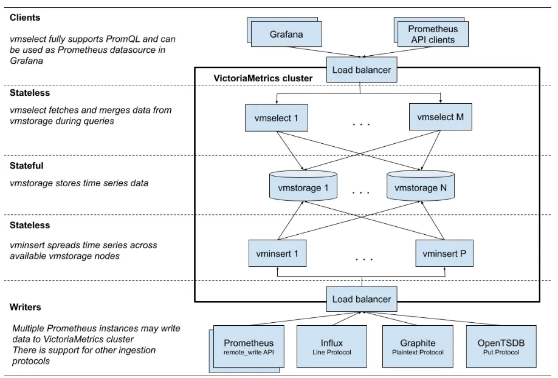
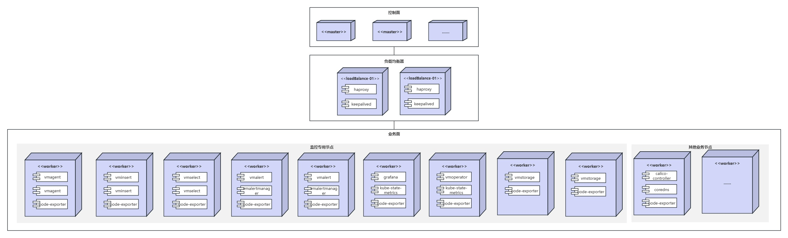
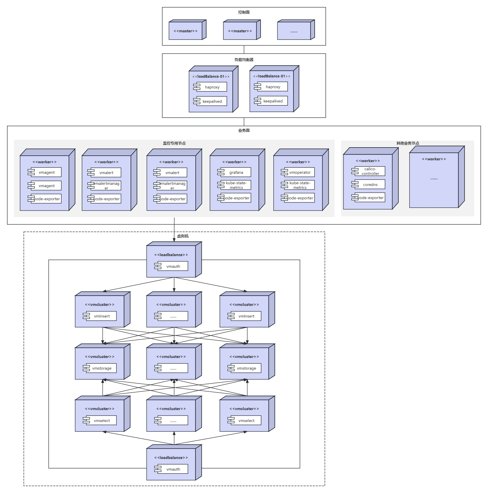

---
# 提案标题
title: 基于VictoriaMetrics软件栈的超大规模集群监控
# 提案编号
ofep-number: 0001
# 提案作者
authors:
  - "@shizilong"
# 提案主导SIG
owning-sig: sig-large-scale-cluster
# 提案协作SIG
participating-sigs:
  - 
# 提案状态(初步草案|准备开始实现|已在SIG中实现并合并|提案被暂缓|提案被否决|作者主动撤回提案|被另一个oFEP取代)
status: provisional
# 创建日期
creation-date: 2025-08-13
# 评审人
reviewers:
  - TBD
  - "@alice.doe"
# 批准人
approvers:
  - TBD
  - "@oscar.doe"
# 相关联的其他oFEP
see-also:
  - "/ofeps/sig-aaa/1234-we-heard-you-like-ofeps"
  - "/ofeps/sig-bbb/2345-everyone-gets-a-ofep"
# 当前oFEP替代了哪些已有提案
replaces:
  - "/ofeps/sig-ccc/3456-replaced-ofep"
# 当前oFEP被哪些提案替代，当status为replaced时需要填写此字段
replaced-by:
  - "/ofeps/sig-ddd/4567-new-ofep"
# 此oFEP当前开发阶段
stage: alpha|beta|stable
# 最近一次推进的版本
latest-milestone: "v1.19"
# 各阶段目标版本
milestone:
  alpha: "v1.19"
  beta: "v1.20"
  stable: "v1.22"
# 功能开关及影响组件
feature-gates:
  - name: MyFeature
    components:
      - kube-apiserver
      - kube-controller-manager
# 是否支持关闭该功能
disable-supported: true
# 该功能引入的监控指标
metrics:
  - my_feature_metric
---
<!--
**注意：**当你的 oFEP 完成时，应删除所有这些注释块。

要开始使用此模板：
- [ ] **选择一个托管 SIG。**
  确保该问题领域是 SIG 感兴趣的。如果没有 SIG 的赞助，oFEP 不应提交。
-[]**在 openfuyao/ofep 中创建问题**
  提交增强功能跟踪问题时，请务必填写该模板中的所有字段。其中一个字段要求提供指向 oFEP 的链接。你可以留空该字段，直到提交此 oFEP 后再返回到增强功能并添加链接。
- [ ] **复制此模板目录。**
  将此模板复制到所属 SIG 的目录中，并将其命名为“ofep-NNNN-short-descriptive-title”，其中“NNNN”是分配给上述增强功能的问题编号（没有前导零填充）。
- [ ] **尽可能多地填写以上oFEP元数据。**
  至少，你应该填写“标题”、“作者”、“SIG所有者”、“状态”和与日期相关的字段。
- [ ] **请尽可能详细地填写此文件。**
  至少，你应该填写“摘要”和“动机”部分。如果你已经和相关的 SIG 进行过前期沟通和想法验证，那么这两部分应该会很容易完成。
- [ ] **为此 oFEP 创建 PR。**
  将其指派给正在支持该流程的 SIG（特别兴趣小组）成员。
- [ ] **尽早合并并迭代。**
  避免纠结于具体细节，而应致力于明确 oFEP 的目标并快速合并。最好的方法是从概要部分开始，然后在后续的 PR 中逐步完善细节。

oFEP 合并并不意味着它已完成或获得批准。任何标记为“临时”的 oFEP 都是工作文档，可能会发生变更。你可以按以下方式标记正在积极讨论的部分：

编辑 oFEPS 时，请尽量使用范围明确、主题单一的 PR，以保持讨论的集中性。如果你不同意文档中已有的内容，请提交新的 PR 并提出修改建议。

一个 oFEP 对应其整个生命周期内的一项“功能”或“增强”。例如，从 Beta 版升级到 GA 版无需新的 oFEP。如果出现属于 oFEP 的新细节，请编辑 oFEP。一旦某个功能被“实现”，重大变更应该获得新的 oFEP。

最新（以及该文件的可能来源）的规范位置是[0000-ofep-template.md]（/0000-ofep-template.md）。

**注意：**任何将 oFEP 推进为“implementable”状态的 PR，或在标记为“implementable”后的重大更改，都必须得到每个 oFEP 批准人的批准。如果这些批准人均不合适（例如离开社区、角色变更等），则该列表的更改应由其余批准人和/或所属 SIG 批准。
-->
# oFEP-0001：基于VictoriaMetrics软件栈的超大规模集群监控

<!--
这是你的 oFEP 的标题。请保持简短、简洁且描述性强。一个好的标题可以帮助传达什么是 oFEP，以及有助于审查与追踪。
-->

<!--
目录（TOC）有助于快速跳转到 oFEP 的各个部分，同时突出显示超出标准模板所提供的其他信息。

确保目录已用<code>&lt;!-- toc --&rt;&lt;!-- /toc --&rt;</code>标签，然后用`hack/update-toc.sh`生成。
-->

<!-- toc -->
- [发布签核清单](#release-signoff-checklist)
- [摘要](#summary)
- [动机](#motivation)
    - [目标](#goals)
    - [非目标](#non-goals)
- [提案](#proposal)
    - [风险与缓解措施](#risks-and-mitigations)
- [设计细节](#design-details)
    - [测试计划](#test-plan)
        - [先决条件测试更新](#prerequisite-testing-updates)
        - [单元测试](#unit-tests)
        - [集成测试](#integration-tests)
        - [e2e 测试](#e2e-tests)
    - [毕业标准](#graduation-criteria)
    - [升级/降级策略](#upgrade--downgrade-strategy)
    - [版本倾斜策略](#version-skew-strategy)
- [生产准备情况评审问卷](#production-readiness-review-questionnaire)
    - [功能启用和回滚](#feature-enablement-and-rollback)
    - [推出、升级和回滚规划](#rollout-upgrade-and-rollback-planning)
    - [监控要求](#monitoring-requirements)
    - [依赖项](#dependencies)
    - [可扩展性](#scalability)
    - [故障排除](#troubleshooting)
- [实施历史](#implementation-history)
- [缺点](#drawbacks)
- [替代方案](#alternatives)
- [所需基础设施（可选）](#infrastructure-needed-optional)
<!-- /toc -->

## 发布签核清单
<!--
**需要采取的行动：**为了将代码合并到一个版本中，在[openfuyao/ofep]引用此oFEP并在目标版本的[增强冻结]之前瞄准发布里程碑**中必须存在问题。

对于对核心代码或流程/程序进行更改的增强功能，例如：[openfuyao/openfuyao]，我们需要完成以下发布签署清单。

完成后勾选这些，以便发布团队跟踪。为了发布增强，必须更新这些检查表项。
-->

标记有（R）的项目*在达到里程碑/发布*之前是必需的。
- [ ]（R）发布里程碑中的增强问题，链接到 [openfuyao/ofep] 中的 oFEP 目录
- [ ] (R) oFEP 审批者已批准 oFEP 状态为“可实施”
- [ ] (R) 设计细节已适当记录
  - [ ]（R）测试计划已到位，并考虑了 SIG 架构和 SIG 测试的输入（包括测试重构）
    - [ ] 针对所有 Beta API 操作（端点）进行 e2e 测试
    - [ ] (R) 确保 GA e2e 测试满足一致性测试的要求
    - [ ] (R) GA e2e 测试至少需要两周时间才能证明测试结果无 flake（不稳定或偶发失败）
- [ ] (R) 毕业标准已设定
    - [ ] (R) 所有 GA 端点必须通过[一致性测试]
- [ ] (R) 生产准备情况审查完成
- [ ] (R) 生产准备情况审查已获批准
- [ ] “实施历史”部分已更新里程碑
- [ ] 面向用户的文档已在 [openfuyao/docs] 创建，以便发布到 [openfuyao.com]
- [ ] 支持文档 - 例如，额外的设计文档、邮件列表讨论/SIG 会议链接、相关 PR/问题、发行说明

<!--
**注意：**此清单是迭代的，每次考虑将此增强功能作为里程碑时都应进行审查和更新。
-->

- [openfuyao.com](https://openfuyao.com/)
- [openfuyao/ofep](https://gitcode.com/openfuyao/ofep)
- [openfuyao/docs](https://gitcode.com/openfuyao/docs)

## 概括
<!--
这部分对于生成高质量、以用户为中心的文档（如发行说明或开发路线图）非常重要。应该在实现开始之前收集这些信息，以避免要求实现者在编写发行说明和实现功能本身之间分散注意力。oFEP 编辑器和SIG文档应该有助于确保“摘要”部分的语气和内容对广泛的受众有用。

好的摘要可能至少有一段长度。

在本节和下一节中，请遵循[文档样式指南]的指导方针。特别是，将代码行包装到合理的长度，使审阅者更容易引用特定的部分，并尽量减少更新的差异。
-->

超大规模集群具有系统复杂性高、故障影响范围大等特点，此时监控不再是“锦上添花”，而是大规模集群"生存"和高效运营的基石。本提案旨在集成VictoriaMetrics集群版，提供具备水平扩展性、海量数据处理能力的超大规模集群监控方案。

## 动机
<!--
本节用于明确列出该oFEP的动机、目标和非目标。描述变更的重要性以及对用户的好处。
-->

现网环境2千节点，每天监控数据总量大约68GB，每秒摄入率大约38.3万样本，每天活跃时间序列大约1702万。128k卡超大规模集群有1.6万节点，根据2千节点数据推算，1.6万节点环境每天监控数据总量大约550GB，每秒摄入率大约310万样本，每天活跃时间序列大约1.4亿。因此需要提供一套支持水平扩展、有极高的写入/查询吞吐量、资源利用率低(网络带宽、内存、存储)的超大规模集群监控解决方案。

### 目标
<!--
列出oFEP的具体目标。它想要达到什么目标？我们怎么知道这已经成功了？
-->

- 提供支撑摄入速率310万样本/秒，每天活跃时间序列达1.4亿的监控方案  
- 明确在超大规模集群中VictoriaMetrics软件栈的部署方案  
- 给出在不同数据摄取率时VictoriaMetrics Cluster各组件所需CPU、内存、存储资源  

### 非目标
<!--
什么超出了这个oFEP的范围？列出非目标有助于集中讨论并取得进展。
-->

- 不提供监控冷数据的对象存储方案  

## 提案
<!--
**这是我们真正进入提案具体内容的部分。**  
这一部分应包含足够的细节，使评审人员能清晰理解你到底在提出什么建议，  
但不应涉及 API 设计或具体实现细节。  

请阐明：
- **预期目标是什么？**  
- **我们如何衡量成功？**

请将更详细的设计和实现细节放在下方的 “设计细节” 部分中。
-->

### 风险与缓解措施
<!--
这个提案存在哪些风险？我们将如何加以缓解？请从广泛的角度思考，例如包括安全性问题，以及它可能对更大范围的 openfuyao 生态系统产生的影响。 安全性将由谁进行评审，以及如何评审？用户体验（UX）将由谁进行评审，以及如何评审？建议考虑邀请 SIG 外部或子项目之外的相关人员参与评估。
-->

- 实施过程中遇到问题VictoriaMetrics可参考的资料不多。解决方法为在VictoriaMetrics社区提issue，与社区开发者沟通解决问题。

## 设计细节
<!--
本节应包含足够的信息，以便读者能够清楚理解你所提出的变更具体是什么。这可能包括 API 规格说明（虽然并非必须）或代码片段。如果对该提案将如何实施存在任何疑问，应在此处进行详细讨论。
-->

### VictoriaMetrics介绍

VictoriaMetrics是一个监控解决方案和时间序列数据库。[可以用作Prometheus的长期存储](https://docs.victoriametrics.com/victoriametrics/integrations/prometheus/)，也可以用作Grafana中Prometheus的替代品，[兼容Prometheus查询API](https://docs.victoriametrics.com/victoriametrics/#prometheus-querying-api-usage)。VictoriaMetrics提供单节点VictoriaMetrics与集群版VictoriaMetrics。官方建议在指标获取速率低于100w/s时使用单节点版VictoriaMetrics。集群版本提供了单节点版本的所有功能，同时支持水平扩容、支持多租户，集群版官方基准测试支持采集速率[1亿/s](https://victoriametrics.com/blog/benchmark-100m/)。
在处理数百万个唯一时间序列（高基数）时，[VictoriaMetrics使用的内存比Prometheus少5倍](https://valyala.medium.com/prometheus-vs-victoriametrics-benchmark-on-node-exporter-metrics-4ca29c75590f)。VictoriaMetrics提供了高数据压缩，与Prometheus相比，存储同等数量样本VictoriaMetrics所需的存储空间最多可减少7倍，[测试方案](https://valyala.medium.com/prometheus-vs-victoriametrics-benchmark-on-node-exporter-metrics-4ca29c75590f)。

#### VictoriaMetrics架构



- VMAgent是一个微型代理，可从各种来源(例如：node-exporter)收集指标，重新标记和过滤收集到的指标，并通过Prometheus协议或通过VictoriaMetrics协议将指标存储在VictoriaMetrics或任何其他存储系统中。
- VMAlert根据配置的datasource.url执行给定的警报或记录规则列表。
- VMAlertmanager发送告警通知。
- VMAuth是一个HTTP代理，它可以在VictoriaMetrics组件或任何其他HTTP后端之间授权、路由和负载平衡请求。
- VMBackup通过即时快照创建VictoriaMetrics数据备份。VMBackup支持增量备份和完整备份。
- VMRestore从VMBackup创建的备份中恢复数据。恢复过程可随时中断。VMRestore使用相同参数重新启动时，将自动从中断点恢复。
- VMCtl是VictoriaMetrics命令行工具。
- VMGateway是VictoriaMetrics时间序列数据库(TSDB)的代理。提供速率限制与访问控制能力，仅在企业版中可使用。
- VMBackupmanager可自动执行定期备份程序。支持以下备份间隔：每小时、每天、每周和每月。可以同时配置多个备份间隔。仅在企业版中可使用。
- VMAgent-tool是VMAgent命令行工具。可以使用VMAgent-tool来运行警报和记录规则的单元测试。

#### VictoriaMetrics高性能分析

1、索引

VictoriaMetrics使用两种倒排索引：全局索引和按日索引。在整个保留期内执行搜索时使用全局索引。按日索引索引存储与全局索引类似的映射，但每个映射中还包括日期，这加快了较短时间范围内查询（通常只是最后一天）的数据检索速度。当执行搜索查询时，VictoriaMetrics会根据查询的时间范围决定使用哪个索引，如果搜索时间范围为 40 天或更短，则使用每日索引。全局索引用于时间范围大于40天的搜索查询。

2、存储

VictoriaMetrics采用的数据模型是单值模型，只支持浮点数指标。VictoriaMetrics数据存储目录中主要是big目录和small目录，这两个目录的结构是一样的。VictoriaMetrics在写数据时，先写入small目录下的相应partition目录下面，在small目录下，以月为单位不断生成partition目录，每个partition最多有256个part。big目录下的数据由small目录下的数据在后台compaction时合并生成的。small目录和big目录都会周期性检查，是否需要做part的合并，VictoriaMetrics默认每个10ms检查一次partition目录下的part是否需要做merge，如果检查出有满足merge条件的parts，则这些parts合并为一个part。

数据存储分为big目录和small目录主要是从磁盘空间占用上来考虑的。时序数据经常读取最近写入的数据，较少读历史数据，而且时序数据的数据量比较大，通常会使用压缩算法进行压缩，数据进行压缩后，读取时需要解压，采用不同级别的压缩压缩算法其解压速度不一样，通常压缩级别越高，其解压速度越慢。在VictoriaMetrics在时序压缩的基础上，又采用了ZSTD压缩算法进一步压缩了数据，以提高压缩率。在small目录中的part数据，采用的是低级别的ZSTD，而big目录下的数据，采用的是高级别的ZSTD。因此，VictoriaMetrics分成small目录和big目录，兼顾了近期数据的读取和历史数据的压缩率。

```shell
[root@all-in-one vmstorage-2]# tree ./
./
├── data
│   ├── big
│   │   ├── 2025_07
│   │   │   └── 1856AC8622F94754
│   │   ├── 2025_08
│   │   │   ├── 1858BF01B5AC73CF  # 文件内有一个metadata.json文件，记录该数据目录有多少行数据以及数据的时间范围
│   │   └── snapshots
│   └── small
│       ├── 2025_07
│       │   ├── 1856AC8622F952E7  # 文件内有一个metadata.json文件，记录该数据目录有多少行数据以及数据的时间范围
│       │   └── parts.json
│       ├── 2025_08
│       │   └── parts.json
│       └── snapshots
├── flock.lock
├── indexdb
│   ├── 1856AC2776056BB5  # table目录
│   │   ├── 1856AC2777AD161C  # part目录
│   │   │   ├── index.bin
│   │   │   ├── items.bin
│   │   │   ├── lens.bin
│   │   │   ├── metadata.json  # itemcount与blockcount
│   │   │   └── metaindex.bin
│   │   ├── 1858BCF37EC32209  # part目录
│   │   └── parts.json
│   ├── 1858C27C6DA9DBCE  # table目录
│   │   └── parts.json
│   └── snapshots
├── metadata
│   └── minTimestampForCompositeIndex
└── snapshots
```

3、VMAgent

VMAgent在抓取数据时分为两种模式：单次模式和流模式。较小数据量的抓取响应，单次模式往往更高效，因为在设置上下文方面的开销较小。相比之下，对于较大数据量的响应，流模式可能更节省资源，因为它以64KB的块为单位处理数据，并且按顺序处理。即使未手动启用流模式，如果抓取响应数据大小超过1MB VMAgent也会自动切换到流模式进行优化。
VMAgent根据请求头部的压缩类型来解压数据。VMAgent支持3种remote write协议：Snappy、Zstandard(zstd)、Gzip。VictoriaMetrics的remote write协议采用的是zstd，相比其他方式，它可以降低2～4倍的网络流量，但需要额外约10%的CPU资源。

### VictoriaMetrics部署方案

所有部署方案中[VMAgent](https://docs.victoriametrics.com/operator/resources/vmagent/#high-availability)、[VMAlert](https://docs.victoriametrics.com/operator/resources/vmalert/#high-availability)、[VMAgentManager](https://docs.victoriametrics.com/operator/resources/vmalertmanager/#high-availability)、[VMAuth](https://docs.victoriametrics.com/operator/resources/vmauth/#high-availability)、[VMCluster(VMStorage\VMSelect\VMInsert)](https://docs.victoriametrics.com/operator/resources/vmcluster/#high-availability)均采用高可用方式部署，kube-state-metrics与VMAgent水平分片部署。

- 方案一：所有组件均部署到超大规模集群中
  - 所有监控组件均部署在监控专属节点，与业务pod节点隔离。VMStorage使用localpv存储数据，每个vmstorage实例独占一块磁盘



- 方案二：除VMCluster（VMSelect、VMInsert、VMStorage）其他组件均部署在超大规模集群，VMCluster部署在单独物理机或虚拟机，每个VMStorage单独绑定一块磁盘
  - VMCluster单独部署，需要额外部署VMAuth做负载均衡器，增加运维复杂度。
  - VMStorage直接使用物理存储，在高并发场景下能提供5–15%更高的吞吐率和更低的延迟。



### 压测方案

1、使用Prometheus-benchmark压测工具

Prometheus-benchmark是一套专为评估Prometheus兼容存储系统性能而设计的开源工具集，主要用于模拟真实生产环境中的监控数据摄取（写入）和查询负载，以测试时序数据库（如VictoriaMetrics、Grafana Mimir 等）的扩展性、稳定性和资源效率
- **真实数据源**：通过node_exporter采集物理节点或容器的真实系统指标（如 CPU、内存、磁盘等），而非合成数据，确保测试贴近生产环境
- **动态目标管理**：支持配置指标流失率（churn rate），定期更新抓取目标（如每 10 分钟更新 1% 的目标），可测试系统处理时序变化的稳定性
- **查询负载**：内置Prometheus告警规则，定期执行查询（如 queryInterval: 15s），测试存储系统的查询性能

2、压测工具使用

- 部署方式

```shell
# 可直接部署在测试监控组件集群中
git clone https://github.com/VictoriaMetrics/prometheus-benchmark
cd prometheus-benchmark
make install
```

- 部署yaml配置

```yaml
# vmtag is a docker image tag for VictoriaMetrics components,
# which run inside the prometheus-benchmark - e.g. vmagent, vmalert, vmsingle.
# VictoriaMetrics组件镜像tag，这些组件运行在prometheus-benchmark中，例如 vmagent, vmalert, vmsingle
vmtag: "v1.102.1"

# Controls whether to deploy a built-in vmsingle for monitoring
# Useful if there is monitoring already in place and built-in vmsingle is not needed.
# 是否部署一个vmsingle，如果集群中已经部署了监控组件，则不用部署vmsingle
disableMonitoring: false

# nodeSelector is an optional node selector for placing benchmark pods.
# 选择节点运行benchmark pods.
nodeSelector: {}

# targetsCount defines the number of nodeexporter instances to scrape by every benchmark pod.
# This option allows to configure the number of active time series to push to remoteStorages.
# Every nodeexporter exposes around 1230 unique metrics, so when targetsCount
# is set to 1000, then the benchmark generates around 1230*1000=1.23M active time series.
# See also writeReplicas and writeURLReplicas options.
# 定义每个基准测试pod中的nodeexporter实例数量。此选项允许配置要推动到远程存储的活动时间序列数量
# 每个node-exporter会公开1230个独立metrics，当targetsCount设置为1000，那么1230*1000 = 1.23M的活动时间序列
targetsCount: 1000

# scrapeInterval defines how frequently to scrape nodeexporter targets.
# This option allows to configure data ingestion rate per every remoteStorages.
# For example, if the benchmark generates 1.23M active time series and scrapeInterval
# is set to 10s, then the data ingestion rate equals to 1.23M/10s = 123K samples/sec.
# See also writeReplicas and writeURLReplicas options.
# 定义了抓取指标的频率，此选项允许配置每个远程存储的数据提取率，例如设置为10s，活动时间序列为1.23M。那么数据摄取率为1.23M / 10 = 123K/s = 12.3W/s
scrapeInterval: 10s

# queryInterval is how often to send queries from files/alerts.yaml to remoteStorages.readURL
# This option can be used for tuning read load at remoteStorages.
# It is a good rule of thumb to keep it in sync with scrapeInterval.
# 此配置项配置了从files/alerts.yaml向远端存储发送查询的频率。
# 此选项可用于调整远程存储的读取负载
# 此选项与scrapeInterval保持同步是一个很好的经验
queryInterval: 10s

# scrapeConfigUpdatePercent is the percent of nodeexporter targets
# which are updated with unique label on every scrape config update
# (see scrapeConfigUpdateInterval).
# This option allows tuning time series churn rate.
# For example, if scrapeConfigUpdatePercent is set to 1 for targetsCount=1000,
# then around 10 targets gets updated labels on every scrape config update.
# This generates around 1230*10=12300 new time series every scrapeConfigUpdateInterval.
# 是node-export 中在每次scrape配置更新时用唯一标签更新的百分比
# 此选项可以调整时间序列的流失率
# 例如：当scrapeConfigUpdatePercent 配置为1 targetsCount=1000时，那么每次抓取配置更新时，大约有10个目标会获得新标签。每个scrapeConfigUpdateInterval大约会生成1230*10=12300个新的时间序列
scrapeConfigUpdatePercent: 1

# scrapeConfigUpdateInterval specifies how frequently to update labels
# across scrapeConfigUpdatePercent nodeexporter targets.
# This option allows tuning time series churn rate.
# For example, if scrapeConfigUpdateInterval is set to 10m for targetsCount=1000
# and scrapeConfigUpdatePercent=1, then around 10 targets gets updated labels every 10 minutes.
# This generates around 1230*10=12300 new time series every 10 minutes.
# 指定跨scrapeConfigUpdatePercent node-export 目标更新标签的频率
# 此选项可以调整时间序列的流失率
# 例如：如果scrapeConfigUpdateInterval设置为10m且targetsCount=1000且scrapeConfigUpdatePercent=1，那么大约每10分钟会有10个目标获得新的标签，每10分钟会产生12300个时间序列
scrapeConfigUpdateInterval: 10m

# writeConcurrency is an optional number of concurrent tcp connections
# for sending the scraped metrics to remoteStorage.writeURL.
# Increase this value if there is a high network latency between prometheus-benchmark
# components and remoteStorage.wirteURL.
# If this value isn't set, then the number of concurrent connections
# for sending the scraped metrics is determined automatically.
# 向remoteStorage.writeURL发送样本的并发TCP连接数。如果prometheus-benchmark和 remoteStorage有很高的网络延迟可以增加这个值。如果没有设置该值，那么并发连接数将自动配置
writeConcurrency: 0

# writeReplicas is an optional number of pod writers to run.
# Each replica scrapes targetsCount targets and has
# its own extra `replica` label attached to time series stored to remote storage.
# This option is useful for scaling the writers horizontally.
# See also writeURLReplicas option.
# 运行写入pod的副本数量。每个副本都会抓取targetsCount目标，并在存储到远程存储的时间序列上附加自己的额外“副本”标签。
# 此选项对于水平缩放写入器非常有用。
writeReplicas: 1

# writeReplicaMem is the memory limit per each pod writer.
# See writeReplicas option.
# 每个写入pod的内存大小限制
writeReplicaMem: "4Gi"

# writeReplicaCPU is the CPU limit per each pod writer.
# See writeReplicas option.
# 每个写入pod的CPU大小限制
writeReplicaCPU: 2

# remoteStorages contains a named list of Prometheus-compatible systems to test.
# These systems must support data ingestion via Prometheus remote_write protocol.
# These systems must also support Prometheus querying API if query performance
# needs to be measured additionally to data ingestion performance.
# remoteStorages 包含要测试的兼容prometheus系统的名称列表
# 这些系统必须支持通过Prometheus remote_write一些进行数据提取
# 如果除了数据接收性能之外还需要测量查询性能，则这些系统还必须支持Prometheus查询API。
remoteStorages:
  # the name of the remote storage to test.
  # The name is added to remote_storage_name label at collected metrics
  # 要测试的远程存储名称
  # 该名称将添加到收集指标的 remote_storage_name 标签中
  vm:
    # writeURL should contain the url, which accepts Prometheus remote_write
    # protocol at the tested remote storage.
    # For example, the following urls may be used for testing VictoriaMetrics:
    # - http://<victoriametrics-addr>:8428/api/v1/write for single-node VictoriaMetrics
    # - http://<vminsert-addr>:8480/insert/0/prometheus/api/v1/write for cluster VictoriaMetrics
    # It is possible to send data to multiple remote endpoints by specifying
    # multiple writeURL entries split by ",", e.g.:
    # writeURL: "http://<vminsert-cluster-1>:8480/insert/0/prometheus/api/v1/write,http://<vminsert-cluster-2>:8480/insert/0/prometheus/api/v1/write"
    # writeURL应包含url，该url在测试的远程存储中接受Prometheus remote_write协议。
    # 通过指定由“，”分隔的多个writeURL条目，可以将数据发送到多个远程端点
    # 可以配置为vmagent的url，主动像vmagent推送数据
    writeURL: ""
    # writeURLReplicas is an optional number of writeURL replicas to send data to.
    # A unique `url_replica` label is added to every writeURL replica via `extra_label` query arg
    # in order to generate unique time series.
    # This option can be used for increasing the number of active time series
    # to send to writeURL. Please note, `extra_label` feature is supported only by VictoriaMetrics servers.
    # See also writeReplicas option.
    # writeURLReplicas是一个可选数量的writeURL副本，用于向其发送数据。通过“extra_label”查询参数，为每个writeURL副本添加一个唯一的“url_replica”标签，以生成唯一的时间序列。
    #  此选项可用于增加发送到writeURL的活动时间序列的数量。请注意，“extra_label”功能仅受VictoriaMetrics服务器支持。另请参见writeReplicas选项。
    writeURLReplicas: 1
    # readURL is an optional url when query performance needs to be tested.
    # The query performance is tested by sending alerting queries from files/alerts.yaml
    # to readURL.
    # For example, the following urls may be used for testing query performance:
    # - http://<victoriametrics-addr>:8428/ for single-node VictoriaMetrics
    # - http://<vmselect-addr>:8481/select/0/prometheus/ for cluster VictoriaMetrics
    # 当需要测试查询性能时，readURL是一个可选的url。通过将警报查询从files/alerts.yaml发送到readURL来测试查询性能。
    readURL: ""
    # writeBearerToken is an optional bearer token to use when writing data to writeURL.
    # writeBearerToken是向writeURL写入数据时使用的可选承载令牌。
    writeBearerToken: ""
    # readBearerToken is an optional bearer token to use when querying data from readURL.
    # readBearerToken是从readURL查询数据时使用的可选承载令牌。
    readBearerToken: ""
    # writeHeaders is an optional list of headers in form `header:value`, attached to every write request.
    # multiple headers must be delimited by '^^': 'header1:value1^^header2:value2'
    # writeHeaders是一个可选的请求头列表，格式为“header:value”，附加到每个写入请求。多个标头必须用“^^”分隔：“header1:value1^^header2:value2”
    writeHeaders: ""
    # readHeaders is an optional list of headers in form `header:value`, attached to every read request.
    # multiple headers must be delimited by '^^': 'header1:value1^^header2:value2'
    # readHeaders是一个可选的请求头列表，格式为“header:value”，附加到每个读取请求中。多个标头必须用“^^”分隔：“header1:value1^^header2:value2”
    readHeaders: ""
    # vmagentExtraFlags allows to pass additional flags to vmagent.
    # vmagentExtraFlags允许向vmagent传递其他标志。
    vmagentExtraFlags: []
    # - "--remoteWrite.useVMProto=true"

    vmalertExtraFlags: []
    # - "--envflag.enable=true"

    # Extra env variables for vmagent container.
    # See: https://docs.victoriametrics.com/#environment-variables
    # vmagent容器的额外环境变量
    vmagentExtraEnvs: [ ]
    # - name: "VM_EXTRA_ENV"
    #   value: "value"
    # - name: "VM_LICENSE"
    #   valueFrom:
    #     secretKeyRef:
    #       name: "vm-license"
    #       key: "license-key"

    # Extra env variables for vmagent container.
    # See: https://docs.victoriametrics.com/#environment-variables
    # vmalert容器的额外环境变量
    vmalertExtraEnvs: [ ]
    # - name: "VM_EXTRA_ENV"
    #   value: "value"
    # - name: "VM_LICENSE"
    #   valueFrom:
    #     secretKeyRef:
    #       name: "vm-license"
    #       key: "license-key"
```

3、已知基准压测数据

- 已知公开基准数据，vm配置如下

  | Component  | Replicas  |  CPU |  Mem (GiB) |
  |---|---|---|---|
  | VMInsert  | 4  | 2  | 4  |
  |VMSelect   | 2  | 8  | 16  |
  | VMStorage  | 10  | 2  | 16  |
  |  Total |   | 44  | 208  |
  - 基准压测方案：基准测试中的每个node_exporter产生大约900个时间序列，targetCount=6000 和 scrapeInterval=15s 以**360k样本/秒**的摄取率产生大约**550万个活跃时间序列**到每个配置的远程存储。对于配置的警报列表，queryInterval=15s 通过即时查询生成大约**1.5个查询/秒**的读取负载。scrapeConfigUpdatePercent=1 和 scrapeConfigUpdateInterval=10m 产生**每10分钟约60k新时间序列的流失率**。
  - 基准压测结果：上述配置vm完全可以抗住压力，VictoriaMetrics的总磁盘空间使用为49GiB。VMSelects使用了大部分CPU：平均7 个CPU，峰值高达12个CPU内核，利用率为其极限的70%。
  - 极限压测结果：上述配置可以抗住180万/秒摄取率（node_exporter写副本数为4个，活跃时间序列为基准压测方案4倍）。

- VMStorage存储空间计算公式

```shell
Bytes Per Sample * Ingestion rate * Replication Factor * (Retention Period in Seconds +1 Retention Cycle(day or month)) * 1.2 (recommended 20% of dree space for merges ) 

每个样本字节数 * 摄取率 * 复制因子(备份数) * （保留期（秒） + 1保留周期（天或月）） * 1.2 （建议将20%的数据空间用于合并）
```

  - VMStorage存储空间计算公式使用样例
```shell
# Kubernetes 环境每秒产生5k个时间序列，保留期为1年，ReplicationFactor=2：
# 保留周期: 365天 + 30天
# byte到GB转换
(1 byte-per-sample * 5000 time series * 2 replication factor * 34128000 seconds) * 1.2 ) / 2^30 = 381 GB
```
> VictoriaMetrics 需要额外的磁盘空间来存储索引。流失率越低，索引的磁盘空间占用率就越低。通常，索引占用约20%的磁盘空间来存储数据。高基数设置可能会占用超过50%的磁盘空间来存储索引。

4、压测过程

- 采用阶梯式压测流程，采集数据量按（摄取率100w/s、活跃时间序列0.43亿、15个查询/秒） → （摄取率200w/s、活跃时间序列0.86亿、15个查询/秒） → （摄取率300w/s、活跃时间序列1.3亿、15个查询/秒） → （摄取率400w/s、活跃时间序列1.6亿、15个查询/秒） → （摄取率500w/s、活跃时间序列2.2亿、1.5个查询/秒）逐步增加，每个阶梯压测3小时，过程中使用VictoriaMetrics自带的监控指标数据观察VMAgent、VMCluster、VMAlert、VMAlertmanager占用CPU、内存、网络带宽大小  
  - 不同监控组件占用CPU、内存、网络带宽大小可直接在grafana看板查看  
  - prometheus-benchmark会模拟查询，可在grafana中VictoriaMetrics-cluster看板查看查询的.99时延，覆盖及时查询和范围查询等  
  - 可根据grafana看板中VMInsert的 Storage Connection Saturation指标评估VMInsert写入连接是否饱和，通常该指标应<1s  
  - sum(rate(vm_slow_row_inserts_total[5m])) / sum(rate(vm_rows_inserted_total[5m])) > 0.3 表明写入性能下降  

5、压测所需机器资源

- 根据已知基准测试数据，推算压测不同数据量VictoriaMetrics核心组件所需资源大小
  - 采集数据量 200w/s
  
    | Component  | Replicas | CPU | Memary (GiB) | Storage(GiB) |
    |---|----------|-----|-----------|--------------|
    | VMInsert  | 5        | 2   | 4         | 0            |
    |VMSelect   | 3        | 8   | 16        | 30           |
    | VMStorage  | 11       | 2   | 16        | 1545         |
    |  Total |          | 56  | 244       | 1575         |
  - 采集数据量 300w/s
  
    | Component | Replicas | CPU | Memary (GiB) | Storage(GiB) |
    |-----------|--------|-----|-----------|--------------|
    | VMInsert  | 8      | 2   | 4         | 0            |
    | VMSelect  | 4      | 8   | 16        | 30           |
    | VMStorage | 20     | 2   | 16        | 2318         |
    | Total     |        | 88  | 416       | 2348         |
  - 采集数据量 400w/s
  
    | Component  | Replicas | CPU | Memary (GiB) | Storage(GiB) |
    |---|----------|-----|-----------|--------------|
    | VMInsert  | 9        | 2   | 4         | 0            |
    |VMSelect   | 5        | 8   | 16        | 30           |
    | VMStorage  | 21       | 2   | 16        | 3090         |
    |  Total |          | 100 | 452       | 3120         |
  - 采集数据量 500w/s
  
    | Component  | Replicas | CPU | Memary (GiB) | Storage(GiB) |
    |---|----------|-----|-----------|--------------|
    | VMInsert  | 12       | 2   | 4         | 0            |
    |VMSelect   | 6        | 8   | 16        | 30           |
    | VMStorage  | 30       | 2   | 16        | 5408         |
    |  Total |          | 132 | 624       | 5438         |

- 根据[prometheus-benchmark生成十亿个活跃时间序列，每秒生成1亿个样本所需资源大小](https://victoriametrics.com/blog/benchmark-100m/)，评估每秒生成500w样本数据需要的资源大小约为8U25G(Mem)

  | 时间序列 | 样本/s | vCPU | Mem (GiB) |
  |------|----------|------|-----------|
  | 10亿  | 1亿       | 128  | 400       |
  | 1.4亿 | 500万       | 12   | 32        |

- 集群核心组件、VMAlert、VMAlertmanager、VMAgent、kube-state-metrics所需机器规格为CPU 16U、内存32G、存储200G，数量为15台

- **完成压测，至少需要372个CPU核心、1104G内存、9T存储。**

### VictoriaMetrics自动化部署

将采用的VictoriaMetrics部署方案集成到installer部署工具中，支持自动化部署、卸载VictoriaMetrics，支持部署时配置VictoriaMetrics参数。

### 测试计划
<!--
**注意：**在该提案尚未被纳入某个正式版本前，此部分不是必需的。
其目标是确保我们不会接收缺乏充分测试的增强功能。
所有代码都应具备充分的测试（最终也应满足测试覆盖率要求）。在撰写测试计划时，请遵循 openFuyao 测试指南。
-->

[ ] 我/我们理解，相关组件的所有者可能会要求更新已有的测试，以便在提交实现该增强功能所需的更改之前，使代码达到足够稳固的质量标准。

##### 先决条件测试更新
<!--
根据评审者的反馈，描述在实施此项增强功能之前需要补充哪些额外的测试，以确保该增强特性也具备稳固的基础。
-->

##### 单元测试
<!--
原则上，所有新增的代码都应具有完整的单元测试覆盖率，因此列出确切的测试项并不会带来额外价值。
但如果无法实现完整的单元测试覆盖，请说明原因，并解释为何在这种情况下这是可以接受的。
-->

<!--
此外，对于 Alpha 阶段，请尽量列出为了实现该增强功能将涉及的核心包（core package），并提供这些包当前的单元测试覆盖率，格式如下：
- <软件包>: <日期> - <当前测试覆盖率>
这可以帮助我们在扩展生产代码、实施该增强功能之前，识别并推进某些测试覆盖率的改进工作。
-->

- `<软件包>`: `<日期>` - `<测试覆盖率>`

##### 集成测试
<!--
集成测试允许控制用于启动被测二进制文件的配置参数。
这与不允许配置参数的 e2e 测试不同。
这样做可以测试非默认选项以及多个不同的、可能冲突的命令行选项。

如果集成测试不是必要的或有用的，请解释原因。
-->

<!--
当准备将功能纳入某个正式版本时，需要填写此问题。
- 对于 Alpha 阶段，请描述将添加哪些测试，以确保该增强功能具备良好的质量保障。
- 对于 Beta 和 GA 阶段，需要记录测试已经编写、被定期执行，且结果稳定。

你可以通过以下方式提供相关证明：
- 指向 gitcode 源代码的永久链接
- 指向定期测试作业的链接，并按测试名称过滤
- 在 openfuyao 缺陷追踪工具中进行搜索。
-->

- 测试名称

##### e2e 测试
<!--
当该功能计划纳入某个正式版本时，应填写此问题。
- 对于 Alpha 阶段，请描述将添加哪些测试，以确保该增强功能具备良好的质量保障。
- 对于 Beta 和 GA 阶段，需要说明测试已经编写、被定期执行，且结果稳定。

可通过以下方式提供证明材料： 
- 指向 gitcode 源代码的永久链接
- 指向定期测试作业的链接，并按测试名称过滤
- 在 openfuyao 缺陷追踪工具中进行搜索。

作为进入 GA（正式可用）阶段的标准，我们期望过去一个月内不存在任何非基础设施相关的 flaky 测试（不稳定测试）。
如果你认为无需添加端到端测试（e2e），请解释其原因及合理性。
-->

- 测试名称

### 毕业标准
<!--
> **注意：** *在功能尚未计划纳入某个正式版本时，本节无需填写。*
> 请在此处定义该功能的毕业（Graduation）里程碑。
> 毕业条件可以基于 API 成熟度、[Feature Gate] 的推进阶段，或其他方式来定义。此处应保持高层次，重点说明评估是否可以毕业时将参考哪些信号（信心指标）。
> 在制定毕业标准时，请参考以下内容：
> - [成熟度等级（`alpha`、`beta`、`stable`）]
> - [Feature Gate 生命周期][feature gate]
> - [弃用政策][deprecation-policy]
> 请明确说明“毕业”的定义。
> 通常我们倾向于无论功能通过何种方式访问，均采用相同的阶段划分（alpha、beta、GA）。

#### 🔹 Alpha 阶段
- 功能已通过 Feature Gate 实现（默认关闭）  
- 初步的端到端（e2e）测试已完成并启用  
#### 🔸 Beta 阶段
- 收集开发者反馈及用户调研结果  
- 完成核心功能 A、B、C  
- 额外的测试已加入 Testgrid，并在 oFEP 中有链接说明  
- 实现更严格的测试形式，例如降级测试和可扩展性测试  
- 所有功能均已实现  
- 所有安全相关机制均已完备  
- 所有监控要求均已实现  
- 所有测试要求均已满足  
- 所有预发布阶段的问题与缺陷均已修复  

> **注意：** Beta 阶段的评估标准必须包含所有功能、安全性、监控与测试的要求，并解决所有已知问题或差距。

#### 🟢 GA 阶段
- 有 N 个真实生产环境中的使用示例  
- 有 N 次实际安装部署记录  
- 已留出反馈窗口期，收集充分用户反馈  
- 所有在 Beta 阶段反馈的问题与缺陷都已解决  

> **注意：** GA 阶段的毕业标准不得再包含功能、安全性、监控或测试方面的要求，这些应在 Beta 阶段全部完成。
> **注意：** 通常，我们在 Beta 和 GA 之间至少间隔两个版本周期，以便留出时间获取用户反馈和发现潜在问题，避免在连续发布中遗漏反馈环节。
> **对于非可选（默认启用）功能在进入 GA 阶段时，毕业标准必须包含 [一致性测试（Conformance tests）]。**

#### 🧯 弃用（Deprecation）
- 宣布弃用现有功能标志（flag）并说明支持策略  
- 自引入替代功能以来，已过去两个版本（以解决版本偏差问题）  
- 处理来自 gitcode Issues 等反馈渠道中的用法变更或行为差异问题  
- 正式弃用原有标志 （flag）
-->
### 升级/降级策略
<!--
> 指导提案人在功能设计时兼顾向前兼容性、配置迁移、Feature Gate 管理等问题。
-->
<!--
如果适用，该组件在升级和降级时将如何处理？请确保在测试计划中包含这部分内容。

在制定该增强功能的升级/降级策略时，请考虑以下问题：
- 为了保持现有行为不变，集群在升级时是否需要进行调用方式、配置或 API 使用上的任何更改？
- 为了使用该增强功能，集群在升级时是否需要对调用方式、配置或 API 使用做出调整？
-->

### 版本倾斜策略
<!--
确保你的提案在 openfuyao 集群中升级时能够兼容不同版本组件之间的运行差异。
-->
<!--
如果适用，该组件在面对与其他组件的版本不一致（version skew）时将如何处理？有哪些兼容性保证？请确保在测试计划中包括这一部分。

在为此增强功能制定版本偏差应对策略时，请考虑以下问题：
- 该功能是否涉及控制面（Control Plane）与节点（Node）之间的协同行为？
- 当使用该功能时，版本落后三个版本（n-3）的 kubelet 或 kube-proxy 会如何表现？
- 当使用该功能时，版本落后一个版本（n-1）的 kube-controller-manager 或 kube-scheduler 会有何行为？
- 节点上的其他组件是否会发生变更？ 例如，CSI（容器存储接口）、CRI（容器运行时接口）或 CNI（容器网络接口）是否需要在 kubelet 之前被更新？
-->

## 生产可用性审查
<!--
**生产可用性审查（Production Readiness Review，PRR）** 的目的是确保即将合并到 openfuyao 中的功能：
- 可观测（observable）、可扩展（scalable）、可支持（supportable）；
- 能在生产环境中安全运行；
- 在出现故障时能够被禁用或回滚。

**要使 oFEP 进入 `implementable` 状态并被纳入发布版本，必须完成并通过生产可用性审查问卷（PRR Questionnaire）。**

在某些情况下，元数据中也应包含这些问题的答案：
- 这样可以便于自动化工具验证是否进行了审查；
- 同时有助于减少评审负担并降低审查延迟。
-->

### 功能启用和回滚
<!--
当针对 alpha 版本发布时，必须完成此部分。
-->

###### 如何在实时集群中启用/禁用此功能？
<!--
选择其中一个并删除其余的。
-->

- [ ] **功能开关（Feature gate）**（请同时在元数据中填写相应字段）
    - 功能开关名称：
    - 依赖该功能开关的组件：
- [ ] **其他机制**
    - 描述机制实现方式：
    - 启用/禁用该功能是否会导致控制平面需要停机？
    - 启用/禁用该功能是否会导致节点需要停机或重新部署（reprovision）？

###### 启用该功能会改变任何默认行为吗？
<!--
任何默认行为的变更都可能让用户感到意外，或破坏现有的自动化流程，因此在这方面必须格外小心。
-->

###### 该功能一旦启用，是否可以禁用（即我们可以回滚启用）？
<!--
**请描述该功能对现有工作负载可能造成的影响**（例如，如果这是一个运行时特性，它是否可能破坏现有应用程序的行为？）。

通常，通过将功能开关（Feature Gate）设置为 `false` 并重启相应组件，即可禁用该功能。除这个操作之外，不应再需要其他变更来完成禁用。

**注意：**在元数据中，也请将 `disable-supported` 字段设置为 `true` 或 `false`。
-->

###### 如果该功能之前已回滚，现在我们重新启用它会发生什么情况？

###### 是否有任何针对功能启用/禁用的测试？
<!--
当前的端到端测试框架（e2e framework）**尚不支持启用或禁用 Feature Gate**。  
然而，对于处理数据的每个组件，必须编写包含**启用和未启用该功能场景的单元测试**。

如果该功能修改了 API 类型，**至少应该考虑添加转换测试（conversion tests）**。

此外，如果该功能引入了新的 API 字段，**还必须编写测试 Feature Gate 开关行为的单元测试**——也就是验证以下情形：  
- “当我先启用 Feature Gate 并写入了包含新字段的对象后，随后将其禁用，会发生什么？”
-->

### 推出、升级和回滚规划
<!--
当该功能计划从 Beta 阶段发布至正式版本时，必须填写本节内容。
-->

###### 部署或回滚为何会失败？这会影响正在运行的工作负载吗？
<!--
**尽可能保持警觉和审慎**——例如，假设在发布过程中某些组件会中途重启，会发生什么？

请务必考虑以下场景：
- **高可用（HA）集群**：在该场景下，功能开关（Feature Flag）可能仅在部分 API Server 上启用，而其他仍为禁用状态；
- **大型集群**：在这种情况下，功能的启用/禁用可能会分批分节点地推进，需考虑该过程中的一致性与兼容性问题。
-->

###### 哪些具体指标应该通知回滚？
<!--
当该功能还处于早期阶段时，用户应关注哪些信号，以便及早发现可能存在的严重问题？
-->

###### 升级和回滚测试了吗？升级->降级->升级的路径测试了吗？
<!--
请描述已完成的手动测试及其结果。
从长远来看，我们可能会要求实施自动化的升级/回滚测试，但目前我们仍缺少相关的机制和工具，因此暂时无法实现。
-->

###### 推出时是否伴随任何功能、API、API 类型的字段、标志等的弃用和/或删除？
<!--
即使应用弃用政策，仍可能会让一些用户感到惊讶。
-->

### 监控要求
<!--
当计划将功能从 Beta 阶段纳入某个正式版本（release）时，必须完成此部分内容。
对于 GA（正式可用）阶段，该部分也是必须填写的：审批人应能够基于实际生产环境中的经验，确认之前各项回答的准确性。
-->

###### 操作员如何确定该功能是否正在被工作负载使用？
<!--
理想情况下，应使用指标（metric）来实现。
通过对 Kubernetes API 的操作（例如检查是否存在设置了字段 X 的对象）应作为最后手段。
请避免将日志或事件用于此目的。
-->

###### 使用此功能的人如何知道它适用于他们的实例？
<!--
例如，如果这是一个与 Pod 相关的功能，则应能够针对每个 Pod 确定该功能是否正常工作。
请从以下选项中选择一项并删除其余内容。
请在下方详细描述所有对最终用户可见的内容，确保他们能够验证该功能是否已正确启用并正常运行。
> 请注意：最终用户通常无法查看组件日志或访问系统指标（metrics）。
-->

- [ ] 事件
    - 事件原因：
- [ ] API .状态
    - 条件名称：
    - 其他领域：
- [ ] 其他（作为最后手段）
    - 细节：

###### 增强的合理 SLO（服务级别目标）是什么？
<!--
这是你定义该功能“正常服务质量”（Quality of Service，QoS）表现的机会。
我们无法提供全面的指导，但从高层角度来看（还需要更精确定义），这些表现可能包括：
- 每天返回 5XX 错误的 API 调用比例 ≤ 1%  
- CronJob 的任务实际创建时间与预期创建时间之差的绝对值在一天内的 99 百分位 ≤ 10%  
- 每天 99.9% 的 `/health` 请求返回 HTTP 200 状态码  

这些目标将有助于你在下一个问题中确定需要衡量的服务指标（SLIs）。
-->

###### 运维人员可以使用哪些服务级别指标（SLIs）来判断服务的健康状况？
<!--
请选择以下选项中的一个，并删除其余内容。
-->

- [ ] 指标
    - 指标名称：
    - [可选] 聚合方法：
    - 暴露指标的组件：
- [ ] 其他（作为最后手段）
    - 细节：

###### 是否存在任何尚未覆盖的指标（metrics），可以用来进一步提升该功能的可观测性？
<!--
请描述这些指标本身，以及未添加它们的原因（例如：成本高、实现复杂等）。
-->

### 依赖项
<!--
当计划将该功能从 Beta 阶段纳入某个正式版本（release）时，必须完成本节内容。
-->

###### 此功能是否依赖于集群中运行的任何特定服务？
<!--
请同时考虑集群级别的服务（例如 metrics-server）以及节点级别的代理（例如某个特定版本的 CRI）。  
重点关注该功能所依赖的 **外部或可选服务**。  
例如，如果该功能依赖云服务商的 API、或外部的软件定义存储（SDS）或网络控制面板等服务，则应明确列出。

对于每一项依赖项，请填写以下内容：
- 当前用户工作负载的运行情况  
- 新建工作负载的创建情况  
- 集群级别的服务（例如 DNS）

填写格式如下：
```
- [依赖项名称]
  - 使用说明：
    - 若该服务发生中断，对该功能的影响：
    - 若该服务性能下降或错误率升高，对该功能的影响：
```
-->

### 可扩展性
<!--
对于 Alpha 阶段，鼓励填写本节内容：评审人员应考虑这些问题，并尝试给出回答。
对于 Beta 阶段，本节为必填项：评审人员必须回答这些问题。
对于 GA（正式发布）阶段，本节同样为必填项：审批人员应能根据实际生产经验，确认之前给出的所有回答。
-->

###### 启用/使用此功能会导致任何新的 API 调用吗？
<!--
**请描述相关 API 调用，包括以下信息：**
- **API 调用类型**（例如：`PATCH pods`）  
- **预估调用频率（吞吐量）**  
- **调用发起组件**（例如：`Kubelet`、`Feature-X-controller`）

重点关注以下场景：
- **组件开始列出（list）或监听（watch）以前未处理的资源**
- **某些 Kubernetes 资源发生变化后，触发新的 API 请求行为**  
  例如：更新对象 X 后又触发了对对象 Y 的修改或创建
- **用于状态对齐（state reconciliation）的定期 API 请求**  
  例如：周期性获取资源状态、心跳上报、领导者选举等
-->

###### 启用/使用此功能是否会导致引入新的 API 类型？
<!--
请描述它们（指代 API 对象或资源），并提供以下信息：
- **API 类型**（API type）  
- **每个集群支持的最大对象数量**
- **每个命名空间支持的最大对象数量**（仅适用于具备命名空间作用域的对象）
-->

###### 启用/使用此功能是否会导致对云提供商的任何新的 API 调用？
<!--
请进行如下描述：
- **涉及哪些 API：**  
- **预估调用增加量：**
-->

###### 启用/使用此功能是否会导致现有 API 对象的大小或数量增加？
<!--
**请描述新增或受影响的资源对象，提供以下信息：**
- **API 类型（API type(s)）：**  
- **预估对象体积增加量：**（例如：新增注解字段，大小为 32 字节）  
- **预估新增对象数量：**（例如：为每个现有 Pod 创建一个新的对象 X）
-->

###### 启用/使用此功能是否会导致现有 SLI/SLO 所涵盖操作的耗时增加？
<!--
请思考是否会新增额外操作或在现有流程中引入新的中间步骤（例如：为了启动一个容器，现在需要先执行步骤 X 等）。
请在下方详细描述这些新增内容。
-->

###### 启用/使用此功能是否会导致任何组件的资源使用率（CPU、RAM、磁盘、IO 等）不可忽略的增加？
<!--
需要注意的事项包括：
- 增加的内存状态（in-memory state）；
- 新引入的耗时计算操作；
- 频繁的磁盘访问（包括日志量增加）；
- 大量发送或接收的网络数据流量等。

请从小型和大型集群的不同规模角度，**全面评估这些资源消耗**，并结合 Kubernetes 的[支持上限（supported limits）](https://git.k8s.io/community/sig-scalability/configs-and-limits/thresholds.md)进行考量。
-->

###### 启用/使用此功能是否会导致某些节点资源（PID、套接字、inode 等）耗尽？
<!--
**请不要只关注理想情况，更重要的是评估异常或极端情况**，例如：
- 探针响应时间从毫秒级变成分钟级；
- 异常或失败的 Pod 持续占用资源等。

**如果该功能可能会导致某些资源被耗尽**，请说明：
- 如何通过 Kubernetes 已有的资源限制机制进行缓解（例如每节点最大 Pod 数）；
- 或该 oFEP 是否引入了新的限制来控制这些风险。

此外，还请说明：
- **是否已经进行了性能相关测试（或计划进行），用于更好地理解性能特征，并验证所声明的资源使用上限？**
-->

### 故障排除
<!--
**当该功能计划从 Beta 阶段发布至正式版本（release）时，本节必须填写。**

对于 **GA（正式发布）阶段**，本节同样为必填项：审批人员应能够根据实际生产环境中的经验，确认之前的各项回答。

当前的 **“排障（Troubleshooting）” 部分**，在功能发布流程中相当于临时承担了 **“运维手册（Playbook）”** 的角色。  
未来可能会将其拆分为一个专门的 `Playbook` 文档（可能还会包含一些监控信息）。但目前仍将其保留在此处。
-->

###### 如果 API 服务器和/或 etcd 不可用，此功能如何反应？

###### 其他已知故障模式有哪些？
<!--
**对于每种故障模式，请使用以下模板逐项填写信息：**
- **[故障模式简要描述]**  
  - **检测方式（Detection）：**  
    如何通过指标（metrics）检测该问题？换句话说：  
    操作人员**如何在不登录 master 或 worker 节点的情况下排障**？
  - **缓解手段（Mitigations）：**  
    尤其对于已在运行的用户工作负载，可采取哪些措施止血/减缓影响？
  - **诊断信息（Diagnostics）：**  
    有哪些有用的日志消息？其对应的**日志级别**（logging level）是多少？  
    ✅ *注：日志诊断信息在功能进入 Beta 阶段前可不填写。*
  - **测试情况（Testing）：**  
    针对该故障是否有测试用例？若无，请说明原因。
-->

###### 如果未满足 SLO，应采取哪些步骤来确定问题？

## 实施历史
<!--
**在本节中应记录一个 oFEP 生命周期中的主要里程碑。**

可能包括但不限于以下内容：
- `摘要` 和 `动机` 部分被合并，表示 SIG 已接受该提案  
- `提案` 部分被合并，表示对设计方案达成一致  
- 实现工作的启动日期  
- 首个包含该 oFEP 初始版本的 openfuyao 发布版本  
- 该 oFEP 成功毕业为正式可用（GA）的 openfuyao 版本  
- oFEP 被废弃或被其他提案取代的时间  
-->

## 缺点
<!--
为什么不实施这个 oFEP？从反面角度分析该提案可能带来的负面影响、权衡成本、潜在风险或争议点。
-->

## 替代方案
<!--
**你还考虑过哪些其他方案？为什么将它们排除？**  
这些备选方案不需要像最终提案那样详尽，但应提供足够的信息来阐述其基本思路，并说明为什么它们不可接受。
-->

## 所需基础设施（可选）
<!--
**如果你需要从项目或 SIG 获得资源支持，请在本节中列出。** 例如：
- 请求创建新的子项目（subproject）  
- 新建 gitcode 仓库（repos）  
- 配置 gitcode 相关权限或细节（如 team 成员或 CI 权限等）

提前在这里列出这些需求，有助于 SIG 尽早启动相关流程，加快资源配置效率。
-->