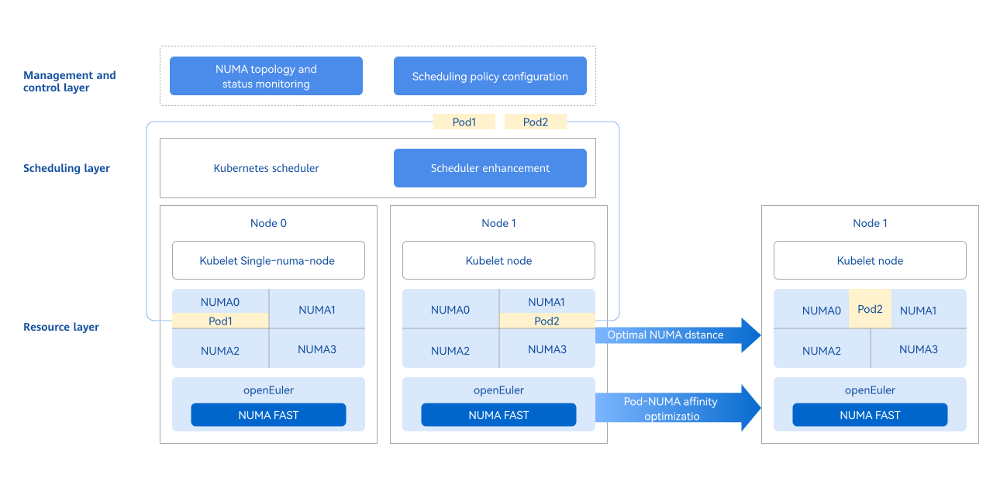
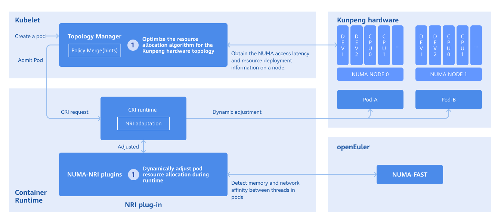

# NUMA-Aware Scheduling Developer Guide

## Feature Introduction

In modern high-performance computing and large-scale distributed systems, Non-Uniform Memory Access (NUMA) architecture is becoming increasingly common. NUMA architecture aims to reduce memory access latency and improve system performance by dividing memory into different nodes (NUMA nodes), each with its own local memory and CPU. However, the complexity of NUMA architecture increases the difficulty of system resource management, especially in multi-task and multi-threaded environments. To fully leverage the advantages of NUMA architecture, fine-grained management and monitoring of system resources are required. NUMA resource monitoring visualization aims to display the allocation and usage of NUMA resources in the system in real-time through an intuitive graphical interface, helping users better understand and manage NUMA resources, thereby improving system performance and resource utilization. In container clusters, a variety of schedulers provide resource scheduling capabilities. This feature will be divided into three aspects, providing different types of optimization methods for tasks with high, medium, and low priorities. At the level of cluster scheduling and intra-node NUMA scheduling, it ensures that Pods achieve optimal allocation effects and achieves significant performance improvements.
For details, please refer to [NUMA Affinity Scheduling](../user_guide/numa-affinity_user_guide.md).

### Component Dependencies

The functions provided by this component depend on the following:

1. **Cluster-level affinity scheduling based on NUMA topology**: No hardware dependencies (requires multi-NUMA architecture), no OS dependencies.
2. **Optimal NUMA distance allocation strategy**: No hardware dependencies (requires multi-NUMA architecture), no OS dependencies.
3. **Network affinity-aware optimization between PODs**: Adapted to ARM architecture, OS must be openEuler 22.03-sp3 or higher, containerd >= 1.7.
4. **NUMA topology monitoring**: No hardware dependencies, no OS dependencies.

### Constraints and Limitations

- **Dependency between topology policy and features**

  | Feature | Dependent Kubelet Configuration | Description |
  | :--- | :--- | :--- |
  | NUMA affinity scheduling policy (numa-aware) | topologyManagerPolicy: best-effort / restricted / single-numa-node | The topology policy specified by the workload must match the policy configured in the node's Kubelet, and the scheduler will schedule the Pod to that node |
  | Optimal NUMA Distance | topologyManagerPolicy: best-effort / restricted / single-numa-node | A non-none topology policy must be configured for Kubelet to consider NUMA distance when allocating resources |
  | Pod affinity optimization | No special requirements | This feature works at runtime and does not depend on topology policy configuration |

- When using NUMA affinity scheduling or optimal NUMA Distance features, you need to configure the topology policy of the node's Kubelet. For specific configuration methods, please refer to [User Guide - Topology Policy Configuration Instructions](../user_guide/numa-affinity_user_guide.md#topology-policy-configuration-instructions).

  > **Note:**<br />
  > - When enabling related policies, the component will automatically configure `cpuManagerPolicy: static` and restart Kubelet. Users only need to manually configure `topologyManagerPolicy`.
  > - Modifying the topology policy of a node will restart Kubelet, which may cause some Pods to be rescheduled. Use with caution in production environments.

- When using the runtime Pod affinity optimization feature, you need to modify the system configuration in advance. The specific steps are as follows.

  1. Modify the containerd configuration file.

      ```
      vi /etc/containerd/config.toml
      ```

      Modify the content to disable the disable switch.

      ```
      [plugins."io.containerd.nri.v1.nri"]
      disable=false
      ```

      Restart containerd to apply the update:

     ```
     systemctl restart containerd
     ```

  2. Install dependencies.
  Note: If there are dependent rpm packages that have not been downloaded during this process, they need to be downloaded one by one according to the dependencies.
  Taking the openEuler 22.03 sp3 environment as an example, the packages that need to be downloaded are:

      ```
      yum install -y numactl-devel numactl
      yum install -y boost boost-devel
      yum install -y graphviz graphviz-devel
      yum install -y log4cplus log4cplus-devel
      yum install -y yaml-cpp yaml-cpp-devel
      yum install -y strace sysstat
      yum install -y libboundscheck
      yum install -y libnl3
      ```

      Download libkperf from the following link:

      ```
      https://dl-cdn.openeuler.openatom.cn/openEuler-22.03-LTS-SP4/update/aarch64/Packages/
      ```

      After downloading, execute:

      ```
      rpm -ivh libkperf-v1.2-2.oe2203sp4.aarch64.rpm
      ```

  3. Install NRI plugin and oeAware
  The rpm package download links are as follows:

      ```
      https://eulermaker.compass-ci.openeuler.openatom.cn/package/download?osProject=openEuler-22.03-LTS-SP4:epol&packageName=resaware_nri_plugins  
      https://eulermaker.compass-ci.openeuler.openatom.cn/package/download?osProject=openEuler-22.03-LTS-SP4:everything&packageName=oeAware-manager
      ```

      Download the rpm packages from the above links, save them locally, and execute:

      ```
      rpm -ivh oeAware-manager-v2.1.1-4.oe2203sp4.aarch64.rpm
      rpm -ivh resaware_nri_plugins-0.0.1-2.oe2203sp4.aarch64.rpm
      ```

      Enable plugins:

      ```
      systemctl start oeaware
      systemctl start netrela
      systemctl start nriplugin
      ```

      If you want to stop the plugin functionality:

      ```
      systemctl stop oeaware
      systemctl stop netrela
      systemctl stop nriplugin
      ```

> **Note:**<br />The runtime Pod affinity optimization feature currently only supports ARM environment + openEuler 22.03 environment.

- When using the cluster NUMA monitoring feature, you need to configure Prometheus in advance (optional, if not configured, the monitoring chart will not be displayed, which does not affect other functions).

  1. To configure Prometheus Operator to access NUMA Exporter, refer to task scenario 2.

  2. To configure Prometheus to access NUMA Exporter, refer to task scenario 3.

  3. To configure the front-end monitoring proxy address, refer to task scenario 4.

## Environment Preparation

### Environment Requirements

- Kubernetes v1.21 or higher has been deployed.
- Containerd v1.7 or higher has been deployed.
- (Optional) Prometheus has been deployed. The cluster NUMA monitoring chart function depends on Prometheus. If this function is not needed, you can skip it.

### Verify the Environment Setup

Taking Volcano as an example: when all Pods in the volcano-system namespace are in the "Running" state, it indicates that the environment has been successfully set up.

```
volcano-system volcano-admission-xx-xx           1/1  Running  0  xmxxs
volcano-system volcano-admission-init-xx         1/1  Running  0  xmxxs
volcano-system volcano-controllers-xx-xx         1/1  Running  0  xmxxs
volcano-system volcano-schedulers-xx-xx          1/1  Running  0  xmxxs
volcano-system volcano-exporter-daemonset-xx     n/n  Running  0  xmxxs
volcano-system volcano-config-website-xx-xx      1/1  Running  0  xmxxs
volcano-system volcano-config-xx-xx              1/1  Running  0  xmxxs
volcano-system numa-exporter-xx                  n/n  Running  0  xmxxs
default        numaadj-xx                      n/n  Running  0  xmxxs
```

## Task Scenario 1: Modify Volcano Scheduling Policy

### Task Scenario Overview

Configure Volcano scheduling policy.

### System Architecture

The management and control layer leverages the openFuyao platform console-website capability to display the NUMA topology, status monitoring, and scheduling policy configuration front-end interface. The management scheduler can not only use the Kubernetes scheduler in the cluster, but also supports user-defined schedulers. Through the scheduler, combined with Kubelet capabilities, resources are scheduled to nodes. At Pod runtime, the Oeware + NUMA-nri plugin capability is used to perform Pod affinity optimization, scheduling Pods with strong network affinity to the same NUMA, improving performance and completing the overall end-to-end scheduling optimization solution.

**Figure 1** NUMA-Aware Scheduling Architecture Relationship



### Interface Description (Taking numa-aware as an Example)

**Table 1** Main Interface Description

| Interface Name                    | Description                          |
| :-------------------------------- | :----------------------------------- |
| GET /rest/scheduling/v1/numaaware | Query NUMA affinity scheduling policy. |
| PUT /rest/scheduling/v1/numaaware | Modify NUMA affinity scheduling policy. |

### Development Steps

Determine whether the numa-aware plugin is available by viewing the configuration file. You can also modify the configuration file to enable/disable the numa-aware extended scheduling policy. The core code is as follows.

```
func methodPut(clientset kubernetes.Interface, plugin string, status string) (*httputil.ResponseJson, int) {
    // Get Volcano configuration file
    configmap, err := k8sutil.GetConfigMap(clientset, constant.VolcanoConfigServiceConfigmap,
       constant.VolcanoConfigServiceDefaultNamespace)
    if err != nil {
       zlog.Errorf("GetConfigMap failed, %v", err)
       return httputil.GetDefaultServerFailureResponseJson(), http.StatusInternalServerError
    }

 // Get the specific content of the configuration file
    configContent, exists := configmap.Data[constant.VolcanoConfigServiceConfigmapName]
    zlog.Infof("configContent: %v", configContent)
    if !exists {
       zlog.Errorf("GetConfigMap failed, content is empty")
       return httputil.GetDefaultServerFailureResponseJson(), http.StatusInternalServerError
    }

 // Modify policy status
    str := "name: " + plugin
    if status == "open" {
       if !strings.Contains(configContent, str) {
          configContent = insertPlugin(configContent)
       }
    } else if status == "close" {
       if strings.Contains(configContent, str) {
          configContent = removePlugin(configContent, plugin)
       }
    } else {
       zlog.Errorf("status is not open or close, %v", err)
       return httputil.GetDefaultServerFailureResponseJson(), http.StatusInternalServerError
    }

 // Update configuration file
    configmap.Data[constant.VolcanoConfigServiceConfigmapName] = configContent
    configmap, err = k8sutil.UpdateConfigMap(clientset, configmap)
    if err != nil {
       zlog.Errorf("UpdateConfigMap failed, %v", err)
       return httputil.GetDefaultServerFailureResponseJson(), http.StatusInternalServerError
    }

 // Restart scheduler
    err = k8sutil.DeleteVolcanoPod(clientset, constant.VolcanoConfigServiceDefaultNamespace)
    if err != nil {
       zlog.Errorf("delete pod volcano-scheduler failed, %v", err)
       return httputil.GetDefaultServerFailureResponseJson(), http.StatusInternalServerError
    }

    return &httputil.ResponseJson{
       Code: constant.Success,
       Msg:  "success",
    }, http.StatusOK
}

```

### Testing and Verification

Call the interface corresponding to this task scenario to confirm whether you can normally view or modify the scheduling policy.

1. Call the interface.
   Change the ClusterIP in the service to NodePort and call the NodePort port number.

   ```
   curl -X GET  "http://192.168.100.59:NodePort/rest/scheduling/v1/numaaware"
   ```

2. View the Volcano configuration file in the cluster.

   ```
   kubectl edit configmaps volcano-scheduler-configmap -n volcano-system
   ```

   Check whether there is a - numa-aware item. If there is, it indicates that the NUMA affinity scheduling policy has been enabled.

3. Verify whether the scheduling policy takes effect correctly.

   Create a Deployment, set it to be affinity to a node with single-numa-node, use Volcano as the scheduler, and observe whether it is scheduled as expected.
 ```
    apiVersion: apps/v1
    kind: Deployment
    metadata:
      name: nginx
    spec:
      replicas: 1
      selector:
        matchLabels:
          app: nginx
      template:
        metadata:
          labels:
            app: nginx
          annotations:
            # Specify numa affinity
            volcano.sh/numa-topology-policy: single-numa-node
        spec:
          # Specify the scheduler as Volcano
          schedulerName: volcano
          containers:
          - name: nginx
            image: nginx
            imagePullPolicy: IfNotPresent
            resources:
              limits:
                cpu: 1
                memory: 100Mi
              requests:
                cpu: 1
                memory: 100Mi
 ```

## Task Scenario 2: Configure Prometheus Operator to Access NUMA Exporter

### Task Scenario Overview

Prometheus Operator mainly uses custom resources (CRD) to manage Prometheus configuration, including Prometheus, Alertmanager, ServiceMonitor, and PodMonitor. ServiceMonitor is designed to define how Prometheus should discover and scrape monitoring data from specific services. It is used to specify one or more Kubernetes services as Prometheus scrape targets.

### Development Steps

1. Write the YAML file for ServiceMonitor.

   Create a YAML file named numaExporter-serviceMonitor.yaml with the following content.

   ```yaml
      apiVersion: monitoring.coreos.com/v1
      kind: ServiceMonitor
      metadata:
        labels:
          name: numa-exporter
        name: numa-exporter
        namespace: volcano-system
      spec:
        endpoints:
          - interval: 30s
            port: https
        selector:
          matchLabels:
            app: numa-exporter
        namespaceSelector:
          matchNames:
          - volcano-system
   ```

2. Apply the ServiceMonitor resource so that Prometheus can discover NUMA Exporter and scrape monitoring data.

   Execute the following command to use kubectl to apply the ServiceMonitor resource to the Kubernetes cluster.

   ```
   kubectl apply -f numaExporter-serviceMonitor.yaml
   ```

### Testing and Verification

1. Log in to Prometheus.

   Access the Prometheus interface: enter "http://_prometheus-server_:9090" in a browser.

    > **Note:**<br />
    > If Prometheus is configured with authentication or other security measures, enter the necessary credentials to log in.

2. Verify the monitoring target.

   2.1 Check Prometheus Targets.

     In the Prometheus web interface, access the Targets page (usually under the "Status" menu) to check whether the "numa-exporter" monitoring target has been correctly discovered and scraped.

   2.2 View data.

     Enter "numa_node_cpus_count" in the query input box to get metric data.

## Task Scenario 3: Configure Prometheus to Access NUMA Exporter

### Task Scenario Overview

   In a Kubernetes cluster, ConfigMap is usually used to manage and update Prometheus's configuration file (prometheus.yml).

### Development Steps   

1. Edit ConfigMap.

   Find the ConfigMap that stores prometheus.yml and execute the following command.

   ```
   kubectl get configmap -n monitoring
   ```

   Open and modify this ConfigMap using an editor.

   ```
   kubectl edit configmap <prometheus-config-name> -n monitoring
   ```

   In the editor, add or modify the scrape_configs section.

   ```
   scrape_configs:
   - job_name: 'numa-exporter'
    static_configs:
    - targets: ['numa-exporter.volcano-system:9201']
   ```

2. Reload Prometheus configuration.

   Save and exit the editor, and reload the configuration through hot reloading.

   ```
   curl -X POST http://prometheus-server:9090/-/reload # Replace with the actual host name or IP address and port number where Prometheus is running.
   ```

### Testing and Verification

1. Log in to Prometheus.

   Access the Prometheus interface: enter "http://_prometheus-server_:9090" in a browser.

   > **Note:**<br />
   > If Prometheus is configured with authentication or other security measures, enter the necessary credentials to log in.

2. Verify the monitoring target.

   - Check Prometheus Targets: In the Prometheus web interface, access the "Targets" page (usually under the "Status" menu) to check whether the "numa-exporter" monitoring target has been correctly discovered and scraped.

   - View data: Enter "numa_node_cpus_count" in the query input box to get metric data.

## Task Scenario 4: Configure Front-end Monitoring Proxy to Access Prometheus

### Task Scenario Overview

After completing the configuration of Prometheus scraping NUMA Exporter data (task scenario 2 or 3), you also need to specify the query address of Prometheus in the front-end nginx proxy so that the front-end monitoring chart can display data normally. This task scenario explains how to configure the connection between the front-end and Prometheus through Helm values.

> **Note:**<br />
> When `backend.query` is empty, the front-end does not access Prometheus monitoring query; other functions are not affected.

### Development Steps

1. Edit the top-level Helm values file.

   Edit `numa-affinity-package/values.yaml` in the extracted Chart directory and find the configuration item under `volcano-config-website`.

   **kube-prometheus-stack scenario** (usually can be used directly):

   ```yaml
   volcano-config-website:
     backend:
       query: "http://prometheus-k8s.monitoring.svc:9090"
   ```

   **Independent Prometheus scenario** (modify according to actual Service address):

   ```yaml
   volcano-config-website:
     backend:
       query: "http://<prometheus-service>.<namespace>.svc:<port>"
   ```

    > If the cluster uses a non-default domain name, you can use the full FQDN according to the actual domain name, for example:
    > `http://<prometheus-service>.<namespace>.svc.<cluster-domain>:<port>`

   **No Prometheus scenario** (disable monitoring chart, other front-end functions are not affected):

   ```yaml
   volcano-config-website:
     backend:
       query: ""
   ```

2. Update the deployed Chart (if already installed).

   ```
   helm upgrade numa-affinity-package ./numa-affinity-package
   ```

### Testing and Verification

1. Confirm that the nginx configuration has taken effect.

   ```
   kubectl get configmap volcano-config-nginx -n volcano-system -o yaml
   ```

   If `backend.query` is not empty, the configuration file should contain the `/rest/scheduling/api/v1/query` location block.

2. Access the front-end interface, enter the "Cluster NUMA Monitoring" page, and confirm that the monitoring chart data is loaded normally.

3. If the monitoring chart has no data, troubleshoot in the following order:

   - Check whether the `backend.query` address points to the correct Prometheus Service.
   - Check whether Prometheus has correctly scraped numa-exporter data (refer to task scenario 2/3).

## Task Scenario 5: Non-exclusive Pods Have Affinity to the Same NUMA

### Task Scenario Overview

There are many network access behaviors between Pods, which can be regarded as a group of Pods with affinity. If this group of Pods with affinity is allocated on the same NUMA node, it can effectively reduce the number of cross-NUMA accesses, thereby improving the system's throughput.

### System Architecture

- Obtain Pod affinity: Through the OS's oeAware module, thread affinity is calculated and then converted into Pod affinity.
- Runtime affinity optimization: Use NRI to perceive resource-aware and store Pod affinity relationships. When creating, modify the cpuset/memset of the Pod to allocate the resources of affinity Pods to the same NUMA.
  The implementation principle of Pod affinity is shown in the figure below.

**Figure 2** Pod Affinity Optimization Principle Diagram<br />


### Development Steps   

Before execution, please first confirm that the **target node** has `/root/.kube/config` (kubeconfig). If it does not exist, you can execute:

```bash
mkdir -p /root/.kube
cp /etc/kubernetes/admin.conf /root/.kube/config
chmod 600 /root/.kube/config
```

If the kubeconfig file cannot be placed in the `/root/.kube/config` path, you need to execute `systemctl edit --full nriplugin` to modify the configuration, roughly in the following format:

```ini
[Unit]
...
[Service]
...
ExecStart=/bin/bash -c '/bin/bash /etc/nriplugin/config.sh apply_plugin_config && /usr/bin/nriplugin -reconcile-time 30 -config-namespace tcs -kubeconfig <path-to-kubeconfig>' # Modify <path-to-kubeconfig> here to the actual path
...
Environment="KUBECONFIG=<path-to-kubeconfig>" # Add or modify environment variable, path same as above
[Install]
...
```

After modification, restart the service to take effect: `systemctl restart nriplugin`.


Execute the following command to view the affinity relationship between Pods.

```
kubectl get oenuma podafi -n tcs -o yaml
```

In the spec.node.numa field, you can see the affinity relationship between Pods.

### Testing and Verification

Compare before and after deployment whether Pods with thread affinity are scheduled to the same NUMA.

1. Execute the following command to find the thread number, taking the deployment of nginx as an example.

```
ps -ef | grep nginx
```

2. Execute the following command to get the pid.

```
cat /proc/#pid/status
```

View the Cpus_allowed field. If it has been changed to one NUMA, the Pods with affinity have successfully been bound to cores.

## External Interface Audit Log Missing List

The following external interfaces of this service cannot record operation (audit) logs. Downstream developers should supplement audit log capabilities during secondary development to support issue traceability and security compliance.

- **Root cause**: `pkg/server/server.go` `buildHandlerChain()` does not mount Audit-type Handlers, and the request processing chain lacks audit middleware.
- **Remediation entry points**:
  - Global intercept: Chain `filters.WithAuditLog(handler)` middleware in `pkg/server/server.go` `buildHandlerChain()`.
  - Local intercept: Register route-level interceptors via `WebService.Filter(...)` in `pkg/volcano/register.go`.

| API Endpoint | Access Method | Risk Level | Description |
| :--- | :--- | :--- | :--- |
| `/rest/scheduling/v1/balance` | GET, PUT | High | PUT involves scheduling configuration/CRD modification |
| `/rest/scheduling/v1/default` | GET, PUT | High | PUT involves scheduling configuration/CRD modification |
| `/rest/scheduling/v1/numaaware` | GET, PUT | High | PUT may trigger NodeConfig CR write operations, causing cluster-wide kubelet restart |
| `/rest/scheduling/v1/numaDistance` | GET, PUT | High | PUT may trigger NodeConfig CR write operations, causing cluster-wide kubelet restart |
| `/rest/scheduling/v1/numaFast` | GET, PUT | High | PUT may trigger NodeConfig CR write operations, causing cluster-wide kubelet restart |
| `/rest/scheduling/v1/nodeList` | GET | Low | Read-only interface, exposes cluster node sensitive information |
| `/rest/scheduling/v1/nodeList/{name}` | GET | Low | Read-only interface, exposes cluster node sensitive information |
| `/rest/scheduling/v1/cr/{name}` | GET | Low | Read-only interface, exposes cluster internal resource information |
| `/rest/scheduling/v1/uuidToName/{uuid}` | GET | Low | Read-only interface, exposes cluster internal resource mapping |
| `/rest/scheduling/v1/scheduler` | GET | Low | Read-only interface, exposes scheduler sensitive information |

## FAQ

How to handle the NUMA affinity policy not taking effect?

- Symptom description

  The workload is configured with a NUMA affinity policy of single-numa-node and uses Volcano as the scheduler, but it is not correctly scheduled to a node with a topology policy of single-numa-node.

- Possible causes

  1. The numa-aware plugin has not been enabled in the configuration file.
  2. The workload is configured with anti-affinity or taints, making it unable to be allocated to that node.
  3. Node resources are full.

- Solution

   Enable the numa-aware plugin, check whether there is anti-affinity configuration, and clean up node resources.
