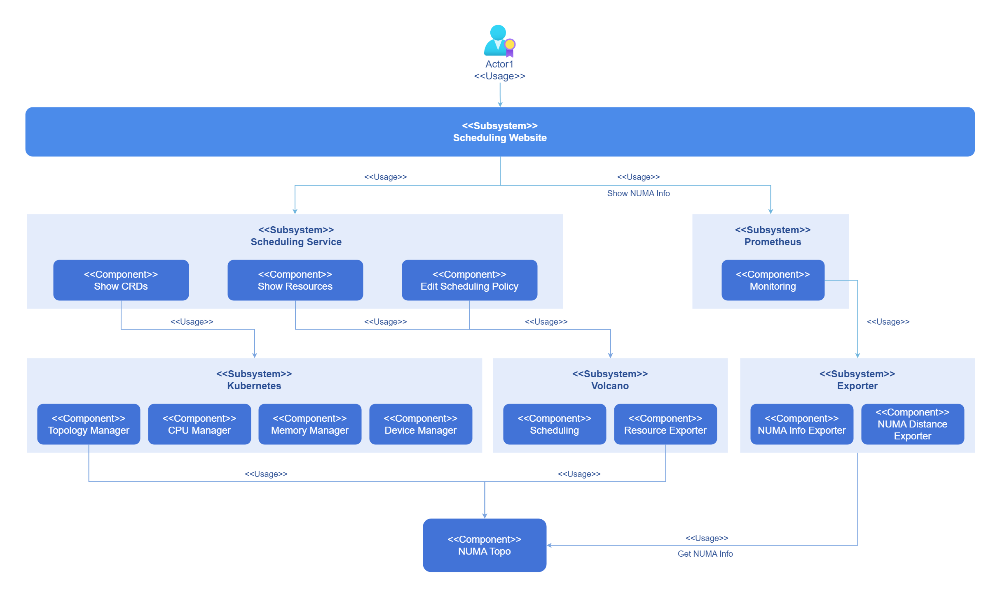
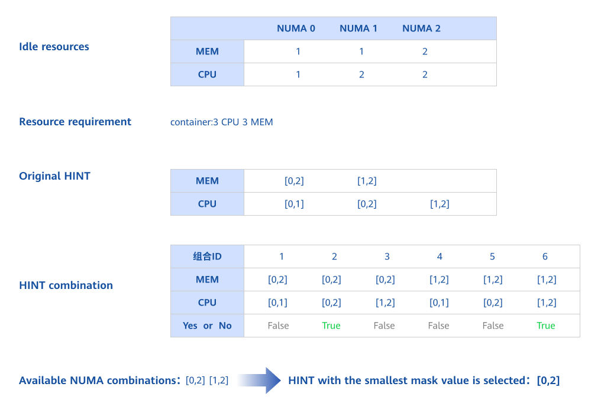
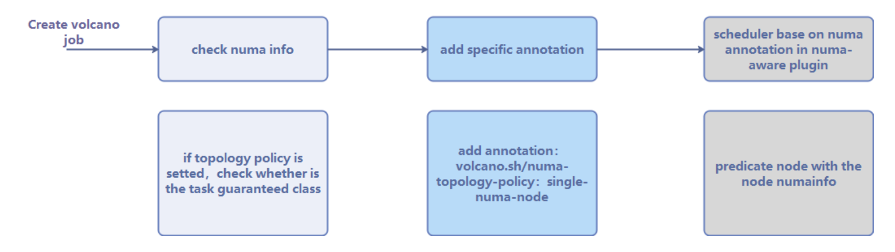
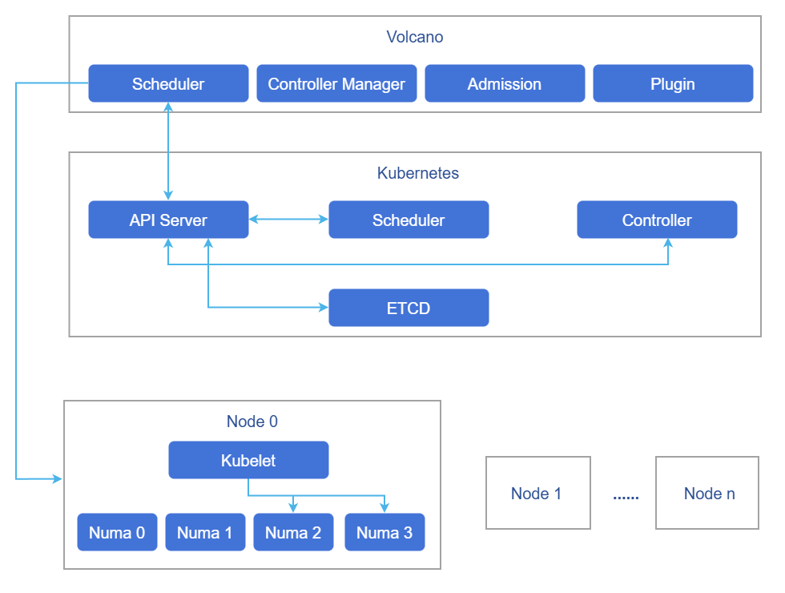
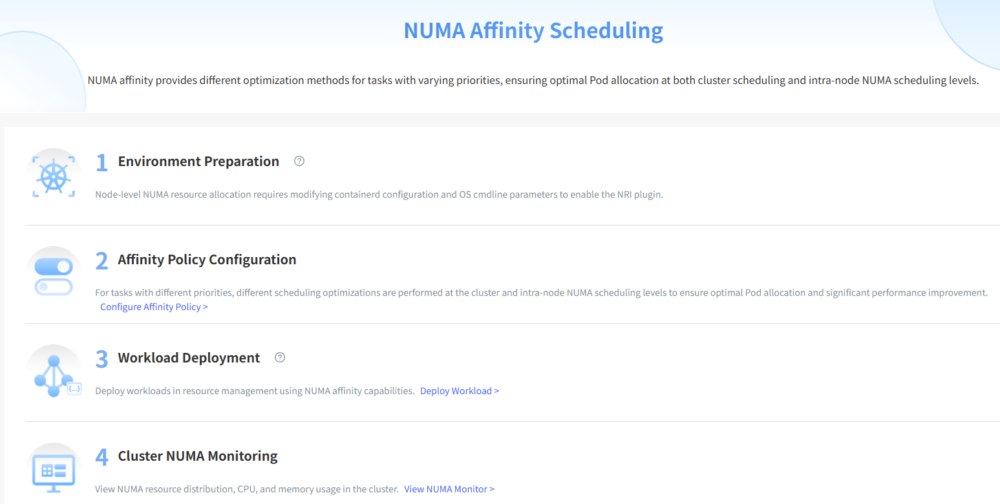
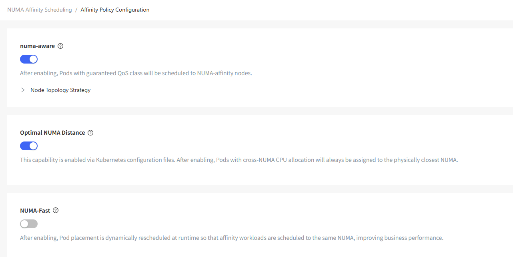
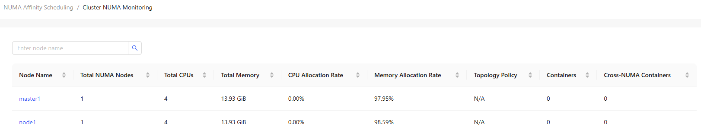
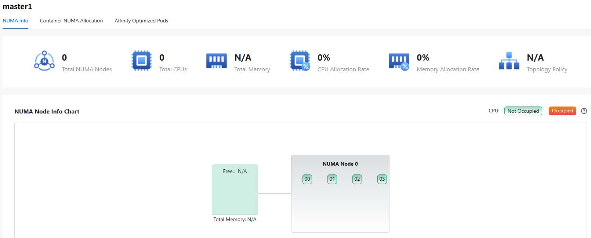
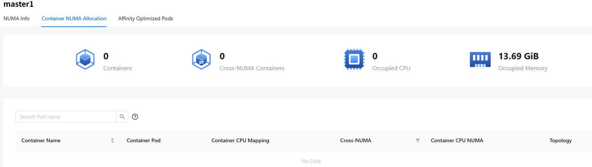
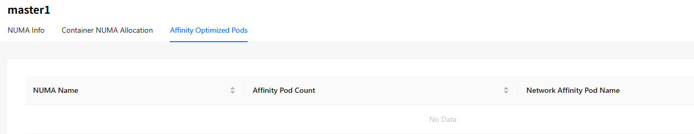

# NUMA-Aware Scheduling

## Feature Introduction

In modern high-performance computing and large-scale distributed systems, Non-Uniform Memory Access (NUMA) architecture is becoming increasingly common. NUMA architecture aims to reduce memory access latency and improve system performance by dividing memory into different nodes (NUMA nodes), each with its own local memory and CPU. However, the complexity of NUMA architecture increases the difficulty of system resource management, especially in multi-task and multi-threaded environments. To fully leverage the advantages of NUMA architecture, fine-grained management and monitoring of system resources are essential. NUMA resource monitoring visualization aims to display the allocation and usage of NUMA resources in the system in real-time through an intuitive graphical interface, helping users better understand and manage NUMA resources, thereby improving system performance and resource utilization. In container clusters, a variety of schedulers provide resource scheduling capabilities. This feature provides unified management capabilities for schedulers, such as Volcano.

### Application Scenarios

This feature has three functions. Among them, the cluster-level affinity scheduling capability acts during the scheduling phase. The optimal NUMA-Distance capability acts during the node resource allocation phase after scheduling is completed. Pod affinity optimization acts during the hot migration of running Pods.

### Capability Scope

- NUMA topology diagram: Intuitively display the topology of each NUMA node in the system, including the CPU and memory distribution of each node. Display the connection relationships and access latency between nodes.
- Real-time resource monitoring: Display the CPU usage of each NUMA node in real-time, including usage rate and idle state. Display the memory usage of each NUMA node in real-time, including total memory, used memory, and free memory.
- Detailed resource information: Display detailed resource information of each NUMA node, such as CPU list and memory size. Support viewing the CPU and memory allocation of each container on NUMA nodes.

### Highlights

- Visualized NUMA topology: Provides a topological visualization of system NUMA nodes, clearly presenting the physical connection relationships between NUMA nodes.
- Real-time resource monitoring: Updates the CPU and memory usage of NUMA nodes at the second level, providing real-time performance monitoring.
- Fine-grained container resource management: Accurately locates the resource allocation of each container on NUMA nodes.
- Multi-scheduler compatible management: Supports mainstream container orchestration schedulers such as Volcano, providing a unified NUMA resource management interface.

### Component Dependencies

The functions provided by this component depend on the following:

1. **Cluster-level affinity scheduling based on NUMA topology**: No hardware dependencies (requires multi-NUMA architecture), no OS dependencies.
2. **Optimal NUMA distance allocation strategy**: No hardware dependencies (requires multi-NUMA architecture), no OS dependencies.
3. **Network affinity-aware optimization between PODs**: Adapted to ARM architecture, OS must be openEuler 22.03-sp3 or higher, containerd >= 1.7.
4. **NUMA topology monitoring**: No hardware dependencies, no OS dependencies.

### Usage Limitations

This feature and NPU Operator both use Volcano, but conflicts arise due to different component versions, so they cannot be used simultaneously at present.

### Implementation Principle

Kubernetes and collectors can perceive the underlying topology and can be configured to use schedulers in the cluster for resource scheduling. Users can configure scheduling policies on the front-end interface and view the current topology through monitoring. The logical view is shown in the figure below.

**Figure 1** NUMA-Aware Scheduling Implementation Principle



Before Kubernetes introduced the topology manager, the CPU and device managers in Kubernetes made resource allocation decisions independently. This would result in CPUs and devices being allocated from different NUMA nodes, thus causing additional latency. The topology manager provides Kubernetes with an interface called Hint Provider to send and receive topology information and obtain the optimal solution according to the policy.

**Figure 2** NUMA Allocation



Kubernetes supports NUMA affinity settings for CPU and Memory, which requires setting CPU management policy and topology management policy. Through the hint algorithm of Topologymanager, it ensures that the allocated CPU and memory are on the same NUMA.

The topology manager provides two different alignment configurations: Scope and Policy. Scope defines the resource alignment granularity as Pod or container. Policy defines the strategy actually used during alignment as best-effort, restricted, single-numa-node, or none.

**Table 1** Topology Scheduling Behavior Expectations
<table>
<thead>
<tr> 
   <th rowSpan="2">Volcano Topology Policy</th>
   <th colSpan="2">Node Scheduling Behavior</th>
</tr>
<tr>   
   <th>1. Filter nodes with the same policy</th>
   <th>2. The CPU topology of the node meets the requirements of this policy</th>
</tr>
</thead>
<tbody>
<tr>   
   <td>none</td>
   <td>
     No filtering behavior:
     <ul>
       <li>none: schedulable</li>
       <li>best-effort: schedulable</li>
       <li>restricted: schedulable</li>
       <li>single-numa-node: schedulable</li>
     </ul>
   </td>
   <td>-</td>
</tr>
<tr>   
   <td>best-effort</td>
   <td>
     Filter nodes with topology policy also as "best-effort":
     <ul>
       <li>none: not schedulable</li>
       <li>best-effort: schedulable</li>
       <li>restricted: not schedulable</li>
       <li>single-numa-node: not schedulable</li>
     </ul>
   </td>
   <td>Schedule as much as possible to meet policy requirements:<br />Give priority to scheduling to a single NUMA node. If a single NUMA node cannot meet the CPU request value, scheduling to multiple NUMA nodes is allowed.</td>
</tr>
<tr>   
   <td>restricted</td>
   <td>
     Filter nodes with topology policy also as "restricted":
     <ul>
       <li>none: not schedulable</li>
       <li>best-effort: not schedulable</li>
       <li>restricted: schedulable</li>
       <li>single-numa-node: not schedulable</li>
     </ul>
   </td>
   <td>
     Strictly limited scheduling policy:
     <ul>
       <li>When the CPU capacity limit of a single NUMA node is greater than or equal to the CPU request value, scheduling is only allowed to a single NUMA node. At this time, if the remaining available CPU amount of a single NUMA node is insufficient, the Pod cannot be scheduled.</li>
       <li>When the CPU capacity limit of a single NUMA node is less than the CPU request value, scheduling to multiple NUMA nodes is allowed.</li>
     </ul>
   </td>
</tr>
<tr>   
   <td>single-numa-node</td>
   <td>
     Filter nodes with topology policy also as "single-numa-node":
     <ul>
       <li>none: not schedulable</li>
       <li>best-effort: not schedulable</li>
       <li>restricted: not schedulable</li>
       <li>single-numa-node: schedulable</li>
     </ul>
   </td>
   <td>Only scheduling to a single NUMA node is allowed.</td>
</tr>
</tbody>
</table>

The Kubernetes scheduler cannot perceive topology and does not guarantee at the scheduling level that the node selected for the Pod has a free single NUMA, which may cause the Pod to fail to start. To solve this problem, Volcano supports NUMA scheduling to ensure that when Kubelet enables the topology scheduling policy, Pods scheduled to nodes can definitely find suitable NUMA.

The flow of Volcano NUMA affinity scheduling is shown in the figure below.

**Figure 3** Scheduling Flow



After creating a workload and setting the scheduler to Volcano, it will first check whether the configured topology policy is correct, and then add the topology policy to the annotation. Then, the NUMA-aware component will determine whether the NUMA on the node to be scheduled is idle. Finally, the scheduler performs NUMA scheduling based on the results of the NUMA-aware component and the topology policy in the annotation. For cross-NUMA scheduling, the scheduler will follow the scheduling principle:

score = weight &times; (100 - 100 &times; numaNodeNum / maxNumaNodeNum)

Schedule Pods to worker nodes that require the fewest NUMA nodes to cross as much as possible.

**Figure 4** Volcano Scheduling



Volcano's scheduling policy is cluster-level, and various scheduling policies can ensure that the load is scheduled to the optimal node. However, which NUMA on the node specifically allocates resources to the workload is completed by the Kubelet on the node, and Volcano does not participate. Therefore, even if it is assigned to the optimal node, it is not necessarily the optimal NUMA. Based on Volcano's cluster-level scheduling, this solution optimizes the allocation of NUMA within the node after the container is assigned to the node.

### Topology Policy Configuration Instructions

The normal operation of the NUMA affinity scheduling feature depends on the topology management policy (topologyManagerPolicy) configuration of the node-side Kubelet.

**NUMA affinity scheduling policy (numa-aware)**: This feature is used to filter nodes that meet the topology policy during the scheduling phase. For this feature to take effect, the Kubelet of the target node must be configured with the corresponding `topologyManagerPolicy`. For example, when the workload specifies the `single-numa-node` policy, only nodes whose Kubelet is configured with `single-numa-node` will be scheduled.

**Optimal NUMA Distance**: This feature is used to select the optimal NUMA node when allocating resources within the node. This feature also depends on the Kubelet's topology policy configuration and can only function when `topologyManagerPolicy` is set to a non-`none` policy.

**Configuration Process**:

It is recommended to complete the configuration according to the following steps:

1. Deploy the numa-affinity-package extension component.
2. Enable the **numa-aware** or **Optimal NUMA Distance** switch on the **Affinity Policy Configuration** interface. When enabled, the component will automatically configure `cpuManagerPolicy: static` for the node and restart Kubelet.
3. Manually modify the `topologyManagerPolicy` configuration of the target node according to business needs.

**Manually Configure Kubelet Topology Policy**:

1. Edit the Kubelet configuration file.

   ```bash
   vi /var/lib/kubelet/config.yaml
   ```

2. Modify the topology policy configuration item (taking `single-numa-node` as an example).

   ```yaml
   topologyManagerPolicy: single-numa-node
   ```

   Optional policy values: `none`, `best-effort`, `restricted`, `single-numa-node`.

3. Clean up state files and restart Kubelet.

   ```bash
   # Recommended process: When modifying `cpuManagerPolicy`, first stop kubelet -> delete state -> (if necessary) daemon-reload -> start kubelet;
   # If not modified, directly execute `systemctl restart kubelet`.
   systemctl stop kubelet
   rm -rf /var/lib/kubelet/cpu_manager_state
   systemctl daemon-reload  # If the systemd unit has been modified
   systemctl start kubelet
   ```

> **Note:**<br />
> - When enabling NUMA affinity policy or optimal NUMA Distance policy, the component will automatically configure `cpuManagerPolicy: static`, and this process will restart Kubelet, which may affect Pods on the node.
> - Users only need to manually configure `topologyManagerPolicy`. It is recommended to plan the cluster's topology policy before deployment, for example, configuring a group of nodes uniformly as `single-numa-node` and another group as `best-effort`.
> - Use with caution in production environments. It is recommended to make configuration changes during off-peak business hours.

### Recommended Configuration

This component provides three features, each suitable for different business scenarios:

| Feature | Action Stage | Description |
| :--- | :--- | :--- |
| NUMA affinity scheduling (numa-aware) | Scheduling phase | Volcano scheduler filters nodes based on the topology policy specified by the workload |
| Optimal NUMA Distance | Node resource allocation phase | Kubelet prioritizes the nearest NUMA node when allocating cross-NUMA resources |
| Pod affinity optimization | Runtime | Adjusts non-exclusive Pods with network affinity to the same NUMA |

**Feature Combination Recommendations**:

| Business Scenario | Recommended Configuration | Description |
| :--- | :--- | :--- |
| Latency-sensitive business (such as databases, real-time computing) | numa-aware + `single-numa-node` | Ensures Pod resource allocation on a single NUMA node. Optimal NUMA Distance does not take effect in this scenario (no cross-NUMA situation) |
| Large resource request business (single Pod demand exceeds single NUMA capacity) | numa-aware + Optimal NUMA Distance + `best-effort` or `restricted` | Allows cross-NUMA allocation while optimizing distance selection when crossing NUMA |
| Microservice cluster with non-exclusive resources | Pod affinity optimization | Automatically identifies network affinity and adjusts related Pods to the same NUMA |
| Mixed business scenario | Enable all three features + `best-effort` | Takes into account scheduling optimization, cross-NUMA distance optimization, and runtime affinity optimization |

**Configuration Example**:

Taking latency-sensitive business as an example, the recommended configuration steps are:

1. Deploy the numa-affinity-package extension component.
2. Enable the **numa-aware** switch (the component automatically configures `cpuManagerPolicy: static`).
3. Manually configure the target node's `topologyManagerPolicy: single-numa-node`.
4. When deploying the workload, add the annotation `volcano.sh/numa-topology-policy: single-numa-node`.

> **Note:**<br />
> - When `topologyManagerPolicy` is `single-numa-node`, the optimal NUMA Distance feature does not take effect because resources will not be allocated across NUMA.
> - The Pod affinity optimization feature is independent of the first two features and can be enabled separately as needed.

### Relationship with Related Features

Depends on the resource management module to provide CRD and CR viewing interfaces, and depends on Prometheus to provide monitoring capabilities.

### Related Instances

Code link: [openFuyao/volcano-config-service (gitcode.com)](https://gitcode.com/openfuyao/volcano-config-service)

## Installation

### Prerequisites

- Kubernetes v1.21 or higher has been deployed.
- Containerd v1.7 or higher has been deployed.
- (Optional) Prometheus has been deployed. The cluster NUMA monitoring chart function depends on Prometheus. If this function is not needed, you can skip it. When Prometheus is not configured, the monitoring chart will not be displayed, but other functions are not affected.

### Start Installation

#### openFuyao Platform

1. In the left navigation bar of the openFuyao platform, select **Application Market > Applications** to enter the **Applications** interface.
2. Check the **Extension Components** type on the left to view all extension components. Or enter **numa-affinity-package** in the search box.
3. Click the **numa-affinity-package** card to enter the scheduling extension component **Details** interface.
4. Click **Deploy** to enter the **Deploy** interface.
5. Enter the application name, select the installation version and namespace.
6. Enter the values information to be deployed in the "Values.yaml" of the parameter configuration.
7. Click **Deploy** to complete the deployment.
8. Click **Extension Component Management** in the left navigation bar to manage scheduling components.

> **Note:**<br />After deployment, the Kubelet configuration items on the node will be modified. This process will restart Kubelet. Use with caution in production environments.

If you need to use the Pod affinity optimization feature, you need to perform the following additional operations on each node:

1. Modify the containerd configuration file.

```
vi /etc/containerd/config.toml
```

Modify the content to disable the disable switch.

```
  [plugins."io.containerd.nri.v1.nri"]
  disable=false
```

Restart containerd to apply the update:

```
systemctl restart containerd
```

2. Install dependencies.
Note: If there are dependent rpm packages that have not been downloaded during this process, they need to be downloaded one by one according to the dependencies.
Taking the openEuler 22.03 sp3 environment as an example, the packages that need to be downloaded are:

```
yum install -y numactl-devel numactl
yum install -y boost boost-devel
yum install -y graphviz graphviz-devel
yum install -y log4cplus log4cplus-devel
yum install -y yaml-cpp yaml-cpp-devel
yum install -y strace sysstat
yum install -y libboundscheck
yum install -y libnl3
```

Download libkperf from the following link:

```
https://dl-cdn.openeuler.openatom.cn/openEuler-22.03-LTS-SP4/update/aarch64/Packages/
```

After downloading, execute:

```
rpm -ivh libkperf-v1.2-2.oe2203sp4.aarch64.rpm
```

3. Install NRI plugin and oeAware
The rpm package download links are as follows:

```
https://eulermaker.compass-ci.openeuler.openatom.cn/package/download?osProject=openEuler-22.03-LTS-SP4:epol&packageName=resaware_nri_plugins  
https://eulermaker.compass-ci.openeuler.openatom.cn/package/download?osProject=openEuler-22.03-LTS-SP4:everything&packageName=oeAware-manager
```

Download the rpm packages from the above links, save them locally, and execute:

```
rpm -ivh oeAware-manager-v2.1.1-4.oe2203sp4.aarch64.rpm
rpm -ivh resaware_nri_plugins-0.0.1-2.oe2203sp4.aarch64.rpm
```

Enable plugins:

```
systemctl start oeaware
systemctl start netrela
systemctl start nriplugin
```

If you want to stop the plugin functionality:

```
systemctl stop oeaware
systemctl stop netrela
systemctl stop nriplugin
```

#### Independent Deployment

Compared with application market installation and deployment, this component provides independent deployment functionality. The steps are as follows:

1. Pull the image.

   ```
   helm pull oci://cr.openfuyao.cn/charts/numa-affinity-package --version xxx
   ```

   Replace xxx with the helm image version you need to pull, for example: 0.0.0-latest

2. Decompress the installation package.

   ```
   tar -zxvf numa-affinity-package-xxx.tgz
   ```

3. Disable openFuyao and OAuth switches, and configure Prometheus related parameters as needed.

   ```
   vim numa-affinity-package/values.yaml
   ```

   Change the `enableOAuth` and `openFuyao` options under `volcano-config-website` to `false`:

   ```yaml
   volcano-config-website:
     enableOAuth: false
     openFuyao: false
   ```

   If the independent deployment environment has not installed Prometheus Operator (no ServiceMonitor CRD), it is recommended to disable ServiceMonitor creation at the same time:

   ```yaml
   volcano-config-package:
     numa-exporter:
       serviceMonitor:
         enabled: false
   ```

   Configure Prometheus monitoring chart access as needed (see step 5).

4. Independent installation.

   ```
   helm install numa-affinity-package ./
   ```

5. Configure Prometheus monitoring access (optional).

   This step configures the cluster NUMA monitoring chart function. If this function is not needed, you can skip it. Other front-end functions are not affected.

   **5.1 Configure Prometheus to scrape NUMA Exporter data**

   According to the Prometheus type used in the cluster, refer to the development guide for configuration:
   - Using Prometheus Operator (kube-prometheus-stack): Refer to NUMA-aware scheduling development guide task scenario 2.
   - Using independent Prometheus: Refer to NUMA-aware scheduling development guide task scenario 3.

   **5.2 Configure front-end nginx proxy address**

   Edit `numa-affinity-package/values.yaml` and select the following configuration according to the actual situation:

  **Scenario A: The cluster has deployed kube-prometheus-stack** (usually can be used directly)

   ```yaml
   volcano-config-website:
     backend:
       query: "http://prometheus-k8s.monitoring.svc:9090"
   ```

   **Scenario B: The cluster uses other Prometheus instances**

   ```yaml
   volcano-config-website:
     backend:
       query: "http://<prometheus-service>.<namespace>.svc:<port>"
   ```

   > If the cluster uses a non-default domain name, you can use the full FQDN according to the actual domain name, for example:
   > `http://<prometheus-service>.<namespace>.svc.<cluster-domain>:<port>`

   **Scenario C: The cluster has no Prometheus or does not need monitoring charts**

   ```yaml
   volcano-config-website:
     backend:
       query: ""
   ```

   After the configuration is complete, if the Chart is already installed, execute the following command to update:
   ```
   helm upgrade numa-affinity-package ./
   ```

6. Access the independent front-end.

   You can access the independent front-end through http://*management plane client login IP address*:30881.

> **Note:**<br />When deploying independently, if you need to use the Pod affinity optimization feature, you also need to complete the preconfiguration of Pod affinity optimization.

> **Note:**<br />When using Pod affinity optimization (the third feature), make sure that the kubeconfig file exists on the target node, with the default path being `/root/.kube/config`.<br />- If it does not exist, first execute: `mkdir -p /root/.kube && cp /etc/kubernetes/admin.conf /root/.kube/config && chmod 600 /root/.kube/config`.<br />- If it cannot be placed in the default path, you need to execute `systemctl edit --full nriplugin` to modify: In `[Service]`, modify `ExecStart` to add `-kubeconfig <path-to-kubeconfig>`, and add/modify the `Environment="KUBECONFIG=<path-to-kubeconfig>"` environment variable. After modification, restart the service (`systemctl restart nriplugin`) to take effect.

## View Overview Page 

In the left navigation bar of the openFuyao platform interface under **Computing Power Optimization Center**, select **NUMA-Aware Scheduling > Overview** to enter the **Overview** interface.

The overview interface displays the workflow of NUMA-aware scheduling.

**Figure 5** Overview



### Prerequisites

The "numa-affinity-package" extension component has been deployed in the application market.

### Background Information

View the workflow of NUMA-aware scheduling, including environment preparation, affinity policy configuration, workload deployment, and cluster NUMA monitoring.

### Usage Limitations

None.

### Operation Steps

Click **NUMA-Aware Scheduling > Overview** to enter the **Overview** interface.

- **Environment Preparation** contains the node-level NUMA resource allocation that needs to modify Kubernetes configuration to enable node topology policy and optimal Distance switch. Click  to display the configuration method.
- In **Affinity Policy Configuration**, you can click **Configure Affinity Policy** after the description to jump to the affinity policy configuration page.
- **Workload Deployment** is the actual use of scheduling functions for workload scheduling. Click **Deploy Workload** to jump to the workload deployment interface.
- **Cluster NUMA Monitoring** displays NUMA information in the cluster. Click **View NUMA Monitoring** to jump to the cluster NUMA monitoring interface.

## Use Affinity Policy Configuration

In the left navigation bar of the openFuyao platform interface under **Computing Power Optimization Center**, select **NUMA-Aware Scheduling > Affinity Policy Configuration** to enter the **Affinity Policy Configuration** interface.

**Figure 6** Affinity Policy Configuration



### Configure Affinity Policy

#### Prerequisites

The logged-in user has the **platform admin** or **cluster admin** role.

#### Background Information

Modify the scheduling policy of the deployed scheduling extension component. Before enabling the scheduling policy, please ensure that the Kubelet of the target node has been configured with the corresponding topology policy. For details, see [Topology Policy Configuration Instructions](#topology-policy-configuration-instructions).

#### Usage Limitations

The scheduling extension component that supports configuring scheduling policies needs to have been deployed.

#### Operation Steps

1. In the left navigation bar of the openFuyao platform interface under **Computing Power Optimization Center**, select **NUMA-Aware Scheduling > Affinity Policy Configuration** to enter the **Affinity Policy Configuration** interface.
   
2. Click the switch under each scheduling policy to enable/disable this scheduling policy. Click  after the scheduling policy to view the detailed introduction of the policy.

## Use Cluster NUMA Monitoring

In the left navigation bar of the openFuyao platform interface under **Computing Power Optimization Center**, select **NUMA-Aware Scheduling > Cluster NUMA Monitoring** to enter the **Cluster NUMA Monitoring** interface.

The cluster NUMA monitoring interface displays the **Total NUMA Nodes**, **Total CPUs**, **Total Memory**, **CPU Allocation Rate**, **Memory Allocation Rate**, **Topology Policy**, **Container Count**, and **Cross-NUMA Container Count** of all nodes in the cluster.

**Figure 7** Cluster NUMA Monitoring



### View NUMA Information

#### Prerequisites

The **numa-affinity-package** extension component has been deployed in the application market.

#### Background Information

View the information of specific NUMA, including CPU and memory resources, to understand the NUMA allocation of nodes.

#### Usage Limitations

Only supports nodes with NUMA architecture and reads NUMA status through the numactl command.

#### Operation Steps

Click on any node in the **Node Name** column to enter the node's **NUMA Information** interface.

- The NUMA information interface displays **Total NUMA Nodes**, **Total CPUs**, **Total Memory**, **CPU Allocation Rate**, **Memory Allocation Rate**, **Topology Policy**, and "**Node NUMA Information Diagram**.
- <span id="jump">The node NUMA information diagram shows the CPU number of each NUMA node, where red represents the CPU is occupied and green represents the CPU is not occupied. Each NUMA node has a local memory, light green represents free and red represents occupied.</span>
- The Distance table shows the access latency between NUMA nodes. The larger the data, the higher the latency in actual use.

**Figure 8** Node NUMA



### View Container NUMA Allocation Information

#### Prerequisites

The **numa-affinity-package** extension component has been deployed in the application market.

#### Background Information

View detailed container NUMA allocation information.

#### Usage Limitations

Only supports nodes with NUMA architecture.

#### Operation Steps

1. Click on any node in the **Node Name** column.
2. Click the **Container NUMA Allocation** tab.

  - This interface displays overview data such as **Container Count**, **Cross-NUMA Container Count**, **Occupied CPUs**, and **Total Occupied Memory**.
  - The table displays **Container Name**, **Pod Where Container Is Located**, **Container's CPU Mapping**, **Whether Cross-NUMA**, **NUMA Where Container CPU Is Located**, and **Topology**. It also supports searching by **Pod Name**.
  - Click  in the **Topology** column to view the container information diagram.
  
**Figure 9** Container NUMA Allocation



### View Affinity Optimized Pods

#### Prerequisites

The **numa-affinity-package** extension component has been deployed in the application market.

#### Background Information

View the scheduling status of affinity optimized Pods.

#### Usage Limitations

Only supports ARM nodes with NUMA architecture, operating system is openEuler 22.03 LTS SP4, adjusting non-exclusive resource Pods with network affinity to the same NUMA.

#### Operation Steps

1. Click on any node in the **Node Name** column.
2. Click the "Affinity Optimized Pods" tab.

- The table displays the number of affinity Pods in each NUMA under the node and the names of network affinity Pods.

**Figure 10** Affinity Optimized Pods


