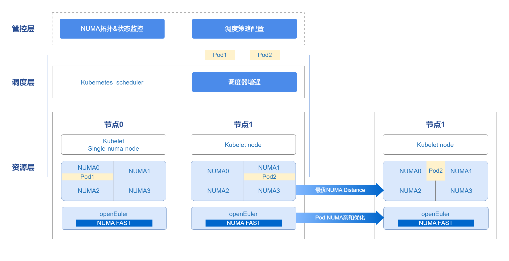
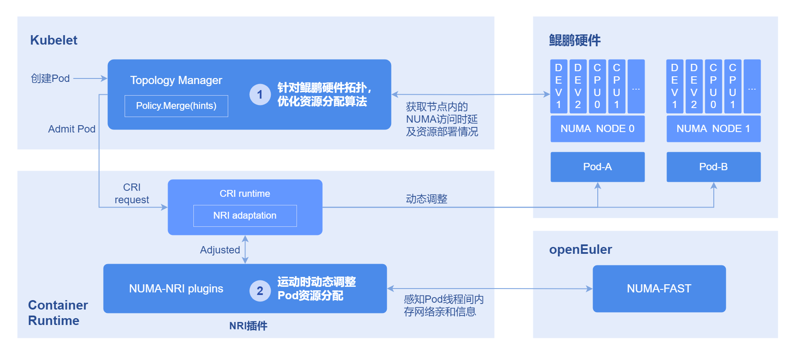

# NUMA亲和调度开发指南

## 特性简介

在现代高性能计算和大规模分布式系统中，非统一内存访问（NUMA）架构越来越普遍。NUMA架构通过将内存划分到不同的节点（NUMA节点），每个节点有其自己的局部内存和CPU，旨在减少内存访问延迟，提高系统性能。然而，NUMA架构的复杂性增加了系统资源管理的难度，特别是在多任务、多线程环境中。为了充分利用NUMA架构的优势，需要对系统资源进行精细化管理和监控。NUMA资源监控可视化旨在通过直观的图形界面，实时展示系统中NUMA资源的分配和使用情况，帮助用户更好地理解和管理NUMA资源，从而提升系统性能和资源利用率。在容器集群中，丰富多样的调度器提供了资源调度能力。本特性将分为三个角度，提供针对优先级高、中、低三种不同类型的任务，不同种类的优化方式，在集群调度以及节点内NUMA调度的层面上，保证Pod达到最优的分配效果，在性能提升上达到了显著效果。
详情请参见[《NUMA亲和调度》](../user_guide/numa-affinity_user_guide.md)。

### 组件依赖

本组件提供的各项功能依赖如下：

1. **基于NUMA拓扑的集群级亲和调度**：无硬件依赖（需多NUMA架构），无OS依赖。
2. **NUMA distance最优分配策略**：无硬件依赖（需多NUMA架构），无OS依赖。
3. **POD间网络亲和感知优化**：适配ARM架构，OS需为openEuler 22.03-sp3及以上版本，containerd为v1.7及以上版本。
4. **NUMA拓扑监控**：无硬件依赖，无OS依赖。

### 约束与限制

- **拓扑策略与功能的依赖关系**

  | 功能 | 依赖的Kubelet配置 | 说明 |
  | :--- | :--- | :--- |
  | NUMA亲和调度策略（numa-aware） | topologyManagerPolicy: best-effort / restricted / single-numa-node | 工作负载指定的拓扑策略需与节点Kubelet配置的策略匹配，调度器才会将Pod调度到该节点 |
  | 最优NUMA Distance | topologyManagerPolicy: best-effort / restricted / single-numa-node | 需配置非none的拓扑策略，Kubelet才会在分配资源时考虑NUMA距离 |
  | Pod亲和性优化 | 无特殊要求 | 该功能作用于运行时，不依赖拓扑策略配置 |

- 使用NUMA亲和调度或最优NUMA Distance功能时，需要配置节点Kubelet的拓扑策略。具体配置方法请参见[用户指南-拓扑策略配置说明](../user_guide/numa-affinity_user_guide.md#拓扑策略配置说明)。

  > **说明：**<br />
  > - 开启相关策略时，组件会自动配置`cpuManagerPolicy: static`并重启Kubelet，用户只需手动配置`topologyManagerPolicy`。
  > - 修改节点的拓扑策略会重启Kubelet，可能导致部分Pod重新调度，现网环境请谨慎使用。

- 使用运行时Pod亲和优化功能时，需要提前修改系统配置，具体步骤如下。

  1. 修改containerd的配置文件。

      ```
      vi /etc/containerd/config.toml
      ```

      将其中的内容修改，关闭disable开关。

      ```
      [plugins."io.containerd.nri.v1.nri"]
      disable=false
      ```

      重启containerd以应用更新：

     ```
     systemctl restart containerd
     ```

  2. 安装依赖项。
  注：此过程中如果有依赖的rpm包未下载，则需要按照依赖项逐一下载。
  以openEuler 22.03 sp3环境为例，需要下载的包有：

      ```
      yum install -y numactl-devel numactl
      yum install -y boost boost-devel
      yum install -y graphviz graphviz-devel
      yum install -y log4cplus log4cplus-devel
      yum install -y yaml-cpp yaml-cpp-devel
      yum install -y strace sysstat
      yum install -y libboundscheck
      yum install -y libnl3
      ```

      从以下链接下载libkperf：

      ```
      https://dl-cdn.openeuler.openatom.cn/openEuler-22.03-LTS-SP4/update/aarch64/Packages/
      ```

      下载后执行：

      ```
      rpm -ivh libkperf-v1.2-2.oe2203sp4.aarch64.rpm
      ```

  3. 安装NRI插件和oeAware
  rpm包下载链接如下：

      ```
      https://eulermaker.compass-ci.openeuler.openatom.cn/package/download?osProject=openEuler-22.03-LTS-SP4:epol&packageName=resaware_nri_plugins  
      https://eulermaker.compass-ci.openeuler.openatom.cn/package/download?osProject=openEuler-22.03-LTS-SP4:everything&packageName=oeAware-manager
      ```

      从以上链接下载好rpm包，保存到本地后执行：

      ```
      rpm -ivh oeAware-manager-v2.1.1-4.oe2203sp4.aarch64.rpm
      rpm -ivh resaware_nri_plugins-0.0.1-2.oe2203sp4.aarch64.rpm
      ```

      启用插件：

      ```
      systemctl start oeaware
      systemctl start netrela
      systemctl start nriplugin
      ```

      如果希望停止插件功能：

      ```
      systemctl stop oeaware
      systemctl stop netrela
      systemctl stop nriplugin
      ```

> **说明：**<br />运行时Pod亲和优化功能目前只支持ARM环境+openEuler 22.03环境使用。

- 使用集群NUMA监控功能时，需要提前配置Prometheus（可选，未配置则监控图表不显示，不影响其他功能）。

  1. 配置Prometheus Operator接入NUMA Exporter参考任务场景2。

  2. 配置Prometheus接入NUMA Exporter参考任务场景3。

  3. 配置前端监控代理地址参考任务场景4。

## 环境准备

### 环境要求

- 已部署Kubernetes v1.21及以上。
- 已部署Containerd v1.7及以上。
- （可选）已部署Prometheus。集群NUMA监控图表功能依赖Prometheus，若不需要该功能可跳过。

### 检验搭建环境

以使用Volcano为例：当所有volcano-system namespace下的Pod状态为“Running”时，表示环境搭建成功。

```
volcano-system volcano-admission-xx-xx           1/1  Running  0  xmxxs
volcano-system volcano-admission-init-xx         1/1  Running  0  xmxxs
volcano-system volcano-controllers-xx-xx         1/1  Running  0  xmxxs
volcano-system volcano-schedulers-xx-xx          1/1  Running  0  xmxxs
volcano-system volcano-exporter-daemonset-xx     n/n  Running  0  xmxxs
volcano-system volcano-config-website-xx-xx      1/1  Running  0  xmxxs
volcano-system volcano-config-xx-xx              1/1  Running  0  xmxxs
volcano-system numa-exporter-xx                  n/n  Running  0  xmxxs
default        numaadj-xx                      n/n  Running  0  xmxxs
```

## 任务场景1：修改Volcano调度策略

### 任务场景概述

配置Volcano调度策略。

### 系统架构

管控层借用openFuyao平台console-website能力，前端展示NUMA拓扑、状态监控以及调度策略配置前端界面。管理调度器在集群中不仅可以使用Kubernetes scheduler，也支持用户自定义调度器。通过调度器，配合Kubelet能力，将资源调度至节点上。Pod运行时使用Oeware+NUMA-nri plugin能力，进行Pod亲和优化，把网络亲缘关系较强的Pod调度至同一NUMA上，提高性能，完成整体端到端的调度优化方案。

**图 1** NUMA亲和调度架构关系



### 接口说明（以numa-aware为例）

**表 1** 主要接口说明

| 接口名                            | 描述                     |
| :-------------------------------- | :----------------------- |
| GET /rest/scheduling/v1/numaaware | 查询NUMA亲和性调度策略。 |
| PUT /rest/scheduling/v1/numaaware | 修改NUMA亲和性调度策略。 |

### 开发步骤

通过查看配置文件的方法，判断numa-aware插件是否可用。同时可对配置文件进行修改，即开启/关闭numa-aware扩展调度策略，核心代码如下。

```
func methodPut(clientset kubernetes.Interface, plugin string, status string) (*httputil.ResponseJson, int) {
    // 获取volcano配置文件
    configmap, err := k8sutil.GetConfigMap(clientset, constant.VolcanoConfigServiceConfigmap,
       constant.VolcanoConfigServiceDefaultNamespace)
    if err != nil {
       zlog.Errorf("GetConfigMap failed, %v", err)
       return httputil.GetDefaultServerFailureResponseJson(), http.StatusInternalServerError
    }

 // 获取配置文件具体内容
    configContent, exists := configmap.Data[constant.VolcanoConfigServiceConfigmapName]
    zlog.Infof("configContent: %v", configContent)
    if !exists {
       zlog.Errorf("GetConfigMap failed, content is empty")
       return httputil.GetDefaultServerFailureResponseJson(), http.StatusInternalServerError
    }

 // 修改策略状态
    str := "name: " + plugin
    if status == "open" {
       if !strings.Contains(configContent, str) {
          configContent = insertPlugin(configContent)
       }
    } else if status == "close" {
       if strings.Contains(configContent, str) {
          configContent = removePlugin(configContent, plugin)
       }
    } else {
       zlog.Errorf("status is not open or close, %v", err)
       return httputil.GetDefaultServerFailureResponseJson(), http.StatusInternalServerError
    }

 // 更新配置文件
    configmap.Data[constant.VolcanoConfigServiceConfigmapName] = configContent
    configmap, err = k8sutil.UpdateConfigMap(clientset, configmap)
    if err != nil {
       zlog.Errorf("UpdateConfigMap failed, %v", err)
       return httputil.GetDefaultServerFailureResponseJson(), http.StatusInternalServerError
    }

 // 重启调度器
    err = k8sutil.DeleteVolcanoPod(clientset, constant.VolcanoConfigServiceDefaultNamespace)
    if err != nil {
       zlog.Errorf("delete pod volcano-scheduler failed, %v", err)
       return httputil.GetDefaultServerFailureResponseJson(), http.StatusInternalServerError
    }

    return &httputil.ResponseJson{
       Code: constant.Success,
       Msg:  "success",
    }, http.StatusOK
}

```

### 调测验证

调用本任务场景对应的接口，确认能否正常查看或修改调度策略。

1. 调用接口。
   将service中ClusterIP改为NodePort，并调用NodePort端口号。

   ```
   curl -X GET  "http://192.168.100.59:NodePort/rest/scheduling/v1/numaaware"
   ```

2. 在集群中查看Volcano配置文件。

   ```
   kubectl edit configmaps volcano-scheduler-configmap -n volcano-system
   ```

   查看其中是否有- numa-aware项，有则表示NUMA亲和调度策略已开启。

3. 验证调度策略是否正确生效。

   创建一个Deployment，设置亲和到single-numa-node的节点上，使用调度器为Volcano，观察是否按预期进行调度。
 ```
    apiVersion: apps/v1
    kind: Deployment
    metadata:
      name: nginx
    spec:
      replicas: 1
      selector:
        matchLabels:
          app: nginx
      template:
        metadata:
          labels:
            app: nginx
          annotations:
            # 指定numa亲和性
            volcano.sh/numa-topology-policy: single-numa-node
        spec:
          # 指定调度器为Volcano
          schedulerName: volcano
          containers:
          - name: nginx
            image: nginx
            imagePullPolicy: IfNotPresent
            resources:
              limits:
                cpu: 1
                memory: 100Mi
              requests:
                cpu: 1
                memory: 100Mi
 ```

## 任务场景2：配置Prometheus Operator接入NUMA Exporter

### 任务场景概述

Prometheus Operator主要使用自定义资源（CRD）来管理Prometheus的配置，包括Prometheus、Alertmanager、ServiceMonitor和PodMonitor等。ServiceMonitor旨在定义Prometheus应该如何发现和抓取特定服务的监控数据。它用来指定一个或多个Kubernetes服务作为Prometheus的抓取目标。

### 开发步骤

1. 编写ServiceMonitor的YAML文件。

   创建一个名为numaExporter-serviceMonitor.yaml的YAML文件，内容如下。

   ```yaml
      apiVersion: monitoring.coreos.com/v1
      kind: ServiceMonitor
      metadata:
        labels:
          name: numa-exporter
        name: numa-exporter
        namespace: volcano-system
      spec:
        endpoints:
          - interval: 30s
            port: https
        selector:
          matchLabels:
            app: numa-exporter
        namespaceSelector:
          matchNames:
          - volcano-system
   ```

2. 应用ServiceMonitor资源，使Prometheus可以发现NUMA Exporter并抓取监控数据。

   执行如下命令，使用kubectl将ServiceMonitor资源应用到Kubernetes集群中。

   ```
   kubectl apply -f numaExporter-serviceMonitor.yaml
   ```

### 调测验证

1. 登录Prometheus。

   访问Prometheus界面：浏览器中输入“http://_prometheus-server_:9090”。

    > **说明：**<br />
    > 如果Prometheus配置了身份验证或其他安全措施，输入必要的凭据登录。

2. 验证监控目标。

   2.1 检查Prometheus Targets。

     在Prometheus web界面中，访问Targets页面（通常在“Status”菜单下），检查“numa-exporter”监控目标是否已被正确发现和抓取。

   2.2 查看数据。

     在查询输入框中输入“numa_node_cpus_count”以获取指标数据。

## 任务场景3：配置Prometheus接入NUMA Exporter

### 任务场景概述

   在Kubernetes集群中，通常使用ConfigMap来管理和更新Prometheus的配置文件（prometheus.yml）。

### 开发步骤   

1. 编辑ConfigMap。

   找到存储prometheus.yml的ConfigMap，执行以下命令。

   ```
   kubectl get configmap -n monitoring
   ```

   使用编辑器打开并修改这个ConfigMap。

   ```
   kubectl edit configmap <prometheus-config-name> -n monitoring
   ```

   在编辑器中，添加或修改scrape_configs部分。

   ```
   scrape_configs:
   - job_name: 'numa-exporter'
    static_configs:
    - targets: ['numa-exporter.volcano-system:9201']
   ```

2. 重新加载Prometheus配置。

   保存并退出编辑器，并通过热加载来重新加载配置。

   ```
   curl -X POST http://prometheus-server:9090/-/reload #替换为Prometheus实际运行的主机名或IP地址及其端口号。
   ```

### 调测验证

1. 登录Prometheus。

   访问Prometheus界面：浏览器中输入“http://_prometheus-server_:9090”。

   > **说明：**<br />
   > 如果Prometheus配置了身份验证或其他安全措施，输入必要的凭据登录。

2. 验证监控目标。

   - 检查Prometheus Targets：在Prometheus web界面中，访问“Targets”页面（通常在“Status”菜单下），检查“numa-exporter”监控目标是否已被正确发现和抓取。

   - 查看数据：在查询输入框中输入“numa_node_cpus_count”以获取指标数据。

## 任务场景4：配置前端监控代理接入Prometheus

### 任务场景概述

完成Prometheus抓取NUMA Exporter数据的配置后（任务场景2或3），还需在前端nginx代理中指定Prometheus的查询地址，前端监控图表才能正常展示数据。本任务场景说明如何通过Helm values配置前端与Prometheus的连接。

> **说明：**<br />
> 当 `backend.query` 为空时，前端不接入Prometheus监控查询；其余功能不受影响。

### 开发步骤

1. 编辑顶层Helm values文件。

   在解压后的Chart目录中编辑 `numa-affinity-package/values.yaml`，找到 `volcano-config-website` 下的配置项。

   **kube-prometheus-stack场景**（通常可直接使用）：

   ```yaml
   volcano-config-website:
     backend:
       query: "http://prometheus-k8s.monitoring.svc:9090"
   ```

   **独立Prometheus场景**（按实际Service地址修改）：

   ```yaml
   volcano-config-website:
     backend:
       query: "http://<prometheus-service>.<namespace>.svc:<port>"
   ```

    > 若集群使用非默认域名，可按实际域名使用完整FQDN，例如：
    > `http://<prometheus-service>.<namespace>.svc.<cluster-domain>:<port>`

   **无Prometheus场景**（禁用监控图表，前端其余功能不受影响）：

   ```yaml
   volcano-config-website:
     backend:
       query: ""
   ```

2. 更新已部署的Chart（如已安装）。

   ```
   helm upgrade numa-affinity-package ./numa-affinity-package
   ```

### 调测验证

1. 确认nginx配置已生效。

   ```
   kubectl get configmap volcano-config-nginx -n volcano-system -o yaml
   ```

   若 `backend.query` 非空，配置文件中应包含 `/rest/scheduling/api/v1/query` location块。

2. 访问前端界面，进入"集群NUMA监控"页面，确认监控图表数据正常加载。

3. 若监控图表无数据，按以下顺序排查：

   - 检查 `backend.query` 地址是否指向正确的Prometheus Service。
   - 检查Prometheus是否已正确抓取到numa-exporter数据（参见任务场景2/3）。

## 任务场景5：非独占的Pod亲和至同一NUMA上

### 任务场景概述

Pod之间存在很多的网络互访行为，可以将他们视作一组具有亲缘关系的Pod。如果将这一组具有亲缘关系的Pod分配在同一Numa节点上，可以有效的降低他们跨Numa访问的次数，从而提升系统的吞吐率。

### 系统架构

- 获取Pod亲和性：通过OS的oeAware模块统计线程亲和性，进而转化为Pod亲和性。
- 运行时亲和优化：利用NRI感知resource-aware并存储Pod间亲和关系，创建时修改Pod的cpuset/memset，从而将亲和性Pod的资源分配至同一NUMA。
  Pod亲和性实现原理如下图所示。

**图 2** Pod亲和性优化原理图<br />


### 开发步骤   

执行前请先确认**目标节点**存在 `/root/.kube/config`（kubeconfig）。若不存在，可执行：

```bash
mkdir -p /root/.kube
cp /etc/kubernetes/admin.conf /root/.kube/config
chmod 600 /root/.kube/config
```

若kubeconfig文件无法放置在 `/root/.kube/config` 路径下，则需要执行 `systemctl edit --full nriplugin` 修改配置，大致格式如下：

```ini
[Unit]
...
[Service]
...
ExecStart=/bin/bash -c '/bin/bash /etc/nriplugin/config.sh apply_plugin_config && /usr/bin/nriplugin -reconcile-time 30 -config-namespace tcs -kubeconfig <path-to-kubeconfig>' # 修改此处 <path-to-kubeconfig> 为实际路径
...
Environment="KUBECONFIG=<path-to-kubeconfig>" # 新增或修改环境变量，路径同上
[Install]
...
```

修改后重启服务生效：`systemctl restart nriplugin`。


执行如下命令，可查看Pod间亲缘关系。

```
kubectl get oenuma podafi -n tcs -o yaml
```

在spec.node.numa字段中，可以看到Pod间亲缘关系。

### 调测验证

比较部署前后，具有线程亲和关系的Pod是否被调度到同一NUMA上。

1. 执行如下命令，查找线程号，以部署nginx为例。

```
ps -ef | grep nginx
```

2. 执行如下命令，获取到pid。

```
cat /proc/#pid/status
```

查看Cpus_allowed字段，如果修改到了一个NUMA上，则具有亲和关系的Pod绑核成功。

## 外部接口审计日志缺失清单

本服务以下外部接口均无法记录操作（审计）日志，请下游开发者在二次开发时自行补充审计日志能力，以支撑问题追溯与安全合规。

- **根因**：`pkg/server/server.go` 的 `buildHandlerChain()` 中未挂载 Audit 类 Handler，请求处理链缺少审计中间件。
- **改造入口**：
  - 全局拦截：在 `pkg/server/server.go` 的 `buildHandlerChain()` 中链入 `filters.WithAuditLog(handler)` 中间件。
  - 局部拦截：在 `pkg/volcano/register.go` 中通过 `WebService.Filter(...)` 注册路由级拦截器。

| 接口地址 | 访问方法 | 风险等级 | 说明 |
| :--- | :--- | :--- | :--- |
| `/rest/scheduling/v1/balance` | GET, PUT | 高 | PUT 涉及调度配置/CRD 改写 |
| `/rest/scheduling/v1/default` | GET, PUT | 高 | PUT 涉及调度配置/CRD 改写 |
| `/rest/scheduling/v1/numaaware` | GET, PUT | 高 | PUT 可能触发 NodeConfig CR 写操作，导致全集群 kubelet 重启 |
| `/rest/scheduling/v1/numaDistance` | GET, PUT | 高 | PUT 可能触发 NodeConfig CR 写操作，导致全集群 kubelet 重启 |
| `/rest/scheduling/v1/numaFast` | GET, PUT | 高 | PUT 可能触发 NodeConfig CR 写操作，导致全集群 kubelet 重启 |
| `/rest/scheduling/v1/nodeList` | GET | 低 | 只读接口，暴露集群节点敏感信息 |
| `/rest/scheduling/v1/nodeList/{name}` | GET | 低 | 只读接口，暴露集群节点敏感信息 |
| `/rest/scheduling/v1/cr/{name}` | GET | 低 | 只读接口，暴露集群内部资源信息 |
| `/rest/scheduling/v1/uuidToName/{uuid}` | GET | 低 | 只读接口，暴露集群内部资源映射关系 |
| `/rest/scheduling/v1/scheduler` | GET | 低 | 只读接口，暴露调度器敏感信息 |

## FAQ

怎么处理NUMA亲和策略不生效？

- 现象描述

  工作负载配置了NUMA亲和策略为single-numa-node，使用调度器为Volcano，但是没有正确调度到拓扑策略为single-numa-node的节点上。

- 可能原因

  1. 未在配置文件中开启numa-aware插件。
  2. 工作负载配置了反亲和或者污点，导致无法分配到该节点上。
  3. 节点资源已满。

- 解决办法

   开启numa-aware插件，并查看是否有反亲和配置，清理节点资源。
