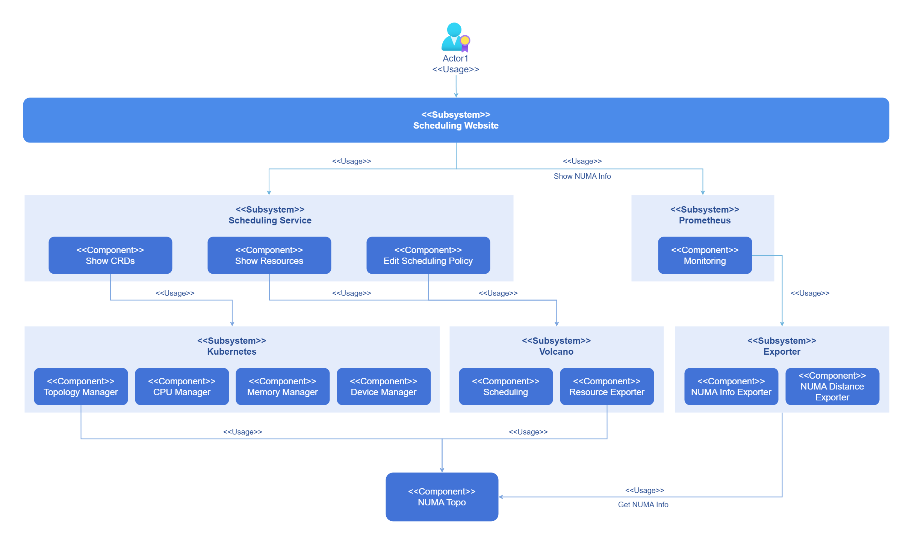
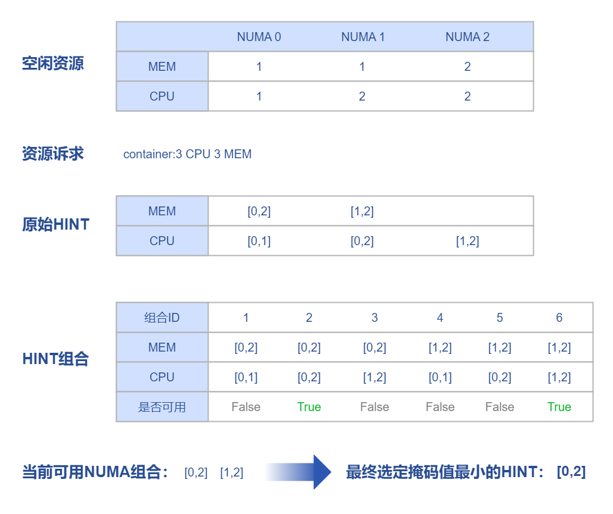
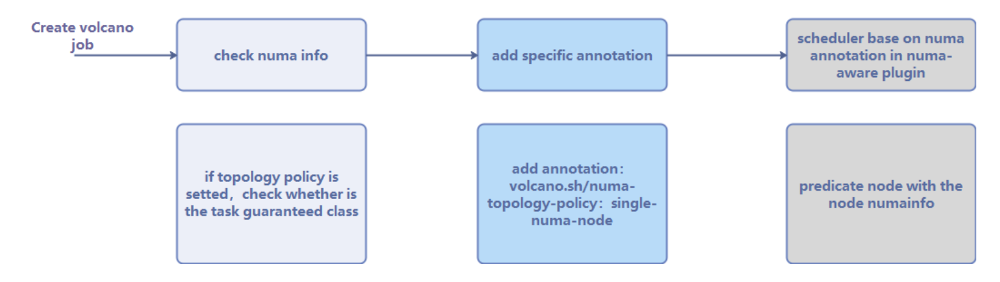
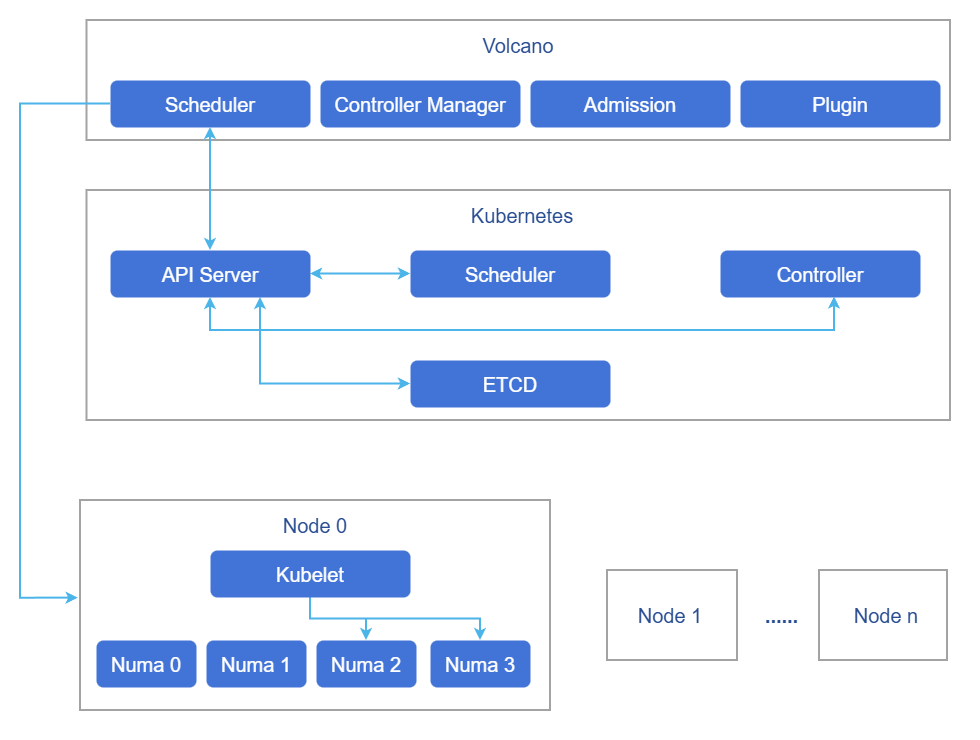
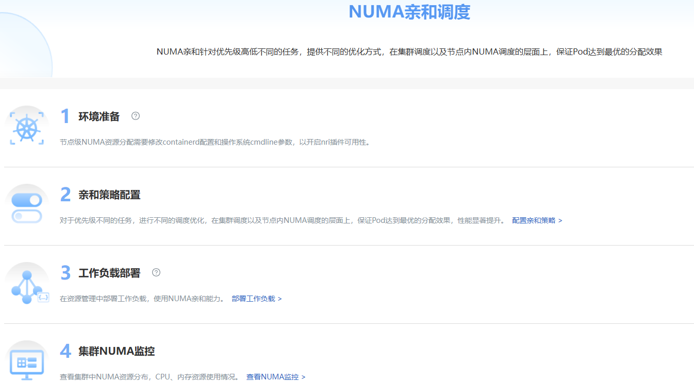
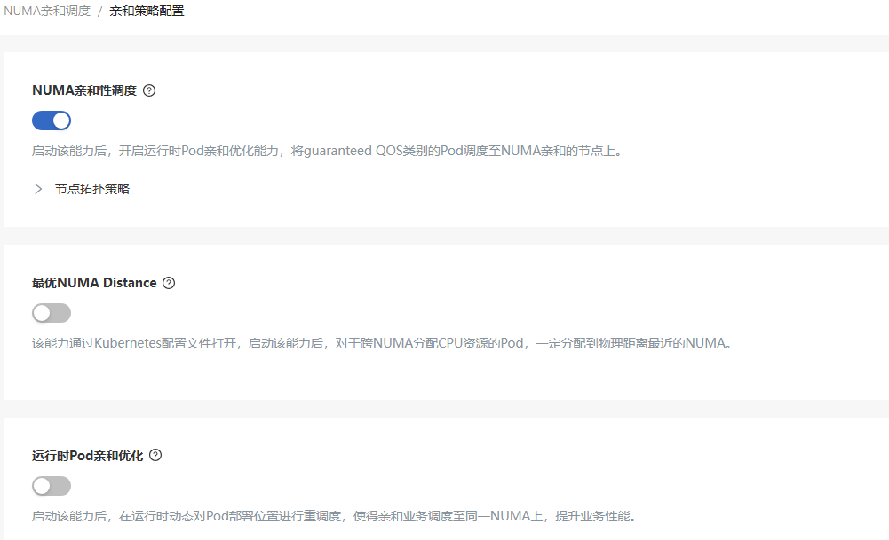
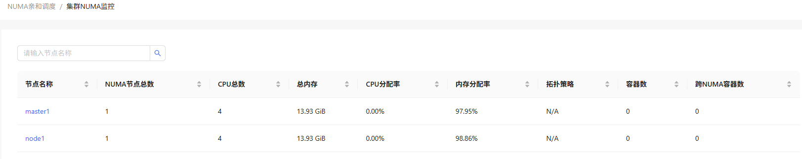
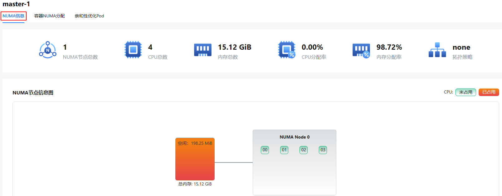
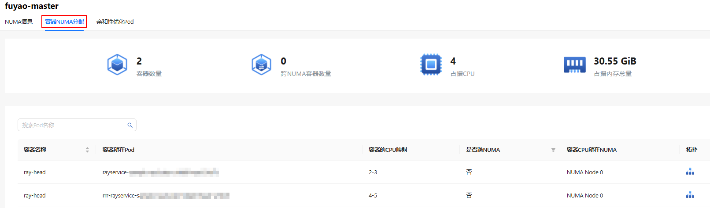
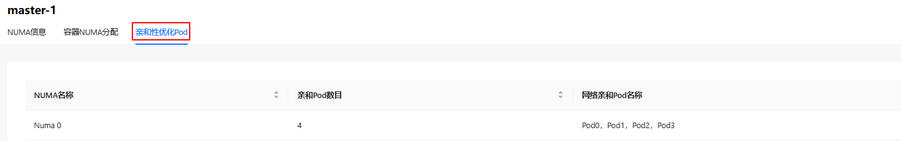

# NUMA亲和调度

## 特性介绍

在现代高性能计算和大规模分布式系统中，非统一内存访问（NUMA）架构越来越普遍。NUMA架构通过将内存划分到不同的节点（NUMA节点），每个节点有其自己的局部内存和CPU，旨在减少内存访问延迟，提高系统性能。然而，NUMA架构的复杂性增加了系统资源管理的难度，特别是在多任务、多线程环境中。为了充分利用NUMA架构的优势，必须对系统资源进行精细化管理和监控。NUMA资源监控可视化旨在通过直观的图形界面，实时展示系统中NUMA资源的分配和使用情况，帮助用户更好地理解和管理NUMA资源，从而提升系统性能和资源利用率。在容器集群中，丰富多样的调度器提供了资源调度能力。本特性提供了调度器的统一管理能力，例如Volcano。

### 应用场景

本特性共有三个功能，其中，集群级亲和调度能力作用于调度阶段。最优NUMA-Distance能力作用于调度完成后的节点资源分配阶段。Pod亲和性优化作用于Pod运行过程中的热迁移。

### 能力范围

- NUMA拓扑图：直观展示系统中各NUMA节点的拓扑结构，包括每个节点的CPU和内存分布。显示各节点之间的连接关系和访问延迟。
- 实时资源监控：实时显示各NUMA节点的CPU使用情况，包括使用率和空闲状态。实时显示各NUMA节点的内存使用情况，包括总内存、已用内存和空闲内存。
- 详细资源信息：显示每个NUMA节点的详细资源信息，如CPU列表、内存大小。支持查看每个容器在NUMA节点上的CPU和内存分配情况。

### 亮点特征

- 可视化NUMA拓扑：提供系统NUMA节点的拓扑可视化展示，清晰呈现各NUMA节点间的物理连接关系。
- 实时资源监控：秒级更新NUMA节点的CPU和内存使用情况，提供实时性能监控。
- 容器资源精细化管理：精确定位每个容器在NUMA节点上的资源分配情况。
- 多调度器兼容管理：支持Volcano等主流容器编排调度器，提供统一的NUMA资源管理接口。

### 组件依赖

本组件提供的各项功能依赖如下：

1. **基于NUMA拓扑的集群级亲和调度**：无硬件依赖（需多NUMA架构），无OS依赖。
2. **NUMA distance最优分配策略**：无硬件依赖（需多NUMA架构），无OS依赖。
3. **POD间网络亲和感知优化**：适配ARM架构，OS需为openEuler 22.03-sp3及以上版本，containerd >= 1.7。
4. **NUMA拓扑监控**：无硬件依赖，无OS依赖。

### 使用限制

本特性与NPU Operator都使用到了volcano，但是组件版本不同造成冲突，暂时无法同时使用。

### 实现原理

Kubernetes和采集器可感知底层拓扑，并可配置采用集群中的调度器进行资源调度。用户可在前台界面进行调度策略的配置，以及通过监控查看当前拓扑情况。逻辑视图如下图所示。

**图 1** NUMA亲和调度实现原理



Kubernetes在引入拓扑管理器之前，Kubernetes中的CPU和设备管理器相互独立地做出资源分配决策。会导致CPU和设备是从不同的NUMA节点分配的，因此会导致额外的延迟。拓扑管理器为Kubernetes提供了一个名为Hint Provider的接口，以发送和接收拓扑信息，并根据策略得到最优解。

**图 2** NUMA分配



Kubernetes支持CPU和Memory的NUMA亲和设置，需要设置CPU管理策略、拓扑管理策略。通过Topologymanager的hint算法，保证分配的CPU和内存在同一NUMA上。

拓扑管理器提供了两种不同的对齐配置：Scope和Policy。Scope定义了资源对齐粒度为Pod或container。Policy定义了对齐时实际使用的策略为best-effort、restricted、single-numa-node、none。

**表 1** 拓扑调度行为预期
<table>
<thead>
<tr> 
   <th rowSpan="2">Volcano拓扑策略</th>
   <th colSpan="2">节点调度行为</th>
</tr>
<tr>   
   <th>1.筛选具有相同策略的节点</th>
   <th>2.节点的CPU拓扑满足该策略的要求</th>
</tr>
</thead>
<tbody>
<tr>   
   <td>none</td>
   <td>
     无筛选行为：
     <ul>
       <li>none：可调度</li>
       <li>best-effort：可调度</li>
       <li>restricted：可调度</li>
       <li>single-numa-node：可调度</li>
     </ul>
   </td>
   <td>-</td>
</tr>
<tr>   
   <td>best-effort</td>
   <td>
     筛选拓扑策略同样为“best-effort”的节点：
     <ul>
       <li>none：不可调度</li>
       <li>best-effort：可调度</li>
       <li>restricted：不可调度</li>
       <li>single-numa-node：不可调度</li>
     </ul>
   </td>
   <td>尽可能满足策略要求进行调度：<br />优先调度至单NUMA节点，如果单NUMA节点无法满足CPU申请值，允许调度至多个NUMA节点。</td>
</tr>
<tr>   
   <td>restricted</td>
   <td>
     筛选拓扑策略同样为“restricted”的节点：
     <ul>
       <li>none：不可调度</li>
       <li>best-effort：不可调度</li>
       <li>restricted：可调度</li>
       <li>single-numa-node：不可调度</li>
     </ul>
   </td>
   <td>
     严格限制的调度策略：
     <ul>
       <li>单NUMA节点的CPU容量上限大于等于CPU的申请值时，仅允许调度至单NUMA节点。此时如果单NUMA节点剩余的CPU可使用量不足，则Pod无法调度。</li>
       <li>单NUMA节点的CPU容量上限小于CPU的申请值时，可允许调度至多个NUMA节点。</li>
     </ul>
   </td>
</tr>
<tr>   
   <td>single-numa-node</td>
   <td>
     筛选拓扑策略同样为“single-numa-node”的节点：
     <ul>
       <li>none：不可调度</li>
       <li>best-effort：不可调度</li>
       <li>restricted：不可调度</li>
       <li>single-numa-node：可调度</li>
     </ul>
   </td>
   <td>仅允许调度至单NUMA节点。</td>
</tr>
</tbody>
</table>

Kubernetes调度器无法感知拓扑，没有在调度层面保证给Pod选择的节点有空闲的单NUMA，可能会导致Pod启动失败。Volcano为了解决这个问题，支持了NUMA调度，保证Kubelet在开启拓扑调策略时，调度到节点的Pod一定可以找到合适的NUMA。

Volcano NUMA亲和调度的流程如下图所示。

**图 3** 调度流程



在创建工作负载并将调度器设置为Volcano后，首先会检查配置的拓扑策略是否正确，再将拓扑策略加入到注解中。之后NUMA感知组件会判断即将调度的节点上的NUMA是否有空闲，最后调度器根据NUMA感知组件的结果及注解中的拓扑策略进行NUMA调度。在跨NUMA的调度上，调度器会根据调度原则：

score = weight &times; (100 - 100 &times; numaNodeNum / maxNumaNodeNum)

尽可能把Pod调度到需要跨NUMA节点最少的工作节点上。

**图 4** volcano调度



Volcano的调度策略，是集群级的，各种调度策略可保证将负载调度到最优的节点上。但是节点上具体给工作负载分配哪个NUMA上的资源，是由节点上的Kubelet完成的，Volcano并未参与。所以，即使分配到了最优节点，却并不一定是最优NUMA。本方案在Volcano集群级调度的基础上，将容器分配到节点上之后，优化了节点内NUMA的分配。

### 拓扑策略配置说明

NUMA亲和调度功能的正常工作依赖于节点侧Kubelet的拓扑管理策略（topologyManagerPolicy）配置。

**NUMA亲和调度策略（numa-aware）**：此功能用于在调度阶段筛选符合拓扑策略的节点。要使该功能生效，目标节点的Kubelet必须配置相应的`topologyManagerPolicy`。例如，当工作负载指定`single-numa-node`策略时，只有Kubelet配置为`single-numa-node`的节点才会被调度。

**最优NUMA Distance**：此功能用于在节点内分配资源时选择最优的NUMA节点。该功能同样依赖Kubelet的拓扑策略配置，只有当`topologyManagerPolicy`设置为非`none`的策略时才能发挥作用。

**配置流程**：

建议按以下步骤完成配置：

1. 部署numa-affinity-package扩展组件。
2. 在"亲和策略配置"界面开启"numa-aware"或"最优NUMA Distance"开关。开启时，组件会自动为节点配置`cpuManagerPolicy: static`并重启Kubelet。
3. 根据业务需求，手动修改目标节点的`topologyManagerPolicy`配置。

**手动配置Kubelet拓扑策略**：

1. 编辑Kubelet配置文件。

   ```bash
   vi /var/lib/kubelet/config.yaml
   ```

2. 修改拓扑策略配置项（以`single-numa-node`为例）。

   ```yaml
   topologyManagerPolicy: single-numa-node
   ```

   可选策略值：`none`、`best-effort`、`restricted`、`single-numa-node`。

3. 清理状态文件并重启Kubelet。

   ```bash
   # 推荐流程：修改 `cpuManagerPolicy` 时先停止 kubelet -> 删除状态 ->（如有必要）daemon-reload -> 启动 kubelet；
   # 未修改时直接执行 `systemctl restart kubelet` 即可。
   systemctl stop kubelet
   rm -rf /var/lib/kubelet/cpu_manager_state
   systemctl daemon-reload  # 如修改了 systemd 单元
   systemctl start kubelet
   ```

> **说明：**<br />
> - 开启NUMA亲和策略或最优NUMA Distance策略时，组件会自动配置`cpuManagerPolicy: static`，此过程会重启Kubelet，可能影响节点上的Pod。
> - 用户只需手动配置`topologyManagerPolicy`，建议在部署前规划好集群的拓扑策略，例如将一组节点统一配置为`single-numa-node`，另一组配置为`best-effort`。
> - 现网环境请谨慎操作，建议在业务低峰期进行配置变更。

### 推荐配置

本组件提供三个功能，分别适用于不同的业务场景：

| 功能 | 作用阶段 | 说明 |
| :--- | :--- | :--- |
| NUMA亲和调度（numa-aware） | 调度阶段 | Volcano调度器根据工作负载指定的拓扑策略筛选节点 |
| 最优NUMA Distance | 节点资源分配阶段 | Kubelet在分配跨NUMA资源时，优先选择距离最近的NUMA节点 |
| Pod亲和性优化 | 运行时 | 将具有网络亲缘关系的非独占Pod调整至同一NUMA |

**功能组合建议**：

| 业务场景 | 推荐配置 | 说明 |
| :--- | :--- | :--- |
| 延迟敏感型业务（如数据库、实时计算） | numa-aware + `single-numa-node` | 确保Pod资源分配在单一NUMA节点，最优NUMA Distance在此场景下不生效（无跨NUMA情况） |
| 大资源申请业务（单Pod需求超过单NUMA容量） | numa-aware + 最优NUMA Distance + `best-effort`或`restricted` | 允许跨NUMA分配，同时优化跨NUMA时的距离选择 |
| 非独占资源的微服务集群 | Pod亲和性优化 | 自动识别网络亲缘关系，将相关Pod调整至同一NUMA |
| 混合业务场景 | 三个功能全部开启 + `best-effort` | 兼顾调度优化、跨NUMA距离优化和运行时亲缘优化 |

**配置示例**：

以延迟敏感型业务为例，推荐配置步骤：

1. 部署numa-affinity-package扩展组件。
2. 开启"numa-aware"开关（组件自动配置`cpuManagerPolicy: static`）。
3. 手动配置目标节点的`topologyManagerPolicy: single-numa-node`。
4. 部署工作负载时，添加注解`volcano.sh/numa-topology-policy: single-numa-node`。

> **说明：**<br />
> - 当`topologyManagerPolicy`为`single-numa-node`时，最优NUMA Distance功能不生效，因为资源不会跨NUMA分配。
> - Pod亲和性优化功能独立于前两个功能，可根据需要单独启用。

### 与相关特性的关系

依赖资源管理模块提供CRD和CR查看的接口，依赖Prometheus提供监控能力。

### 相关实例

代码链接：[openFuyao/volcano-config-service (gitcode.com)](https://gitcode.com/openfuyao/volcano-config-service)

## 安装

### 前提条件

- 已部署Kubernetes v1.21及以上。
- 已部署Containerd v1.7及以上。
- （可选）已部署Prometheus。集群NUMA监控图表功能依赖Prometheus，若不需要该功能可跳过。未配置Prometheus时，监控图表不显示，其余功能不受影响。

### 开始安装

#### openFuyao平台

1. 在openFuyao平台的左侧导航栏选择“应用市场 > 应用列表”，进入“应用列表”界面。
2. 勾选左侧类型“扩展组件”，查看所有扩展组件。或在搜索框中输入“numa-affinity-package”。
3. 单击“numa-affinity-package”卡片，进入调度扩展组件“详情”界面。
4. 单击“部署”进入“部署”界面。
5. 输入应用名称、选择安装版本和命名空间。
6. 在参数配置的“Values.yaml”中输入要部署的values信息。
7. 单击“部署”完成部署。
8. 在左侧导航栏单击“扩展组件管理”，管理调度组件。

> **说明：**<br />部署后会修改节点上的Kubelet配置项，此过程会重启Kubelet，现网环境谨慎使用。

若需要使用Pod亲和性优化功能，则需在每个节点额外进行以下操作：

1. 修改containerd的配置文件。

```
vi /etc/containerd/config.toml
```

将其中的内容修改，关闭disable开关。

```
  [plugins."io.containerd.nri.v1.nri"]
  disable=false
```

重启containerd以应用更新：

```
systemctl restart containerd
```

2. 安装依赖项。
注：此过程中如果有依赖的rpm包未下载，则需要按照依赖项逐一下载。
以openEuler 22.03 sp3环境为例，需要下载的包有：

```
yum install -y numactl-devel numactl
yum install -y boost boost-devel
yum install -y graphviz graphviz-devel
yum install -y log4cplus log4cplus-devel
yum install -y yaml-cpp yaml-cpp-devel
yum install -y strace sysstat
yum install -y libboundscheck
yum install -y libnl3
```

从以下链接下载libkperf：

```
https://dl-cdn.openeuler.openatom.cn/openEuler-22.03-LTS-SP4/update/aarch64/Packages/
```

下载后执行：

```
rpm -ivh libkperf-v1.2-2.oe2203sp4.aarch64.rpm
```

3. 安装NRI插件和oeAware
rpm包下载链接如下：

```
https://eulermaker.compass-ci.openeuler.openatom.cn/package/download?osProject=openEuler-22.03-LTS-SP4:epol&packageName=resaware_nri_plugins  
https://eulermaker.compass-ci.openeuler.openatom.cn/package/download?osProject=openEuler-22.03-LTS-SP4:everything&packageName=oeAware-manager
```

从以上链接下载好rpm包，保存到本地后执行：

```
rpm -ivh oeAware-manager-v2.1.1-4.oe2203sp4.aarch64.rpm
rpm -ivh resaware_nri_plugins-0.0.1-2.oe2203sp4.aarch64.rpm
```

启用插件：

```
systemctl start oeaware
systemctl start netrela
systemctl start nriplugin
```

如果希望停止插件功能：

```
systemctl stop oeaware
systemctl stop netrela
systemctl stop nriplugin
```

#### 独立部署

相比于应用市场安装部署，本组件提供了独立部署功能，步骤如下：

1. 拉取镜像。

   ```
   helm pull oci://cr.openfuyao.cn/charts/numa-affinity-package --version xxx
   ```

   将其中的xxx替换成需要拉取的helm镜像版本，例如：0.0.0-latest

2. 解压安装包。

   ```
   tar -zxvf numa-affinity-package-xxx.tgz
   ```

3. 关闭openFuyao及OAuth开关，并按需配置Prometheus相关参数。

   ```
   vim numa-affinity-package/values.yaml
   ```

   将 `volcano-config-website` 下的 `enableOAuth` 及 `openFuyao` 选项改为 `false`：

   ```yaml
   volcano-config-website:
     enableOAuth: false
     openFuyao: false
   ```

   若独立部署环境未安装Prometheus Operator（无ServiceMonitor CRD），建议同时关闭ServiceMonitor创建：

   ```yaml
   volcano-config-package:
     numa-exporter:
       serviceMonitor:
         enabled: false
   ```

   按需配置Prometheus监控图表接入（见步骤5）。

4. 独立安装。

   ```
   helm install numa-affinity-package ./
   ```

5. 配置Prometheus监控接入（可选）。

   本步骤配置集群NUMA监控图表功能，若不需要该功能可跳过，前端其余功能不受影响。

   **5.1 配置Prometheus抓取NUMA Exporter数据**

   根据集群使用的Prometheus类型，参考开发指南进行配置：
   - 使用Prometheus Operator（kube-prometheus-stack）：参考NUMA亲和调度开发指南任务场景2。
   - 使用独立Prometheus：参考NUMA亲和调度开发指南任务场景3。

   **5.2 配置前端nginx代理地址**

   编辑 `numa-affinity-package/values.yaml`，按实际情况选择以下配置：

  **场景A：集群已部署kube-prometheus-stack**（通常可直接使用）

   ```yaml
   volcano-config-website:
     backend:
       query: "http://prometheus-k8s.monitoring.svc:9090"
   ```

   **场景B：集群使用其他Prometheus实例**

   ```yaml
   volcano-config-website:
     backend:
       query: "http://<prometheus-service>.<namespace>.svc:<port>"
   ```

   > 若集群使用非默认域名，可按实际域名使用完整FQDN，例如：
   > `http://<prometheus-service>.<namespace>.svc.<cluster-domain>:<port>`

   **场景C：集群无Prometheus或无需监控图表**

   ```yaml
   volcano-config-website:
     backend:
       query: ""
   ```

   配置完成后，若Chart已安装，执行以下命令更新：
   ```
   helm upgrade numa-affinity-package ./
   ```

6. 访问独立前端。

   可通过http://*管理面的客户端登录IP地址*:30881 访问独立前端。

> **说明：**<br />独立部署时若需要使用Pod亲和性优化功能，也需要完成Pod亲和性优化的前置配置。

> **说明：**<br />使用Pod亲和性优化（第三个功能）时，需确认目标节点上存在kubeconfig文件，默认为 `/root/.kube/config` 路径。<br />- 若不存在，可先执行：`mkdir -p /root/.kube && cp /etc/kubernetes/admin.conf /root/.kube/config && chmod 600 /root/.kube/config`。<br />- 若无法放置在默认路径，需执行 `systemctl edit --full nriplugin` 进行修改：在 `[Service]` 中修改 `ExecStart` 补充 `-kubeconfig <path-to-kubeconfig>`，并增加/修改 `Environment="KUBECONFIG=<path-to-kubeconfig>"` 环境变量。修改完成后重启服务（`systemctl restart nriplugin`）生效。

## 查看概览页 

在openFuyao平台界面的左侧导航栏“算力优化中心”中选择“NUMA亲和调度 > 概览”，进入“概览”界面。

概览界面展示了NUMA亲和调度的工作流。

**图 5** 概览



### 前提条件

已在应用市场部署“numa-affinity-package”扩展组件。

### 背景信息

查看NUMA亲和调度的工作流，包括环境准备、亲和策略配置、工作负载部署、集群NUMA监控。

### 使用限制

无。

### 操作步骤

单击“NUMA亲和调度 > 概览”，进入“概览”界面。

- “环境准备”包含了节点级NUMA资源分配需要修改Kubernetes配置，以开启节点拓扑策略及最优Distance开关，单击展示配置方法。
- “亲和策略配置”可单击说明后的“配置亲和策略”跳转至亲和策略配置页。
- “工作负载部署”是实际使用调度功能进行工作负载调度，单击“部署工作负载”可跳转至工作负载部署界面。
- “集群NUMA监控”展示了集群中的NUMA信息，单击“查看NUMA监控”可跳转至集群NUMA监控界面。

## 使用亲和策略配置

在openFuyao平台界面的左侧导航栏“算力优化中心”中选择“NUMA亲和调度 > 亲和策略配置”，进入“亲和策略配置”界面。

**图 6** 亲和策略配置



### 配置亲和策略

#### 前提条件

登录用户具有"platform admin"或"cluster admin"角色。

#### 背景信息

对已部署的调度扩展组件进行修改调度策略。开启调度策略前，请确保目标节点的Kubelet已配置对应的拓扑策略，详见[拓扑策略配置说明](#拓扑策略配置说明)。

#### 使用限制

需要已部署可支持配置调度策略的调度扩展组件。

#### 操作步骤

1. 在openFuyao平台界面的左侧导航栏“算力优化中心”中选择“NUMA亲和调度 > 亲和策略配置”，进入“亲和策略配置”界面。
   
2. 单击各个调度策略下的开关，开启/关闭此调度策略。单击调度策略后的，可查看该策略的详细介绍。

## 使用集群NUMA监控

在openFuyao平台界面的左侧导航栏“算力优化中心”中选择“NUMA亲和调度 > 集群NUMA监控”，进入“集群NUMA监控”界面。

集群NUMA监控界面展示了集群中所有节点的“NUMA节点总数”、“CPU总数”、“内存总数”、“CPU分配率”、“内存分配率”、“拓扑策略”、“容器数”以及“跨NUMA容器数”。

**图 7** 集群NUMA监控



### 查看NUMA信息

#### 前提条件

已在应用市场部署“numa-affinity-package”扩展组件。

#### 背景信息

查看具体NUMA的信息，包括CPU、内存资源，以了解节点的NUMA分配情况。

#### 使用限制

仅支持有NUMA架构的节点，且通过numactl指令读取NUMA情况。

#### 操作步骤

单击“节点名称”列的任意一个节点，进入节点“NUMA信息”界面。

- NUMA信息界面展示“NUMA节点总数”、“CPU总数”、“内存总数”、“CPU分配率”、“内存分配率”、“拓扑策略”以及“节点NUMA信息图”。
- <span id="jump">节点NUMA信息图中展示了每个NUMA节点的CPU号，其中红色代表CPU已被占用，绿色代表CPU未被占用。每个NUMA节点都有一块本地内存，浅绿色代表空闲，红色代表被占用。</span>
- Distance表格所展示的内容表示NUMA节点间访问延迟，数据越大，则实际使用时延迟越高。

**图 8** 节点NUMA



### 查看容器NUMA分配信息

#### 前提条件

已在应用市场部署“numa-affinity-package”扩展组件。

#### 背景信息

查看容器NUMA详细分配信息。

#### 使用限制

仅支持有NUMA架构的节点。

#### 操作步骤

1. 单击“节点名称”列的任意一个节点。
2. 单击“容器NUMA分配”页签。

  - 该界面展示了概览数据，如“容器数量”、“跨NUMA容器数量”、“占据CPU”以及“占据内存总量”。
  - 表格中展示了“容器名称”、“容器所在Pod”、“容器的CPU映射”、“是否跨NUMA”、“容器CPU所在NUMA”以及“拓扑”。并且支持按照“Pod名称”搜索查看。
  - 单击“拓扑”列可查看容器信息图。
  
**图 9** 容器NUMA分配



### 查看亲和性优化Pod

#### 前提条件

已在应用市场部署“numa-affinity-package”扩展组件。

#### 背景信息

查看亲和性优化Pod调度情况。

#### 使用限制

仅支持有NUMA架构的ARM节点，操作系统为openEuler 22.03 LTS SP4，将未独占资源且具有网络亲缘关系的Pod调整至同一NUMA上。

#### 操作步骤

1. 单击“节点名称”列的任意一个节点。
2. 单击“亲和性优化Pod”页签。

- 表格中展示了节点下每个NUMA中亲和Pod数目及网络亲和Pod名称。

**图 10** 亲和性优化Pod


