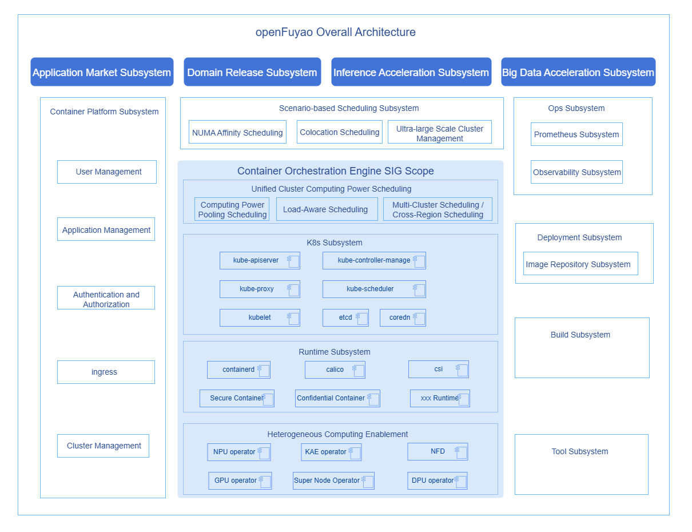

# orchestration-engine Sig
## SIG Introduction

As a core SIG of the openFuyao community, the container orchestration engine SIG is dedicated to building core container orchestration engine components for diverse clusters. The SIG architecture diagram is as follows:

### Diverse Computing Enablement

Mainly responsible for enabling various computing resources in the AI era, allowing them to be quickly, automatically, and seamlessly integrated into production systems, and efficiently utilizing computing power.
- Code repositories and directories.

### Runtime Subsystem

Responsible for building runtime components that support multiple computing resources and match multiple load patterns.
- Code repositories and directories.

### K8s Subsystem

Core of container orchestration, based on upstream community components, optimized around computing enablement, efficient scheduling, high availability/security, etc., to meet production-grade orchestration requirements.
- Code repositories and directories.
  - [kubernetes](https://gitcode.com/openFuyao/kubernetes)

### Unified Cluster Computing Scheduling

Builds capabilities such as computing pooling (soft partition/virtualization), intelligent awareness scheduling (load awareness/computing awareness/IO awareness, etc.), and multi-cluster scheduling from the cluster level, fully releasing production cluster computing power.
- Code repositories and directories.

## RoadMap (Updated 2026/07/13)

| Planned Component | Planned Objectives | Release Plan |
| ----- | ----- | ----- |
| ubs-k8s-enable | Load scheduling enhancement, supporting super-node topology-aware scheduling at the super-node granularity based on data collection and super-node topology construction in super-node scenarios. | 26.09 |
| ub-ssu-csi | CSI plugin supporting UB super-node pooled storage. | 26.09 |
| pod-live-migration | Container live migration support, IP preservation and other capabilities; combined with shared memory capabilities to improve migration efficiency and reduce container migration duration; container service interruption duration less than 1s. | 26.12 (depends on openEuler) |
| serverlessdb-operator | Serverless DB pool management, supporting rapid distribution of database instances under Agent scenarios with unchanged connection addresses. | 26.09/26.12 |
| kubevirt | Container-VM co-management under ARM64 scenarios, supporting advanced capabilities such as: huge page management, NUMA binding, MemoryDump, disk hot-plug/hot-unplug, watchdog, etc. | 26.12 |
| npu-dra-plugin | Ascend NPU DRA scheduling plugin, supporting NPU soft slicing, unified scheduling mode, and metrics monitoring capabilities. | 26.09/26.12 |
| many-core-orchestrator | Software-hardware resource interference detection policies and rescheduling framework, improving deployment density while ensuring SLA < 5%. | 26.09/26.12 |

## SIG Activities

### Regular Meetings

Public meeting time: Beijing time, every other Tuesday at 14:15. Please subscribe to <orchestration-engine@list.openfuyao.cn> to receive meeting notifications.
Refer to <https://www.openfuyao.cn/en/email/> for email subscription.

Meeting topics and minutes link: <https://etherpad.openfuyao.cn/p/sig-orchestration-engine>.

## SIG Members

### Maintainer

### Main Committers
  
## Contact Information
- Email: <orchestration-engine@list.openfuyao.cn>
- Issue: <https://gitcode.com/openFuyao/sig-orchestration-engine/issues>

## Optimization Suggestions

openFuyao Enhancement Proposal (OFEP) is used for management and control of optimization or changes to SIG subprojects.

Proposals for orchestration-engine SIG please refer to <https://gitcode.com/openFuyao/ofep/tree/main/ofeps/sig-orchestration-engine>.

Please follow the [OFEP template](https://gitcode.com/openFuyao/ofep/blob/main/0000-ofep-template.md) for new proposals.
