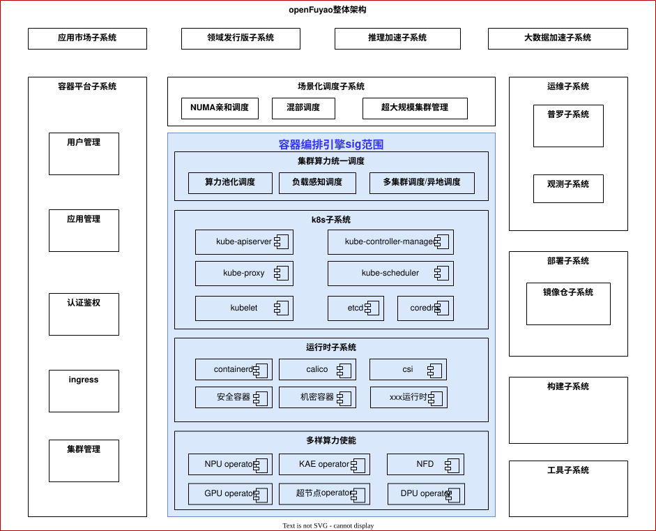

# orchestration-engine Sig
## sig简介
容器编排引擎sig作为openFuyao社区核心sig，致力于构建多样化集群的核心容器编排引擎组件，sig的架构图如下：

### 多样算力使能
主要负责对AI时代的多种算力资源进行使能，使其可以快速、自动、无缝地集成到生产系统中，且能高效地发挥算力。
- 代码仓及目录

### 运行时子系统

负责构建支持多种算力资源、匹配多种负载形态的运行时组件。
- 代码仓及目录

### K8s子系统

容器编排核心，基于上游社区组件，围绕算力使能、高效调度、高可用/安全等进行优化，满足生产级编排要求。
- 代码仓及目录
  - [kubernetes](https://gitcode.com/openFuyao/kubernetes)

### 集群算力统一调度

从集群层面构建算力池化（软切分/虚拟化）、智能感知调度（负载感知/算力感知/IO感知等）、多集群调度等能力，充分释放生产集群算力。
- 代码仓及目录

## RoadMap（2026/07/13更新）
| 规划组件 | 规划目标 | 发布计划 |
| ----- | ----- | ----- |
| ubs-k8s-enable | 负载调度增强，支持超节点场景基于数据采集与超节点拓扑构建，进行超节点粒度的拓扑感知调度能力。 | 26.09 |
| ub-ssu-csi | 支持UB超节点池化存储的CSI插件。 | 26.09 |
| pod-live-migration | 支持容器热迁移，支持容器热迁移，IP保持等能力，结合共享内存能力提升迁移效率，降低容器迁移时长，容器断服时长小于1s。 | 26.12（依赖openEuler） |
| serverlessdb-operator | 支持serverless化的DB池化管理，支持Agent场景下的数据库实例快速分发、连接地址不变。 | 26.09/26.12 |
| kubevirt | 支持ARM64场景下的容器虚机共管，支持高阶能力，如：大页管理、NUMA绑定、MemoryDump、磁盘热插拔、watchdog等能力。 | 26.12 |
| npu-dra-plugin | 支持昇腾NPU卡的DRA调度插件，支持NPU软切分，统一调度模式，支持指标监控等能力。 | 26.09/26.12 |
| many-core-orchestrator | 支持软硬件资源干扰检测策略与重调度框架，在保障 SLA<5% 前提下提升部署密度。 | 26.09/26.12 |

## sig活动

### 例会

公开会议时间：北京时间，双周二 14:15，请订阅<orchestration-engine@list.openfuyao.cn>，以获取会议通知。
可参考 <https://www.openfuyao.cn/zh/email/> 进行邮件订阅。

例会议题及纪要链接：<https://etherpad.openfuyao.cn/p/sig-orchestration-engine>

## sig成员

### Maintainer

### 主要Committer
  
## 联系方式
- 邮件：<orchestration-engine@list.openfuyao.cn>
- issue：<https://gitcode.com/openFuyao/sig-orchestration-engine/issues>

## 优化建议
openFuyao 增强提案（OFEP）用于对 SIG 的子项目进行优化或变更的管理和控制。

orchestration-engine sig的提案请参考<https://gitcode.com/openFuyao/ofep/tree/main/ofeps/sig-orchestration-engine>

请按照 [OFEP的模板](https://gitcode.com/openFuyao/ofep/blob/main/0000-ofep-template.md) 进行新提案。
