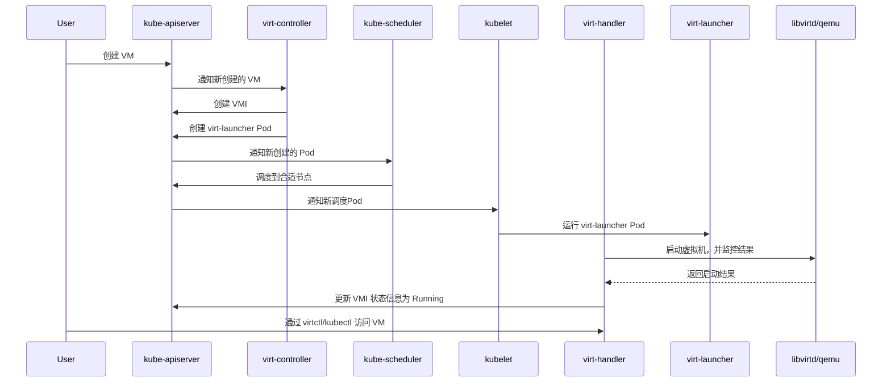
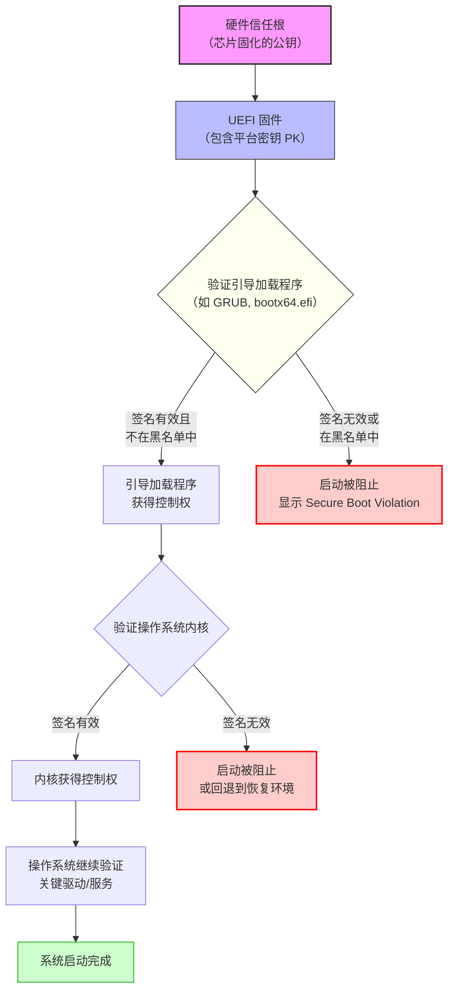
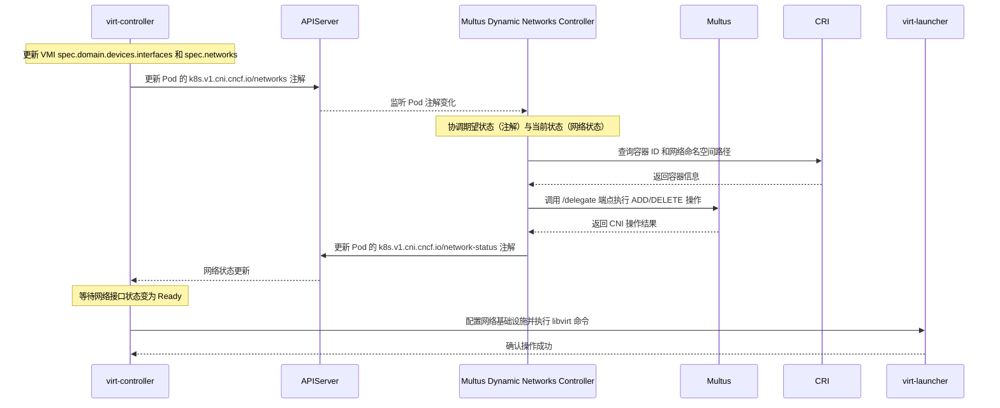
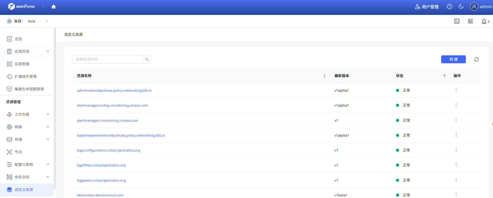
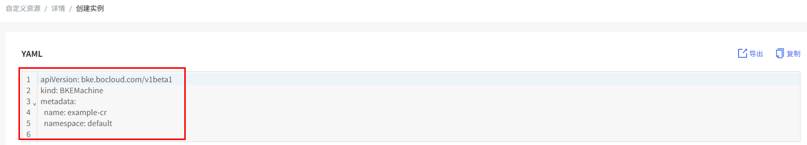
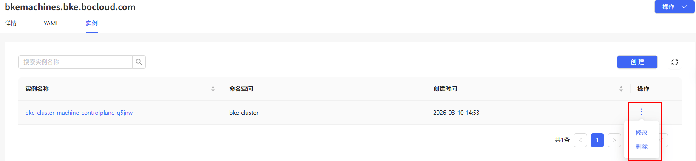
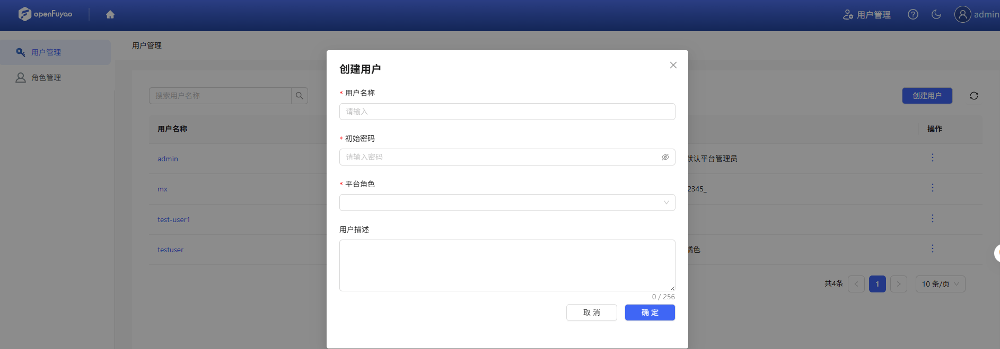
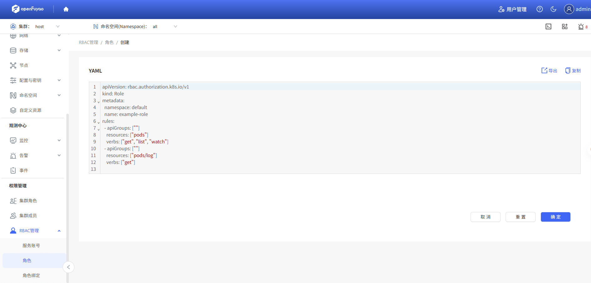
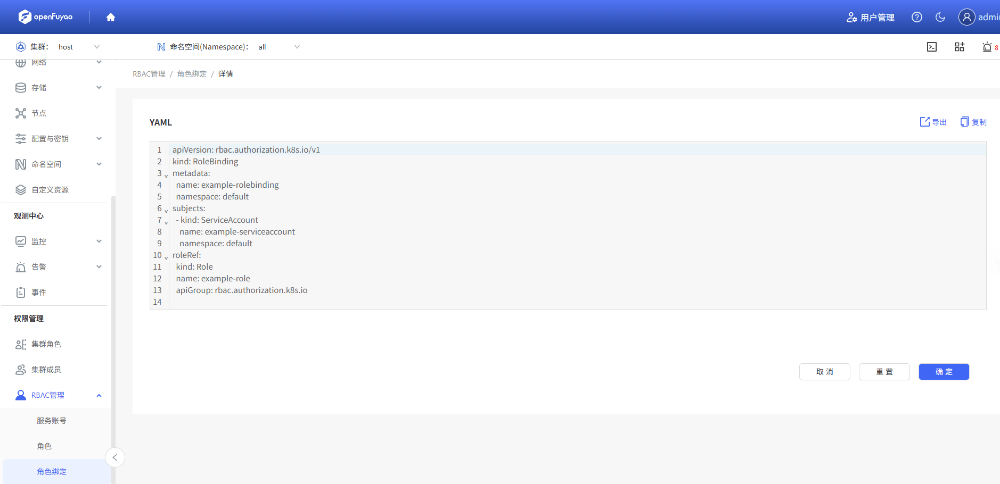

## Summary

KubeVirt 基于原生 K8s 的机制扩展，将 VM 和容器纳入统一的 K8s 声明式 API 和管理体系，能够让 VM 也享受到 K8s 的编排、调度和网络策略等能力，同时支持了虚拟机迁移、开关机等特性操作。我们期望在鲲鹏服务器上能够使用相关特性。


- 集群内部署：KubeVirt 由 virt-operator 安装与升级，主要包含 virt-controller、virt-api 和 virt-handler 组件，分别以 Deployment 和 DaemonSet 类型部署于 kubevirt 命名空间中，用户通过 kubectl 操作 VirtualMachine CRD，触发 KubeVirt 控制平面生成对应的 VMI 并调度运行。
- 引入了新的 CRD 资源，包含 VirtualMachine(VM)、VirtualMachineInstance(VMI) 和 VirtualMachineInstanceReplicaSet：
  - VirtualMachine 是高阶资源，可控制 VM 的开关机的配置变更；
  - VirtualMachineInstance 是代表实际运行的虚拟机；
  - VirtualMachineInstanceReplicaSet 类似于 Pod 的 ReplicaSet ，用于批量管理同构虚拟机实例。
- KubeVirt 实现了一组核心组件，包括 virt-api, virt-controller, virt-handler, virt-launcher 以及每个 VM Pod 内的 libvirtd/qemu 实例：
  - virt-api：作为 Kubernetes API 扩展入口，处理 VM 操作请求；提供 CRD，通过 aggregator 特性对外暴露虚机相关操作接口，如：restart、migrate、start、stop、freeze/unfreeze、softReboot、pause/unpause、console、vnc等
  - virt-controller：集群级控制器，监控 VM/VMI 状态并进行调谐，维护一致性；
  - virt-handler：以 DaemonSet 类型部署于每个节点，负责VMI生命周期操作；提供rest接口给 virt-api 调用，功能包含console、vnc、pause/unpause、freeze/unfreeze等功能，用于操作对应的虚拟机；
  - virt-launcher：运行在 Pod 内，包含轻量化的 libvirtd 和 qemu 进程，启动并管理 VM；并且会启动一个 grpc server，负责提供接口给 virt-handler 调用；
  - libvirtd/qemu：每个 VMI 对应一个 Pod，内含 libvirtd 和 qemu，负责虚拟机的实际运行；libvirt 封装 hypervisor的操作，并转化为对 qemu 的请求，qemu 依赖 KVM 和硬件虚拟化等相关特性。

创建与调度流程：


## Motivation

当前 KubeVirt 对 ARM64 硬件平台虚拟化支持的不够完善，需要针对性补齐并验证。KubeVirt 宣称对 ARM64 的支持大量使用 feature gate 控制，部分处于实验性状态，且对相当一部分关键虚拟化特性的支持是缺失的，关键原因是 KubeVirt 中集成的 QEMU-KVM 组件来源于 Red Hat，出于安全或其他因素考虑，将很多的设备支持以及特性裁剪掉，相关特性如下：
| FEATURE GATE | STATUS | NOTES | Needed |
| ----- | ----- | ----- | ----- |
| CPUManager | Supported | use taskset to do CPU pinning, do not support kvm-hint-dedicated (this is only works on x86 platform) |  |
| NUMAFeatureGate | **Not supported yet** | Need to support Hugepage on Arm64 | Y |
| IgnitionGate | Supported | This feature is only used for CoreOS/RhCOS |  |
| LiveMigrationGate | Supported | Verified live migration with masquerade network |  |
| SRIOVLiveMigrationGate | **Not verified** | Need two same Machine and SRIOV device | Y |
| HypervStrictCheckGate | **Not supported** | Hyperv does not work on Arm64 | N（windows） |
| SidecarGate | Supported |   |   |
| GPUGate | **Not verified** | Need GPU device | N（鲲鹏无相关诉求） |
| HostDevicesGate | **Not verified** | Need GPU or sound card | N（GPU，鲲鹏无相关诉求） |
| SnapshotGate | Supported | Need snapshotter support https://github.com/kubernetes-csi/external-snapshotter |  |
| VMExportGate | **Partially supported** | Need snapshotter support https://kubevirt.io/user-guide/operations/export_api/, support exporting pvc, not support exporting DataVolumes and MemoryDump which rely on CDI | Y |
| HotplugVolumesGate | **Not supported yet** | Rely on datavolume and CDI | Y |
| HostDiskGate | Supported |   |   |
| VirtIOFSGate | Supported |   |   |
| MacvtapGate | **Not supported yet** | quay.io/kubevirt/macvtap-cni not support Arm64, https://github.com/kubevirt/macvtap-cni#deployment | Y |
| PasstGate | Supported | VM have same ip with pods; start a process for network /usr/bin/passt --runas 107 -e -t 8080 |  |
| DownwardMetricsFeatureGate | **need more information** | It used to let guest get host information, failed on both Arm64 and x86_64. | N（X86和ARM均不支持） |
| NonRootDeprecated | Supported |   |   |
| NonRoot | Supported |   |   |
| Root | Supported |   |   |
| ClusterProfiler | Supported |  |  |
| WorkloadEncryptionSEV | **Not supported** | SEV is only available on x86_64 | N（AMD的技术，鲲鹏不支持） |
| VSOCKGate | Supported |   |   |
| HotplugNetworkIfacesGate | **Not supported yet** | Need to setup multus-cni and multus-dynamic-networks-controller: https://github.com/k8snetworkplumbingwg/multus-cni <br/> cat ./deployments/multus-daemonset-thick.yml \| kubectl apply -f -<br/>https://github.com/k8snetworkplumbingwg/multus-dynamic-networks-controller<br/> kubectl apply -f manifests/dynamic-networks-controller.yaml <br/><br/> Currently, the image ghcr.io/k8snetworkplumbingwg/multus-cni:snapshot-thick does not support Arm64 server. For more information please refer to https://github.com/k8snetworkplumbingwg/multus-cni/pull/1027. | Y |
| CommonInstancetypesDeploymentGate | **Not supported yet** | Support of common-instancetypes instancetypes needs to be tested, common-instancetypes preferences for ARM workloads are still missing| N（模板，偏好设置，根据特性看应该是部分能力可能有差异） |

libvirtd、qemu 作为用户态底层软件，针对不同的服务器和架构，需适配其硬件、驱动、虚拟化技术等。在鲲鹏场景，需要替换 KubeVirt 原生集成的 qemu 以适配鲲鹏运行环境的差异，并补齐 KubeVirt 当前在 X86 上已经支持但在 ARM64 上不支持的能力。

当前X86和ARM64架构中各能力项对比：

| 能力维度           | 具体功能项                       | x86_64                                                       | ARM64                                                        |      |
| :----------------- | :------------------------------- | :----------------------------------------------------------- | :----------------------------------------------------------- | ---- |
| **计算与硬件配置** | **启动固件 (BIOS/UEFI)**         | 支持传统BIOS和UEFI，且UEFI支持安全启动(Secure Boot)          | **仅支持UEFI**，**不支持**安全启动(Secure Boot)              | RP2  |
|                    | **CPU 模型**                     | 支持多种模型，如`host-passthrough`, `host-model`及一系列命名的CPU模型 | **仅支持 `host-passthrough`** 模式                           |      |
|                    | **HugePages**                    | 支持                                                         | **不支持**                                                   | RP3  |
|                    | **NUMA 绑定**                    | 支持                                                         | **不支持** (因依赖HugePages)                                 | RP3  |
|                    | **看门狗 (Watchdog)**            | 支持`i6300esb`等设备                                         | **不支持** (因 `i6300esb` 设备不可用)                        | RP3  |
| **存储挂载**       | **磁盘总线类型**                 | 支持`virtio`, `scsi`, `ide`等多种类型                        | **支持** (`virtio` 和 `scsi` 类型)                           |      |
|                    | **磁盘热插拔 (Hotplug Volumes)** | 支持                                                         | **不支持** (依赖于Containerized Data Importer (CDI) 的 ARM64 支持) | RP3  |
|                    | **块设备多队列**                 | 支持                                                         | **支持**（BlockMultiQueue）                                  |      |
|                    | **virtiofs**                     | 支持                                                         | **支持** (需启用特性门控)                                    |      |
|                    | **主机磁盘 (HostDisk)**          | 支持                                                         | **支持**                                                     |      |
| **网络功能**       | **自动挂载 Pod 网络**            | 支持                                                         | **支持**（AutoattachPodInterface）                           |      |
|                    | **网络多队列**                   | 支持                                                         | **支持**（NetworkInterfaceMultiQueue）                       |      |
|                    | **网络接口热插拔**               | 支持 (自 v1.4.0 起 GA，需Multus厚插件)                       | **不支持** (因 `Multus-cni` 厚插件无ARM64支持)               | RP2  |
|                    | **macvlan**                      | 支持 (通过 `macvtap-cni`)                                    | **不支持** (因 `macvtap-cni` 无ARM64支持)                    | RP2  |
|                    | **SR-IOV**                       | 支持                                                         | **未经验证** (Not verified)                                  | RP2  |
| **运维与管理**     | **实时迁移 (Live Migration)**    | 完全支持                                                     | **支持** (已验证基于`masquerade`网络的迁移场景)              | RP2  |
|                    | **SR-IOV 实时迁移**              | 支持                                                         | **未经验证** (Not verified)                                  | RP2  |
|                    | **快照 (Snapshot)**              | 支持磁盘快照，内存快照不支持                                 | 支持磁盘快照，内存快照不支持                                 |      |
|                    | **导出 API (Export API)**        | 完全支持 (支持PVC, DataVolume, 内存转储导出)                 | **部分支持** (仅支持导出PVC，不支持依赖CDI的DataVolume 和 MemoryDump) | RP3  |
|                    | **内存转储 (Memory Dump)**       | 支持                                                         | **不支持** (依赖CDI)                                         | RP3  |
|                    | **容器化数据导入器 (CDI)**       | 支持                                                         | **不支持**                                                   | RP3  |
|                    | **CPU Manager**                  | 支持                                                         | **支持** (通过`taskset`进行CPU pinning，不支持 kvm-hint-dedicated) |      |

### Goals  (目标)

KubeVirt 在鲲鹏节点上运行，支持 ARM64 虚拟化的基础生命周期管理能力
- 构建鲲鹏服务器可用的 KubeVirt 相关组件包；（RP1）
- 支持通过声明 CR 方式创建 ARM64 虚拟机，支持基础生命周期的管理（创建、删除、状态同步）；（RP1）
- 补齐高级虚拟化管理特性，包含：安全启动、网卡热插拔、支持macvlan、支持SR-IOV硬件直通及热迁移、虚机热迁移、openfuyao界面管理；（RP2）
- 结合鲲鹏硬件，构筑性能优势点，包含：watchdog、大页内存、NUMA 亲和、CDI支持、卷热插拔、内存Dump、导出API。（RP3）

### Non-Goals  (非目标，澄清特性范围)

## Proposal

### User Stories (Optional)

#### Story 1

集群管理员可以通过在鲲鹏服务器集群中安装 KubeVirt 相关组件来支持用户创建 ARM64 架构的虚拟机的能力。

#### Story 2

用户在鲲鹏服务器集群中通过声明 VirtualMachine，达到创建 ARM64 架构虚拟机的目的，虚拟机状态正常，并通过删除 CR 来删除虚拟机。

### Notes/Constraints/Caveats (Optional)

### Risks and Mitigations

## Design Details（设计细节）

### KubeVirt 在鲲鹏节点上运行
1. 构建鲲鹏服务器可用的 KubeVirt 组件包

   当前上游社区提供的 ARM64 架构场景的包可能不能满足鲲鹏场景的运行基础要求，主要由于不同的硬件服务器厂商对 qemu 有各自的适配点，因此需要构建基于鲲鹏的 libvirtd/qemu 组件。
   主要流程为：从鲲鹏社区获取对应版本的 libvirtd/qemu 组件，在 openFuyao 构建对应的完整镜像包，包含：virt-api、virt-controller、virt-handler、virt-launcher。

2. 验证 KubeVirt 基础生命周期管理能力

   - 使用 1 中构建的镜像在鲲鹏服务器集群中部署 KubeVirt；
   - 通过声明 VirtualMachine 资源来创建虚拟机；
   - 验证 Pod 状态与 VM 状态同步正常，Pod 调度正常；
   - 删除 VirtualMachine 资源，确认虚机可以正常删除。

### 高级虚拟化管理特性

#### 1、UEFI secure boot启动

Secure Boot（安全启动）是 **UEFI（统一可扩展固件接口）** 规范中的一个重要安全功能，旨在确保计算机在启动过程中仅运行受信任的软件，防止恶意软件在操作系统加载前被注入或篡改。



1. **硬件信任根**
   芯片内部固化的公钥是整个信任链的起点，用于验证 UEFI 固件的完整性（此步骤通常由硬件自动完成，对用户透明）。
2. **UEFI 固件验证引导加载程序**
   UEFI 使用**签名数据库（db）**和**禁止签名数据库（dbx）**对引导加载程序进行签名验证：
   - 若签名存在于 db 且不在 dbx 中，则允许执行。
   - 否则，阻止启动并提示安全违规。
3. **引导加载程序验证操作系统内核**
   引导加载程序（如 GRUB 或 Windows Boot Manager）会继续验证内核的签名，确保内核未被篡改。
4. **内核验证关键组件**
   操作系统内核启动后，可能还会验证核心驱动、安全策略等模块，最终完成系统启动。

openEuler已支持，详见关于[secure boot的启动方式](https://docs.openeuler.org/zh/docs/22.03_LTS_SP3/docs/Virtualization/%E7%AE%A1%E7%90%86%E8%99%9A%E6%8B%9F%E6%9C%BA.html#%E8%99%9A%E6%8B%9F%E6%9C%BA%E5%AE%89%E5%85%A8%E5%90%AF%E5%8A%A8)说明，且目前鲲鹏已经支持secure boot启动方式，详见[TaiShan 服务器 BIOS 参数参考(鲲鹏920处理器)](https://support.huawei.com/enterprise/zh/doc/EDOC1100088653/97a0d5a0?idPath=23710424|251364417|9856629|250697162)，**需要时切换virt-launcher中的qemu和libvirt版本后，进行完整功能验证**，软件可从[openeuler社区](https://easysoftware.openeuler.org/zh/field)进行获取。

kubevirt中需要实现相关能力：

- 添加鲲鹏安全启动相关参数与固件常量；
- 实现ARM64场景下的安全启动校验hook；
- 构建支持安全启动的virt-launcher镜像，替换qemu和libvirt。


主要验证点包含：

- 创建虚机指定安全启动后，内核启动日志中包含启用安全启动相关日志。


#### 2、网卡热插拔能力

为运行中的虚拟机添加网卡，从正在运行的虚拟机中删除网卡。

具体的实现就是给运行的Pod增加和删除网卡，通过增加注解`k8s.v1.cni.cncf.io/networks`，控制器监听Pod变化后，获取容器信息（容器ID和Net NS），最后调用CNI接口为容器增加网卡，具体流程如下：



这其中最重要的就是要CNI插件支持动态、按需的进行网卡的添加，因此对Multus-CNI做了重构，从薄插件重构为一个厚插件，增加了常驻控制器。

当前社区说明为multus-cni不支持ARM64导致[不支持热插拔](https://kubevirt.io/user-guide/cluster_admin/operations_on_Arm64/#hotplug-network-interfaces)，需要自行构建并进行验证。

kubevirt社区热插拔设计文档 https://github.com/kubevirt/community/blob/main/design-proposals/nic-hotplug/nic-hotplug.md

kubevirt社区issues：https://github.com/kubevirt/kubevirt/issues/9383

kubevirt社区网络热插拔用户指导：https://kubevirt.io/user-guide/network/hotplug_interfaces/

multus-cni社区其他贡献者已经做的支持thick plugin的pr：

https://github.com/k8snetworkplumbingwg/multus-cni/pull/1136

https://github.com/k8snetworkplumbingwg/multus-cni/pull/1027

**我们需要构建ARM64的Multus-cni thick plugin，来进行完整的网卡热插拔功能验证。**


主要验证点包含：

- 对正在运行的虚拟机的VM.yaml中增加网卡信息，虚拟机中的网卡会增加；

- 将正在运行的虚拟机的VM.yaml中的网卡信息的状态标记为absent，虚拟机中的网卡信息会删除。

  ```yaml
  spec:
    template:
      spec:
        domain:
          devices:
            interfaces:
              - name: hotplug
                bridge: {}
                state: "" # up/down/absent 
  ```

  

#### 3、macvlan

Macvlan 是一种高效的 Linux 网络虚拟化技术，允许在一个物理网络接口（即"父接口"）上创建多个虚拟网络接口（即"子接口"）。每个子接口都被分配一个独立的 MAC 地址，并可以像普通网卡一样配置 IP 地址进行通信。这些虚拟设备，在外部看来就是多个独立的物理设备。这种机制的核心优势在于性能。它绕过了传统的 Linux 网桥，数据包可以直接通过物理网卡收发，减少了网络栈的处理环节，从而降低了延迟，提高了吞吐量。在 KubeVirt 环境中，它主要用于让虚拟机直接接入宿主机的底层（Underlay）网络，以获得接近于物理机的网络性能。

macvtap CNI 包含一个设备插件，用于将 macvtap 接口暴露给Pod，由 Multus 这样的元插件会获取由设备插件分配的接口名称，并负责调用 CNI 插件时将该名称作为 deviceID 传递。

官方声明不支持ARM64的macvtap-cni，所以[不支持macvlan](https://kubevirt.io/user-guide/cluster_admin/feature_gate_status_on_Arm64/)，**需要构建ARM64版本的macvtap-cni能力进行验证**。

社区源码地址：https://github.com/kubevirt/macvtap-cni


主要验证点包含：

- CNI插件可正常部署，设备可正常上报与查看
- 设备可正常分配给Pod，且网络连通性正常
- macvtap类型的网络接口热插拔能力正常


#### 4、SR-IOV

Single Root I/O Virtualization，是一种让单个物理 PCIe 设备（比如网卡）在虚拟化环境中“分身”成多个独立设备的硬件规范；核心在于两种新类型：

- **物理功能 (Physical Function, PF)**：为主机提供设备（如网络）功能的 PCIe 功能，但也可以创建和管理一组 VF。每个具有 SR-IOV 功能的设备都有一个或多个 PF。
- **虚拟功能 (Virtual Function, VF)**：充当独立设备的轻量级 PCIe 功能。每个 VF 都是从 PF 中派生的，每个 VF 每次只能分配给一个虚拟机，但虚拟机可以分配多个 VF。

VM 将 VF 识别为虚拟设备。例如，由 SR-IOV 网络设备创建的 VF 显示为分配给虚拟机的网卡，其方式与主机系统上显示的物理网卡相同。

当虚拟机直接使用一个 VF 时，数据可以不经过宿主机复杂的软件模拟层（如 Linux 网桥、Open vSwitch），直接在虚拟机和物理网卡之间交换。这种绕过操作系统内核直接通信的方式，极大地降低了网络延迟，并减少了 CPU 的额外开销，实现了近乎物理机的性能。

```bash
[root@master /]# lspci | grep "Ethernet controller"
01:00.0 Ethernet controller: Mellanox Technologies MT27710 Family [ConnectX-4 Lx]
01:00.1 Ethernet controller: Mellanox Technologies MT27710 Family [ConnectX-4 Lx]
7d:00.0 Ethernet controller: Huawei Technologies Co., Ltd. HNS GE/10GE/25GE RDMA Network Controller (rev 21)
7d:00.1 Ethernet controller: Huawei Technologies Co., Ltd. HNS GE/10GE/25GE Network Controller (rev 21)
7d:00.2 Ethernet controller: Huawei Technologies Co., Ltd. HNS GE/10GE/25GE RDMA Network Controller (rev 21)
7d:00.3 Ethernet controller: Huawei Technologies Co., Ltd. HNS GE/10GE/25GE Network Controller (rev 21)
```


Kubevirt中明确在[ARM64架构中未验证相关能力](https://kubevirt.io/user-guide/cluster_admin/virtual_machines_on_Arm64/#sriov)，需要进行相关的验证，参考[官方的用户指导参考](https://kubevirt.io/user-guide/network/interfaces_and_networks/#sriov)。


#### 5、SR-IOV 实时迁移

理论上讲带有 SR-IOV 网络的虚拟机是可以进行实时迁移的，但由于 SR-IOV 设备是硬件直通的，迁移到新节点后，虚拟网络功能 (VF) 不会自动重新连接，需要手动干预，且业务会短暂中断。社区有特性门控`SRIOVLiveMigration`控制，主要验证有以下功能：

- 特性门控的功能正常；
- 静态配置传递：为了网络的恢复，需要虚机配置静态 IP 和 MAC，在迁移后不会变化；
- 在源节点上的VF设备要能被正常的清理和回收，可以分配给其他Pod；


#### 6、虚拟机热迁移

目前最新kubevirt官方已声明支持ARM64虚机热迁移，以及虚机暂停/恢复，快照等能力，需要在切换virt-launcher之后进行功能验证。

社区热迁移用户指导：https://kubevirt.io/user-guide/compute/live_migration/

StarlingX指导：https://static.opendev.org/project/starlingx.io/www/r/stx.10.0/kube-virt/live-migration-support-for-vms-bea635bacc50.html


#### 7、WatchDog

泰山服务器不支持i6300esb类型的watchdog，环境中目前已存在的watchdog类型为 `SBSA Generic Watchdog [version 0]`

代码中明确不支持ARM64架构下的Watchdog：

```go
func (converterARM64) ConvertWatchdog(source *v1.Watchdog, watchdog *api.Watchdog) error {
	return fmt.Errorf("watchdog is not supported on architecture ARM64")
}
```

需要实现以下功能：

- 新增ARM64中SBSA的定义；
- 实现virt-launcher中ARM64相关的转换器方法，支持SBSA WatchDog；
- 切换 openEuler 的qemu和libvirt版本后，进行完整功能验证，软件可从[openeuler社区](https://easysoftware.openeuler.org/zh/field)进行获取。


主要验证点包含：

- 使用yaml创建启动虚机后，使用watchdog命令测试验证watchdog 是否可以正常启动，异常后查看VM状态是否会发生变化


#### 8、支持界面管理虚机

##### 前台管理界面

用户不方便进行后台服务器操作，希望提供界面操作功能，支持VM的基础生命周期管理能力，包含：创建、删除、开机、关机、重启能力。

通过kubevirt能力管理的虚机，对于K8s是一种自定义资源，当前openFuyao容器平台的管理面支持对自定义资源的管理，该界面的数据来源于查询apiserver的customresourcedefinitions，我们只需要注册相关资源，在已有的能力上补充对VM的新的操作即可；



资源对应的页面展示风格和列不需要修改，保持当前风格和内容，需要补齐操作，因此我们需要实现如下能力：

1. 自定义资源页面支持管理新的virtualmachines.kubevirt.io资源，支持基础生命周期的管理操作；

2. VM创建：在virtualmachines.kubevirt.io/v1资源的实例中支持通过yaml格式资源创建（现有能力），需要补充模板示例；

   

   模板示例如下：

   ```yaml
   apiVersion: kubevirt.io/v1
   kind: VirtualMachine
   metadata:
     name: example-vm
     namespace: test-vm-ns 
   spec:
     running: false        # 初始状态为停止，创建后手动启动
     template:
       metadata:
         labels:
           kubevirt.io/domain: openeuler
       spec:
         domain:
           devices:
             disks:
               - name: rootfs
                 disk:
                   bus: virtio
               - name: cloudinit
                 disk:
                   bus: virtio
             interfaces:
               - name: default
                 bridge: {}
           resources:
             requests:
               memory: 1Gi
             limits:
               memory: 1Gi
         networks:
           - name: default
             pod: {}
         volumes:
           - name: rootfs
             containerDisk:
               image: openeuler2203-sp3:v1
               path: /disk/disk.qcow2        # 必须与 Dockerfile 中的路径一致
           - name: cloudinit
             cloudInitNoCloud:
               userData: |-
                 password: pwd
                 chpasswd: { expire: False }
                 ssh_pwauth: True
                 packages:
                   - nginx
                 runcmd:
                   - systemctl enable nginx
                   - systemctl start nginx
   ```

   

3. VM删除：实例展示列表操作列有删除操作项（已有能力）；

4. VM开机/关机/重启：需要在列表操作列增加相关操作，调用后台提供的接口；

   

##### 后台管理服务

需要提供管理VM的接口给前台调用，接口实现按照自定义资源通用逻辑实现即可；

接口列表如下：

```yaml
# 获取全量虚机实例
GET /clusters/host/api/kubernetes/apis/apiextensions.k8s.io/v1/customresourcedefinitions/virtualmachines.kubevirt.io

# 修改指定实例（开机/关机/重启）
PUT /clusters/host/api/kubernetes/apis/kubevirt.io/v1/namespaces/{namespace}/virtualmachines/{vm-name}

# 删除指定实例
DELETE /clusters/host/api/kubernetes/apis/kubevirt.io/v1/namespaces/{namespace}/virtualmachines/{vm-name}
```

后台服务需要转调apiserver进行资源的对应操作，并将对应的错误信息，如权限不足等，返回至前台。

##### 用户使用

VM生命周期管理涉及危险操作，需要在使用时配置相关权限，避免普通用户创建、删除VM，操作（开、关、重启）他人的VM；

管理员需要两步操作：

- 创建用户

  用户管理 -> 创建用户

  

- 创建授权

  权限管理 -> RBAC管理 -> 角色 -> 创建 -> 角色，创建只能操作具体VM的角色：

  

  示例如下：

  ```yaml
  apiVersion: rbac.authorization.k8s.io/v1
  kind: Role
  metadata:
    name: vm1-edit-role
    namespace: test-vm-ns            # vm1 所在的命名空间
  rules:
  - apiGroups: ["kubevirt.io"]
    resources: ["virtualmachines"]
    resourceNames: ["vm1"]           # 只能操作 vm1 这一个资源
    verbs: ["patch", "update"]       # 只有修改权限
  ```

  权限管理 -> RBAC管理 -> 角色绑定 -> 创建 -> 角色绑定，将只能操作具体VM的角色绑定给对应用户：

  

  示例如下：

  ```yaml
  apiVersion: rbac.authorization.k8s.io/v1
  kind: RoleBinding
  metadata:
    namespace: test-vm-ns            # 和 Role 的 namespace 一致
    name: test-vm1-binding
  subjects:
  - kind: User
    name: testuser                   # 与 Username 一致
    apiGroup: rbac.authorization.k8s.io
  roleRef:
    kind: Role
    name: vm1-edit-role              # 与 Role name 一致
    apiGroup: rbac.authorization.k8s.io
  ```


**测试用例**

- 通过界面创建虚拟机，虚拟机可以正常启动，状态正常
- 通过界面操作指定虚拟机进行关机，关机成功
- 通过界面操作指定虚拟机进行开机，开机成功
- 通过界面操作指定虚拟机进行重启，重启成功
- 通过界面操作删除指定虚拟机，删除成功
- 管理员创建多个用户和多个虚拟机，并进行授权，用户只能操作（开、关、重启）与自己相关的虚拟机，操作他人虚拟机将报错无权限

#### 9、支持虚机内存转储
目前 kubevirt 社区官网明确声明[在ARM64场景下不支持内存导出](https://kubevirt.io/user-guide/cluster_admin/operations_on_Arm64/#virtual-machine-memory-dump)；当前ARM64场景下 CDI 能力已经声明支持，但是社区未进行验证内存导出相关能力，因此我们需要进行验证。
此特性需要依赖 QEMU 的能力进行实际的内存导出，在OpenEuler社区的[qemu 8.2.0 版本](https://atomgit.com/openeuler/qemu/tree/qemu-8.2.0)中已支持此能力，配套[libvirt 9.10.0 版本](https://atomgit.com/openeuler/libvirt/tree/libvirt-9.10.0)，因此需要对virt-launcher
镜像中的qemu和libvirt版本进行替换后进行验证;可参考[社区方案](https://kubevirt.io/user-guide/compute/memory_dump/#virtual-machine-memory-dump)进行验证。

验证点：
- 使用 virtctl 可正常进行内存转储与文件下载，转储文件格式正确，大小符合预期，内容正确。


## Testcase

### Test Plan

#### 功能用例
- KubeVirt 相关组件镜像包为 ARM64 架构，且符合 OCI 标准规范；
- 集群部署 KubeVirt 成功，各 Pod 状态正常；
- 声明 VirtualMachine 资源，VM 被调度到指定节点，Pod状态正常，VM 状态正常；
- 删除 VirtualMachine 资源，VM 可被正常删除。


#### Prerequisite testing updates

## Production Readiness Review Questionnaire

### Feature Enablement and Rollback

#### Prerequisite testing updates

## Production Readiness Review Questionnaire

### Feature Enablement and Rollback

###### How can this feature be enabled / disabled in a live cluster?

不涉及

###### Does enabling the feature change any default behavior?

不涉及

###### Can the feature be disabled once it has been enabled (i.e. can we roll back the enablement)?

支持

###### What happens if we reenable the feature if it was previously rolled back?

支持

###### Are there any tests for feature enablement/disablement?

不涉及

### Rollout, Upgrade and Rollback Planning

###### How can a rollout or rollback fail? Can it impact already running workloads?

不涉及

###### What specific metrics should inform a rollback?

不涉及

###### Were upgrade and rollback tested? Was the upgrade->downgrade->upgrade path tested?

不涉及

###### Is the rollout accompanied by any deprecations and/or removals of features, APIs, fields of API types, flags, etc.?

不涉及

### Monitoring Requirements

###### How can an operator determine if the feature is in use by workloads?

不涉及

###### How can someone using this feature know that it is working for their instance?

不涉及

###### What are the reasonable SLOs (Service Level Objectives) for the enhancement?

不涉及

###### What are the SLIs (Service Level Indicators) an operator can use to determine the health of the service?

不涉及

###### Are there any missing metrics that would be useful to have to improve observability of this feature?

不涉及

### Dependencies

###### Does this feature depend on any specific services running in the cluster?

否

### Scalability

###### Will enabling / using this feature result in any new API calls?

不涉及

###### Will enabling / using this feature result in introducing new API types?

不涉及

###### Will enabling / using this feature result in any new calls to the cloud provider?

不涉及

###### Will enabling / using this feature result in increasing size or count of the existing API objects?

不涉及

###### Will enabling / using this feature result in increasing time taken by any operations covered by existing SLIs/SLOs?

不涉及

###### Will enabling / using this feature result in non-negligible increase of resource usage (CPU, RAM, disk, IO, ...) in any components?

不涉及

### Troubleshooting

###### How does this feature react if the API server and/or etcd is unavailable?

不涉及

###### What are other known failure modes?

不涉及

###### What steps should be taken if SLOs are not being met to determine the problem?

不涉及

## Implementation History

## Drawbacks　

不涉及

## Alternatives

不涉及

