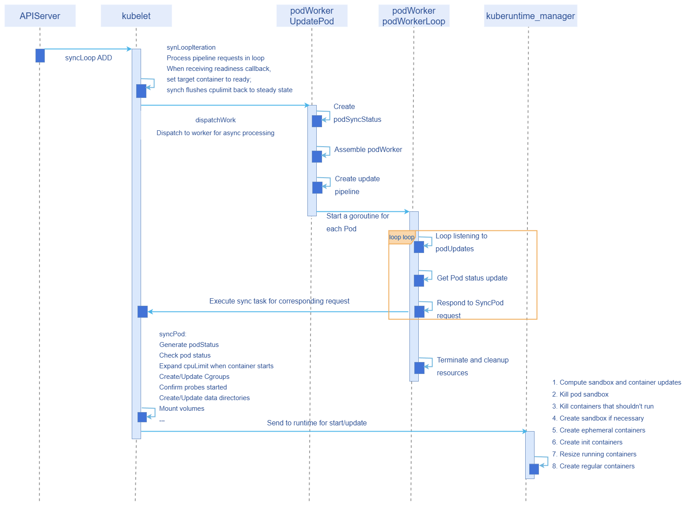

# CPU Acceleration During Container Startup

## Feature Introduction

The service startup phase consumes more CPU resources than the steady state. This feature aims to ensure minimal resource usage in the steady state while increasing startup speed to meet business requirements.

### Use Cases

- Enable the feature switch and correctly configure `resize.on.starting` at startup. When a Pod starts, it uses `ResizeLimit` as the CPU limit for startup; after startup the limit returns to the steady-state configured size.

- Enable the feature switch and correctly configure `resize.on.starting` at startup. After a container starts and is abnormally killed, when the container restarts it uses `ResizeLimit` as the CPU limit; after startup the limit returns to the steady-state configured size.

- Enable the feature switch and correctly configure `resize.on.starting` at startup. After a Pod starts and is abnormally killed, when the Pod restarts, the container uses `ResizeLimit` as the CPU limit; after startup the limit returns to the steady-state configured size.

### Supported Scope

Supports adjusting the CPU limit value at startup to enable startup acceleration; does not provide the ability to adjust memory limits at startup.

### Highlights

Programs such as Java consume more resources during the startup phase, with resources decreasing after startup completes. If resources configured at startup are too small, startup will take longer. This feature ensures both startup speed and reduced steady-state resource usage.

### Implementation Principle

#### Design Principles

- By default, native community capabilities are maintained; this feature switch is disabled by default.
- Modify native code as minimally as possible.
- Record basic request access information at minimum storage cost.

#### New Parameters

| Parameter          | Default Value | Description                    |
| ------------------ | ------------- | ------------------------------ |
| resize.on.starting | Empty string  | CPU limit at service startup   |

#### Process Overview

**Figure 1** CPU Acceleration During Container Startup Flow Chart



#### Implementation

1. First, validate whether the configured value is valid: it must be greater than the steady-state limit. If invalid, do not dynamically adjust the CPU value and record logs.
2. In the `SyncPod` method for processing Pods, based on the annotation configuration, patch the resource size of non-terminated Pod containers that are not in the ready state, then submit to the runtime for startup.
3. After successful startup, the probe result refreshes the Pod status. If the probe is OK, the container refreshes to ready state, and the native `syncCh` logic restores the steady-state CPU limit.
4. Each time a Pod is rebuilt or restarted, repeat the above operations.

### Relationship with Related Features

InPlacePodVerticalScaling: The startup resize capability depends on the `InPlacePodVerticalScaling` feature gate; only CPU limit adjustment during the startup phase is supported.

## Create a Pod and Verify CPU Acceleration During Startup

### Prerequisites

- The feature is disabled by default; whether to enable it is determined by the product.

- The startup resize capability depends on the `InPlacePodVerticalScaling` feature gate; only CPU limit adjustment during the startup phase is supported.

- Business must ensure the readiness probe succeeds only when the container is truly ready; the probe result is the sole basis for determining whether to reset resources to steady state.

- The Pod QoS level must not be Guaranteed.

### Background Information

You need to understand how to enable the `InPlacePodVerticalScaling` feature in `kube-apiserver` and `kubelet` components.

### Usage Restrictions

- At startup, `ResizeLimit` cannot be less than the steady-state CPU limit; if it is, the configuration takes no effect, and a log is recorded and printed.
- Enabling the feature during an upgrade will cause container restarts and service interruption; there is currently no capability to enable it during upgrades.
- Due to resource constraints, even if a scheduled Pod has its CPU limit adjusted, full acceleration may not always be achieved.

### Procedure

1. The startup resize capability depends on the `InPlacePodVerticalScaling` feature gate. Please enable the `InPlacePodVerticalScaling` feature gate for both `kubelet` and `kube-apiserver` components. Reference links:

   [kube-apiserver | Kubernetes](https://kubernetes.io/zh-cn/docs/reference/command-line-tools-reference/kube-apiserver/)

   [Feature Gates | Kubernetes](https://kubernetes.io/docs/reference/command-line-tools-reference/feature-gates/)

   Example:

   Add `InPlacePodVerticalScaling=true` to the feature-gates in the kube-apiserver configuration file, then run `kubectl delete pod -n {namespace} {api-server pod name}` to restart kube-apiserver.

   Add `InPlacePodVerticalScaling: true` to featureGates in the kubelet configuration file, then run `systemctl restart kubelet` to restart kubelet. Expected success output: `kubelet start success`.

2. When creating a workload (deployment, statefulset, etc.), configure the steady-state CPU request/limit in the resource field, and configure the CPU value required at startup for each container in the Pod metadata annotations.

   ```
   resize.on.starting: '[{"name":"container1", "cpu":"400m"},{"name":"container2", "cpu":"600m"}]'
   ```

   A correct deployment configuration example:

   ```yaml
   apiVersion: apps/v1
   kind: Deployment
   metadata:
     name: my-pod
   spec:
     replicas: 1
     selector:
       matchLabels:
         app: my-pod
     template:
       metadata:
         labels:
           app: my-pod
         annotations:
           resize.on.starting: '[{"name":"my-container", "cpu":"4"}]'        # Enable resize feature; multiple containers can be configured
       spec:
         restartPolicy: Always
         containers:
           - name: my-container
             image: registry.k8s.io/e2e-test-images/nginx:1.15-2
             resources:
               limits:
                 cpu: 300m
             ports:
               - containerPort: 80
             readinessProbe:
               httpGet:
                 path: /
                 port: 80
               initialDelaySeconds: 1
               periodSeconds: 10
               timeoutSeconds: 1
               failureThreshold: 3
   ```

3. Self-verification: Use the command `crictl inspect containerID |grep cpuQuota` to check the CPU consumed at container creation time and in steady state. At startup it should be the `resize.on.starting` configured size; in steady state it should be the `cpuLimit` configured size.
