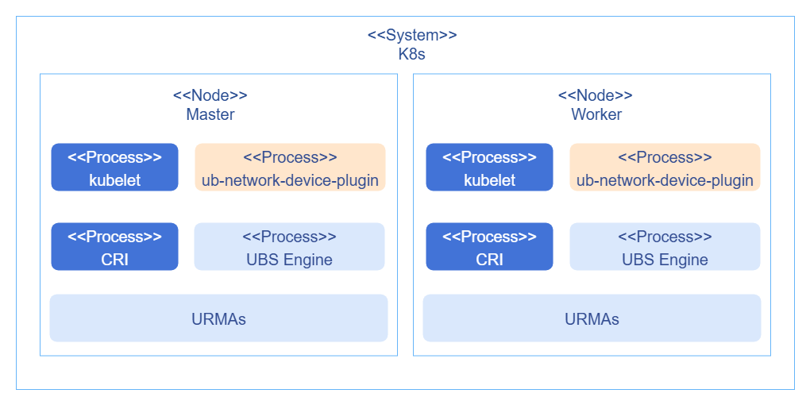
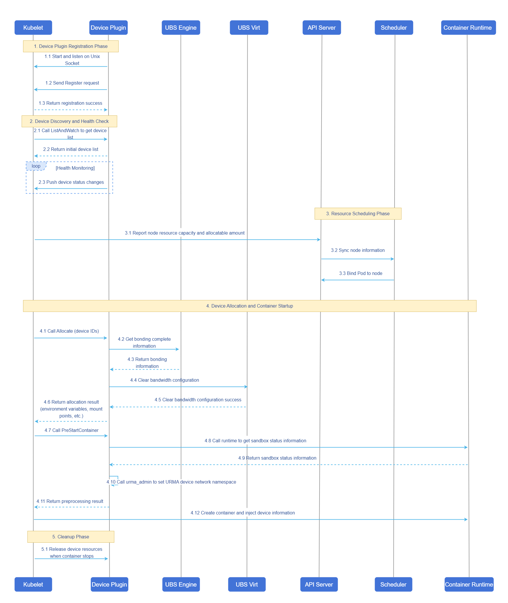

# Device Plugin Based on UB Container Network

## Feature Introduction

This feature aims to enable businesses to use URMA devices for communication, reduce communication latency, and improve business performance.

### Use Cases

In UB environments, businesses need to use URMA devices for communication. The Device Plugin is responsible for managing and allocating devices, interacting with kubelet, and modifying the device's network namespace to the container's namespace after allocation.

### Supported Scope

- Supports management and on-demand allocation of URMA devices.
- Supports setting the network namespace of URMA devices.

### Highlights

- Supports URMA device health monitoring in the environment.
- Enables businesses to use URMA devices for communication, reducing communication latency and improving business performance.

### Implementation Principle

#### Deployment View

A new `ub-network-device-plugin` component is added, deployed as a DaemonSet, and interacts with kubelet, the container runtime, and the ubs engine.

**Figure 1** Deployment View



#### Device Discovery and Allocation

The device plugin injection and device management part only needs to implement the standard device plugin interface. Since the network namespace needs to be modified in the `PreStartContainer` interface of the plugin, `PreStartContainer` must be specified during registration. Device information is already passed through the interface, and the mapping between devices and Pods is stored in the `/var/lib/kubelet/device-plugins/kubelet_internal_checkpoint` file on the current node after device allocation. You can match the corresponding Pod information based on the device information, obtain the network namespace via PodID, and then perform the namespace modification. After the Pod lifecycle ends, the corresponding network namespace is automatically released. When URMA detects that the corresponding network namespace has ended, it automatically cleans up the logical device and releases the EID externally, ensuring proper allocation of the network device next time.

#### Interaction Flow

**Figure 2** Interaction Flow



#### Setting the Network Namespace

To obtain the network namespace, you need to get the process ID of the Pod's Sandbox container (i.e., the ID of the pause process). In the Pod startup process, the Pod's Sandbox is created and started first, then the containers are created and started. Before starting the containers, kubelet calls the `PreStartContainer` interface; at this point the pause process has started and can be accessed. The process is as follows:

1. To obtain PodUID through the device ID, mount the kubelet deviceplugin directory as hostpath to `/var/lib/kubelet/device-plugins`, which is also the default content required to be mounted by deviceplugin.
2. Call the runtime via PodUID to get the corresponding Sandbox information, then get the Sandbox status information via SandboxID. The status information contains the pid; mount the container runtime communication socket file as hostpath. For containerd, the default is `/run/containerd/containerd.sock`. Example code:

   ```go
   import (
      "context"
      "fmt"
      "os"
      "time"

      "k8s.io/klog/v2"

      runtimeapi "k8s.io/cri-api/pkg/apis/runtime/v1"
      remote "k8s.io/cri-client/pkg"
      "k8s.io/kubelet/pkg/types"
   )

   func main() {
      logger := klog.Background()
      runtimeSockPath := "/run/containerd/containerd.sock"
      client, err := remote.NewRemoteRuntimeService(runtimeSockPath, 30 * time.Second, nil, &logger)
      if err != nil {
         // handle err
         return
      }
      podUid := os.Getenv("podUID")  // obtain according to actual situation
      filter := &runtimeapi.PodSandboxFilter{
         LabelSelector: map[string]string{types.KubernetesPodUIDLabel: podUid},
      }
      sandboxes, err := client.ListPodSandbox(context.Background(), filter)
      if err != nil {
         // handle err
         return
      }
      for _, sandbox := range sandboxes {
         status, err := client.PodSandboxStatus(context.Background(), sandbox.Id, true)
         if err != nil {
            // handle err
            return
         }
         // get pid from SandboxStatus.Info - info is a JSON string that needs to be parsed to get pid
         fmt.Println(status.Info["info"])
      }
   }
   ```

## Installation

### Prerequisites

- A Kubernetes cluster has been installed.
- UB capabilities are available.

### Installation Steps

1. Edit `ub-network-device-plugin.yaml` and set `Image` to: `openfuyao/ub-network-device-plugin:br_noncom_container_20260228`.

2. Run the following command to deploy the device plugin.

   ```bash
   kubectl apply -f ub-network-device-plugin.yaml
   ```

## Using URMA Devices

In containers, configure resources as shown in the following example. The supported device type is `ub_net_device`:

```yaml
...
spec:
  containers:
    resources:
      requests:
        cpu: "1"
        memory: "128Mi"
        unifiedbus.com/ub_net_device: "1"
      limits:
        cpu: "1"
        memory: "128Mi"
        unifiedbus.com/ub_net_device: "1"
...
```
