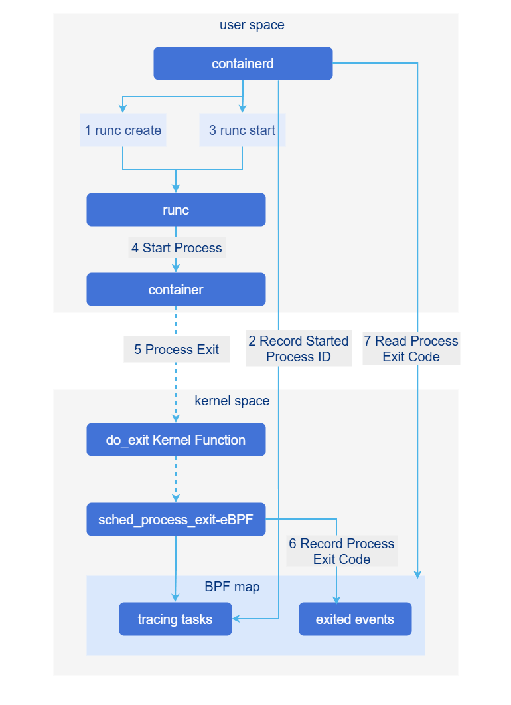

# High-Density Container Deployment

## Feature Introduction

When a large number of Pods are deployed on a worker node, the main issues include:

- `containerd` runtime creates a shim process for each Pod to handle Pod management and monitoring. When the number of Pods is large, shims consume a large amount of memory.

  The relationship between shim and containers is 1:1. The containerd container shim process is written in Go and consumes approximately 20 MB of memory. With 1000 Pods, approximately 20 GB of memory is consumed.

- The native kubelet probe mechanism (exec/http) consumes high CPU, and the probe failure rate also increases when there are many Pods.

  The native probe mechanism runs via the CRI interface. When there are very many containers, a large number of concurrent calls occur, generating high system noise and slowing system response.

- A large number of containers generates a large number of cgroups, causing degraded systemd management performance and reliability.

Therefore, optimizations and mitigations for the above issues are desired.

### Use Cases

- Configure lightweight probes correctly, with business periodically updating target files. When the probe detects a file update, the probe succeeds.

- Configure lightweight probes correctly, container startup fails and target files cannot be updated periodically. When the probe detects that the file update interval exceeds the configured value, the probe fails.

### Highlights

- Eliminate shim processes

  Implement shim functionality in containerd, using kernel eBPF technology to implement process exit monitoring, reducing the memory footprint of the container runtime.

- Build lightweight kubelet probes

  Replace message interaction/CRI interaction with low-cost methods such as file detection for kubelet probes, reducing CPU usage of the container runtime.

### Implementation Principle

#### Design Principles

1. By default, native community capabilities are maintained; this feature switch is disabled by default.
2. Modify native code as minimally as possible.
3. Record basic request access information at minimum storage cost.

#### New Parameters

| Parameter | Default Value | Description                                      |
| --------- | ------------- | ------------------------------------------------ |
| file      | Empty string  | Lightweight probe file.                          |
| path      | Empty string  | Location of the target file.                     |
| validity  | 0             | If modification time is within this value, probe succeeds; otherwise fails. |

#### Shimless Implementation

After `containerd` starts a process, it creates a `pidfd` to track the process exit event, and uses the `sched_process_exit` `eBPF` program to record the process exit code. Even if a container process exit event occurs during `containerd` restart, the kernel `eBPF` program does not exit. After `containerd` starts, it reads the exit code recorded by `eBPF` to identify process exit events that occurred during restart. The main process is:

- At startup of `containerd`, load the `eBPF` program `sched_process_exit` into the kernel.

- `containerd` starts the container via `runc`, records the process ID to `BPF map` `tracing_tasks`, and creates a `pidfd` to track process exit.

- After the container process exits, the `sched_process_exit` program records the process exit code to `exited_events` in `BPF map`.

- After `containerd` detects the process exit event via `pidfd`, it reads the process exit code from `exited_events` in `BPF map`.

**Figure 1** Shimless Implementation Flow Chart



Based on the new container exit detection mechanism, shim-related capabilities can be implemented using eBPF kernel capabilities, with other capabilities separated into containerd, thereby achieving the goal of eliminating shims.

#### How Lightweight Probes Work

1. The container process periodically updates the timestamp of the file at `file.path`.

2. The `kubelet` lightweight probe periodically checks the modification timestamp of the file at `file.path` according to the user-configured probe interval. If the file modification time is within `file.validity` of the current time, the probe succeeds; otherwise it fails. Other probe parameters have the same meaning and handling as other native probes.

### Relationship with Related Features

None.

## Create a Shimless Pod with a Lightweight Probe

### Prerequisites

- kernel version >= v5.4, kernel compilation option CONFIG_DEBUG_INFO_BTF=y. If using cgroup v2, kernel version 5.14 or above is recommended.

  Run the command `grep BTF /boot/config-$(uname -r)`, output:

  1. `CONFIG_DEBUG_INFO_BTF=y` means supported;

  2. `# CONFIG_DEBUG_INFO_BTF is not set` means not supported.

- Containers must correctly create probe files and continuously update them periodically.
- Modifying shimless configuration during system operation is not allowed, as this would cause shim and shimless to coexist.

### Background Information

You need to understand how to enable the `InPlacePodVerticalScaling` feature in `kube-apiserver` and `kubelet` components.

### Usage Restrictions

None.

### Procedure

#### Shim Process Elimination

1. Ensure containerd (replacement) and containerd-shim-shimless-v2 (new addition) are in the correct path, e.g., `/usr/local/bin/`.

2. Run `vi /etc/containerd/config.toml` to configure.

   ```
   Add the following configuration under [plugins."io.containerd.grpc.v1.cri".containerd.runtimes]:
   
     [plugins."io.containerd.grpc.v1.cri".containerd.runtimes.unified]
       base_runtime_spec = ""
       cni_conf_dir = ""
       cni_max_conf_num = 0
       container_annotations = []
       pod_annotations = []
       privileged_without_host_devices = false
       privileged_without_host_devices_all_devices_allowed = false
       runtime_engine = ""
       runtime_path = "/usr/local/bin/containerd-shim-shimless-v2"
       runtime_root = ""
       runtime_type = "io.containerd.runc.v2"
       sandbox_mode = "podsandbox"
       snapshotter = ""
   
       [plugins."io.containerd.grpc.v1.cri".containerd.runtimes.unified.options]
         BinaryName = ""
         CriuImagePath = ""
         CriuPath = ""
         CriuWorkPath = ""
         IoGid = 0
         IoUid = 0
         NoNewKeyring = false
         NoPivotRoot = false
         Root = ""
         ShimCgroup = ""
         SystemdCgroup = true
   ```
   
3. Modify containerd.service by adding the configuration item `LimitMEMLOCK=infinity` under the Service section.

4. Run `kubectl apply -f xxx.yaml` to create a RuntimeClass. The `xxx.yaml` reference example is as follows.

   ```
   kind: RuntimeClass
   apiVersion: node.k8s.io/v1
   metadata:
     name: unified
   handler: unified
   ```

5. Start the Pod by adding `runtimeClassName: unified` to the Pod spec to reference the RuntimeClass, as shown in the following example.

   ```
   apiVersion: apps/v1
   kind: Deployment
   metadata:
     name: shimless-pod
   spec:
     replicas: 10
     selector:
       matchLabels:
         app: shimless-pod
     template:
       metadata:
         labels:
           app: shimless-pod
       spec:
         restartPolicy: Always
         runtimeClassName: unified                                   # Reference RuntimeClass in Pod SPEC
         containers:
           - name: shimless-container
             image: registry.k8s.io/e2e-test-images/nginx:1.15-2
             resources:
               limits:
                 cpu: 300m
             ports:
               - containerPort: 80
             readinessProbe:
               httpGet:
                 path: /
                 port: 80
               initialDelaySeconds: 1
               periodSeconds: 1
               timeoutSeconds: 1
   ```

6. Verification: After creating shimless Pods, when 10 Pods are running normally, use the command `ps -ef|grep shim` to check and confirm that the number of shim processes has not increased.

#### Lightweight Probes

1. Mount an empty volume in the business Pod and create the target file in that empty volume.

2. The container needs to periodically update the target file to indicate that the container is alive.

3. Configure the lightweight probe, making sure the path matches the path under the empty volume. Example:

   ```
   apiVersion: v1 
   kind: Pod
   metadata:
     name: file-probe-success
   spec:
     nodeSelector:
       my-node: master
     containers:
     - name: container1
       image: registry.k8s.io/e2e-test-images/busybox:1.29-2
       command: ["/bin/sh", "-c"]
       args:
       - |
         mkdir -p /probe-dir;
         touch /probe-dir/probe;                 # Simulate periodic business update of target file
         while true; do                          # Simulate periodic business update of target file
           touch /probe-dir/probe;               # Simulate periodic business update of target file
           sleep 20;                             # Simulate periodic business update of target file
         done
       readinessProbe:
         file:                                   # Lightweight probe
           path: /probe-volume/probe             # Path to target file under empty volume
           validity: 30                          # Tolerated update interval: if the elapsed time since the last cycle is within 30 seconds at probe time, the probe succeeds; otherwise it fails
         initialDelaySeconds: 5
         periodSeconds: 10
         timeoutSeconds: 1
         failureThreshold: 3
       livenessProbe:
         file:                                   # file probe
           path: /probe-volume/probe             # Target path
           validity: 10                          # Tolerated update time difference
         initialDelaySeconds: 5
         periodSeconds: 10
         timeoutSeconds: 1
         failureThreshold: 3
       volumeMounts:
       - name: probe-volume
         mountPath: /probe-dir
     volumes:
     - name: probe-volume                        # Empty volume
       emptyDir: {}
   ```

4. After running `kubectl apply -f deploy.yaml` to create the Pod, the probes become ready normally.

### Related Operations

None.
