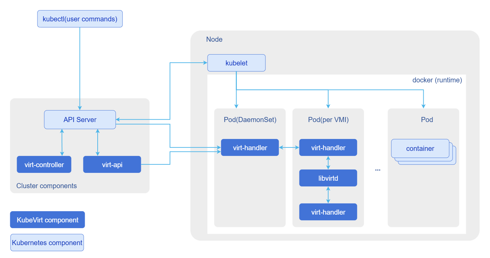
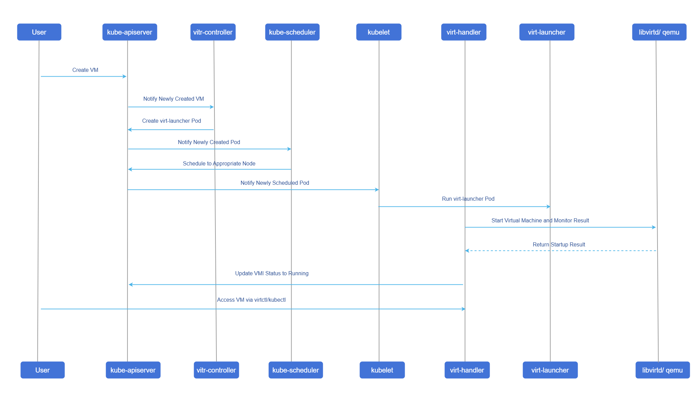
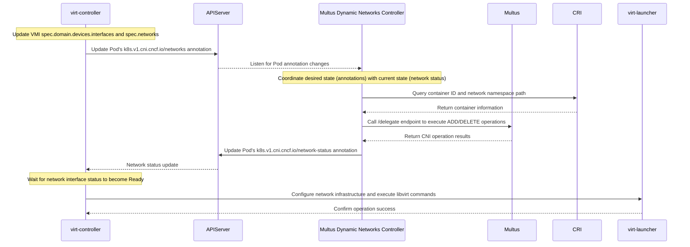

# KubeVirt
## Feature Introduction
KubeVirt is an open-source project sponsored by the Cloud Native Computing Foundation (CNCF) and serves as the core foundation of Red Hat OpenShift virtualization technology. It aims to seamlessly integrate traditional Virtual Machine (VM) workloads into the Kubernetes ecosystem.
Through KubeVirt, users can manage both containerized applications and traditional VMs within the same Kubernetes cluster. VMs are encapsulated in containers for execution, preserving the compatibility and isolation of traditional virtualization while leveraging cloud-native capabilities provided by Kubernetes, such as orchestration, scheduling, network policies, and declarative APIs. This enables enterprises to smoothly migrate and run legacy applications on a unified hybrid cloud platform.
## Application Scenarios
- Edge Computing: In edge computing scenarios, there are often both newly developed cloud-native applications and traditional services that are difficult to containerize. KubeVirt allows both types of workloads to run uniformly within an edge Kubernetes cluster. For example: IoT edge nodes can use KubeVirt to deploy VM-based legacy operating system services while allowing those services to share underlying network and storage resources with containerized microservices, reducing hardware costs and simplifying management.
- Hybrid Cloud and Private Cloud: KubeVirt enables Kubernetes to serve as a unified hybrid cloud control plane. By deploying a Kubernetes cluster integrated with KubeVirt on bare-metal servers, enterprises can achieve unified management, scheduling, and operations for both VMs and containers, breaking down the silos between virtualization and containerization.

## Capability Scope
- Architecture Support: Supports creating ARM64 architecture VMs through declarative CRD (Custom Resource Definition) approach.
- Lifecycle Management: Provides complete basic VM lifecycle management capabilities, including creation, deletion, startup, shutdown, and state synchronization.
- Kunpeng Adaptation: Supports running virtualization workloads on Kunpeng node environments.
- Declarative Deployment & Configuration: Supports declarative one-click deployment and parameterized configuration with unified images via Helm Chart, supporting both openFuyao official OCI artifact registry and traditional Helm repositories.
## Highlight Features
- ARM64 Native Support: Provides stable virtualization foundational capabilities on Kunpeng and other ARM64 servers.
- Unified Management: Brings VMs under the K8s management framework, enabling "deploy once, manage everywhere".
- Cloud-Native Feature Inheritance: VMs can reuse K8s network plugins (CNI), storage plugins (CSI), and scheduling policies.
- Helm Out-of-the-Box Delivery & Flexible Configuration: Provides enterprise-grade Helm Chart to deliver CRDs, RBAC permissions, Operator controller, and CR instance in one click, supporting flexible customization of software emulation, replica counts, image repositories, and live migration policies via values.yaml.
## Implementation Principle
KubeVirt manages VMs by extending the Kubernetes API. Its core components are deployed in the kubevirt namespace, as shown in Figure 1.

**Figure 1** KubeVirt Interaction View

### Core Components Description
KubeVirt introduces a set of new CRD resources and core controller components:
#### New CRD Resources
- VirtualMachine(VM): A high-level resource object used to define the desired state of a VM (such as running, stopped) and configuration changes. Similar to Deployment in K8s.
- VirtualMachineInstance(VMI): Represents an actually running VM instance. Similar to Pod in K8s, it is the basic unit for scheduling and execution.
- VirtualMachineInstanceReplicaSet: Similar to ReplicaSet for Pods, used for batch management and maintaining the quantity of homogeneous VM instances.
#### Core Runtime Components
- virt-api: Serves as the extension entry point for the Kubernetes API. It registers CRDs and exposes VM operation interfaces (such as start, stop, migrate, console, vnc, etc.) through the Aggregator mechanism, handling user REST requests.
- virt-controller: A cluster-level controller. It listens for changes in VM and VMI resources and is responsible for coordinating state consistency. For example, when a user creates a VM, it creates the corresponding VMI and virt-launcher Pod.
- virt-handler: Deployed as a DaemonSet on each compute node. Responsible for node-level VMI lifecycle operations (such as startup, shutdown, monitoring), and provides a local REST interface for virt-api to invoke for operations such as console connections.
- virt-launcher: Runs inside the Pod corresponding to each VMI. It is a lightweight container that contains libvirtd and qemu processes internally, responsible for actually starting and managing the VM. It also starts a gRPC server for virt-handler to communicate with and control it.
- libvirtd/qemu: Runs inside the virt-launcher Pod. libvirt encapsulates Hypervisor operation instructions and converts them into requests to qemu; qemu relies on the host's KVM module and hardware virtualization features to run VMs.
### Creation and Scheduling Flow
**Figure 2** Creation and Scheduling Flow

## Relationship with Related Features
- Privileged Mode Requirement: The Kubernetes API Server must be started with the `--allow-privileged=true` parameter to allow KubeVirt's privileged DaemonSet (virt-handler) to run.
- Hardware Requirements: Nodes must support hardware virtualization (Intel VT-x or AMD-V) and it must be enabled in BIOS. For ARM64 architecture, the corresponding virtualization extensions must be supported.
## Using KubeVirt
### Prerequisites
* Kubernetes Version: It is recommended to use the openFuyao community recommended version v1.34.3 or a compatible version.
* Helm Version: Recommended v3.8.0 or above.
* Install docker for building VM images
### Background Information
KubeVirt leverages Kubernetes native extension capabilities to implement unified access of VMs and containers to the K8s declarative management API. VMs can reuse cluster orchestration, scheduling, network policies and other capabilities, and support VM power on/off, hot migration, and other features; currently it needs to be adapted and deployed on Kunpeng server environments.
### Usage Limitations
Use hardware that supports virtualization.
### Operation Steps
1. Basic Environment Preparation

    1.1 Install Dependency Packages

    Execute the following command to install KVM (Kernel-based Virtual Machine) related dependencies on all nodes.
    ```
    yum install -y qemu-kvm libvirt virt-install bridge-utils
    ```
    1.2 Verify Virtualization Support
  
    Execute the following command to check whether the node meets virtualization conditions, ensuring all critical items display PASS:
    ```
    virt-host-validate qemu
    ```
   Expected output example:
    ```
   QEMU: Checking if device /dev/kvm exists                                   : PASS 
   QEMU: Checking if device /dev/vhost-net exists                             : PASS
   QEMU: Checking if device /dev/net/tun exists                               : PASS
   QEMU: Checking for cgroup 'cpu' controller support                         : PASS
   QEMU: Checking for cgroup 'cpuacct' controller support                     : PASS
   QEMU: Checking for cgroup 'cpuset' controller support                      : PASS
   QEMU: Checking for cgroup 'memory' controller support                      : PASS
   QEMU: Checking for cgroup 'devices' controller support                     : PASS
   QEMU: Checking for cgroup 'blkio' controller support                       : PASS
    ...
    ```
2. KubeVirt Deployment

    Supports deployment via Helm Chart (recommended) and native YAML deployment.

    2.1 Method 1: Deployment via Helm (Recommended)

    openFuyao provides a unified container image and standard declarative Helm Chart, supporting out-of-the-box installation and centralized parameter management.

    2.1.1 Deployment Options

    - Option 1: One-Click Installation via openFuyao Public OCI Registry (Recommended)

    Deploy directly online via Helm client without downloading local Chart files:
    ```
    helm install kubevirt oci://cr.openfuyao.cn/charts/kubevirt \
      --version 0.0.0-of-dev-v1.7.1 \
      --namespace kubevirt \
      --create-namespace
    ```

    - Option 2: Installation via Official openFuyao Community Helm Repository

    ```
    # Add openFuyao community development repository
    helm repo add openfuyao-dev https://helm.openfuyao.cn/_dev
    helm repo update

    # Install KubeVirt
    helm install kubevirt openfuyao-dev/kubevirt \
      --version 0.0.0-of-dev-v1.7.1 \
      --namespace kubevirt \
      --create-namespace
    ```

    - Option 3: Pull Chart Locally for Custom Parameter Installation

    For offline deployment or customized configurations:
    ```
    # Pull and unpack Chart
    helm pull oci://cr.openfuyao.cn/charts/kubevirt --version 0.0.0-of-dev-v1.7.1 --untar

    # Modify ./kubevirt/values.yaml and execute local installation
    helm install kubevirt ./kubevirt -n kubevirt --create-namespace
    ```

    2.1.2 Custom Parameter Configuration

    When deploying via Helm, core components and runtime parameters can be flexibly configured using `--set key=value` or custom `values.yaml` files.

    **Table 1** Helm Core Configuration Parameters

    | Parameter | Type | Default | Description |
    | :--- | :--- | :--- | :--- |
    | `image.repository` | string | `cr.openfuyao.cn/openfuyao/kubevirt` | Unified container image repository for all KubeVirt components |
    | `image.tag` | string | `of-dev-v1.7.1` | Image version tag |
    | `image.pullPolicy` | string | `IfNotPresent` | Image pull policy (`IfNotPresent` / `Always`) |
    | `global.imagePullSecrets` | list | `[]` | Secret list for private registry credentials |
    | `operator.replicaCount` | int | `2` | Number of high-availability replicas for `virt-operator` |
    | `operator.resources` | object | `requests: { cpu: 10m, memory: 450Mi }` | Minimum resource requests for Operator controller |
    | `kubevirt.create` | bool | `true` | Whether to automatically create `KubeVirt` CR instance upon Chart installation |
    | `kubevirt.useEmulation` | bool | `true` | Whether to enable QEMU software emulation (must be set to `true` if KVM hardware acceleration is unavailable) |
    | `kubevirt.featureGates` | list | `[LiveMigration, Snapshot, HotplugVolumes, DataVolumes, Sidecars, GPU, VGPU]` | List of enabled KubeVirt feature gates |
    | `kubevirt.configuration.migrations` | object | `{}` | Advanced VM live migration policy parameters (e.g. auto-converge, completion timeout, parallelism) |

    Typical Scenario Configuration Examples:

    - Scenario 1: Nodes without hardware virtualization (Enable QEMU software emulation, recommended for dev/test)
    ```
    helm install kubevirt oci://cr.openfuyao.cn/charts/kubevirt \
      --version 0.0.0-of-dev-v1.7.1 \
      -n kubevirt --create-namespace \
      --set kubevirt.useEmulation=true
    ```

    - Scenario 2: Bare-metal production environment (Full hardware acceleration, enable migration auto-converge and parallelism tuning)
    ```
    helm install kubevirt oci://cr.openfuyao.cn/charts/kubevirt \
      --version 0.0.0-of-dev-v1.7.1 \
      -n kubevirt --create-namespace \
      --set kubevirt.useEmulation=false \
      --set kubevirt.configuration.migrations.allowAutoConverge=true \
      --set kubevirt.configuration.migrations.parallelMigrationsPerCluster=5
    ```

    - Scenario 3: Offline environment with private Harbor registry replacement
    ```
    helm install kubevirt oci://cr.openfuyao.cn/charts/kubevirt \
      --version 0.0.0-of-dev-v1.7.1 \
      -n kubevirt --create-namespace \
      --set image.repository="harbor.mycompany.local/openfuyao/kubevirt" \
      --set image.tag="v1.7.1"
    ```

    2.2 Method 2: Deployment via Native YAML

    Execute the following command to download the virt-operator configuration file and apply it:
    ```
    # Download KubeVirt 1.7.1 official Operator deployment file
    wget https://github.com/kubevirt/kubevirt/releases/download/v1.7.1/kubevirt-operator.yaml
    # Deploy KubeVirt Operator in Kubernetes cluster
    kubectl apply -f kubevirt-operator.yaml
    ```

    Create a kubevirt-cr.yaml file to define the KubeVirt instance:
    ```yaml
    # KubeVirt Custom Resource Definition (CRD) configuration file
    # For deploying and configuring KubeVirt virtualization components in Kubernetes cluster
    apiVersion: kubevirt.io/v1
    kind: KubeVirt
    metadata:
      name: kubevirt
      namespace: kubevirt
    spec:
      certificateRotateStrategy: {}
      configuration:
        developerConfiguration:
          useEmulation: false
          featureGates: []
      customizeComponents: {}
      imagePullPolicy: IfNotPresent
      workloadUpdateStrategy: {}
    ```
    Execute the following command to apply the configuration:
    ```
    kubectl apply -f kubevirt-cr.yaml   
    ```

    2.3 Verify Deployment Status

    Execute the following commands to verify component and reconciliation status across all levels:

    - Check Helm Release status (if deployed via Helm):
    ```
    helm list -n kubevirt
    ```
    Expected output shows `STATUS` as `deployed`.

    - Check KubeVirt custom resource reconciliation status:
    ```
    kubectl get kubevirt -n kubevirt
    ```
    Expected output shows `PHASE` as `Deployed`, indicating components and certificate initialization are complete.

    - Check control plane and daemon Pod status:
    ```
    kubectl get pods -n kubevirt -o wide
    ```
    When virt-operator, virt-api, virt-controller, and node virt-handlers are all in `Running` status with `Ready` probes, deployment is normal.

    - Check CRD registration status:
    ```
    kubectl get crd | grep kubevirt.io | wc -l
    ```
    Expected output is `17`, indicating that all virtualization CRDs are registered.

    2.4 Install virtctl Client

    virtctl is a dedicated command-line tool for managing KubeVirt VMs. Execute the following command to install virtctl:
    ```
    # Download the ARM64 version
    wget https://github.com/kubevirt/kubevirt/releases/download/v1.7.1/virtctl-v1.7.1-linux-arm64
    
    # Rename and move to path
    mv virtctl-v1.7.1-linux-arm64 /usr/local/bin/virtctl
    chmod +x /usr/local/bin/virtctl
    
    # Verify version
    virtctl version
    ```
    Output of version information with Platform displayed as Linux/arm64 indicates successful deployment.

    2.5 Uninstallation and Cleanup (Optional)

    To uninstall KubeVirt from the cluster, gracefully shut down virtual machines, remove the KubeVirt CR, and uninstall controller components in sequence.

    >  **Note:**<br />
    > Ensure all workload VMs are gracefully shut down and stopped before uninstallation. Deleting VMs is irreversible; please verify carefully before proceeding.

    Execute the following commands to perform uninstallation and cleanup:

    1. Shut down and delete running virtual machines:
    ```
    # Stop running virtual machines and verify exit
    virtctl stop <vm-name>

    # Delete virtual machine resources after verifying they are stopped
    kubectl delete vm <vm-name>
    ```

    2. Remove KubeVirt custom resource (CR) (Required for both Helm and YAML deployments):
    ```
    kubectl delete kubevirt kubevirt -n kubevirt
    ```
    After deleting the KubeVirt CR, the Operator automatically reclaims and cleans up the core components it manages (virt-api, virt-controller, virt-handler, etc.).

    3. Uninstall controller components:
    - If deployed via Helm, uninstall the Helm Release:
    ```
    helm uninstall kubevirt -n kubevirt
    ```
    - If deployed via native YAML, delete the Operator:
    ```
    kubectl delete -f kubevirt-operator.yaml
    ```

    4. Clean up residual Webhooks and CRDs (for complete environment cleanup):
    ```
    kubectl delete validatingwebhookconfiguration virt-operator-validator virt-api-validator --ignore-not-found=true
    kubectl delete mutatingwebhookconfiguration virt-api-mutator --ignore-not-found=true
    kubectl get crd -o name | grep kubevirt | xargs -r kubectl delete
    ```
3. Build KubeVirt Image

    3.1 Execute the following command to prepare the disk file
    ```
    wget https://dl-cdn.openeuler.openatom.cn/openEuler-22.03-LTS-SP3/virtual_machine_img/aarch64/openEuler-22.03-LTS-SP3-aarch64.qcow2.xz
    xz -d openEuler-22.03-LTS-SP3-aarch64.qcow2.xz
    ```
    3.2 Write Dockerfile

    Create a Dockerfile to package the qcow2 image into a container:
    ```
    FROM openeuler/openeuler:22.03
    ADD openEuler-22.03-LTS-SP3-aarch64.qcow2 /disk/disk.qcow2
    RUN chmod 644 /disk/disk.qcow2     
    ```

   >  **Note:**<br />
   >
   >  The path here must be consistent with the path defined in oe-vm.yaml in step 4.1.
   >
    3.3 Build and Export Image

    Execute the following command to build and export the image
    ```
    # Build image
    docker build -t openeuler2203-sp3:v1 .
    
    # Export image as tar package
    docker save -o openeuler.tar openeuler2203-sp3:v1
    ```

    3.4 Import Image to Container Runtime

    Execute the following command to import the image into the container runtime used by Kubernetes (using containerd as an example here):
    ```
    ctr -n k8s.io image import openeuler.tar
    ```
4. Create and Run openEuler VM

    4.1. Prepare VM Definition File (oe-vm.yaml)
    ```
    apiVersion: kubevirt.io/v1
    kind: VirtualMachine
    metadata:
      name: openeuler-vm
    spec:
      running: false  # Initial state is stopped, manually start after creation
      template:
        metadata:
          labels:
            kubevirt.io/domain: openeuler
        spec:
          domain:
            devices:
              disks:
                - name: rootfs
                  disk:
                    bus: virtio
                - name: cloudinit
                  disk:
                    bus: virtio
              interfaces:
                - name: default
                  bridge: {}
            resources:
              requests:
                memory: 1Gi
              limits:
                memory: 1Gi
          networks:
            - name: default
              pod: {}
          volumes:
            - name: rootfs
              containerDisk:
                image: openeuler2203-sp3:v1
                path: /disk/disk.qcow2  # Must be consistent with the path in Dockerfile
            - name: cloudinit
              cloudInitNoCloud:
                userData: |-
                  password: openEuler12#$
                  chpasswd: { expire: False }
                  ssh_pwauth: True
                  packages:
                    - nginx
                  runcmd:
                    - systemctl enable nginx
                    - systemctl start nginx
    ```
    4.2 Create and Start VM

    Execute the following command to create and start the VM
    ```
    # Create VM resource
    kubectl apply -f oe-vm.yaml
    
    # View status (should be Stopped at this point)
    kubectl get vms
    
    # Start the VM
    virtctl start openeuler-vm
    
    # View status again, wait until it becomes Running
    kubectl get vms
    ```
    4.3 Connect to VM
    The VM supports two login methods: `virtctl console (serial port)` and `SSH`.
    openEuler image default login account: `root`, default password: `openEuler12#$`
    - Method 1: Execute the following command to connect to the VM using virtctl console (serial port connection)
    ```
    virtctl console openeuler-vm
    ```
    The following result indicates successful connection to the VM:
    ```
    [root@master ~]# virtctl console openeuler
    Successfully connected to openeuler console. Press Ctrl+] or Ctrl+5 to exit console.
        
    openeuler login: root
    Password:
    Last login: Thu Mar  5 09:02:51 from 76.3.165.18 
        
    Welcome to 5.10.0-182.0.0.95.oe2203sp3.aarch64
    
    System information as of time:  Thu Mar  5 08:23:47 AM UTC 2026
    
    System load:    0.00
    Processes:      93
    Memory used:    10.2%    
    Swap used:      0.0%
    Usage On:       4%
    IP address:     172.27.205.169
    Users online:   1        
    ```
    - Method 2: Connect using SSH

    Execute the following command to obtain the VM IP address:
    ```
    kubectl get vmi openeuler-vm -o jsonpath='{.status.interfaces[0].ipAddress}'
    ```
    The following result indicates successful connection to the VM
    ```
    ......
    Welcome to 5.10.0-182.0.0.95.oe2203sp3.aarch64
    
    System information as of time:  Thu Mar  5 08:23:47 AM UTC 2026
    
    System load:    0.00
    Processes:      93
    Memory used:    10.2%    
    Swap used:      0.0%
    Usage On:       4%
    IP address:     172.27.205.169
    Users online:   1        
    ```
    4.4 Stop VM

    Execute the following command to stop the VM
    ```
    virtctl stop openeuler-vm
    ```
## Using Advanced VM Management Capabilities

KubeVirt runs on Kunpeng nodes and supports ARM64 virtualization advanced VM management features, including: NIC hot-plug, macvlan support, SR-IOV hardware passthrough and hot migration, VM hot migration, etc.

### NIC Hot-Plug Capability

#### Background Introduction

Add NICs to a running VM, or remove NICs from a running VM.

The specific implementation is to add and remove NICs from a running Pod. By adding the annotation `k8s.v1.cni.cncf.io/networks`, the controller listens for Pod changes, obtains container information (container ID and Net NS), and finally calls the CNI interface to add NICs for the container. The specific flow is as follows:



For the KubeVirt community network hot-plug user guide, please refer to [KubeVirt Network Hot-Plug User Guide](https://kubevirt.io/user-guide/network/hotplug_interfaces).

#### Prerequisites

Deploy `Multus-cni thick plugin` and `Multus Dynamic Networks Controller`

```shell
wget https://github.com/k8snetworkplumbingwg/multus-cni/blob/master/deployments/multus-daemonset-thick.yml
kubectl apply -f multus-daemonset-thick.yml
# The image used is ghcr.io/k8snetworkplumbingwg/multus-cni:snapshot-thick

wget https://github.com/k8snetworkplumbingwg/multus-dynamic-networks-controller/blob/main/manifests/dynamic-networks-controller.yaml
# The image in this yaml is ghcr.io/k8snetworkplumbingwg/multus-dynamic-networks-controller:latest-amd64
# Modify the image to ghcr.io/k8snetworkplumbingwg/multus-dynamic-networks-controller:latest
kubectl apply -f dynamic-networks-controller.yaml
```

#### Usage Limitations

- Currently, hot-plug is only supported for interfaces using the `virtio` model and connected via `bridge` binding or `SR-IOV` binding.
- Currently, hot-unplug is only supported for interfaces connected via `bridge` binding.

#### Operation Steps

1. Create a new `NetworkAttachmentDefinition` in the cluster.
   ```yaml
   apiVersion: k8s.cni.cncf.io/v1
   kind: NetworkAttachmentDefinition
   metadata:
     name: new-fancy-net
   spec:
       config: '{
         "cniVersion": "0.3.1",
         "type": "bridge",
         "mtu": 1300,
         "name":"new-fancy-net"
       }'
   ```
2. Deploy VM and start VM to running state.
   ```yaml
   # Original VM
   apiVersion: kubevirt.io/v1
   kind: VirtualMachine
   metadata:
     name: vm-hotplug
   spec:
     running: false  # Initial state is stopped, manually start after creation
     template:
       metadata:
         labels:
           kubevirt.io/domain: openeuler
       spec:
         domain:
           devices:
             disks:
               - name: rootfs
                 disk:
                   bus: virtio
               - name: cloudinit
                 disk:
                   bus: virtio
             interfaces:
               - name: default
                 masquerade: {}
         resources:
           requests:
             memory: 1Gi
           limits:
             memory: 1Gi
     networks:
       - name: default
         pod: {}
     volumes:
       - name: rootfs
         containerDisk:
           image: openeuler2203-sp3-test:v5
           path: /disk/disk.qcow2  # Must be consistent with the path in Dockerfile
       - name: cloudinit
         cloudInitNoCloud:
           userData: |-
             password: openEuler12#$
             chpasswd: { expire: False }
             ssh_pwauth: True
             packages:
               - nginx
             runcmd:
               - systemctl enable nginx
               - systemctl start nginx
   ```
3. Add NIC.

   `kubectl edit vm vm-hotplug` to add a NIC, update the VM's `spec.domain.devices.interfaces` and `spec.networks` as follows:
   ```yaml
       spec:
         domain:
           devices:
             disks:
               - name: rootfs
                 disk:
                   bus: virtio
               - name: cloudinit
                 disk:
                   bus: virtio
             interfaces:
               - name: default
                 masquerade: {}
                 # new interface
               - name: dyniface1
                 bridge: {}
           resources:
             requests:
               memory: 1Gi
             limits:
               memory: 1Gi
         networks:
           - name: default
             pod: {}
             # new network
           - name: dyniface1
             multus:
               networkName: new-fancy-net
   ```
   Check whether the VM's network interface has been added successfully:
   - The annotations in the `virt-launcher` Pod are updated, showing the new NIC configuration.
   - The new NIC appears in the `vmi`'s `.status.interfaces`.
   - A new NIC appears in the VM.

 4. Remove NIC.

   `kubectl edit vm vm-hotplug` to remove a NIC, update the corresponding NIC state in the VM's `spec.domain.devices.interfaces` to **absent**.
   ```yaml
       spec:
         domain:
           devices:
             disks:
               - name: rootfs
                 disk:
                   bus: virtio
               - name: cloudinit
                 disk:
                   bus: virtio
             interfaces:
               - name: default
                 masquerade: {}
                 # set the interface state to absent 
               - name: dyniface1
                 bridge: {}
                 state: absent
           resources:
             requests:
               memory: 1Gi
             limits:
               memory: 1Gi
         networks:
           - name: default
             pod: {}
           - name: dyniface1
             multus:
             networkName: new-fancy-net
   ```
   Check whether the VM's network interface has been removed successfully:
   - The annotations in the `virt-launcher` Pod are updated, the NIC is removed.
   - The NIC is removed from the `vmi`'s `.status.interfaces`.
   - The NIC is removed from the VM.

### macvlan

#### Background Introduction

Macvlan is an efficient Linux network virtualization technology that allows multiple virtual network interfaces (i.e., "child interfaces") to be created on a single physical network interface (i.e., "parent interface"). Each child interface is assigned an independent MAC address and can be configured with an IP address for communication like a regular NIC. These virtual devices appear as multiple independent physical devices from the outside. The core advantage of this mechanism lies in performance. It bypasses the traditional Linux bridge, allowing data packets to be sent and received directly through the physical NIC, reducing the processing steps in the network stack, thereby lowering latency and increasing throughput. In the KubeVirt environment, it is primarily used to allow VMs to directly access the host's Underlay network, achieving network performance close to that of a physical machine.

macvtap CNI includes a device plugin that exposes macvtap interfaces to Pods. A meta-plugin like Multus obtains the interface name assigned by the device plugin and passes it as deviceID when calling the CNI plugin.

#### Usage Limitations

macvtap type network interfaces do not support hot-plug capability.

#### Prerequisites

Create macvtap CNI configuration.

```yaml
# The theoretical upper limit of virtual device quantity is 1 million, recommended configuration is within 200
kind: ConfigMap
apiVersion: v1
metadata:
  name: macvtap-deviceplugin-config
data:
  DP_MACVTAP_CONF: |
    [ {
        "name" : "dataplane",
        "lowerDevice" : "enp1s0f0np0",
        "mode": "bridge",
        "capacity" : 20
    } ]
```

Deploy `macvtap CNI`.
```shell
wget https://github.com/kubevirt/macvtap-cni/blob/main/manifests/macvtap.yaml
kubectl apply -f macvtap.yaml
# The image used is quay.io/kubevirt/macvtap-cni:latest
```

#### Operation Steps

1. Create a new `NetworkAttachmentDefinition` in the cluster.
   ```yaml
   kind: NetworkAttachmentDefinition
   apiVersion: k8s.cni.cncf.io/v1
   metadata:
     name: macvtapnetwork
     annotations:
       k8s.v1.cni.cncf.io/resourceName: macvtap.network.kubevirt.io/dataplane
   spec:
     config: '{
         "cniVersion": "0.3.1",
         "name": "macvtapnetwork",
         "type": "macvtap",
         "mtu": 1500
       }'
   ```
2. Update kubevirt, add network.binding configuration.
   ```yaml
     spec:
       certificateRotateStrategy: {}
       configuration:
         developerConfiguration:
           useEmulation: false
         network:  # Add network.binding configuration
           binding:
             macvtap:
               domainAttachmentType: tap
       customizeComponents: {}
       imagePullPolicy: IfNotPresent
       imageRegistry: ttl.sh/openfuyao
       imageTag: v17
       workloadUpdateStrategy: {}
   ```
3. Configure macvtap interface in VM, add the VM's `spec.domain.devices.interfaces` and `spec.networks`.
   ```yaml
       spec:
         domain:
           devices:
             disks:
               - name: rootfs
                 disk:
                   bus: virtio
               - name: cloudinit
                 disk:
                   bus: virtio
             interfaces:
               - name: default
                 masquerade: {}
               - name: macvtap-net    # Added: macvtap interface definition
                 binding:             # Added
                   name: macvtap      # Added
         resources:
           requests:
             memory: 1Gi
           limits:
             memory: 1Gi
     networks:
       - name: default
         pod: {}
       - name: macvtap-net        # Added: macvtap network definition
         multus:                  # Added: specify using Multus
           networkName: macvtapnetwork # Added: corresponding NetworkAttachmentDefinition name
     volumes:

   ```
   Start VM to running state, enter the VM and check that there is a macvtap type NIC.
   ```shell
   virtctl start <vm-name>
   virtctl console <vm-name>
   ip a
   ```

### SR-IOV

#### Background Introduction

SR-IOV (Single Root I/O Virtualization) is a hardware specification that allows a single physical PCIe device (such as a NIC) to "split" into multiple independent devices in a virtualized environment.

The core lies in two new types:
- Physical Function (PF): PF is an entity function with full PCIe capabilities, responsible for providing hardware business capabilities to the host, while also used to create and manage a corresponding set of VFs; PCIe hardware supporting SR-IOV contains at least 1 PF.
- Virtual Function (VF): VF is a lightweight PCIe logical device, derived from a PF; a single VF can only be attached to one VM at any given time, and a single VM can be configured with multiple VFs. The VM operating system can recognize a VF as a standard physical hardware device, for example, a VF split from an SR-IOV NIC appears as a native NIC in the guest.

When a VM directly uses a VF, data can bypass the host's complex software emulation layer (such as Linux bridge, Open vSwitch) and exchange directly between the VM and the physical NIC. This bypass of the operating system kernel for direct communication greatly reduces network latency and decreases additional CPU overhead, achieving performance close to that of a physical machine.

#### Usage Limitations

This feature requires Linux kernel VFIO support. SMMU must be enabled in BIOS, and `iommu.passthrough=1` must be configured in grub to enable passthrough mode.

#### Prerequisites

Deploying `SR-IOV Network Operator` is a dangerous operation that will restart all nodes with SR-IOV devices.

```shell
# Install Operator-SDK
export ARCH=$(case $(uname -m) in x86_64) echo -n amd64 ;; aarch64) echo -n arm64 ;; *) echo -n $(uname -m) ;; esac)
export OS=$(uname | awk '{print tolower($0)}')
export OPERATOR_SDK_DL_URL=https://github.com/operator-framework/operator-sdk/releases/download/v1.42.2
curl -LO ${OPERATOR_SDK_DL_URL}/operator-sdk_${OS}_${ARCH}
chmod +x operator-sdk_${OS}_${ARCH} && mv operator-sdk_${OS}_${ARCH} /usr/local/bin/operator-sdk

# Install the operator, follow these steps to generate manifests from source
# You can also directly obtain the yaml file https://gitcode.com/openFuyao/kubevirt/tree/of-dev%2Fv1.7.1/examples/sriov
git clone https://github.com/k8snetworkplumbingwg/sriov-network-operator.git
cd sriov-network-operator
make deploy-setup-k8s

# Label nodes that need SR-IOV
kubectl label node node node-role.kubernetes.io/worker=
```

#### Operation Steps

1. Create SriovNetworkNodePolicy.
   ```yaml
   apiVersion: sriovnetwork.openshift.io/v1
   kind: SriovNetworkNodePolicy
   metadata:
     name: policy-mellanox
     namespace: sriov-network-operator
   spec:
     nodeSelector:
       node-role.kubernetes.io/worker: ""
     resourceName: intel_sriov_vfio
     priority: 99
     mtu: 1500
     numVfs: 8  # Query the number of allocatable VFs: cat /sys/class/net/<interface_name>/device/sriov_totalvfs
     nicSelector:
       vendor: "15b3"      # Check the reported vendor in sriovnetworknodestates resource
       deviceID: "1015"    # Check the deviceID in sriovnetworknodestates resource
       rootDevices:
       - "0000:01:00.0"    # Only use the first port enp1s0f0np0
     deviceType: vfio-pci  # kubevirt uses vfio-pci type
     isRdma: false
   ```
2. Create SriovNetwork.
   ```yaml
   apiVersion: sriovnetwork.openshift.io/v1
   kind: SriovNetwork
   metadata:
     name: kubevirt-vfio-network
     namespace: sriov-network-operator  # Use your actual namespace
   spec:
     networkNamespace: default  # Adjust according to your VM deployment namespace
     resourceName: intel_sriov_vfio
     ipam: ""
   ```
3. Configure sriov interface in VM, add the VM's `spec.domain.devices.interfaces` and `spec.networks`.
   ```yaml
   apiVersion: kubevirt.io/v1
   kind: VirtualMachine
   metadata:
     name: vm-sriov
   spec:
     running: false  # Initial state is stopped, manually start after creation
     template:
       metadata:
         labels:
           kubevirt.io/domain: openeuler
       spec:
         domain:
           devices:
             disks:
               - name: rootfs
                 disk:
                   bus: virtio
               - name: cloudinit
                 disk:
                   bus: virtio
             interfaces:
               - name: default
                 masquerade: {}
               - name: sriov-net
                 sriov: {}
         resources:
           requests:
             memory: 1Gi
           limits:
             memory: 1Gi
     networks:
       - name: default
         pod: {}
       - multus:
           networkName: kubevirt-vfio-network  # Consistent with SriovNetwork name
         name: sriov-net
     volumes:
       - name: rootfs
         containerDisk:
           image: openeuler2203-sp3-test:v5
           path: /disk/disk.qcow2  # Must be consistent with the path in Dockerfile
       - name: cloudinit
         cloudInitNoCloud:
           userData: |-
             password: openEuler12#$
             chpasswd: { expire: False }
             ssh_pwauth: True
             packages:
               - nginx
             runcmd:
               - systemctl enable nginx
               - systemctl start nginx
   ```
  Start VM to running state, enter the VM and check that there is a fully functional real physical NIC interface of sriov type.
   ```shell
   virtctl start <vm-name>
   virtctl console <vm-name>
   ip a
   ```
   - It has its own firmware version.
   - It has directly loaded the vendor's `mlx5_core` driver.
   - Its hardware offload capabilities (such as TC offload) are available.
   - Its physical link is properly connected (Link up).

### SR-IOV Live Migration

#### Background Introduction

VMs configured with SR-IOV passthrough NICs support online hot migration. Because VFs use hardware passthrough mode, VMs cannot automatically re-attach corresponding VF resources after migration to the target node, requiring manual intervention for configuration. Short-term service interruption will occur during the migration process. To ensure rapid network recovery after migration, VMs must be pre-configured with static IP addresses and static MAC addresses, avoiding network parameter changes that could cause service anomalies after migration.

#### Usage Limitations

This feature requires Linux kernel VFIO support. SMMU must be enabled in BIOS, and `iommu.passthrough=1` must be configured in grub to enable passthrough mode.

#### Prerequisites

None

#### Operation Steps

1. Enable the feature gate `SRIOVLiveMigration`.
   ```yaml
   # kubectl edit -n kubevirt kubevirt
     spec:
       certificateRotateStrategy: {}
       configuration:
         developerConfiguration:
           featureGates:
             - SRIOVLiveMigration  # Add SRIOVLiveMigration
           useEmulation: false
         migrations:
           unsafeMigrationOverride: true
         network:
           binding:
             macvtap:
               domainAttachmentType: tap

   ```
2. Configure sriov interface in the original VM, write static MAC address and IP address.
   ```yaml
   apiVersion: kubevirt.io/v1
   kind: VirtualMachine
   metadata:
     name: vm-sriov-ip-mac
   spec:
     running: false  # Initial state is stopped, manually start after creation
     template:
       metadata:
         labels:
           kubevirt.io/domain: openeuler
       spec:
         domain:
           devices:
             disks:
               - name: rootfs
                 disk:
                   bus: virtio
               - name: cloudinit
                 disk:
                   bus: virtio
             interfaces:
               - name: default
                 masquerade: {}
               - name: sriov-net
                 macAddress: "02:00:00:00:00:01"   # Specify static MAC address
                 sriov: {}
         resources:
           requests:
             memory: 1Gi
           limits:
             memory: 1Gi
     networks:
       - name: default
         pod: {}
       - multus:
           networkName: kubevirt-vfio-network
         name: sriov-net
     volumes:
       - name: rootfs
         containerDisk:
           image: openeuler2203-sp3-test:v5
           path: /disk/disk.qcow2  # Must be consistent with the path in Dockerfile
       - name: cloudinit
         cloudInitNoCloud:
           userData: |-
             password: openEuler12#$
             chpasswd: { expire: False }
             ssh_pwauth: True
             packages:
               - nginx
             runcmd:
               - systemctl enable nginx
               - systemctl start nginx
           networkData: |
             version: 2
             ethernets:
               sriov-net:
                 match:
                   macaddress: "02:00:00:00:00:01"
                 set-name: sriov-net
                 addresses:
                 - 76.3.165.23/32  # Specify static IP
                 dhcp4: no
   ```
   Enter the VM and check that the specified MAC address and IP address are on the sriov device.
   ```shell
   virtctl console <vm-name>
   ip a
   ```
3. Deploy `VirtualMachineInstanceMigration` to execute hot migration.
   ```yaml
   apiVersion: kubevirt.io/v1
   kind: VirtualMachineInstanceMigration
   metadata:
     name: migration-sriov
   spec:
     vmiName: vm-sriov-ip-mac
   ```
4. Wait for migration to complete.

   Confirm that the VM has migrated to another node. Enter the migrated VM and verify that the device still retains the configured MAC address and IP address.
   ```shell
   kubectl get vm <vm-name>
   virtctl console <vm-name>
   ip a
   ```

### VM Hot Migration

#### Background Introduction

The latest official kubevirt has declared support for ARM64 VM hot migration, as well as VM pause/resume, snapshot, and other capabilities.

#### Usage Limitations

None

#### Prerequisites

None

#### Operation Steps

1. Deploy original VM.
   ```yaml
   apiVersion: kubevirt.io/v1
   kind: VirtualMachine
   metadata:
     name: vm-migrate
   spec:
     running: false  # Initial state is stopped, manually start after creation
     template:
       metadata:
         labels:
           kubevirt.io/domain: openeuler
       spec:
         domain:
           devices:
             disks:
               - name: rootfs
                 disk:
                   bus: virtio
               - name: cloudinit
                 disk:
                   bus: virtio
             interfaces:
               - name: default
                 masquerade: {}
         resources:
           requests:
             memory: 1Gi
           limits:
             memory: 1Gi
     networks:
       - name: default
         pod: {}
     volumes:
       - name: rootfs
         containerDisk:
           image: openeuler2203-sp3-test:v5
           path: /disk/disk.qcow2  # Must be consistent with the path in Dockerfile
       - name: cloudinit
         cloudInitNoCloud:
           userData: |-
             password: openEuler12#$
             chpasswd: { expire: False }
             ssh_pwauth: True
             packages:
               - nginx
             runcmd:
               - systemctl enable nginx
               - systemctl start nginx
   ```
   Start VM to running state.
   ```shell
   virtctl start <vm-name>
   ```

2. Deploy `VirtualMachineInstanceMigration` to execute hot migration.
   ```yaml
   apiVersion: kubevirt.io/v1
   kind: VirtualMachineInstanceMigration
   metadata:
     name: migration-job
   spec:
     vmiName: vm-migrate
   ```
3. Wait for migration to complete.

   Confirm that the VM has migrated to another node. Check `VirtualMachineInstance`, where `.status.migrationState` contains migration information.

### Using UI to Manage VM Capabilities

#### Background Introduction

The current openFuyao container platform management plane supports management of custom resources. VMs managed through KubeVirt capabilities are displayed as virtualmachines.kubevirt.io resources on the custom resources page, supporting basic lifecycle management operations.

#### Operation Limitations

None

#### Prerequisites

The openFuyao container platform management plane has been deployed.

#### Notice

VM operation permissions can be configured through page permission management to prevent unauthorized users from operating others' VMs: Please refer to [RBAC Management](https://gitcode.com/openFuyao/docs/blob/master/docs/en/management_plane_operations/permission_management/rbac_management.md).

#### Operation Steps

1. Log in to the openFuyao management plane: Please refer to [Registration and Login](https://gitcode.com/openFuyao/docs/blob/master/docs/en/management_plane_operations/registration_and_login.md).
2. VM lifecycle management operations.
    - Create VM:
      1. In the openFuyao platform left navigation bar, select "Custom Resources" under "Resource Management" to enter the "Custom Resources" page.
      2. In the custom resources list page, find the virtualmachines.kubevirt.io resource and enter the "Instances" tab.
      3. Click the create button in the upper right corner and fill in the VM configuration information in the yaml template. 
    - Delete VM:
      1. In the "Instances" tab, select the VM to delete and click the delete button.
      2. Confirm the deletion operation.
    - Power On/Power Off/Restart VM:
      1. In the "Instances" tab, select the VM to operate and click the Power On/Power Off/Restart button.
      2. When the page displays "Power On/Power Off/Restart successful", it indicates the operation was successful. When the page displays "Power On/Power Off/Restart unsuccessful", it indicates the operation failed. Please further analyze based on the prompt or logs.
