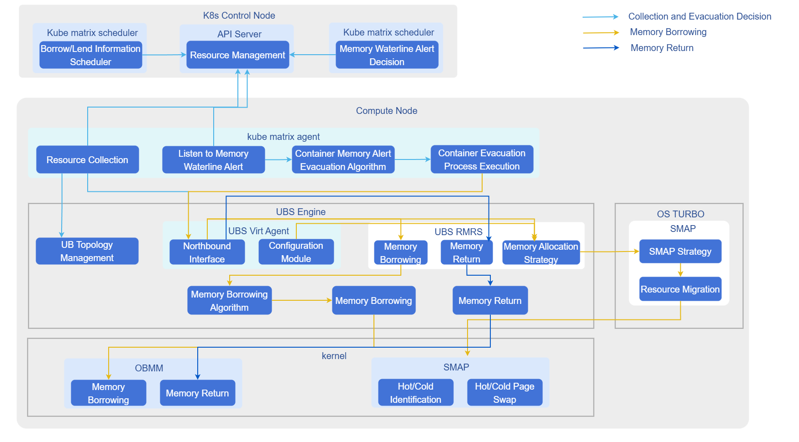

# Memory Borrowing

## Feature Introduction

Based on UB memory pooling mechanism, when bare-metal container scenario node or numa memory usage reaches a preset value, memory borrowing is triggered to share some memory pressure to borrowed memory.

## Application Scenarios

High memory density computing scenarios: Suitable for scenarios with large numbers of Pods or containers deployed on a single node, improving node memory utilization and reducing hardware costs through memory oversubscription and borrowing mechanisms.

## Capability Scope

- Architecture Support: Supports operating system openEuler 24.03 LTS and above, Kubernetes v1.31.1 and above, architecture ARM64.
- Memory Management:
  - Supports node-level and NUMA-level memory waterline monitoring and alerting.
  - Supports transparent container memory borrowing, maximum 25% remote memory oversubscription ratio.
- Specification Limitations:
  - Transparent memory borrowing only supports 4K standard page scenarios.
  - Memory sharing only applies to bare-metal container scenarios, not VM container scenarios.
  - kube-matrix-agent single instance can manage up to 150 Pods, 300 containers, 300 processes.

## Highlight Features

- Transparent Memory Borrowing: Applications can enjoy memory pooling benefits without code modifications, such as automatic cold-hot data exchange, with extremely low performance overhead (single container performance degradation <5%).
- Flexible Scheduling Strategy: Supports both NUMA-bound and non-NUMA-bound scenarios, providing NUMA-level and node-level waterline alerts respectively, adapting to different business needs.
- Plugin Deployment: Quick deployment through Helm Chart, seamlessly integrating with existing K8s ecosystem.

## Implementation Principle

### Transparent Memory Borrowing

**Figure 1** Container Transparent Memory Borrowing



1. Monitoring and Triggering: kube-matrix-agent monitors node/NUMA memory usage in real-time. When exceeding preset waterline (such as 92%), borrowing process is triggered.
2. Interface Invocation: Agent calls UBSE interface to request remote memory.
3. Cold-Hot Exchange: UBSE enables cold-hot page swapping for container processes, migrating cold data to remote memory and keeping hot data local.
4. Escape Strategy: Supports configuring watermark-escape-strategy label to distinguish NUMA-level or node-level alert strategies; supports configuring remote-mem-allocation-ratio to control oversubscription ratio.

### Relationship with Related Features

- Depends on UBS Engine: This solution strongly depends on underlying ubs-engine and its memory pooling components, which need to be pre-installed.
- Hardware Constraints: Depends on UB chip interconnect technology to achieve high-bandwidth remote memory access; only supports 4K page tables, need to configure numa_remote=nofallback in GRUB to prohibit applications from directly requesting remote memory.

## Using Container Memory Borrowing

### Prerequisites

* **Operating System:** openEuler 24.03 LTS SP3 or higher
* **CPU Architecture:** ARM64
* **Memory:** Greater than or equal to 64GB
* **Disk:** SSD, IOPS 500MB/s
* **Chip Interconnect:** UB
* **User Permissions:** Installation and management require root permissions
* **Software Requirements:**
    1. Kubernetes v1.31.1 and above
    2. Refer to [ubs-engine](https://gitcode.com/openeuler/ubs-engine) to install ubs-engine and its dependency components
    3. Refer to [Helm Installation Documentation](https://helm.sh/docs/intro/install/) to install Helm

### Background Information

In high-performance computing or high-density deployment scenarios, local memory may become a bottleneck. By deploying UBS K8S Enable related components, you can leverage UB memory pooling technology to achieve cross-node memory borrowing, breaking through single-machine memory limitations while maintaining cloud-native characteristics of containerized applications.

### Usage Limitations

- Scenario Limitations: Only applies to bare-metal container scenarios, not VM container scenarios.
- Page Size Limitation: Only supports 4K standard page scenarios.
- Configuration Requirements: Need to modify `/etc/default/grub` to add `numa_remote=nofallback` parameter to prevent applications from directly requesting remote memory causing exceptions.
- Oversubscription Ratio: Node memory oversubscription ratio maximum is 25%.

### Operation Steps

1. Build Instructions.

    1.1 Pull source code.

    ```shell
    git clone https://gitcode.com/openFuyao/ubs-k8s-enable.git
    ```
    
    1.2 Install dependencies.  
    Before building, ensure the host has the following tools installed:
    ```shell
    docker
    helm
    ```
    Dockerfile uses BuildKit features, ensure BuildKit is enabled before executing `docker build`.

    1.3 Execute build images.  
    ```shell
    # Version number example, can be adjusted according to actual release version
    export VERSION=1.0.0
    export DOCKER_BUILDKIT=1
    
    # Build matrixagent image
    docker build -f build/matrixagent.dockerfile -t cr.openfuyao.cn/openfuyao/matrixagent:${VERSION} .
    
    # Build matrixcontroller image
    docker build -f build/matrixcontroller.dockerfile -t cr.openfuyao.cn/openfuyao/matrixcontroller:${VERSION} .
    ```
    1.4 Export image packages.
    ```shell
    mkdir -p output

    docker save cr.openfuyao.cn/openfuyao/matrixagent:${VERSION} | gzip -c > output/ubs-k8s.matrixagent.image.${VERSION}.aarch64.tgz
    docker save cr.openfuyao.cn/openfuyao/matrixcontroller:${VERSION} | gzip -c > output/ubs-k8s.matrixcontroller.image.${VERSION}.aarch64.tgz
    ```
    1.5 Package Helm Chart.
    ```shell
    helm package charts/matrixagent --destination output
    helm package charts/matrixcontroller --destination output
    mv output/matrixagent-*.tgz output/ubs-k8s.matrixagent.chart.${VERSION}.aarch64.tgz
    mv output/matrixcontroller-*.tgz output/ubs-k8s.matrixcontroller.chart.${VERSION}.aarch64.tgz
    ```
    Build artifacts are as follows:
    ```
        └── output
        ├── ubs-k8s.matrixagent.image.${VERSION}.aarch64.tgz
        ├── ubs-k8s.matrixagent.chart.${VERSION}.aarch64.tgz
        ├── ubs-k8s.matrixcontroller.image.${VERSION}.aarch64.tgz
        ├── ubs-k8s.matrixcontroller.chart.${VERSION}.aarch64.tgz
    ```

2. Deployment Steps.  
    Execute the following command to set version variables:
    
    ```bash
    export VERSION=1.0.0
    export OCI_VERSION=0.0.0-latest
    ```

    2.1 Obtain deployment files.  
    Choose one of the following methods to obtain required images and Helm Charts according to actual scenario.

    - Method 1: Use offline release packages.

    Prepare the following files:

    * `ubs-k8s.matrixagent.image.${VERSION}.aarch64.tgz`
    * `ubs-k8s.matrixagent.chart.${VERSION}.aarch64.tgz`
    * `ubs-k8s.matrixcontroller.image.${VERSION}.aarch64.tgz`
    * `ubs-k8s.matrixcontroller.chart.${VERSION}.aarch64.tgz`

    - Method 2: Obtain from image repository and OCI repository.

    Pull images:

    ```bash
    docker pull cr.openfuyao.cn/openfuyao/matrixcontroller:latest
    docker pull cr.openfuyao.cn/openfuyao/matrixagent:latest
    ```

    Pull Helm Charts:

    ```bash
    helm pull oci://cr.openfuyao.cn/charts/matrixagent --version ${OCI_VERSION}
    helm pull oci://cr.openfuyao.cn/charts/matrixcontroller --version ${OCI_VERSION}
    ```

   2.2 Import offline images.  

    ```bash
    gunzip -c ubs-k8s.matrixagent.image.${VERSION}.aarch64.tgz | ctr -n k8s.io images import -
    gunzip -c ubs-k8s.matrixcontroller.image.${VERSION}.aarch64.tgz | ctr -n k8s.io images import -
    ```
    
    >  **Note:**<br />
    >  If using "Method 2" to pull images directly from image repository, skip this step.
    
    2.3 Deploy services.   
    Choose one of the following methods to deploy services according to actual scenario.
    - Deploy using offline Chart.

    ```bash
    helm install matrixagent ubs-k8s.matrixagent.chart.${VERSION}.aarch64.tgz -n kube-system \
      --set images.matrixagent.tag=${VERSION}
    helm install matrixcontroller ubs-k8s.matrixcontroller.chart.${VERSION}.aarch64.tgz -n kube-system \
      --set images.matrixcontroller.tag=${VERSION}
    ```
    - Deploy using OCI Chart.

    ```bash
    helm install matrixagent oci://cr.openfuyao.cn/charts/matrixagent --version ${OCI_VERSION} -n kube-system \
      --set images.matrixagent.tag=latest
    helm install matrixcontroller oci://cr.openfuyao.cn/charts/matrixcontroller --version ${OCI_VERSION} -n kube-system \
      --set images.matrixcontroller.tag=latest
    ```
    2.4 Verify results.  
    Execute the following command to view Pod status.

    ```bash
    kubectl get pods -A
    ```

    Expected results are as follows:
    * Each node should have corresponding `matrixagent` related Pods with status `Running`.
    * Control node should have `matrixcontroller` related Pods with status `Running`.
3. Enable container memory borrowing demo.  
    **Prerequisites**  
    Complete installation of matrix-agent and matrix-controller.  
    3.1 Configure node labels.  
    Configure worker node labels through command line on K8s master node to identify whether nodes support NUMA binding, used to distinguish between NUMA-level or node-level waterline alerts when making escape strategy decisions. If this label is not configured, waterline-triggered container memory borrowing is not supported.
    
    ```shell
      kubectl label nodes <node-name> watermark-escape-strategy=<strategy> 
      # Replace <strategy> with NUMA or node, replace <node-name> with node name that needs borrowing
    ```
    
    3.2 Enable oversubscription node and memory oversubscription ratio.   
    Configure node labels through command line on K8s master node, node memory oversubscription ratio maximum 25%.
    ```shell
    kubectl label nodes <node-name> remote-mem-allocation-ratio=25 
    # Constraint: value is an integer between (0,25], replace <node-name> with node name that needs borrowing
    ```
    Configure memory oversubscription for containers through Pod yaml file.
    ```shell
    apiVersion: v1
    kind: Pod
    metadata:
      name: annotation-demo
      labels:
         remote-mem-allocation-ratio:  25 # Set maximum remote memory ratio for container processes, also identifies this Pod's related processes use remote memory; if this label is not configured or has abnormal value, this Pod does not support memory borrowing, recommended value 25
    # Constraint: value is an integer between (0,200]
    ```
    3.3 Configure waterline configMap.  
    Generate yaml for waterline configMap configuration.

    ```yaml
    apiVersion: v1
    kind: ConfigMap
    metadata:
      name: watermark-config
      namespace: kube-system
    data:
      returnLine : "80" # Memory return waterline
      firstLine : "85" # First waterline, used for container live migration escape, container live migration not delivered yet
      secondLine: "92" # Second waterline, used for container memory borrowing escape
    # Constraint: waterline value is an integer between (0,100], difference between 2 waterlines cannot be less than 5
    ```

    Configure configMap through command line on K8s master node.

    ```shell
    kubectl apply -f <yaml-name>
    # Replace <yaml-name> with filename of yaml created in previous step
    ```

    3.4 Deploy test Pod and container.  
    Edit file content: vi numa-stress.yaml  
    Modify file content as needed (the following example is for demonstration only, just pay attention to labels and resources fields, any pod meeting these two configurations can use container memory borrowing).
    ```yaml
    apiVersion: v1
    kind: Pod
    metadata:
      ......
      labels:
        remote-mem-allocation-ratio: "25"
        # Set maximum remote memory ratio for container processes, also identifies this Pod's related processes use remote memory, if ratio is not set defaults to node oversubscription ratio; if this label is not configured or has abnormal value, Pod does not support remote memory
    spec:
      containers:
        - name: xxxx
          ......
          resources:
            requests:
              cpu: "2"
              memory: "8Gi"
              # Modify memory spec as needed, in non-NUMA-bound scenarios, Pod QoS must be burstable (i.e., resource requests < limits).
            limits:
              cpu: "2"
              memory: "10Gi"
              # Modify memory spec as needed, in non-NUMA-bound scenarios, Pod QoS must be burstable (i.e., resource requests < limits).
          ......
    ```
    
    3.5 Create Pod.

    ```shell
    kubectl apply -f numa-stress.yaml
    ```

    View Pod creation status, when Pod is successfully created, status changes to Running.
    
    ```shell
    kubectl get pod -A
    ```

    3.6 Enter Pod to apply pressure.   
    Execute pressure command inside pod, as long as container internal memory pressure rises through application, making escape waterline reach secondLine set in watermark-config.
    - Observe memory borrowing results.

    ssh to pod's node, execute the following command to view numastat for cold-hot swapping

    ```shell
    numastat -cvm
    ```
    As shown below, the additional Node 4 is borrowed 2048M remote memory, MemUsed of 1743 indicates used memory size is 1743M.

    ```
    $ numastat -cvm
    Per-node system memory usage (in MBs):
                     Node 0 Node 1 Node 4  Total
                     ------ ------ ------ ------
    MemTotal          64254  63967   2048 130269
    MemFree            2605  60793    305  63704
    MemUsed           61649   3174   1743  66565
    ......
    ```

    - Trigger memory return.  
     Execute the following command to delete Pod or remove memory pressure, triggering memory return.
     ```shell
     kubectl delete pod -n kube-system xxxx
     ```
