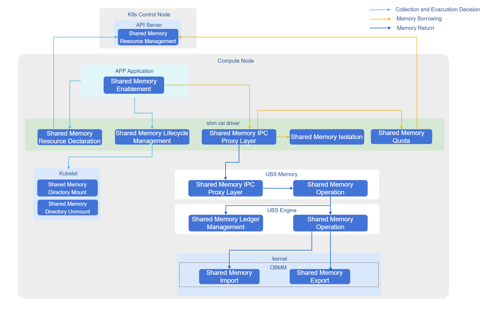

# Memory Sharing

## Feature Introduction

UBS-Core's memory pooling component supports importing and exporting memory blocks within UBS Server clusters through memory pooling capabilities, achieving cross-node and multi-process memory sharing on bare-metal, while ensuring resource security and QoS through directory isolation and proxy layer.

## Application Scenarios

Cross-node Big Data Processing: Suitable for scenarios requiring cross-node sharing of large memory datasets (such as in-memory databases, big data analysis), avoiding data copying and improving processing efficiency through memory sharing capabilities.

## Capability Scope

- Architecture Support: Supports operating system openEuler 24.03 LTS and above, Kubernetes v1.31.1 and above, architecture ARM64.
- Memory Management:
  - Supports cross-node, multi-process memory sharing, single node shared memory upper limit 512GB, single shared memory block range 128M-512G.
- Lifecycle Management: Automatically senses container extinction and cleans up borrowed remote memory or imported shared memory.
- Specification Limitations:
  - Memory sharing only applies to bare-metal container scenarios, not VM container scenarios.

## Highlight Features

Plugin Deployment: Quick deployment through Helm Chart, seamlessly integrating with existing K8s ecosystem.

## Implementation Principle

**Figure 1** Container Memory Sharing



1. Resource Declaration: Users declare shared memory size and name through Custom Resource (ShareMemory).
2. CSI Mounting: shm-csi-driver listens to resource creation, mounts shared memory blocks to designated Pod directories through CSI protocol.
3. Proxy and Isolation: Added proxy layer intercepts shared memory operations, implements QoS restrictions; ensures data security between different tenants/applications through directory isolation.
4. Lifecycle Linkage: Listens to Pod events, automatically unmounts shared memory and cleans up backend resources when Pods are deleted.

### Relationship with Related Features

- Depends on UBS Engine: This solution strongly depends on underlying ubs-engine and its memory pooling components, which need to be pre-installed.
- Kubernetes Version Dependency: Implemented based on K8s v1.31.1+ CSI plugin mechanism and CRD extension capabilities.
- Hardware Constraints: Depends on UB chip interconnect technology to achieve high-bandwidth remote memory access.

## Using Container Memory Sharing

### Prerequisites

* **Operating System:** openEuler 24.03 LTS SP3 or higher
* **CPU Architecture:** ARM64
* **Memory:** Greater than or equal to 64GB
* **Disk:** SSD, IOPS 500MB/s
* **Chip Interconnect:** UB
* **User Permissions:** Installation and management require root permissions
* **Software Requirements:**
    1. Kubernetes v1.31.1 and above.
    2. Refer to [ubs-engine](https://gitcode.com/openeuler/ubs-engine) to install ubs-engine and its dependency components.
    3. Refer to [Helm Installation Documentation](https://helm.sh/docs/intro/install/) to install Helm.

### Background Information

In high-performance computing or high-density deployment scenarios, local memory may become a bottleneck. By deploying UBS K8S Enable related components, you can leverage UB memory pooling technology to achieve cross-node memory sharing, breaking through single-machine memory limitations while maintaining cloud-native characteristics of containerized applications.

### Usage Limitations

Scenario Limitations: Only applies to bare-metal container scenarios, not VM container scenarios.

### Operation Steps

1. Build Instructions.

    1.1 Pull source code.

    ```shell
    git clone https://gitcode.com/openFuyao/ubs-k8s-enable.git
    ```

    1.2 Install dependencies.

    Before building, ensure the host has the following tools installed:

    ```shell
    docker
    helm
    ```

    Dockerfile uses BuildKit features, ensure BuildKit is enabled before executing `docker build`.

    1.3 Execute build images.

    ```shell
    # Version number example, can be adjusted according to actual release version
    export VERSION=1.0.0
    export DOCKER_BUILDKIT=1
    # Build matrixshm image
    docker build -f build/matrixshm.dockerfile -t cr.openfuyao.cn/openfuyao/matrixshm:${VERSION} .
    ```

    1.4 Export image packages.

    ```shell
    mkdir -p output

    docker save cr.openfuyao.cn/openfuyao/matrixshm:${VERSION} | gzip -c > output/ubs-k8s.matrixshm.image.${VERSION}.aarch64.tgz
    ```

    1.5 Package Helm Chart.

    ```shell
    helm package charts/matrixshm --destination output

    mv output/matrixshm-*.tgz output/ubs-k8s.matrixshm.chart.${VERSION}.aarch64.tgz
    ```

    Build artifacts are as follows:

    ```
        └── output
        ├── ubs-k8s.matrixshm.image.${VERSION}.aarch64.tgz
        └── ubs-k8s.matrixshm.chart.${VERSION}.aarch64.tgz
    ```

2. Deployment Steps.

    Execute the following command to set version variables:

    ```bash
    export VERSION=1.0.0
    export OCI_VERSION=0.0.0-latest
    ```

    2.1 Obtain deployment files.  
    Choose one of the following methods to obtain required images and Helm Charts according to actual scenario.

    - Method 1: Use offline release packages. 
    Prepare the following files:
    * `ubs-k8s.matrixshm.image.${VERSION}.aarch64.tgz`
    * `ubs-k8s.matrixshm.chart.${VERSION}.aarch64.tgz`

    - Method 2: Obtain from image repository and OCI repository.

    Pull images:

    ```bash
    docker pull cr.openfuyao.cn/openfuyao/matrixshm:latest
    ```

    Pull Helm Charts:

    ```bash
    helm pull oci://cr.openfuyao.cn/charts/matrixshm --version ${OCI_VERSION}
    ```

    2.2 Import offline images.

    ```bash
    gunzip -c ubs-k8s.matrixshm.image.${VERSION}.aarch64.tgz | ctr -n k8s.io images import -
   ```

    >  **Note:**<br />
    > If using "Method 2" to pull images directly from image repository, skip this step.

    2.3 Deploy services.  
    Choose one of the following methods to deploy services according to actual scenario.
    - Deploy using offline Chart.

    ```bash
    helm install matrixshm ubs-k8s.matrixshm.chart.${VERSION}.aarch64.tgz -n kube-system \
      --set images.shmcsidriver.tag=${VERSION}
    ```

    - Deploy using OCI Chart.

    ```bash
   helm install matrixshm oci://cr.openfuyao.cn/charts/matrixshm --version ${OCI_VERSION} -n kube-system \
      --set images.shmcsidriver.tag=latest
    ```

    2.4 Execute the following command to verify results.  
    
    ```bash
    kubectl get pods -A
    ```

    Expected results are as follows:

    * Each node should have corresponding `matrixagent`, `matrixshm` related Pods with status `Running`
    * Control node should have `matrixcontroller` related Pods with status `Running`

3. Enable container memory sharing demo.  
    
    3.1 Prerequisites.  
    Complete installation of shm-csi-driver. 
    
    3.2 Develop simple test binary.    
    Using container memory sharing requires users to call externally provided SDK through their own developed applications.  
    SDK header file reference: [ubs_mem.h](https://atomgit.com/openeuler/ubs-mem/blob/master/src/app_lib/include/ubs_mem.h)  
    
    3.3 Verification steps.

    Write the following configuration to `cr.yaml`, modify corresponding configuration as needed.
    
    ```
    apiVersion: resource.ubsvirt.huawei.com/v1
    kind: ShareMemory
    metadata:
      name: testshm # Shared memory name, user-defined
      namespace: kube-system
    spec:
      storage: 5120Mi  # Total shared memory
    ```

    Write the following configuration to `pod.yaml`, modify corresponding configuration as needed (here user's own developed application needs to be integrated in image or mounted inside Pod).

    ```
    apiVersion: v1
    kind: Pod
    metadata:
      ......
    spec:
      securityContext:
        supplementalGroups:
          - 1024 # ubsmd group id
          - 4177 # shm csi driver group id
      ......
      volumes:
        - name: ubs-mem # ubsm so file path, shared memory dependency
          hostPath:
            path: /usr/local/ubs_mem/
            type: Directory
        - name: boundscheck-volume # libboundscheck, libobmm, libnuma, libhcom so files can be directly integrated in image, eliminating mount configuration
          hostPath:
            path: /usr/lib64/libboundscheck.so
            type: File
        - name: libobmm-1-0-1
          hostPath:
            path: /usr/lib64/libobmm.so.1.0.1
            type: File
        - name: libobmm-1
          hostPath:
            path: /usr/lib64/libobmm.so.1
            type: File
        - name: libnuma-1-0-0
          hostPath:
            path: /usr/lib64/libnuma.so.1.0.0
            type: File
        - name: libnuma-1
          hostPath:
            path: /usr/lib64/libnuma.so.1
            type: File
        - name: libhcom-so-0-0-1
          hostPath:
            path: /usr/lib64/libhcom.so.0.0.1
            type: File
        - name: libhcom-so-0
          hostPath:
            path: /usr/lib64/libhcom.so.0
            type: File
        - name: mxm-agent-ipc-server # ubsm socket file
          hostPath:
            path: /run/memory/
            type: Directory
        - name: shared-memory # Shared memory file mount dependency configuration
          csi:
            driver: shm-csi-driver
            volumeAttributes:
              type: shareMem
              identity: testshm # Shared memory name, corresponds to name in cr
        ......
      containers:
        - name: xxxxxxx
          ......
          env:
            - name: LD_LIBRARY_PATH
              value: "/usr/lib64/:/host/usr/local/ubs_mem/lib/:......"
          volumeMounts:
            - name: ubs-mem
              mountPath: /host/usr/local/ubs_mem/
            - name: boundscheck-volume
              mountPath: /usr/lib64/libboundscheck.so
            - name: libobmm-1-0-1
              mountPath: /usr/lib64/libobmm.so.1.0.1
            - name: libobmm-1
              mountPath: /usr/lib64/libobmm.so.1
            - name: libnuma-1-0-0
              mountPath: /usr/lib64/libnuma.so.1.0.0
            - name: libnuma-1
              mountPath: /usr/lib64/libnuma.so.1
            - name: libhcom-so-0-0-1
              mountPath: /usr/lib64/libhcom.so.0.0.1
            - name: libhcom-so-0
              mountPath: /usr/lib64/libhcom.so.0
            - name: mxm-agent-ipc-server
              mountPath: /run/matrix/memory/
            - name: shared-memory
              mountPath: /dev
              mountPropagation: "HostToContainer"
            ......
    ```

    3.4 Deploy yaml on master node.

    ```shell
    kubectl apply -f cr.yaml
    kubectl apply -f pod.yaml
    ```

    3.5 Use memory sharing.  
    Users execute their own developed applications inside containers to enable shared memory within containers.
