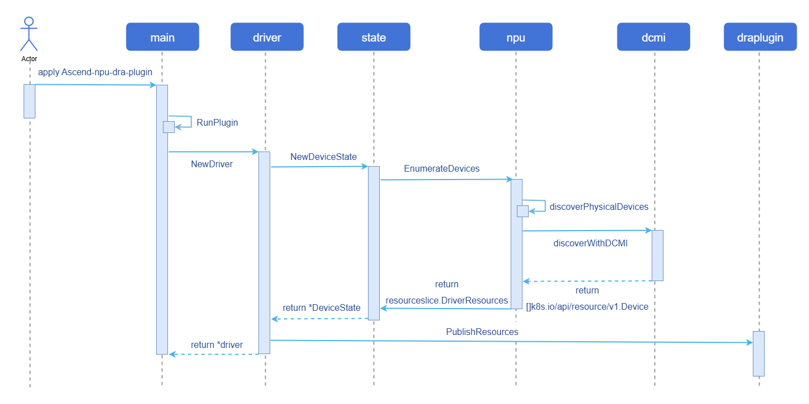

# npu-dra-plugin

## Feature Introduction

Traditional Device Plugin requests devices based on "countable" interfaces and cannot perceive device internal characteristics. DRA (Dynamic Resource Allocation) provides Kubernetes with a more flexible resource scheduling mechanism. npu-dra-plugin completes Ascend NPU device adaptation based on the native Kubernetes DRA architecture, supporting scheduling decisions based on device attributes, computing power specifications, and other metadata, enabling fine-grained heterogeneous computing resource scheduling.

### Application Scenarios

- **AI Large Model Inference/Training**: Provides NPU computing power for AI frameworks such as vLLM and MindIE through whole-card allocation or soft partitioning, supporting efficient inference of large language models.
- **Multi-tenant Computing Power Sharing**: Shares a physical NPU to multiple business Pods by computing power quota through soft partitioning, improving resource utilization and reducing costs.
- **Fine-grained Resource Scheduling**: Filters devices through CEL expressions based on device attributes (NUMA affinity, chip model, etc.) to meet scheduling constraints in high-performance computing scenarios.
- **Heterogeneous Chip Mixed Scheduling**: Multiple NPU models such as 910B, 910C, and 310P coexist in the same cluster, managed uniformly through DeviceClass, matching the most suitable devices according to business requirements.

### Capability Scope

- Supports device discovery and reporting for Ascend 910B, 910C, and 310P chips.
- Supports device filtering through `DeviceClass/CEL`.
- Supports resource requests using `ResourceClaim/ResourceClaimTemplate`, binding business `Pod` with `ResourceSlice`.
- Supports injecting devices into containers through `CDI`.
- Supports **whole-card allocation (full)**: Allocates a complete NPU to a business Pod.
- Supports **hard partitioning (hard)**: Partitions a whole card into multiple vNPU instances based on fixed templates, matching templates precisely by `aiCore`+`aiCPU`.
- Supports **soft partitioning (soft)**: Implements software virtualization of NPU devices based on vCANN-RT runtime hijack library, flexibly sharing physical NPU by `memCapacity`+`coreCapacity` quota, supporting three scheduling strategies: elastic, fixed-share, and best-effort.
- Chip models supported by the three partitioning modes: **910B, 310P, 910C**. Among them, 910C must be set to single-die mode (see [Prerequisites](#prerequisites)).
- Supports configuring the partitioning mode (full/hard/soft) for each NPU card through `ConfigMap`, and also supports node-level default mode configuration through node labels.
- Supports one-click deployment through `Helm Chart`.

### Highlight Features

- Supports three resource allocation modes: whole-card allocation, hard partitioning, and soft partitioning, covering the full range of scenarios from exclusive to shared.
- Implements card-level partitioning mode configuration through structured `draConfig`, allowing different cards on the same node to be configured with different modes.

### Implementation Principle

**Figure 1** Device Discovery and Reporting Process Diagram



#### Core Components

`npu-dra-plugin` is deployed as a DaemonSet on each NPU node. Core components include:

- **DRA Kubelet Plugin**: The main DRA driver plugin, responsible for the entire process of device discovery, resource reporting, ResourceClaim allocation, CDI injection, etc. Discovers NPU devices through DCMI interface or sysfs, and reports device information as ResourceSlice.
- **draConfig ConfigMap**: Structured configuration that defines the partitioning mode (full/hard/soft) and scheduling strategy for each NPU card on each node, read at driver startup.
- **vnpu-template-config ConfigMap**: Hard partitioning chip template configuration that defines the vNPU templates (aiCore/aiCPU/memoryMi) supported by each chip model, precisely matched by the driver based on requested values.
- **vCANN-RT Installer** (optional): A prerequisite dependency for soft partitioning, deployed as a DaemonSet, installs the vCANN-RT hijack library to the host `/opt/xpu/` directory, supports automatic repair.

### Relationship with Related Features

- Depends on Ascend `NPU` device interfaces (DCMI/sysfs).
- Depends on the Kubernetes DRA feature (v1.34+, requires `DynamicResourceAllocation` and `DRAConsumableCapacity` feature gates to be enabled).

## Installation

### Prerequisites

- **Kubernetes version**: Use the openFuyao community recommended version v1.34.3, with DRA feature enabled (`DynamicResourceAllocation=true`) and `DRAConsumableCapacity=true` feature gate.
- **Container runtime**: containerd must use v1.7.0 or above; the openFuyao community default version v2.1.1 is recommended.
- **NPU hardware and driver**: Cluster nodes have Ascend NPU hardware installed and the corresponding version of the Ascend NPU driver deployed. The recommended driver version should be no lower than 25.5.x. For 910B driver installation, see: [Ascend 910B Driver Installation Guide](https://support.huawei.com/enterprise/zh/doc/EDOC1100468900/cb91d9dc?idPath=23710424|251366513|254884019|261408772|261457531).
- **ascend-docker-runtime**: Hard partitioning depends on `ascend-docker-runtime` (used to create vNPU devices and mount them into containers). Before using hard partitioning, ensure that `ascend-docker-runtime` is installed and configured on the node. You can confirm this with `which ascend-docker-runtime` or `ls /usr/local/Ascend/Ascend-Docker-Runtime/ascend-docker-runtime`. If not installed, please refer to the Ascend official documentation to complete installation and configuration.
- **Ascend 910C additional requirements** (not required for 910B and 310P):

  The following configurations must be completed on 910C nodes before deployment. All operations must be **manually executed** before deploying the DRA plugin:

    1. **Confirm driver version**: Query via `npu-smi info`, the driver version must be **26.0.RC1** or above.

        ```bash
        npu-smi info
        # Check the Version field in the output, must be 26.0.RC1 or above
        ```

    2. **Set single-die mode**: 910C supports both single-die and dual-die working modes. The DRA plugin only supports single-die mode. You need to set it to single-die mode using the `npu-smi` tool.

       For specific operations, refer to the Ascend official documentation [Setting Single-Die Mode](https://support.huawei.com/enterprise/zh/doc/EDOC1100568418/da866a1e).

    3. **Enable configuration recovery (persistence)**: Ensure that the 910C partitioning mode configuration is not lost after node restart (inherits the pre-restart configuration after OS restart).

        ```bash
        # Enable persistent recovery for multi-die container policy (see [Setting the Persistent Recovery Status of Multi-Die Container Policy](https://support.huawei.com/enterprise/zh/doc/EDOC1100568418/eb901923))
        npu-smi set -t multi-die-policy-cfg-recover -d 1
   
        # Query the current persistent recovery status
        npu-smi info -t multi-die-policy-cfg-recover
        # Expected output: Multi die policy config recover mode : Enable 
        ```


### Usage Restrictions

**Table 1** Partitioning Modes Supported by Each Chip

| Chip Model | Whole-card Allocation (full) | Hard Partitioning (hard) | Soft Partitioning (soft) |
|---------|:---------------:|:--------------:|:--------------:|
| 910B | Supported | Supported | Supported |
| 310P | Supported | Supported | Supported |
| 910C (single-die) | Supported | Supported | Supported |
| 910C (dual-die) | Not supported | Not supported | Not supported |

>  **Note:**
>
> 910C must be set to single-die mode. For specific configuration requirements, see [Prerequisites](#prerequisites). Although devices can be reported and allocated normally in 910C dual-die mode, the devices cannot be used properly within containers.
>
> - When using the soft partitioning feature, the vCANN-RT hijack library must be installed first. It can be automatically installed via the `vcannrtInstaller` installer (installed to `/opt/xpu/`), or the actual path can be configured in the ConfigMap if the environment has it pre-installed.
> - Hard partitioning Pods must be configured with `runtimeClassName: ascend`.
> - Soft partitioning supports a maximum of 63 vNPU instances per physical NPU (controlled by the `--share-count` parameter, valid range 1-63).

### Three Resource Allocation Modes

`npu-dra-plugin` supports three NPU resource allocation modes, specified through `draConfig` configuration or node labels:

**Table 2** Resource Allocation Mode Description

| Mode | vnpuMode Value | Description | Resource Request Method | DeviceClass |
|------|-----------|------|-------------|-------------|
| Whole-card allocation | full | Exclusively allocates a complete NPU to a business Pod | No need to specify capacity | full.npu.huawei.com |
| Hard partitioning | hard | Partitions the whole card into vNPU instances based on fixed templates, precisely matched by aiCore+aiCPU | aiCore + aiCPU | hard.npu.huawei.com |
| Soft partitioning | soft | Implements software virtualization based on vCANN-RT hijack library, shared by memory + computing power quota | memCapacity + coreCapacity | elastic.npu.huawei.com / fixed.npu.huawei.com / best-effort.npu.huawei.com |


### Installing npu-dra-plugin

`npu-dra-plugin` provides a Helm Chart that supports one-click deployment of all components (Namespace, RBAC, ConfigMap, DaemonSet, DeviceClass, vCANN-RT installer).

>  **Notice:**
>
> At driver startup, the ConfigMap or node labels are read to determine the partitioning mode for each card. If not configured, the default is `full` (whole-card mode), and hard partitioning and soft partitioning features will not take effect. It can be configured in either of the following two ways, with priority: **ConfigMap card-level configuration > Node label > Default full**. After modifying the configuration, the driver Pod must be restarted for the new configuration to take effect.

#### Operation Steps

1. Pull the Chart and configure values.yaml.

   1.1 Pull the Helm Chart and view the cluster node names.

     ```bash
     # Pull the Chart from the OCI repository
     helm pull oci://cr.openfuyao.cn/charts/npu-dra-driver --version 0.0.0-latest
     tar xzf npu-dra-driver-*.tgz

     # View cluster node names (needed when configuring nodes later)
     kubectl get nodes
     ```

   1.2 Modify the configuration in `values.yaml` (image address, node NPU partitioning mode, etc.).

     ```bash
     vi npu-dra-driver/values.yaml
     ```

     Main configurable items of the Helm Chart:

    ```yaml
    # Image repository base configuration
    basic:
      swr_addr: "cr.openfuyao.cn/openfuyao"
      namespace: npu-dra-driver

    # NPU driver path configuration
    npu:
      driverHostPath: /usr/local/Ascend
      npuSmiHostPath: /usr/local/sbin/npu-smi

    # DRA Plugin configuration
    npuDraPlugin:
      shareCount: 16
      chipCapabilitiesConfigMap: vnpu-template-config
      draProfileConfigMap: dra-profile-config
      # Soft partitioning mount items (only needed when using soft partitioning)
      softShareMounts:
      - hostPath: /opt/xpu/bin/enpu-monitor
        containerPath: /opt/enpu/vcann-rt/tools/enpu-monitor
        options: [ro, rbind]
      - hostPath: /opt/xpu/bin/systemd-detect-virt
        containerPath: /usr/bin/systemd-detect-virt
        options: [ro, rbind]
      # Node NPU partitioning configuration, key is the K8s node name (obtained via kubectl get nodes)
      # Default is empty; configure as needed when using hard or soft partitioning
      # Takes effect directly on first deployment; after subsequent modifications, restart the driver Pod: kubectl delete pod -n npu-dra-driver -l app=npu-dra-plugin
      # nodes:
      #   <node-name>:
      #   - physicalId: 0          # NPU physical ID, can be viewed via the `npu-smi info -m` command
      #     vnpuMode: full
      #   - physicalId: 1
      #     vnpuMode: hard
      #   - physicalId: 2
      #     vnpuMode: soft
      #     schedulingPolicy: elastic

    # vCANN-RT hijack library installer configuration (only needed when using soft partitioning)
    vcannrtInstaller:
      enabled: true   # When set to false, the vCANN-RT installer is not deployed
      image:
        swr_addr: "cr.openfuyao.cn/openfuyao/vnpu"
        # Image name, must match the NPU hardware model. Take 910B as an example
        # Valid options: acl-client-update-910b, acl-client-update-910c, acl-client-update-310p
        name: acl-client-update-910b
        version: "latest"

    # Chip template configuration (hard partitioning templates)
    chipCapabilities: |
      chips:
        - chipName: 310P3
          totalAiCore: 8
          totalAiCpu: 7
          totalMemoryMi: 21525
          templates:
            - { name: vir01, aiCore: 1, aiCpu: 1, memoryMi: 3072 }
            - { name: vir02, aiCore: 2, aiCpu: 2, memoryMi: 6144 }
            - { name: vir02_1c, aiCore: 2, aiCpu: 1, memoryMi: 6144 }
            - { name: vir04, aiCore: 4, aiCpu: 4, memoryMi: 12288 }
            - { name: vir04_3c, aiCore: 4, aiCpu: 3, memoryMi: 12288 }
        - chipName: 910B4
          totalAiCore: 20
          totalAiCpu: 6
          totalMemoryMi: 32768
          templates:
            - { name: vir05_1c_8g, aiCore: 5, aiCpu: 1, memoryMi: 8192 }
            - { name: vir10_3c_16g, aiCore: 10, aiCpu: 3, memoryMi: 16384 }
            - { name: vir10_4c_16g_m, aiCore: 10, aiCpu: 4, memoryMi: 16384 }
            - { name: vir10_3c_16g_nm, aiCore: 10, aiCpu: 3, memoryMi: 16384 }
        - chipName: Ascend910C
          totalAiCore: 20
          totalAiCpu: 6
          totalMemoryMi: 32768
          templates:
            - { name: vir05_1c_16g, aiCore: 5, aiCpu: 1, memoryMi: 16384 }
            - { name: vir10_3c_32g, aiCore: 10, aiCpu: 3, memoryMi: 32768 }

    # DeviceClass definition
    deviceClass:
      enabled: true
    ```

     **Configuration Notes:**

     - `chipCapabilities` configures the chip specifications and vNPU templates supported by hard partitioning. The driver precisely matches templates based on the requested `aiCore`+`aiCPU`. Templates may differ across chip models and driver versions. Please query via `npu-smi info -t vnpu-template` in the actual environment and use the actual values as the standard, modifying this configuration as needed. Table 4 below provides common template references.
     - **Whether to install the vCANN-RT hijack library**: Controlled by `vcannrtInstaller.enabled`. Only needs to be set to `true` when using soft partitioning (`vnpuMode=soft`).
     - **If the environment has the hijack library pre-installed**: Set `vcannrtInstaller.enabled` to `false` to skip installer deployment, and modify the `hostPath` in `softShareMounts` to the actual hijack library file path in the environment.
     - For detailed configuration of the vCANN-RT hijack library, see [vCANN-RT Hijack Library Configuration](#vcann-rt-hijack-library-configuration).

2. (Optional) Configure the partitioning mode through node labels.

 If you do not want to modify `values.yaml` or do not know the node names, you can leave `nodes` empty and label the nodes before deployment. The driver will read the node label as the default partitioning mode for all NPUs on that node.

 Execute the following commands to view node names and apply labels:

 ```bash
 # View node names
 kubectl get nodes

 # Label the node with partitioning mode (full/hard/soft)
 kubectl label node <node-name> vnpu-mode=soft

 # If using soft partitioning, also specify the scheduling policy (optional, default elastic)
 kubectl label node <node-name> schedulingPolicy=elastic
 ```

 Optional label values:
 - `vnpu-mode`: `full` (default) / `hard` / `soft`
 - `schedulingPolicy`: `elastic` (default) / `fixed-share` / `best-effort` (only effective when `vnpu-mode=soft`)

 >  **Note:**
 >
 > - Node labels are **node-level** configurations. All NPU cards on that node that are not configured in the ConfigMap will use this mode.
 > - If the same card is configured in both ConfigMap and node labels, **ConfigMap takes precedence**.
 > - After modifying labels or ConfigMap, the driver Pod must be restarted for the configuration to take effect:
 >   ```bash
 >   kubectl delete pod -n npu-dra-driver -l app=npu-dra-plugin
 >   ```

3. Deploy.

   Execute the following command to deploy npu-dra-plugin via Helm Chart:

   ```bash
   helm install npu-dra-driver oci://cr.openfuyao.cn/charts/npu-dra-driver --version 0.0.0-latest -f npu-dra-driver/values.yaml
   ```

4. Verify the deployment result.

   4.1 Check Pod status.

     ```bash
     kubectl get pods -n npu-dra-driver
     ```

   Expected result: Each NPU node has an `npu-dra-plugin` Pod with status `Running`. If the vCANN-RT installer is deployed, there will also be a `vcannrt-installer` Pod.

   4.2 Check whether ResourceSlice reports devices normally.

     ```bash
     kubectl get resourceslices
     ```

     Expected result: ResourceSlice starting with `<node-name>-npu.huawei.com-`.

   4.3 Check whether the device partitioning mode is correct.

     ```bash
     kubectl get resourceslices -o yaml | grep vnpuMode
     ```

   Expected result: The `vnpuMode` (full/hard/soft) of each device, consistent with the ConfigMap or label configuration.

   4.4 Check whether DeviceClass is created.

     ```bash
     kubectl get deviceclasses
     ```

   Expected result: Five DeviceClasses: `full.npu.huawei.com`, `hard.npu.huawei.com`, `elastic.npu.huawei.com`, `fixed.npu.huawei.com`, `best-effort.npu.huawei.com`.

#### vCANN-RT Hijack Library Configuration

The vCANN-RT hijack library is a prerequisite dependency for the soft partitioning feature. Whole-card allocation and hard partitioning do not require it. Users can choose one of the following two methods:

- **Method A (recommended)**: Set `vcannrtInstaller.enabled: true`, and Helm automatically deploys the installer DaemonSet, installing vCANN-RT runtime files to the host `/opt/xpu/` directory with continuous automatic repair. Keep the default paths in `softShareMounts`, **no modification needed**.

  The soft partitioning container mounts the following host files into the container through `softShareMounts`:

  **Table 3** softShareMounts File Description

  | hostPath (Host Path)                    | containerPath (Container Path) | Actual File Type                  | Description |
  |------------------------------------|---|-------------------------|---|
  | `/opt/xpu/bin/enpu-monitor`        | `/opt/enpu/vcann-rt/tools/enpu-monitor` |    Physical file                 | NPU monitoring tool, pre-installed by other components |
  | `/opt/xpu/bin/systemd-detect-virt` | `/usr/bin/systemd-detect-virt` | Physical file                    | Container detection script, installed by the installer |

- **Method B**: If the environment has already installed the vCANN-RT hijack library through other means, set `vcannrtInstaller.enabled` to `false` to skip installer deployment, but **must modify the `hostPath` in `softShareMounts` in `values.yaml`** to point to the actual hijack library file path in the environment.

  For example, if the hijack library is installed in the `/usr/local/enpu/` directory in the environment:

  ```yaml
  softShareMounts:
  - hostPath: /usr/local/enpu/bin/enpu-monitor             # Modify to actual path
    containerPath: /opt/enpu/vcann-rt/tools/enpu-monitor
    options: [ro, rbind]
  - hostPath: /usr/local/enpu/bin/systemd-detect-virt     # Modify to actual path
    containerPath: /usr/bin/systemd-detect-virt
    options: [ro, rbind]
  ```

>  **Note:**
>
> - `hostPath` is the actual path of the hijack library file on the host, and `containerPath` is the path mounted into the business container (keep the default, do not modify).
> - Ensure that all files listed in `softShareMounts` actually exist on the host; otherwise, the soft partitioning Pod will fail to start due to mount failure.
> - You can check whether the hijack library files are complete on the host with the following command (replace the path with the actual installation path):
>   ```bash
>   ls -l /opt/xpu/bin/enpu-monitor /opt/xpu/bin/systemd-detect-virt
>   ```

## Using NPU Resources
### Background Information

Through DRA technology, Kubernetes can manage the allocation and usage of Ascend NPU devices in a declarative manner. After a business Pod requests NPU resources through ResourceClaim, the driver automatically completes device discovery, reporting, allocation, and CDI injection, and ultimately the NPU device can be viewed and used within the container.

### Using Whole-card Allocation

After configuring the NPU to `vnpuMode: full`, use the `full.npu.huawei.com` DeviceClass to request whole-card resources.

```yaml
apiVersion: resource.k8s.io/v1
kind: ResourceClaimTemplate
metadata:
  name: npu-full
  namespace: default
spec:
  spec:
    devices:
      requests:
      - name: npu
        exactly:
          deviceClassName: full.npu.huawei.com
---
apiVersion: v1
kind: Pod
metadata:
  name: npu-full-demo
  namespace: default
spec:
  resourceClaims:
  - name: npu
    resourceClaimTemplateName: npu-full
  containers:
  - name: demo
    image: docker.io/library/ubuntu:22.04
    imagePullPolicy: IfNotPresent
    command: ["sleep", "infinity"]
    resources:
      claims:
      - name: npu
    env:
    - name: LD_LIBRARY_PATH
      value: "/usr/local/Ascend/driver/lib64:/usr/local/Ascend/driver/lib64/common:/usr/local/Ascend/driver/lib64/driver:/usr/local/Ascend/ascend-toolkit/latest/lib64:/usr/local/Ascend/ascend-toolkit/latest/runtime/lib64"
    volumeMounts:
    - name: ascend-driver
      mountPath: /usr/local/Ascend
      readOnly: true
    - name: npu-smi-command
      mountPath: /usr/local/bin/npu-smi
      readOnly: true
  volumes:
  - name: ascend-driver
    hostPath:
      path: /usr/local/Ascend
      type: Directory
  - name: npu-smi-command
    hostPath:
      path: /usr/local/bin/npu-smi
      type: File
```

### Using Hard Partitioning

After configuring the NPU to `vnpuMode: hard`, use the `hard.npu.huawei.com` DeviceClass to precisely match vNPU templates through `aiCore`+`aiCPU`.

>  **Notice:**
>
> - Hard partitioning Pods must be configured with `runtimeClassName: ascend`. Before using hard partitioning, ensure that `ascend-docker-runtime` is installed on the node. You can confirm this with `which ascend-docker-runtime` or `ls /usr/local/Ascend/Ascend-Docker-Runtime/ascend-docker-runtime`. If not installed, please refer to the Ascend official documentation to complete installation and configuration.
>
> - Hard partitioning Pods must be configured with `securityContext.capabilities.add: ["SYS_ADMIN"]` permission. `SYS_ADMIN` is a high-risk Linux capability that grants the container significant system operation permissions. Please grant it only as needed in hard partitioning scenarios, and follow these security recommendations:
>  - Restrict this permission to hard partitioning business Pods only; do not grant it to non-hard-partitioning Pods.
>  - Combine with Pod Security Standards (Restricted level) and admission control policies to prevent abuse.
>  - Run container processes as a non-root user whenever possible to reduce privilege escalation risks.

```yaml
apiVersion: resource.k8s.io/v1
kind: ResourceClaimTemplate
metadata:
  name: npu-hard-vnpu
  namespace: default
spec:
  spec:
    devices:
      requests:
      - name: npu
        exactly:
          deviceClassName: hard.npu.huawei.com
          capacity:
            requests:
              aiCore: 5
              aiCPU: 1
---
apiVersion: v1
kind: Pod
metadata:
  name: npu-hard-demo
  namespace: default
spec:
  runtimeClassName: ascend
  resourceClaims:
  - name: npu
    resourceClaimTemplateName: npu-hard-vnpu
  containers:
  - name: demo
    image: docker.io/library/ubuntu:22.04
    imagePullPolicy: IfNotPresent
    command: ["sleep", "infinity"]
    resources:
      claims:
      - name: npu
    env:
    - name: LD_LIBRARY_PATH
      value: "/usr/local/Ascend/driver/lib64:/usr/local/Ascend/driver/lib64/common:/usr/local/Ascend/driver/lib64/driver:/usr/local/Ascend/ascend-toolkit/latest/lib64:/usr/local/Ascend/ascend-toolkit/latest/runtime/lib64"
    volumeMounts:
    - name: ascend-driver
      mountPath: /usr/local/Ascend
      readOnly: true
    - name: npu-smi-command
      mountPath: /usr/local/bin/npu-smi
      readOnly: true
  volumes:
  - name: ascend-driver
    hostPath:
      path: /usr/local/Ascend
      type: Directory
  - name: npu-smi-command
    hostPath:
      path: /usr/local/bin/npu-smi
      type: File
```

The values of `aiCore` and `aiCPU` must match the templates defined in the `vnpu-template-config` ConfigMap:

**Table 4** Hard Partitioning Template Mapping Table

| Chip Model | Template Name | aiCore | aiCPU | memoryMi |
|---------|---------|--------|-------|----------|
| 310P3 | vir01 | 1 | 1 | 3072 |
| 310P3 | vir02 | 2 | 2 | 6144 |
| 310P3 | vir02_1c | 2 | 1 | 6144 |
| 310P3 | vir04 | 4 | 4 | 12288 |
| 310P3 | vir04_3c | 4 | 3 | 12288 |
| 910B4 | vir05_1c_8g | 5 | 1 | 8192 |
| 910B4 | vir10_3c_16g | 10 | 3 | 16384 |
| 910B4 | vir10_4c_16g_m | 10 | 4 | 16384 |
| 910B4 | vir10_3c_16g_nm | 10 | 3 | 16384 |
| Ascend910C | vir05_1c_16g | 5 | 1 | 16384 |
| Ascend910C | vir10_3c_32g | 10 | 3 | 32768 |

>  **Note:**
>
> - `aiCore` is required, `aiCPU` is optional. When `aiCPU` is not specified or is 0, the first template that satisfies the condition is matched by `aiCore`.
> - In the example, `aiCore=5, aiCPU=1` corresponds to the `vir05_1c_8g` template for 910B4; if using 310P3, you can set `aiCore=1, aiCPU=1` (corresponding to `vir01`); if using 910C (single-die), you can set `aiCore=5, aiCPU=1` (corresponding to `vir05_1c_16g`).
> - 910C must be set to single-die mode (see [Prerequisites](#prerequisites)).
> - Hard partitioning requires `ascend-docker-runtime` to be installed; otherwise, vNPU devices cannot be created.
### Using Soft Partitioning

After configuring the NPU to `vnpuMode: soft`, use the `elastic.npu.huawei.com` (or `fixed.npu.huawei.com`, `best-effort.npu.huawei.com`) DeviceClass to specify memory and computing power quotas through `memCapacity`+`coreCapacity`.

```yaml
apiVersion: resource.k8s.io/v1
kind: ResourceClaimTemplate
metadata:
  name: npu-soft-vnpu
  namespace: default
spec:
  spec:
    devices:
      requests:
      - name: npu
        exactly:
          deviceClassName: elastic.npu.huawei.com
          capacity:
            requests:
              memCapacity: 4Gi
              coreCapacity: 50
---
apiVersion: v1
kind: Pod
metadata:
  name: npu-soft-demo
  namespace: default
spec:
  resourceClaims:
  - name: npu
    resourceClaimTemplateName: npu-soft-vnpu
  containers:
  - name: demo
    image: docker.io/library/ubuntu:22.04
    imagePullPolicy: IfNotPresent
    command: ["sleep", "infinity"]
    resources:
      claims:
      - name: npu
    env:
    - name: LD_LIBRARY_PATH
      value: "/usr/local/Ascend/driver/lib64/driver:/usr/local/Ascend/driver/lib64/common:/usr/local/Ascend/ascend-toolkit/latest/aarch64-linux/lib64:/usr/local/Ascend/ascend-toolkit/latest/runtime/lib64"
    volumeMounts:
    - name: npu-libs-driver
      mountPath: /usr/local/Ascend/driver/lib64/driver
    - name: npu-libs-common
      mountPath: /usr/local/Ascend/driver/lib64/common
    - name: ascend-toolkit
      mountPath: /usr/local/Ascend/ascend-toolkit
      readOnly: true
    - name: npu-smi
      mountPath: /usr/local/sbin/npu-smi
  volumes:
  - name: npu-libs-driver
    hostPath: { path: /usr/local/Ascend/driver/lib64/driver, type: DirectoryOrCreate }
  - name: npu-libs-common
    hostPath: { path: /usr/local/Ascend/driver/lib64/common, type: DirectoryOrCreate }
  - name: ascend-toolkit
    hostPath: { path: /usr/local/Ascend/ascend-toolkit, type: Directory }
  - name: npu-smi
    hostPath: { path: /usr/local/sbin/npu-smi, type: File }
```

>  **Note:**
>
> - `memCapacity`: HBM memory quota, supported range from `1Mi` to the physical NPU total memory, step `1Mi`.
> - `coreCapacity`: AI Core computing quota, range 1-100 (percentage), step 1.
> - Description of the three soft partitioning scheduling strategies:
>
>   **Table 5** Soft Partitioning Scheduling Strategy Comparison
>
>   | Strategy | DeviceClass | Typical Scenario | Resource Guarantee Level | Applicable Workload Type |
>   |------|------------|---------|-------------|-------------|
>   | `elastic` | elastic.npu.huawei.com | Large load fluctuation, peak staggering | Shared idle computing power, no fixed guarantee | Inference services, online inference |
>   | `fixed-share` | fixed.npu.huawei.com | Requires stable computing power guarantee, multi-tenant isolation | Fixed quota, no mutual influence | Training tasks, batch processing |
>   | `best-effort` | best-effort.npu.huawei.com | Low priority, can be preempted | Best-effort allocation, no guarantee | Development and testing, offline analysis |

### Using CEL Expressions to Filter Devices

Both `ResourceClaimTemplate` and `ResourceClaim` can use CEL expressions for device filtering. The following example selects devices by NUMA affinity:

```yaml
apiVersion: resource.k8s.io/v1
kind: ResourceClaim
metadata:
  name: npu-numa-claim
  namespace: default
spec:
  devices:
    requests:
    - name: npu
      exactly:
        deviceClassName: full.npu.huawei.com
        count: 1
        selectors:
        - cel:
            expression: |-
              device.attributes["npu.huawei.com"].numaNode == 1
---
apiVersion: v1
kind: Pod
metadata:
  name: npu-numa-demo
  namespace: default
spec:
  resourceClaims:
  - name: npu
    resourceClaimName: npu-numa-claim
  containers:
  - name: demo
    image: docker.io/library/ubuntu:22.04
    imagePullPolicy: IfNotPresent
    command: ["sleep", "infinity"]
    resources:
      claims:
      - name: npu
    env:
    - name: LD_LIBRARY_PATH
      value: "/usr/local/Ascend/driver/lib64:/usr/local/Ascend/driver/lib64/common:/usr/local/Ascend/driver/lib64/driver:/usr/local/Ascend/ascend-toolkit/latest/lib64:/usr/local/Ascend/ascend-toolkit/latest/runtime/lib64"
    volumeMounts:
    - name: ascend-driver
      mountPath: /usr/local/Ascend
      readOnly: true
    - name: npu-smi-command
      mountPath: /usr/local/bin/npu-smi
      readOnly: true
  volumes:
  - name: ascend-driver
    hostPath:
      path: /usr/local/Ascend
      type: Directory
  - name: npu-smi-command
    hostPath:
      path: /usr/local/bin/npu-smi
      type: File
```

### Using Topology Attributes for Affinity Scheduling

`npu-dra-plugin` publishes PCIe and NPU topology attributes in `ResourceSlice` based on the actual interconnect relationships returned by `npu-smi info -t topo` on the node. Topology affinity scheduling can be used in conjunction with CEL device filtering: filter candidate devices that meet chip model, NUMA, and other conditions through `selectors[].cel`, then require that devices allocated to the same request have the same topology attribute value through `constraints.matchAttribute`.

The grouping process does not depend on the server or NPU model. HCCS (Huawei Cache Coherence System) is a hardware direct-connect link; HCCS_SW is a connection through an HCCS Switch (HCCS switching device). Both types of connections are counted in the HCCS ring, and the same connectivity group uses the same ID, with IDs numbered starting from 0.

The following example requests 8 whole-card NPUs located in the same HCCS ring:

```yaml
apiVersion: resource.k8s.io/v1
kind: ResourceClaim
metadata:
  name: npu-same-hccs-ring
  namespace: default
spec:
  devices:
    requests:
    - name: npu
      exactly:
        deviceClassName: full.npu.huawei.com
        allocationMode: ExactCount
        count: 8
        selectors:
        - cel:
            expression: device.attributes["npu.huawei.com"].chipName == "910B4"
    constraints:
    - requests: ["npu"]
      matchAttribute: "npu.huawei.com/topoHccsRingID"
```

The following shows the configuration that needs to be added or replaced when a Pod references this `ResourceClaim`; the container image, command, NPU driver, and `npu-smi` mounts and other configurations remain consistent with the CEL example above:

```yaml
spec:
  resourceClaims:
  - name: npu
    resourceClaimName: npu-same-hccs-ring
  containers:
  - name: demo
    # Image, command, environment variables, and mount configuration are consistent with the CEL example above.
    resources:
      claims:
      - name: npu
```

If you also require the 8 NPUs to be on the same NUMA node, you can add the following to the same `constraints` list:

```yaml
- requests: ["npu"]
  matchAttribute: "npu.huawei.com/numaNode"
```

If you also require the NUMA node of the container's exclusively allocated CPU to match the NUMA node of the NPU card, you can add the following to the same `constraints` list:
```yaml
- requests: ["cpu","npu"]
  matchAttribute: "resource.kubernetes.io/numaNode"
```

>  **Note:**
>
> - When the corresponding HCCS or SIO interconnect does not exist in the hardware topology, the driver does not publish `topoHccsRingID` or `topoSioID`. Only after confirming that the corresponding attribute exists in the ResourceSlice can this attribute be used as a `matchAttribute` constraint.
> - The old attribute `busId` is no longer published; please use `resource.kubernetes.io/pciBusID`. If an existing `ResourceClaim`'s CEL selector references `busId`, after upgrading to a driver that no longer publishes this attribute, subsequent new allocations or re-allocations will not be able to match devices, and the Claim may remain Pending, preventing Pods referencing it from being scheduled. Already allocated Claims will not be automatically converted to the new attribute; before upgrading, new `ResourceClaim` or new `ResourceClaimTemplate` versions should be created based on `resource.kubernetes.io/pciBusID`, and business Pods should be switched to the new Claim.

## Related Operations

### Querying DRA-related CR Information

- Query all `ResourceSlice`. Execute the following command:

  ```bash
  kubectl get resourceslices
  ```

- Query detailed information of the corresponding `ResourceSlice`. Execute the following command:

  ```bash
  kubectl get resourceslices <resourceslice_name> -o yaml
  ```

  You can view all discovered device information, which can be used for device filtering with CEL expressions. An example is as follows.

  ```yaml
  apiVersion: resource.k8s.io/v1
  kind: ResourceSlice
  metadata:
    creationTimestamp: "2026-02-27T01:55:37Z"
    generateName: master-npu.huawei.com-
    generation: 1
    name: master-npu.huawei.com-9gv8l
    ownerReferences:
    - apiVersion: v1
      controller: true
      kind: Node
      name: master
      uid: 6ef76e72-da36-44e3-b9c3-93f44684a859
    resourceVersion: "2225369"
    uid: 0c1b399e-4fa8-4279-93f8-b92a1faeff6f
  spec:
    devices:
    - allowMultipleAllocations: true
      attributes:
        vnpuMode:
          string: soft
        schedulingPolicy:
          string: elastic
        physicalID:
          int: 0
        chipID:
          int: 0
        chipName:
          string: 910B4
        type:
          string: 910B
        numaNode:
          int: 6
        resource.kubernetes.io/pciBusID:
          string: "0000:81:00.0"
        resource.kubernetes.io/pcieRoot:
          string: pci0000:80
        resource.kubernetes.io/numaNode:
          int: 6
        topoHccsRingID:
          int: 0
        topoSioID:
          int: 0
        memoryTotal:
          int: 32768
        vdieID:
          string: 00000000-00000001-00000002-00000003-00000004
      capacity:
        coreCapacity:
          requestPolicy:
            default: "100"
            validRange:
              max: "100"
              min: "1"
              step: "1"
          value: "100"
        memCapacity:
          requestPolicy:
            default: 32Gi
            validRange:
              max: 32Gi
              min: 1Mi
              step: 1Mi
          value: 32Gi
        shareCount:
          requestPolicy:
            default: "1"
            validValues:
            - "1"
          value: "16"
      name: npu-0
    driver: npu.huawei.com
    nodeName: master
    pool:
      generation: 1
      name: master
      resourceSliceCount: 1
  ```

  **Table 6** ResourceSlice Device Attribute Description

  | Attribute | Description | Data Source |
  |------|------|----------|
  | `vnpuMode` | Device partitioning mode (full/hard/soft). | NPU partitioning configuration in `draConfig`. |
  | `schedulingPolicy` | Scheduling strategy (only has a value in soft mode: elastic/fixed-share/best-effort). | Scheduling strategy configuration in `draConfig`. |
  | `physicalID` | Physical NPU ID. | DCMI device discovery; falls back to `npu-smi info` when DCMI is unavailable. |
  | `chipID` | Chip ID. | DCMI device discovery; falls back to `npu-smi info` when DCMI is unavailable. |
  | `chipName` | Chip model (e.g., 910B4, 310P3, Ascend910C). | DCMI device discovery; falls back to `npu-smi info` when DCMI is unavailable. |
  | `type` | Chip series (e.g., 910B, 910C, 310P). | DCMI device discovery and PCI device information; falls back to `npu-smi info` when DCMI is unavailable. |
  | `numaNode` | NUMA node ID; not published when it cannot be obtained. | Read from node sysfs based on the NPU PCI bus address. |
  | `resource.kubernetes.io/pciBusID` | PCI bus address. | DCMI device discovery; falls back to `npu-smi info` when DCMI is unavailable. |
  | `resource.kubernetes.io/pcieRoot` | PCIe Root identifier. | Read from the PCIe hierarchy in node sysfs based on the NPU PCI bus address. |
  | `resource.kubernetes.io/numaNode` | NUMA node ID; not published when it cannot be obtained. | Read from node sysfs based on the NPU PCI bus address. |
  | `topoHccsRingID` | HCCS ring ID; both `HCCS` and `HCCS_SW` connections participate in grouping; not published when there is no HCCS interconnect. | `npu-smi info -t topo` output. |
  | `topoSioID` | SIO interconnect group ID; not published when there is no SIO interconnect. | `npu-smi info -t topo` output. |
  | `memoryTotal` | NPU total memory (Mi). | DCMI device discovery; falls back to `npu-smi info` when DCMI is unavailable. |
  | `vdieID` | Virtual die ID (chip unique identifier). | DCMI device discovery; generated by the plugin when not provided by the device. |
  | `coreCapacity` | AI Core computing quota (soft mode only, 1-100). | Soft partitioning capacity range defined by the plugin. |
  | `memCapacity` | HBM memory capacity (soft mode only). | Physical NPU memory capacity, converted by the plugin to soft partitioning capacity. |
  | `shareCount` | Maximum number of shared instances (soft mode only). | Plugin `SHARE_COUNT` configuration. |

- Query all `DeviceClass`. Execute the following command:

  ```bash
  kubectl get deviceclasses
  ```

- Query all `ResourceClaim`. Execute the following command:

  ```bash
  kubectl get resourceclaims -n <namespace>
  ```

## FAQ

### What to do if a Pod remains Pending with status `cannot allocate all claims`?

1. Check whether the partitioning mode of devices in ResourceSlice is correct:

   ```bash
   kubectl get resourceslices -o yaml | grep vnpuMode
   ```

2. Check whether the ResourceClaim status is `allocated`:

   ```bash
   kubectl get resourceclaims -n <namespace>
   ```

3. If the Claim is `pending`, it may be due to insufficient capacity. Check whether the allocated capacity exceeds the physical limit:
   - Soft partitioning: The sum of `memCapacity` across multiple Pods cannot exceed the NPU total memory, and the sum of `coreCapacity` cannot exceed 100.
   - Hard partitioning: The sum of `aiCore` across multiple Pods cannot exceed the chip's total AiCore count.

### What to do if hard partitioning Pod creation fails with `no hard vNPU template matches`?

1. Check whether the `aiCore` and `aiCPU` values match the templates defined in the `vnpu-template-config` ConfigMap. You can view the available templates via `kubectl get cm vnpu-template-config -n npu-dra-driver -o jsonpath='{.data.capabilities\.yaml}'`.

2. Confirm that `ascend-docker-runtime` is installed. Hard partitioning depends on it to create vNPU devices:

   ```bash
   which ascend-docker-runtime
   # or
   ls /usr/local/Ascend/Ascend-Docker-Runtime/ascend-docker-runtime
   ```

3. Confirm that the Pod is configured with `runtimeClassName: ascend`.

### What to do if soft partitioning Pod fails to start with `libboundscheck.so: no such file or directory`?

1. Check whether the hijack library file corresponding to `hostPath` in `softShareMounts` actually exists on the host (default path is `/opt/xpu/`; if using Method B with a custom path, replace with the actual path):

   ```bash
   ls -l /opt/xpu/lib/libboundscheck.so /opt/xpu/bin/npu-monitor
   ```

2. If the file does not exist, deploy the vCANN-RT hijack library installer (see the `vcannrtInstaller.enabled` configuration in [Installation](#installation)), or manually add the missing files.

### What to do if K8s 1.34 multi-mode coexistence scheduling fails?

K8s 1.34 has a known scheduler bug ([PR #133706](https://github.com/kubernetes/kubernetes/pull/133706)). When multiple partitioning modes are configured on the same node (e.g., npu-0=soft, npu-1=hard), it may cause Pod scheduling failures. Workarounds:
- Configure the NPU with `physicalID=0` to the same partitioning mode as the business Pod.
- Or upgrade kube-scheduler to a version that includes the PR #133706 fix.
