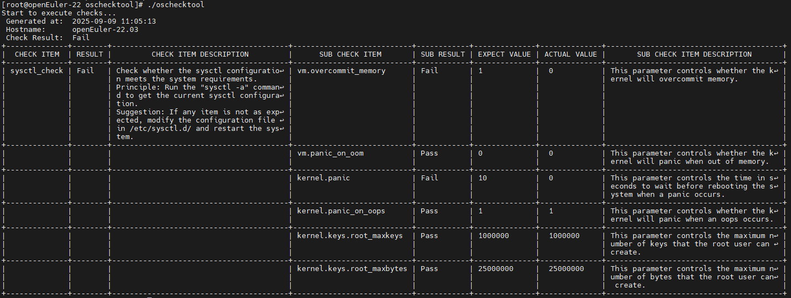
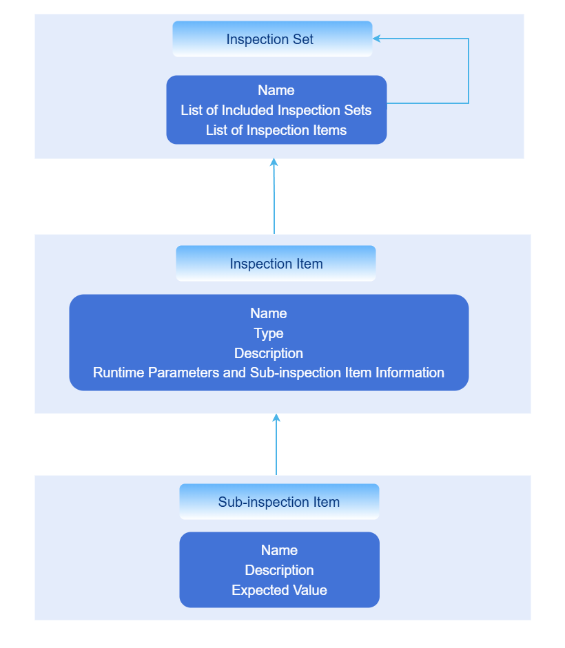

# OS Consistency Check Tool Developer Guide

## Feature Introduction

In container scenarios, various workloads have reduced dependencies on the OS runtime environment. However, the container platform itself has increased OS runtime environment dependencies due to managing more content. oschecktool provides a single-node check tool that checks whether a specific runtime environment meets the container platform's environmental requirements in an openFuyao scenario, to reduce deployment failures or feature failures caused by environmental dependencies.

## Constraints and Limitations

- Only Linux system checks are supported; Windows versions are not supported.
- This tool only performs preliminary analysis of environmental dependencies; analysis results cannot replace actual compatibility testing.
- The check tool requires each component to provide specific check items before it can perform the corresponding checks.
- The check tool must be run with root privileges because it needs to read some system files during the check process.

## Environment Preparation

### Environment Requirements

As a standalone tool, it can run in a general Linux environment.

### Setting Up the Environment

Download the latest version directly from the following links and extract with tar:

[X86_64 Download](https://openfuyao.obs.cn-north-4.myhuaweicloud.com/openFuyao/node-checker/releases/download/latest/oschecktool.tar.gz_linux_amd64)  
[ARM64 Download](https://openfuyao.obs.cn-north-4.myhuaweicloud.com/openFuyao/node-checker/releases/download/latest/oschecktool.tar.gz_linux_arm64)

### Verify Environment Setup

When using the oschecktool, simply run `./oschecktool` in the oschecktool directory. As follows:  
**Figure 1** oschecktool default run result  


When the preset check items can run, the environment setup is successful.

## Use Case: Extending Check Tool Check Items

### Use Case Overview

oschecktool itself only provides some basic check items. Users can extend check items according to their own scenarios to meet their check requirements.

### Check Item Organization Structure

The check tool itself is a standalone tool that runs on the node to be checked, directly outputs check results, and has no context dependencies. It mainly relies on check items for specific check logic.

Check items are located in the tool's conf directory, where:

- The check-items directory contains configuration files for all check items.
- The check-sets directory contains configuration files for all check sets.

The check item organization structure is as follows:

**Figure 2** Check item organization structure  
  
Check sets support nesting to meet the nested association requirements of various components within openFuyao.

### Development Process

1. **Create a check item configuration file**

    Check item configuration file directory: ./conf/check-items/

    Format description:

    ```yaml
    name: sysctl-check
    kind: kv-checker
    doc: |
    Check whether sysctl meets Kubernetes runtime requirements via the sysctl -a command
    spec:
    ...
    ```

    Where:

    - `name`: Check item name, the unique identifier of the check item. The check set references check items via the `name` field; the `name` field is also included in the results.
    - `kind`: Check item type, differentiates different check item types based on the `kind` field.
    - `doc`: Check item description, provides detailed explanation of the check item. The `doc` field is also included in reports; you can provide detailed explanations of the principle in this field.
    - `spec`: Specific parameters for each check item; different `kind` check items have different `spec` structures.

    Currently supported `kind` field values for check items:

    - `kv-checker`: Parses data from a specific source as simple key-value pairs and checks whether a specific key meets expectations; can also be abbreviated as `kv`.
    - `command-checker`: Uses a command as a sub-check item and directly checks the command's output result; can also be abbreviated as `command`.
    - `ping-checker`: Uses the ICMP protocol to check whether a target host is reachable; can also be abbreviated as `ping`.
    - `kernel-module-checker`: Checks kernel module loading status and loading parameters; can also be abbreviated as `kernel-module`.

    **command-checker type check items**

    This check item executes a command and checks the output (stdout and stderr merged). The `spec` field format example is as follows:

    ```yaml
    spec:
    - name: echo command exist  # [Required] Name
      command: which echo && echo "Exist" || echo "Not Exist"
      type: string
      expect: "Exist"
      doc: Check whether the {name} command exists; the configuration process depends on the echo command  
    ```

    `spec` field descriptions:

    - `spec[].name`: [Required] Check item name.
    - `spec[].command`: [Required] The command and parameters to execute; the content of this field will be run as the argument to `sh -c`.
    - `spec[].doc`: [Optional] Output to report as a description.
    - `spec[].type` & `spec[].expect`: [Optional], same as `kv-checker`. If these two fields are not configured, the return value of the command configured by `spec[].command` is used as the judgment (0 for success, non-0 for failure). If configured, the content configured in `spec[].expect` is used to check the command output.

    Where `spec[].type` specifies the type of `spec[].expect`, and `spec[].expect` is the expected result. `spec[].type` supports the following types:  
    - `string`: String type, directly compares whether strings are equal.
    - `regex`: Regular expression type, uses regex to check whether the string matches.
    - `int`: Integer type, checks whether the above output matches the `expect` value numerically.
    - `version-range`: Version type, checks whether the above output is within the `expect` version range. Version numbers use dot-separated numeric format, e.g., 1.1.1; `expect` is an interval, e.g., `(1.2.3, 1.5)` means version greater than 1.2.3 and less than 1.5; `[1.2.3, ]` means version greater than or equal to 1.2.3.
    - `int-range`: Integer range type, checks whether the above output is within the `expect` integer range; `expect` is an interval, e.g., `(1, 10]` means integer greater than 1 and less than or equal to 10.

    **kv-checker type check items**

    This check item parses command output or specific file content as key-value pairs and checks whether specific keys meet expectations. The `spec` field format example is as follows:

    ```yaml
    spec:
      source:  # Specify the data source; supports command and file; each line of data is split into key and value by the splitter
        file:
        - /etc/sysctl.conf
        command:
        - sysctl -a
    
      kvParser: # Optional; specifies how to parse key and value from source. If not specified, defaults to splitting by whitespace. If splitting fails, the line is skipped.
        reSplitter: = # Use this field value as a regular expression to split key, value    
      subItems: # Sub-check items
      - name: kernel.threads-max
        key: kernel.threads-max  # If key is specified, it is used for matching; otherwise name is used directly. key itself supports regex wildcards
        type: int-range  # Integer value range
        expect: "[409600,)"
        doc: Minimum thread count <409600 may cause the system to malfunction
    ```

    Where:

    - `spec.source.file`: [Optional] Specifies the file paths to read; content from multiple files will be merged.
    - `spec.source.command`: [Optional] Specifies command outputs as the subsequent data source; outputs from multiple commands will be merged. If `spec.source.file` is specified, this parameter is ignored.
    - `spec.kvParser`: [Optional] Specifies how to parse key and value from source. If not specified, defaults to splitting by whitespace. If splitting fails, the line is skipped.
    - `spec.kvParser.reGroup`: [Optional] Uses this field value as a regular expression to match each line. The regex must have two or more unnamed groups; if there are more than two matching groups, the last group value is used as the value, and other group values are joined with `-` as the key.
    - `spec.kvParser.reSplitter`: [Optional] Specifies the delimiter for key and value; the delimiter is used as a regular expression. If there are multiple matches, the first match is used for splitting. If `spec.kvParser.reGroup` is specified, this parameter is ignored.
    - `spec.kvParser.reIgnore`: [Optional] Matched lines are ignored and not parsed.
    - `spec.subItems[]`: Specific content to be checked, where `key` matches the previously parsed keys, and `expect` matches the previously parsed values. If `key` is empty, `name` is used as the key. Other fields have the same meaning as same-named fields in `command-checker`.

    **ping-checker type check items**

    This check item uses the ICMP protocol to check whether a target host is reachable. The default is 5 checks, each with a 5-second timeout. Success with 3 or more checks is considered a successful check; otherwise it fails. Supports IPv4 and IPv6. The `spec` field format example is as follows:

    ```yaml
    spec:
      targets: 
      - 192.168.1.1@hostname
    ```

    Where:

    - `spec.targets[]`: List of target hosts to check, in the format `ip@nodeName`. If no node name is specified, the IP is used as the node name by default. The node name is mainly for display in reports.

    **kernel-module-checker type check items**

    This check item parses `/proc/modules` and the `/sys/module` directory to check whether specified kernel modules are loaded and whether their loading parameters meet expectations. The `spec` field format example is as follows:

    ```yaml
    spec:
    - name: ip_vs
      doc: Check whether the ip_vs module is loaded properly
      detail:
      - name: parameters/conn_tab_bits
        expect: "[0, )"
        type: int-range
    - name: not_exist_module
      doc: Test a non-existent module, should fail the check
        
    - name: nf_conntrack
      doc: Test an existing module but with loading parameters that do not meet requirements
      detail:
      - name: parameters/expect_hashsize
        expect: "(, 0)"
        type: int-range
    ```

    Where:

    - `spec[].name`: [Required] Kernel module name.
    - `spec[].doc`: [Optional] Output to report as a description.
    - `spec[].detail[]`: [Optional] Module parameter check items. Each parameter check item is a key-value pair, where key is the parameter path (relative path based on `/sys/module/<module_name>`), `expect` is the expected value, and `type` is the value type. `expect` and `type` have the same meaning as same-named fields in other check items.

    **Extended Parameters**

    Since some parameters can only be determined at runtime, oschecktool supports specifying some extended parameters in check items, which are bound and assigned via the `-p` parameter when running. Example:

    ```yaml
    name: ping_check
    kind: ping
    doc: Simulate checking whether target IPs are reachable; specific targets are entered via the -p parameter
    params:
    - name: ping-addr
      desc: Check whether the target IP is reachable
      multi: true
    spec:
      targets: '{{ping-addr}}'

    ```

    Where:

    - `params[].name`: [Required] Parameter name; valid character range: `A-Za-z0-9_-`.
    - `params[].desc`: [Optional] Description.
    - `params[].multi`: [Optional] Whether it is a multi-value parameter; defaults to false. Multiple values will be set as a string array; a single value will be a string.

    `{{param.name}}` can be used in `spec` to reference parameter values, but only supports completely setting a yaml field to the parameter value.

2. **Define check sets**

    Check sets are used to organize multiple check items together for easy selection. The check set archive directory is `<tool directory>/conf/check-sets`. The check set format example is as follows:

    ```yaml
    name: default
    desc: default check set
    include: 
    - other_check_set
    items:
    - sysctl_check
    ```

    Where:

    - `name`: [Required] Check set name.
    - `desc`: [Optional] Description.
    - `include`: [Optional] Include other check sets; the included check sets will be merged into the current check set, referencing the `name` field of other check sets.
    - `items`: [Optional] Check item list, referencing the `name` field of check items.

3. **Validate check items**

    Run oschecktool and use the `-s` option to specify your new check set: `<tool directory>/oschecktool -s <check set name>`. You can also omit `-s` to run all check items by default.  
    If a check item result is Error, you can analyze the issue based on the logs under `<tool directory>/log`.
