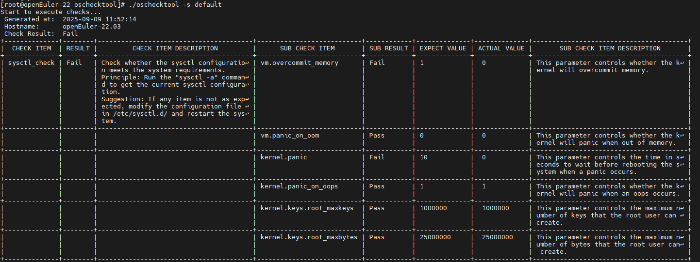

# OS Consistency Check Tool

## Feature Introduction

In container scenarios, workloads have greatly reduced dependencies on the OS runtime environment. However, the container platform itself has increased OS runtime environment dependencies due to managing more content. oschecktool provides a single-node check tool that checks whether a specific runtime environment meets the container platform's environmental requirements in an openFuyao scenario, to reduce deployment failures or feature failures caused by environmental dependencies.

### Use Cases

- Before deploying the openFuyao system on non-officially supported releases, you can use the OS consistency check tool to check whether the current environment meets openFuyao runtime requirements, and modify the environment configuration based on the generated check report to avoid various simple errors during deployment or runtime.
- When encountering unknown issues during deployment or use of the openFuyao system, you can use this tool to perform checks and initially identify the problem, improving resolution efficiency.

### Supported Scope

Provides a tool framework and default check capabilities for checking whether the OS runtime environment meets specific application runtime requirements. Specifically:

- Environment check capabilities:
  - Kernel module loading and loading parameter check capability.
  - Command check capability, able to run a command and check the environment through command output.
  - Simple configuration file check capability (lines parseable as key-value configuration).
  - ICMP network connectivity detection capability.
- Supports generating check reports:
  - Provides csv, yaml, and plain format check reports.
  - Check reports can include specific failure reasons, making it easier to adjust the environment.
- Supports extending the check tool in the form of standalone process plugins:
  - The check tool can be extended in source code form or as a standalone process to meet complex check requirements.
  - Can quickly extend the check tool in simple script form.
- Specific check content can be specified in configuration file form.
  Specific check content can be specified as independent configuration files to allow each openFuyao component to specify its own runtime environment requirements.

The check tool runs as a standalone node tool; besides basic runtime resource consumption, the check process has no impact on the runtime environment.

### Highlights

Consolidates the check logic of all components, avoiding duplicate development and maintenance caused by each component implementing its own. Also facilitates unified environment checking.

### Basic Concepts

- Check item: A specific item checked by the check tool. A check item includes check sub-items; when all sub-item results are successful, the entire check item result is successful; otherwise it fails. Check items are the basic organizational unit of checking and the basic unit of tool extension.
- Check set: A check set is a collection of check items; it can contain multiple check items. A check set can also contain other check sets, in which case the check set includes all check items from its referenced check sets.

### Relationship with Related Features

The check tool only implements the check framework and basic capabilities. Specific check items need to be provided by each component based on their own runtime environment requirements.

## Installation

Download the latest version directly from the following links and extract with tar:

[X86_64 Download](https://openfuyao.obs.cn-north-4.myhuaweicloud.com/openFuyao/node-checker/releases/download/latest/oschecktool_linux_amd64.tar.gz)

[ARM64 Download](https://openfuyao.obs.cn-north-4.myhuaweicloud.com/openFuyao/node-checker/releases/download/latest/oschecktool_linux_arm64.tar.gz)

## Using the OS Consistency Check Tool

### Prerequisites

The tool runs on a single node with no networking required. The tool runtime environment requires the basic `/bin/sh` command.

### Usage Restrictions

- Only Linux system checks are supported; Windows versions are not supported.
- This tool only performs preliminary analysis of environmental dependencies; analysis results cannot replace actual compatibility testing.
- The check tool requires each component to provide specific check items before it can check against that component's usage constraints.
- The check tool must be run with root privileges because it needs to read some system files during the check process.

### Procedure

1. Based on the actual scenario, select the check set to use. Check sets can be obtained with the `-h` command, as follows:

   ```
    [root@openEuler-22 oschecktool]# ./oschecktool -h
    This tool is used to check whether the OS configuration is consistent with a specific check set.
    Usage: ./oschecktool [-s check-set] [-o yaml|csv|plain] [-r report-path] [-p key1=value1[,value2,...]] [-h]
            -h: Print help information
            -o: Specify the report output path. The report file will be generated under this path: CheckReport-{NodeName}-{Time}.format.
            -p: Specify the parameters, format: key1=value1[,value2,...],This parameter can be bound multiple times.
                    No optional parameters.
            -s: Specify the check set to use, if not specified, all check items in the conf/CheckItem directory will be used.
                    Optional check sets:
                            default: default check set
            -t: Specify the output format: yaml, csv, plain, if not specified, plain will be used.

    ```

    The available check sets can be seen under `Optional check sets`.

2. Run the check tool, as follows:
   
   **Figure 1:** Check tool running result
   
   

3. You can adjust the environment based on the check results.

### Related Operations

None.
